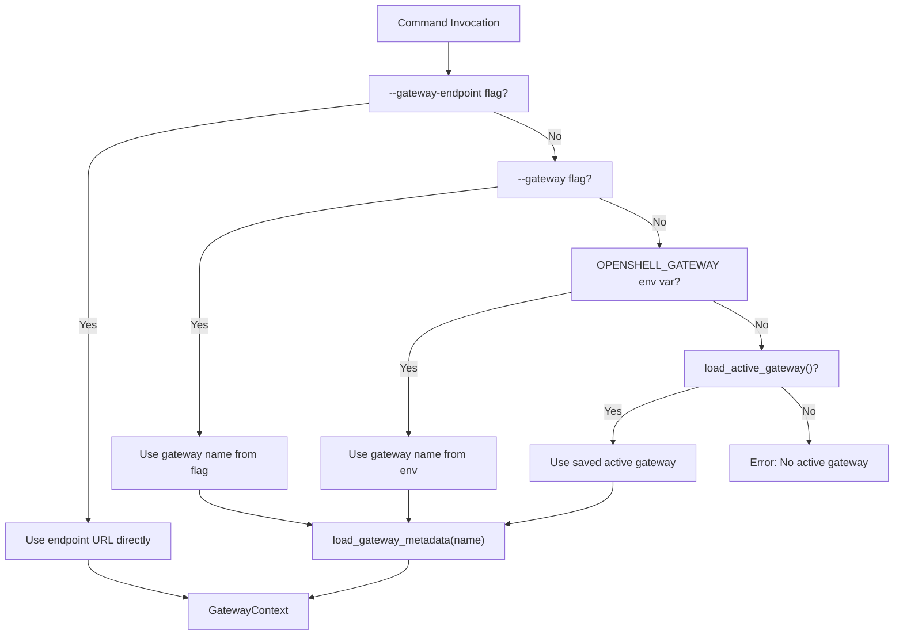
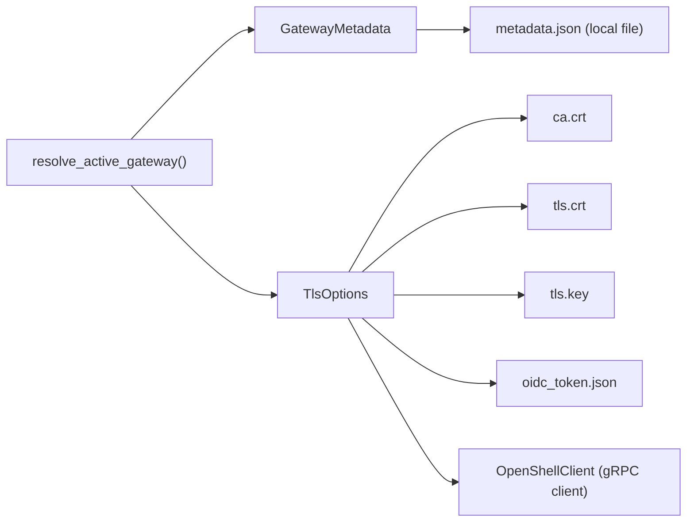
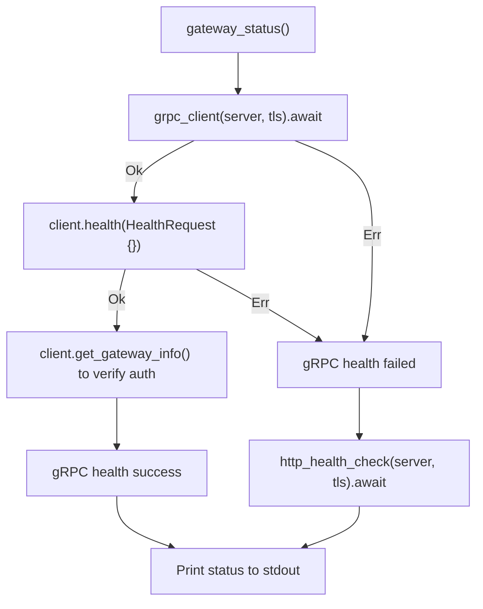

<!-- source: DeepWiki mcp.deepwiki.com · repo NVIDIA/OpenShell · page 4.1 Gateway Commands · fetched 2026-10-26 -->

# Gateway Commands

<details>
<summary>Relevant source files</summary>

The following files were used as context for generating this wiki page:

- [crates/openshell-bootstrap/src/edge_token.rs](crates/openshell-bootstrap/src/edge_token.rs)
- [crates/openshell-bootstrap/src/lib.rs](crates/openshell-bootstrap/src/lib.rs)
- [crates/openshell-bootstrap/src/metadata.rs](crates/openshell-bootstrap/src/metadata.rs)
- [crates/openshell-bootstrap/src/mtls.rs](crates/openshell-bootstrap/src/mtls.rs)
- [crates/openshell-bootstrap/src/oidc_token.rs](crates/openshell-bootstrap/src/oidc_token.rs)
- [crates/openshell-bootstrap/src/paths.rs](crates/openshell-bootstrap/src/paths.rs)
- [crates/openshell-cli/src/color.rs](crates/openshell-cli/src/color.rs)
- [crates/openshell-cli/src/commands/common.rs](crates/openshell-cli/src/commands/common.rs)
- [crates/openshell-cli/src/commands/gateway.rs](crates/openshell-cli/src/commands/gateway.rs)
- [crates/openshell-cli/src/commands/mod.rs](crates/openshell-cli/src/commands/mod.rs)
- [crates/openshell-cli/src/commands/provider_readiness.rs](crates/openshell-cli/src/commands/provider_readiness.rs)
- [crates/openshell-cli/src/completers.rs](crates/openshell-cli/src/completers.rs)
- [crates/openshell-cli/src/lib.rs](crates/openshell-cli/src/lib.rs)
- [crates/openshell-cli/src/oidc_auth.rs](crates/openshell-cli/src/oidc_auth.rs)
- [crates/openshell-cli/src/test_utils.rs](crates/openshell-cli/src/test_utils.rs)
- [crates/openshell-cli/src/tls.rs](crates/openshell-cli/src/tls.rs)
- [crates/openshell-cli/tests/cli_color_integration.rs](crates/openshell-cli/tests/cli_color_integration.rs)

</details>


This page documents the gateway management commands available through the `openshell gateway` CLI group. These commands allow users to register, list, select, authenticate with, inspect, and check the health status of gateways. Gateways serve as the control plane endpoints for managing sandboxes and other OpenShell resources.

---

## Command Overview

The key gateway management commands within the CLI are:

| Command          | Purpose                                         | Description                                                                                 |
|------------------|------------------------------------------------|---------------------------------------------------------------------------------------------|
| `add`            | Register a gateway                              | Adds metadata for an already running gateway, storing connection and authentication info.  |
| `list`           | List registered gateways                        | Displays gateways registered via metadata on the local filesystem.                         |
| `use`            | Alias for `select`                             | Sets the default gateway by updating local active gateway state.                           |
| `login`          | Authenticate with a gateway                     | Executes authentication (OIDC, Edge token) and stores credentials.                         |
| `info`           | Show detailed gateway information              | Queries gateway metadata and runtime status including extensions and compute drivers.      |
| `status`         | Check gateway health and connectivity          | Performs gRPC and HTTP health probes to report gateway availability and authentication.    |
| `select`         | Set the active gateway                          | Saves the selected gateway as the CLI's active target for subsequent commands.             |

These commands are implemented in the CLI crate under `crates/openshell-cli/src/commands/gateway.rs`, interacting closely with gateway metadata utilities (`openshell-bootstrap`) and TLS/authentication helpers (`openshell-cli/src/tls.rs`, `openshell-cli/src/oidc_auth.rs`).

---

## Gateway Resolution

Many CLI commands require resolving which gateway to target. The resolution logic follows this priority:

1. **`--gateway-endpoint` flag:** Use the explicit endpoint URL.
2. **`--gateway` flag:** Use the explicit gateway name and lookup metadata.
3. **`OPENSHELL_GATEWAY` environment variable:** Use the gateway name specified in env var.
4. **Active gateway:** Load the default active gateway saved in user config.

If none is provided or loaded, an error is raised indicating no active gateway is set.

### Implementation Logic Diagram



This resolution applies throughout the CLI, enabling commands to build a `GatewayContext` with endpoint URL and authentication materials ready for network calls.

*Sources:*  
[crates/openshell-cli/src/tls.rs:127-149]()  
[crates/openshell-cli/src/completers.rs:121-130]()  
[crates/openshell-bootstrap/src/metadata.rs:94-120]()

---

## Gateway Metadata and Authentication Context

The CLI stores gateway metadata locally to resolve connection parameters and authentication modes. The core metadata is defined in the struct `GatewayMetadata`:

```rust
pub struct GatewayMetadata {
    pub name: String,
    pub gateway_endpoint: String,
    pub is_remote: bool,
    pub gateway_port: u16,
    pub remote_host: Option<String>,
    pub resolved_host: Option<String>,
    pub auth_mode: Option<String>,          // e.g., "mtls", "oidc", "cloudflare_jwt"
    pub edge_team_domain: Option<String>,
    pub edge_auth_url: Option<String>,
    pub oidc_issuer: Option<String>,
    pub oidc_client_id: Option<String>,
    pub oidc_audience: Option<String>,
    pub oidc_scopes: Option<String>,
    pub vm_driver_state_dir: Option<PathBuf>,
}
```

The metadata is persisted as `metadata.json` under user or system config directories, e.g., `~/.config/openshell/gateways/<name>/metadata.json`.

### Authentication Modes

- **mTLS (mutual TLS):** Default for local gateways; client certificates are loaded from the `mtls` directory (`ca.crt`, `tls.crt`, `tls.key`).
- **OIDC (OpenID Connect):** Tokens stored in `oidc_token.json`. The CLI handles token refresh and interactive login flows.
- **Cloudflare JWT:** Used when behind Cloudflare edge proxy; tokens loaded from edge token storage.

### Security Material Flow



This flow ensures that the CLI can authenticate and securely connect to the gateway using the correct credentials based on `auth_mode`.

*Sources:*  
[crates/openshell-bootstrap/src/metadata.rs:13-74]()  
[crates/openshell-cli/src/tls.rs:117-150]()  
[crates/openshell-cli/src/completers.rs:120-180]()

---

## Command Details

### `gateway add`

Registers a new gateway by writing metadata locally without creating the infrastructure itself. Used for gateways running externally or remotely.

- Validates and persists a `GatewayMetadata` instance to the user's gateways directory.
- Resolves SSH aliases (for remote hosts) using `ssh -G` calls to map to reachable hostnames.
- Allows configuring auth modes (`mtls`, `oidc`, or `cloudflare_jwt`).

This command enables the CLI to recognize and connect to gateways created outside the CLI lifecycle.

*Sources:*  
[crates/openshell-bootstrap/src/metadata.rs:108-177]()  
[crates/openshell-bootstrap/src/lib.rs:22-28]()  
[crates/openshell-cli/src/commands/gateway.rs:16-21]()

---

### `gateway list`

Lists gateways from the local registry, showing name, endpoint, authentication mode, and source (user or system).

- Reads metadata from both user and system directories.
- Displays gateway names with origin and current selection indicator.
- Supports filtering and formatting (JSON or human-readable).

*Sources:*  
[crates/openshell-bootstrap/src/lib.rs:22-28]()  
[crates/openshell-bootstrap/src/metadata.rs:95-98]()  
[crates/openshell-cli/src/commands/gateway.rs:16-21]()

---

### `gateway use` / `gateway select`

Sets the active gateway by saving the specified gateway name in the active gateway file.

- Validates the gateway exists in the registry before saving.
- Saves active gateway info using `save_active_gateway(name)`.
- Subsequent CLI commands resolve against this active gateway automatically.

*Sources:*  
[crates/openshell-bootstrap/src/lib.rs:22-28]()  
[crates/openshell-bootstrap/src/metadata.rs:108-120]()  
[crates/openshell-bootstrap/src/lib.rs:23]()

---

### `gateway login`

Performs authentication against the selected gateway.

- Supports OIDC flows including Authorization Code + PKCE (interactive browser-based login).
- Stores OIDC tokens with expiration metadata.
- Supports token refresh, and one-shot "fresh login" prompting.
- Supports Edge authentication token loading and storage.
- Ensures subsequent CLI gRPC clients attach correct bearer tokens or client certs.

*Typical OIDC Flow (simplified):*
1. Fetch discovery document from `<issuer>/.well-known/openid-configuration`.
2. Start local HTTP server to receive auth code redirect.
3. Construct PKCE challenge and open browser for user login.
4. Exchange authorization code for tokens, store tokens.
5. Use tokens for subsequent gateway calls.

*Sources:*  
[crates/openshell-cli/src/oidc_auth.rs:71-206]()  
[crates/openshell-bootstrap/src/oidc_token.rs:16-125]()  
[crates/openshell-cli/src/completers.rs:138-168]()

---

### `gateway info`

Retrieves detailed gateway information and runtime status:

- Queries the gateway's `GetGatewayInfo` gRPC endpoint.
- Displays protocol versions, extensions, compute drivers, and versions.
- Reports authentication mode and cluster role information.

This command is read-only and does not alter any state.

*Sources:*  
[crates/openshell-cli/src/commands/gateway.rs:28-60]()

---

### `gateway status`

Performs a comprehensive health and status check on the gateway:

1. Attempts to connect with gRPC health check (`Health` RPC).
2. Verifies authentication by calling `GetGatewayInfo`.
3. On gRPC failure, falls back to performing HTTP health check on the gateway's endpoint.
4. Reports connection state, version, error messages, and authentication status.
5. Prints information in human-readable or JSON output.

### Flow Overview



*Sources:*  
[crates/openshell-cli/src/commands/gateway.rs:64-190]()

---

### `gateway select` vs `gateway use`

The `use` command is effectively an alias for `select` and updates which gateway the CLI uses as the default. Both commands:

- Validate the gateway name exists.
- Persist the selection in the active gateway configuration file.
- Affect command behaviors without explicit gateway flags.

*Sources:*  
[crates/openshell-bootstrap/src/lib.rs:22-28]()

---

# Summary

The gateway commands enable managing gateway registrations and connectivity within the CLI. They provide:

- Local registration via `add`.
- Discovery and resolution of active gateway for CLI commands.
- Authentication handling via OIDC or mTLS.
- Status and info inspection using gRPC and HTTP probing.

The modular design separates metadata storage (`openshell-bootstrap`), TLS/authentication (`openshell-cli/src/tls.rs`, `oidc_auth.rs`) and command logic (`openshell-cli/src/commands/gateway.rs`), affording extensibility and robustness.

---

# References and Sources

- [crates/openshell-bootstrap/src/lib.rs:22-28]()  
- [crates/openshell-bootstrap/src/metadata.rs:1-181]()  
- [crates/openshell-cli/src/commands/gateway.rs:1-190]()  
- [crates/openshell-cli/src/tls.rs:1-197]()  
- [crates/openshell-cli/src/completers.rs:1-131]()  
- [crates/openshell-cli/src/oidc_auth.rs:1-206]()  
- [crates/openshell-bootstrap/src/oidc_token.rs:1-140]()

---

