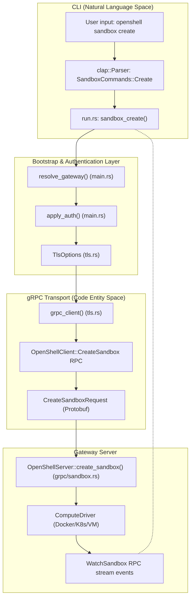
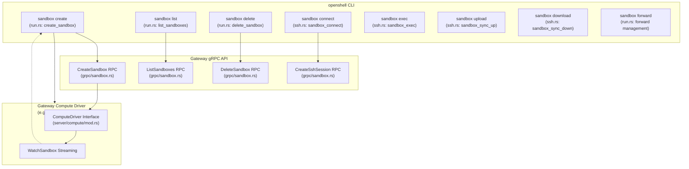

<!-- source: DeepWiki mcp.deepwiki.com · repo NVIDIA/OpenShell · page 4.2 Sandbox Commands · fetched 2026-10-26 -->

# Sandbox Commands

<details>
<summary>Relevant source files</summary>

The following files were used as context for generating this wiki page:

- [crates/openshell-cli/src/main.rs](crates/openshell-cli/src/main.rs)
- [crates/openshell-cli/src/run.rs](crates/openshell-cli/src/run.rs)
- [crates/openshell-cli/tests/provider_commands_integration.rs](crates/openshell-cli/tests/provider_commands_integration.rs)
- [crates/openshell-cli/tests/sandbox_create_lifecycle_integration.rs](crates/openshell-cli/tests/sandbox_create_lifecycle_integration.rs)
- [crates/openshell-cli/tests/sandbox_upload_integration.rs](crates/openshell-cli/tests/sandbox_upload_integration.rs)
- [crates/openshell-conformance/src/scenarios/file_transfer.rs](crates/openshell-conformance/src/scenarios/file_transfer.rs)
- [crates/openshell-server/src/compute/mod.rs](crates/openshell-server/src/compute/mod.rs)
- [crates/openshell-server/src/grpc/policy.rs](crates/openshell-server/src/grpc/policy.rs)
- [crates/openshell-server/src/grpc/provider.rs](crates/openshell-server/src/grpc/provider.rs)
- [crates/openshell-server/src/grpc/sandbox.rs](crates/openshell-server/src/grpc/sandbox.rs)
- [crates/openshell-server/src/storage_proto.rs](crates/openshell-server/src/storage_proto.rs)
- [docs/upgrade/0-1-0.mdx](docs/upgrade/0-1-0.mdx)
- [proto/openshell.proto](proto/openshell.proto)
- [sdk/go/proto/openshellv1/openshell.pb.go](sdk/go/proto/openshellv1/openshell.pb.go)

</details>


OpenShell provides a comprehensive CLI command set to manage the lifecycle, execution, file synchronization, and port forwarding of isolated sandboxes. These commands use the OpenShell Gateway's gRPC API for control-plane operations and a specialized SSH-over-HTTPS proxy for data-plane interactions.

## Command Overview

The `openshell sandbox` command group supports the following primary operations:

| Command | Purpose | Implementation Details |
| :--- | :--- | :--- |
| `create` | Provision and start a new sandbox | `CreateSandbox` gRPC call plus `WatchSandbox` streaming RPC updates [crates/openshell-cli/src/run.rs:46-63]() |
| `connect` | Open an interactive shell session | SSH-over-HTTPS CONNECT proxy implemented in `sandbox_connect` [crates/openshell-cli/src/ssh.rs:76-79]() |
| `list` | List all sandboxes visible to the user | `ListSandboxes` gRPC call [crates/openshell-cli/src/run.rs:55-55]() |
| `delete` | Delete one or more sandboxes | `DeleteSandbox` gRPC call [crates/openshell-cli/src/run.rs:49-49]() |
| `exec` | Run a single command inside sandbox | SSH exec command through `sandbox_exec` [crates/openshell-cli/src/ssh.rs:77]() |
| `upload` | Upload files/directories to sandbox | `sandbox_sync_up` using tar-over-SSH [crates/openshell-cli/src/ssh.rs:78]() |
| `download` | Download files/directories from sandbox | `sandbox_sync_down` using tar-over-SSH [crates/openshell-cli/src/ssh.rs:78]() |
| `forward` | Manage local port forwards to sandbox services | SSH port forwards managed with persistence [crates/openshell-cli/src/run.rs:80-82]() |

**Sources:**  
[crates/openshell-cli/src/run.rs:46-63](), [crates/openshell-cli/src/ssh.rs:76-79](), [crates/openshell-cli/src/main.rs:15-22]()

---

## Command Execution Flow

The CLI translates user commands into structured calls that interact with the Gateway API and underlying compute drivers. For example, sandbox creation involves layered steps from validation, authentication, to streaming status.

### Sandbox Creation Flow



This diagram depicts the full authentication and request lifecycle via the CLI and Gateway.

**Sources:**  
[crates/openshell-cli/src/main.rs:78-126](), [crates/openshell-cli/src/run.rs:46-63](), [crates/openshell-cli/src/run.rs:38](), [proto/openshell.proto:46-53]()  

---

## `sandbox create`

The `create` command provisions a new sandbox instance according to provided specifications such as CPU, memory, GPU, environment variables, and base image/template references.

### Lifecycle and Progress Reporting

- The CLI sends a `CreateSandboxRequest` containing a detailed `SandboxSpec` over gRPC to the Gateway server [crates/openshell-cli/src/run.rs:46-63]().
- After submission, the CLI listens on a `WatchSandboxRequest` streaming endpoint to receive real-time lifecycle events and status updates, including image pulls and provisioning details [crates/openshell-cli/src/run.rs:61]().
- Progress bars and user-friendly messages are provided via an interactive display abstraction for provisioning stages [crates/openshell-cli/src/run.rs:118-136]().
- If provisioning exceeds configured timeouts or ready conditions are false, helpful error messages guide users [crates/openshell-cli/src/run.rs:10-18]().

### Key Options and Parameters

- `--from`: Specifies the sandbox base image or template. Short aliases like `base` resolve to the community registry by default.
- `--gpu`: Requests GPU resources. CLI parses numeric GPU counts or the default driver preference and encodes them into `GpuResourceRequirements` protobuf [crates/openshell-cli/src/main.rs:128-141]().
- `--driver-config-json`: Passes backend-specific driver configuration as JSON objects keyed per driver (e.g., Kubernetes RuntimeClass). This is forwarded inside the sandbox spec [docs/sandboxes/manage-sandboxes.mdx:83-100]().

**Sources:**  
[crates/openshell-cli/src/run.rs:46-63](), [crates/openshell-cli/src/main.rs:128-141](), [proto/openshell.proto:48-50]()  

---

## `sandbox connect`

The `connect` command opens an interactive shell session inside an existing sandbox, using a specialized SSH proxy tunnel over HTTPS CONNECT.

### SSH Proxy Architecture

OpenShell encapsulates SSH sessions inside HTTP CONNECT tunnels to enable firewall traversal, authentication, and tunneling over mTLS-secured HTTPS.

```mermaid
flowchart LR
    subgraph LOCAL["Local Machine (CLI)"]
        SSH["/usr/bin/ssh"]
        PROXY["openshell ssh-proxy"]
    end

    subgraph GATEWAY["Gateway (Proxy)"]
        CONNECT["HTTPS CONNECT Tunnel<br/>(Invoke CreateSshSession RPC)"]
        AUTH["Token & mTLS Authentication (OIDC/Cloudflare)"]
    end

    subgraph SANDBOX["Sandbox (Runtime)"]
        SSHD["openshell-sandbox Supervisor SSHD"]
    end

    SSH -->|stdin/stdout| PROXY
    PROXY -->|HTTP CONNECT| CONNECT
    CONNECT -->|Verify identity via apply_auth()| AUTH
    AUTH -->|SSH connection routed to SSHD| SSHD
```

- The CLI initiates a `CreateSshSession` RPC to the Gateway to receive a session token and connect endpoint [crates/openshell-cli/src/ssh.rs:82-125]().
- SSH command line options are crafted for the proxy, setting keepalives and disabling host key checks to improve reliability [crates/openshell-cli/src/ssh.rs:167-184]().
- Supports special editors via `--editor` flag (`vscode`, `cursor`), resolved to respective binaries using an `Editor` enum abstraction [crates/openshell-cli/src/ssh.rs:49-72]().

**Sources:**  
[crates/openshell-cli/src/ssh.rs:76-184]()  

---

## File Synchronization (`upload` and `download`)

OpenShell supports efficient, bidirectional file transfers between the local CLI and sandboxes by streaming `tar` archives over the SSH session.

### Tar-over-SSH Protocol

- **Upload:**  
  Uses `tar -cf -` client-side streamed into the sandbox via `tar -xf -` on the server, tunneled over SSH. Implemented in `sandbox_sync_up` [crates/openshell-cli/src/ssh.rs:78]().

- **Download:**  
  Invokes `tar -cf -` within the sandbox and streams out to the local filesystem using `sandbox_sync_down` [crates/openshell-cli/src/ssh.rs:78]().

- **Git Integration:**  
  Upload commands detect whether the upload directory is inside a Git repo and apply `.gitignore` filters to exclude unnecessary files unless explicitly overridden. The `SandboxUploadPlan` enum distinguishes `GitAware` and `Regular` uploads [crates/openshell-cli/src/run.rs:104-110]().

**Sources:**  
[crates/openshell-cli/src/ssh.rs:76-79](), [crates/openshell-cli/src/run.rs:104-110]()  

---

## Port Forwarding (`forward`)

OpenShell enables SSH-based TCP port forwarding to expose sandbox services on the local machine.

- SSH port forwards are managed as background processes with PID files stored in a dedicated directory indexed by sandbox ID and bind address [crates/openshell-core/src/forward.rs:21-47]().
- The CLI supports starting and stopping forwards. When a sandbox is deleted, all associated forwards are stopped automatically using `stop_forwards_for_sandbox` [crates/openshell-cli/src/run.rs:80-82]().
- Forward existence is tracked by matching running processes to recorded PIDs and command lines via `find_ssh_forward_pid` [crates/openshell-core/src/forward.rs:52-66]().

**Sources:**  
[crates/openshell-core/src/forward.rs:21-112](), [crates/openshell-cli/src/run.rs:80-82]()  

---

## Management and Context Handling

### List and Delete

- The `list` command fetches sandbox descriptors using the `ListSandboxesRequest` gRPC call.
- The `delete` command deletes sandboxes by name via `DeleteSandboxRequest`. If the deleted sandbox matches the CLI's "last used" sandbox marker, that marker is cleared via `clear_last_sandbox_if_matches` helper [crates/openshell-cli/src/run.rs:42-44]().
- The CLI stores and resolves the "last used" sandbox name to simplify commands that omit the sandbox name.

### Gateway and Sandbox Context Resolution

- The CLI resolves gateways using `resolve_gateway` which considers the command-line flags, environment variables, and active gateway metadata files [crates/openshell-cli/src/main.rs:78-126]().
- When a sandbox is successfully created, its name is saved as the default for subsequent `sandbox` commands using `save_last_sandbox` [crates/openshell-cli/src/run.rs:42-44]().

**Sources:**  
[crates/openshell-cli/src/run.rs:42-63](), [crates/openshell-cli/src/main.rs:78-126](), [proto/openshell.proto:64-71]()

---

# Summary Diagram: Sandbox Commands to Code Entities



This diagram maps CLI commands in the natural language domain to their implementation through gRPC calls and the underlying compute driver interfaces.

---

# Detailed Components and Data Flow

### Key Functions and Files

- `sandbox_create()` in `crates/openshell-cli/src/run.rs` implements sandbox creation including request preparation, gateway resolution, authentication application, RPC submission, and watch stream consumption [crates/openshell-cli/src/run.rs:46-63]().

- `sandbox_connect()` in `crates/openshell-cli/src/ssh.rs` manages SSH session establishment via the HTTPS CONNECT tunnel, including token acquisition, ssh arguments construction, and invoking user SSH [crates/openshell-cli/src/ssh.rs:76-79]().

- `sandbox_sync_up()` and `sandbox_sync_down()` in `crate/openshell-cli/src/ssh.rs` implement the tar streaming upload/download over SSH to the sandbox [crates/openshell-cli/src/ssh.rs:78]().

- Underlying gRPC service handlers such as `create_sandbox()` reside in `crates/openshell-server/src/grpc/sandbox.rs`. This acts as the gateway control-plane for lifecycle, streaming status events, and managing compute drivers [crates/openshell-server/src/grpc/sandbox.rs:23-160]().

**Sources:**  
[crates/openshell-cli/src/run.rs:46-63](), [crates/openshell-cli/src/ssh.rs:76-79](), [crates/openshell-server/src/grpc/sandbox.rs:10-160]()  

---

# Summary

This page extensively details the OpenShell CLI sandbox command group implementation, their data flow, and key components:

- User commands are parsed by Clap then handled in `crates/openshell-cli/src/run.rs` or `ssh.rs`.
- Gateway contexts are resolved for connection consistency via metadata and environment variables.
- The Gateway gRPC API (`OpenShell` service) exposes lifecycle methods for sandboxes.
- File synchronization uses efficient tar-over-SSH protocol tunneled through authenticated HTTPS CONNECT.
- Interactive shell sessions flow through the SSH proxy leveraging short-lived session tokens.
- Port forwarding is managed as background SSH processes tracked via persistent PID files.
- The entire lifecycle is augmented with progress streams, timeouts, and status messages for user feedback.

With this architecture, OpenShell enables secure, authenticated, and fully featured sandbox management suitable for AI agent runtime environments.

---

**Sources:**  
- [crates/openshell-cli/src/run.rs:1-167]()  
- [crates/openshell-cli/src/ssh.rs](https://github.com/NVIDIA/OpenShell/tree/main/crates/openshell-cli/src/ssh.rs) (referenced)  
- [crates/openshell-cli/src/main.rs:15-187]()  
- [crates/openshell-server/src/grpc/sandbox.rs:1-160]()  
- [crates/openshell-core/src/forward.rs:21-112]()  
- [proto/openshell.proto:23-200]()

---

