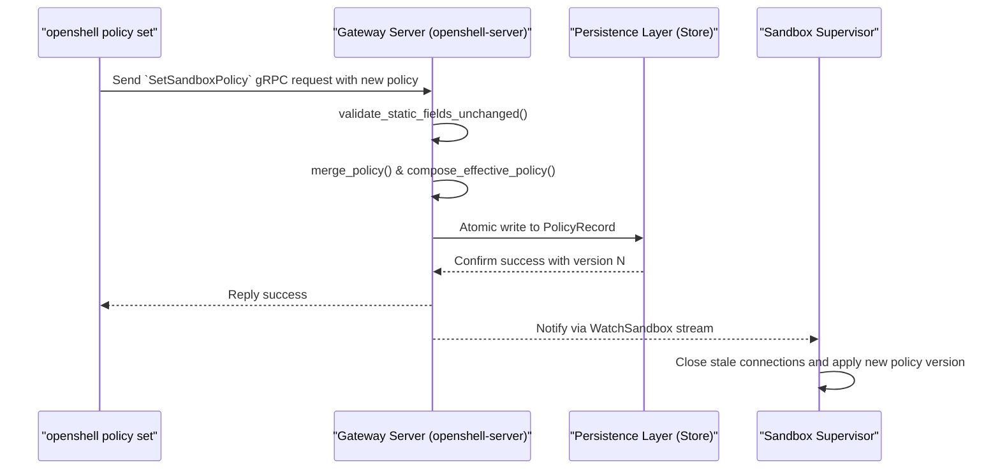
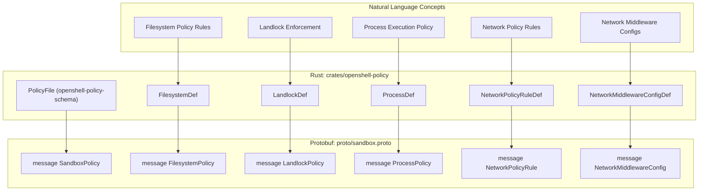
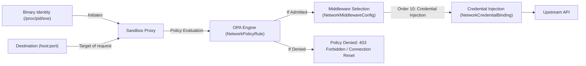

<!-- source: DeepWiki mcp.deepwiki.com · repo NVIDIA/OpenShell · page 4.3 Policy and Settings Commands · fetched 2026-10-26 -->

# Policy and Settings Commands

<details>
<summary>Relevant source files</summary>

The following files were used as context for generating this wiki page:

- [crates/openshell-core/src/net.rs](crates/openshell-core/src/net.rs)
- [crates/openshell-core/src/settings.rs](crates/openshell-core/src/settings.rs)
- [crates/openshell-ocsf/Cargo.toml](crates/openshell-ocsf/Cargo.toml)
- [crates/openshell-ocsf/src/enums/activity.rs](crates/openshell-ocsf/src/enums/activity.rs)
- [crates/openshell-ocsf/src/enums/device_type.rs](crates/openshell-ocsf/src/enums/device_type.rs)
- [crates/openshell-ocsf/src/enums/mod.rs](crates/openshell-ocsf/src/enums/mod.rs)
- [crates/openshell-ocsf/src/format/shorthand.rs](crates/openshell-ocsf/src/format/shorthand.rs)
- [crates/openshell-ocsf/src/lib.rs](crates/openshell-ocsf/src/lib.rs)
- [crates/openshell-ocsf/src/objects/device.rs](crates/openshell-ocsf/src/objects/device.rs)
- [crates/openshell-ocsf/src/objects/http.rs](crates/openshell-ocsf/src/objects/http.rs)
- [crates/openshell-ocsf/src/objects/metadata.rs](crates/openshell-ocsf/src/objects/metadata.rs)
- [crates/openshell-ocsf/src/validation/mod.rs](crates/openshell-ocsf/src/validation/mod.rs)
- [crates/openshell-ocsf/src/validation/schema.rs](crates/openshell-ocsf/src/validation/schema.rs)
- [crates/openshell-ocsf/tests/event_identity.rs](crates/openshell-ocsf/tests/event_identity.rs)
- [crates/openshell-policy/src/lib.rs](crates/openshell-policy/src/lib.rs)
- [crates/openshell-policy/src/merge.rs](crates/openshell-policy/src/merge.rs)
- [crates/openshell-providers/src/profiles.rs](crates/openshell-providers/src/profiles.rs)
- [crates/openshell-sandbox/src/mechanistic_mapper.rs](crates/openshell-sandbox/src/mechanistic_mapper.rs)
- [docs/observability/ocsf-json-export.mdx](docs/observability/ocsf-json-export.mdx)
- [e2e/python/test_sandbox_policy.py](e2e/python/test_sandbox_policy.py)
- [proto/sandbox.proto](proto/sandbox.proto)
- [tasks/ci.toml](tasks/ci.toml)
- [tasks/python.toml](tasks/python.toml)
- [tasks/rust.toml](tasks/rust.toml)
- [tasks/typescript.toml](tasks/typescript.toml)

</details>


This section describes the CLI commands and internal implementations related to managing sandbox policies and configuring settings in OpenShell. It focuses on the handling of declarative security policies for running sandboxes and the usage of settings channels for applying global and per-sandbox configuration overrides.

---

## Purpose and Scope

OpenShell employs a policy-driven security model to govern sandbox isolation boundaries and network access. Policies consist of immutable static components (e.g., filesystem and process execution constraints) set at sandbox creation, and dynamic components (network rules, middleware configuration) that can be updated live. The commands covered here enable operators to list, retrieve, update, and incrementally modify sandbox policies.

In addition, OpenShell exposes a **settings channel** interface supporting top-level global and sandbox-scoped runtime configuration parameters beyond policies — such as toggling OCSF JSON export or other behavioral flags — managed through similar get/set mechanisms.

This page covers the CLI commands `policy get/set/list/update`, the underlying gRPC and persistence layer interactions, and the architectural principles behind configuration scoping and dynamic reloads.

---

## Policy Commands Overview

OpenShell's sandbox policies are expressed in a canonical YAML schema which is programmatically converted to/from Protobuf messages exchanged between CLI, Gateway, and Sandbox Supervisor components. The policy structure includes:

- **Static configurations** such as:
  - Filesystem access (`FilesystemPolicy`)
  - Kernel Landlock enforcement (`LandlockPolicy`)
  - Process user/group constraints (`ProcessPolicy`)

- **Dynamic, runtime-modifiable configurations** such as:
  - Network access rules (`NetworkPolicyRule`)
  - Supervisor network middlewares (`NetworkMiddlewareConfig`)

> Static fields are immutable after sandbox creation; changing them requires sandbox recreation. Dynamic fields support hot reload by the supervisor.

### Core Commands

| Command                      | Description                                                          |
| ---------------------------- | -------------------------------------------------------------------- |
| `openshell policy get`       | Retrieve current policy revision and status, optionally by version.  |
| `openshell policy set`       | Replace the dynamic parts of the sandbox policy atomically.           |
| `openshell policy list`      | Show the revision history of policy updates for a sandbox.           |
| `openshell policy update`    | Perform incremental merges (add/remove rules) for fine-grained edits.|
| `openshell policy prove`     | Formally verify policies using SMT solver against credentials.       |

---

## Policy Command Details

### `openshell policy get`

- Retrieves the current known active sandbox policy.
- Can request a specific revision (`--rev` flag) or full YAML output (`--full`).
- The underlying RPC fetches the `PolicyRecord` from persistent storage (`Store`) and returns the policy along with metadata.
- Supports filtering out provider-injected rules to show base user policy only (`--base`).

**Key Functionality:**
- Gateway grpc handler fetches cache or DB: see `crates/openshell-server/src/grpc/policy.rs` [lines 18-20]().

---

### `openshell policy set`

- Pushes a new policy to the running sandbox, replacing its dynamic config.
- Validates no static fields change (`filesystem`, `landlock`, `process`) to maintain sandbox integrity.
- Hot reload is enabled by forwarding the updated network policies and middleware configs to the supervisor.
- Gateway calls policy validation routines to guarantee correctness before applying.

**Key Flows:**



- Hot restart of network policies triggers immediate supervisor enforcement via generation changes [docs/sandboxes/policies.mdx:64-65]().

---

### `openshell policy update`

- Supports incremental policy updates via `PolicyMergeOperation` requests.
- Applies additive or subtractive changes to network rules without replacing the whole policy.
- Implemented with optimistic concurrency and retries (`MERGE_RETRY_LIMIT=5`) on resource version conflicts.
- Uses `merge_policy()` from the `openshell-policy` crate to generate the new effective policy state.

**Retry Loop Pseudocode:**

```mermaid
sequenceDiagram
    participant Gateway as "Gateway Server"

    rect rgb(230,230,230)
    loop Up to MERGE_RETRY_LIMIT times
        Gateway->>Gateway: Fetch current policy version from Store
        Gateway->>Gateway: merge_policy(base=current, change=update)
        alt merge success
            Gateway->>Store: AtomicPolicyRevisionWrite(updated_policy)
            break
        else conflict
            continue
        end
    end
    end
```

- Returns detailed errors on ambiguous rules or validation failures.

---

## Policy Revision History (`policy list`)

- Shows the indexed incremental history of all applied policy versions for a sandbox.
- Sources for this data are the `PolicyRecord` entries persisted in the gateway's backing store (e.g., SQLite or Postgres).
- Useful for audit, rollback, and troubleshooting.

---

## Settings Channel Commands

Besides policies, OpenShell uses the `settings` command group to manage runtime configuration flags scoped globally or per sandbox. Settings are small key-value pairs controlling optional features such as:

- Enabling OCSF JSON audit export.
- Toggling sandbox diagnostic modes.
- Overriding default behavior flags.

Settings follow the same model of scoped storage and polling for updates, with fast asynchronous propagation based on watcher streams. Applying settings requires no sandbox restart.

**Example usage:**

```shell
# Enable OCSF JSON export globally:
openshell settings set --global --key ocsf_json_enabled --value true

# Enable OCSF JSON export for a named sandbox only:
openshell settings set my-sandbox --key ocsf_json_enabled --value true

# Get the current setting value:
openshell settings get my-sandbox --key ocsf_json_enabled
```

---

## Data Flow and Key Components

### 1. CLI Client

- Issues gRPC calls to the gateway for `policy get/set/list/update` and `settings get/set/list`.
- Serializes/deserializes Protobuf policy and settings messages.
- Users interact via YAML or flags for policy editing and configuration.

### 2. Gateway Server (`openshell-server`)

- Maintains authoritative state for all sandboxes, policies, and settings.
- Validates policies with static checks (`validate_static_fields_unchanged`) and OPA integration.
- Stores policies atomically via the `Store` abstraction.
- Sends update notifications to sandbox supervisors via watch streams.
- Applies concurrency control and retries during policy merges.

### 3. Persistence Layer (`Store`)

- Provides atomic operations, revision indexing, and full revision history.
- Backed by SQLite or PostgreSQL databases.
- Maintains a consistent view for policy versions and setting changes.

### 4. Sandbox Supervisor (`openshell-sandbox`)

- Watches for policy and settings change notifications from the gateway.
- On receiving a new policy generation, it closes stale network and L7 inspection connections to enforce the new policy state immediately.
- Applies dynamic policy changes without sandbox restart for network rules and middleware.
- Reports status updates back to the gateway.

---

## Code Entity Mapping: Policy System

This diagram bridges the high-level natural language policy components to their Rust crate structs and Protobuf message representations.



**Sources:** [crates/openshell-policy/src/lib.rs:4-69](), [proto/sandbox.proto:19-36]()

---

## Dynamic Enforcement and Middleware Flow

Network policies can include dynamic middleware configurations which apply layered inspection, denial, credential injection, or redaction to egress requests. These operate at runtime, supporting multi-stage filtering in defined order.



Middleware `order` field determines execution sequence; `include` and `exclude` fields specify host patterns for selective application.

---

## Static vs Dynamic Policy Scopes

| Policy Component          | Immutable? | Scope        | Description                          |
|--------------------------|------------|--------------|------------------------------------|
| FilesystemPolicy         | Yes        | Sandbox-level | Read/write and RO directories       |
| LandlockPolicy           | Yes        | Sandbox-level | Linux Landlock kernel sandboxing    |
| ProcessPolicy            | Yes        | Sandbox-level | User and group to run processes     |
| NetworkPolicyRule        | No         | Sandbox-level | Network endpoint access rules       |
| NetworkMiddlewareConfig  | No         | Sandbox-level | Config for network egress middleware|

---


## Summary

- Policies have immutable sandbox-scoped static components set at creation.
- Dynamic rules and middleware configs can be safely hot-updated at runtime.
- The Gateway server manages policy persistence, validation, and orchestrates propagation.
- The supervisor watches for changes and applies them immediately to network enforcement layers.
- Settings provide an analogous channel for runtime feature toggles, scoped globally or at sandbox level.

---

## References and Sources

- [crates/openshell-policy/src/lib.rs:1-172]()
- [crates/openshell-policy/src/merge.rs:1-142]()
- [crates/openshell-server/src/grpc/policy.rs:10-115]()
- [proto/sandbox.proto:4-169]()
- [e2e/python/test_sandbox_policy.py:1-183]()
- [crates/openshell-core/src/net.rs:1-170]()
- [docs/sandboxes/policies.mdx:13-15,64-65,75-77]()

---

*This page is a LEAF section (4.3) focusing on policy and settings commands, integral to configuring sandbox security and runtime behavior in OpenShell.*

---

