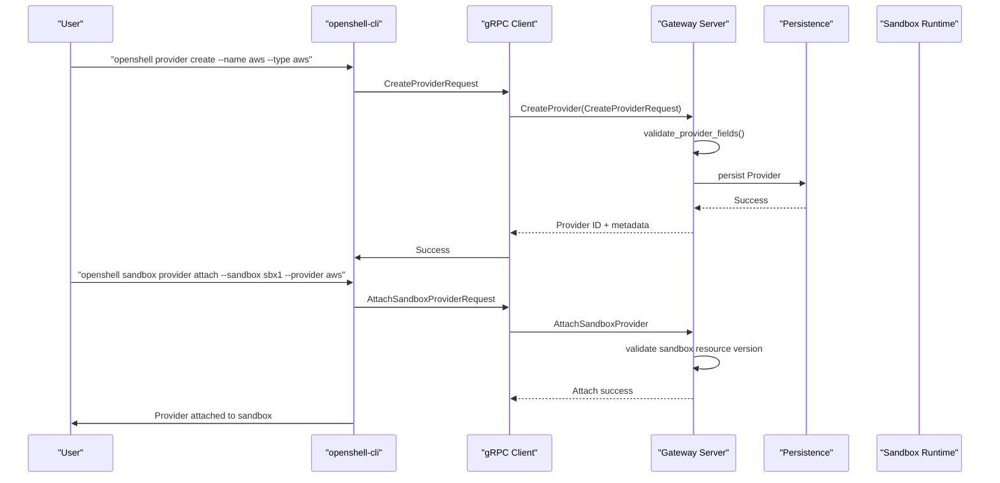
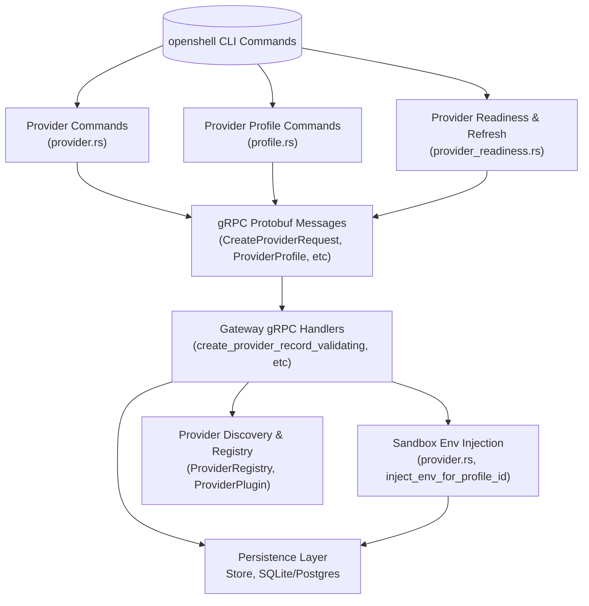

<!-- source: DeepWiki mcp.deepwiki.com · repo NVIDIA/OpenShell · page 4.4 Provider and Profile Commands · fetched 2026-10-26 -->

# Provider and Profile Commands

<details>
<summary>Relevant source files</summary>

The following files were used as context for generating this wiki page:

- [crates/openshell-cli/src/commands/provider.rs](crates/openshell-cli/src/commands/provider.rs)
- [crates/openshell-providers/src/lib.rs](crates/openshell-providers/src/lib.rs)
- [crates/openshell-providers/src/providers/mod.rs](crates/openshell-providers/src/providers/mod.rs)
- [crates/openshell-supervisor-network/data/sandbox-policy.rego](crates/openshell-supervisor-network/data/sandbox-policy.rego)
- [crates/openshell-supervisor-network/src/l7/jsonrpc.rs](crates/openshell-supervisor-network/src/l7/jsonrpc.rs)
- [crates/openshell-supervisor-network/src/l7/mcp.rs](crates/openshell-supervisor-network/src/l7/mcp.rs)

</details>


## Purpose and Scope

This page documents the CLI commands related to managing **providers** and **provider profiles** within OpenShell. These commands facilitate creation, listing, deletion, readiness checks, and credential refresh operations for providers and their profiles. Providers represent external service configurations and credentials (e.g., cloud services, LLM providers) stored on the gateway, which sandboxes can reference to inject environment variables and authorize access.

The commands mediate communication between the CLI and gateway server via gRPC requests defined in proto files (notably `Provider`, `ProviderProfile`, `CreateProviderRequest`, `ListProvidersRequest`, etc.). This page details the implementation of key commands, their data flow, and how the system manages asynchronous readiness and credential rotation states.

Sources: [crates/openshell-cli/src/commands/provider.rs:1-177](), [crates/openshell-providers/src/lib.rs:1-126](), [crates/openshell-cli/src/commands/provider.rs:178-3881]() (full source referenced)


## Command Categories

### Provider Commands

- **Create a provider (`openshell provider create`)**  
  Creates a new provider record with credentials and configuration. The command supports input formats such as environment variables, YAML, or JSON profiles. The CLI sends a `CreateProviderRequest` to the gateway, which performs validation and persists the provider.  
- **List providers (`openshell provider list`)**  
  Lists stored providers on the gateway with pagination and output format options. Internally uses the `ListProvidersRequest` RPC.  
- **Delete provider (`openshell provider delete`)**  
  Removes a provider record by ID using `DeleteProviderRequest`. Handles error aggregation when deleting multiple providers.  

### Provider Profile Commands

- **Create / Import provider profiles (`openshell provider profile import/create`)**  
  Supports creating or importing provider credential profiles in bulk or individually. Profiles describe credential refresh strategies with various fields and hooks. Uses `ImportProviderProfilesRequest` and `CreateProviderProfileRequest`.  
- **List provider profiles (`openshell provider profile list`)**  
  Lists known profiles and their diagnostic statuses via `ListProviderProfilesRequest`.  
- **Delete provider profiles (`openshell provider profile delete`)**  
  Deletes one or multiple profiles by ID with `DeleteProviderProfileRequest`.  
- **Lint provider profiles (`openshell provider profile lint`)**  
  Validates and diagnoses profiles for common errors or misconfiguration. Uses `LintProviderProfilesRequest`.  

### Provider Readiness and Credential Refresh

- **Check provider readiness (`openshell provider readiness wait`)**  
  Waits for a provider to become ready after creation or configuration updates. Readiness signals confirm that credentials and configuration have finished propagating and are authorized. Uses consolidated state under the `ProviderCredentialRefreshStatus` message.  
- **Refresh provider credentials (`openshell provider refresh rotate`)**  
  Initiates an active credential refresh/rotation for a provider, optionally blocking until refresh completes, handling errors, and supporting retry/sync strategies.

---

## Data Model and Key Classes

| Data Entity | Role | Defined/Cited in |
| --- | --- | --- |
| `Provider` | Core message representing a configured provider record including type, credentials, metadata, and attached profiles | openshell_core proto, CLI commands |
| `ProviderProfile` | Defines credential refresh profiles associated with providers; includes strategy, hooks, and diagnostic info | openshell_core proto, openshell_cli commands |
| `DiscoveryContext` / `RealDiscoveryContext` | Used for provider credential discovery and validation via profiles | crates/openshell-providers/src/lib.rs:6-26 |
| `ProviderMutationExpectation` | Enum and logic managing the wait expectations and timeouts for provider readiness after mutations | crates/openshell-cli/src/commands/provider_readiness.rs |
| `TlsOptions` | Configures TLS for secure gRPC communication with the gateway server | crates/openshell-cli/src/commands/provider.rs:13-14 |
| `grpc_client` | Creates the tonic gRPC client connected to the gateway | crates/openshell-cli/src/commands/provider.rs:13 |

---

## Provider Command Implementation Details

### Provider Creation Logic

The `sandbox_provider_attach` and `provider_create` asynchronous functions interact with the gateway via tonic gRPC.

- `sandbox_provider_attach` first fetches the current sandbox to get its **resource version** to enable optimistic concurrency control when attaching providers.
- The CLI assembles an `AttachSandboxProviderRequest` including sandbox name, workspace, and the provider ID to attach.
- If a request encounters uncertainty due to backend storage errors (e.g., storage write ambiguity), the code detects this by analyzing the gRPC error's metadata using `provider_mutation_is_uncertain()`.
- For certain failure types, the CLI advises users to manually reconcile changes because the state might be ambiguous.
- `provider_create` calls `CreateProviderRequest` with user-supplied parameters, then awaits the server response, handling validation errors, redacted responses, and readiness wait options.

```mermaid
graph TD
  CLI["openshell-cli provider create"] -->|CreateProviderRequest| GRPCClient
  GRPCClient -->|gRPC call| GatewayServer
  GatewayServer -->|validate_provider_fields()| Validation
  GatewayServer -->|persist Provider object| PersistenceStore
  PersistenceStore -->|SQLite/Postgres| DB
  GatewayServer -->|return redacted Provider| GRPCClient
  GRPCClient --> CLI
```

Sources: [crates/openshell-cli/src/commands/provider.rs:95-130](), [crates/openshell-cli/src/commands/provider.rs:132-177](), [crates/openshell-providers/src/lib.rs:60-123]()

### Listing Providers

CLI calls the `ListProvidersRequest` to the gateway for paginated provider lists.

- Results are formatted as tables or JSON/YAML depending on `--output` flags.
- The system supports managed pagination tokens allowing incremental fetching.

### Provider Profile Management

Profile commands support importing or creating profiles, listing them, and deletion.

- Implements bulk import via `ImportProviderProfilesRequest`, parsing from YAML or JSON documents.
- Profile linting uses `LintProviderProfilesRequest` which returns diagnostics.
- Deletion aggregates multiple delete failures for comprehensive user error messaging.

### Provider Readiness and Credential Rotation

Readiness checks are done by polling `GetProviderRefreshStatusRequest` which returns detailed status info about the provider's credential refresh lifecycle.

- The system maintains internal states and recovery actions.
- Failure, retry, and blocking behaviors are configurable per command.
- Rotation baseline provides hooks for starting background credential refresh cycles and waiting on completion.

---

## Command Flow Diagram

**Provider Creation and Attach Flow**



Sources: [crates/openshell-cli/src/commands/provider.rs:133-177](), [crates/openshell-server/src/grpc/provider.rs:120-160](), [crates/openshell-server/src/grpc/sandbox.rs:123-149]()

---

## Provider and Profile Command-Namespace to Code Entity Mapping



This mapping shows how the CLI commands trigger gRPC requests, which are handled by the gateway server's handlers accessing the persistence layer and provider profile discovery/registry modules, ultimately injecting credentials into sandboxes.

Sources: [crates/openshell-cli/src/commands/provider.rs:1-177](), [crates/openshell-providers/src/lib.rs:60-125]()


---

# Summary

The **Provider and Profile Commands** group offers a comprehensive interface for managing external service credentials and configurations in OpenShell via the CLI and gRPC gateway API. The implementation involves sophisticated validation, concurrency control through resource versioning, readiness handling after mutations, and support for credential refreshing strategies in profiles.

Users leverage these commands to securely create, list, attach, refresh, and clean up providers and profile data, enabling sandboxes to seamlessly access securely managed credentials and configurations.

---

Sources:

- crates/openshell-cli/src/commands/provider.rs:1-177  
- crates/openshell-providers/src/lib.rs:1-130  
- crates/openshell-server/src/grpc/provider.rs:4-70, 120-160, 162-185  
- crates/openshell-server/src/grpc/sandbox.rs:123-149  
- crates/openshell-providers/src/lib.rs:60-125

---

