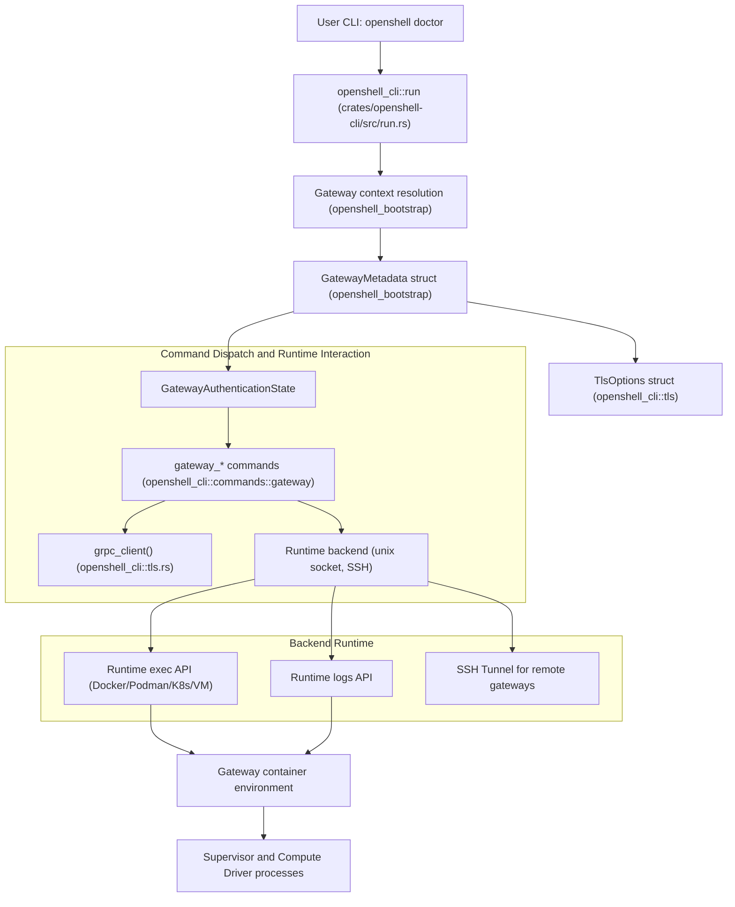
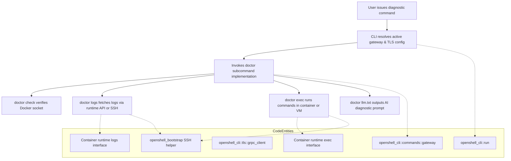

<!-- source: DeepWiki mcp.deepwiki.com · repo NVIDIA/OpenShell · page 4.5 Diagnostics and Doctor Commands · fetched 2026-10-26 -->

# Diagnostics and Doctor Commands

<details>
<summary>Relevant source files</summary>

The following files were used as context for generating this wiki page:

- [crates/openshell-cli/src/main.rs](crates/openshell-cli/src/main.rs)
- [crates/openshell-cli/src/run.rs](crates/openshell-cli/src/run.rs)
- [crates/openshell-cli/tests/provider_commands_integration.rs](crates/openshell-cli/tests/provider_commands_integration.rs)
- [crates/openshell-cli/tests/sandbox_create_lifecycle_integration.rs](crates/openshell-cli/tests/sandbox_create_lifecycle_integration.rs)
- [crates/openshell-core/src/config.rs](crates/openshell-core/src/config.rs)
- [crates/openshell-server/src/cli.rs](crates/openshell-server/src/cli.rs)
- [crates/openshell-server/src/compute/mod.rs](crates/openshell-server/src/compute/mod.rs)
- [crates/openshell-server/src/config_file.rs](crates/openshell-server/src/config_file.rs)
- [crates/openshell-server/src/grpc/policy.rs](crates/openshell-server/src/grpc/policy.rs)
- [crates/openshell-server/src/grpc/provider.rs](crates/openshell-server/src/grpc/provider.rs)
- [crates/openshell-server/src/grpc/sandbox.rs](crates/openshell-server/src/grpc/sandbox.rs)
- [crates/openshell-server/src/lib.rs](crates/openshell-server/src/lib.rs)
- [crates/openshell-server/src/storage_proto.rs](crates/openshell-server/src/storage_proto.rs)
- [docs/how-it-works/gateways/configuration.mdx](docs/how-it-works/gateways/configuration.mdx)
- [proto/openshell.proto](proto/openshell.proto)
- [sdk/go/proto/openshellv1/openshell.pb.go](sdk/go/proto/openshellv1/openshell.pb.go)
- [skills/debug-openshell-cluster/SKILL.md](skills/debug-openshell-cluster/SKILL.md)

</details>


This page documents the diagnostic commands available in the `openshell` CLI under the `doctor` command group (alias: `dr`). These commands enable troubleshooting and runtime inspection of OpenShell gateways and their compute platforms. They are crucial for validating deployment prerequisites, retrieving logs, executing commands inside gateway containers, and generating AI-assisted diagnostic prompts.

These commands integrate closely with the gateway metadata, transport security settings, and deployment mode. They abstract over runtime implementations such as Docker, Podman, Kubernetes, VM, or external compute drivers, and support remote gateways via SSH tunnels.

---

## Command Overview

The `doctor` command group provides focused diagnostic and troubleshooting helpers:

| Command       | Alias | Description                                 | Typical Usage                                              |
|---------------|-------|---------------------------------------------|------------------------------------------------------------|
| `doctor check`| -     | Verify Docker runtime readiness and config | Pre-flight check for Docker runtime availability           |
| `doctor logs` | -     | Fetch or stream gateway container logs      | Examine gateway startup or runtime logs                     |
| `doctor exec` | -     | Run arbitrary commands inside gateway container | Inspect cluster state, invoke `kubectl` in k3s-in-docker deployments |
| `doctor llm.txt` | -  | Output diagnostic prompt suitable for LLM agents | Provide rich context for AI-powered troubleshooting        |

**Automatic context resolution**: All doctor commands resolve the active gateway configuration (`GatewayMetadata`) and adapt to the deployment environment (local container, remote SSH, or extension driver socket). They leverage stored metadata, TLS config, and CLI flags/environment variables [crates/openshell-cli/src/commands/gateway.rs:15-67]().

---

## Command Details and Implementation

### doctor check

The `doctor check` command validates the presence, connectivity, and responsiveness of a Docker-compatible container runtime. It is intended as a deployment prerequisite verification step.

- Attempts to connect to the Docker socket or runtime endpoint.
- Queries version and status information.
- Reports issues such as missing Docker, inaccessible sockets, or permission errors.
- Provides actionable remediation messages for common failure causes.

Example usage:

```bash
openshell doctor check
```

This command is implemented by invoking runtime probing logic inside the CLI that detects and interacts with Docker/Podman or other container runtimes as configured [crates/openshell-cli/src/commands/gateway.rs:55-67]().

---

### doctor logs

Fetches and streams logs from the gateway container, abstracting over the underlying container runtime or remote environment.

Capabilities:
- Retrieve last N lines or full logs.
- Tail logs in real time.
- Supports logs from native deployments (Docker, Podman) and extensions.
- When remote gateway metadata specifies an SSH connection, tunnels the logs command over an SSH session to the gateway host.

Example usage:

```bash
# Fetch the last 100 lines of logs
openshell doctor logs --lines 100

# Tail logs live
openshell doctor logs --tail
```

Implementation notes:
- Resolves active gateway metadata for container ID and runtime.
- Uses the runtime API or SSH to execute log fetch commands.
- Streams logs to the CLI stdout or processes them for further consumption [crates/openshell-cli/src/commands/gateway.rs:52-67]().

---

### doctor exec

Runs arbitrary commands inside the gateway container environment.

Typical use cases:
- Executing `kubectl` commands inside a k3s-in-docker gateway deployment without requiring `kubectl` to be installed locally.
- Running diagnostic commands or scripts to inspect gateway internals, cluster state, and resource availability.

Example usage:

```bash
# Check Kubernetes readiness endpoint
openshell doctor exec -- kubectl get --raw=/readyz

# List pods in all namespaces inside gateway
openshell doctor exec -- kubectl get pods -A
```

The CLI determines the gateway container, selects the appropriate runtime `exec` interface, and issues the command, propagating exit codes back to the user.

This command supports remote gateways by connecting via SSH if required [crates/openshell-cli/src/commands/gateway.rs:52-67]().

---

### doctor llm.txt

Outputs a large, structured diagnostic prompt formatted for input into AI language models (LLMs). This prompt consolidates:

- Gateway topology and architecture overview.
- Known common failure points and troubleshooting heuristics.
- Logs and configuration context extract.
- Guidance on debugging steps and command usage.

Use case:

```bash
openshell doctor llm.txt > diagnostic_prompt.md
```

This provides AI-assisted diagnostics via external skill agents or chatbots. The generation logic collects runtime status and telemetry context from the gateway to populate a comprehensive Markdown document designed for LLM consumption.

---

## Internals and Data Flow

The doctor commands operate through a sequence of context resolution, authentication, and runtime execution phases. Below is a detailed data flow and control path bridging user intent ("Natural Language Space") to underlying code entities ("Code Entity Space").

### Doctor Command Execution Flow



This diagram relates principal code artifacts invoked in the command lifecycle.

- `openshell_cli::run` is the CLI root module coordinating commands.
- `GatewayMetadata` describes gateway identity, endpoint URL, runtime type, and auth mode.
- `gateway_*` commands implement doctor subcommands.
- Runtime backend resolves locally or remotely using Unix socket or SSH tunnels.
- Container or runtime exec and logs APIs interact with the gateway container environment for diagnostics.


### Diagnostic Workflow for Doctor Commands



This workflow shows how the doctor commands branch to specific runtime implementations and helper modules depending on gateway deployment.

---

## Common Failure Patterns and Diagnostics

Doctor commands help identify and remediate typical cluster and runtime problems:

| Failure Pattern              | Root Cause                             | Doctor Command Usage                              | Recovery Hint                                 |
|-----------------------------|-------------------------------------|--------------------------------------------------|-----------------------------------------------|
| `No active gateway`          | No gateway is selected or registered| `openshell gateway select <name>`; `doctor check`| Register or select the gateway for CLI context|
| `Connection refused`         | Gateway process down or unreachable | `doctor logs`, `doctor exec`                     | Start gateway service or check network tunnel |
| `TLS/certificate errors`    | Certificate trust chain or TLS config mismatch | `doctor logs` to inspect gateway startup logs   | Validate mTLS cert files and config correctness|
| `Unauthorized / Unauthenticated` | Outdated or missing edge/OIDC tokens | `gateway login <name>` then retry commands       | Renew stored gateway credentials               |
| Missing or inaccessible Docker runtime | Docker daemon not running or socket not accessible | `doctor check`                                  | Start Docker service and verify socket path    |
| Kubernetes deployment failures | Helm release or pod scheduling issues | `doctor logs`,`doctor exec -- kubectl get events` | Inspect Kubernetes manifests and runtime logs  |

---

## Summary

The doctor command group offers a unified, flexible interface to diagnose gateway and sandbox deployment issues:

- Pre-flight runtime checks (`doctor check`).
- Access to live gateway container logs (`doctor logs`).
- Execution of diagnostic commands inside gateways (`doctor exec`).
- AI prompt generation for advanced agent-assisted troubleshooting (`doctor llm.txt`).

These commands rely on gateway metadata resolution and authentic, secure communication channels supporting both local and remote gateways.

---

## Sources

- crates/openshell-cli/src/commands/gateway.rs:15-67
- crates/openshell-cli/src/run.rs:1-167
- crates/openshell-cli/src/main.rs:1-187
- skills/debug-openshell-cluster/SKILL.md:1-1025

---

