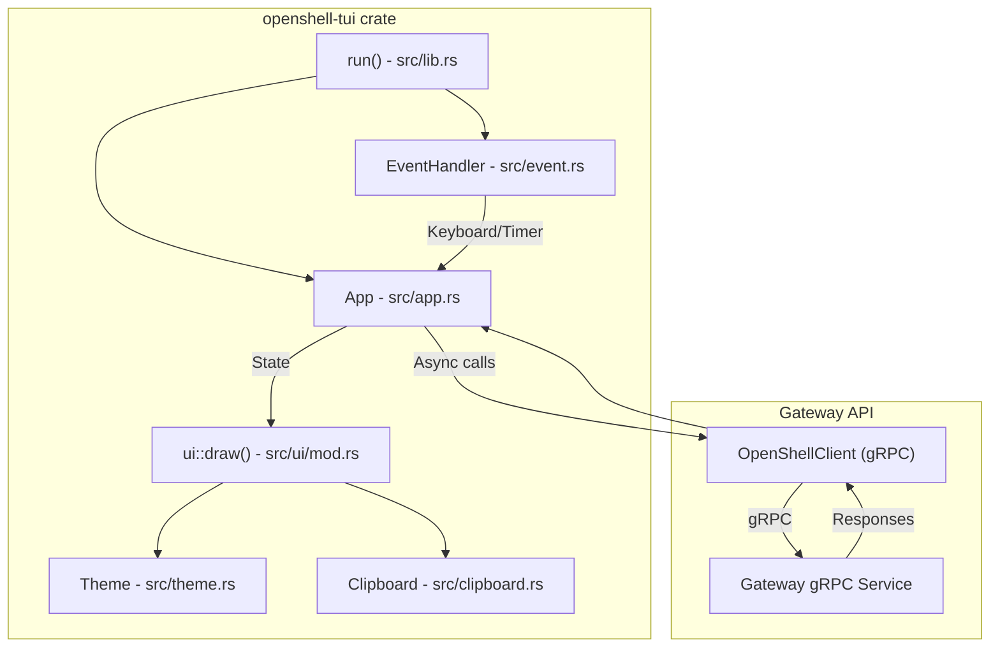
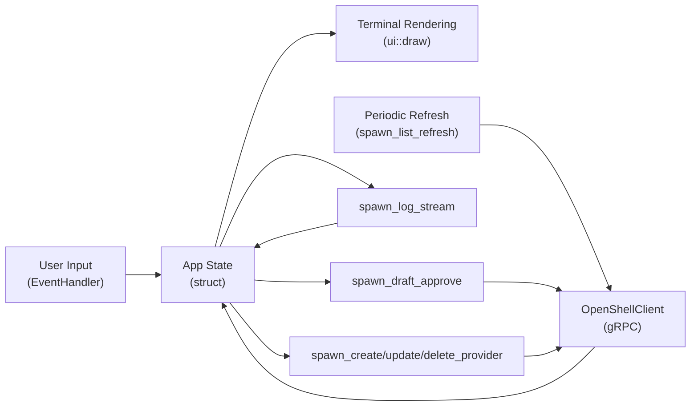

<!-- source: DeepWiki mcp.deepwiki.com · repo NVIDIA/OpenShell · page 4.6 Terminal UI (openshell term) · fetched 2026-10-26 -->

# Terminal UI (openshell term)

<details>
<summary>Relevant source files</summary>

The following files were used as context for generating this wiki page:

- [.agents/skills/tui-development/SKILL.md](.agents/skills/tui-development/SKILL.md)
- [Cargo.lock](Cargo.lock)
- [Cargo.toml](Cargo.toml)
- [crates/openshell-cli/Cargo.toml](crates/openshell-cli/Cargo.toml)
- [crates/openshell-core/Cargo.toml](crates/openshell-core/Cargo.toml)
- [crates/openshell-server/Cargo.toml](crates/openshell-server/Cargo.toml)
- [crates/openshell-tui/Cargo.toml](crates/openshell-tui/Cargo.toml)
- [crates/openshell-tui/src/app.rs](crates/openshell-tui/src/app.rs)
- [crates/openshell-tui/src/clipboard.rs](crates/openshell-tui/src/clipboard.rs)
- [crates/openshell-tui/src/event.rs](crates/openshell-tui/src/event.rs)
- [crates/openshell-tui/src/lib.rs](crates/openshell-tui/src/lib.rs)
- [crates/openshell-tui/src/theme.rs](crates/openshell-tui/src/theme.rs)
- [crates/openshell-tui/src/ui/create_provider.rs](crates/openshell-tui/src/ui/create_provider.rs)
- [crates/openshell-tui/src/ui/create_sandbox.rs](crates/openshell-tui/src/ui/create_sandbox.rs)
- [crates/openshell-tui/src/ui/dashboard.rs](crates/openshell-tui/src/ui/dashboard.rs)
- [crates/openshell-tui/src/ui/global_settings.rs](crates/openshell-tui/src/ui/global_settings.rs)
- [crates/openshell-tui/src/ui/mod.rs](crates/openshell-tui/src/ui/mod.rs)
- [crates/openshell-tui/src/ui/providers.rs](crates/openshell-tui/src/ui/providers.rs)
- [crates/openshell-tui/src/ui/sandbox_draft.rs](crates/openshell-tui/src/ui/sandbox_draft.rs)
- [crates/openshell-tui/src/ui/sandbox_logs.rs](crates/openshell-tui/src/ui/sandbox_logs.rs)
- [crates/openshell-tui/src/ui/sandbox_settings.rs](crates/openshell-tui/src/ui/sandbox_settings.rs)

</details>


## Purpose and Scope

The `openshell term` command launches an interactive terminal user interface (TUI) client for the OpenShell platform, offering a live, keyboard-driven dashboard to monitor gateways, manage sandboxes, inspect logs, and handle provider credentials. This TUI enhances user experience by exposing cluster state and policy management without resorting to repeated CLI commands.

Implemented in the `openshell-tui` crate, the UI leverages the Rust-based `ratatui` library for rendering terminal graphics and `crossterm` for terminal event handling and input capture ([crates/openshell-tui/src/lib.rs:1-58](), [.agents/skills/tui-development/SKILL.md:12-25]() ).

**Sources:** [crates/openshell-tui/src/lib.rs:1-58](), [.agents/skills/tui-development/SKILL.md:12-25]()

---

## Architecture Overview

The TUI runs as an async client application connecting to the configured OpenShell Gateway service via gRPC. It maintains rich internal state (`App`) including UI screen, focused panels, cached data (gateways, providers, sandboxes, logs), and controls the UI rendering loop.

The main event loop is orchestrated in `run()` (in `lib.rs`), which configures the terminal, spawns asynchronous data fetching tasks, and processes input and periodic timers through the `EventHandler` ([crates/openshell-tui/src/lib.rs:94-182]()).

### Core Components

| Concept                | Code Entity                                  | Purpose                                         |
|------------------------|----------------------------------------------|------------------------------------------------|
| Terminal App Entry     | `run()` function in `lib.rs`                  | Async main loop initializing terminal UI and event loop |
| Global UI State       | `App` struct in `app.rs`                       | Central in-memory UI state, including focus, cached data, and pending operations |
| Event Handling        | `EventHandler` struct in `event.rs`           | Async input and timer event dispatch            |
| Terminal Rendering    | `ui::draw()` in `ui/mod.rs`                    | Composes screen layout and calls screen-specific draw functions |
| Theming               | `Theme` struct in `theme.rs`                   | Defines adaptive light/dark color palettes      |
| gRPC Client           | `OpenShellClient` from `openshell-core::proto`| Communicates with the gateway for command and data fetch |
| Clipboard handling    | `clipboard.rs`                                 | Supports OSC 52 terminal clipboard integration  |

### Data Flow Summary

- `run()` initializes the gRPC client and `App`, configures terminal modes.
- The `EventHandler` asynchronously yields keyboard input, background refresh ticks, and gRPC response events.
- User input triggers state mutations in `App`.
- Background refresh workers poll gateway APIs to update gateway lists, sandboxes, providers, settings, and logs, updating `App`.
- The UI redraw timer triggers `ui::draw()` which renders using the current `App` state and the `Theme`.
- Keybindings invoke asynchronous operations such as creating providers, deleting sandboxes, or fetching logs.

### Mermaid Diagram: OpenShell TUI Architecture


**Sources:** [crates/openshell-tui/src/lib.rs:87-182](), [crates/openshell-tui/src/app.rs:1-53](), [crates/openshell-tui/src/ui/mod.rs:10-67](), [crates/openshell-tui/src/event.rs:10-80](), [.agents/skills/tui-development/SKILL.md:27-44]()

---

## Screens and Focus Model

### Screens (`Screen` enum)

The TUI supports three main full-screen layouts represented by the `Screen` enum in `app.rs`([crates/openshell-tui/src/app.rs:24-33]()):

| Screen      | Description                                            | UI Modules                           |
|-------------|--------------------------------------------------------|------------------------------------|
| `Splash`    | Initial splash screen shown at startup, auto-dismissed | `ui/splash.rs`                     |
| `Dashboard` | Lists gateways, provider credentials, global settings, and sandboxes in a structured layout | `ui/dashboard.rs`                   |
| `Sandbox`   | Single sandbox detailed view with metadata, policy, settings, logs, and network draft rules | `ui/sandbox_detail.rs`, `ui/sandbox_policy.rs`, `ui/sandbox_settings.rs`, `ui/sandbox_logs.rs`, `ui/sandbox_draft.rs` |

### Focus (`Focus` enum)

The `Focus` enum tracks which UI panel currently accepts input ([crates/openshell-tui/src/app.rs:41-53]()):

| Focus             | Screen     | Meaning                                       |
|-------------------|------------|-----------------------------------------------|
| `Gateways`        | Dashboard  | Gateway list focused                          |
| `Providers`       | Dashboard  | Provider or Global Settings focus (tabbed)  |
| `Sandboxes`       | Dashboard  | Sandbox table focused                         |
| `SandboxPolicy`   | Sandbox    | Bottom pane focused on policy or settings tab|
| `SandboxLogs`     | Sandbox    | Log viewer pane focused                       |
| `SandboxDraft`    | Sandbox    | Network draft policy recommendations list    |

### Tab Enums

Two enums switch between sub-views inside focused panes:

| Tab Enum          | Options                           | Description                                      |
|-------------------|---------------------------------|------------------------------------------------|
| `MiddlePaneTab`   | `Providers` / `GlobalSettings`  | Dashboard middle pane toggles                   |
| `SandboxPolicyTab`| `Policy` / `Settings`            | Sandbox bottom pane toggles                      |

### Screen Dispatch

The root UI draw dispatches based on current screen and focus state ([crates/openshell-tui/src/ui/mod.rs:26-67]()):

```rust
match app.screen {
    Screen::Splash => splash::draw(...),
    Screen::Dashboard => dashboard::draw(...),
    Screen::Sandbox => {
        sandbox_detail::draw(...)
        match app.focus {
            Focus::SandboxLogs => sandbox_logs::draw(...),
            Focus::SandboxDraft => sandbox_draft::draw(...),
            _ => match app.sandbox_policy_tab {
                SandboxPolicyTab::Settings => sandbox_settings::draw(...),
                SandboxPolicyTab::Policy => sandbox_policy::draw(...),
            }
        }
    }
}
```

**Sources:** [crates/openshell-tui/src/app.rs:20-53](), [crates/openshell-tui/src/ui/mod.rs:26-67](), [.agents/skills/tui-development/SKILL.md:61-130]()

---

## Async Data Flow

### Data Fetching and Refresh

The TUI performs live data fetching asynchronously over gRPC:

- On startup, `run()` triggers initial gateway list refresh and health check ([crates/openshell-tui/src/lib.rs:120-130]()).
- Periodic refreshes of sandboxes, providers, workspace info, and global settings occur by timers firing events in `EventHandler` ([crates/openshell-tui/src/event.rs:20-60]()).
- Background tasks are spawned for CRUD operations on providers, sandboxes, settings, and log fetching ([crates/openshell-tui/src/lib.rs:140-180]()).
- Sandbox log streaming uses gRPC bidirectional streams to push logs live into the UI ([crates/openshell-tui/src/lib.rs:190-220]()).
- Draft policy approval executes asynchronously and updates sandbox policies in the backend ([crates/openshell-tui/src/lib.rs:155-165]()).

### Data Model Highlights

- `App` maintains versioned caches of gateways, providers, sandboxes, global & sandbox settings, and draft chunks ([crates/openshell-tui/src/app.rs:40-220]()).
- Log lines are stored with detailed metadata for structured rendering in `LogLine` structs ([crates/openshell-tui/src/app.rs:59-68]()).
- Settings are typed and display smart formatting, distinguishing global vs sandbox scope ([crates/openshell-tui/src/app.rs:119-217]()).

### Mermaid Diagram: Async Data & Event Flow


**Sources:** [crates/openshell-tui/src/lib.rs:100-183](), [crates/openshell-tui/src/app.rs:38-74](), [crates/openshell-tui/src/event.rs:10-61](), [.agents/skills/tui-development/SKILL.md:139-164]()

---

## Theming and Visual Design

The UI supports adaptive theming based on terminal background color detection or explicit user override ([crates/openshell-tui/src/theme.rs](), [crates/openshell-tui/src/lib.rs:100-106]()).

- Themes define colors and styles for titles, focus indicators, status text, borders, logs, and interactive elements.
- Auto-detection uses OSC 11 terminal sequences to probe background color before entering raw mode.
- Users can explicitly select `Dark`, `Light` or `Auto` color scheme via CLI flags or environment variable `OPENSHELL_THEME`.

The consistent green accent color and monospaced layout reinforce the NVIDIA branding and technical clarity ([crates/openshell-tui/src/theme.rs]()).

**Sources:** [crates/openshell-tui/src/lib.rs:100-106](), [crates/openshell-tui/src/theme.rs:1-50]()

---

## Clipboard Support

The TUI allows copying text to the system clipboard using the OSC 52 terminal control sequence encoded in base64 ([crates/openshell-tui/src/clipboard.rs]()).

- Clipboard writes are used primarily for log detail and sandbox draft views to facilitate copy-paste from the terminal.
- Implemented as a utility called by the UI render or keybindings with proper terminal escape codes.
- Supports robust terminal compatibility and screen buffer preservation.

**Sources:** [crates/openshell-tui/src/clipboard.rs:1-28]()

---

## Keybindings

The TUI is designed around efficient keyboard navigation and command entry with two key input modes (`InputMode` in `app.rs`) ([crates/openshell-tui/src/app.rs:36-39]()).

### Global and Screen-wide Bindings

| Key        | Action                                      | Context/Screen                 |
|------------|---------------------------------------------|-------------------------------|
| `1`        | Switch to Dashboard screen                   | Global                        |
| `2`        | Switch to Sandboxes screen                   | Global                        |
| `j`/`k`    | Move selection cursor up/down                | Lists or Tables               |
| `Tab`      | Cycle focus area or tab                       | Dashboard/Sandbox screens     |
| `Enter`    | Select item, open detail, or start editing   | Selection in lists or text fields |
| `d`        | Delete selected item or unset setting        | Selection                    |
| `c`        | Open create modal (e.g. provider, sandbox)   | Dashboard                    |
| `f`        | Toggle log autoscroll (follow mode)          | Log viewer                   |
| `h/l`      | Switch tabs in middle dashboard/ sandbox settings pane | Depends on pane                 |
| `a`        | Approve selected draft network rule          | Drafts pane                  |
| `Esc`      | Cancel modal, close popup, or cancel input   | Modal overlays              |
| `q`        | Quit application                              | Global                      |

### UX Notes

- The TUI enforces modal controls: modals like create providers or confirm dialogs capture keys until dismissed.
- Navigation keys repeat auto-scroll and cursor movements smoothly.
- Focus changes update what keys affect, e.g., `j/k` in sandboxes table vs. providers list.
- Command mode enables text input and submitting via `Enter`.
- `Tab` key switches focus logically in screen or between dashboard panes.

**Sources:** [crates/openshell-tui/src/app.rs:35-53](), [crates/openshell-tui/src/ui/mod.rs:178-188](), [.agents/skills/tui-development/SKILL.md:85-105]()

---

## Implementation Details

### Main Entry: `run()` in `lib.rs`

- Accepts a connected `Channel` and an authentication interceptor.
- Detects theme mode before enabling raw terminal mode to prevent conflicts with OSC 11 color queries.
- Initializes `App` state with the client, gateway name, endpoint, workspace, and selected theme.
- Configures terminal in alternate screen and enables mouse capture with `crossterm`.
- Starts an asynchronous event loop processing keyboard and other events from `EventHandler`, dispatching user commands and background fetches.
- Draws the entire UI each tick with `ratatui::Frame`.

### Application State: `App` in `app.rs`

- Tracks current `Screen`, `Focus`, active tabs, input mode, and selection indexes.
- Holds cached data:
  - `gateways: Vec<GatewayEntry>`
  - `providers: Vec<ProviderListEntry>`
  - `sandboxes: Vec<Sandbox>`
  - `sandbox_log_lines: Vec<LogLine>`
  - `provider_profiles: ProviderProfileCache`
  - `global_settings: Vec<GlobalSettingEntry>`
  - `sandbox_settings: Vec<SandboxSettingEntry>`
  - `draft_chunks: Vec<DraftChunk>`
- Manages pending async operations with boolean flags like `pending_provider_create`.
- Stores scroll positions, audit states, detail popup states.
- Implements keyboard event handlers to update focus, switch screens, trigger async actions ([crates/openshell-tui/src/app.rs]()).

### UI Layout and Drawing: `ui/mod.rs`

- Defines the main layout split into four rows: title bar, main content, nav bar, and command bar.
- Each screen resides in main content area:
  - `Splash`: full-screen logo.
  - `Dashboard`: three vertically stacked panels (gateways, providers/global-settings tab, sandboxes).
  - `Sandbox`: split into metadata pane and bottom panel toggling between policy, settings, logs, or drafts based on focus and tabs.
- Modal overlays for forms (create sandbox/provider) and popups render last.
- Uses `ratatui::Layout` and widgets (`Block`, `Paragraph`, `Borders`) with styling from `Theme`.

### Logs and Drafts Panels

- Logs panel supports visual selection, autoscroll, and detailed log popup on pressing Enter.
- Drafts panel displays network draft policy chunks with approve/reject actions.
- Both panels handle scroll offsets, cursor positioning, and styled spans including colored log levels.

**Sources:** [crates/openshell-tui/src/lib.rs:87-180](), [crates/openshell-tui/src/app.rs:1-220](), [crates/openshell-tui/src/ui/mod.rs:20-128](), [crates/openshell-tui/src/ui/sandbox_logs.rs:13-121](), [crates/openshell-tui/src/ui/sandbox_draft.rs:1-90]()

---

## Summary

The OpenShell Terminal UI (`openshell term`) presents a fully interactive, ratatui-based client for real-time cluster inspection and management:

- **Screens**: Splash, Dashboard, Sandbox detail view with tabbed sub-panes.
- **Focus Model**: Granular panel-level focus control enabling keyboard navigation.
- **Async Data Flow**: Background data fetching and live log streaming with dynamic UI updates.
- **Theming**: Adaptive light/dark theme via terminal color queries or user flag.
- **Clipboard Support**: OSC 52-based copy integration.
- **Keybindings**: Intuitive keyboard-driven workflows for all user actions.

This architecture balances asynchronous Rust programming with sophisticated terminal UI layout and interaction patterns, enabling maintainability and extensibility for rich cluster management within terminal constraints.

---

**References**

- `crates/openshell-tui/src/lib.rs`
- `crates/openshell-tui/src/app.rs`
- `crates/openshell-tui/src/event.rs`
- `crates/openshell-tui/src/ui/mod.rs`
- `crates/openshell-tui/src/ui/sandbox_logs.rs`
- `crates/openshell-tui/src/theme.rs`
- `.agents/skills/tui-development/SKILL.md`

---

