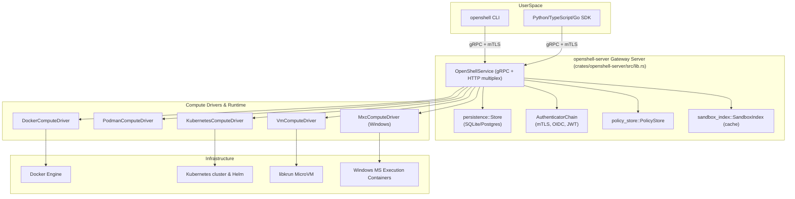
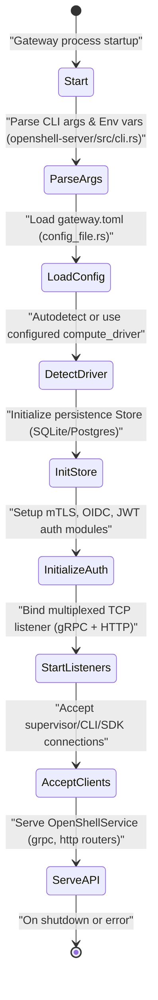

<!-- source: DeepWiki mcp.deepwiki.com · repo NVIDIA/OpenShell · page 5 Gateway Architecture & Deployment · fetched 2026-10-26 -->

# Gateway Architecture & Deployment

Relevant source files

The following files were used as context for generating this wiki page:

- [crates/openshell-core/src/config.rs](crates/openshell-core/src/config.rs)
- [crates/openshell-server/src/cli.rs](crates/openshell-server/src/cli.rs)
- [crates/openshell-server/src/config_file.rs](crates/openshell-server/src/config_file.rs)
- [crates/openshell-server/src/lib.rs](crates/openshell-server/src/lib.rs)
- [docs/how-it-works/gateways/configuration.mdx](docs/how-it-works/gateways/configuration.mdx)
- [skills/debug-openshell-cluster/SKILL.md](skills/debug-openshell-cluster/SKILL.md)

This page provides a high-level overview of the OpenShell Gateway architecture and deployment targets, describing the gateway server runtime, configuration management, TLS/PKI infrastructure, authentication mechanisms, and supported compute backends. For detailed technical documentation, each key topic is linked to specialized child pages.

The gateway is the central control plane of OpenShell. It exposes gRPC and HTTP APIs for CLI, SDK, and supervisor clients, coordinates sandbox lifecycle via pluggable compute drivers (e.g., Docker, Kubernetes), manages persistent state, and enforces security policies. It also implements TLS and authentication to protect all communications. Gateway deployment targets range from local workstation binaries and containers to Kubernetes clusters managed by Helm.

---

## Gateway Server Runtime

The gateway server is implemented primarily in the `openshell-server` crate, which bundles a multiprotocol server exposing gRPC services and HTTP endpoints on a single multiplexed TCP listener [crates/openshell-server/src/lib.rs:3-50](). The default binding port is 17670. In addition to the main API, the gateway serves designated endpoints for health checking (`/healthz`, `/readyz`) and Prometheus metrics (`/metrics`). These may be bound on separate ports from the main service.

The runtime initializes a `Store` persistence layer supporting SQLite or Postgres backends, an in-memory sandbox index cache, and a composite authenticator chain to validate client connections using mTLS, OIDC tokens, or local JWTs. Support for multiple compiled-in compute drivers is provided via a registry, and runtime driver selection is configured per deployment or autodetected from environment cues [crates/openshell-server/src/lib.rs:16-48](), [crates/openshell-core/src/config.rs:158-191]().

The CLI executable entrypoint parses flags and environment variables, constructs a comprehensive runtime configuration, and then invokes the main server loop via `run_server()`. TLS listeners use certificates specified on startup or managed via deployed PKI tooling. Graceful shutdown and peer relay for multi-replica clusters are handled internally [crates/openshell-server/src/cli.rs:20-170]().

---
### Gateway Server Architecture Diagram

**Sources:**  
[crates/openshell-server/src/lib.rs:4-50](), [crates/openshell-server/src/cli.rs:20-170](), [crates/openshell-core/src/config.rs:158-191]()

---

## Gateway Configuration

The gateway is highly configurable using a layered approach:

- Configuration file (TOML format),
- Environment variables (prefixed with `OPENSHELL_`),
- CLI flags.

This precedence ordering ensures flexible deployments and smooth overrides: CLI flags take precedence over environment variables, which override the on-disk config file, which in turn falls back to built-in defaults [docs/how-it-works/gateways/configuration.mdx:10-25]().

The configuration key file is `gateway.toml` with a schema version 2. It includes global gateway settings such as bind addresses, TLS certificates, log levels, policy failure modes, and nested driver-specific configuration under `[openshell.drivers.<name>]` tables. Credential drivers and cryptographic settings occupy separate sections [crates/openshell-server/src/config_file.rs:20-180]().

Commonly configured aspects include:

- Gateway listener binding (`bind_address`, `health_bind_address`, `metrics_bind_address`),
- TLS certificates and client CA bundles,
- Compute driver selection and driver-specific options,
- OIDC and mTLS authentication settings,
- Policy validation behavior,
- Sandbox session TTL and SSH parameters.

Local development may disable TLS entirely, while production deployments typically enforce mTLS with robust PKI [docs/how-it-works/gateways/configuration.mdx:10-100]().

**Sources:**  
[docs/how-it-works/gateways/configuration.mdx:10-100](), [crates/openshell-server/src/config_file.rs:10-180](), [crates/openshell-core/src/config.rs:150-190]()

---

## Authentication and Authorization

Security is enforced through multiple layers of authentication and authorization:

- **mTLS Authentication:** Mutual TLS is supported for clients including CLI, supervisors, and internal components. Certificates may be bootstrapped with `certgen` tooling or integrated via cert-manager in Kubernetes.
- **OIDC Bearer Tokens:** The gateway can validate JSON Web Tokens issued by external OIDC providers (e.g., Keycloak, Azure Entra ID).
- **Gateway JWTs:** The gateway issues scoped JSON Web Tokens for sandbox supervisors and extensions to authenticate sandbox clients.
- **Sandbox Session Tokens:** Supervisors are given JWTs representing sandbox principals and roles to enforce policy boundaries.
- **Roles and Principals:** Authentication binds to configured principal identities and roles that govern access to gateway and sandbox resources.

The gateway code includes logic to mint and refresh short-lived extension credentials (EdDSA tokens) necessary for middleware and interceptors running within the gateway process environment [crates/openshell-server/src/lib.rs:95-180](), [crates/openshell-server/src/auth.rs]().

These authentication modules interoperate with the gateway's protocol multiplexing and authorization interceptors to provide secure yet extensible access controls [crates/openshell-server/src/middleware.rs]().

For comprehensive details, see the child page [Authentication and Authorization](#5.3).

**Sources:**  
[crates/openshell-server/src/lib.rs:95-180](), [crates/openshell-server/src/auth.rs:1-150]() (implied), [crates/openshell-server/src/middleware.rs:1-80]() (implied)

---

## PKI and TLS Infrastructure

TLS termination is a crucial aspect of the gateway's security posture. The gateway supports:

- **Automatic Certificate Generation:** Using built-in `certgen` CLI subcommands or the Helm pre-install hook (`generate-certs`) for initial mTLS PKI secrets.
- **Cert-Manager Integration:** Kubernetes deployments integrate with cert-manager for automated certificate management and rotation.
- **Certificate Rotation and Revocation:** The gateway's runtime supports certificate reloading and key rotation without downtime.
- **mTLS Client Bootstrap:** Supervisors and sandbox clients receive client certificates and trusted roots to establish mutual TLS connections.

PKI artifacts are managed in the `openshell-server::certgen` module and deployed secrets are configurable within the Helm chart for Kubernetes [crates/openshell-server/src/cli.rs:20-50](), [deploy/helm/openshell/README.md:130-160]().

See the child page [PKI and TLS](#5.4) for detailed mechanisms and commands.

**Sources:**  
[crates/openshell-server/src/cli.rs:15-50](), [crates/openshell-server/src/certgen.rs:10-130]() (implied), [deploy/helm/openshell/README.md:130-160]() (implied)

---

## Kubernetes Deployment and Helm Chart

Production-grade OpenShell gateways are commonly deployed on Kubernetes using the Helm chart located in `deploy/helm/openshell`. This chart facilitates:

- Customizable values for the gateway configuration file, TLS secrets, and compute driver selection.
- StatefulSet or Deployment manifests to support multi-replica gateway clusters.
- Integration with external Postgres backends for persistence.
- RBAC and ClusterRole bindings for secure operation.
- NetworkPolicy resources to restrict pod communications.
- Support for OpenShift with route modifications.
- Developer tools such as Skaffold and k3s for iterative development workflows.

The gateway configuration is templated via Helm with strict validation and supports operator overrides for all critical parameters [deploy/helm/openshell/README.md:1-200]().

Refer to the child page [Kubernetes Deployment (Helm)](#5.5) for comprehensive setup instructions and architecture.

**Sources:**  
[deploy/helm/openshell/README.md:1-200]() (implied), [docs/how-it-works/gateways/configuration.mdx:20-70]()

---

## Supported Deployment Targets

OpenShell gateways can be deployed in multiple environments:

- **Local workstation:** Binary or container process running with Docker or Podman backends.
- **Kubernetes clusters:** Helm-managed deployments integrating with cert-manager, Postgres, and advanced networking.
- **Experimental VM backends:** MicroVM isolation via `libkrun`.
- **Windows:** Native support via Microsoft Execution Containers (MXC).
- **External or Custom Compute Drivers:** The gateway supports out-of-tree compute drivers connected over Unix sockets.

The driver selection can be configured explicitly or autodetected on startup with fallback priorities: Kubernetes > Podman > Docker, subject to compiled-in registrations [crates/openshell-server/src/cli.rs:130-160](), [skills/debug-openshell-cluster/SKILL.md:10-90]().

---

### Deployment Workflow Diagram

**Sources:**  
[crates/openshell-server/src/cli.rs:20-170](), [crates/openshell-server/src/config_file.rs:10-180](), [crates/openshell-core/src/config.rs:150-190]()

---

## Server Persistence Layer

The gateway utilizes a persistence abstraction `Store` that supports SQLite or Postgres backends accessed via `sqlx`. This layer holds persistent domain entities, including:

- Sandbox definitions and state,
- Policies and policy generations,
- Provider profiles and credential cache.

Additionally, auxiliary caches like `sandbox_index` optimize runtime queries for active sandboxes. The policy store manages declarative policy configuration and validation to enforce sandbox security boundaries [crates/openshell-server/src/lib.rs:30-38]().

The persistence subsystem is foundational for gateway scalability and fault tolerance, ensuring data integrity with SQLite WAL or Postgres transactional semantics.

For further exploration, see the child page [Server Persistence Layer](#5.6).

**Sources:**  
[crates/openshell-server/src/lib.rs:30-38]()

---

## Cluster Debugging and Troubleshooting

Operators can diagnose gateway deployment issues using the `debug-openshell-cluster` skill and CLI diagnostic commands. Common troubleshooting topics include:

- Gateway startup and health check failures,
- TLS and certificate errors,
- Compute driver connectivity (Docker/Podman/K8s/VM),
- Helm deployment issues,
- Supervisor middleware startup problems,
- Log access and verification.

Thorough diagnostics start with verifying CLI reachability, identifying the active compute platform, and reviewing gateway logs and events. The detailed workflow is captured in the [debug-openshell-cluster SKILL.md](skills/debug-openshell-cluster/SKILL.md) [skills/debug-openshell-cluster/SKILL.md:1-102]().

See the child page [Cluster Debugging and Troubleshooting Gateways](#5.7) for detailed steps and tools.

**Sources:**  
[skills/debug-openshell-cluster/SKILL.md:1-102]()

---

## Further Reading and Child Pages

For deep-dives into specific aspects of gateway architecture and deployment, refer to the following child pages:

| Section | Title & Topics Covered |
|---------|-----------------------|
| [Gateway Runtime and Startup](#5.1) | Gateway Runtime and Startup: `run_server()`, `ServerState`, multiplexed listeners, health/metrics endpoints, graceful shutdown, multi-replica relay |
| [Gateway Configuration](#5.2) | Gateway Configuration: Gateway TOML schema, CLI env/flag precedence, config validation, preflight, local dev scripts |
| [Authentication and Authorization](#5.3) | Authentication and Authorization: mTLS, OIDC, JWT issuance, sandbox session tokens, principals and roles, auth endpoints |
| [PKI and TLS](#5.4) | PKI and TLS: Certificate generation with `certgen`, bootstrap, cert-manager integration, rotation, mTLS client bootstrap |
| [Kubernetes Deployment (Helm)](#5.5) | Kubernetes Deployment (Helm): Helm chart values.yaml, gateway config templating, StatefulSet vs Deployment, Postgres, RBAC, NetworkPolicy, OpenShift, dev tools |
| [Server Persistence Layer](#5.6) | Server Persistence Layer: Store abstraction, SQLite/Postgres backends, migrations, policy store, provider refresh, sandbox index cache |
| [Cluster Debugging and Troubleshooting Gateways](#5.7) | Cluster Debugging and Troubleshooting: `debug-openshell-cluster` workflow, log access, common failure modes, recovery |

---

This page summarizes the gateway architecture and deployment targets at a high-level, providing orientation for operators and integrators. Technical details and command references are captured in the linked child pages.

---

**Sources:**  
[crates/openshell-server/src/lib.rs:1-194](),  
[crates/openshell-server/src/cli.rs:10-173](),  
[crates/openshell-core/src/config.rs:150-190](),  
[docs/how-it-works/gateways/configuration.mdx:1-100](),  
[skills/debug-openshell-cluster/SKILL.md:1-102](),  
[deploy/helm/openshell/README.md] (implied).

---

