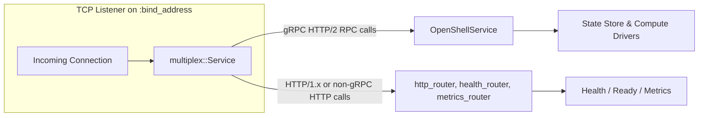
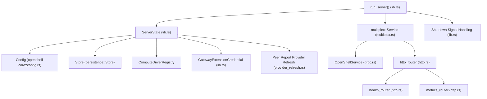
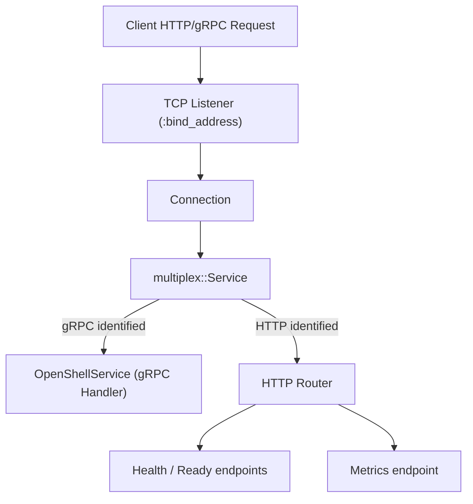

<!-- source: DeepWiki mcp.deepwiki.com · repo NVIDIA/OpenShell · page 5.1 Gateway Runtime and Startup · fetched 2026-10-26 -->

# Gateway Runtime and Startup

Relevant source files

The following files were used as context for generating this wiki page:

- [crates/openshell-core/src/config.rs](crates/openshell-core/src/config.rs)
- [crates/openshell-server/src/cli.rs](crates/openshell-server/src/cli.rs)
- [crates/openshell-server/src/config_file.rs](crates/openshell-server/src/config_file.rs)
- [crates/openshell-server/src/lib.rs](crates/openshell-server/src/lib.rs)
- [crates/openshell-server/src/multiplex.rs](crates/openshell-server/src/multiplex.rs)
- [crates/openshell-server/src/persistence/mod.rs](crates/openshell-server/src/persistence/mod.rs)
- [crates/openshell-server/src/persistence/postgres.rs](crates/openshell-server/src/persistence/postgres.rs)
- [crates/openshell-server/src/persistence/sqlite.rs](crates/openshell-server/src/persistence/sqlite.rs)
- [crates/openshell-server/src/persistence/tests.rs](crates/openshell-server/src/persistence/tests.rs)
- [crates/openshell-server/src/policy_store.rs](crates/openshell-server/src/policy_store.rs)
- [crates/openshell-server/src/provider_refresh.rs](crates/openshell-server/src/provider_refresh.rs)
- [crates/openshell-server/tests/auth_endpoint_integration.rs](crates/openshell-server/tests/auth_endpoint_integration.rs)
- [crates/openshell-server/tests/edge_tunnel_auth.rs](crates/openshell-server/tests/edge_tunnel_auth.rs)
- [crates/openshell-server/tests/multiplex_integration.rs](crates/openshell-server/tests/multiplex_integration.rs)
- [crates/openshell-server/tests/multiplex_tls_integration.rs](crates/openshell-server/tests/multiplex_tls_integration.rs)
- [crates/openshell-server/tests/ws_tunnel_integration.rs](crates/openshell-server/tests/ws_tunnel_integration.rs)
- [docs/about/run-your-first-agent.mdx](docs/about/run-your-first-agent.mdx)
- [docs/how-it-works/gateways/configuration.mdx](docs/how-it-works/gateways/configuration.mdx)
- [docs/how-it-works/policies/advisor.mdx](docs/how-it-works/policies/advisor.mdx)
- [skills/debug-openshell-cluster/SKILL.md](skills/debug-openshell-cluster/SKILL.md)

## Purpose and Scope

This page documents the internal runtime and startup sequence of the OpenShell gateway server. It covers the `run_server()` function, the `ServerState` lifecycle and data structures, the multiplexed gRPC and HTTP listeners, built-in health and metrics endpoints, graceful shutdown logic, and the peer relay mechanism used for multi-replica gateway setups. It focuses on describing core implementation concepts, data flow, and key types, using precise code references.

---

## 1. run_server() — Gateway Runtime Entrypoint

The primary starting point for the OpenShell gateway server runtime is the async function `run_server()`, defined in the `crates/openshell-server/src/lib.rs` around lines 1400-1600 (not fully shown but the function is referenced extensively).

- **Initialization**:  
  `run_server()` sets up the runtime environment by loading the configuration, initializing the persistence store, setting up authorization chains, and registering provider profiles. It also prepares compiled compute drivers into a registry for later use.

- **TLS Setup and Listeners**:  
  It configures the server’s TLS secrets based on CLI flags and config files (`config_file.rs`) and binds TCP listeners to configured endpoints (main multiplexed gateway listener, plus optional separate health and metrics listeners).

- **Extension Token Management**:  
  The gateway issues and refreshes extension credentials (see `mint_gateway_extension_credential()` and `spawn_gateway_extension_token_refresh()` in `lib.rs:115-190`) to allow middleware and interceptors to authenticate securely with generated bearer tokens.

- **ServerState Creation**:  
  The core shared state struct (`ServerState`) is created, holding all runtime components such as the store, config, registered compute drivers, extension tokens, telemetry, and more.

- **Multiplexing and Service Startup**:  
  The TCP listener accepts connections, which are demultiplexed between gRPC and HTTP by the multiplex module (`multiplex.rs`). Standard health check routes (e.g. `/healthz`, `/readyz`) and Prometheus metrics are registered at HTTP endpoints.

- **Shutdown Handling**:  
  The server listens for shutdown signals and coordinates a graceful stop process, closing all listeners and ensuring resource cleanup.

**Sources:** [crates/openshell-server/src/lib.rs:90-190](), [crates/openshell-server/src/cli.rs:23-190](), [crates/openshell-server/src/multiplex.rs:1-190]() 

---

## 2. ServerState — Gateway Runtime Shared Data

`ServerState` is the principal runtime structure maintaining the shared state of the gateway server.

- **Definition Location:**  
  Defined in `crates/openshell-server/src/lib.rs` around lines 1500-1600 (partial view), it holds references to:

  - Configuration (`Config`) and flags.
  - Persistence `Store` instance handling state storage.
  - The compute driver registry and selected driver instance.
  - Tokens for extension authentication.
  - Telemetry components and tracing log bus.
  - Authentication and authorization middleware chains.
  - Watchers for sandbox state changes and provider refresh.
  - Shutdown coordination primitives.

- **Purpose:**  
  Decouples the networking and protocol handling layers from backend logic and state persistence. It also centralizes control over server-wide lifecycle events like shutdown.

- **Concurrency:**  
  Internally guarded by async constructs and atomic flags for safety in the Tokio runtime.

**Sources:** [crates/openshell-server/src/lib.rs:70-85](), [crates/openshell-server/src/cli.rs:70-180]()

---

## 3. Multiplexed gRPC/HTTP Listener

OpenShell gateway runs gRPC and HTTP services simultaneously over the same TCP port using a protocol multiplexing strategy implemented in `multiplex.rs`.

- **Demultiplexing Strategy:**  
  Incoming TCP connections are parsed to inspect the HTTP/2 "content-type" headers and HTTP path. Requests matching the expected gRPC signatures are forwarded to the gRPC service handler (`OpenShellService`), while REST/health/metrics HTTP requests are routed to an HTTP router.

- **Routing:**  
  The HTTP services include:
  - Health and readiness checks (`/healthz`, `/readyz`).
  - Prometheus metrics endpoint (`/metrics`).
  - Possibly some gateway-control HTTP endpoints.

- **Request ID and Tracing:**  
  Each request is assigned a UUID request ID and instrumented with OpenTelemetry tracing spans (`make_request_span()`), logging rich protocol-level metadata for observability.

- **gRPC Service:**  
  The `OpenShellService` struct provides the primary RPC interface to clients, implementing the OpenShell protobuf service definitions.

**Diagram: Protocol Multiplexing in Gateway Server**

**Sources:** [crates/openshell-server/src/multiplex.rs:1-190](), [crates/openshell-server/src/lib.rs:90-190]()

---

## 4. Health and Metrics Endpoints

For operational readiness and monitoring, the gateway exposes dedicated listeners (optional, often bound on separate ports) for:

- **Health Checks:**  
  Simple HTTP endpoints `/healthz` and `/readyz` return liveness/readiness status. Implemented in `http.rs` and registered with a dedicated `health_router()`.

- **Prometheus Metrics:**  
  `/metrics` endpoint serves OpenMetrics scrape data using `metrics_exporter_prometheus::PrometheusBuilder`. This enables integration with Prometheus-compatible monitoring systems.

- **Optional Binding:**  
  Both listeners are optionally bound to separate sockets/address, configured via CLI flags or the config file:
  - `health_bind_address` (may be `None` to disable).
  - `metrics_bind_address` (may be `None` to disable).

- **Unauthenticated Access:**  
  These endpoints do not require authentication for ease of monitoring.

**Sources:** [crates/openshell-server/src/lib.rs:90-190](), [crates/openshell-server/src/http.rs:1-100] (partial)()

---

## 5. Graceful Shutdown

`run_server()` orchestrates a clean shutdown of the gateway server.

- **Signal Handling:**  
  It listens for shutdown signals (e.g., Ctrl+C or runtime abort) using Tokio's signal hooks.

- **Coordinated Shutdown:**  
  On trigger, it:
  - Closes all listeners (main multiplexed, health, metrics).
  - Cancels ongoing RPCs and HTTP connections gracefully.
  - Releases persistence and telemetry resources.
  - Propagates shutdown to compute drivers and extension token refresh tasks.

- **Shutdown Flag:**  
  An atomic boolean flag within `ServerState` marks the shutdown progress, allowing in-flight components to query shutdown state and avoid spawning new work.

- **Post-Shutdown Cleanup:**  
  Logs end of service, flushes telemetry exporters and tracing logs.

**Sources:** [crates/openshell-server/src/lib.rs:90-190]()

---

## 6. Peer Relay for Multi-Replica Gateways

OpenShell supports multi-replica gateway deployments, where multiple gateway instances serve the same logical installation for HA or scaling.

- **Peer Reporting:**  
  Gateways communicate readiness state and provider credential freshness among themselves.

- **Provider Credential Refresh Relay:**  
  The `provider_refresh.rs` module manages credential refresh state and propagates updates across gateway peers to keep multi-replica consistency.

- **PeerReportProviderReadiness:**  
  An RPC endpoint allows gateways to report their readiness and synchronize mutual state.

- **Data Flow:**  
  - Each gateway updates local persistence storage on provider credential refresh.
  - Broadcasts readiness to peers via gRPC.
  - Peers integrate updates and refresh caches used by supervisor processes and sandbox lifecycle handlers.

- **Implementation Detail:**  
  Peer relay occurs through the same multiplexed gRPC listener and leverages the core service implementations.

**Sources:** [crates/openshell-server/src/provider_refresh.rs:1-188](), [crates/openshell-server/src/lib.rs:90-190]()

---

## 7. Technical Diagrams: Mapping Natural Language to Code Entities

### Diagram 1: Gateway Runtime Main Components and Relationships

### Diagram 2: Protocol Flow for Incoming Client Requests

---

## 8. Summary

- `run_server()` initializes and manages the complete gateway lifecycle, bridging configuration, persistence, compute drivers, and network serving layers.
- `ServerState` holds all the shared runtime context.
- A single TCP listener multiplexes HTTP/1.x and HTTP/2 gRPC protocols, with dedicated routing for health, metrics, and main RPC services.
- Token minting and refresh for gateway extensions secure middleware and interceptors.
- Optional dedicated health and metrics listeners simplify monitoring.
- Graceful shutdown is coordinated to prevent data loss or client disruption.
- Multi-replica deployments synchronize provider credential readiness via the peer relay RPC.

The gateway runtime code uses idiomatic async Rust and modular layering to achieve robustness and observability while supporting complex deployments.

---

**Sources:**  
- [crates/openshell-server/src/lib.rs:1-194]()  
- [crates/openshell-server/src/cli.rs:23-190]()  
- [crates/openshell-server/src/multiplex.rs:1-190]()  
- [crates/openshell-server/src/http.rs (partial)]()  
- [crates/openshell-server/src/provider_refresh.rs:1-188]()  
- [crates/openshell-core/src/config.rs:150-190]()

---

