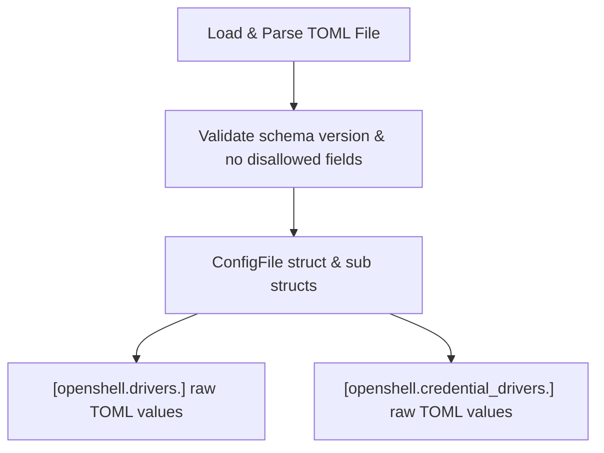
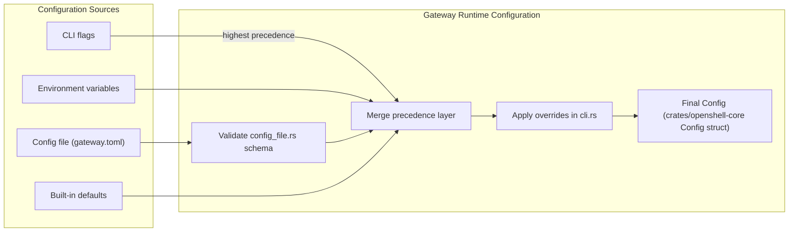
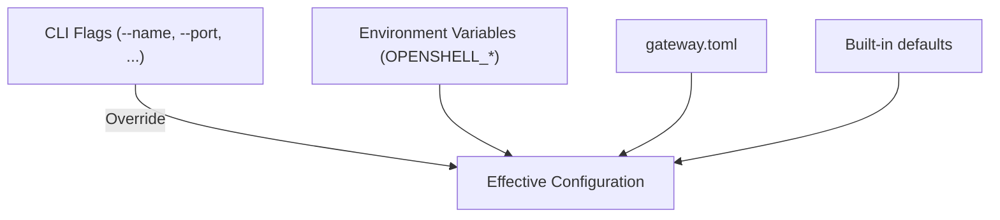
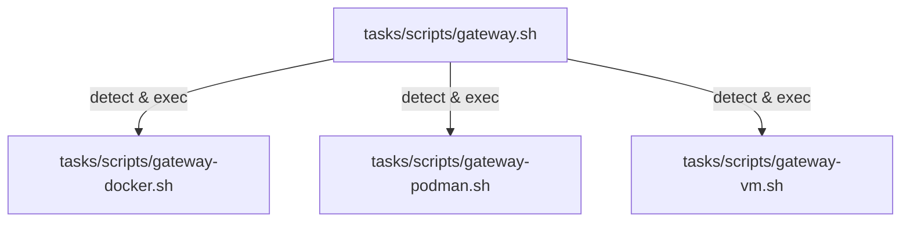
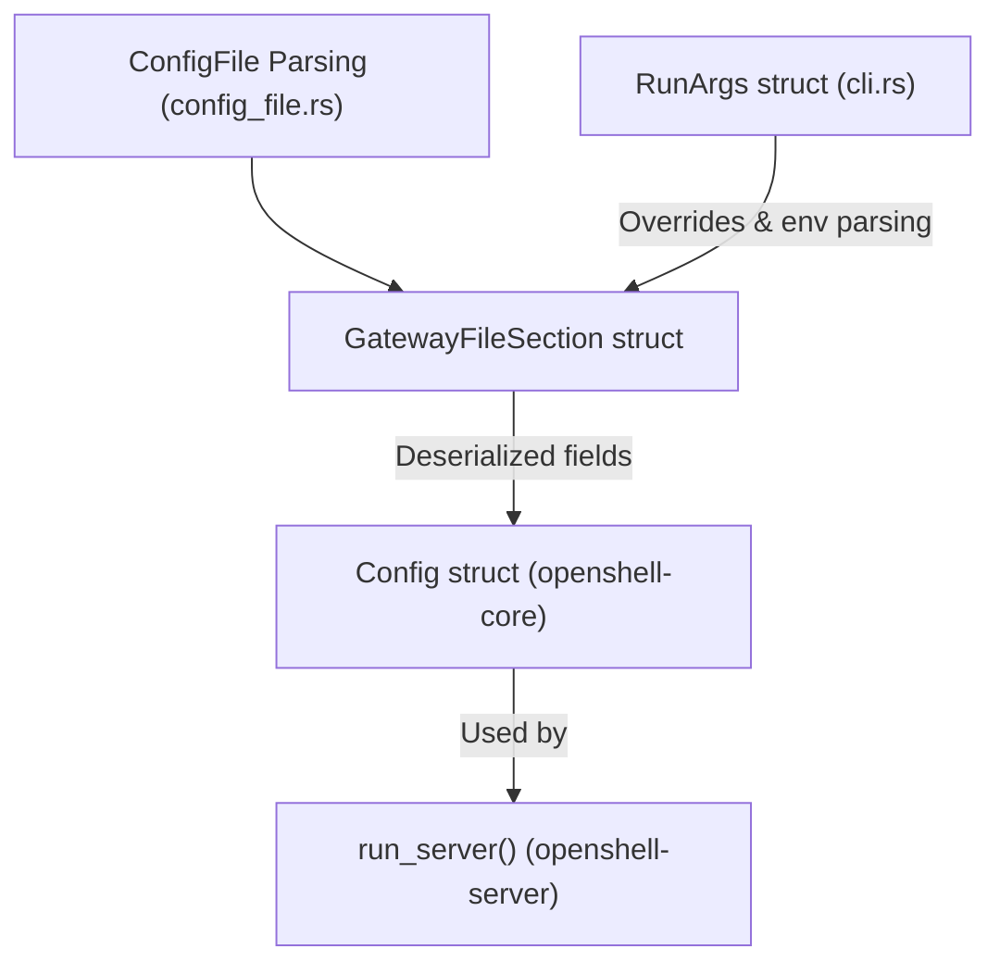

<!-- source: DeepWiki mcp.deepwiki.com · repo NVIDIA/OpenShell · page 5.2 Gateway Configuration · fetched 2026-10-26 -->

# Gateway Configuration

<details>
<summary>Relevant source files</summary>

The following files were used as context for generating this wiki page:

- [crates/openshell-core/src/config.rs](crates/openshell-core/src/config.rs)
- [crates/openshell-server/src/cli.rs](crates/openshell-server/src/cli.rs)
- [crates/openshell-server/src/config_file.rs](crates/openshell-server/src/config_file.rs)
- [crates/openshell-server/src/lib.rs](crates/openshell-server/src/lib.rs)
- [docs/how-it-works/gateways/configuration.mdx](docs/how-it-works/gateways/configuration.mdx)
- [skills/debug-openshell-cluster/SKILL.md](skills/debug-openshell-cluster/SKILL.md)
- [tasks/gateway.toml](tasks/gateway.toml)
- [tasks/scripts/gateway-docker.sh](tasks/scripts/gateway-docker.sh)
- [tasks/scripts/gateway-podman.sh](tasks/scripts/gateway-podman.sh)
- [tasks/scripts/gateway-vm.sh](tasks/scripts/gateway-vm.sh)
- [tasks/scripts/gateway.sh](tasks/scripts/gateway.sh)

</details>


This page documents the OpenShell gateway runtime configuration focusing on the `gateway.toml` schema, CLI flags and environment variable precedence, configuration validation and preflight, and the local development gateway launch scripts. It covers the gateway's file format and structured layering of configuration, the CLI integration design for flag/env/config resolution, validation logic for the TOML config payload, preflight CLI commands to check config correctness, and the scripts that facilitate local manual testing with various compute drivers.

---

## 1. `gateway.toml` Configuration Schema

OpenShell gateways load a hierarchical TOML configuration file, typically named `gateway.toml`, structured under the `[openshell]` root key. Configuration entries relevant to the gateway runtime live under `[openshell.gateway]`, with driver-specific settings isolated into `[openshell.drivers.<name>]` tables. Credential drivers get their own `[openshell.credential_drivers.<name>]` subtables.

### Schema Versioning and Layout

- The file must declare a schema version at `[openshell].version = 2`.
- Gateway-wide settings are stored under `[openshell.gateway]`. All fields are optional except for `version`.
- Driver configs are isolated per driver under `[openshell.drivers.<driver_name>]`. This isolation avoids inheritance or interference with global gateway settings.
- Configuration must avoid specifying certain sensitive fields, such as database URL, inside the file itself. These are loaded solely via environment variables or CLI flags.

Example file snippet (simplified):

```toml
[openshell]
version = 2

[openshell.gateway]
name = "openshell"
compute_driver = "docker"
disable_tls = true
log_level = "info"

[openshell.drivers.docker]
default_image = "nvcr.io/nvidia/base/ubuntu:24.04"
supervisor_image = "openshell/supervisor:dev"
sandbox_runtime_image = "openshell/sandbox:dev"
image_pull_policy = "if_not_present"
sandbox_label = "docker-dev"
grpc_endpoint = "http://127.0.0.1:17670"
app_armor_profile = "Unconfined"
```

### Fields and Features

- **Identity**: `name` designates the operator-readable gateway installation name.
- **Listeners**: `bind_address` and optional `health_bind_address` and `metrics_bind_address` control server socket binding.
- **Logging**: `log_level` sets runtime verbosity.
- **Compute Driver**: `compute_driver` chooses which runtime driver to use, or disables to enable detection.
- **Sandbox-related settings**: SSH session TTL, policy validation modes, and sandbox service routing DNS names.
- **TLS/Authentication**: Nested tables for TLS cert/key, OIDC config, mTLS client CA, gateway JWT signing configs.
- **Interceptors and Middleware**: Config lists of gateway interceptors and provider profile sources.
- **OCSF Logging and OpenTelemetry** tracing endpoints.

### Validation and Restrictions

- The config loader rejects disallowed fields intruding into the file (e.g., `database_url`).
- The file must specify `[openshell].version` exactly as `2`.
- Legacy schemas and multiple compute drivers arrays are deprecated.
- Explicit zero sentinel values in integers that disable features are disallowed for consistency.

### Schema Source and Details

The schema is formally represented and parsed in the Rust type `ConfigFile` defined in `crates/openshell-server/src/config_file.rs` [lines 44-173]() which deserializes and validates field shapes. It enforces:

- `[openshell]` root section containing `version`, `gateway`, `supervisor`, `drivers`, and `credential_drivers`.
- `[openshell.gateway]` section with mostly `Option<T>` to detect presence.
- Driver sections stored as raw TOML values for driver-specific deserialization.

---

## 2. CLI Flags and Environment Variable Precedence

The gateway binary accepts both command line flags and environment variables as configuration inputs. Configuration can be specified:

- Via explicit command line flags (`--name`, `--port`, `--disable-tls`, etc.).
- Via environment variables prefixed with `OPENSHELL_` (e.g. `OPENSHELL_GATEWAY_NAME`, `OPENSHELL_SERVER_PORT`).
- Via a TOML config file, specified by `--config` flag or `OPENSHELL_GATEWAY_CONFIG` environment variable.
- Built-in/runtime defaults apply if none of the above provide a value.

The overall precedence order is:

```text
CLI flag > OPENSHELL_* env var > TOML config file > built-in default
```

This layered model allows environment variables to override config files without requiring full CLI flags, and CLI flags control immediate overrides.

### CLI Flag and Env Definitions

The flags and env vars are declared with `clap` in `crates/openshell-server/src/cli.rs` [lines 28-173](), notably in the `RunArgs` struct starting line 72. Some key flags/envs:

| Flag/Env                  | Description                                      | Default / Notes                      |
| ------------------------- | ----------------------------------------------- | ---------------------------------- |
| `--config` / `OPENSHELL_GATEWAY_CONFIG` | Path to TOML config file                      | Optional                            |
| `--name` / `OPENSHELL_GATEWAY_NAME`     | Gateway installation name                     | Defaults to `openshell`             |
| `--bind-address` / `OPENSHELL_BIND_ADDRESS` | Address for server to listen                  | Defaults to `127.0.0.1`             |
| `--port` / `OPENSHELL_SERVER_PORT`      | Port for gateway listener                       | Defaults to 17670                   |
| `--health-port` / `OPENSHELL_HEALTH_PORT` | Port for unauthenticated health endpoint       | 0 disables dedicated listener      |
| `--metrics-port` / `OPENSHELL_METRICS_PORT` | Port for dedicated Prometheus metrics endpoint | 0 disables dedicated listener      |
| `--log-level` / `OPENSHELL_LOG_LEVEL`   | Log verbosity level                            | Defaults to `info`                  |
| `--tls-cert` / `OPENSHELL_TLS_CERT`     | TLS certificate file path                      | Optional; required unless TLS disabled |
| `--tls-key` / `OPENSHELL_TLS_KEY`       | TLS private key file path                       | Optional; required unless TLS disabled |
| `--disable-tls` / `OPENSHELL_DISABLE_TLS` | Disable TLS (serve plaintext HTTP)              | Defaults false                     |
| `--compute-driver` / `OPENSHELL_COMPUTE_DRIVER` | Selected compute driver by name               | Optional; triggers detection otherwise |

### Dynamic Driver Flags

- Support for flags like `--compute-driver-socket` to specify remote driver socket paths.
- Deprecated flags for compute-drivers arrays (`--drivers`) are not supported and produce errors.

### CLI Subcommands

- `generate-certs` subcommand helps bootstrap TLS for gateways (used by Helm).
- `config preflight` subcommand validates the config file without starting the gateway.

---

## 3. Config Validation: `config_file.rs`

The gateway loads and parses the TOML file via the `ConfigFile` and related types (`OpenShellRoot`, `GatewayFileSection`) from the `[openshell]` schema.

- Validation ensures schema version correctness (`version = 2`).
- Rejects disallowed file-supplied fields such as `database_url`.
- Checks for invalid or unknown fields with Serde's `deny_unknown_fields`.
- Does not apply CLI/env overrides directly but enables detection of which fields were present in the file. This informs later merging.
- Drivers and credential drivers are left as raw TOML values in per-driver maps to allow independent evolution.

The primary validation functions and structures are in `crates/openshell-server/src/config_file.rs` [lines 3-173]().



This module exposes:

- `ConfigFile` root parsing type
- Helper to extract driver config tables without inheritance
- Enforcement to keep `database_url` out of file (env only)
- Well-defined error reporting on schema version mismatches or unknown keys

---

## 4. Config Preflight CLI Command

The `openshell-gateway config preflight` CLI command allows operators to validate configuration files without launching the gateway server.

- Runs extensive checks on the TOML syntax and schema.
- Ensures disallowed or deprecated fields are not used.
- Reports errors early to prevent confusing runtime failures.

Defined in the CLI as `ConfigPreflightArgs` and parsed under subcommands [crates/openshell-server/src/cli.rs:54-67]().

**Usage example:**

```bash
openshell-gateway config preflight --path /path/to/gateway.toml
```

This command loads the specified file, validates it according to `config_file.rs` logic, and returns success or error diagnostics.

---

## 5. Local Development Gateway Scripts

To simplify running OpenShell gateway instances locally during development, the repository provides shell scripts under `tasks/scripts/` that automate launching gateway servers configured for specific compute drivers.

### Scripts

| Script Name                | Purpose                                                | Highlights                                                  |
|----------------------------|--------------------------------------------------------|-------------------------------------------------------------|
| `gateway.sh`               | Entry point for standalone launcher; detects driver    | Detects Kubernetes, Podman, or Docker in order; then execs corresponding script; errors if none found [tasks/scripts/gateway.sh:1-229]() |
| `gateway-docker.sh`        | Local Docker-driven gateway runner                      | Sets gateway name, ports, images; builds and runs the gateway binary; generates certs locally; prepares `gateway.toml` with Docker driver config [tasks/scripts/gateway-docker.sh:1-204]() |
| `gateway-podman.sh`        | Local Podman-driven gateway runner                      | Similar to Docker script but tailored for Podman environment and images [tasks/scripts/gateway-podman.sh:1-212]() |
| `gateway-vm.sh`            | VM driver-based gateway test script                     | Configures VM-specific paths; environment variables; builds; generates certs; persists state under local cache paths [tasks/scripts/gateway-vm.sh:1-202]() |

### Workflow of `gateway.sh` Script

- Detects compute driver by checking environment and presence of runtime (`KUBERNETES_SERVICE_HOST`, podman cli availability, docker cli availability).
- Normalizes driver name (`kubernetes`, `podman`, `docker`, `vm`).
- If no driver is found, exits with an error.
- Delegates to the corresponding driver-specific script for launch.
- Sets environment variables like `OPENSHELL_{DRIVER}_GATEWAY_NAME` to isolate per-driver configs.
- Performs validation like port availability.
- Builds the gateway binary from source (`cargo build` via `mise run build:gateway`).
- Generates local mTLS certs with `openshell-gateway generate-certs`.
- Writes a minimal `gateway.toml` with relevant computed paths and disables TLS for localhost convenience in dev.
- Outputs gateway metadata usable by the CLI to register and direct commands to the running gateway.

---

## 6. Data Flow & Diagrams

### Configuration Loading Flow



### Gateway CLI Flag/Env/Config Precedence



### Driver-Delegated Local Run Script Flow



### Mapping from Config Concepts to Code Entities



---

## References and Further Details

- The TOML schema and semantics are detailed in `crates/openshell-server/src/config_file.rs` lines 1-173.
- CLI flags, env var bindings, and their precedence live in `crates/openshell-server/src/cli.rs` lines 28-173.
- Local development gateway scripts that automate config and launch are under `tasks/scripts/gateway*.sh`.
- The `gateway.toml` config file documentation with examples and upgrade notes resides in `docs/how-it-works/gateways/configuration.mdx`.
- `crates/openshell-core/src/config.rs` contains global defaults and typed `Config` struct fields backing gateway runtime config.
- `tasks/gateway.toml` defines Makefile-like task entries pointing to these scripts for local use.

---

# Summary

OpenShell gateway configuration is primarily driven by a versioned TOML file schema rooted at `[openshell.gateway]`. This file coexists with CLI flags and environment variables in a carefully ordered override chain, allowing flexible deployment and local testing profiles. The Rust gateway binary enforces schema correctness and prevents insecure or disallowed settings in files. Local standalone gateway runners provide convenient ways to start fully configured gateways against popular compute drivers like Docker, Podman, and VM without manual config preparation.

---

**Sources:**  
- `crates/openshell-server/src/config_file.rs:1-173`  
- `crates/openshell-server/src/cli.rs:28-173`  
- `docs/how-it-works/gateways/configuration.mdx:1-102`  
- `tasks/scripts/gateway.sh:1-229`  
- `tasks/scripts/gateway-docker.sh:1-204`  
- `tasks/scripts/gateway-podman.sh:1-212`  
- `tasks/scripts/gateway-vm.sh:1-202`  
- `crates/openshell-core/src/config.rs:1-191`  
- `tasks/gateway.toml:1-26`

---

