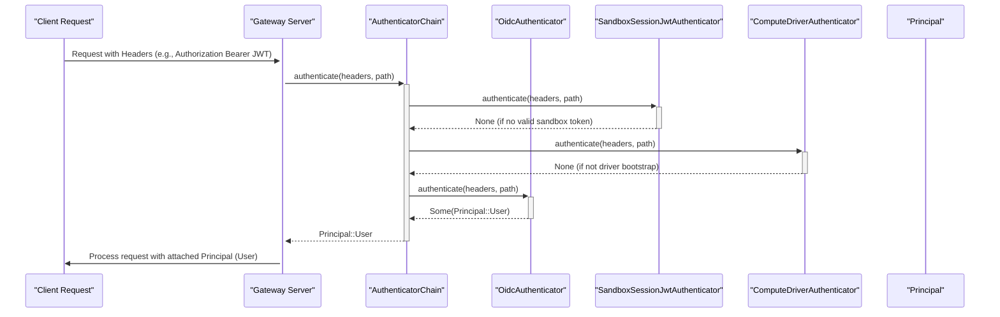
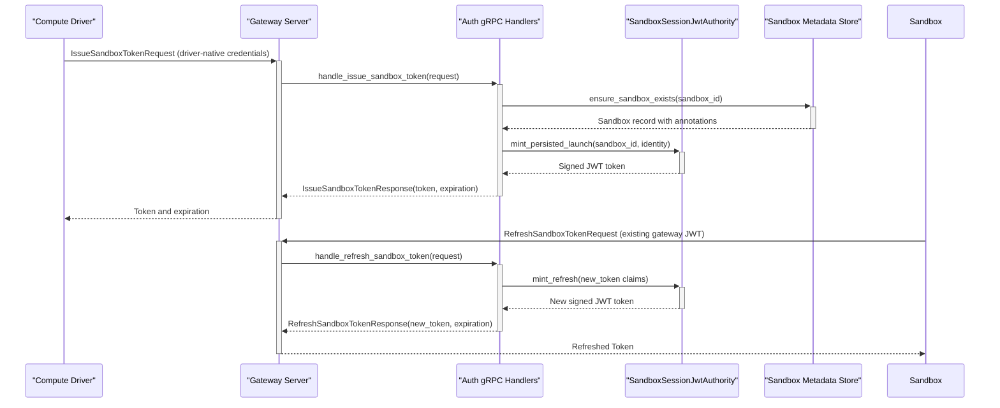

<!-- source: DeepWiki mcp.deepwiki.com · repo NVIDIA/OpenShell · page 5.3 Authentication and Authorization · fetched 2026-10-26 -->

# Authentication and Authorization

Relevant source files

The following files were used as context for generating this wiki page:

- [crates/openshell-core/src/extension_protocol.rs](crates/openshell-core/src/extension_protocol.rs)
- [crates/openshell-server/src/auth/authenticator.rs](crates/openshell-server/src/auth/authenticator.rs)
- [crates/openshell-server/src/auth/http.rs](crates/openshell-server/src/auth/http.rs)
- [crates/openshell-server/src/auth/launch_signing.rs](crates/openshell-server/src/auth/launch_signing.rs)
- [crates/openshell-server/src/auth/mod.rs](crates/openshell-server/src/auth/mod.rs)
- [crates/openshell-server/src/auth/oidc.rs](crates/openshell-server/src/auth/oidc.rs)
- [crates/openshell-server/src/auth/principal.rs](crates/openshell-server/src/auth/principal.rs)
- [crates/openshell-server/src/auth/sandbox_jwt.rs](crates/openshell-server/src/auth/sandbox_jwt.rs)
- [crates/openshell-server/src/defaults.rs](crates/openshell-server/src/defaults.rs)
- [crates/openshell-server/src/grpc/auth_rpc.rs](crates/openshell-server/src/grpc/auth_rpc.rs)
- [e2e/mcp-conformance.sh](e2e/mcp-conformance.sh)
- [e2e/rust/tests/oidc_pkce.rs](e2e/rust/tests/oidc_pkce.rs)
- [e2e/rust/tests/workspace_namespace_managed.rs](e2e/rust/tests/workspace_namespace_managed.rs)
- [e2e/rust/tests/workspace_namespace_operator.rs](e2e/rust/tests/workspace_namespace_operator.rs)

This section documents the comprehensive authentication and authorization mechanisms implemented in OpenShell's gateway server. It covers the mutual TLS (mTLS) setup, OpenID Connect (OIDC) user authentication via JWT validation, the issuance and refresh of gateway JWT tokens for sandbox supervision, sandbox session tokens, principals and roles used for identity representation, and the HTTP/gRPC authentication-related endpoints exposed by the gateway.

---

## 1. Overview and Scope

OpenShell employs a flexible and layered security architecture to authenticate any client connecting to the gateway — including human users, sandbox supervisors, and internal peer replicas — and to authorize what each caller can do.

Key components covered here include:

- **mTLS (Mutual TLS)** for gateway replica and peer authentication.
- **OIDC Authentication** for human users leveraging industry-standard identity providers (Keycloak, Okta, Entra ID).
- **Gateway JWT Issuance** of sandbox session tokens bound to sandbox runtime generation and credentials.
- **Sandbox Session Tokens** for supervisor-sandbox handshake and continuous authorization.
- **Principals and Roles** representing callers with fine-grained role and scope metadata.
- **Auth Endpoints and gRPC Handlers** that issue and refresh tokens and expose identity information.

This page goes into technical detail on implementation, data flow, and relevant code entities, enabling deep understanding and extension.

---

## 2. Mutual TLS (mTLS) Authentication

The gateway enforces **mutual TLS** for internal communication between gateway replicas and other trusted components (such as compute drivers). mTLS provides strong cryptographic mutual authentication before the gateway dispatches any requests.

- TLS certificate files reside in a local directory configured via environment variables or defaults (e.g. `OPENSHELL_LOCAL_TLS_DIR`), containing:
  - CA certificate (`ca.crt`)
  - Server certificate and key (`server/tls.crt`, `server/tls.key`)
  - Client certificate and key (`client/tls.crt`, `client/tls.key`)

- The server verifies client certificates against the CA.
- Client components present their own certificates signed by the CA.
  
This trust validates internal API calls, especially for sandbox bootstrap token exchanges and peer replica authorization.

The relevant TLS file resolution and verification logic lives in `crates/openshell-server/src/defaults.rs` managing these default paths and validation [crates/openshell-server/src/defaults.rs:10-120]().

---

## 3. OpenID Connect (OIDC) User Authentication

OpenShell supports validating human user authentication via OIDC JWTs issued from a compliant identity provider such as Keycloak.

### 3.1 OIDC Authentication Flow

- Incoming requests use an `Authorization: Bearer <JWT>` header.
- The gateway validates the JWT signature against a cached set of JWKS (JSON Web Key Set) keys fetched from the issuer's `jwks_uri` endpoint.
- The JWT payload is deserialized to extract the user claims such as subject, roles, scopes.
- An `Identity` object is created representing the user, including OIDC provider type.
- Verified users are represented as the principal variant `Principal::User`.

### 3.2 JWKS Caching and Validation

`JwksCache` manages fetching and refreshing JWKS keys with controlled TTL, cooldowns for unknown keys, and concurrency-safe refresh mutex to avoid stampedes. Cached keys are stored with decoding keys and algorithms for JWT verification.

Key constants like TTL grace period, max downloaded bytes, and cooldowns guard reliability and security.

Validation includes careful URL checks for issuer and JWKS endpoints, disallowing credentials in URLs, enforcing HTTPS unless exceptions for local development, and rejecting fragment/query components on JWKS URLs.

This OIDC authenticator is implemented in `crates/openshell-server/src/auth/oidc.rs`, including authentication logic, JWKS caching, and validation utilities [crates/openshell-server/src/auth/oidc.rs:1-181]().

---

## 4. Gateway JWT Issuance and Sandbox Session Tokens

Gateways mint their own **session JWTs** to delegate sandbox session authentication and continuity with strong cryptographic assurances.

### 4.1 Sandbox Session JWT Authority

- `SandboxSessionJwtAuthority` issues and verifies gateway-signed JWT tokens bound to a specific sandbox runtime generation.
- Tokens encode a "launch authentication" asserting the identity and generation epoch of the sandbox supervisor process.
- Token claims include a SPIFFE-style subject prefix and controlled TTL.
- Signing keys use EdDSA (Ed25519) and are loaded from PEM files configured during gateway startup.
- A matching verifier validates tokens on inbound sandbox requests.

### 4.2 Issuing and Refreshing Tokens

Two primary gRPC RPC handlers manage tokens:

- `IssueSandboxToken` is called during sandbox bootstrap by compute drivers presenting native credentials. It exchanges driver-authenticated sandbox identity for a gateway-signed session JWT.

- `RefreshSandboxToken` allows sandboxes already holding a valid gateway session JWT to refresh it, extending the session TTL and revoking prior tokens in a controlled lineage.

These handlers validate caller principals and sandbox metadata, ensure the runtime identity bindings remain consistent, and produce new JWT tokens via the `SandboxSessionJwtAuthority`.

Implementation is in `crates/openshell-server/src/grpc/auth_rpc.rs` which delegates calls to the minting authority and enforces authorization [crates/openshell-server/src/grpc/auth_rpc.rs:1-172]().

### 4.3 Launch Signing Authorities

The keys for signing and verifying these JWTs are loaded at gateway startup from local PEM files using the `LaunchSigningAuthorities` abstraction, which bundles an `ExtensionJwtIssuer` for typed extension tokens and a `SandboxSessionJwtAuthority` for sandbox session tokens.

Key loading includes self-tests for key pair matching and mint/verify operations before accepting drivers.

This logic is hosted in `crates/openshell-server/src/auth/launch_signing.rs` [crates/openshell-server/src/auth/launch_signing.rs:1-173]().

---

## 5. Principals and Roles

OpenShell represents authenticated callers as `Principal` enums, which are inserted into gRPC request extensions after authentication for subsequent authorization.

### 5.1 Principal Types

- `Principal::User(UserPrincipal)` for OIDC-authenticated human users.
- `Principal::Sandbox(SandboxPrincipal)` for sandbox supervisor processes authenticated by gateway session tokens or compute driver bootstrap credentials.
- `Principal::Peer(PeerPrincipal)` for trusted gateway replica peers.
- `Principal::Anonymous` for truly unauthenticated callers like health probes.

### 5.2 Principal Details

- User principals wrap an `Identity` struct which includes subject, roles, scopes, and identity provider type.
- Sandbox principals hold sandbox UUIDs and a `SandboxIdentitySource` enum specifying how the identity was verified:
  - `BootstrapJwt` for gateway-issued session tokens.
  - `ComputeDriver` for bootstrapped identities derived from compute driver native credentials.
- Peer principals carry replica and pod identity for mutual authentication inside gateway clusters.

The principal types and authorization sources are defined in `crates/openshell-server/src/auth/principal.rs` [crates/openshell-server/src/auth/principal.rs:1-89]().

---

## 6. Authenticator Chain and gRPC Authentication

The gateway runs incoming requests through a chain of `Authenticator` implementations, each attempting to authenticate the caller:

- `SandboxSessionJwtAuthenticator` validates gateway session JWTs.
- `ComputeDriverAuthenticator` validates sandbox bootstrap tokens from compute drivers.
- `OidcAuthenticator` validates OIDC Bearer tokens.
- Others can be inserted to handle mTLS peer auth and anonymous bypass.

The first authenticator to match produces a `Principal`; if none applies, the request is unauthenticated.

This chain is implemented as the `AuthenticatorChain` struct owning a vector of authenticators and running them in order on every request.

The trait and chain implementation reside in `crates/openshell-server/src/auth/authenticator.rs` [crates/openshell-server/src/auth/authenticator.rs:1-186](). The chain fail-closed guarantees security by terminating on errors during authentication.

---

## 7. HTTP/gRPC Authentication and Authorization Endpoints

OpenShell exposes several endpoints to surface authentication and manage tokens:

- **GetCurrentUser**: Returns the currently authenticated user identity, including subject, display name, roles, scopes, and auth provider.

- **IssueSandboxToken**: Receives compute driver authenticated sandbox bootstrap credentials and returns a gateway JWT.

- **RefreshSandboxToken**: Accepts a valid gateway-issued sandbox JWT and issues a fresh one, renewing session validity.

These endpoints are implemented as async functions in `crates/openshell-server/src/grpc/auth_rpc.rs`, extracting the `Principal` from request extensions and executing the relevant logic with proper permission checks [crates/openshell-server/src/grpc/auth_rpc.rs:33-172]().

---

## 8. Data Flow Diagram: Authentication Chain and Principal Assignment

**Explanation:** The gateway attempts authenticators in order: first sandbox session JWT validation, then compute driver bootstrap token, then OIDC JWT bearer validation. The first matching authenticator sets the Principal passed to handlers.

Sources: `crates/openshell-server/src/auth/authenticator.rs`, `crates/openshell-server/src/auth/oidc.rs`, `crates/openshell-server/src/auth/principal.rs`

---

## 9. Data Flow Diagram: Sandbox Token Issuance and Refresh

**Explanation:** The compute driver bootstraps sandbox credentials initially with `IssueSandboxToken`, after which the sandbox supervisor can refresh tokens regularly with `RefreshSandboxToken`. The JWT authority keeps lineage and issues tokens bound to sandbox runtimes.

Sources: `crates/openshell-server/src/grpc/auth_rpc.rs`, `crates/openshell-server/src/auth/sandbox_jwt.rs`

---

## 10. Summary Table of Key Code Entities

| Entity                      | Role and Responsibility                                             | Location (with lines)                  |
|-----------------------------|--------------------------------------------------------------------|--------------------------------------|
| `Authenticator` (trait)     | Abstract step in authentication chain                             | `src/auth/authenticator.rs:30-48`    |
| `AuthenticatorChain`        | Runs ordered authenticators, returns first principal               | `src/auth/authenticator.rs:50-92`    |
| `OidcAuthenticator`         | Validates OIDC JWT bearer tokens against JWKS                      | `src/auth/oidc.rs:1-181`              |
| `JwksCache`                 | Caches and refreshes JWKS keys safely                              | `src/auth/oidc.rs:66-83`              |
| `Principal` (enum)           | Caller identity abstraction                                         | `src/auth/principal.rs:23-90`         |
| `SandboxSessionJwtAuthority`| Issues and verifies gateway JWTs for sandbox sessions              | `src/auth/sandbox_jwt.rs:94-199`      |
| `ExtensionJwtIssuer`        | Mints typed JWTs for extensions and middleware                      | `src/auth/sandbox_jwt.rs:66-84`       |
| gRPC Handlers (`handle_*`)   | Implement auth-related RPCs: GetCurrentUser, Issue/RefreshSandboxToken | `src/grpc/auth_rpc.rs:33-172`          |
| `LaunchSigningAuthorities`  | Load and validate signing keys for session JWTs at gateway startup | `src/auth/launch_signing.rs:12-88`    |

---

## 11. Notes on Authorization

While this page focuses primarily on authentication mechanisms, authorization in OpenShell is role and scope-based and is implemented separately in the `authz` crate module. After authenticators produce a `Principal`, the authorization layer evaluates the principal's roles and scopes against each request and its method-specific policy.

---

## References

- `crates/openshell-server/src/auth/oidc.rs` (OIDC authentication, JWKS caching)
- `crates/openshell-server/src/auth/authenticator.rs` (Authenticator trait and chain)
- `crates/openshell-server/src/auth/principal.rs` (Principal enum)
- `crates/openshell-server/src/auth/sandbox_jwt.rs` (Sandbox session JWT authority)
- `crates/openshell-server/src/grpc/auth_rpc.rs` (gRPC auth handlers)
- `crates/openshell-server/src/defaults.rs` (TLS key paths)
- `crates/openshell-server/src/auth/launch_signing.rs` (Signing keys loading)

---

This concludes the detailed technical documentation for OpenShell's Authentication and Authorization architecture and implementation.

---

