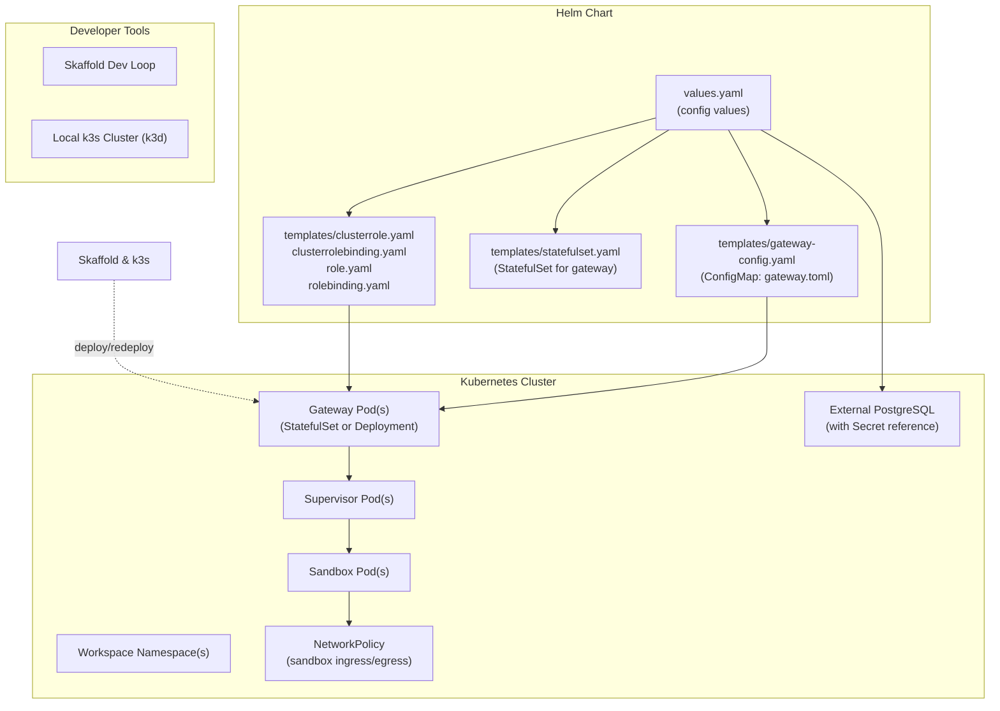
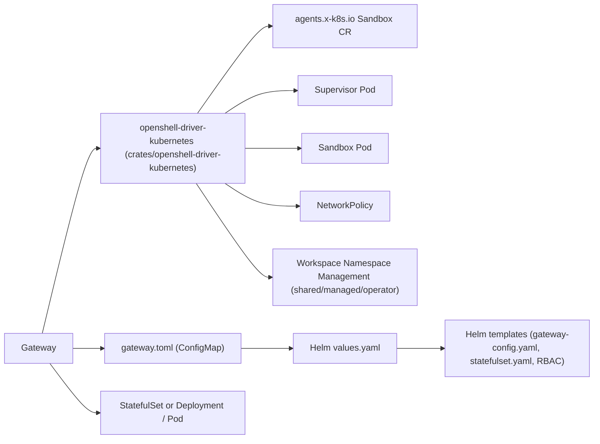

<!-- source: DeepWiki mcp.deepwiki.com · repo NVIDIA/OpenShell · page 5.5 Kubernetes Deployment (Helm) · fetched 2026-10-26 -->

# Kubernetes Deployment (Helm)

<details>
<summary>Relevant source files</summary>

The following files were used as context for generating this wiki page:

- [.agents/skills/helm-dev-environment/SKILL.md](.agents/skills/helm-dev-environment/SKILL.md)
- [crates/openshell-driver-kubernetes/README.md](crates/openshell-driver-kubernetes/README.md)
- [crates/openshell-driver-kubernetes/src/config.rs](crates/openshell-driver-kubernetes/src/config.rs)
- [crates/openshell-driver-kubernetes/src/driver.rs](crates/openshell-driver-kubernetes/src/driver.rs)
- [crates/openshell-driver-kubernetes/src/lib.rs](crates/openshell-driver-kubernetes/src/lib.rs)
- [crates/openshell-driver-kubernetes/src/lifecycle.rs](crates/openshell-driver-kubernetes/src/lifecycle.rs)
- [crates/openshell-driver-kubernetes/src/lifecycle_tests.rs](crates/openshell-driver-kubernetes/src/lifecycle_tests.rs)
- [crates/openshell-driver-kubernetes/src/main.rs](crates/openshell-driver-kubernetes/src/main.rs)
- [deploy/helm/openshell-workspace/templates/role.yaml](deploy/helm/openshell-workspace/templates/role.yaml)
- [deploy/helm/openshell-workspace/tests/workspace_test.yaml](deploy/helm/openshell-workspace/tests/workspace_test.yaml)
- [deploy/helm/openshell/README.md](deploy/helm/openshell/README.md)
- [deploy/helm/openshell/README.md.gotmpl](deploy/helm/openshell/README.md.gotmpl)
- [deploy/helm/openshell/ci/values-gateway.yaml](deploy/helm/openshell/ci/values-gateway.yaml)
- [deploy/helm/openshell/ci/values-keycloak.yaml](deploy/helm/openshell/ci/values-keycloak.yaml)
- [deploy/helm/openshell/ci/values-namespace-admin.yaml](deploy/helm/openshell/ci/values-namespace-admin.yaml)
- [deploy/helm/openshell/ci/values-skaffold.yaml](deploy/helm/openshell/ci/values-skaffold.yaml)
- [deploy/helm/openshell/ci/values-tls-disabled.yaml](deploy/helm/openshell/ci/values-tls-disabled.yaml)
- [deploy/helm/openshell/templates/_gateway-workload.tpl](deploy/helm/openshell/templates/_gateway-workload.tpl)
- [deploy/helm/openshell/templates/_helpers.tpl](deploy/helm/openshell/templates/_helpers.tpl)
- [deploy/helm/openshell/templates/clusterrole.yaml](deploy/helm/openshell/templates/clusterrole.yaml)
- [deploy/helm/openshell/templates/clusterrolebinding.yaml](deploy/helm/openshell/templates/clusterrolebinding.yaml)
- [deploy/helm/openshell/templates/gateway-config.yaml](deploy/helm/openshell/templates/gateway-config.yaml)
- [deploy/helm/openshell/templates/peer-role.yaml](deploy/helm/openshell/templates/peer-role.yaml)
- [deploy/helm/openshell/templates/role.yaml](deploy/helm/openshell/templates/role.yaml)
- [deploy/helm/openshell/templates/rolebinding.yaml](deploy/helm/openshell/templates/rolebinding.yaml)
- [deploy/helm/openshell/templates/statefulset.yaml](deploy/helm/openshell/templates/statefulset.yaml)
- [deploy/helm/openshell/tests/clusterrole_test.yaml](deploy/helm/openshell/tests/clusterrole_test.yaml)
- [deploy/helm/openshell/tests/clusterrolebinding_test.yaml](deploy/helm/openshell/tests/clusterrolebinding_test.yaml)
- [deploy/helm/openshell/tests/gateway_config_test.yaml](deploy/helm/openshell/tests/gateway_config_test.yaml)
- [deploy/helm/openshell/tests/gateway_sandbox_identity_test.yaml](deploy/helm/openshell/tests/gateway_sandbox_identity_test.yaml)
- [deploy/helm/openshell/tests/sandbox_namespace_test.yaml](deploy/helm/openshell/tests/sandbox_namespace_test.yaml)
- [deploy/helm/openshell/values.yaml](deploy/helm/openshell/values.yaml)
- [deploy/helm/test-split-ownership.sh](deploy/helm/test-split-ownership.sh)
- [deploy/kube/manifests/openshell-helmchart.yaml](deploy/kube/manifests/openshell-helmchart.yaml)
- [docs/kubernetes/setup.mdx](docs/kubernetes/setup.mdx)
- [e2e/with-kube-gateway.sh](e2e/with-kube-gateway.sh)
- [tasks/helm.toml](tasks/helm.toml)
- [tasks/scripts/helm-k3s-local.sh](tasks/scripts/helm-k3s-local.sh)

</details>


This section provides an in-depth technical overview of deploying the OpenShell gateway to a Kubernetes cluster using the official Helm chart located in `deploy/helm/openshell`. It covers the Helm `values.yaml` configuration, the `gateway-config` template how gateway workload deployments are differentiated (StatefulSet vs Deployment), integration with an external PostgreSQL database, Role-Based Access Control (RBAC) and ClusterRoles management, NetworkPolicy usage, the separate workspace Helm chart, OpenShift deployment notes, and the Skaffold/k3s local development iterative deployment loop.

---

## Overview

OpenShell uses a Kubernetes compute driver implemented in Rust to deploy and manage sandbox workloads as Kubernetes custom resources (`Sandbox` from the Agent Sandbox SIG project). The Helm chart deploys the gateway service and the required Kubernetes resources. It supports different operational modes and namespaces layouts for the sandboxes, flexible image configuration, security via TLS, strict RBAC policies, and network isolation using NetworkPolicies.

---

## Chart and Configuration

### `values.yaml` Defaults and Key Parameters

The Helm chart's `values.yaml` file defines default configuration values and options for customizing the deployment. Key configurable sections include:

- **Replica Count and Workload Kind**

  ```yaml
  replicaCount: 1
  workload:
    kind: statefulset
    allowMultiReplicaStatefulSet: false
  ```
  - `replicaCount`: Number of gateway replicas.
  - `workload.kind`: Determines if the gateway is deployed as a `StatefulSet` or a `Deployment`.
    - Use `StatefulSet` for default single-replica setups backed by SQLite.
    - Use `Deployment` for multi-replica setups which require an external database.
  - `allowMultiReplicaStatefulSet`: If true, permits multiple replicas using a StatefulSet, typically discouraged.

- **Images**

  The chart uses a layered image configuration:

  - Global defaults apply to shared images (`global.image.registry`, `tag`, `pullPolicy`).
  - `gateway.image`, `sandboxRuntime.image`, `supervisor.image`, and `sandbox.image` can override global settings individually.
  - Images can specify explicit `tag` or `digest`; digest takes precedence.
  - Example section for gateway image override:
  
    ```yaml
    gateway:
      image:
        registry: ""
        repository: openshell/gateway
        tag: ""
        digest: ""
    ```

- **Security and Policy**

  Options for enabling/disabling TLS, configuring the certificate manager, and controlling policy validation failure modes are exposed:
  
  ```yaml
  server:
    disableTls: false
    policyValidationFailureMode: "fail_closed"
  ```

- **RBAC**

  Controls creation of RBAC resources, and whether cluster-scoped objects are created:

  ```yaml
  rbac:
    create: true
    clusterScoped:
      create: true
      clusterRoleName: ""
      clusterRoleBindingName: ""
  ```

- **Sandbox Runtime and Supervisor**

  Trusted workload and control-side runtime images and ports are configurable, with defaults that align with gateway images.

- **Upstream Proxy**

  Gateway-side configuration allows specifying a corporate forward proxy for sandbox egress traffic, including authentication and CA bundles.

- **Service Accounts**

  Separate service accounts can be created for the gateway and sandbox pods:
  
  ```yaml
  serviceAccount:
    create: true
    annotations: {}
    name: ""

  sandboxServiceAccount:
    create: true
    annotations: {}
    name: ""
  ```

- **Workspace Resources**

  The chart can be configured to own or not own sandbox namespace-scoped resources, allowing installing a separate workspace chart when needed for multi-namespace multi-workspace deployments.

Sources: `deploy/helm/openshell/values.yaml:1-159`


### Gateway Configuration Template (`templates/gateway-config.yaml`)

The Helm chart renders a ConfigMap containing the gateway TOML configuration file (`gateway.toml`). This configuration is read by OpenShell gateway at startup.

- The template supports:

  - Setting gateway identity and binding addresses.
  - Configuring the compute driver as `"kubernetes"`.
  - Credential driver options, for example enabling `"kubernetes-secrets"` or `"vault"`.
  - Policy validation failure mode enforcement: must be `"fail_closed"` or `"retain_last_valid"`.
  - TLS server and client certificate file paths, including support for cert-manager or built-in PKI job secrets.
  - OTLP tracing endpoint and OCSF logging options.
  - Rate limit parameters for gRPC requests.
  - Gateway image references are derived sensibly from global or gateway-specific image values, with digest precedence.
  
- It *does not* render the database URL (`server.dbUrl`) in this file; it is passed separately as an environment variable or CLI argument depending on whether external database credentials exist.

- Conditional logic ensures coherent and secure TLS and authentication setup. For example, if cert-manager is referenced, `certManager.enabled` must also be true or the installation fails with a message.

- Gateway-level flags and security have defaults balancing developer experience and production needs (e.g., the WebSocket tunnel is disabled unless explicitly enabled).

Sources: `deploy/helm/openshell/templates/gateway-config.yaml:1-144`, `deploy/helm/openshell/tests/gateway_config_test.yaml:1-183`


### StatefulSet vs Deployment for Gateway

By default, the OpenShell gateway is deployed using a `StatefulSet` when SQLite is used as the local backend database, since StatefulSets provide stable identities and persistent storage per pod.

- The StatefulSet configuration (in `templates/statefulset.yaml`) includes a PVC template for `openshell-data` volume with default storage size (1Gi).

- For deployments with multiple replicas (i.e., `replicaCount > 1`), stateful sets are discouraged unless `allowMultiReplicaStatefulSet` is set to `true`. Instead, a Kubernetes `Deployment` is preferred when using an external database for gateway persistence.

- The deployment type affects pod lifecycle, scaling semantics, and storage affinity.

Sources: `deploy/helm/openshell/values.yaml:6-28`, `deploy/helm/openshell/templates/statefulset.yaml:1-27`


---

## External PostgreSQL Support

OpenShell supports running the gateway in HA mode with multiple replicas by offloading persistence to an external PostgreSQL database.

- This requires setting `server.externalDbSecret` to reference a Kubernetes Secret containing the database connection URI (`uri` key).

- The chart and e2e tests support deploying an ephemeral PostgreSQL fixture as a deployment and Secret for testing or CI purposes.

- The use of an external database disables the default SQLite backend (which is per pod and unsuitable for multi-replica).

- Flags in test scripts (`e2e/with-kube-gateway.sh`) demonstrate the management of such fixtures for integration testing, configuring external PostgreSQL secrets and deployments dynamically.

- The Helm chart and gateway deployment logic conditionally configure connection parameters and environment variables accordingly to use this external database backend.

Sources: `e2e/with-kube-gateway.sh:160-164`, `deploy/helm/openshell/values.yaml:6-13`


---

## RBAC and ClusterRoles

RBAC in the Helm chart is finely controlled with flags to allow deployment in different cluster permission scenarios.

- The gateway service account is granted necessary permissions via:

  - Namespaced `Role` and `RoleBinding` resources, created by default.
  - Cluster-scoped `ClusterRole` and `ClusterRoleBinding` for permissions like `TokenReview`.

- Flags:

  - `rbac.create` controls whether RBAC objects are created at all.
  - `rbac.clusterScoped.create` controls creation of cluster-wide `ClusterRole` and `ClusterRoleBinding`.
  
- This splitting allows a cluster-admin to preinstall cluster-scoped RBAC once, and let a namespace-admin install the gateway without cluster-wide rights.

- The chart documents the scenarios for installers with different permission levels, with guidance on annotations to keep cluster-scoped objects across upgrades.

- Sample commands for pre-creating RBAC cluster bindings and managing ownership are provided in the README.

- The service account names can be overridden with config values.

Sources: `deploy/helm/openshell/README.md:20-130`, `deploy/helm/openshell/values.yaml:144-159`, `deploy/helm/openshell/templates/_helpers.tpl:93-147`


---

## NetworkPolicy Usage

OpenShell enforces strong network isolation using Kubernetes `NetworkPolicy` objects around sandbox workloads:

- A namespace-wide `NetworkPolicy` selects all OpenShell workload pods and denies all egress by default.

- It allows ingress traffic from supervisor pods to the workload boundary TLS port.

- The gateway's Kubernetes compute driver manages these policies.

- The CNI plugin in the cluster *must* enforce ingress and egress `NetworkPolicy`. Kubernetes accepts these resources regardless, so operators must ensure actual enforcement.

- This approach prevents sandboxes from bypassing supervisor mediation or directly connecting outside policy.

Sources: `crates/openshell-driver-kubernetes/src/driver.rs:78-86`

---

## Workspace Chart and Multi-Namespace Deployment

The Helm chart allows flexible workspace namespace management modes, governed by the `server.drivers.kubernetes.workspaceMode` configuration:

- **Shared (default)**

  - All sandboxes run in a single fixed namespace.
  - Namespaced resources use workspace-scoped names with `{workspace}--{name}` syntax for collision avoidance.

- **Managed**

  - The driver automatically creates and deletes namespaces dynamically on demand with the pattern `openshell-{gateway_id}-{workspace}`.
  - It also manages ServiceAccounts and copies SCC annotations on OpenShift.

- **Operator**

  - Pre-provisioned namespaces are used exclusively.
  - The driver uses a label selector or a namespace allowlist file to discover which namespaces are valid.
  - The gateway does not create or delete namespaces, leaving lifecycle to platform operators.
  - Admins must carefully secure namespaces as the allowlist is not a tenant isolation boundary.

When deploying in a multitenant environment:

- The main gateway Helm chart can be installed with `workspaceResources.enabled=false` to omit sandbox-related namespaced resources.

- The `openshell-workspace` Helm chart can then be installed into each pre-provisioned workspace namespace to manage sandbox RBAC, service accounts, and NetworkPolicies. 

Example installation snippet for splitting gateway and workspace:

```shell
helm upgrade --install openshell \
  oci://ghcr.io/nvidia/openshell/helm-chart \
  --version <version> \
  --namespace openshell \
  --set workspaceResources.enabled=false \
  --set server.sandboxNamespace=app-a

helm upgrade --install openshell-workspace \
  oci://ghcr.io/nvidia/openshell/openshell-workspace \
  --version <version> \
  --namespace app-a \
  --set gateway.serviceAccount.name=openshell \
  --set gateway.serviceAccount.namespace=openshell
```

Sources: `deploy/helm/openshell/README.md:12-146`, `docs/kubernetes/setup.mdx:91-147`, `crates/openshell-driver-kubernetes/README.md:15-73`


---

## OpenShift Deployment Notes

- OpenShift requires special attention mainly due to Security Context Constraints (SCC) and networking.

- The Helm chart and associated scripts check for OpenShift and adapt namespace annotations and RBAC accordingly.

- OpenShift disables port-forwarding for CLI to gateway connections due to latency on SSH tunnels. Instead, a true network path secured with mandatory mTLS via an OpenShift Route is recommended.

- Dedicated OpenShift values files like `ci/values-openshift-e2e.yaml` are provided for correct cluster-specific behavior.

- Namespaces used by OpenShift and SCC adjustments might need to be precreated and granted permissions manually.

- The official OpenShift installation guide linked in the Helm chart README covers this in detail.

Sources: `deploy/helm/openshell/README.md:155-161`, `e2e/with-kube-gateway.sh:20-29`


---

## Skaffold and k3s Development Loop

For rapid iterative development, OpenShell supports a local Kubernetes development loop using Skaffold and k3s (via k3d):

- The project includes scripts and tasks to:

  - Create and start a local k3s cluster (`tasks/scripts/helm-k3s-local.sh`).
  - Build and load local Docker images into k3d.
  - Deploy the Helm chart to the cluster.
  - Port-forward the gateway service for local CLI access.

- Skaffold watches source code changes and Helm templates, automatically rebuilding and redeploying the gateway.

- Workspace and test values files such as `ci/values-skaffold.yaml` configure the environment for local development.

- Key task entries in `tasks/helm.toml` include `helm:skaffold:dev`, `helm:k3s:create`, `helm:k3s:delete`, and related commands.

- This workflow provides a close approximation of production deployment for developing gateway features and integration tests locally.

Sources: `e2e/with-kube-gateway.sh:5-164`, `tasks/helm.toml:71-127`


---

## System Components and Their Interaction

The following diagram maps natural language system parts to relevant Helm chart artifacts and runtime components for clarity:



- The Helm chart's `values.yaml` controls images, replica counts, RBAC, TLS, and workspace modes.
- `gateway-config.yaml` generates the key gateway TOML configuration, mounted into gateway pods.
- The gateway runs as a StatefulSet by default, or Deployment for multi-replica external DB setups.
- Supervisor and Sandbox pods are orchestrated dynamically by the gateway Kubernetes driver.
- RBAC controls permissions for the gateway service account, sandbox service account, and cluster roles.
- Network Policies ensure sandbox pods are isolated and supervised.
- External Postgres may be referenced via Secret for HA persistence.
- For local dev, Skaffold and k3s/k3d automate build and deployment loops.

Sources: `deploy/helm/openshell/values.yaml`, `deploy/helm/openshell/templates/gateway-config.yaml`, `deploy/helm/openshell/templates/statefulset.yaml`, `deploy/helm/openshell/README.md`, `e2e/with-kube-gateway.sh`, `tasks/helm.toml`


---

## Kubernetes Driver and Sandbox Resource Lifecycle

Internally, the Kubernetes compute driver, implemented in Rust (`crates/openshell-driver-kubernetes`), orchestrates sandbox lifecycle on behalf of the gateway:

- It interfaces with the `agents.x-k8s.io` `Sandbox` CRD, watching sandbox resource state.

- Generates supervisor Pods with direct owner references to the Sandbox CR, enabling proper garbage collection.

- Creates a Kubernetes `Service` to provide a stable boundary communication endpoint for the workload pod.

- Maintains TLS identity and bootstrap secrets for sandbox generations.

- Creates and maintains namespace-wide `NetworkPolicy` enforcing supervisor ingress and sandbox egress restrictions.

- Supports namespace workspace modes (`shared`, `managed`, `operator`) configured via `KubernetesComputeConfig`.

- Observes and propagates sandbox state, events, and platform conditions back to the gateway through gRPC streams.

The driver ensures sandbox workload pods run as non-root with strict capabilities and seccomp profiles, delivering the trusted sandbox runtime image and supervisor image specified in the Helm chart configuration.

Sources: `crates/openshell-driver-kubernetes/src/driver.rs:1-163+`, `crates/openshell-driver-kubernetes/src/config.rs:1-178`, `crates/openshell-driver-kubernetes/README.md:1-120`


---

## Summary of Key Files

| File | Description |
|-------|-------------|
| `deploy/helm/openshell/values.yaml` | Default Helm chart values, configurable parameters for images, replicas, RBAC, TLS, proxy, etc. |
| `deploy/helm/openshell/templates/gateway-config.yaml` | Gateway TOML configuration rendered as ConfigMap, key gateway runtime options and integration points. |
| `deploy/helm/openshell/templates/statefulset.yaml` | Kubernetes StatefulSet manifest template for gateway pod using local SQLite backend. |
| `deploy/helm/openshell/README.md` | User-facing Helm chart README with usage, RBAC, workspace modes, and OpenShift notes. |
| `e2e/with-kube-gateway.sh` | End-to-end test script for deploying OpenShell gateway with Helm on Kubernetes. |
| `tasks/helm.toml` | Development tasks for Helm operations including skaffold runs and k3s cluster lifecycle management. |
| `crates/openshell-driver-kubernetes/src/driver.rs` | Kubernetes compute driver implementation managing sandbox lifecycle and Kubernetes API interactions. |
| `crates/openshell-driver-kubernetes/src/config.rs` | Driver configuration including workspace modes, image policies, and runtime defaults. |

---

This page documents the intricate system design, configuration, and operational considerations for deploying the OpenShell gateway in a Kubernetes cluster using Helm. It enables operators and developers to understand, customize, and safely manage the OpenShell runtime platform in various Kubernetes environments including OpenShift, on-premises, and cloud clusters.

---

# Appendix: Glossary of Key Deployment Concepts and Code Entities



This diagram correlates OpenShell runtime concepts with the concrete code artifacts where these responsibilities are implemented or configured.

Sources: `crates/openshell-driver-kubernetes/src/driver.rs`, `deploy/helm/openshell/templates/gateway-config.yaml`, `deploy/helm/openshell/values.yaml`

---

# End of Page 5.5 Kubernetes Deployment (Helm)

---

