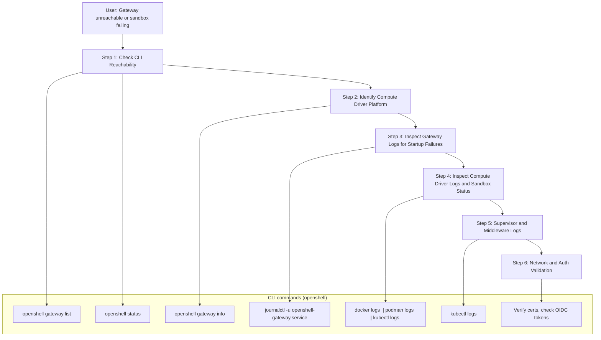
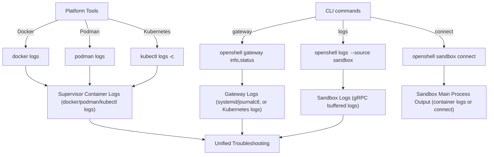
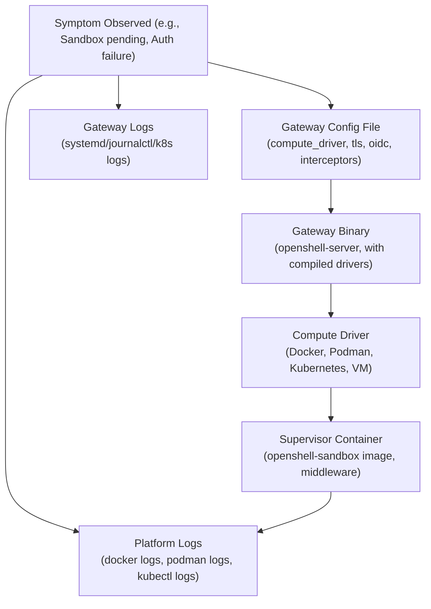

<!-- source: DeepWiki mcp.deepwiki.com · repo NVIDIA/OpenShell · page 5.7 Cluster Debugging and Troubleshooting Gateways · fetched 2026-10-26 -->

# Cluster Debugging and Troubleshooting Gateways

Relevant source files

The following files were used as context for generating this wiki page:

- [crates/openshell-core/src/config.rs](crates/openshell-core/src/config.rs)
- [crates/openshell-sandbox/src/container_log.rs](crates/openshell-sandbox/src/container_log.rs)
- [crates/openshell-sandbox/src/delegated.rs](crates/openshell-sandbox/src/delegated.rs)
- [crates/openshell-sandbox/src/main_session.rs](crates/openshell-sandbox/src/main_session.rs)
- [crates/openshell-server/src/cli.rs](crates/openshell-server/src/cli.rs)
- [crates/openshell-server/src/config_file.rs](crates/openshell-server/src/config_file.rs)
- [crates/openshell-server/src/lib.rs](crates/openshell-server/src/lib.rs)
- [docs/how-it-works/gateways/configuration.mdx](docs/how-it-works/gateways/configuration.mdx)
- [docs/observability/accessing-logs.mdx](docs/observability/accessing-logs.mdx)
- [skills/debug-openshell-cluster/SKILL.md](skills/debug-openshell-cluster/SKILL.md)

This page documents the debug workflow encapsulated in the `debug-openshell-cluster` skill, methods for accessing key logs, common gateway failure patterns, and recovery strategies for OpenShell gateway clusters. It is targeted at operators and developers diagnosing gateway health failures, startup issues, and runtime errors across supported compute drivers: Docker, Podman, Kubernetes, VM, and external drivers.

## Purpose and Scope

- Provide a structured workflow for pinpointing gateway cluster failures.
- Detail access to gateway, supervisor, and sandbox logs.
- Explain common failure symptoms by platform and driver.
- Describe recovery techniques relevant to gateways, sandbox startup, compute drivers, and middleware.
- Reference key classes, functions, and configuration resources.

---

## 1. Overview of the Diagnostic Workflow: `debug-openshell-cluster` Skill

The `debug-openshell-cluster` skill encapsulates a step-by-step diagnostic procedure designed to help operators methodically debug unhealthy or unreachable OpenShell gateway deployments.

### Key Steps in the Workflow

1. **CLI Reachability Check:**  
   Validate that the gateway endpoint is reachable from the operator CLI using commands like `openshell gateway list`, `openshell gateway info`, and `openshell status`.  
   Failures here usually indicate gateway process down, TLS misconfiguration, or network exposure problems.  
   Use the `--gateway-endpoint` override for direct targeting.

2. **Compute Platform Identification:**  
   Operators must identify the active compute driver platform (Docker, Podman, Kubernetes, VM, or external driver) to select correct tooling and logs.  
   This uses deployment metadata, configured driver name in gateway config, or local environment knowledge.

3. **Gateway Startup Dependencies:**  
   Analyze gateway logs for early failures before listener readiness—resource admission, TLS cert loading, compute driver initialization, network policies, and Kubernetes RBAC concerns.  
   Kernel-level isolation enforcement failures or missing privileged capabilities manifest here.

4. **Compute Driver Diagnostics:**  
   Use provider-specific tools (`docker logs`, `podman logs`, `kubectl logs`, VM driver logs) to inspect sandbox lifecycle and runtime container/pod status.

5. **Supervisor and Middleware Check:**  
   Inspect the supervisor (`openshell-sandbox`) startup logs and supervisor middleware chain for asynchronous startup failures or binary extraction issues.

6. **Gateway and Supervisor Logs Aggregation:**  
   Gather logs from gateway (including gRPC and HTTP multiplexer), supervisor container logs, and sandbox logs to correlate error events.

7. **Network and Authentication Validation:**  
   Verify TLS certificates, mTLS CA bundles, OIDC JWTs, and client credentials used by the gateway and supervisors.

### Supported Triggers

The skill activates on trigger keywords such as:  
`debug gateway`, `gateway failing`, `deployment failing`, `helm install failing`, `cluster health`, `sandbox pending`, `docker driver`, `podman driver`, `kubernetes driver`, `vm driver`, `supervisor middleware failed`, and others.

---

### Diagram: Debug Workflow from Natural Language to CLI Commands

**Sources:** [skills/debug-openshell-cluster/SKILL.md:6-102]()

---

## 2. Accessing Logs for Debugging

OpenShell provides layered logs at the gateway, supervisor, and sandbox levels. Effective troubleshooting requires correlating these sources.

### 2.1 Gateway Logs

- Gateway logs include start-up diagnostics, listener readiness, interceptor and middleware status, compute driver selection, and error reporting.
- Logs are typically accessed via systemd (`journalctl -u openshell-gateway`), container logs, or Helm-managed Kubernetes pods (`kubectl logs`).
- Important logs reveal TLS errors, driver misconfiguration, and gRPC failures.

### 2.2 Supervisor Logs

- Supervisors run as containers or pods managing sandbox processes.
- Container logs can be viewed via standard container tool commands:
  - Docker: `docker logs <sandbox-container>`
  - Podman: `podman logs <sandbox-container>`
  - Kubernetes: `kubectl logs <sandbox-pod> -c agent`
- Logs cover: binary sideloading, middleware startup, network proxy failures, and process lifecycle events.

### 2.3 Sandbox Logs

- Sandboxes push logs via gRPC to the gateway for short-term buffering.
- Use `openshell logs <sandbox_name> --source sandbox` to stream logs from the gateway.
- For full durable logs, access files inside the sandbox container or VM:
  - `openshell sandbox exec --name <name> -- cat /var/log/openshell.<date>.log`
- Logs include OCSF structured events denoting network policy decisions and runtime findings.

### 2.4 Main Process Output

- The sandbox's main process stdout/stderr is streamed to container logs.
- For TTY-attached processes, `openshell sandbox connect` is required to view output.
- Main process logs are not included in `openshell logs`.

---

### Diagram: Log Access Layers and Tools Mapping

**Sources:** [docs/observability/accessing-logs.mdx:9-125](), [skills/debug-openshell-cluster/SKILL.md:10-40]()

---

## 3. Common Gateway Failures and Recovery

This section catalogs frequent failure modes, their causes, and actionable recovery steps grouped largely by compute driver and deployment context.

| Symptom / Error                                   | Probable Cause                                  | Recovery / Debugging |
|-------------------------------------------------|------------------------------------------------|---------------------|
| `No active gateway`                              | Gateway not registered in CLI or endpoint misconfigured | Register gateway with `openshell gateway add <endpoint>`; verify endpoint URL and TLS |
| Connection refused or gateway unreachable        | Gateway process down, incorrect service exposure, port blocked | Ensure gateway systemd or container running; check firewall and service ports |
| TLS certificate verification failures            | Wrong trust chain, mismatched CA, expired certs | Verify TLS cert files and CA bundles; check mTLS config on gateway and supervisors |
| `Unauthenticated` from edge or OIDC gateway      | Stale or missing authentication credentials   | Run `openshell gateway login` to refresh tokens; confirm OIDC issuer configuration |
| Gateway startup failure due to compute driver    | Driver misconfigured or missing compiled registration | Confirm driver compilation in gateway binary; check driver configuration `compute_driver` and socket settings |
| Supervisor binary start failure                   | Supervisor image missing or broken, middleware binary extraction failure | Rebuild supervisor container image (`mise run build:docker:supervisor`), verify middleware configuration |
| Sandbox creation pending or stuck                 | Kubernetes pod scheduling failure, container image pull issues, resource admission blocking | Inspect Kubernetes events, network policies, imagePullSecrets, PVC claims; Docker or Podman network or image pull failures |
| Resource admission disabled or blocking           | Helm chart resourceAdmission enabled but no matching privileges | Adjust Helm values to allow driver config or fix labels/RBAC for PVCs and RuntimeClasses |
| Supervisor middleware startup failure             | Middleware interceptors misconfigured or fail at startup | Review gateway interceptors config and logs; test extension authentication tokens |

### Examples:

- **Podman Pod Sandbox Failure:** Missing supervisor image; fix by running supervisor image build and refresh commands.
- **Kubernetes Sandbox Pending:** PVC missing or not approved; check `kubectl describe pvc` and ensure labels match RBAC requirements.
- **TLS Mismatch:** CA bundles not matching gateway certificate; replace certificates or adjust TLS config.

---

### Diagram: Failure Symptom to Code/Config Entities

**Sources:** [skills/debug-openshell-cluster/SKILL.md:70-102](), [crates/openshell-server/src/cli.rs:72-159](), [docs/how-it-works/gateways/configuration.mdx:10-102]()

---

## 4. Implementation Highlights

### Gateway CLI and Server Startup

- The gateway CLI (`crates/openshell-server/src/cli.rs`) parses flags and environment variables, including `--compute-driver` and TLS settings, to build a server config.
- Server process instantiates registered compute drivers compiled into the binary or connects to an operator-provided external driver socket [crates/openshell-server/src/lib.rs:70-112]().

### Compute Driver Selection

- Built-in drivers include Kubernetes, Podman, and Docker, also VM and MXC on supported platforms.
- If no `compute_driver` config is set, auto-probe attempts in priority order (Kubernetes > Podman > Docker).
- Custom external drivers require explicit socket path configured [crates/openshell-server/src/cli.rs:131-151]().

### Supervisor and Middleware

- Supervisor process (`openshell-sandbox` binary) is launched inside the sandbox container or VM, responsible for main agent lifecycle.
- Middleware (gateway interceptors, supervisor middleware) configured via `[openshell.gateway.interceptors]` and `[openshell.supervisor.middleware]`.
- Failed middleware start causes sandbox startup failure; logs key error details.

### Log Buffering

- Sandbox logs pushed asynchronously to gateway via gRPC; buffered non-persistent storage with loss-awareness.
- Main process output buffered separately with backpressure control to avoid losing output.
- CLI log streaming supports resume cursors and gap detection for robustness.

---

## 5. Summary Recommendations

- Start with `openshell gateway list` and `openshell status` to confirm gateway reachability.
- Confirm the configured compute driver and use driver-specific tooling and logs (`docker/podman/kubectl`) to diagnose sandbox lifecycle.
- Review gateway logs early for failures in listener bind, TLS certs, compute driver initialization.
- Check Supervisor container or pod logs for middleware startup and agent errors.
- Use `openshell logs` or direct sandbox filesystem access for detailed sandbox logs and OCSF events.
- Verify TLS, mTLS, and OIDC credentials to rule out authentication issues.
- Leverage the Helm values and gateway config to ensure resource admission labels and driver parameters are set correctly in Kubernetes.
- Consult documented build processes and conformance tests for deeper troubleshooting of driver or image-related failures.

---

# Appendix: Reference

| Component                        | Code / Config Location                                           |
|---------------------------------|-----------------------------------------------------------------|
| `debug-openshell-cluster` skill | `skills/debug-openshell-cluster/SKILL.md`                      |
| Gateway CLI argument parsing    | `crates/openshell-server/src/cli.rs:[72-159]`                   |
| Gateway Server runtime          | `crates/openshell-server/src/lib.rs:[70-112]`                   |
| Gateway config file loader      | `crates/openshell-server/src/config_file.rs`                    |
| Gateway config schema reference | `docs/how-it-works/gateways/configuration.mdx`                  |
| Accessing logs and streaming    | `docs/observability/accessing-logs.mdx`                         |

**Sources:**  
`skills/debug-openshell-cluster/SKILL.md`  
`crates/openshell-server/src/cli.rs`  
`crates/openshell-server/src/lib.rs`  
`docs/how-it-works/gateways/configuration.mdx`  
`docs/observability/accessing-logs.mdx`

---

