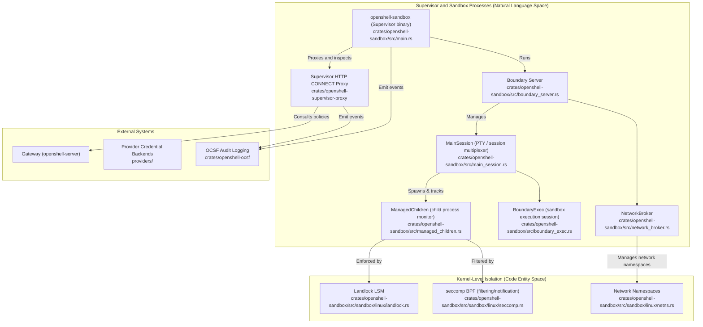
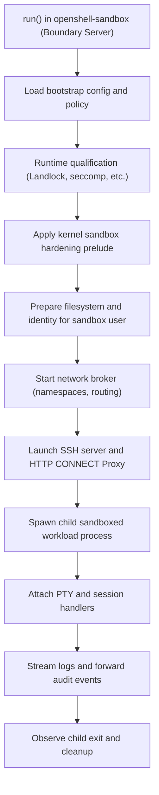

<!-- source: DeepWiki mcp.deepwiki.com · repo NVIDIA/OpenShell · page 6 Sandbox System · fetched 2026-10-26 -->

# Sandbox System

Relevant source files

The following files were used as context for generating this wiki page:

- [crates/openshell-sandbox/Cargo.toml](crates/openshell-sandbox/Cargo.toml)
- [crates/openshell-sandbox/src/lib.rs](crates/openshell-sandbox/src/lib.rs)
- [crates/openshell-sandbox/src/main.rs](crates/openshell-sandbox/src/main.rs)
- [crates/openshell-sandbox/src/process.rs](crates/openshell-sandbox/src/process.rs)
- [crates/openshell-sandbox/src/sandbox/linux/landlock.rs](crates/openshell-sandbox/src/sandbox/linux/landlock.rs)
- [crates/openshell-sandbox/src/sandbox/linux/mod.rs](crates/openshell-sandbox/src/sandbox/linux/mod.rs)
- [e2e/python/test_sandbox_landlock.py](e2e/python/test_sandbox_landlock.py)

The sandbox system provides isolated execution environments for AI agents and user workloads. It creates a secure runtime boundary orchestrated by the `openshell-sandbox` supervisor binary. This boundary enforces policy-driven isolation leveraging Linux kernel mechanisms such as Landlock LSM (Linux Security Module), seccomp BPF for syscall filtering, and network namespaces, complemented by userspace enforcement including an HTTP CONNECT proxy integrated with the OPA (Open Policy Agent) engine. The supervisor manages sandbox lifecycle phases including policy loading, network isolation setup, process launching, privilege dropping, and real-time log streaming back to the gateway.

This page offers a high-level overview of the sandbox system architecture and its key concepts. For comprehensive technical details and code-level descriptions, please consult the following child pages which cover distinct subsystems of the sandbox system:

- [Sandbox Architecture](#6.1)
- [Supervisor Processes and Sessions](#6.2)
- [Isolation Backends and Enforcement](#6.3)
- [Network Isolation and Mediation](#6.4)
- [HTTP CONNECT Proxy and L7 Inspection](#6.5)
- [Log Streaming and Observability](#6.6)
- [OCSF Audit Logging](#6.7)

---

## Purpose and Scope

The sandbox system’s goal is to safely execute untrusted workloads with strong isolation guarantees. It achieves this by combining kernel-level sandboxing techniques with supervised environment controls. The `openshell-sandbox` binary takes on the role of the supervisor process, typically running as PID 1 within the sandbox container, and orchestrates:

- Enforcement of filesystem access policies using Landlock.
- Application of syscall filtering rules through seccomp.
- Network traffic isolation using Linux network namespaces supplemented by a user-space proxy.
- Injection and management of credential and provider environment variables.
- Integration with the gateway and telemetry subsystems for policy synchronization and observability.

The system provides defense-in-depth: static policies (e.g. filesystem and process identity) are locked at sandbox startup, while network isolation and L7 protocol inspection policies can be hot-reloaded dynamically. This layered approach balances security and flexibility.

**Sources:** [crates/openshell-sandbox/src/lib.rs:4-27](), [crates/openshell-sandbox/src/main.rs:52-170]()

---

## Core Components

The sandbox system is composed of multiple interacting components spanning user-space binaries, kernel isolation mechanisms, and external control planes.

### Sandbox System Logical Components and Code Entities

**Component Roles:**

| Component                         | Description                                                   | Code Reference                                             |
|----------------------------------|---------------------------------------------------------------|------------------------------------------------------------|
| **openshell-sandbox**             | Supervisor process binary orchestrating sandbox lifecycle and enforcement | `crates/openshell-sandbox/src/main.rs`                      |
| **boundary_server**               | Runs the boundary listener and main sandbox event loop        | `crates/openshell-sandbox/src/boundary_server.rs`          |
| **main_session**                  | Manages the primary session multiplexer, PTYs, and child processes | `crates/openshell-sandbox/src/main_session.rs`             |
| **managed_children**              | Tracks and manages all child processes spawned by the sandbox | `crates/openshell-sandbox/src/managed_children.rs`         |
| **sandbox/linux/landlock.rs**    | Implements Landlock-based filesystem sandbox enforcement       | `crates/openshell-sandbox/src/sandbox/linux/landlock.rs`   |
| **sandbox/linux/seccomp.rs**     | Defines seccomp syscall filtering and notification logic       | `crates/openshell-sandbox/src/sandbox/linux/seccomp.rs`    |
| **network_broker**                | Coordinates network namespace setup and mediation              | `crates/openshell-sandbox/src/network_broker.rs`           |
| **openshell-ocsf**                | Provides OCSF event logging and audit compliance support       | `crates/openshell-ocsf`                                     |

**Sources:** [crates/openshell-sandbox/src/lib.rs:6-31](), [crates/openshell-sandbox/src/main.rs:48-70](), [crates/openshell-sandbox/src/sandbox/linux/mod.rs:1-103](), [crates/openshell-sandbox/src/sandbox/linux/landlock.rs:6-173]()

---

## Sandbox Lifecycle Overview

The sandbox lifecycle is carefully orchestrated in phases, orchestrating tasks from sandbox bootstrap to workload execution and termination. Key phases include:

- **Authorization and bootstrap** of the sandbox environment.
- **Static policy loading and qualification** to validate kernel capabilities.
- **Filesystem preparation** including identity resolution and ownership.
- **Applying kernel-level isolation** using Landlock and seccomp filters.
- **Network namespace and proxy startup** to restrict egress traffic.
- **Child process spawning and supervision** for workload execution.
- **Log streaming and event emission** for observability and audit.

### Sandbox Startup Orchestration (High-level Flow)

Each of these steps is elaborated on in [Sandbox Architecture](#6.1) and [Supervisor Processes and Sessions](#6.2).

**Sources:** [crates/openshell-sandbox/src/lib.rs:58-70](), [crates/openshell-sandbox/src/main.rs:52-80](), [crates/openshell-sandbox/src/process.rs:70-110]()

---

## Isolation Backends and Enforcement

The sandbox enforces process and filesystem isolation primarily through two Linux kernel features:

- **Landlock**: A Linux Security Module for filesystem allowlisting; Landlock rules are prepared by opening path file descriptors and enforced before workload exec. A mandatory baseline ruleset protects the sandbox internal hierarchy (`/.openshell`). User policies are applied on top. [Isolation Backends and Enforcement](#6.3)

- **seccomp notify/filtering**: Seccomp policies block forbidden syscalls and provide notifications via a supervisor thread for asynchronous enforcement decisions.

Additional enforcement features include:

- **Privilege dropping** to least privilege UID/GID as per sandbox policy.
- **Socket registry and task memory protections** for containerized workload self-protection.

The Landlock availability and mode (hard requirement vs best effort) are dynamically probed and logged for security auditing.

**Sources:** [crates/openshell-sandbox/src/sandbox/linux/landlock.rs:50-170](), [crates/openshell-sandbox/src/sandbox/linux/mod.rs:20-100]()

---

## Network Isolation and Mediation

The sandbox networking model creates fully isolated network namespaces per sandbox. Network egress is routed transparently through an HTTP CONNECT proxy running inside the supervisor. Key details:

- **Per-sandbox network namespaces** enforce isolation and control.
- **Network broker** sets up the virtual network interfaces, routes, and mediate TCP/UDP traffic.
- **Transparent TCP interception** uses `nftables` to capture outbound traffic.
- **Policy DNS** resolves special domains to synthetic IPs for policy evaluation.
- **Bypass detection** monitors attempts to circumvent the proxy using kernel logs.

For deep details on network setup and mediation, see [Network Isolation and Mediation](#6.4).

**Sources:** [crates/openshell-sandbox/src/network_broker.rs](), [architecture/security-policy.md:38-48]()

---

## HTTP CONNECT Proxy and L7 Inspection

The supervisor runs an HTTP CONNECT proxy which:

- Intercepts all outbound HTTP and HTTPS connections via the network broker.
- Resolves outbound requests back to the initiating binary using TCP tuple matching.
- Terminates TLS and performs Layer 7 protocol inspection on REST, WebSocket, GraphQL, JSON-RPC, MCP, and AWS SigV4 requests.
- Enforces policy evaluations at the application protocol level.
- Resolves dynamic credentials credentials from attached providers for request signing.

Refer to [HTTP CONNECT Proxy and L7 Inspection](#6.5) for the full design.

**Sources:** [crates/openshell-sandbox/src/proxy.rs](), [architecture/sandbox.md:48-48]()

---

## Log Streaming and Observability

The sandbox streams logs and audit information to the gateway for observability:

- Uses Rust's `tracing` crate extensively for runtime diagnostics.
- Streams PTY session I/O, process lifecycle events, and proxy logs.
- OCSF (Open Cybersecurity Schema Framework) audit logs document security-relevant actions.
- Integrates with OpenTelemetry for tracing benchmarking and observability statistics.

For implementation and integration details, see [Log Streaming and Observability](#6.6).

**Sources:** [crates/openshell-sandbox/src/lib.rs:31-56](), [crates/openshell-ocsf]()

---

## OCSF Audit Logging

The sandbox leverages the `openshell-ocsf` crate to emit structured audit events conforming to OCSF specifications. This includes:

- Event class builders for SSH activity, application lifecycle events, and policy changes.
- Severity and status mappings for machine-interpretability.
- JSONL export format suitable for ingestion into SIEM systems.
- Integration points throughout the supervisor and sandbox lifecycle.

See [OCSF Audit Logging](#6.7) for comprehensive details.

**Sources:** [crates/openshell-ocsf/src/lib.rs](), [crates/openshell-sandbox/src/lib.rs:28-43]()

---

# Summary

The sandbox system in OpenShell provides a comprehensive capability-free security boundary leveraging Linux kernel mechanisms and controlled userspace proxies. This approach ensures untrusted workloads are confined with least privilege, fine-grained filesystem and network access enforcement, and rich audit trail support. The modular design coordinates runtime qualification, supervisor-based enforcement, dynamic policy updates, and observability in a unified sandboxing runtime.

For detailed, code-specific information about each aspect of the sandbox, refer to the linked child pages below:

- [Sandbox Architecture](#6.1)
- [Supervisor Processes and Sessions](#6.2)
- [Isolation Backends and Enforcement](#6.3)
- [Network Isolation and Mediation](#6.4)
- [HTTP CONNECT Proxy and L7 Inspection](#6.5)
- [Log Streaming and Observability](#6.6)
- [OCSF Audit Logging](#6.7)

---

**Sources:**

- [crates/openshell-sandbox/src/lib.rs:4-70]()
- [crates/openshell-sandbox/src/main.rs:48-170]()
- [crates/openshell-sandbox/src/process.rs:70-110]()
- [crates/openshell-sandbox/src/sandbox/linux/mod.rs:1-103]()
- [crates/openshell-sandbox/src/sandbox/linux/landlock.rs:6-170]()
- [e2e/python/test_sandbox_landlock.py:3-194]()

---

