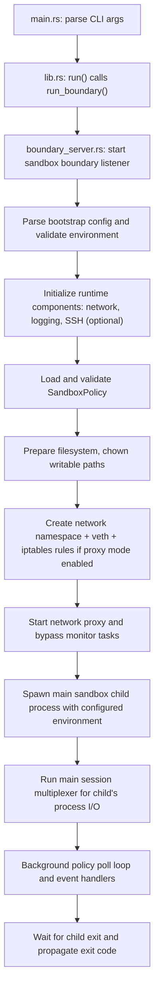
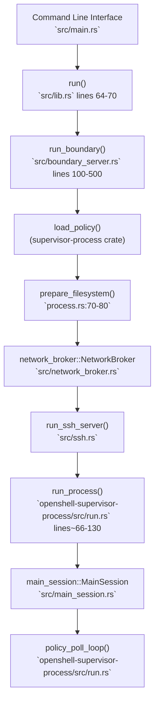
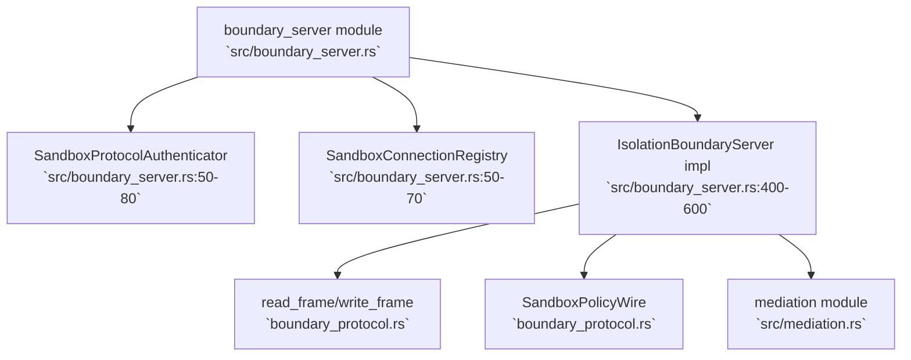

<!-- source: DeepWiki mcp.deepwiki.com · repo NVIDIA/OpenShell · page 6.1 Sandbox Architecture · fetched 2026-10-26 -->

# Sandbox Architecture

Relevant source files

The following files were used as context for generating this wiki page:

- [crates/openshell-isolation-interface/src/contract.rs](crates/openshell-isolation-interface/src/contract.rs)
- [crates/openshell-isolation-interface/src/linux/seccomp_notify.rs](crates/openshell-isolation-interface/src/linux/seccomp_notify.rs)
- [crates/openshell-isolation-interface/src/linux/task_memory.rs](crates/openshell-isolation-interface/src/linux/task_memory.rs)
- [crates/openshell-isolation-interface/tests/backend_conformance.rs](crates/openshell-isolation-interface/tests/backend_conformance.rs)
- [crates/openshell-sandbox-backend/README.md](crates/openshell-sandbox-backend/README.md)
- [crates/openshell-sandbox-backend/src/boundary_protocol.rs](crates/openshell-sandbox-backend/src/boundary_protocol.rs)
- [crates/openshell-sandbox-backend/src/runtime.rs](crates/openshell-sandbox-backend/src/runtime.rs)
- [crates/openshell-sandbox-backend/src/runtime/tests/credential_renewal.rs](crates/openshell-sandbox-backend/src/runtime/tests/credential_renewal.rs)
- [crates/openshell-sandbox-backend/src/runtime/tests/flow_control.rs](crates/openshell-sandbox-backend/src/runtime/tests/flow_control.rs)
- [crates/openshell-sandbox-backend/src/runtime/tests/network_recovery.rs](crates/openshell-sandbox-backend/src/runtime/tests/network_recovery.rs)
- [crates/openshell-sandbox-backend/src/sandbox_auth.rs](crates/openshell-sandbox-backend/src/sandbox_auth.rs)
- [crates/openshell-sandbox/Cargo.toml](crates/openshell-sandbox/Cargo.toml)
- [crates/openshell-sandbox/src/boundary_exec.rs](crates/openshell-sandbox/src/boundary_exec.rs)
- [crates/openshell-sandbox/src/boundary_server.rs](crates/openshell-sandbox/src/boundary_server.rs)
- [crates/openshell-sandbox/src/container_log.rs](crates/openshell-sandbox/src/container_log.rs)
- [crates/openshell-sandbox/src/delegated.rs](crates/openshell-sandbox/src/delegated.rs)
- [crates/openshell-sandbox/src/lib.rs](crates/openshell-sandbox/src/lib.rs)
- [crates/openshell-sandbox/src/main.rs](crates/openshell-sandbox/src/main.rs)
- [crates/openshell-sandbox/src/main_session.rs](crates/openshell-sandbox/src/main_session.rs)
- [crates/openshell-sandbox/src/process.rs](crates/openshell-sandbox/src/process.rs)
- [crates/openshell-sandbox/src/sandbox/linux/landlock.rs](crates/openshell-sandbox/src/sandbox/linux/landlock.rs)
- [crates/openshell-sandbox/src/sandbox/linux/mod.rs](crates/openshell-sandbox/src/sandbox/linux/mod.rs)
- [docs/observability/accessing-logs.mdx](docs/observability/accessing-logs.mdx)
- [e2e/python/test_sandbox_landlock.py](e2e/python/test_sandbox_landlock.py)
- [e2e/rust/src/harness/sandbox.rs](e2e/rust/src/harness/sandbox.rs)
- [e2e/rust/tests/sandbox_labels.rs](e2e/rust/tests/sandbox_labels.rs)
- [e2e/rust/tests/sandbox_lifecycle.rs](e2e/rust/tests/sandbox_lifecycle.rs)

The sandbox architecture defines the design, startup orchestration, and runtime operations of the `openshell-sandbox` process boundary. It governs secure workload execution within isolated namespaces and enforces layered policies including process, filesystem, network, and logging controls. This page details the sandbox startup sequence, the sandbox boundary server and protocol, the sandbox-backend runtime, the main session multiplexer, and component initialization steps.

This page is a leaf and does not have child pages. For complementary sandbox topics see the Sandbox System parent and other child pages (e.g. Supervisor Processes and Sessions).

---

## Purpose and Scope

The `openshell-sandbox` provides a capability-free, authenticated execution environment boundary that is co-located inside the workload runtime. It accepts bootstrap configuration and communicates with the driver and gateway via a gRPC-based sandbox boundary protocol. The sandbox runs a main supervisor process that applies policy, network mediation, and logs, then launches and monitors the child workload processes.

This document covers:

- The sandbox startup orchestration from command-line argument parsing through policy loading to child process launch.
- The boundary server and control protocol that runs inside the sandbox providing authenticated RPCs for control, logging, and network mediation.
- The sandbox-backend runtime that acts as the host-side backend implementing the `IsolationBackend` interface.
- The main session multiplexer for the canonical sandbox process's I/O streams.
- The orderly initialization of key sandbox components including filesystem permissions, SSH server (optional), network namespace and proxy setup.

---

## Sandbox Startup Orchestration

The entry point for sandbox startup is the `run()` function in `openshell-sandbox/src/lib.rs`. It initializes the sandbox by invoking `boundary_server::run_boundary()` with the path of the protected bootstrap configuration and a runtime qualification struct representing evidence about kernel capabilities and environment.

Internally:

- The CLI binary (`openshell-sandbox/src/main.rs`) uses Clap to parse arguments such as `--bootstrap` pointing to the bootstrap JSON.
- The sandbox performs a "capability probe" mode to actively qualify its kernel environment capabilities before proceeding with enforced sandboxing.
- The runtime qualification encapsulates seccomp notification support, Landlock ABI, and network DNS round-trip probes.
- The `boundary_server` module establishes the authenticated sandbox control server by listening on a Unix socket passed in the bootstrap.

### Sandbox Startup Sequence Diagram

This sequence represents the sandbox supervisor lifecycle inside the workload:

- The protected bootstrap is loaded ensuring that secrets and configuration are valid.
- Policy is loaded either from local files for dev mode or retrieved over gRPC from the gateway.
- Filesystem ownership and permissions are fixed before the unprivileged workload starts.
- Network namespaces are created, and proxying/bypass detection is established if required.
- The canonical entrypoint child process is spawned with environment variables injecting sandbox identity and policy.
- The `main_session` module multiplexes stdout/stderr/stdin of the sandbox process to allow centralized logging and control.
- A background loop polls the gateway for dynamic policy updates in gRPC mode.

---

## Sandbox Boundary Server and Protocol

The `boundary_server` module in `src/boundary_server.rs` implements the inner transport and lifecycle glue for the capability-free sandbox runtime. It hosts a gRPC server implementing the `IsolationBoundary` protocol shared between the sandbox and its supervisor backend.

Details:

- The protocol uses multiplexed HTTP/2 gRPC streams over local Unix sockets or virtual device connections.
- RPC services include process exec, signal sending, network mediation (proxy decisions), policy attach/confirm, and log streaming.
- Authentication uses JWT tokens scoped for the sandbox session, verified via `SandboxProtocolAuthenticator`.
- The sandbox connection registry tracks active connections and enforces stream limits.
- Control keepalives and handshake timeouts ensure sandbox liveness and orderly termination.

The sandbox boundary server drives the workload lifecycle asynchronously. Upon startup, it performs policy validation, resource claim assessment, and environment installation before spawning workload processes.

---

## Sandbox-Backend Runtime

The backend runtime integration is defined in `crates/openshell-sandbox-backend/src/runtime.rs`. It implements the `IsolationBackend` trait which represents a host-side sandbox boundary.

Key behavior:

- The backend connects to the sandbox boundary over gRPC and performs attach and confirm calls for session establishment.
- Network and DNS mediation requests are proxied to the sandbox boundary process.
- Exec calls launch workload processes inside the sandbox with injected environment and correct user credentials.
- The backend handles sandbox session snapshots, lifecycle events, and recovery semantics.
- Resource claims (e.g., GPU presence) adjust policy and filesystem access.

The backend is typically invoked by the compute driver manager but can be used standalone for sandbox lifecycle tests.

---

## Main Session and I/O Multiplexing

The `main_session` module inside `openshell-sandbox/src/main_session.rs` manages the canonical sandbox process's stdin/stdout/stderr multiplexing and exit status observation.

Functionality:

- Maintains a ring-buffered event log for stdout and stderr streams.
- Retains a lossless output buffer for exec commands to avoid losing output when consumers are slow.
- Publishes output via watch channels to subscribers (logging or RPC sinks).
- Detects process exit and generates exit events.
- Uses `tokio::io::unix::AsyncFd` to non-blockingly read/write pipes connected to the workload process.
- Supports terminal control for TTYs if allocated.

This module is central for connecting the sandbox supervisor to workload I/O and audit logging infrastructure.

---

## Component Initialization and Environment Setup

The sandbox supervisor prepares its environment and child process with these steps:

- **Filesystem Preparation**: Writable paths specified by policy are `chown`ed to the sandbox user before unprivileged child launch.
- **Provider Environment Injection**: Environment variables containing provider credentials and service endpoints are merged and injected into child environments.
- **SSH Server (Optional)**: If `--ssh-socket-path` is provided, an ephemeral SSH host key is created and an internal SSH server is launched for managed remote sessions.
- **Network Namespace Setup**: If proxy mode is enabled, a network namespace is established along with veth pairs and bypass iptables/nftables.
- **Bypass Monitor**: A background task monitors `/dev/kmsg` to detect network bypass attempts and integrity violations.
- **Tracing and Logging**: Structured logging is established, often integrated with the OpenTelemetry-based OCSF audit logging framework.
- **Final Child Exec**: The final unprivileged workload process is spawned with a pre-exec closure to apply Landlock restrictions, seccomp filters, and user identity switching.

---

## Sandbox Logical Topology and Code Entity Associations

We illustrate how the system components associate with concrete code modules and functions in the codebase, providing a bridge from conceptual system design to code entities.

### Sandbox Startup Orchestration vs Code Entities

### Sandbox Boundary Server and Protocol Components

---

## Summary

The sandbox architecture is a sophisticated but modular system that integrates capability-free kernel security mechanisms, dynamic policy enforcement, network mediation, and robust logging under a unified supervisor boundary. Its startup orchestrates multiple components that collectively ensure a secure, controlled workload runtime environment.

All control interactions flow over a unified boundary transport protocol, shared by the sandbox and its supervising backend. The runtime leverages Linux kernel features including Landlock, seccomp notify, network namespaces, and cgroups for resource controls. The main session multiplexer centralizes output and lifecycle supervision.

Together, these components constitute the fundamental architecture enabling OpenShell's secure AI agent sandboxing.

---

## References

- `crates/openshell-sandbox/src/lib.rs:60-70`  
- `crates/openshell-sandbox/src/main.rs:40-100`  
- `crates/openshell-sandbox/src/boundary_server.rs:15-100, 300-600`  
- `crates/openshell-sandbox-backend/src/runtime.rs:60-150`  
- `crates/openshell-sandbox/src/main_session.rs:1-195`  
- `crates/openshell-sandbox/src/process.rs:65-80`  
- `e2e/rust/src/harness/sandbox.rs:70-150`  

Sources:  
[crates/openshell-sandbox/src/lib.rs:64-70](),  
[crates/openshell-sandbox/src/main.rs:40-100](),  
[crates/openshell-sandbox/src/boundary_server.rs:15-100,300-600](),  
[crates/openshell-sandbox-backend/src/runtime.rs:60-150](),  
[crates/openshell-sandbox/src/main_session.rs:1-195](),  
[crates/openshell-sandbox/src/process.rs:65-80](),  
[e2e/rust/src/harness/sandbox.rs:70-150]()

---

