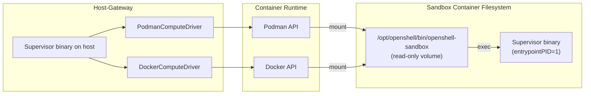
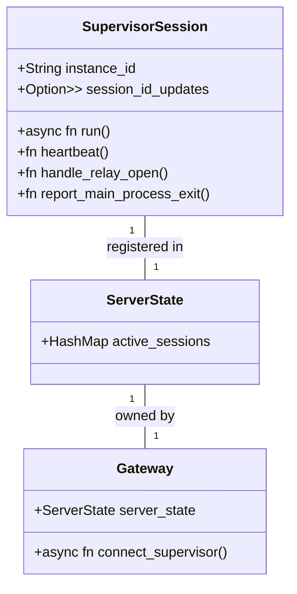

<!-- source: DeepWiki mcp.deepwiki.com · repo NVIDIA/OpenShell · page 6.2 Supervisor Processes and Sessions · fetched 2026-10-26 -->

# Supervisor Processes and Sessions

<details>
<summary>Relevant source files</summary>

The following files were used as context for generating this wiki page:

- [crates/openshell-cli/src/ssh.rs](crates/openshell-cli/src/ssh.rs)
- [crates/openshell-core/src/forward.rs](crates/openshell-core/src/forward.rs)
- [crates/openshell-driver-kubernetes/src/sandbox_runtime.rs](crates/openshell-driver-kubernetes/src/sandbox_runtime.rs)
- [crates/openshell-server/src/grpc/validation.rs](crates/openshell-server/src/grpc/validation.rs)
- [crates/openshell-server/src/supervisor_session.rs](crates/openshell-server/src/supervisor_session.rs)
- [crates/openshell-supervisor-process/Cargo.toml](crates/openshell-supervisor-process/Cargo.toml)
- [crates/openshell-supervisor-process/src/ssh.rs](crates/openshell-supervisor-process/src/ssh.rs)
- [crates/openshell-supervisor-process/src/ssh/peer_stream.rs](crates/openshell-supervisor-process/src/ssh/peer_stream.rs)
- [crates/openshell-supervisor-process/src/ssh/reconnect_tests.rs](crates/openshell-supervisor-process/src/ssh/reconnect_tests.rs)
- [crates/openshell-supervisor-process/src/supervisor_session.rs](crates/openshell-supervisor-process/src/supervisor_session.rs)
- [crates/openshell-supervisor/Cargo.toml](crates/openshell-supervisor/Cargo.toml)
- [crates/openshell-supervisor/src/lib.rs](crates/openshell-supervisor/src/lib.rs)
- [crates/openshell-supervisor/src/main.rs](crates/openshell-supervisor/src/main.rs)
- [docs/how-it-works/sandboxes/overview.mdx](docs/how-it-works/sandboxes/overview.mdx)
- [docs/how-it-works/sandboxes/runtimes.mdx](docs/how-it-works/sandboxes/runtimes.mdx)
- [e2e/rust/tests/vm_overlay.rs](e2e/rust/tests/vm_overlay.rs)
- [skills/generate-sandbox-policy/SKILL.md](skills/generate-sandbox-policy/SKILL.md)
- [skills/openshell-cli/SKILL.md](skills/openshell-cli/SKILL.md)

</details>


This page documents the OpenShell supervisor system's handling of processes and sessions within the sandbox, focusing on the `openshell-supervisor`, the `openshell-supervisor-process` crate (particularly SSH and session management), the gateway's `supervisor_session` registry, and side-loading of the supervisor binary into sandbox environments. It explains the detailed implementation, how key components coordinate, and the data flow for session establishment, connection, and binary provisioning.

---

## Overview and Purpose

The OpenShell supervisor is responsible for sandbox process lifecycle management, secure access, network and syscall enforcement, and session connectivity with the gateway. It exposes embedded SSH services for sandbox terminal attachment, manages process execution and privilege dropping, and maintains persistent bidirectional gRPC sessions to the gateway to handle relay and control messages.

This page covers:

- The `openshell-supervisor` binary's role and side-loaded distribution.
- `openshell-supervisor-process` functionality managing sandbox processes, SSH server, sessions, and reconnect logic.
- The gateway's `supervisor_session` registry, which tracks active supervisor connections and mediates relay channels.
- The provisioning and mounting of the supervisor binary into sandboxes via container compute drivers.

For sandbox lifecycle orchestration details and overall sandbox architecture, see [Sandbox Architecture (6.1)](). For policy governing supervisor behavior, see [Policy System (7)]().

---

## 1. Supervisor Binary and Side-Loading

The `openshell-sandbox` binary acts as the core supervisor runtime inside each sandbox. It is responsible for:

- Starting with root privileges to set up isolation (namespaces, Landlock rules, seccomp).
- Dropping privileges to the resolved non-root user.
- Running an embedded SSH server for interactive sandbox access (`openshell exec`, `openshell connect`).
- Managing process lifecycles and communication back to the OpenShell gateway over gRPC.

### Side-Loading Model

The supervisor binary is not typically baked into user sandbox images. Instead, it is side-loaded into the sandbox environment by the compute driver through volume mounts or bind mounts. This enables separating agent image builds from the supervisor runtime lifecycle.

- Docker and Podman drivers mount the supervisor binary as a read-only volume at `/opt/openshell/bin/openshell-sandbox` inside the sandbox container [crates/openshell-driver-docker/src/lib.rs:77-88](), [crates/openshell-driver-podman/src/container.rs:71-75]().

- This ensures a single, trusted supervisor binary version is delivered and avoids requiring sandbox images to embed the supervisor.

- The supervisor binary includes a subcommand `copy-self` that allows copying itself into shared volumes during init container phases without external copy tools [crates/openshell-sandbox/src/main.rs:20-25]().

- TLS and token materials for secure gateway communication are also side-loaded via fixed mount points, e.g., `/etc/openshell/tls/client/ca.crt` [crates/openshell-core/src/driver_utils.rs:100-101]().



**Sources:**  
[crates/openshell-sandbox/src/main.rs:20-25](),  
[crates/openshell-core/src/driver_utils.rs:76-110](),  
[crates/openshell-driver-docker/src/lib.rs:77-88](),  
[crates/openshell-driver-podman/src/container.rs:71-75]()

---

## 2. Supervisor Process Management: `openshell-supervisor-process`

The `openshell-supervisor-process` crate implements key process and session management facilities for the supervisor side:

### SSH Server

- Runs an embedded SSH server using the `russh` crate binding a Unix socket (e.g., `/run/openshell/ssh.sock`) with strict permissions (`0o600` or `0o660`).

- Generates the SSH host keys dynamically and starts accepting connections asynchronously.

- Handles authentication, session creation, and command execution attached to sandbox processes.

- Injects environment variables and drops privileges to the correct sandbox user identity resolved by the driver.

- Supports multiplexed SSH sessions and underlying communication channels.

- Implements "main detach" command filtering to handle session detach sequences gracefully.

### Process Execution

- Prepares and launches sandbox main and auxiliary processes with Landlock, seccomp, and network isolation applied.

- Drops to the sandbox user before execve, ensuring workload isolation.

- Monitors main process exit and reports status back to the gateway.

### Session Reconnect and Lifecycle

- Supports reconnecting SSH clients after network interruption, preserving session state where possible.

- Maintains heartbeat and timeout intervals to detect dead peer connections.

- Balances resource errors and unknown failures with backoff and reconnection attempts.

### Key Data Structures and Functions

| Name                                | Role / Description                                                                                              | Location (lines)                      |
|-----------------------------------|--------------------------------------------------------------------------------------------------------------|-------------------------------------|
| `run_ssh_server`                  | Main async SSH server loop; initializes config, listens on Unix socket, accepts connections.                 | `openshell-supervisor-process/src/ssh.rs:140-181`  |
| `ssh_server_init`                 | Generates SSH host keys, binds and configures Unix socket, sets permissions.                                  | `openshell-supervisor-process/src/ssh.rs:75-137`   |
| `filter_main_detach_sequence`    | Filters special byte sequences used to detach from main SSH session cleanly.                                  | `openshell-supervisor-process/src/ssh.rs:43-64`    |
| `MainSession`                    | Represents the main sandbox process session, spawns processes, manages IO streams, environment, identity.    | `openshell-supervisor-process/src/main_session.rs` |
| `drop_privileges_with_identity`  | Drops supervisor privileges to the sandbox user identity before exec.                                         | `openshell-supervisor-process/src/process.rs`      |

### SSH Session Configuration and CLI Interaction

- The CLI (`openshell-cli`) fetches sandbox info from the gateway gRPC server, requests creation of an SSH session (`CreateSshSessionRequest`), and configures the local SSH client proxy command accordingly.

- The SSH session config caches the sandbox id, workspace, gateway URL, and session tokens used for authentication and forwarding [crates/openshell-cli/src/ssh.rs:90-170]().

- Upon SSH connection, the supervisor authenticates the client, validates session tokens, and sets up local forwarding.

```mermaid
flowchart LR
    CLI["openshell CLI"]
    Gateway["OpenShell Gateway gRPC"]
    Supervisor["openshell-supervisor-process SSH Server"]
    SandSandbox["Sandbox Process/Container"]

    CLI -->|GetSandbox + CreateSshSession RPC| Gateway
    Gateway -->|Session info + token| CLI
    CLI -->|SSH Connect (proxy command)| Supervisor
    Supervisor -->|Exec on behalf of user| SandSandbox
```

**Sources:**  
[crates/openshell-supervisor-process/src/ssh.rs:4-181](),  
[crates/openshell-cli/src/ssh.rs:90-170]()

---

## 3. Gateway `supervisor_session` Registry

The OpenShell gateway maintains a registry of active supervisor sessions for each sandbox under its control.

- The gateway accepts incoming persistent bidirectional gRPC `ConnectSupervisor` streams from each supervisor process.

- Each supervisor session maintains metadata including:
  - Supervisor instance ID (unique per supervisor process)
  - Gateway session ID (unique per connection)
  - Sandbox ID and name

- Sessions implement heartbeat mechanisms with a fixed `HEARTBEAT_INTERVAL_SECS` (e.g., 15 seconds) to detect liveliness.

- Gateway authorizes relays (`RelayOpen`) that supervisors establish for SSH tunnels, network forwarding, and control messages.

- Relay multiplexing occurs on the same TCP+TLS connection as the supervisor control stream, using gRPC HTTP/2 streams.

- The gateway performs reconnection backoff and session state caching to survive network interruptions.

- It also maintains caches of owner records and peer TLS client configs for efficient peer communication.



**Sources:**  
[crates/openshell-supervisor-process/src/supervisor_session.rs:4-1397](),  
[crates/openshell-server/src/supervisor_session.rs:4-154]()

---

## 4. Side-Loaded Binary Provisioning Details

The OpenShell compute drivers (`docker`, `podman`, `kubernetes`, `vm`) provision the supervisor binary via mountpoints, keeping it distinct from the sandbox workload image.

- This ensures version alignment and ease of upgrade without rebuilding sandbox images.

- Drivers inject the supervisor binary volume and TLS/token secrets at fixed paths to ensure supervisor startup.

- The `openshell-supervisor` binary runs as PID 1 within the sandbox container or VM, performing startup and isolation setup before starting the agent's main process.

- The supervisor's permissions and mounted contents are tightly controlled by the drivers for security.

- The paths for token and cert mounts are standardized, e.g., `/etc/openshell/auth/sandbox.jwt` and `/etc/openshell/tls/client/ca.crt` [crates/openshell-core/src/driver_utils.rs:100-120]().

---

## 5. Summary Data Flow and Component Interaction

```mermaid
flowchart TD
    subgraph Gateway Service
        GS[Gateway Server]
        SSRegistry[supervisor_session Registry]
        gRPC[ConnectSupervisor gRPC Stream]
        GS --> SSRegistry
    end

    subgraph Sandbox Environment
        SUP[openshell-supervisor (supervisor binary)]
        SSHsrv[SSH Embedded Server]
        AgentProc[Agent Main Process]
    end

    subgraph Host Client
        CLI["openshell CLI / SSH Client"]
    end

    CLI -->|Opens SSH channel\n(using session config from gateway)| SSHsrv
    SSHsrv -->|Spawns & manages\nAgentProc with isolation| AgentProc

    SUP <--gRPC--> GS
    SUP -->|Relays SSH/TCP streams| GS

    GS -.->|Manages lifecycles,\nrelay channels, heartbeats| SSRegistry
```

- The supervisor binary inside the sandbox handles process and SSH session management.

- The gateway manages persistent supervisor sessions via streaming gRPC, tracking heartbeats, channel opens, and session state.

- The user CLI requests sandbox access through the gateway, which provides session details to connect to the supervisor's embedded SSH server.

- Compute drivers provision the supervisor binary side-loaded via volumes, enabling startup isolation and secure communication.

---

# References and Source Files

| Topic                   | File Path and Line Range                            |
|-------------------------|----------------------------------------------------|
| Supervisor binary side-loading and mount points | `crates/openshell-sandbox/src/main.rs:20-50`   |
| Supervisor process and embedded SSH server      | `crates/openshell-supervisor-process/src/ssh.rs:4-181` |
| SSH session configuration in CLI                | `crates/openshell-cli/src/ssh.rs:90-170`          |
| Gateway supervisor_session registry              | `crates/openshell-server/src/supervisor_session.rs:4-154` |
| Supervisor session relay management              | `crates/openshell-supervisor-process/src/supervisor_session.rs:4-500` (partial) |
| Supervisor binary mount paths and driver utils   | `crates/openshell-core/src/driver_utils.rs:70-140`           |
| Compute driver mount and volume provisioning      | `crates/openshell-driver-docker/src/lib.rs:70-100`, `crates/openshell-driver-podman/src/container.rs:60-80` |

---

**Sources:**  
crates/openshell-sandbox/src/main.rs[20-50](),  
crates/openshell-supervisor-process/src/ssh.rs[4-181](),  
crates/openshell-cli/src/ssh.rs[90-170](),  
crates/openshell-server/src/supervisor_session.rs[4-154](),  
crates/openshell-core/src/driver_utils.rs[70-140](),  
crates/openshell-driver-docker/src/lib.rs[70-100](),  
crates/openshell-driver-podman/src/container.rs[60-80]()

---

# Summary

This page detailed the supervisor processes and sessions in OpenShell. The `openshell-supervisor` binary is side-loaded into sandboxes by compute drivers, running as an embedded SSH server managing process lifecycles with strict isolation enforcement. The `openshell-supervisor-process` crate implements the SSH server, session management, and process spawning with privilege dropping. The gateway maintains `supervisor_session` registries tracking long-lived supervisor connections and relays SSH and data channels using bidirectional gRPC streams. This design separates enforcement logic out of workloads, simplifies upgrades, and strongly controls sandbox and session boundaries.

---

