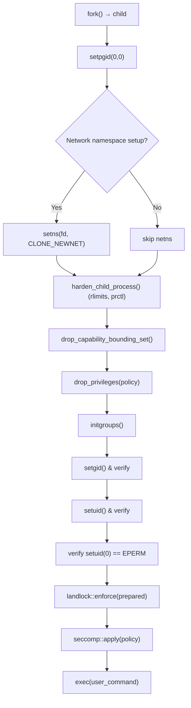
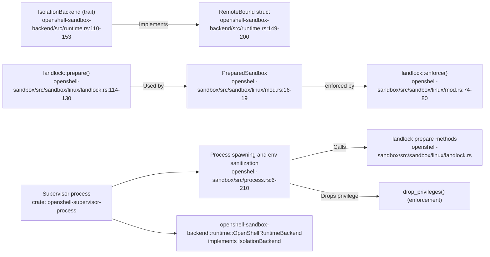

<!-- source: DeepWiki mcp.deepwiki.com · repo NVIDIA/OpenShell · page 6.3 Isolation Backends and Enforcement · fetched 2026-10-26 -->

# Isolation Backends and Enforcement

<details>
<summary>Relevant source files</summary>

The following files were used as context for generating this wiki page:

- [crates/openshell-isolation-interface/src/contract.rs](crates/openshell-isolation-interface/src/contract.rs)
- [crates/openshell-isolation-interface/src/linux/seccomp_notify.rs](crates/openshell-isolation-interface/src/linux/seccomp_notify.rs)
- [crates/openshell-isolation-interface/src/linux/task_memory.rs](crates/openshell-isolation-interface/src/linux/task_memory.rs)
- [crates/openshell-isolation-interface/tests/backend_conformance.rs](crates/openshell-isolation-interface/tests/backend_conformance.rs)
- [crates/openshell-sandbox-backend/README.md](crates/openshell-sandbox-backend/README.md)
- [crates/openshell-sandbox-backend/src/boundary_protocol.rs](crates/openshell-sandbox-backend/src/boundary_protocol.rs)
- [crates/openshell-sandbox-backend/src/runtime.rs](crates/openshell-sandbox-backend/src/runtime.rs)
- [crates/openshell-sandbox-backend/src/runtime/tests/credential_renewal.rs](crates/openshell-sandbox-backend/src/runtime/tests/credential_renewal.rs)
- [crates/openshell-sandbox-backend/src/runtime/tests/flow_control.rs](crates/openshell-sandbox-backend/src/runtime/tests/flow_control.rs)
- [crates/openshell-sandbox-backend/src/runtime/tests/network_recovery.rs](crates/openshell-sandbox-backend/src/runtime/tests/network_recovery.rs)
- [crates/openshell-sandbox-backend/src/sandbox_auth.rs](crates/openshell-sandbox-backend/src/sandbox_auth.rs)
- [crates/openshell-sandbox/Cargo.toml](crates/openshell-sandbox/Cargo.toml)
- [crates/openshell-sandbox/src/boundary_exec.rs](crates/openshell-sandbox/src/boundary_exec.rs)
- [crates/openshell-sandbox/src/boundary_server.rs](crates/openshell-sandbox/src/boundary_server.rs)
- [crates/openshell-sandbox/src/lib.rs](crates/openshell-sandbox/src/lib.rs)
- [crates/openshell-sandbox/src/main.rs](crates/openshell-sandbox/src/main.rs)
- [crates/openshell-sandbox/src/process.rs](crates/openshell-sandbox/src/process.rs)
- [crates/openshell-sandbox/src/sandbox/linux/landlock.rs](crates/openshell-sandbox/src/sandbox/linux/landlock.rs)
- [crates/openshell-sandbox/src/sandbox/linux/mod.rs](crates/openshell-sandbox/src/sandbox/linux/mod.rs)
- [e2e/python/test_sandbox_landlock.py](e2e/python/test_sandbox_landlock.py)
- [e2e/rust/src/harness/sandbox.rs](e2e/rust/src/harness/sandbox.rs)
- [e2e/rust/tests/sandbox_labels.rs](e2e/rust/tests/sandbox_labels.rs)
- [e2e/rust/tests/sandbox_lifecycle.rs](e2e/rust/tests/sandbox_lifecycle.rs)

</details>


This page documents the detailed technical design and implementation of the capability-free isolation backends and the enforcement mechanisms employed by OpenShell sandbox runtimes on Linux systems. It focuses on the isolation interface contract, Linux Landlock filesystem sandboxing, seccomp syscall notification, the socket registry, privilege dropping, and process lifecycle enforcement sequences within the sandbox boundary.

While this is a leaf page without child pages, it complements other pages describing the broader sandbox architecture [6.1 Sandbox Architecture]() and supervisor processes [6.2 Supervisor Processes and Sessions]().

---

## Isolation-Interface Contract

OpenShell defines a strict **isolation-interface contract** between the host supervisor, sandbox boundary, and backends. This contract abstracts fundamental sandbox operations—such as process exec, I/O forwarding, network mediation, and lifecycle management—behind the `IsolationBackend` trait. Each backend implements this trait and communicates with the sandbox boundary either locally or over gRPC.

- The isolation interface expresses sandbox lifecycle phases:
  - **Attach:** Establish connection and send sandbox policy.
  - **Confirm:** Confirm readiness and receive baseline state snapshot.
  - **Exec:** Create new exec sessions with environment and args.
  - **Signal:** Send POSIX signals to running child processes.
  - **Network Mediation:** Forward network open/connect requests for policy evaluation.
  - **Exit Status and I/O Streaming:** Asynchronously stream stdout/stderr from sandbox processes.

The protocol is versioned and composed of JSON-encoded frames with binary streams multiplexed over a single connection, typically HTTP/2 or grpc. This design enables:

- Detached sandbox agents over secured Unix sockets.
- Lightweight, capability-free runtime sandboxes without privileged daemons.
- Flexibility to support multiple isolation driver backends transparently to the supervisor.

The [`openshell-sandbox-backend`](crates/openshell-sandbox-backend/src/runtime.rs:1-153) crate implements a host-side backend conforming to this contract.

### Key Types and Traits

- `IsolationBackend` trait (interface for isolation backends)
- `BoundBoundary` trait (represents attached and ready sandbox sessions)
- `SandboxContext` (injection of agent, policy, and sandbox metadata)
- `SandboxPolicy` (policy config used at runtime)
- `ExecSpec` (exec session parameters)
- `BoundaryExec`, `BoundarySignal` (remote control operations)

**Sources:**  
[crates/openshell-sandbox-backend/src/runtime.rs:10-153]()  
[crates/openshell-sandbox-backend/src/boundary_protocol.rs:3-150]()

---

## Landlock Filesystem Sandboxing

### Overview

Linux Landlock is an LSM (Linux Security Module) that enables fine-grained filesystem restrictions without requiring root privileges to apply policies. OpenShell uses Landlock extensively to sandbox filesystem access with a two-phase enforcement model:

1. **Preparation Phase:** Open relevant filesystem paths as file descriptors (`PathFd`) under privileged context (usually root). This is done before forking the child process.  
2. **Enforcement Phase:** The child process applies these rulesets to restrict itself before exec, by calling `restrict_self()` on the prepared ruleset file descriptors. This requires no elevated privilege.

This design is essential to restrict paths visible to the sandbox workload, while allowing the sandbox to operate with minimal privilege.

### Implementation Highlights

- **Probe Availability:** `probe_availability()` runs a Landlock syscall probe (`landlock_create_ruleset` with version flag) to detect ABI support and possible syscall blocking (e.g., container seccomp). It reports variants like NotImplemented, NotEnabled, Blocked, or Available [src: crates/openshell-sandbox/src/sandbox/linux/landlock.rs:56-87]().
- **Ruleset Preparation:**
  - The user Landlock ruleset is prepared by opening paths required by the sandbox policy (both read-only and read-write).
  - A mandatory **baseline ruleset** enforces same-UID self-protection on the root `/` children except the `.openshell` directory.
  - GPU device nodes are included as read-write paths if GPU resources are claimed, along with `/proc` for CUDA thread metadata writes [src: crates/openshell-sandbox/src/boundary_server.rs:80-153]().
- **Compatibility Modes:**  
  The policy can specify `LandlockCompatibility` as `HardRequirement` or `BestEffort`. In best-effort mode, Landlock unavailability leads to a warning log but does not block sandbox launch.

### Enforcement

Inside the child pre-exec closure, OpenShell calls `landlock::enforce()` on the prepared rulesets, invoking `restrict_self()`. This operation strictly intersects all applied Landlock rulesets to restrict filesystem visibility for the process.

### Diagram: Landlock Lifecycle and Interfaces

```mermaid
flowchart LR
    SP["Supervisor (root)"] -->|Open PathFds| L_PREP["landlock::prepare()"]
    L_PREP --> RULESET["PreparedRuleset (RulesetCreated)"]
    SP --> ForkChild["fork()"]
    ForkChild -->|Child| CHILD_PRE_EXEC["pre_exec: landlock::enforce()"]
    CHILD_PRE_EXEC -->|restrict_self()| KERNEL["Linux kernel Landlock LSM"]
    KERNEL -->|enforce FS restrictions| SANDBOX["Sandboxed process filesystem visible paths"]

    %% Labels associating code entities
    classDef codeEntity fill:#f9f,stroke:#333,stroke-width:1px;
    class SP,L_PREP,RULESET,ForkChild,CHILD_PRE_EXEC,KERNEL,SANDBOX codeEntity;
```

**Sources:**  
[crates/openshell-sandbox/src/sandbox/linux/landlock.rs:1-171]()  
[crates/openshell-sandbox/src/boundary_server.rs:80-153]()  
[architecture/security-policy.md:24-36]()  

---

## Seccomp Notify and Syscall Filtering

OpenShell employs **seccomp syscall filters** to restrict the set of syscalls a sandbox process can invoke, enhancing kernel-level isolation and proxy enforcement.

### Key Features

- Uses seccomp **notify API** (`seccomp_notify`) available on Linux kernels ≥5.7 to intercept prohibited syscalls in userspace.
- Supports fine-grained control over:
  - Disallowed syscalls.
  - Socket creation and TCP connect interception.
  - Id validation and cancellation support.
- Instrumented with extensive per-operation audit state (`SeccompEvidence`) for diagnostic and policy compliance purposes.

### Application

- The seccomp filters are **applied after Landlock enforcement** inside the pre-exec child closure.
- Two main sets of filters:
  - **Supervisor prelude filters:** Harden the supervisor process itself.
  - **Runtime filters:** Enforce syscall blocking for sandbox workloads.
- Capability-free enforcement rejects attempts to regain dropped privileges or bypass proxies.

**Sources:**  
[crates/openshell-sandbox/src/sandbox/linux/seccomp.rs (implied)]()  
[crates/openshell-sandbox-backend/src/boundary_protocol.rs:85-103]()  
[crates/openshell-sandbox/src/lib.rs:30-70]()  

---

## Socket Registry and Network Mediation

To control network access in sandboxes, OpenShell uses a **socket registry** implementation integrated with the seccomp notify mechanism:

- TCP connect requests are intercepted via seccomp and forwarded to the supervisor.
- Supervisor enforces **policy rules** before either allowing or denying socket operations.
- The network mediation subsystem maintains a registry of accepted sockets and policies.
- Transparent TCP mediation ensures the sandbox cannot establish unauthorized network connections.
- The socket registry interacts closely with the seccomp notify layer to enforce live network policies without breaking sandbox compatibility.

This mechanism ensures sandboxed workloads use the supervisor proxy/broker for outbound connections, preventing direct and potentially evasive network access.

**Sources:**  
[crates/openshell-sandbox-backend/src/runtime/tests/network_recovery.rs:4-174]()  
[crates/openshell-sandbox/src/boundary_server.rs:31-70]()  

---

## Privilege Dropping in the Sandbox

### Overview

Before executing user workloads, the supervisor transitions the child process from root to a constrained unprivileged user, as defined by the `SandboxPolicy`:

- Resolves the target UID and GID (supports either string or numeric specification).
- Creates sandbox workspace directories (`read_write` and `tmp`) and fixes ownership.
- Drops supplemental groups, resets capability bounding sets (clearing all capabilities).
- Performs privilege drop calls in the following strict order:
  1. `initgroups(target_user, target_gid)`
  2. `setgid(target_gid)` and verify
  3. `setuid(target_uid)` and verify

- Verifies that `setuid(0)` returns `EPERM` to ensure privileges cannot be regained.

This ensures the child process runs with minimum required privileges, preventing privilege escalation.

### Sanitizing Environment

- Strips supervisor-internal environment variables that should not be exposed to the sandbox child (e.g., tokens and TLS cert variables).
- Injects provider credentials and environment variables deemed safe for injection.

**Sources:**  
[crates/openshell-sandbox/src/process.rs:135-210]()  
[crates/openshell-supervisor-process/src/process.rs:63-160]()  

---

## Process Lifecycle Enforcement

The child process sandbox lifecycle is strictly managed with:

- Controlled process group assignment (`setpgid`) to isolate signals.
- Ensuring non-dumpable status (`prctl PR_SET_DUMPABLE=0`) on sandbox workspace to prevent debugging attacks.
- Enforcing resource limits (`rlimit`) to avoid core dumps and excessive resource usage.
- Applying Landlock and seccomp sandboxes in order inside the `pre_exec` closure.
- Executing the user command after all sandbox primitives are established.

Lifecycle enforcement also includes handling sandbox termination deadlines, restart policies, and exec session policies monitored by the supervisor.

### Diagram: Pre-Exec Enforcement Sequence in Child Process



**Sources:**  
[crates/openshell-supervisor-process/src/process.rs:140-159]()  
[crates/openshell-sandbox/src/lib.rs:64-70]()  

---

## Summary Table: Enforcement Mechanisms and Backends

| Mechanism              | Implementation Location                | Purpose and Description                                         |
|-----------------------|-------------------------------------|----------------------------------------------------------------|
| **Isolation Interface**| `openshell-sandbox-backend/src/runtime.rs` | Host-side backend implementation of sandbox attach/exec/signal protocol. |
| **Landlock**           | `openshell-sandbox/src/sandbox/linux/landlock.rs` | Two-phase filesystem sandbox: prepare and enforce rulesets.    |
| **Seccomp Notify**     | `openshell-sandbox/src/sandbox/linux/seccomp.rs` (implied) | Syscall notification and filtering with proxy enforcement.     |
| **Socket Registry**    | `openshell-sandbox-backend/src/runtime.rs` | TCP connection interception and mediation via seccomp notify.  |
| **Privilege Dropping** | `openshell-sandbox/src/process.rs` | User/group switching, capability bounding set clearing, environment sanitization. |
| **Process Lifecycle Enforcement** | `openshell-sandbox/src/lib.rs` and supervisor code | Setpgid, rlimit, prctl, apply sandbox filters, exec user command. |

---

## References to Key Code Artifacts



---

# Summary

OpenShell’s sandbox isolation backends on Linux leverage advanced kernel security features like Landlock and seccomp notify in a capability-free model. The supervisor orchestrates the lifecycle of a sandbox workload by:

- Preparing Landlock rulesets and opening the necessary path file descriptors before fork.
- Dropping privileges and capability bounding sets post-fork but pre-exec.
- Enforcing seccomp filters with live syscall and socket mediation.
- Managing process lifecycle events and sandbox I/O over gRPC protocols.

This results in an isolated, policy-enforced sandbox environment ready for secure AI agent workloads.

---

**Sources:**  
- [crates/openshell-sandbox/src/lib.rs:1-70]()  
- [crates/openshell-sandbox/src/sandbox/linux/landlock.rs:1-171]()  
- [crates/openshell-sandbox-backend/src/runtime.rs:1-153]()  
- [crates/openshell-sandbox/src/process.rs:1-210]()  
- [crates/openshell-sandbox-backend/src/runtime/tests/network_recovery.rs:1-174]()  
- [crates/openshell-sandbox/src/boundary_server.rs:1-153]()  
- [crates/openshell-sandbox-backend/src/boundary_protocol.rs:1-180]()

---

