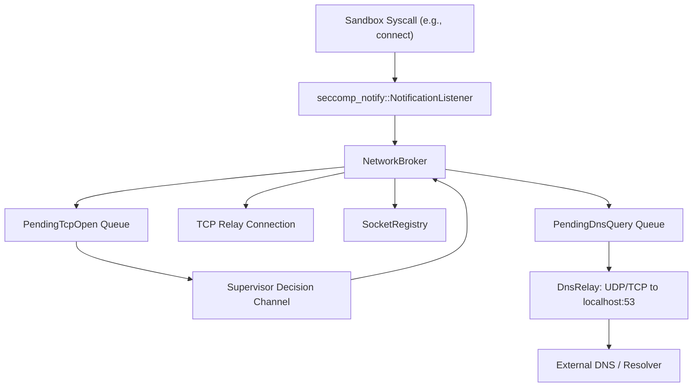

<!-- source: DeepWiki mcp.deepwiki.com · repo NVIDIA/OpenShell · page 6.4 Network Isolation and Mediation · fetched 2026-10-26 -->

# Network Isolation and Mediation

<details>
<summary>Relevant source files</summary>

The following files were used as context for generating this wiki page:

- [crates/openshell-core/src/google_cloud.rs](crates/openshell-core/src/google_cloud.rs)
- [crates/openshell-core/src/provider_credentials.rs](crates/openshell-core/src/provider_credentials.rs)
- [crates/openshell-core/src/secrets.rs](crates/openshell-core/src/secrets.rs)
- [crates/openshell-isolation-interface/src/linux/socket_registry.rs](crates/openshell-isolation-interface/src/linux/socket_registry.rs)
- [crates/openshell-sandbox/src/network_broker.rs](crates/openshell-sandbox/src/network_broker.rs)
- [crates/openshell-supervisor-network/src/google_cloud_metadata.rs](crates/openshell-supervisor-network/src/google_cloud_metadata.rs)
- [crates/openshell-supervisor-network/src/lib.rs](crates/openshell-supervisor-network/src/lib.rs)
- [crates/openshell-supervisor-network/src/run.rs](crates/openshell-supervisor-network/src/run.rs)
- [crates/openshell-supervisor-network/src/upstream_proxy.rs](crates/openshell-supervisor-network/src/upstream_proxy.rs)
- [docs/how-it-works/providers/google.mdx](docs/how-it-works/providers/google.mdx)
- [e2e/python/Dockerfile.workload](e2e/python/Dockerfile.workload)
- [e2e/python/test_sandbox_providers.py](e2e/python/test_sandbox_providers.py)
- [e2e/python/test_security_tls.py](e2e/python/test_security_tls.py)
- [e2e/rust/src/harness/output.rs](e2e/rust/src/harness/output.rs)
- [e2e/rust/src/harness/port.rs](e2e/rust/src/harness/port.rs)
- [e2e/rust/tests/bypass_detection.rs](e2e/rust/tests/bypass_detection.rs)
- [e2e/rust/tests/docker_preflight.rs](e2e/rust/tests/docker_preflight.rs)
- [e2e/rust/tests/edge_tunnel_e2e.rs](e2e/rust/tests/edge_tunnel_e2e.rs)
- [e2e/rust/tests/forward_proxy_jsonrpc_l7.rs](e2e/rust/tests/forward_proxy_jsonrpc_l7.rs)
- [e2e/rust/tests/port_forward.rs](e2e/rust/tests/port_forward.rs)

</details>


## Purpose and Scope

This section details the mechanisms OpenShell employs to isolate sandboxed workloads within network namespaces and mediate their network traffic through a specialized network broker and proxy system. It covers the use of Linux network namespaces, the `network_broker` component that handles seccomp-notification-based mediation, transparent TCP connection handling, the policy DNS system for managed resolution, and bypass detection strategies to prevent network boundary circumvention.

This leaf page focuses on the technical implementation, data flow, and key code entities involved in network isolation and mediation.

Sources:  
[crates/openshell-supervisor-network/src/run.rs:4-184]()  
[crates/openshell-sandbox/src/network_broker.rs:1-190]()  

---

## Network Namespaces and Isolation

OpenShell uses Linux **network namespaces** to encapsulate each sandbox’s network stack. Within a dedicated network namespace, the sandbox sees an isolated set of network interfaces and routing tables independent from the host and other sandboxes. This guarantees that network traffic from the sandbox cannot leak or bypass the configured control and mediation layers.

The network namespace typically includes a **veth pair** connecting the sandbox's isolated side with the host side where the supervisor's network proxy runs. This veth connection makes the proxy the gateway for all sandbox network traffic.

From the OpenShell supervisor's perspective, the following main components exist:

- **Sandbox Network Namespace**: Hosts the sandboxed process, its loopback interface, and DNS client socket pointed at the synthetic DNS server.
- **Host Network Namespace**: Hosts the sandbox supervisor and the egress `openshell-supervisor-network` proxy that enforces policy, performs TLS interception, and resolves credentials transparently.

The sandbox process can only reach the proxy endpoint on the host side, effectively forcing all connections through mediation.

### Diagram: Network Namespace Isolation and Components

```mermaid
graph LR
    subgraph "Host_NetNS"
        PROXY["openshell-supervisor-network::proxy::ProxyHandle"]
        OPA["openshell-supervisor-network::opa::OpaEngine"]
        L7["openshell-supervisor-network::l7::relay::L7EvalContext"]
        POLICYLOCAL["openshell-supervisor-network::policy_local::PolicyLocalContext"]
        POLICYDNS["openshell-supervisor-network::policy_dns::PolicyDnsRuntime"]
        BROKER["openshell-sandbox::network_broker::NetworkBroker"]
    end
    subgraph "Sandbox_NetNS"
        WORKLOAD["Sandboxed Process"]
        VETH_SANDBOX["veth Namespace Interface"]
        POLICYLOCAL_SVC["policy.local HTTP API"]
        DNS_CLIENT["UDP Socket -> policy-dns"]
    end
    subgraph "Host Interface"
        VETH_HOST["veth Supervisor Interface"]
    end

    WORKLOAD -->|All Network Traffic| VETH_SANDBOX
    VETH_SANDBOX --> VETH_HOST
    VETH_HOST --> PROXY
    PROXY --> OPA
    PROXY --> L7
    PROXY --> POLICYLOCAL
    PROXY --> POLICYDNS
    WORKLOAD -->|policy.local API (HTTP)| POLICYLOCAL_SVC
    WORKLOAD -->|DNS Queries UDP/53| DNS_CLIENT
    DNS_CLIENT -.-> POLICYDNS
    BROKER -->|seccomp notify mediation| WORKLOAD
```

Sources:  
[crates/openshell-supervisor-network/src/run.rs:4-162]()  
[crates/openshell-supervisor-network/src/policy_local.rs]()  
[crates/openshell-sandbox/src/network_broker.rs:1-190]()

---

## The Network Broker

`openshell-sandbox::network_broker` is the subsystem that manages transparency and mediation of network operations initiated by the sandboxed workload. It operates using **seccomp-notification** to intercept network-related syscalls at the kernel boundary, allowing mediation and policy enforcement.

Key roles of the network broker:

- **Intercept TCP socket operations** such as `connect(2)` to hold socket creation until the supervisor approves or denies the connection.
- **Relay DNS queries** by proxying UDP and TCP DNS packets through the sandbox supervisor to enforce policy on DNS resolution.
- **Track socket state and metadata** through a bounded socket registry for lifecycle management and consistent identity validation.
- **Handle pending open requests** with backpressure and capacity limits to prevent workload saturation.
- **Dispatch connection decisions asynchronously** with well-defined timeouts and error handling.

### Important Types and Data Flow

- `PendingTcpOpen`: Represents one TCP connection attempt blocked on `connect()`. It stores destination, binary identity (or a resolution error), socket metadata, and channels to communicate the open decision and the resulting proxied connection socket.

- `PendingDnsQuery`: Represents a DNS query made by the sandbox workload. Contains the UDP/TCP DNS request payload, transport type, identity of sender, and a synchronization channel for query response delivery.

- `DnsRelay`: Manages UDP and TCP DNS query relaying to an external DNS service on loopback (127.0.0.1:53).

- Atomic counters and semaphores limit concurrency, e.g., `OPEN_QUEUE_CAPACITY`, `DNS_WORKER_CAPACITY`.

- The broker integrates with a `SocketRegistry` to track socket lifecycle states (Created, Bound, Connected, Failed, etc.).

### Broker Data Flow Summary

1. Sandbox workload issues network syscalls (e.g., `socket()`, `connect()`).
2. Seccomp notifies the broker with syscall metadata.
3. Broker evaluates the request against policy and sandbox state.
4. For `connect()`, broker queues `PendingTcpOpen`, awaiting supervisor decision.
5. Upon decision approval, the broker creates a proxied TCP connection to the destination and injects the socket into the process.
6. For DNS queries, broker relays requests via `DnsRelay` and returns the response to the sandbox process.
7. Broker manages socket metadata and refusal scenarios.

### Diagram: Network Broker Core Components and Flow



Sources:  
[crates/openshell-sandbox/src/network_broker.rs:4-190]()

---

## Transparent TCP Mediation

Unlike traditional proxies that require explicit proxy configuration, OpenShell performs **transparent TCP mediation** by intercepting TCP socket connect syscalls via seccomp notifications within the sandbox.

- When a sandboxed process calls `connect()`, the network broker delays the syscall completion until the supervisor approves or denies the connection according to network policies.

- If approved, the broker creates a TCP relay connection on behalf of the sandbox to the external peer, forwarding traffic bidirectionally.

- The sandbox process thus believes it is connected directly, but the traffic flows through the supervisor proxy for inspection, monitoring, and credential injection.

- Policy checks are performed on the destination IP and port, binary identity of the calling process (resolved via `/proc`), and other contextual information.

This approach provides full network mediation without requiring in-app proxy configuration or any sandbox process awareness.

Sources:  
[crates/openshell-sandbox/src/network_broker.rs:106-135]()

---

## Policy DNS

OpenShell replaces traditional DNS resolution inside sandboxes with a **Policy DNS system** to enforce access control at the domain name level.

- The system sets up a sandbox-local DNS resolver on loopback (`127.0.0.1:53`) that traps sandbox DNS queries.

- DNS requests are intercepted and relayed to the supervisor, which performs policy evaluation on requested domains.

- After authorization, the supervisor performs real DNS resolution and returns synthetic IP addresses from assigned CIDR blocks (the policy DNS "allocation epoch").

- These synthetic IPs are unique to each epoch, ensuring that address mappings cached outside policy reflect the current policy.

- The policy DNS server maintains pools of synthetic IPv4 and IPv6 CIDRs, refreshing its epoch upon sandbox restarts or policy changes.

- The sandbox workload therefore obtains pure synthetic IP address space, preventing direct non-authorized connections to real IPs.

### Epoch Advancement and Runtime Configuration

- Epochs are persisted atomically to `/run/openshell/policy-dns-epoch` enabling stable state across restarts.

- The configuration is supplied via `PolicyDnsRuntimeConfig`.

- The sandbox supervisor shares this configuration with the workload and networking environment to allow proper routing of synthetic addresses.

Sources:  
[crates/openshell-supervisor-network/src/policy_dns.rs (referenced indirectly)]()  
[crates/openshell-supervisor-network/src/run.rs:53-86]()

---

## Bypass Detection

OpenShell incorporates mechanisms to detect and prevent sandbox processes from bypassing the network proxy or sending unauthorized network traffic.

Key techniques include:

- **SSRF protections**: Denying or restricting connections to IP addresses and services known to be insecure or used for metadata exfiltration (e.g., AWS/GCP cloud metadata IPs like `169.254.169.254`).

- **Hostnames aliases for the host gateway**: Certain internal hostnames (`host.openshell.internal`, `host.containers.internal`, `host.docker.internal`) are monitored to ensure their corresponding IP addresses match expected supervisor-injected values, limiting spoofing.

- **Binary Identity Enforcements**: Using process binary identification via procfs, requests that attempt to send disallowed traffic can be denied if the process does not have the right identity or capability according to policy.

- **Socket Registry Checks**: The network broker validates that retained socket descriptors’ identities have not changed during reuse, preventing state corruption or proxy circumvention.

These features collectively guarantee that sandboxed workloads cannot circumvent network controls or exfiltrate data via surprise channels.

Sources:  
[crates/openshell-supervisor-network/src/proxy.rs:95-115]()  
[crates/openshell-supervisor-network/src/opa.rs:82-102]()  
[crates/openshell-sandbox/src/network_broker.rs:130-137]()  

---

## Code Entity Mapping Summary

This diagram associates key system concepts with specific code entities and types for clarity during development or further exploration.

```mermaid
graph TB
    NetworkNamespace["Network Namespace (Linux netns)"] -->|Network isolation| SandboxProcess["Sandboxed Process"]

    SandboxProcess -->|Syscall Interception| SeccompNotify["openshell-sandbox::network_broker::NotificationListener"]
    SeccompNotify --> NetworkBroker["openshell-sandbox::network_broker::NetworkBroker"]
    NetworkBroker --> PendingTcpOpen["PendingTcpOpen (connect request)"]
    PendingTcpOpen --> SupervisorDecision["Supervisor Decision (channel)"]

    NetworkBroker --> DnsRelay["DnsRelay (UDP/TCP DNS proxy)"]
    DnsRelay --> PolicyDnsRuntime["openshell-supervisor-network::policy_dns::PolicyDnsRuntime"]
    PolicyDnsRuntime --> PolicyDnsEpoch["DNS Allocation Epoch (/run/openshell/policy-dns-epoch)"]

    NetworkBroker --> SocketRegistry["openshell_isolation_interface::linux::socket_registry::SocketRegistry"]

    SupervisorDecision -.-> OpaEngine["openshell-supervisor-network::opa::OpaEngine"]
    OpaEngine -.-> ProxyHandle["openshell-supervisor-network::proxy::ProxyHandle"]
    ProxyHandle --> TransparentTcp["Transparent TCP Mediation Layer"]

    SandboxProcess --> "Query policy.local API" --> PolicyLocal["openshell-supervisor-network::policy_local::PolicyLocalContext"]
```

Sources:  
[crates/openshell-sandbox/src/network_broker.rs:1-190]()  
[crates/openshell-supervisor-network/src/run.rs:32-164]()  
[crates/openshell-supervisor-network/src/opa.rs]()  
[crates/openshell-supervisor-network/src/proxy.rs]()  
[crates/openshell-supervisor-network/src/policy_local.rs]()  

---

# Summary

OpenShell establishes a robust network isolation and mediation architecture by:

- Creating per-sandbox Linux network namespaces that isolate workloads.
- Mediating network syscalls with a seccomp-notification-based network broker that handles TCP connect requests and DNS queries transparently.
- Arbitrating network access via supervisor policy checks (OPA engine), and performing transparent TLS interception and credential injections.
- Using a sandbox-local policy DNS system that maps authorized hostnames to synthetic IPs.
- Detecting and blocking attempts to bypass network restrictions through layered controls on IPs, hostnames, and binary identity enforcement.

This comprehensive design ensures that sandboxed processes cannot break out of their network constraints, keeping environments secure and fully observable.

---

# References

- `crates/openshell-supervisor-network/src/run.rs` (lines 1-184)  
- `crates/openshell-sandbox/src/network_broker.rs` (lines 1-190)  
- `crates/openshell-supervisor-network/src/proxy.rs` (various)  
- `crates/openshell-supervisor-network/src/opa.rs` (various)  
- `crates/openshell-supervisor-network/src/policy_local.rs` (various)  
- `crates/openshell-supervisor-network/src/policy_dns.rs` (referenced)  
- `crates/openshell-isolation-interface/src/linux/socket_registry.rs` (various)

---

