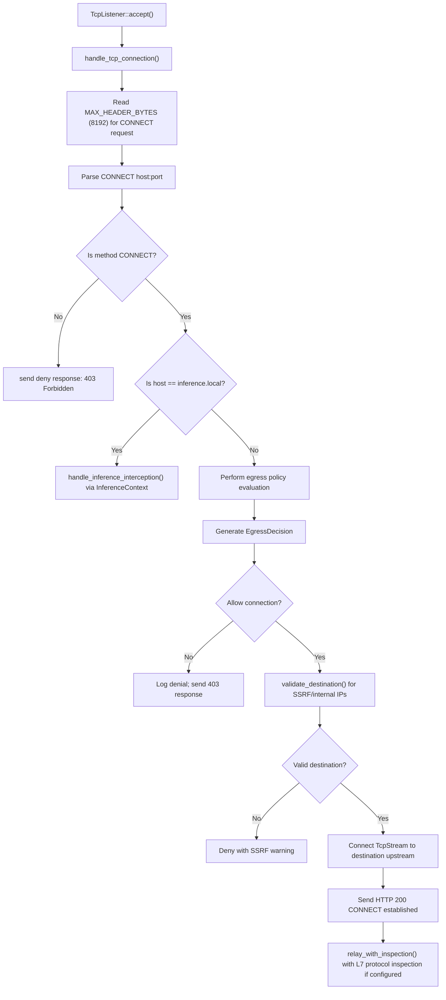
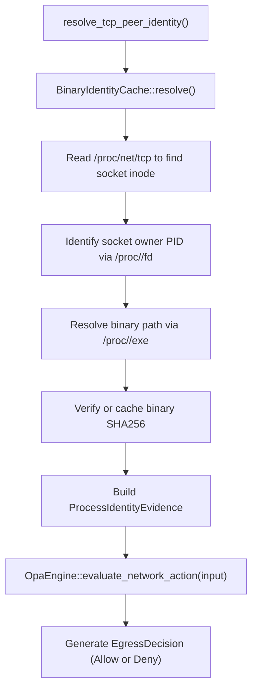
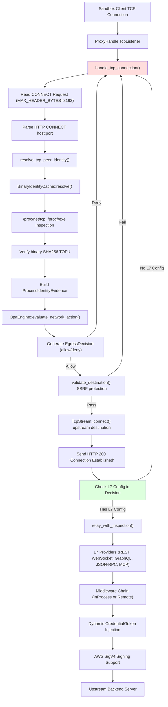

<!-- source: DeepWiki mcp.deepwiki.com · repo NVIDIA/OpenShell · page 6.5 HTTP CONNECT Proxy and L7 Inspection · fetched 2026-10-26 -->

# HTTP CONNECT Proxy and L7 Inspection

Relevant source files

The following files were used as context for generating this wiki page:

- [crates/openshell-cli/src/commands/provider.rs](crates/openshell-cli/src/commands/provider.rs)
- [crates/openshell-supervisor-network/Cargo.toml](crates/openshell-supervisor-network/Cargo.toml)
- [crates/openshell-supervisor-network/data/sandbox-policy.rego](crates/openshell-supervisor-network/data/sandbox-policy.rego)
- [crates/openshell-supervisor-network/src/l7/graphql.rs](crates/openshell-supervisor-network/src/l7/graphql.rs)
- [crates/openshell-supervisor-network/src/l7/http.rs](crates/openshell-supervisor-network/src/l7/http.rs)
- [crates/openshell-supervisor-network/src/l7/jsonrpc.rs](crates/openshell-supervisor-network/src/l7/jsonrpc.rs)
- [crates/openshell-supervisor-network/src/l7/mcp.rs](crates/openshell-supervisor-network/src/l7/mcp.rs)
- [crates/openshell-supervisor-network/src/l7/mod.rs](crates/openshell-supervisor-network/src/l7/mod.rs)
- [crates/openshell-supervisor-network/src/l7/relay.rs](crates/openshell-supervisor-network/src/l7/relay.rs)
- [crates/openshell-supervisor-network/src/l7/rest.rs](crates/openshell-supervisor-network/src/l7/rest.rs)
- [crates/openshell-supervisor-network/src/l7/rest/http_response.rs](crates/openshell-supervisor-network/src/l7/rest/http_response.rs)
- [crates/openshell-supervisor-network/src/opa.rs](crates/openshell-supervisor-network/src/opa.rs)
- [crates/openshell-supervisor-network/src/proxy.rs](crates/openshell-supervisor-network/src/proxy.rs)
- [crates/openshell-supervisor-network/src/proxy/relay.rs](crates/openshell-supervisor-network/src/proxy/relay.rs)
- [crates/openshell-supervisor-network/src/proxy/tests/compatibility.rs](crates/openshell-supervisor-network/src/proxy/tests/compatibility.rs)
- [docs/how-it-works/policies/manage-policies.mdx](docs/how-it-works/policies/manage-policies.mdx)
- [docs/how-it-works/policies/network-rules.mdx](docs/how-it-works/policies/network-rules.mdx)
- [docs/how-it-works/policies/schema.mdx](docs/how-it-works/policies/schema.mdx)
- [docs/observability/logging.mdx](docs/observability/logging.mdx)
- [e2e/rust/src/harness/mod.rs](e2e/rust/src/harness/mod.rs)
- [e2e/rust/tests/custom_image.rs](e2e/rust/tests/custom_image.rs)
- [e2e/rust/tests/forward_proxy_graphql_l7.rs](e2e/rust/tests/forward_proxy_graphql_l7.rs)
- [e2e/rust/tests/forward_proxy_l7_bypass.rs](e2e/rust/tests/forward_proxy_l7_bypass.rs)
- [e2e/rust/tests/host_gateway_alias.rs](e2e/rust/tests/host_gateway_alias.rs)
- [e2e/rust/tests/proxy_egress_pipeline.rs](e2e/rust/tests/proxy_egress_pipeline.rs)
- [examples/bring-your-own-container/Dockerfile](examples/bring-your-own-container/Dockerfile)
- [examples/bring-your-own-container/README.md](examples/bring-your-own-container/README.md)

## Purpose and Scope

The HTTP CONNECT proxy in OpenShell acts as an application-layer network interception and mediation system for sandboxed workloads. It provides process-identity binding, binary integrity verification, SSL/TLS termination, and fine-grained Layer 7 (L7) protocol inspection. This enables detailed security enforcement on outbound connections, including request-level validation and credential binding.

Core capabilities include:

- Mediating outbound HTTP CONNECT requests from sandboxed processes.
- Resolving binary identity through `/proc` inspection and trust-on-first-use SHA256 verification.
- Enforcing OPA (Open Policy Agent) network access policies at connection and request levels.
- Performing Server Side Request Forgery (SSRF) mitigation by analyzing internal and link-local IP addresses.
- Supporting transparent TLS termination and re-signing of requests (e.g., AWS SigV4).
- Inspecting L7 protocols such as REST, WebSocket, GraphQL, JSON-RPC, MCP, and applying middleware chains for request filtering and transformation.

This page documents the supervisor network proxy's architecture, data flow, implementation details of identity resolution, OPA integration, TLS handling, and L7 protocol inspection.

**Sources:**  
[crates/openshell-supervisor-network/src/proxy.rs:4-31]()  
[crates/openshell-supervisor-network/src/l7/relay.rs:4-13]()  
[crates/openshell-supervisor-network/src/l7/mod.rs:1-172]()  
[crates/openshell-supervisor-network/src/l7/rest.rs:1-179]()  
[crates/openshell-supervisor-network/src/opa.rs:1-187]()  
[crates/openshell-supervisor-middleware/src/lib.rs:38-40]()  

---

## Proxy Architecture and Lifecycle

The HTTP CONNECT proxy is managed by the `ProxyHandle` struct, which binds a `TcpListener` to accept incoming sandbox network connections and mediates them according to configured policies and inspection settings.

### Listener Binding Modes

- **Network Namespace Mode (Linux):** The proxy binds to the sandbox's virtual Ethernet host address (e.g., `10.200.0.1`) to intercept outbound TCP connections within the sandbox's separate network namespace.
- **Sidecar Topology:** In container scenarios, the proxy listens on a dedicated IP/port to intercept traffic proxied via a sidecar container.

Upon accepting connections, the proxy reads the HTTP CONNECT request, parses the target address, and dispatches handling based on policy and protocol configuration.

### Inference Context

The proxy accepts an `InferenceContext` which holds an internal router (`openshell_router::Router`) with cached `ResolvedRoute` sets optimized for:

- User-facing transparent inference (`inference.local`) requests.
- Supervisor-only system inference.

This enables special routing behaviors for local sandbox inference calls.

**Sources:**  
[crates/openshell-supervisor-network/src/proxy.rs:69-70]()  
[crates/openshell-supervisor-network/src/proxy.rs:165-166]()  
[crates/openshell-supervisor-network/src/run.rs:150-162]()  

---

## Connection Handling Flow

### Diagram: Proxy Accept and Handle Connection Flow

### Request Parsing and Inference Interception

The proxy reads up to 8192 bytes from the incoming TCP stream to parse the HTTP CONNECT request line and headers. If the request targets `inference.local:443`, the proxy uses the internal route cache to forward traffic to a local inference backend rather than external egress.

**Sources:**  
[crates/openshell-supervisor-network/src/proxy.rs:55-66]()  
[crates/openshell-supervisor-network/src/proxy.rs:165-166]()  

---

## Process Identity and OPA Evaluation

### Binary Identity Resolution

The proxy uses the sandbox's process introspection functionality to identify the binary responsible for the outgoing connection:

1. The proxy reads `/proc/net/tcp` to identify the socket inode matching the outbound connection.
2. It maps the socket inode to a process PID via `/proc/<pid>/fd`.
3. The binary path is resolved from `/proc/<pid>/exe`.
4. The SHA256 digest of the binary is checked against cached entries (Trust-On-First-Use) in `BinaryIdentityCache`.
5. It builds a comprehensive `ProcessIdentityEvidence` including binary path, SHA256, ancestors, and cmdline paths.

### OPA Policy Decision

The proxy queries the embedded OPA engine (`OpaEngine`) with network access inputs:

- Target host and port
- Binary identity evidence
- Ancestor binary paths
- Sandbox network context

The OPA query produces an `EgressDecision`:

- `Allow` with matched policy name and possibly an L7 inspection configuration.
- `Deny` with a reason string.

The decision controls whether the proxy permits the connection or denies it immediately.

### Diagram: Identity Resolution and OPA Query

**Sources:**  
[crates/openshell-supervisor-network/src/proxy.rs:10-12]()  
[crates/openshell-supervisor-network/src/opa.rs:82-93]()  

---

## SSRF Protection

Despite an OPA policy allowing a connection, SSRF protection is applied by validating the resolved destination IPs:

- Rejects internal IPs such as RFC1918 private addresses (`10.0.0.0/8`, `192.168.0.0/16`, etc.), link-local addresses, and unspecified or loopback IPs.
- Blocks cloud metadata service IP addresses (e.g., `169.254.169.254`) regardless of hostname alias.
- Allows certain host aliases (`host.openshell.internal`, `host.docker.internal`) only if they exactly match the driver-injected IP address.

This layered validation prevents sandboxed processes from exploiting redirect or DNS-level tricks to reach forbidden internal services.

**Sources:**  
[crates/openshell-supervisor-network/src/proxy.rs:20-23]()  
[crates/openshell-supervisor-network/src/proxy.rs:100-104]()  
[crates/openshell-supervisor-network/src/proxy.rs:130-133]()  

---

## L7 Protocol Inspection

When the matched policy endpoint includes a `protocol` field for L7 inspection, the proxy:

- Performs bidirectional traffic relay using the `relay` module.
- Parses each request within the tunnel (e.g., individual HTTP requests in a persistent connection).
- Evaluates each request against OPA policy for method, path, operation type, and other request parameters.
- Supports middleware chains for additional request/response processing.
- Either forwards allowed requests or denies and returns policy-defined error responses.

### L7EvalContext

This context struct holds all metadata needed for request-level evaluation:

- Host and port of the endpoint.
- Sandbox workspace.
- Matched policy name.
- Binary identity paths for cross-layer evaluation.
- Secret resolvers and dynamic provider credentials.
- Activity reporting channels.
- Middleware and agent proposal state.
- Endpoint observation channels for privacy-safe telemetry.

### Supported Protocol Providers

| Protocol   | Description                                                              | Key Features                                                  |
|------------|--------------------------------------------------------------------------|---------------------------------------------------------------|
| REST       | HTTP/1.1 request line and headers parsing, including content-length and chunked encoding | Used for typical HTTP APIs. Implements path canonicalization and deny response generation. |
| WebSocket  | Inspection of HTTP upgrade request and subsequent message frames. Supports credential rewriting in text frames and `permessage-deflate` compression. | Limits memory via `WebSocketAssemblyBudget`. |
| GraphQL   | Operation classification (query, mutation), operation name extraction, persisted queries detection. | Uses same policy and classification schemes as REST requests. |
| JSON-RPC  | Checks JSON-RPC 2.0 method names and tools, supports strict MCP validations. | Analyzes tools and calls in JSON-RPC and MCP endpoints. |
| MCP       | Model Context Protocol inspection, stricter validation of tool names. | Version-aware MCP protocol decoding for telemetry and enforcement. |

### Middleware Support

OpenShell supports in-process and remote gRPC middleware that can:

- Inspect and transform outbound requests and inbound responses.
- Apply regular expression matching or scripted rules.
- Inject or rewrite credentials dynamically.
- Emit audit findings or block requests.

Request bodies are buffered up to configured maximum sizes to accommodate middleware needs.

### Credential Injection and AWS SigV4 Signing

For endpoints bound to provider credentials:

- The proxy identifies special placeholder markers in request headers and bodies.
- Dynamically injects tokens resolved via `TokenGrantResolver` implementations.
- Supports AWS SigV4 signing modes (auto-detect, body-less, full body signing).
- Buffers request bodies (up to 10 MiB) for signature calculation.
- Appends or rewrites AWS authorization headers accordingly.

**Sources:**  
[crates/openshell-supervisor-network/src/l7/relay.rs:40-82]()  
[crates/openshell-supervisor-network/src/l7/rest.rs:4-179]()  
[crates/openshell-supervisor-network/src/l7/mod.rs:1-172]()  
[crates/openshell-supervisor-middleware/src/lib.rs:38-40]()  
[crates/openshell-core/src/secrets.rs:10-33]()  

---

## Detailed Data Flow Diagram: From Client Connection to L7 Relay

**Explanation:**  
- The proxy authenticates the connecting binary before evaluating OPA network policy.  
- SSRF checks validate destination IP address restrictions.  
- TCP connection to upstream is established if allowed.  
- Depending on L7 inspection config, traffic is relayed transparently or parsed per protocol.  
- Middleware chains and credential injection occur at the L7 inspection layer.  
- AWS SigV4 signing is integrated if configured for the endpoint.

**Sources:**  
[crates/openshell-supervisor-network/src/proxy.rs:10-70]()  
[crates/openshell-supervisor-network/src/l7/mod.rs:1-172]()  
[crates/openshell-supervisor-network/src/l7/relay.rs:4-82]()  

---

## Summary of Key Classes and Functions

| Class / Function Name         | Role / Description                                                                                         | File / Lines                 |
|------------------------------|-----------------------------------------------------------------------------------------------------------|-----------------------------|
| `ProxyHandle`                | Main TCP listener and accept loop management for proxy connections.                                        | `proxy.rs:60-90`             |
| `resolve_tcp_peer_identity` | Resolves process and binary identity for a connecting TCP socket.                                         | `proxy.rs:10-12`             |
| `BinaryIdentityCache`         | Cache of binary SHA256 fingerprints to ensure file integrity (TOFU).                                      | `proxy.rs:10-12`             |
| `OpaEngine`                  | Embedded OPA policy engine wrapping `regorus::Engine` to evaluate network access policies.                 | `opa.rs:151-187`             |
| `L7EvalContext`              | Context for L7 protocol request evaluation, including secret resolvers, activity reporting, and dynamic credentials. | `l7/relay.rs:40-88`          |
| `RestProvider`               | Parses and relays REST HTTP/1.1 requests with request method/path policy enforcement and body framing.     | `l7/rest.rs:97-149`          |
| `relay_with_inspection`      | Protocol-aware bidirectional relay implementing L7 inspection and middleware application.                  | `l7/relay.rs:4-82`           |
| `MiddlewareRegistry` and `ChainRunner` | Manage middleware chains for modifying/monitoring L7 requests and responses.                             | External crate: openshell-supervisor-middleware |
| `TokenGrantResolver`         | Interface for dynamic token acquisition and injection into headers and bodies for credentialed endpoints. | `l7/token_grant_injection.rs` (not shown fully) |

---

## Observability and Auditing

OpenShell logs proxy and L7 inspection activity using structured OCSF events and standard Rust tracing:

- **OCSF Net:Open Events:** Capture allowed and denied TCP opens with policy references.
- **OCSF HTTP: Methods:** Log allowed and denied HTTP method/path requests with severity.
- **Findings:** Middleware and policy violations result in separate "finding" events that aid security auditing.
- **Latency and Timing:** The proxy tracks connection mediation timing for performance telemetry.

These logs are accessible via the CLI and UI tooling for audit and debug purposes.

**Sources:**  
[docs/observability/logging.mdx:10-144]()  
[crates/openshell-supervisor-network/src/proxy.rs:120-160]()  

---

This completes the detailed technical overview of the OpenShell HTTP CONNECT proxy and its L7 inspection capabilities, describing proxy architecture, connection handling, identity resolution, OPA integration, SSRF protection, protocol inspection, middleware extensibility, credential injection, and observability.

---

