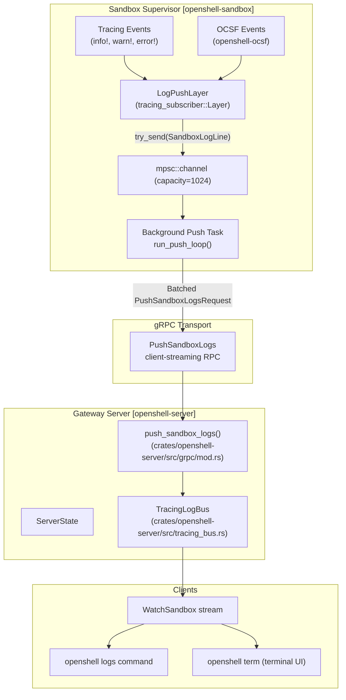
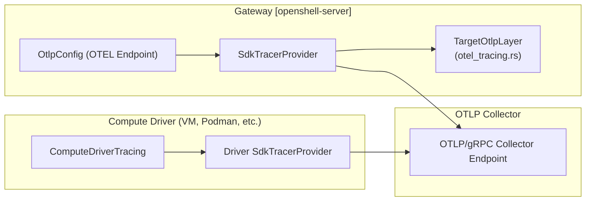

<!-- source: DeepWiki mcp.deepwiki.com · repo NVIDIA/OpenShell · page 6.6 Log Streaming and Observability · fetched 2026-10-26 -->

# Log Streaming and Observability

<details>
<summary>Relevant source files</summary>

The following files were used as context for generating this wiki page:

- [crates/openshell-driver-podman/src/otel_tracing.rs](crates/openshell-driver-podman/src/otel_tracing.rs)
- [crates/openshell-driver-vm/src/otel_tracing.rs](crates/openshell-driver-vm/src/otel_tracing.rs)
- [crates/openshell-otel/Cargo.toml](crates/openshell-otel/Cargo.toml)
- [crates/openshell-otel/src/grpc.rs](crates/openshell-otel/src/grpc.rs)
- [crates/openshell-otel/src/lib.rs](crates/openshell-otel/src/lib.rs)
- [crates/openshell-sandbox/src/container_log.rs](crates/openshell-sandbox/src/container_log.rs)
- [crates/openshell-sandbox/src/delegated.rs](crates/openshell-sandbox/src/delegated.rs)
- [crates/openshell-sandbox/src/main_session.rs](crates/openshell-sandbox/src/main_session.rs)
- [crates/openshell-server/src/otel_tracing.rs](crates/openshell-server/src/otel_tracing.rs)
- [crates/openshell-server/src/tracing_setup.rs](crates/openshell-server/src/tracing_setup.rs)
- [docs/observability/accessing-logs.mdx](docs/observability/accessing-logs.mdx)

</details>


## Purpose and Scope

This page documents the log streaming and observability infrastructure within OpenShell, focusing on how sandbox logs are pushed to the gateway, aggregated by the `TracingLogBus`, surfaced via gRPC streaming APIs, and integrated with OpenTelemetry (OTEL) tracing for distributed observability. It details the implementation of the sandbox log push layers, the gateway’s log aggregation bus, OTEL tracing setup, and how logs can be accessed by clients such as the CLI and terminal UI.

---

## Architecture Overview: Log Streaming Pipeline

The log streaming system enables real-time forwarding of sandbox supervisor logs and security audit events to the gateway, which then fans them out to clients or stores them temporarily.



- **Sandbox Supervisor**: Uses a specialized `LogPushLayer` tracing layer that asynchronously sends logs and OCSF audit events into a bounded mpsc channel.
- **Background Push Task**: Consumes from the channel and forwards batched log lines via the gRPC `PushSandboxLogs` client-streaming RPC to the gateway.
- **Gateway Server**: The gRPC handler receives and merges sandbox log lines into the `TracingLogBus`.
- **TracingLogBus**: Maintains a recent tail buffer of logs and broadcasts them to watchers.
- **Clients**: The CLI and terminal UI watch log streams via gRPC from the gateway and present logs with timestamps and security context.

**Sources:**  
- [crates/openshell-server/src/tracing_setup.rs:16-76]()  
- [docs/observability/accessing-logs.mdx:9-74]()  
- [crates/openshell-sandbox/src/delegated.rs:30-145]()  

---

## The `TracingLogBus`: Central Log Aggregation and Distribution

The `TracingLogBus` is the gateway’s main log aggregation component. It collects internal gateway logs and streams pushed sandbox logs into a unified channel for consumption.

### Core Characteristics

- **Initialization**: Created at gateway startup, it returns a `tracing_subscriber::Layer` that injects gateway logs into the bus [crates/openshell-server/src/tracing_setup.rs:18-19]().
- **Buffering**: Holds an in-memory ring buffer of recent log lines for each sandbox, enabling tailing of logs on demand.
- **Broadcasting**: Implements a broadcast mechanism so multiple clients can watch logs simultaneously without loss.
- **Consumer Watch**: Clients can resume streams, using opaque cursor tokens, to handle disconnect/reconnect scenarios gracefully.

### Integration Points

- The gateway routing stack calls `push_sandbox_logs()` (gRPC server handler) to append sandbox logs to the bus.
- Clients connect to the `WatchSandbox` streaming RPC, which reads logs merged by the bus from various sandboxes.
- The CLI command `openshell logs` and the terminal UI consume from the WatchSandbox stream to display logs.

**Sources:**  
- [crates/openshell-server/src/tracing_setup.rs:16-79]()  
- [docs/observability/accessing-logs.mdx:50-70]()  

---

## Log Formatting and OCSF Structured Events

OpenShell supports two complementary logging formats for observability and security:

| Format             | Purpose                              | Tooling/Format                 | Notes                                              |
|--------------------|------------------------------------|-------------------------------|----------------------------------------------------|
| Standard Tracing   | Developer-focused debug/info logs  | Rust `tracing` events          | Includes info, warn, error with target and message |
| OCSF Structured    | Security audit, SIEM integration   | `openshell-ocsf` crate events | Maps logs to Open Cybersecurity Schema Framework (OCSF) v1.8.0 event classes |

### OCSF Event Classes and Shorthands

OpenShell emits security-relevant events tagged with OCSF classes, facilitating detailed audit and SIEM ingestion:

| Shorthand    | OCSF Class              | UID  | Description                             |
|--------------|------------------------|------|----------------------------------------|
| `NET:`       | Network Activity        | 4001 | TCP proxy CONNECT, bypass detection    |
| `HTTP:`      | HTTP Activity           | 4002 | L7 enforcement, HTTP forwarding         |
| `SSH:`       | SSH Activity            | 4007 | SSH authentication, handshakes         |
| `PROC:`      | Process Activity        | 1007 | Process lifecycle (launch, exit)        |
| `FINDING:`   | Detection Finding       | 2004 | Security findings (nonce replay etc.)   |
| `CONFIG:`    | Device Config           | 5019 | Policy reload, Landlock setup            |
| `LIFECYCLE:` | Application Lifecycle   | 6002 | Sandbox/supervisor lifecycle events     |
| `API:INFERENCE` | API Activity          | 6003 | AI model inference calls                 |

### Shorthand Log Format

The crate `openshell-ocsf` formats structured events into concise single-line shorthand strings with:

- Timestamps formatted as `HH:MM:SS.mmm`
- Severity tags like `[INFO]`, `[MED]`, `[HIGH]`
- Readable context truncation and escaping for security-relevant fields

This format is suitable for rapid inspection, `grep` filtering, and concise audit trail viewing.

**Sources:**  
- [docs/observability/logging.mdx:14-27]()  
- [docs/observability/logging.mdx:51-65]()  
- [crates/openshell-ocsf/src/format/shorthand.rs:51-60]()  
- [crates/openshell-ocsf/src/format/shorthand.rs:188-194]()  

---

## OpenTelemetry (OTEL) Tracing Integration

OpenShell integrates distributed tracing via OpenTelemetry to provide rich observability into gateway and compute driver activity.



### Key Implementation Points

- **Configuration**: The OTel trace export is enabled via the `[openshell.gateway.otlp]` TOML config section specifying the OTLP endpoint; absence disables the export [crates/openshell-server/src/otel_tracing.rs:11-34]().
- **Service Identity**: Service name defaults to `"openshell-gateway"` unless overridden [crates/openshell-server/src/otel_tracing.rs:35-35]().
- **Tracing Layer**: `otel_tracing::layer()` builds a `tracing_subscriber::Layer` that forwards gateway spans to the OTLP exporter while excluding recursive instrumentation traffic [crates/openshell-server/src/otel_tracing.rs:130-144]().
- **Error Handling**: Helper types and guards (`mark_error`, `ErrorStatusGuard`) mark spans as failed automatically on errors [crates/openshell-otel/src/lib.rs:63-108]().
- **gRPC Interception**: `TracedGrpcStream` wraps outbound response streams to record status; `compute_driver_rpc_layer()` attaches to compute-driver gRPC server for tracing [crates/openshell-otel/src/grpc.rs:17-63]().
- **Compute Drivers**: Each compute driver declares its own OTEL tracing identity with `ComputeDriverTracing` constants to annotate spans appropriately, e.g., VM driver in [crates/openshell-driver-vm/src/otel_tracing.rs:6-6](), Podman driver similarly [crates/openshell-driver-podman/src/otel_tracing.rs:6-6]().

**Sources:**  
- [crates/openshell-server/src/otel_tracing.rs:11-144]()  
- [crates/openshell-otel/src/lib.rs:63-108]()  
- [crates/openshell-otel/src/grpc.rs:17-63]()  
- [crates/openshell-driver-vm/src/otel_tracing.rs:6-6]()  
- [crates/openshell-driver-podman/src/otel_tracing.rs:6-6]()  

---

## Accessing Logs

OpenShell provides multiple paths for clients to consume logs for sandboxes:

### CLI Streaming

The `openshell logs` CLI command streams logs from the gateway in real-time via gRPC:

```shell
openshell logs <sandbox-name> --source sandbox
```

- Receives logs merged from sandbox push channels in ordered sequence.
- Each line includes timestamp, source, level, and message.
- OCSF structural events appear with `OCSF` as the level.
- Gateway-originated policy mutations (e.g. policy updates) are also streamed for full observability.

### Terminal UI (TUI)

The `openshell term` terminal UI displays sandbox logs with the same formatting and live updates as the CLI.

### Main Process Container Logs

- The main sandbox process' stdout and stderr appear on the container runtime logs and can be accessed via container commands:
  - `docker logs <container>`
  - `kubectl logs <pod> -c agent`
  - `podman logs <container>`
- This output includes supervisor warnings and sandbox process console output.
- Output from `sandbox exec` and SSH sessions does not appear here.

### Direct Sandbox Filesystem Access

- Logs are retained as files inside the sandbox's filesystem under `/var/log/openshell.<date>.log`.
- Users can inspect complete logs including events that might be dropped on grpc push under backpressure.
- Example shell command:

```shell
openshell sandbox exec --name my-sandbox -- cat /var/log/openshell.2026-04-01.log
```

### Loss Awareness and Resume

- The watch stream supports opaque cursor tokens that allow clients to resume after disconnects.
- The gateway distinguishes recoverable lag (drops with warning) vs unrecoverable loss (stream ends with `OUT_OF_RANGE`).
- Clients must restart the watch stream with an empty cursor on unrecoverable loss.

**Sources:**  
- [docs/observability/accessing-logs.mdx:9-120]()  
- [crates/openshell-sandbox/src/container_log.rs:25-177]()  

---

# Summary

This architecture ensures real-time, robust observability of sandbox runtime activities and security audit events within OpenShell:

- The sandbox supervisor asynchronously pushes tracing logs and OCSF audit events using a dedicated `LogPushLayer`.
- Logs are streamed via gRPC client streaming to the gateway, which aggregates them in the `TracingLogBus`.
- The gateway merges internal and sandbox logs, forwarding them via `WatchSandbox` gRPC streaming to clients.
- Logs are accessible via CLI, TUI, or direct sandbox filesystem inspection.
- OpenTelemetry tracing integrates distributed observability of gateway and compute driver operations, exporting spans to OTLP-compliant collectors.
- The OCSF structured event framework facilitates security-focused audit events with standardized fields and severity mapping.

This unified observability model supports both operational debugging and security incident investigation and integrates tightly with policy enforcement and auditing systems.

---

# Appendix: Key Code Entities and Their Relationships

```mermaid
classDiagram
    class LogPushLayer{
        +Layer
        +try_send(SandboxLogLine)
    }
    
    class MainSession{
        -OutputLog
        +publish(MainOutput)
    }
    
    class TracingLogBus{
        +layer() Layer
        +broadcast(SandboxLogLine)
    }
    
    class run_push_loop{
        +async fn run()
        -mpsc::Receiver
        -client PushSandboxLogsClient
    }
    
    LogPushLayer --> mpsc::Sender
    run_push_loop ..> mpsc::Receiver
    run_push_loop --> PushSandboxLogsClient
    PushSandboxLogsClient --> push_sandbox_logs()
    push_sandbox_logs() --> TracingLogBus
    TracingLogBus --> CLI
    TracingLogBus --> TUI
```

**Explanation:**  
- `LogPushLayer` is the tracing layer in the sandbox supervisor that emits logs into a `mpsc` channel.
- `run_push_loop` consumes the channel and batches logs into gRPC requests to the gateway’s `push_sandbox_logs` handler.
- The gateway’s `TracingLogBus` aggregates pushed logs and gateway logs, providing a broadcast channel.
- CLI and TUI subscribe to the bus to receive logs.

**Sources:**  
- [crates/openshell-sandbox/src/main_session.rs:29-189]()  
- [crates/openshell-sandbox/src/delegated.rs:30-145]()  
- [crates/openshell-server/src/tracing_setup.rs:14-160]()  
- [crates/openshell-server/src/tracing_bus.rs]() (not listed but referenced)  

---

# References

1. **Sandbox supervisor main session and log retention**: `crates/openshell-sandbox/src/main_session.rs` [lines 25-195]()  
2. **Sandbox log push assembly**: `crates/openshell-sandbox/src/delegated.rs` [lines 30-145]()  
3. **Gateway tracing setup and `TracingLogBus` integration**: `crates/openshell-server/src/tracing_setup.rs` [lines 16-160]()  
4. **OpenTelemetry tracing provider and layer**: `crates/openshell-server/src/otel_tracing.rs` [lines 1-144]()  
5. **OTEL shared crate with error mark and tracing helpers**: `crates/openshell-otel/src/lib.rs` [lines 63-108]()  
6. **gRPC request tracing via OTEL**: `crates/openshell-otel/src/grpc.rs` [lines 17-63]()  
7. **Compute driver OTEL tracing identities for VM and Podman drivers**:  
   - VM: `crates/openshell-driver-vm/src/otel_tracing.rs` [lines 6-6]()  
   - Podman: `crates/openshell-driver-podman/src/otel_tracing.rs` [lines 6-6]()  
8. **Accessing logs guide**: `docs/observability/accessing-logs.mdx` [lines 9-120]()  
9. **OCSF formatting and event class reference**: `crates/openshell-ocsf/src/format/shorthand.rs` [lines 51-60, 188-194]()  

This completes the documentation for log streaming and observability in OpenShell.

---

