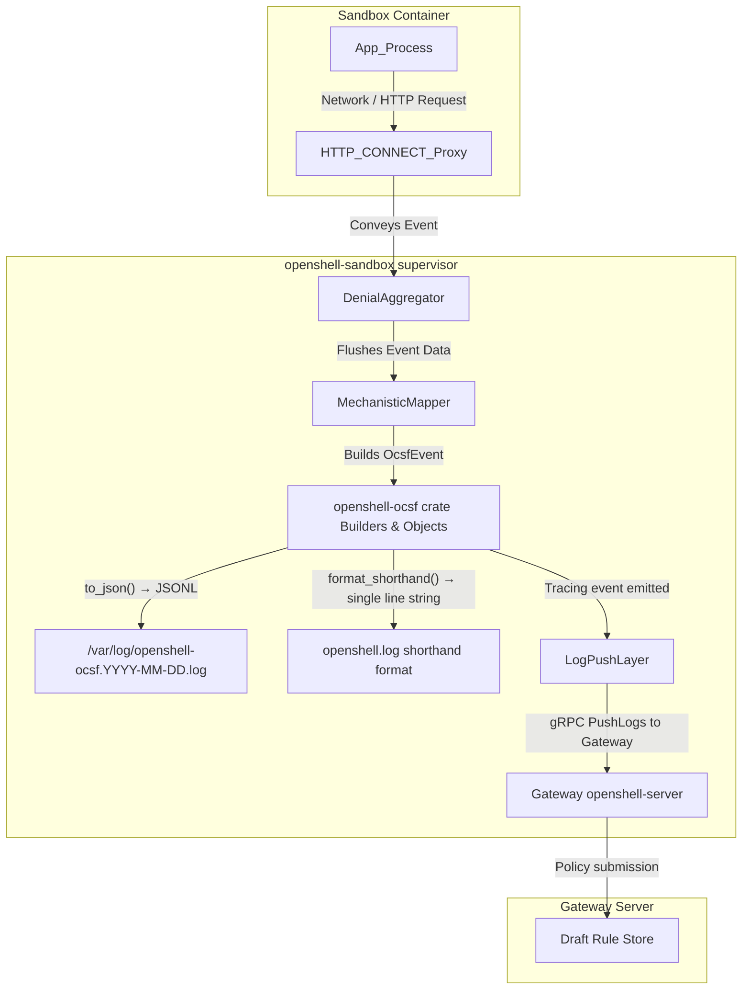
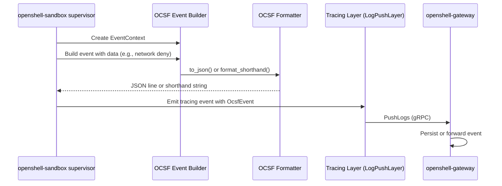

<!-- source: DeepWiki mcp.deepwiki.com · repo NVIDIA/OpenShell · page 6.7 OCSF Audit Logging · fetched 2026-10-26 -->

# OCSF Audit Logging

<details>
<summary>Relevant source files</summary>

The following files were used as context for generating this wiki page:

- [crates/openshell-core/src/settings.rs](crates/openshell-core/src/settings.rs)
- [crates/openshell-ocsf/Cargo.toml](crates/openshell-ocsf/Cargo.toml)
- [crates/openshell-ocsf/src/builders/base.rs](crates/openshell-ocsf/src/builders/base.rs)
- [crates/openshell-ocsf/src/builders/config.rs](crates/openshell-ocsf/src/builders/config.rs)
- [crates/openshell-ocsf/src/builders/finding.rs](crates/openshell-ocsf/src/builders/finding.rs)
- [crates/openshell-ocsf/src/builders/http.rs](crates/openshell-ocsf/src/builders/http.rs)
- [crates/openshell-ocsf/src/builders/lifecycle.rs](crates/openshell-ocsf/src/builders/lifecycle.rs)
- [crates/openshell-ocsf/src/builders/mod.rs](crates/openshell-ocsf/src/builders/mod.rs)
- [crates/openshell-ocsf/src/builders/network.rs](crates/openshell-ocsf/src/builders/network.rs)
- [crates/openshell-ocsf/src/builders/process.rs](crates/openshell-ocsf/src/builders/process.rs)
- [crates/openshell-ocsf/src/builders/ssh.rs](crates/openshell-ocsf/src/builders/ssh.rs)
- [crates/openshell-ocsf/src/enums/activity.rs](crates/openshell-ocsf/src/enums/activity.rs)
- [crates/openshell-ocsf/src/enums/device_type.rs](crates/openshell-ocsf/src/enums/device_type.rs)
- [crates/openshell-ocsf/src/enums/mod.rs](crates/openshell-ocsf/src/enums/mod.rs)
- [crates/openshell-ocsf/src/lib.rs](crates/openshell-ocsf/src/lib.rs)
- [crates/openshell-ocsf/src/objects/device.rs](crates/openshell-ocsf/src/objects/device.rs)
- [crates/openshell-ocsf/src/objects/metadata.rs](crates/openshell-ocsf/src/objects/metadata.rs)
- [crates/openshell-ocsf/src/validation/mod.rs](crates/openshell-ocsf/src/validation/mod.rs)
- [crates/openshell-ocsf/src/validation/schema.rs](crates/openshell-ocsf/src/validation/schema.rs)
- [crates/openshell-ocsf/tests/event_identity.rs](crates/openshell-ocsf/tests/event_identity.rs)
- [docs/observability/ocsf-json-export.mdx](docs/observability/ocsf-json-export.mdx)
- [tasks/ci.toml](tasks/ci.toml)
- [tasks/python.toml](tasks/python.toml)
- [tasks/rust.toml](tasks/rust.toml)
- [tasks/typescript.toml](tasks/typescript.toml)

</details>


The OpenShell audit logging system provides structured, high-fidelity security events for all sandbox activities. By leveraging the **Open Cybersecurity Schema Framework (OCSF) v1.8.0**, OpenShell ensures that network connections, HTTP requests, process executions, and security findings are logged in a vendor-neutral format suitable for ingestion by SIEMs and security data lakes.

The implementation resides primarily in the `openshell-ocsf` crate, which contains OCSF schema definitions, ergonomic event builders, dual-format formatters, tracing layers, and identity constructs.

---

## Architecture and Data Flow

Audit logging is tightly integrated with the `openshell-sandbox` tracing pipeline. Events are captured at points of enforcement or observation (e.g., the HTTP CONNECT proxy or the process supervisor), converted into typed OCSF events via builder APIs, formatted into JSONL or human-readable shorthand, and streamed or persisted for external collection.

The flow shows how a sandbox-origin event (e.g., a denied network connection) is transformed into an OCSF audit log through various steps before reaching the gateway.

### Audit Log Pipeline



Sources: [crates/openshell-ocsf/src/builders/mod.rs:4-8](), [crates/openshell-ocsf/src/builders/http.rs:82-118](), [crates/openshell-sandbox/src/mechanistic_mapper.rs:4-13]()

---

## OCSF Event Classes

OpenShell maps sandbox activities to canonical OCSF v1.8.0 event classes. This enables security analysts and SIEM systems to interpret logs consistently across environments. The events are richly annotated with identifiers such as `activity_id`, `action_id`, `severity_id`, and `metadata`.

| Shorthand Prefix | OCSF Class Name             | Class UID | OpenShell Trigger                   | Key Fields Captured                                      |
|------------------|----------------------------|-----------|-----------------------------------|---------------------------------------------------------|
| `NET:`           | Network Activity            | 4001      | TCP proxy CONNECT, SSRF detection | `src_endpoint`, `dst_endpoint`, `actor.process`, `firewall_rule` |
| `HTTP:`          | HTTP Activity              | 4002      | HTTP L7 forward requests          | `http_request.url`, `http_method`, `firewall_rule`, `status_detail` |
| `SSH:`           | SSH Activity              | 4007      | Interactive sandbox access        | `auth_type`, `protocol_ver`, `src_endpoint`             |
| `PROC:`          | Process Activity           | 1007      | Sandbox process lifecycle         | `process.name`, `pid`, `launch_type`, `exit_code`       |
| `FINDING:`       | Detection Finding          | 2004      | Security bypass/replay attacks    | `finding_info.title`, `confidence_id`, `attacks` (MITRE ATT&CK) |
| `CONFIG:`        | Device Config State Change | 5019      | Policy reloads, Landlock setup    | `state`, `security_level`                                |
| `LIFECYCLE:`     | Application Lifecycle      | 6002      | Supervisor start/stop             | `activity_name` (Start/Stop), `app.name`                 |
| `API:INFERENCE:` | API Activity              | 6003      | AI Inference call observability  | `ai_operation` profile: model, provider, tokens          |

Sources: [crates/openshell-ocsf/src/builders/network.rs:40-115](), [crates/openshell-ocsf/src/builders/http.rs:13-152](), [crates/openshell-ocsf/src/builders/ssh.rs:13-27](), [crates/openshell-ocsf/src/builders/process.rs:60-75](), [crates/openshell-ocsf/src/builders/finding.rs:120-160](), [crates/openshell-ocsf/src/builders/lifecycle.rs:30-45](), [docs/observability/ocsf-json-export.mdx:87-167]()

---

## Implementation Details

### The `openshell-ocsf` Crate

This crate bundles all OCSF v1.8.0-related types, including:

- **OCSF Event Classes** implemented as Rust structs (`NetworkActivityEvent`, `HttpActivityEvent`, etc.)
- **Strongly typed enums and objects** defining OCSF enumerations (e.g., `SeverityId`) and common data types (`Endpoint`, `Process`, `FirewallRule`)
- **Ergonomic Builders** — Per-class event builders, taking an immutable `EventContext` and exposing chainable setters for event data.
- **Formatters** — Methods to render events as:
  - Human-friendly single-line shorthand (`format_shorthand()`)
  - Strict OCSF-compliant JSON lines (`to_json()`, `to_json_line()`)
- **Tracing Integration Layers** — Layers to interface with the tracing system for event emission.
- **Event Metadata and Identity** — Each event carries unique UIDs in `metadata.uid`, distinct from the sandbox container ID in `container.uid`.

---

### Event Context and Shared Metadata

The `EventContext` struct holds immutable environmental data created at sandbox startup:

- `sandbox_id`, `sandbox_name`: Unique sandbox identities.
- `container_image`: Image reference string.
- `hostname`: Hostname of the device hosting the sandbox.
- `product_version`: Supervisor version string.
- `proxy_ip`, `proxy_port`: Proxy listening endpoint.
- `origin`: Enum specifying the producing component, `Supervisor` or `Gateway` with `name`.

The context is passed by reference to every builder to populate common OCSF fields like product metadata, device info, and container identity.

```rust
pub struct EventContext {
    pub sandbox_id: String,
    pub sandbox_name: String,
    pub container_image: String,
    pub hostname: String,
    pub product_version: String,
    pub proxy_ip: IpAddr,
    pub proxy_port: u16,
    pub origin: EventOrigin,
}
```

Sources: [crates/openshell-ocsf/src/builders/mod.rs:177-204]()

---

### Builders: Typed, Fluent, and Modular

Each OCSF event class has a corresponding builder struct. For example, `NetworkActivityBuilder` and `HttpActivityBuilder` encapsulate field-setting logic and enforce compile-time constraints.

- **Chainable setters** for fields like `severity`, `status`, `action`, `actor_process`, `src_endpoint`, `dst_endpoint`.
- **Macros** (`impl_builder_setters!`, `impl_action_disposition_setters!`, etc.) generate repeated setters across builders for consistency.
- **Missing/Has State Typing** tracks required fields (e.g., HTTP events require either a request or a response before build).

Example partial API for `HttpActivityBuilder`:

```rust
impl<'a> HttpActivityBuilder<'a, MissingHttpContext> {
    pub fn new(ctx: &'a EventContext) -> Self;
    pub fn http_request(self, req: HttpRequest) -> HttpActivityBuilder<'a, HasHttpContext>;
    pub fn http_response(self, resp: HttpResponse) -> HttpActivityBuilder<'a, HasHttpContext>;
}

impl<'a> HttpActivityBuilder<'a, HasHttpContext> {
    pub fn status_detail(mut self, detail: impl Into<String>) -> Self;
    pub fn dst_endpoint(mut self, endpoint: Endpoint) -> Self;
    pub fn severity(mut self, id: SeverityId) -> Self;
    pub fn build(self) -> OcsfEvent;
}
```

This pattern is replicated for network, SSH, process, detection-finding, and other event classes.

Sources: [crates/openshell-ocsf/src/builders/mod.rs:10-56](), [crates/openshell-ocsf/src/builders/http.rs:13-208](), [crates/openshell-ocsf/src/builders/network.rs:13-199]()

---

### Event Identity and Serialization

- Each event has a unique `metadata.uid` (UUID string), distinct from the sandbox identifier stored in `container.uid`.
- Serialization to JSON preserves event identity.
- Events without a container image omit the image field gracefully.
- The `device` object identifies the runtime environment, reporting OS name (Linux or Windows) and device type (`Sandbox`).

Example verified by unit tests ensures distinct `metadata.uid` on repeated event creation with same context.

Sources: [crates/openshell-ocsf/tests/event_identity.rs:4-88]()

---

### Dual Formatters

OpenShell audit events can be rendered in two formats:

- **Human-readable shorthand**: Compact single line with timestamp, severity tag, and meaningful event detail for CLI or log file monitoring.
- **Full OCSF JSONL**: Each event output as a one-line JSON object conforming strictly to OCSF v1.8.0 schema, suitable for SIEM consumption.

Typical shorthand line components:

- Timestamp (`HH:mm:ss.mmm`)
- Severity tag (`[INFO]`, `[MED]`, `[HIGH]`, etc.)
- Event class prefix (`NET`, `HTTP`, `PROC`, etc.)
- Source and destination endpoints
- Message trimmed to fixed length
- Escaped delimiters to guarantee single-line

Sources: [crates/openshell-ocsf/src/format/shorthand.rs:6-23](), [docs/observability/ocsf-json-export.mdx:87-132]()

---

## Configuration and Runtime Control

### Sandbox Settings

- **`ocsf_json_enabled` (Boolean)** enables writing OCSF JSONL files in-sandbox (default `false`).
- **`ocsf_schema_version` (String)** controls schema version downgrade of JSONL for compatibility with AWS Security Lake, Splunk, CrowdStrike (`""`, `"1.1"`, `"1.3"` allowed).
- Settings are managed via `openshell settings` CLI commands and propagate without sandbox restart.

### Gateway OCSF JSONL Output

Configured via `[openshell.gateway.ocsf_log]` in `gateway.toml`:

- Collects gateway-origin OCSF events (e.g., TLS cert reloads).
- Writes to local JSONL files per replica.
- Separate from in-sandbox logging.

Windows MXC-specific audit events originate in the gateway and require explicit enabling:

```toml
[openshell.drivers.mxc]
etw_audit = true
```

Environment variables:

```powershell
$env:OPENSHELL_OCSF_JSON = "1"
$env:OPENSHELL_OCSF_LOG_DIR = "D:\OpenShell\audit"
```

Outputs rotate daily with limited retention.

Sources: [crates/openshell-core/src/settings.rs:117-148](), [docs/observability/ocsf-json-export.mdx:10-76]()

---

## Detailed Event Class Relationships: Natural Language to Code Mapping

### Mapping: Real-World Event to Code Builders and Context

```mermaid
flowchart LR
    subgraph Natural_Language ["Natural Language Space"]
        A["Sandbox Event: HTTP CONNECT Deny"]
        B["Policy Decision: Deny"]
        C["User Action: SSH Login"]
        D["Process Activity: exec /usr/bin/python"]
    end

    subgraph Code_Entity_Space ["Code Entity Space (openshell-ocsf crate)"]
        E[/"EventContext (immutable sandbox metadata)"/]
        F["HttpActivityBuilder"]
        G["SshActivityBuilder"]
        H["ProcessActivityBuilder"]
        I["OcsfEvent"]
    end

    A -->|Creates EventContext| E
    B -->|Calls builder| F
    C -->|Calls builder| G
    D -->|Calls builder| H

    E -->|Borrow & configure| F
    E -->|Borrow & configure| G
    E -->|Borrow & configure| H

    F -->|build() produces| I
    G -->|build() produces| I
    H -->|build() produces| I
```

Sources: [crates/openshell-ocsf/src/builders/mod.rs:177-198](), [crates/openshell-ocsf/src/builders/http.rs:13-208](), [crates/openshell-ocsf/src/builders/ssh.rs:13-27](), [crates/openshell-ocsf/src/builders/process.rs:60-75]()

---

### OCSF Event Output Flow Within Sandbox Supervisor



Sources: [crates/openshell-ocsf/src/tracing_layers/mod.rs](), [crates/openshell-ocsf/src/builders/mod.rs:177-198]()

---

## Summary

The `openshell-ocsf` crate encapsulates the OpenShell audit logging capability, conforming to OCSF v1.8.0 for consistent and interoperable security event logging from sandbox supervisors and gateways. Rich event classes, strong typing, ergonomic builders, and dual output formats empower operators to monitor and analyze sandbox activity for security anomalies and compliance.

Enabling OCSF JSON output at both sandbox and gateway layers supports integration with major SIEM products and cloud-native security data lakes.

---

# References and Sources

- [crates/openshell-ocsf/src/lib.rs:4-69]()
- [crates/openshell-ocsf/src/builders/mod.rs:1-204]()
- [crates/openshell-ocsf/src/builders/http.rs:1-208]()
- [crates/openshell-ocsf/src/builders/network.rs:1-199]()
- [crates/openshell-ocsf/tests/event_identity.rs:1-88]()
- [crates/openshell-core/src/settings.rs:117-148]()
- [docs/observability/ocsf-json-export.mdx:10-179]()
- [crates/openshell-sandbox/src/mechanistic_mapper.rs:4-13]()

---

