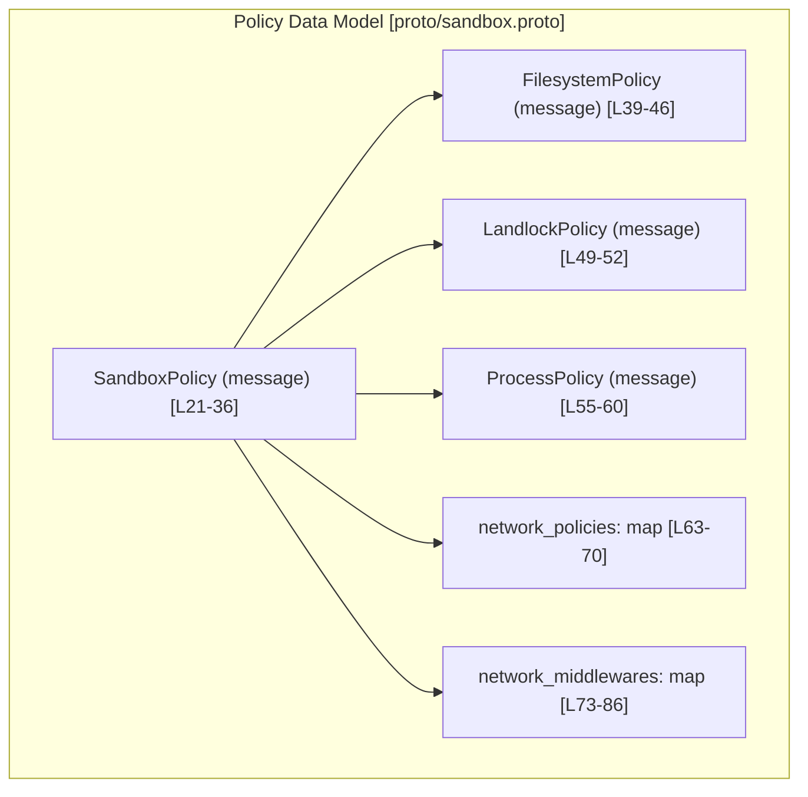
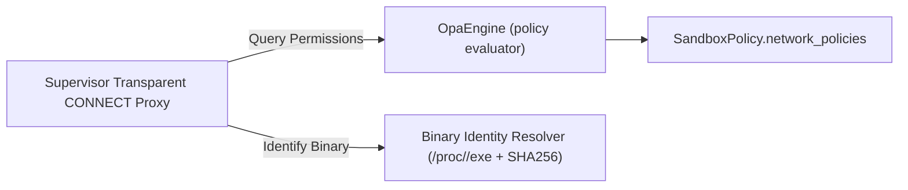
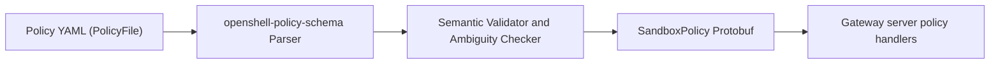
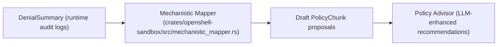
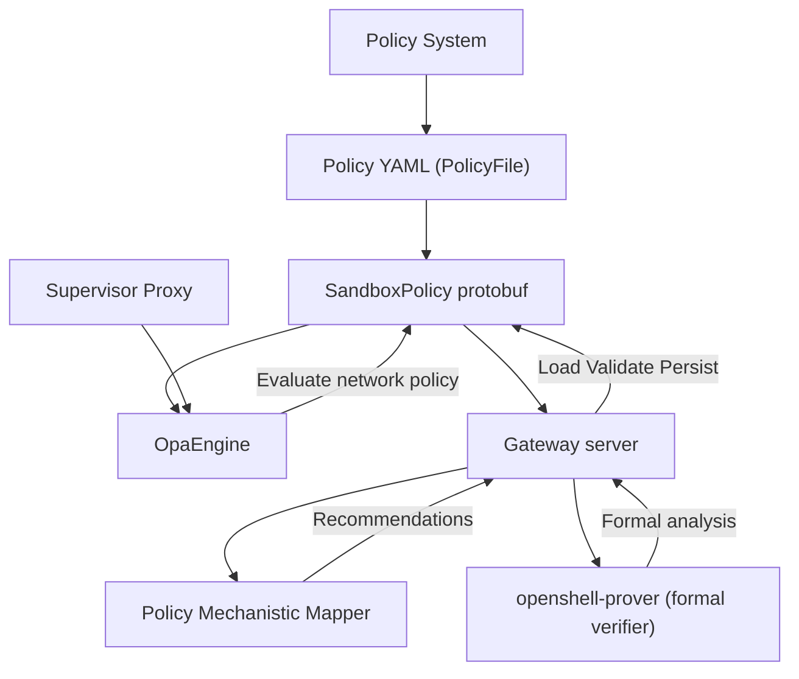

<!-- source: DeepWiki mcp.deepwiki.com · repo NVIDIA/OpenShell · page 7 Policy System · fetched 2026-10-26 -->

# Policy System

Relevant source files

The following files were used as context for generating this wiki page:

- [crates/openshell-core/src/net.rs](crates/openshell-core/src/net.rs)
- [crates/openshell-ocsf/src/format/shorthand.rs](crates/openshell-ocsf/src/format/shorthand.rs)
- [crates/openshell-ocsf/src/objects/http.rs](crates/openshell-ocsf/src/objects/http.rs)
- [crates/openshell-policy/src/lib.rs](crates/openshell-policy/src/lib.rs)
- [crates/openshell-policy/src/merge.rs](crates/openshell-policy/src/merge.rs)
- [crates/openshell-providers/src/profiles.rs](crates/openshell-providers/src/profiles.rs)
- [crates/openshell-sandbox/src/mechanistic_mapper.rs](crates/openshell-sandbox/src/mechanistic_mapper.rs)
- [e2e/python/test_sandbox_policy.py](e2e/python/test_sandbox_policy.py)
- [proto/sandbox.proto](proto/sandbox.proto)

The policy system controls sandboxed AI agent behavior through a declarative and extensible policy language. It defines rules governing filesystem access, process privileges, and network communications, balancing strong kernel-level enforcement with flexible, dynamic network policy evaluation. The system includes integrated validation, runtime enforcement layers, live updates, automated recommendations, and formal verification tools to ensure security and usability.

This page provides a high-level overview of the key components and concepts within the policy system and links to detailed technical child pages.

---

## Policy Language and Data Model Overview

OpenShell policies are expressed as structured YAML documents following a canonical schema. These are parsed into the `SandboxPolicy` protobuf message used at runtime. The core `SandboxPolicy` contains distinct domains representing:

- **FilesystemPolicy** — Controls directories with read-only and read-write permissions.
- **LandlockPolicy** — Configures Linux Landlock LSM capabilities for kernel-level isolation.
- **ProcessPolicy** — Specifies user and group identities for process execution.
- **NetworkPolicyRules** — Defines allowed network endpoints and binary scopes, supporting both layer 4 (connection-level) and layer 7 (application-layer) filtering.
- **NetworkMiddlewares** — Configurable middleware chains for advanced network egress inspection.

These domains enforce sandbox boundaries at different points of the system and vary in mutability and enforcement layers.

### Policy Protobuf Structure and Code Entities

**Sources:** [proto/sandbox.proto:19-86](), [crates/openshell-policy/src/lib.rs:37-69]()

---

## Enforcement Layers and Policy Domains

Each policy domain maps to a different enforcement point within the sandbox runtime architecture:

| Policy Domain       | Enforcement Layer                                             | Mutability               | Code Reference            |
|---------------------|---------------------------------------------------------------|--------------------------|---------------------------|
| `filesystem`        | Linux Landlock LSM applied pre-exec, restricts FS access      | Static (immutable at run) | [crates/openshell-sandbox]() (enforcement logic) |
| `landlock`          | Landlock ruleset configuration at sandbox startup            | Static                    |                           |
| `process`           | User/group IDs set via `setuid/setgid` before exec            | Static                    |                           |
| `network_policies`  | Evaluated connection-level and request-level via OPA engine   | Dynamic (hot-reloadable)  | [crates/openshell-sandbox]() (OpaEngine integration) |
| `network_middlewares` | Runtime middleware chain invoked by network proxy            | Dynamic                   |                           |

This layered approach combines compile-time, kernel, supervisor, and proxy enforcement for defense-in-depth.

**Sources:** [docs/sandboxes/policies.mdx:13-73](), [proto/sandbox.proto:21-86]()

---

## Runtime Evaluation with OPA Engine Integration

OpenShell embeds an Open Policy Agent (OPA) engine to evaluate network policy rules dynamically on each connection attempt or L7 request. Key features include:

- **Binary Identity Binding:** The network proxy extracts the executable path of each outgoing connection’s initiating binary by reading `/proc/<pid>/exe` and verifies it against policy-defined allowed binaries. Trust-on-first-use with SHA256 hashing ensures integrity [docs/security/best-practices.mdx:80-84]().

- **SSRF Protection:** Policies may define `allowed_ips` for endpoints, replacing the default internal-IP block with explicit allowlists. This prevents server-side request forgery attacks [proto/sandbox.proto:160-167]().

- **Fail-Closed Quarantine:** If policy evaluation fails or is ambiguous, the sandbox can deny connections to prevent unintended access.

The `OpaEngine` evaluates the `SandboxPolicy`'s network rules, expanding shorthand access presets, validating rules, and enforcing L4 and L7 network boundaries.

**Sources:** [crates/openshell-policy/src/lib.rs:37-69](), [proto/sandbox.proto:63-170](), [docs/security/best-practices.mdx:80-91]()

---

## Policy Loading, Validation, and Preprocessing

Policy YAML documents are parsed using the `openshell-policy-schema` crate, which strongly enforces the schema with strict `deny_unknown_fields` to prevent misconfigurations.

Validation steps include:

- **Semantic Checks:** Ensure protocol-specific L7 fields (e.g., GraphQL or MCP parameters) are only present when their corresponding protocols are selected.
- **Ambiguity Detection:** Before sandbox launch, the gateway checks for conflicting network endpoint definitions that could cause ambiguous routing or rule application.
- **Default and Merge Semantics:** Provider policies can be overlaid with sandbox-owned rules with deterministic merge behavior. Advisory rules are expanded and canonicalized against the live effective policy to preserve non-ambiguous contracts.

This preprocessing is implemented mainly in the `openshell-policy` crate, which provides conversion to the runtime protobufs and enforces validation logic before persisting policies.

**Sources:** [crates/openshell-policy/src/lib.rs:55-167](), [crates/openshell-policy/src/ambiguity.rs:1-24]()

---

## Static vs Dynamic Policies and Live Updates

- **Static Policy Fields** (`filesystem`, `landlock`, `process`): Applied once during sandbox startup and immutable at runtime. These deeply affect kernel-level isolation and user privileges.
- **Dynamic Policy Fields** (`network_policies`, `network_middlewares`): Hot-reloadable on a live sandbox. Changes trigger immediate enforcement updates including closing pinned connections and re-evaluating in-flight requests.

The gateway manages versioned policy generations with support for last-known-good snapshots and robust failure modes. Hot reloads are communicated to the supervisor and proxy processes, ensuring smooth transitions without sandbox restarts.

**Sources:** [docs/sandboxes/policies.mdx:64-66](), [crates/openshell-server/src/grpc/policy.rs:157-163]()

---

## Policy Recommendations and the Mechanistic Mapper

OpenShell collects denial summaries from runtime audits for policy improvement:

- The **Mechanistic Mapper** automatically generates draft `NetworkPolicyRule` proposals by analyzing denied connection attempts grouped by `(host, port, binary)` tuples.
- It provides structured, confidence-weighted recommendations without requiring LLM-based reasoning.
- These proposals form the baseline for the **Policy Advisor**, which wraps them with richer contextual rationale and approval workflows.

**Sources:** [crates/openshell-sandbox/src/mechanistic_mapper.rs:1-181](), [crates/openshell-policy/src/merge.rs:30-142]()

---

## Formal Policy Verification (openshell-prover)

Formal verification uses an SMT solver (Z3) to analyze sandbox policies for security guarantees:

- **Capability Registry:** Tracks binary capabilities and credential scopes to model delegation.
- **Exfiltration Analysis:** Detects potential data leak paths through policy rules.
- **Risk Assessment:** Accepts or flags defined risk classes for fine-grained enforcement.
- **CLI Tool:** The `openshell-prover` CLI enables operators to verify draft policies before approval.

This rigorous tool augments human review and runtime enforcement by mathematically proving policy soundness.

**Sources:** [crates/openshell-server/src/grpc/policy.rs:65-73]()

---

## Child Pages

The details of policy system components are covered in dedicated child pages:

- [Policy Language and Schema](#7.1) — YAML policy schema, protobuf message, and merge semantics.
- [Static vs Dynamic Policies and Live Updates](#7.2) — Immutable vs hot-reloadable policy domains.
- [OPA Engine Integration](#7.3) — OpaEngine internals and Rego evaluation.
- [L4 and L7 Enforcement](#7.4) — Network connection and request-level evaluation.
- [Policy Validation and Recommendations](#7.5) — Validation pipeline and the Policy Advisor.
- [Formal Policy Verification (openshell-prover)](#7.6) — SMT solver-based formal analysis.

---

# Summary Diagram: Natural Language Concepts to Code Entities in Policy System

---

OpenShell's policy system tightly integrates declarative policy specification, validation, runtime enforcement, and policy lifecycle management to provide a comprehensive security boundary for AI sandboxes.

**Sources:** [proto/sandbox.proto:19-86](), [crates/openshell-policy/src/lib.rs:37-169](), [crates/openshell-policy/src/merge.rs:1-142](), [crates/openshell-sandbox/src/mechanistic_mapper.rs:1-181](), [crates/openshell-server/src/grpc/policy.rs:55-163](), [docs/sandboxes/policies.mdx](), [docs/security/best-practices.mdx:80-91]()

---

