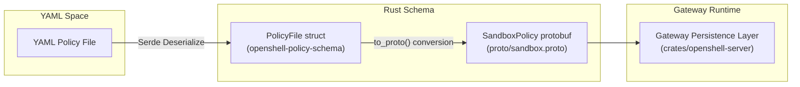
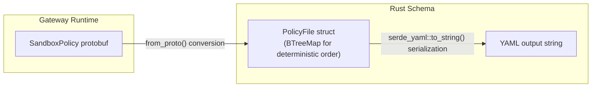
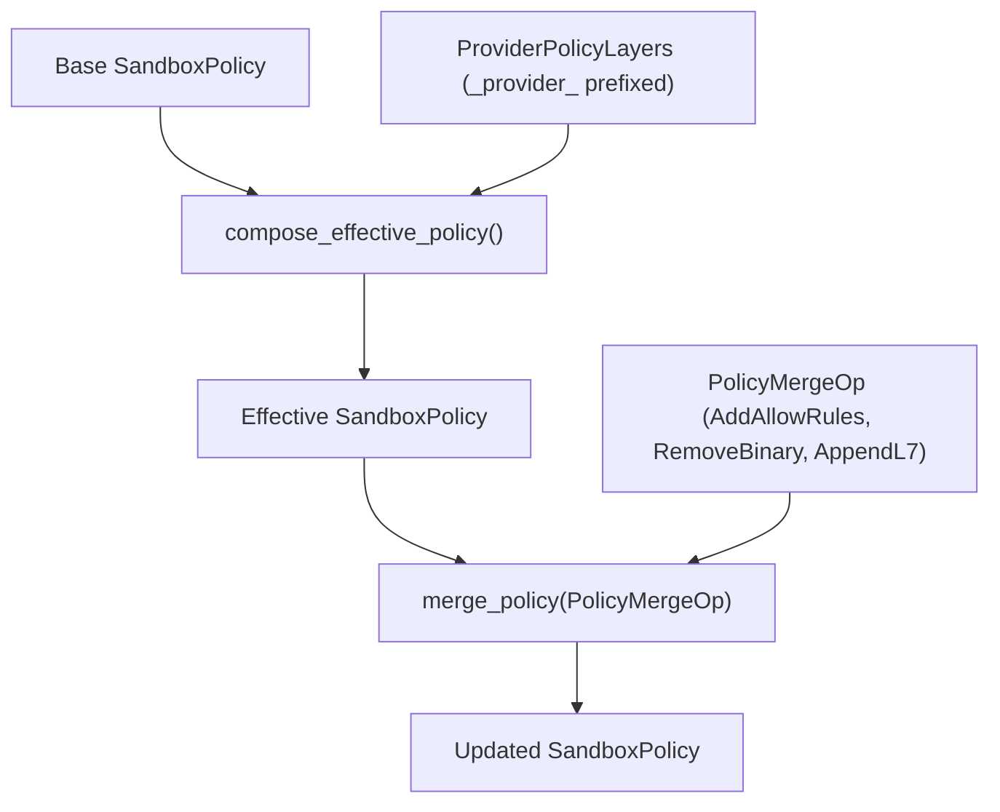

<!-- source: DeepWiki mcp.deepwiki.com · repo NVIDIA/OpenShell · page 7.1 Policy Language and Schema · fetched 2026-10-26 -->

# Policy Language and Schema

<details>
<summary>Relevant source files</summary>

The following files were used as context for generating this wiki page:

- [crates/openshell-core/src/net.rs](crates/openshell-core/src/net.rs)
- [crates/openshell-ocsf/src/format/shorthand.rs](crates/openshell-ocsf/src/format/shorthand.rs)
- [crates/openshell-ocsf/src/objects/http.rs](crates/openshell-ocsf/src/objects/http.rs)
- [crates/openshell-policy/src/lib.rs](crates/openshell-policy/src/lib.rs)
- [crates/openshell-policy/src/merge.rs](crates/openshell-policy/src/merge.rs)
- [crates/openshell-providers/src/profiles.rs](crates/openshell-providers/src/profiles.rs)
- [crates/openshell-sandbox/src/mechanistic_mapper.rs](crates/openshell-sandbox/src/mechanistic_mapper.rs)
- [docs/about/overview.mdx](docs/about/overview.mdx)
- [docs/extensibility/drivers.mdx](docs/extensibility/drivers.mdx)
- [docs/extensibility/isolation-backends.mdx](docs/extensibility/isolation-backends.mdx)
- [docs/how-it-works/inference.mdx](docs/how-it-works/inference.mdx)
- [docs/how-it-works/policies/default-policy.mdx](docs/how-it-works/policies/default-policy.mdx)
- [docs/how-it-works/policies/overview.mdx](docs/how-it-works/policies/overview.mdx)
- [docs/how-it-works/providers/profiles.mdx](docs/how-it-works/providers/profiles.mdx)
- [docs/index.mdx](docs/index.mdx)
- [docs/index.yml](docs/index.yml)
- [docs/kubernetes/ingress.mdx](docs/kubernetes/ingress.mdx)
- [docs/security/best-practices.mdx](docs/security/best-practices.mdx)
- [e2e/python/test_sandbox_policy.py](e2e/python/test_sandbox_policy.py)
- [proto/sandbox.proto](proto/sandbox.proto)

</details>


This page documents the policy language and schema used within OpenShell for controlling sandbox behavior. It details the YAML declarative schema, the `SandboxPolicy` protobuf message defining the runtime policy model, and the `openshell-policy` crate that implements parsing, validation, composition, and merge semantics. Additionally, it covers the default restrictive base policy and how multiple policy layers compose into an effective runtime policy.

Policies govern sandbox filesystem, process, and network behavior with fine-grained controls enforced at kernel and userspace layers, enabling strong security guarantees for AI agent workloads.

---

## Policy Language Representations

OpenShell maintains two canonical representations of sandbox policy data, which support full bidirectional conversion:

| Representation        | Format       | Usage                               | Location                                       |
|----------------------|--------------|-----------------------------------|------------------------------------------------|
| YAML Policy Schema   | Human-readable YAML | Authoring policies, CLI input   | [`openshell-policy-schema` crate types][1] with Rust conversion in [`openshell-policy`][2] |
| SandboxPolicy Proto  | Protobuf message | Gateway internal storage, gRPC transport | [`proto/sandbox.proto:21-36`][3]                 |

The `openshell-policy` crate implements the conversion logic between YAML and protobuf representations and performs runtime validation and composition.

### Data Flow: YAML to Protobuf

The authored YAML schema is loaded into the `PolicyFile` Rust struct (from `openshell-policy-schema` crate), deserialized using Serde, then converted into the protobuf `SandboxPolicy` message via adapter functions. This message is used internally by the gateway and sandbox supervisor.



### Data Flow: Protobuf to YAML

Protobuf `SandboxPolicy` messages are converted back into the schema `PolicyFile` Rust struct with `BTreeMap` used for maps to ensure deterministic key ordering. This struct is then serialized to YAML for display with CLI commands like `openshell policy get`.



Sources: [crates/openshell-policy/src/lib.rs:55-69](), [proto/sandbox.proto:21-36](), [crates/openshell-policy/src/lib.rs:60-69]()

---

## The `SandboxPolicy` Protobuf Message

The runtime policy is defined by the `SandboxPolicy` protobuf message (`proto/sandbox.proto`). It aggregates layered security controls:

```protobuf
message SandboxPolicy {
  uint32 version = 1;
  FilesystemPolicy filesystem = 2;
  LandlockPolicy landlock = 3;
  ProcessPolicy process = 4;
  map<string, NetworkPolicyRule> network_policies = 5;
  map<string, NetworkMiddlewareConfig> network_middlewares = 6;
}
```

### Core Components

| Field               | Description                                             |
|---------------------|---------------------------------------------------------|
| `version`           | Policy version number.                                  |
| `filesystem`        | Filesystem access control via Landlock LSM.            |
| `landlock`          | Landlock compatibility and enforcement settings.       |
| `process`           | Runtime user/group identity for sandboxed processes.   |
| `network_policies`  | Map of named network access rules.                      |
| `network_middlewares`| Map of reusable middleware configurations for network requests. |

### Supporting Messages

- **FilesystemPolicy**: specifies read-only and read-write allowed paths and whether to include the working directory.

- **LandlockPolicy**: controls Landlock kernel module mode (`best_effort` or `hard_requirement`).

- **ProcessPolicy**: sets the user and group inside the sandbox.

- **NetworkPolicyRule**: defines allowed network endpoint hosts/ports and binaries authorized to connect.

- **NetworkMiddlewareConfig**: defines ordered supervisor middleware applied on network egress.

Sources: [proto/sandbox.proto:20-86]()

---

## YAML Policy Schema

The YAML schema mirrors the protobuf structure but uses snake_case field names and includes additional convenience shorthands for authoring.

Example:

```yaml
version: 1

filesystem_policy:
  include_workdir: true
  read_only: ["/usr", "/lib", "/etc"]
  read_write: ["/sandbox", "/tmp"]

landlock:
  compatibility: best_effort

process:
  run_as_user: sandbox
  run_as_group: sandbox

network_policies:
  my_api:
    name: my-api
    endpoints:
      - host: api.example.com
        port: 443
        protocol: rest
        enforcement: enforce
        access: full
    binaries:
      - path: /usr/bin/curl

network_middlewares:
  regex-redactor:
    name: Redact API tokens
    middleware: openshell/regex
    order: 10
    config:
      mode: redact
    on_error: fail_closed
    endpoints:
      include: ["*.example.com"]
```

### Field Mapping Between YAML and Proto

| YAML Field             | Proto Field           | Description                      |
|------------------------|-----------------------|---------------------------------|
| `filesystem_policy`    | `filesystem`          | Filesystem access policy        |
| `landlock`             | `landlock`            | Landlock compatibility          |
| `process`              | `process`             | User/group identity             |
| `network_policies`     | `network_policies`    | Map of network access rules     |
| `network_middlewares`  | `network_middlewares` | Network middleware configs      |

Field validation enforces absolute paths, reasonable list sizes, and prohibits root or invalid user identities in process policy [docs/reference/policy-schema.mdx:51-127]().

Sources: [proto/sandbox.proto:20-86](), [crates/openshell-policy/src/lib.rs:55-69]()

---

## Policy Composition and Merge Semantics

OpenShell supports layered policy composition and incremental policy updates.

### Provider Policy Layers

Provider-specific policies (e.g., GitHub, AWS) append network rules isolated by naming conventions prefixed with `_provider_`. These provider layers are merged with user policies via `compose_effective_policy()` to build the sandbox effective policy [crates/openshell-policy/src/compose.rs:30-40]().

### Incremental Policy Updates

The `merge_policy()` function enables runtime incremental patching of network policy rules, supporting:

- Adding new allow rules
- Removing binaries or endpoints
- Appending L7 allow/deny rules

This mechanism allows `openshell policy update` commands to augment running sandboxes without full restart [crates/openshell-policy/src/merge.rs:30-142]().

### Canonicalizing Advisor-Generated Rules

Policy proposals generated from network denial logs ("advisor proposals") are canonicalized against the current live policy state to avoid endpoint contract conflicts. The function `canonicalize_advisor_add_rule()` handles this logic by either reusing existing endpoint contracts or creating new uniquely-named rules [crates/openshell-policy/src/merge.rs:20-142]().

### Policy Composition Diagram



Sources: [crates/openshell-policy/src/compose.rs:30-40](), [crates/openshell-policy/src/merge.rs:30-142](), [crates/openshell-policy/src/lib.rs:12-15]()

---

## Default Base Policy

OpenShell ships with a minimally permissive default policy locked at sandbox creation time:

- Filesystem: Allows read-only access to essential system paths and read-write to the sandbox working directory and `/tmp`.
- Landlock: Uses `best_effort` compatibility mode.
- Process: Runs under the unprivileged `sandbox` user/group.
- Network: No allowed network policies by default (denies all outbound).

This baseline policy can be found or constructed in the `openshell-policy` crate test helpers and examples [e2e/python/test_sandbox_policy.py:26-44]().

---

## Network Endpoint Configuration

Network endpoints define allowed egress targets with optional Layer 7 inspection and enforcement metadata.

### Fields

| Field                | Description                                                                                  |
|----------------------|----------------------------------------------------------------------------------------------|
| `host`               | Hostname or DNS glob pattern (supports wildcard `*` and recursive `**`).                     |
| `port`               | Single TCP port number. Deprecated in favor of `ports`.                                      |
| `ports`              | List of TCP ports this endpoint applies to.                                                 |
| `protocol`           | Protocol string selecting inspection mode: `"tcp"`, `"rest"`, `"websocket"`, `"graphql"`, `"mcp"`, `"json-rpc"`. |
| `enforcement`        | Enforcement mode: `enforce`, `audit`, or unspecified (default audit).                        |
| `access`             | Shorthand allowing preset access levels: `read_only`, `read_write`, or `full`.               |
| `allowed_ips`        | List of approved IP addresses or CIDR blocks relaxing SSRF internal IP blocking.             |
| `websocket_credential_rewrite` | Controls rewriting credential placeholders in WebSocket frames.                      |
| `allow_encoded_slash` | Enables preserving `%2F` in HTTP paths for some custom server behaviors.                     |

### L7 Protocol Inspection

The `protocol` field enables deep inspection and fine-grained allow/deny rules at the application layer:

- **`rest`**: HTTP method/path inspection with automatic TLS termination.
- **`websocket`**: Inspect WebSocket handshakes and messages.
- **`graphql`**: Inspect GraphQL operations including persisted queries.
- **`mcp`**: Model Context Protocol inspection for tool calls.
- **`json-rpc`**: JSON-RPC protocol configuration.

Sources: [proto/sandbox.proto:140-169](), [crates/openshell-policy/src/lib.rs:90-150]()

---

## Policy Validation and Ambiguity Checks

Prior to applying policies, OpenShell validates endpoint definitions for conflicts and ambiguous overlaps.

- The `find_endpoint_ambiguities()` function scans for overlapping endpoint definitions that share hosts and ports but have conflicting `allowed_ips` or other metadata. Such conflicts cause the gateway to reject sandbox launch with a clear error [crates/openshell-policy/src/lib.rs:20-25]().

- The denial logs and mechanistic policy mapper also rely on strict endpoint schema validation for generating usable policy proposals [crates/openshell-sandbox/src/mechanistic_mapper.rs:40-170]().

---

## Policy Proposals and Mechanistic Mapper Integration

When network requests are denied by policy, denial summaries are aggregated and processed by a mechanistic mapper that generates draft `PolicyChunk` proposals:

- Group denials by `(host, port, binary)`
- Exclude always-blocked destinations (loopback, link local, metadata IPs)
- Build L7 allow rules based on observed request samples
- Annotate proposals with confidence and security rationale

These proposals are surfaced in the Policy Advisor interface for operator approval [crates/openshell-sandbox/src/mechanistic_mapper.rs:45-180]().

---

## Summary Diagram: Natural Language Concepts to Code Entities

```mermaid
flowchart TD
    User("Policy Author") -->|edits| YAMLFile["YAML Policy File\n(openshell-policy-schema)"]
    YAMLFile -->|serde deserialize| PolicyFileStruct["PolicyFile Struct\n(crates/openshell-policy-schema)"]
    PolicyFileStruct -->|to_proto()| SandboxPolicyProto["SandboxPolicy Protobuf\n(proto/sandbox.proto)"]
    SandboxPolicyProto --> Gateway["Gateway Persistence\n(crates/openshell-server)"]
    Gateway --> Supervisor["Sandbox Supervisor Runtime"]

    PolicyUpdates["Policy updates (CLI, API)"] -->|merge_policy()| SandboxPolicyProto
    ProviderLayers["Provider Policy Layers\n(_provider_* rules)"] -->|compose_effective_policy()| SandboxPolicyProto

    SandboxSupervisor -->|enforce| KernelControls["Landlock LSM & seccomp"]
    SandboxSupervisor -->|enforce| ProxyEgress["Userspace Network Proxy + OPA Engine"]

    User -.-> ProposalReview["Policy Advisor & Mechanistic Mapper\n(draft proposals)"]
```

---

## Summary Diagram: Code Components and Roles in Policy System

```mermaid
graph LR
  subgraph crates/openshell-policy
    lib_rs[lib.rs (main parsing, merging)]
    compose_rs[compose.rs (provider policy layering)]
    merge_rs[merge.rs (incremental updates, canonicalization)]
    schema_crate[openshell-policy-schema (YAML schema definitions)]
  end

  subgraph proto
    sandbox_proto["sandbox.proto (SandboxPolicy, network endpoints)"]
  end

  lib_rs --> compose_rs
  lib_rs --> merge_rs
  lib_rs -.-> schema_crate
  lib_rs --> sandbox_proto

  e2e_tests["e2e/python/test_sandbox_policy.py (default policy tests)"]

  schema_crate --> lib_rs
  sandbox_proto --> lib_rs
  lib_rs --> e2e_tests
```

---

## References and Sources

- `SandboxPolicy` protobuf: [`proto/sandbox.proto:20-86`]()
- Policy conversion and merging: [`crates/openshell-policy/src/lib.rs:4-172`]()  
- Provider policy layers and merge semantics: [`crates/openshell-policy/src/compose.rs:10-50`]()  
- Incremental updates and canonicalization: [`crates/openshell-policy/src/merge.rs:1-142`]()  
- Default policy and policy tests: [`e2e/python/test_sandbox_policy.py:20-44`]()  
- Network endpoint validation and denial aggregation: [`crates/openshell-sandbox/src/mechanistic_mapper.rs:10-181`]()  
- Network IP classification utilities: [`crates/openshell-core/src/net.rs:10-170`]()  

---

[1]: crates/openshell-policy-schema/src/lib.rs  
[2]: crates/openshell-policy/src/lib.rs  
[3]: proto/sandbox.proto

---

