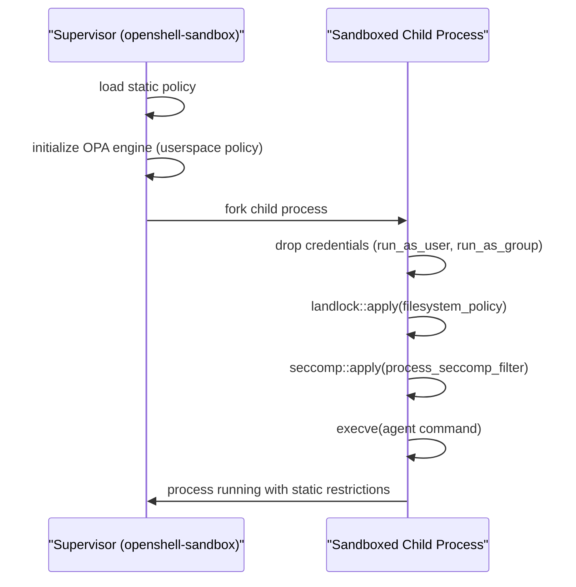
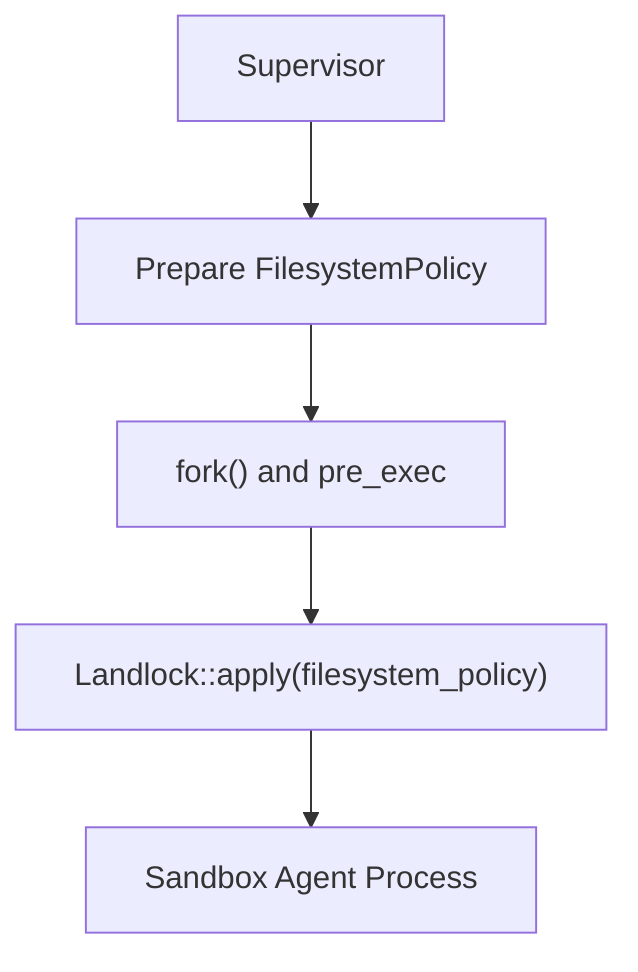
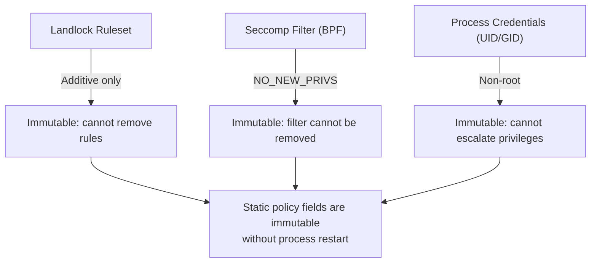
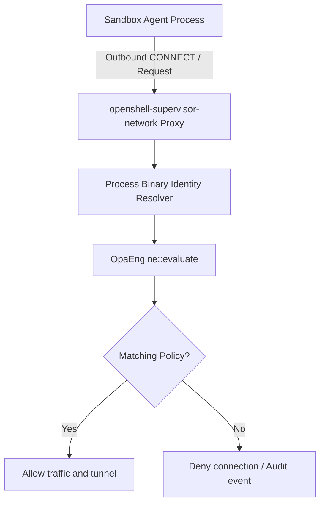
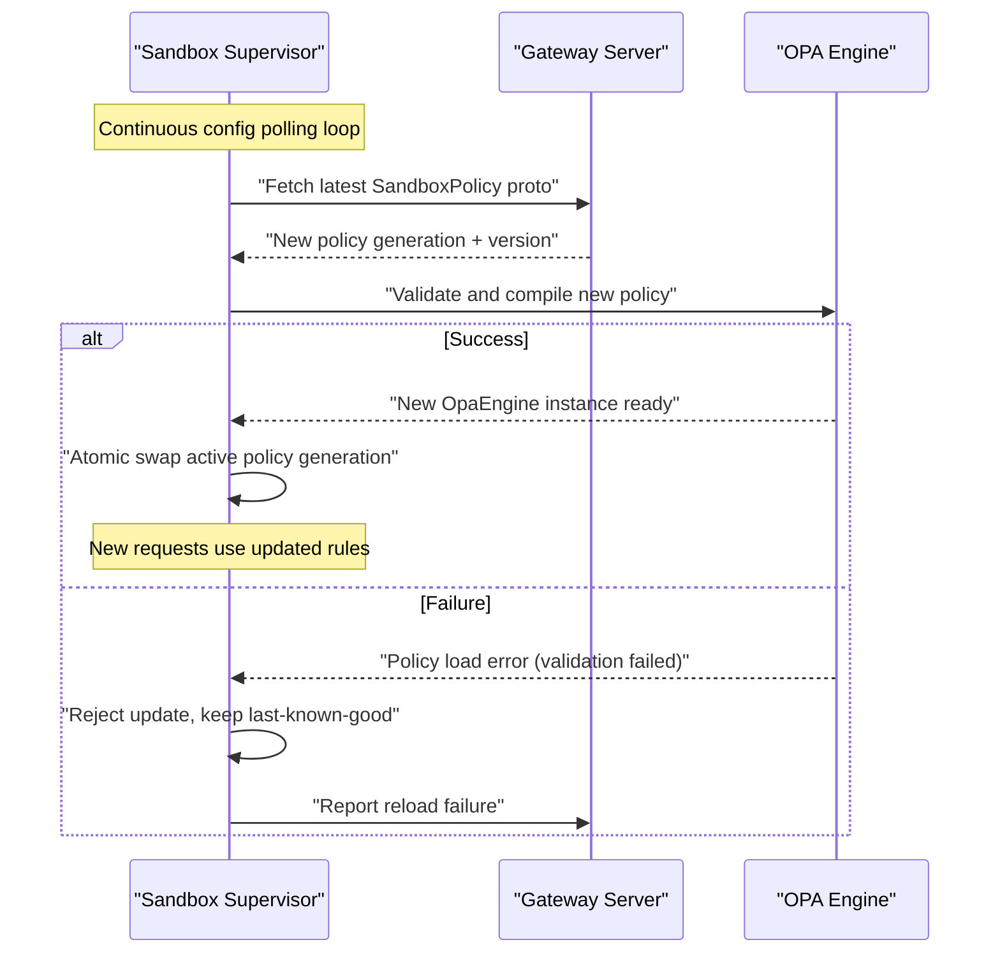
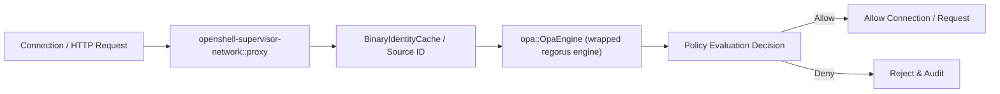

<!-- source: DeepWiki mcp.deepwiki.com · repo NVIDIA/OpenShell · page 7.2 Static vs Dynamic Policies and Live Updates · fetched 2026-10-26 -->

# Static vs Dynamic Policies and Live Updates

<details>
<summary>Relevant source files</summary>

The following files were used as context for generating this wiki page:

- [crates/openshell-driver-podman/Cargo.toml](crates/openshell-driver-podman/Cargo.toml)
- [crates/openshell-driver-podman/src/client.rs](crates/openshell-driver-podman/src/client.rs)
- [crates/openshell-driver-podman/src/test_utils.rs](crates/openshell-driver-podman/src/test_utils.rs)
- [crates/openshell-driver-podman/tests/podman_preflight.rs](crates/openshell-driver-podman/tests/podman_preflight.rs)
- [crates/openshell-supervisor-network/Cargo.toml](crates/openshell-supervisor-network/Cargo.toml)
- [crates/openshell-supervisor-network/src/l7/mod.rs](crates/openshell-supervisor-network/src/l7/mod.rs)
- [crates/openshell-supervisor-network/src/l7/relay.rs](crates/openshell-supervisor-network/src/l7/relay.rs)
- [crates/openshell-supervisor-network/src/l7/rest.rs](crates/openshell-supervisor-network/src/l7/rest.rs)
- [crates/openshell-supervisor-network/src/opa.rs](crates/openshell-supervisor-network/src/opa.rs)
- [crates/openshell-supervisor-network/src/proxy.rs](crates/openshell-supervisor-network/src/proxy.rs)
- [docs/how-it-works/policies/manage-policies.mdx](docs/how-it-works/policies/manage-policies.mdx)
- [docs/how-it-works/policies/network-rules.mdx](docs/how-it-works/policies/network-rules.mdx)
- [docs/how-it-works/policies/schema.mdx](docs/how-it-works/policies/schema.mdx)
- [docs/observability/logging.mdx](docs/observability/logging.mdx)
- [e2e/rust/tests/live_policy_update.rs](e2e/rust/tests/live_policy_update.rs)
- [tests/ansible/playbooks/drivers/podman/e2e.yaml](tests/ansible/playbooks/drivers/podman/e2e.yaml)
- [tests/ansible/roles/openshell_gateway/templates/gateway-podman.toml.j2](tests/ansible/roles/openshell_gateway/templates/gateway-podman.toml.j2)
- [tests/artifacts.nix](tests/artifacts.nix)

</details>


This page explains the distinction between **immutable static policies** enforced at sandbox startup and **hot-reloadable dynamic network policies** enforced at runtime, emphasizing generation versioning, last-known-good semantics, and failure modes relevant to live policy updates. It covers the data flow and key code entities involved in policy loading, activation, and request evaluation.

---

## Overview

OpenShell divides sandbox policies into two categories based on enforcement timing and mutability:

| Type           | Fields                         | Enforcement Layer                      | Mutable at Runtime?       |
|----------------|--------------------------------|--------------------------------------|--------------------------|
| **Static**     | `filesystem_policy`, `landlock`, `process` | Kernel, pre-exec closure (Landlock, seccomp, credentials) | No — locked before exec  |
| **Dynamic**    | `network_policies`, `network_middlewares`  | Userspace, proxy-level policy engine (OPA)                | Yes — hot-reloaded via gRPC |

- **Static policies:** Applied *once* at sandbox process startup within the `pre_exec` child closure after `fork()` but before `execve()`. Changes require sandbox restart to take effect.
- **Dynamic policies:** Loaded and evaluated live by the embedded OPA engine in the sandbox supervisor for every outbound network connection and request over the proxy. These can be updated atomically without restarting the sandbox.

This design leverages Linux kernel security features (Landlock LSM, seccomp BPF, user identity dropping) for immutable enforcement of file access and process constraints, while enabling flexible, observable, and incremental network policy changes in userspace.

**Sources:** [proto/sandbox.proto:19-34](), [architecture/sandbox.md:40-49](), [architecture/security-policy.md:15-29](), [crates/openshell-supervisor-network/src/opa.rs:157-187](), [docs/how-it-works/policies/manage-policies.mdx:180-186]()

---

## Static Policy Enforcement

### Enforcement Timeline

Static policies are applied atomically as the sandbox process is spawned. The supervisor loads the policy, configures the OPA engine, then forks and enters the `pre_exec` closure, where kernel-level restrictions are applied (Landlock ruleset, seccomp filters, dropping privileges), before executing the agent.



- The `pre_exec` closure is limited to async-signal-safe operations.
- Once Landlock and seccomp are applied, static policy clauses cannot be modified.
- The sandbox process runs with dropped privileges per `process` policy.

**Sources:** [crates/openshell-sandbox/src/lib.rs:70](), [architecture/security-policy.md:15-29](), [architecture/sandbox.md:9-23]()

---

### Filesystem Policy (`filesystem_policy`)

The filesystem policy enumerates paths allowed as read-only or read-write by the sandbox.

- The supervisor enriches the baseline policy adding default system paths and GPU device nodes for GPU sandboxes.
- The Landlock LSM restricts filesystem access by adding path-based rules to the Landlock ruleset.
- Path descriptors maintain inode types supporting efficient Landlock application.



After Landlock application, filesystem access is permanently restricted and enforced by the kernel.

**Code entities:**

| Entity                 | File / Lines                        | Description                     |
|------------------------|-----------------------------------|---------------------------------|
| `FilesystemPolicy`      | `proto/sandbox.proto:37-44`       | Protobuf static policy schema   |
| Landlock enforcement   | `crates/openshell-sandbox/src/lib.rs:111-130` | Apply Landlock in pre_exec closure |
| Supervisor process init | `crates/openshell-sandbox/src/lib.rs` | manages policy load/spawn        |

**Sources:** [proto/sandbox.proto:37-44](), [crates/openshell-sandbox/src/lib.rs:70](), [architecture/security-policy.md:15-29]()

---

### Process Policy (`process`)

The process policy sets the identity of the sandbox agent process:

- The sandbox switches to `run_as_group` and drops capabilities.
- Then switches to `run_as_user`.
- Clears the bounding capabilities set.
- Prevents privilege re-escalation.

This guarantees non-root execution, enforced by the kernel at startup.

**Sources:** [proto/sandbox.proto:53-58](), [architecture/sandbox.md:16-22]()

---

### Landlock Policy (`landlock`)

The landlock policy configures compatibility modes defining handling on missing kernel ABI or inaccessible paths:

| Compatibility Mode | Behavior                                                                                   |
|--------------------|--------------------------------------------------------------------------------------------|
| `best_effort`       | Logs warnings and continues without Landlock if unsupported; skips individual inaccessible paths |
| `hard_requirement`  | Sandbox startup aborts if unable to enforce                                              |

This configures how aggressive Landlock enforcement is at sandbox startup.

**Sources:** [proto/sandbox.proto:47-50](), [docs/how-it-works/policies/schema.mdx:63-102]()

---

### Kernel-Level Immutability Guarantees

Static policy enforcement relies on kernel features that guarantee immutable application once active.



**Sources:** [architecture/sandbox.md:40-49](), [architecture/security-policy.md:21-23]()

---

## Dynamic Policy Enforcement

### Network Policy Runtime Evaluation

Network access policies and middlewares are managed dynamically by the supervisor's in-process embedded OPA engine, which runs inside the sandbox supervisor to evaluate each outbound connection negotiation and L7 request.



- The OPA engine consults the current active policy generation to authorize or deny requests.
- Failed matches result in connection denial and corresponding audit logs.
- This approach supports features like protocol-aware HTTP inspection, request-level policy enforcement, and request signing.

**Sources:** [crates/openshell-supervisor-network/src/opa.rs:151-187](), [architecture/sandbox.md:58-63](), [docs/how-it-works/policies/network-rules.mdx:11-150]()

---

### Hot-Reload Architecture

The supervisor continuously polls the configured gateway for policy changes. When a new policy generation is detected, it validates and attempts to atomically swap it into the active OPA engine.



- Valid policy updates hot-replace the active in-process OPA engine instance.
- All new connection authorizations observe the updated rules.
- Existing connections pinned to old generations close to avoid inconsistency.

**Sources:** [docs/how-it-works/policies/manage-policies.mdx:181-186](), [architecture/sandbox.md:35-36](), [crates/openshell-sandbox/src/lib.rs:30-37]()

---

### Last-Known-Good (LKG) Behavior

To ensure availability and security stability, OpenShell treats policy updates as fail-closed for the network proxy:

- If the new policy fails validation or contains invalid entries (e.g., malformed host wildcards, conflicting rules), the update is rejected.
- The supervisor preserves the currently active last-known-good policy generation.
- New connections continue using the valid loaded policy, preventing denial-of-service or loss of enforcement caused by invalid changes.
- The supervisor reports failures to the gateway and via audit logs.

### Reload Boundaries and State Consistency

Live network policy updates affect outstanding connections via generation pinning:

- Upon new policy activation, the supervisor increments the policy generation ID.
- Connections open under older generations are closed to avoid mixing evaluations.
- For example, HTTP keep-alive connections and WebSocket tunnels pinned to old generations are terminated.
- Additionally, sandbox creation installs a baseline TCP network substrate if absent; introducing network endpoints in a policy reload without one triggers a reload rejection.

**Sources:** [docs/how-it-works/policies/manage-policies.mdx:183-186](), [architecture/sandbox.md:98-102](), [crates/openshell-sandbox/src/lib.rs:37-37]()

---

### Policy Analysis and Credential Binding

Beyond live enforcement, dynamic policies support:

- **Policy Advisor**: A pipeline that maps denied access attempts into draft policy proposals, improving policy authoring and debugging.
- **Provider Credential Binding**: Dynamic network policies can bind particular endpoints to provider credentials, scoped to endpoint metadata and signed requests [architecture/sandbox.md:112-117]().
- The supervisor maintains atomic snapshots of network policies and provider credentials for consistent enforcement per revision.

**Sources:** [crates/openshell-sandbox/src/lib.rs:22-22](), [architecture/sandbox.md:112-117]()

---

## Key Code Entities and Data Flow

### Sandbox Policy Data Flow

```mermaid
graph TB
    Gateway[Gateway (Policy Store)]
    Supervisor[Sandbox Supervisor (openshell-sandbox)]
    OpaEngine[OpaEngine wrapped regorus engine]
    Proxy[openshell-supervisor-network Proxy]
    Kernel["Kernel (Landlock, seccomp, UID/GID)"]
    Agent["Sandboxed Agent Process"]

    Gateway -- "Policy proto (network/static)" --> Supervisor
    Supervisor -- "Load static fields --> pre_exec" --> Kernel
    Kernel -- "Apply restrictions" --> Agent
    Supervisor -- "Create OpaEngine instance" --> OpaEngine
    Supervisor -- "Hot-swap active policy on update" --> Proxy
    Proxy -- "Network requests checked via OpaEngine" --> OpaEngine
    Proxy -- "Allow or deny connections" --> Agent
```

- Static policy fields flow from Gateway -> Supervisor -> Kernel.
- Dynamic network policies flow Gateway -> Supervisor -> OpaEngine in Proxy.
- The OPA engine evaluates requests from the Proxy, enforcing dynamic rules without affecting static kernel-level restrictions.

**Sources:** [proto/sandbox.proto:19-34](), [crates/openshell-sandbox/src/lib.rs](), [crates/openshell-supervisor-network/src/opa.rs](), [architecture/sandbox.md]()

---

### OPA Engine Integration within the Proxy



- The proxy receives forwarded connections from the sandbox process.
- It resolves the binary identity of the process making the request.
- Queries the OPA engine with contextual inputs.
- Decides on access, enforcing `network_policies` and `network_middlewares`.
- Generates audit logs and OCSF events for allowed and denied requests.

**Sources:** [crates/openshell-supervisor-network/src/proxy.rs](), [crates/openshell-supervisor-network/src/opa.rs]()

---

# Summary

- **Static policies** configure immutable kernel-enforced restrictions on filesystem access, process privileges, and Landlock settings applied exactly once during sandbox spawn.
- **Dynamic policies** govern network access rules and protocols, enforced at runtime by an in-process OPA engine, which can be hot-reloaded atomically without sandbox restart.
- Hot-reloading is designed with a **last-known-good** fallback to guarantee availability and security posture even during invalid update attempts or transient failures.
- Sandbox network proxy connections and requests are pinned and closed on policy reload for consistency.
- This layered design balances strong kernel-backed immutability for core process restrictions with flexible, observable, and live network policy control through userspace evaluation.

---

**Sources:**  
- [proto/sandbox.proto:19-58]()  
- [crates/openshell-sandbox/src/lib.rs:70](), [crates/openshell-sandbox/src/lib.rs:22-37]()  
- [crates/openshell-supervisor-network/src/opa.rs:151-187]()  
- [crates/openshell-supervisor-network/src/proxy.rs:1-177]()  
- [docs/how-it-works/policies/manage-policies.mdx:160-186]()  
- [architecture/sandbox.md:9-49,58-63,98-102,112-117]()  
- [architecture/security-policy.md:15-29,84-114]()  
- [docs/how-it-works/policies/schema.mdx:10-139]()  
- [docs/how-it-works/policies/network-rules.mdx:10-150]()

---

