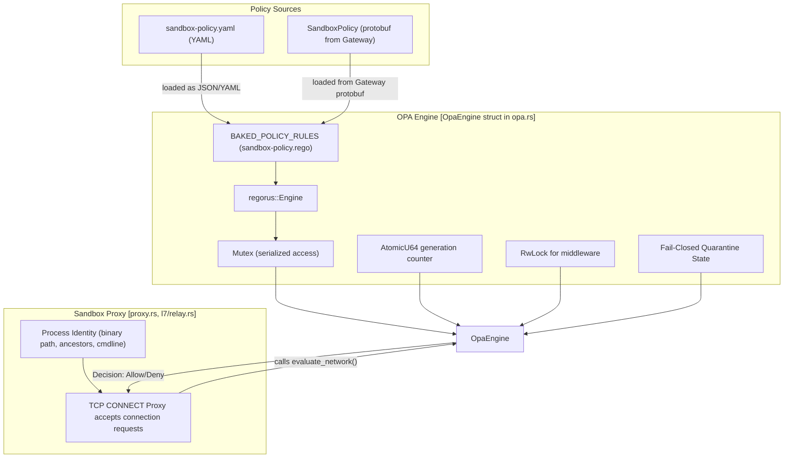
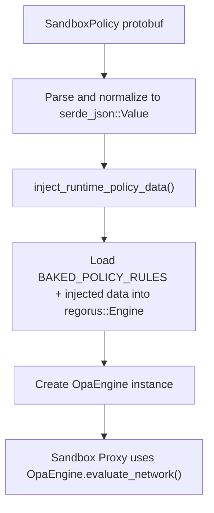

<!-- source: DeepWiki mcp.deepwiki.com · repo NVIDIA/OpenShell · page 7.3 OPA Engine Integration · fetched 2026-10-26 -->

# 7.3 OPA Engine Integration

<details>
<summary>Relevant source files</summary>

The following files were used as context for generating this wiki page:

- [crates/openshell-cli/src/commands/provider.rs](crates/openshell-cli/src/commands/provider.rs)
- [crates/openshell-supervisor-network/Cargo.toml](crates/openshell-supervisor-network/Cargo.toml)
- [crates/openshell-supervisor-network/data/sandbox-policy.rego](crates/openshell-supervisor-network/data/sandbox-policy.rego)
- [crates/openshell-supervisor-network/src/l7/jsonrpc.rs](crates/openshell-supervisor-network/src/l7/jsonrpc.rs)
- [crates/openshell-supervisor-network/src/l7/mcp.rs](crates/openshell-supervisor-network/src/l7/mcp.rs)
- [crates/openshell-supervisor-network/src/l7/mod.rs](crates/openshell-supervisor-network/src/l7/mod.rs)
- [crates/openshell-supervisor-network/src/l7/relay.rs](crates/openshell-supervisor-network/src/l7/relay.rs)
- [crates/openshell-supervisor-network/src/l7/rest.rs](crates/openshell-supervisor-network/src/l7/rest.rs)
- [crates/openshell-supervisor-network/src/opa.rs](crates/openshell-supervisor-network/src/opa.rs)
- [crates/openshell-supervisor-network/src/proxy.rs](crates/openshell-supervisor-network/src/proxy.rs)
- [docs/how-it-works/policies/manage-policies.mdx](docs/how-it-works/policies/manage-policies.mdx)
- [docs/how-it-works/policies/network-rules.mdx](docs/how-it-works/policies/network-rules.mdx)
- [docs/how-it-works/policies/schema.mdx](docs/how-it-works/policies/schema.mdx)
- [docs/observability/logging.mdx](docs/observability/logging.mdx)

</details>


## Purpose and Scope

This section documents the integration of the Open Policy Agent (OPA) engine within OpenShell's network proxy subsystem. The OPA engine provides fine-grained, runtime network access decisions for sandboxed processes by evaluating Rego policies embedded in the supervisor. It supports policy loading from proto messages, dynamic hot reload of network policies, request-level L7 inspection integration, and fail-closed quarantine on policy loading failure. This page covers the `OpaEngine` Rust abstraction, the embedded Rego policy (`sandbox-policy.rego`), policy loading and validation flows, access preset expansion, and fail-closed quarantine mechanisms.

For related policy schema details, see section **7.1. Policy Language and Schema**. For connection-level enforcement, see **7.4 L4 and L7 Enforcement**.

---

## Architecture Overview

The OPA engine lives inside the sandbox supervisor’s proxy component and is invoked on every TCP CONNECT request initiated by sandbox processes. It verifies the endpoint against the network policies and the identity of the binary initiating the connection, returning allow or deny decisions used by the proxy to permit or block network egress.



The engine loads policy data from YAML files during sandbox creation or from Gateway protobuf messages at runtime. The baked-in Rego rules in `sandbox-policy.rego` define the logic for network permission grants and denials. To support live policy updates, the engine tracks a `generation` counter which increments when policies reload. This counter aids in fail-closed quarantine and informs long-lived connection handlers to re-check policies periodically.

**Sources:** [crates/openshell-supervisor-network/src/opa.rs:4-9](), [crates/openshell-supervisor-network/src/proxy.rs:4-8](), [crates/openshell-supervisor-network/src/l7/relay.rs:1-40]()

---

## The `OpaEngine` Structure and Key Methods

### Thread-Safe Embedded OPA Engine

`OpaEngine` encapsulates the Rust-based Rego engine (`regorus::Engine`) behind a `Mutex` to enforce serialized evaluation. This serialization suffices due to the microsecond-level evaluation latency and low concurrency (one per connection request).

Key fields:

- `engine`: Mutex wrapping `regorus::Engine` instance.
- `generation`: Atomic 64-bit counter marking the current policy generation.
- `middleware_runner`: A read/write-locked policy middleware chain runner.
- `websocket_assembly_budget`: Limits resources for WebSocket message assembly.
- `generation_tx`: Watch channel sender for notifying reloads.
- `fail_closed_reason`: Option storing quarantine reason for fail-closed policy loading.

```rust
pub struct OpaEngine {
    engine: Mutex<regorus::Engine>,
    generation: Arc<AtomicU64>,
    middleware_runner: RwLock<ChainRunner>,
    websocket_assembly_budget: crate::l7::websocket::WebSocketAssemblyBudget,
    generation_tx: watch::Sender<u64>,
    fail_closed_reason: RwLock<Option<String>>,
}
```

**Sources:** [crates/openshell-supervisor-network/src/opa.rs:157-164]()

### Summary of Core Methods

| Method                      | Description                                                        | Usage Context                     |
|-----------------------------|------------------------------------------------------------------|----------------------------------|
| `from_proto()`              | Creates a new `OpaEngine` from protobuf sandbox policy data      | Sandbox initialization           |
| `evaluate_network()`        | Perform L4 allowance or denial decision for a connection request | Called by proxy on CONNECT       |
| `reload_from_proto()`       | Atomically hot reload policy from new proto data                 | Policy update loop               |
| `wait_until_stale()`        | Async wait for generation change (used in connection handlers)   | Long-lived relay connections     |
| `middleware_chain_runner()` | Getter for middleware `ChainRunner` for request-level inspection | Integrated in L7 inspection path|

**Sources:** [crates/openshell-supervisor-network/src/opa.rs:152-187]()

---

## Policy Loading and Validation

### Loading from Proto

The policy is loaded from the serialized `SandboxPolicy` protobuf that the Gateway delivers over gRPC. `OpaEngine::from_proto()` ingests this proto to build internal JSON data, merge with baked Rego rules, and instantiate `regorus::Engine`.

During loading, `inject_runtime_policy_data()` appends runtime metadata, such as whether binary identity is required for egress. This flag controls anonymous binary privileges and is derived from environment variables or Gateway configuration.



The policy load failure path updates the `fail_closed_reason`, triggering quarantine mode where all network connections are denied to avoid security risks.

**Sources:** [crates/openshell-supervisor-network/src/opa.rs:100-140](), [crates/openshell-supervisor-network/src/opa.rs:145-160]()

### Policy Validation

The policy loader rejects unknown fields, duplicate keys, malformed access presets, and incoherent endpoint configurations. Validation errors are collapsed with rate limits to avoid overwhelming logs.

---

## Network Access Evaluation Flow

### `evaluate_network()` Function

This method receives a `NetworkInput` object describing the connection attempt:

- `host`: Destination hostname
- `port`: Destination TCP port
- `binary_path`: Full path to the binary opening the socket
- `binary_sha256`: Hash of the binary file to detect tampering
- `ancestors`: Paths of ancestor binaries in the process tree
- `cmdline_paths`: Executable paths discovered in process command line

The engine synchronously evaluates these against the rego policy using the `network_action` entrypoint, returning a `PolicyDecision`:

- `allowed`: boolean allowing or denying connection
- `reason`: denial reason string
- `matched_policy`: optional name of the policy that permitted access

```rust
pub struct PolicyDecision {
    pub allowed: bool,
    pub reason: String,
    pub matched_policy: Option<String>,
}
```

If allowed, the proxy proceeds with opening the TCP tunnel. If denied, the proxy returns a 403 Forbidden and writes denial events to the sandbox log.

---

### Fail-Closed Quarantine on Policy Load Failure

If loading or reloading a policy fails (e.g., syntax error, invalid semantics), the engine enters fail-closed quarantine mode. This disables all network access until a valid policy is loaded. This protects sandbox security by prioritizing denial over a permissive fallback.

The fail-closed state is captured in `OpaEngine.fail_closed_reason` which is `Some(reason_string)`, and the `generation` counter is not advanced.

---

## Access Preset Expansion

Policies may use access presets such as `read-only` for endpoints, which are syntactic sugar expanding to explicit allow lists of HTTP methods and request paths.

The supervisor expands these presets on policy load into fully explicit rules before passing them to OPA. This expansion enables fine control and consistent enforcement without complicating the Rego policy.

---

## `sandbox-policy.rego`: Embedded OPA Rules

The OPA rules embedded at compile time define the full logic for network access decisions.

### Key Features:

- **Binary Identity Matching:** Compares the binary path (and optionally its ancestors and injected `cmdline_paths`) with policy globs. Rejects anonymous binaries if `require_binary_identity` is true.

- **Endpoint Matching:** Matches host, IPs, ports against `network_policies` endpoints, supporting wildcards and IP CIDRs.

- **Network Actions:** The `network_action` rule returns `"Allow"` or `"Deny"` along with matched policy names or failure reasons.

- **Runtime Data Injection:** Runtime flags like `require_binary_identity` affect evaluation dynamically.

- **Request-Level Policy Support:** Defines `request_rules` for L7 protocols (`rest`, `graphql`, `mcp`, `json-rpc`, etc.) interpreted by the L7 proxy modules.

---

## Hot Reload and Policy Generation Guard

When the policy is updated at runtime, `OpaEngine.reload_from_proto()` atomically swaps in new policy data and increments the `generation` counter.

The proxy captures a `PolicyGenerationGuard` at connection or request start time, storing the generation id.

```rust
#[derive(Clone, Debug)]
pub struct PolicyGenerationGuard {
    generation: Arc<AtomicU64>,
    observed: u64,
}
```

The guard can later verify if the cached policy generation is stale by comparing the current engine generation to the observed one. If stale, long-lived connection handlers such as WebSocket relays close and force reconnect and re-validation under the new policy.

---

## Detailed Data Flow for Policy Evaluation During TCP CONNECT

```mermaid
sequenceDiagram
    participant Client as Sandbox Process
    participant Proxy as Sandbox Proxy (proxy.rs)
    participant Identity as Process Identity (src/identity.rs)
    participant OPA as OpaEngine (opa.rs / regorus)

    Client->>Proxy: Open TCP CONNECT to destination (host:port)
    Proxy->>Identity: Request binary_path, ancestors, cmdline_paths
    Identity-->>Proxy: Return binary & process identity
    Proxy->>OPA: evaluate_network(NetworkInput { host, port, binary_path, ancestors, cmdline_paths })
    OPA->>opa::regorus::Engine: Run Rego `network_action` rules
    opa::regorus::Engine-->>OPA: Return NetworkAction::Allow or Deny
    OPA-->>Proxy: Return PolicyDecision
    alt allowed
        Proxy->>Client: 200 Connection Established
    else denied
        Proxy->>Client: 403 Forbidden with deny reason
        Proxy->>Sandbox Logs: Emit OCSF denial event
    end
```

---

## Summary

- The `OpaEngine` wraps a pure Rust `regorus::Engine`, embedding Rego policies for runtime network access control.
- Policies are loaded from compiled-in Rego + protobuf messages from the Gateway.
- The engine tracks policy `generation` for hot reload and fail-closed quarantine on errors.
- Network connection requests are evaluated by `evaluate_network()` using binary identity and destination.
- Access presets are expanded before policy loading.
- Long-lived connections use generation guards to detect policy updates and force reconnects.
- The integral `sandbox-policy.rego` file defines the comprehensive OPA rules for network egress.

---

**Sources:**  
- [crates/openshell-supervisor-network/src/opa.rs:1-187]()  
- [crates/openshell-supervisor-network/data/sandbox-policy.rego]()  
- [crates/openshell-supervisor-network/src/proxy.rs:4-8]()  
- [crates/openshell-supervisor-network/src/run.rs:182-185]()  
- [crates/openshell-supervisor-network/src/l7/relay.rs:1-40]()

---

