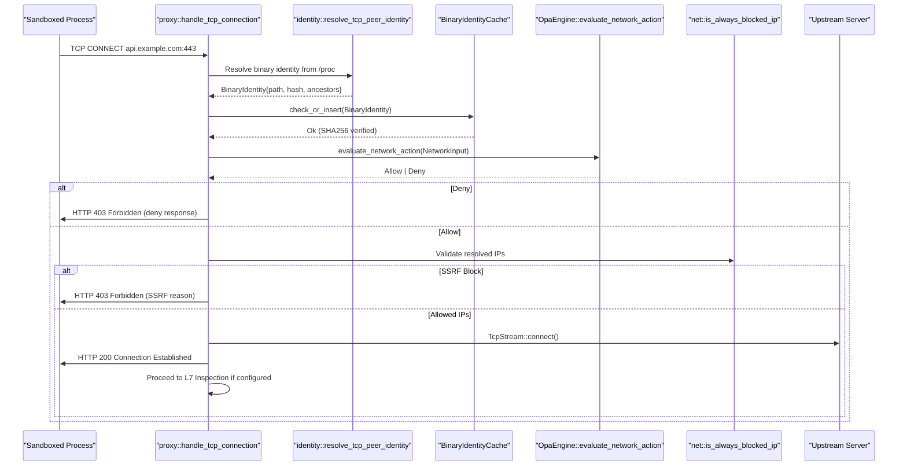
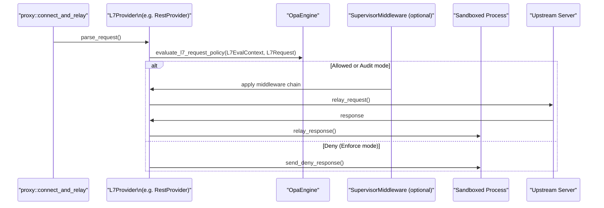
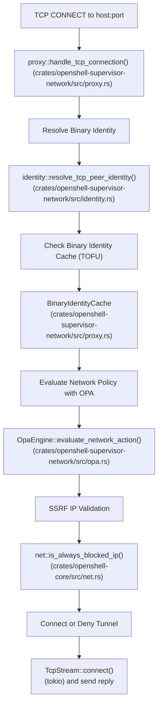
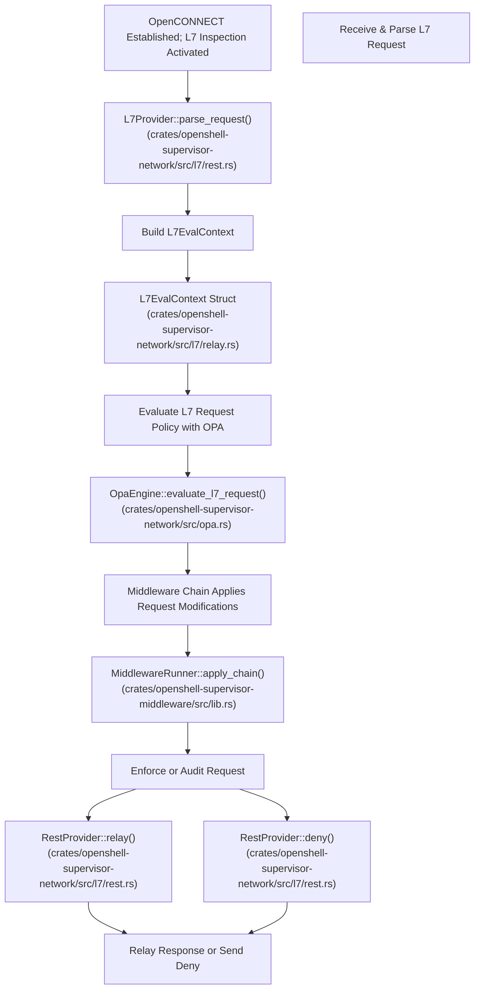

<!-- source: DeepWiki mcp.deepwiki.com · repo NVIDIA/OpenShell · page 7.4 L4 and L7 Enforcement · fetched 2026-10-26 -->

# L4 and L7 Enforcement

<details>
<summary>Relevant source files</summary>

The following files were used as context for generating this wiki page:

- [crates/openshell-binary-identity/README.md](crates/openshell-binary-identity/README.md)
- [crates/openshell-binary-identity/src/lib.rs](crates/openshell-binary-identity/src/lib.rs)
- [crates/openshell-core/src/middleware.rs](crates/openshell-core/src/middleware.rs)
- [crates/openshell-supervisor-middleware-builtins/Cargo.toml](crates/openshell-supervisor-middleware-builtins/Cargo.toml)
- [crates/openshell-supervisor-middleware-builtins/src/lib.rs](crates/openshell-supervisor-middleware-builtins/src/lib.rs)
- [crates/openshell-supervisor-middleware-builtins/src/regex.rs](crates/openshell-supervisor-middleware-builtins/src/regex.rs)
- [crates/openshell-supervisor-middleware/src/headers.rs](crates/openshell-supervisor-middleware/src/headers.rs)
- [crates/openshell-supervisor-middleware/src/lib.rs](crates/openshell-supervisor-middleware/src/lib.rs)
- [crates/openshell-supervisor-middleware/src/remote.rs](crates/openshell-supervisor-middleware/src/remote.rs)
- [crates/openshell-supervisor-middleware/src/websocket.rs](crates/openshell-supervisor-middleware/src/websocket.rs)
- [crates/openshell-supervisor-network/Cargo.toml](crates/openshell-supervisor-network/Cargo.toml)
- [crates/openshell-supervisor-network/src/host.rs](crates/openshell-supervisor-network/src/host.rs)
- [crates/openshell-supervisor-network/src/identity.rs](crates/openshell-supervisor-network/src/identity.rs)
- [crates/openshell-supervisor-network/src/l7/middleware.rs](crates/openshell-supervisor-network/src/l7/middleware.rs)
- [crates/openshell-supervisor-network/src/l7/mod.rs](crates/openshell-supervisor-network/src/l7/mod.rs)
- [crates/openshell-supervisor-network/src/l7/relay.rs](crates/openshell-supervisor-network/src/l7/relay.rs)
- [crates/openshell-supervisor-network/src/l7/rest.rs](crates/openshell-supervisor-network/src/l7/rest.rs)
- [crates/openshell-supervisor-network/src/l7/websocket.rs](crates/openshell-supervisor-network/src/l7/websocket.rs)
- [crates/openshell-supervisor-network/src/opa.rs](crates/openshell-supervisor-network/src/opa.rs)
- [crates/openshell-supervisor-network/src/policy_local.rs](crates/openshell-supervisor-network/src/policy_local.rs)
- [crates/openshell-supervisor-network/src/proxy.rs](crates/openshell-supervisor-network/src/proxy.rs)
- [docs/how-it-works/policies/manage-policies.mdx](docs/how-it-works/policies/manage-policies.mdx)
- [docs/how-it-works/policies/network-rules.mdx](docs/how-it-works/policies/network-rules.mdx)
- [docs/how-it-works/policies/schema.mdx](docs/how-it-works/policies/schema.mdx)
- [docs/observability/logging.mdx](docs/observability/logging.mdx)
- [proto/supervisor_middleware.proto](proto/supervisor_middleware.proto)

</details>


This page covers the detailed mechanics and implementation of **Layer 4 (L4) connection-level enforcement** and **Layer 7 (L7) request-level enforcement** in OpenShell. It explains how OpenShell authorizes outbound TCP connections from sandboxed processes based on binary identity and destination endpoint, enforces SSRF protections, and performs deep inspection of application-layer requests using protocol-aware middleware and OPA policy evaluation.

---

## Overview

OpenShell enforces sandbox network policy in two main phases:

- **L4 Enforcement** occurs at the TCP connection establishment level via the HTTP CONNECT proxy inside the supervisor. It performs:
  - Verification of the requesting process identity bound to the connection.
  - Matching against network authorization rules in OPA based on binary identity and destination.
  - SSRF protection by blocking problematic IP addresses even if authorized by policy.

- **L7 Enforcement** occurs optionally inside a CONNECT tunnel for inspected endpoints when a `protocol` such as `rest`, `websocket`, or `graphql` is configured. Each application-layer request within the tunnel is:
  - Parsed and parsed requests are evaluated against granular L7 rules in OPA.
  - Enforced either in `audit` (log violations) or `enforce` (block violating requests) mode.
  - Passed through configured supervisor middleware for header/body rewriting, signing, or detection.

Both enforcement layers integrate tightly, flowing context and identity information between them to maintain strong binding between binary, endpoint, and request. Together, these layers provide robust network control and application-layer policy enforcement for secure sandbox operation.

**Sources:** 
- [crates/openshell-supervisor-network/src/proxy.rs:4-100]()
- [crates/openshell-supervisor-network/src/l7/relay.rs:1-175]()
- [crates/openshell-supervisor-network/src/opa.rs:1-187]()
- [crates/openshell-supervisor-network/src/l7/mod.rs:1-172]()
- [crates/openshell-supervisor-network/src/l7/rest.rs:1-179]()

---

## Connection-Level (L4) Evaluation

### Key Steps for Each Outbound Connection

1. **CONNECT Request Parsing**  
   When a sandboxed process attempts a TCP connection, the HTTP CONNECT proxy parses the destination host and port from the HTTP CONNECT request.   
   (See: `validate_destination` in `proxy.rs`)

2. **Binary Identity Resolution**  
   The supervisor identifies the binary opening the connection using a `/proc`-based walk:
   - The socket inode is found.
   - The owner PID of the socket is resolved.
   - Executable path and ancestors are determined by reading `/proc/<pid>/exe` and `/proc/<pid>/status`.
   This establishes the requesting binary's canonical path and hashed identity.   
   (Code uses `identity::resolve_tcp_peer_identity()` in `proxy.rs`)

3. **Binary Identity Binding with Cache (TOFU)**  
   The `BinaryIdentityCache` caches SHA256 hashes of binaries at given paths to detect binary replacement attacks (Trust On First Use). A changed binary results in denial of further connections.   

4. **OPA Network Policy Evaluation**  
   The resolved binary identity and connection info (host, port) are wrapped as a `NetworkInput` struct and passed to the embedded OPA engine (`OpaEngine`).  
   The OPA evaluation uses baked-in Rego rules in `sandbox-policy.rego` to decide an allow/deny `NetworkAction` based on matching policy rules for network endpoints and binaries.

5. **SSRF and IP Validation**  
   Even after OPA authorizes the connection, the proxy resolves the destination DNS names to IP addresses and blocks requests to reserved, link-local, or metadata service IPs. This protects against SSRF attacks and proxy bypass.  

6. **Tunnel Establishment or Denial**  
   On authorization, a 200 Connection Established response is sent, and the TCP tunnel is opened. On denial, an HTTP error response with details is sent.   

---

### L4 Connection Enforcement Flow Diagram



---

### OPA Network Policy Evaluation

The OPA engine is represented by `OpaEngine` wrapping the `regorus::Engine`. It evaluates policies compiled from the sandbox's `SandboxPolicy` protobuf expanded with runtime data.

- The input (`NetworkInput`) includes the binary path, SHA256 hash, ancestors, host, and port.  
- The key Rego rule evaluated is `network_action`, returning either `Allow` or `Deny` with details.  
- Matching occurs against policy network rules based on:
  - Endpoint host (exact, wildcard, or IP-based via allowed IPs)
  - Port or port list `port`/`ports`
  - Binary path and hash match
  - Ancestor binary paths for contextual checks.

The policy can fail-closed with quarantine mode on errors or unrecognized binaries, ensuring security.

```rust
pub struct NetworkInput {
    pub host: String,
    pub port: u16,
    pub binary_path: PathBuf,
    pub binary_sha256: String,
    pub ancestors: Vec<PathBuf>,
    pub cmdline_paths: Vec<PathBuf>,
}
```

---

### Binary Identity Resolution and Cache

Binary identity is fundamental to L4 enforcement:

- The supervisor inspects the socket inode, resolves its owning PID via `identity::resolve_tcp_peer_identity`.
- Reads symbolic links to determine the executable real path.
- Gathers ancestor paths and command line executable paths for contextual matching.
- The `BinaryIdentityCache` implements TOFU caching of binary hashes (`sha256`) at given paths to detect unauthorized binary swaps.

This binding prevents attackers from subverting policies by replacing executables at known paths.

---

### SSRF Protection

To block SSRF and proxy bypass:

- The proxy verifies resolved IP addresses are not within forbidden ranges:
  - Loopback (127.0.0.0/8, ::1)
  - Link-local (169.254.0.0/16, fe80::/10)
  - Metadata IPs (169.254.169.254 on IPv4)
  - Named private IPs configured as "always blocked"
- Hostnames recognized as trusted host gateway aliases (e.g. `host.docker.internal`) are exempted if resolving to allowed driver-injected IPs.

This second defense layer prevents policy circumvention using DNS and IP tricks.

---

### Summary of L4 Code Entities

| Entity | Description |
| --- | --- |
| `proxy::handle_tcp_connection` | Entry point for TCP CONNECT proxy; parses CONNECT request and enforces L4 policy. |
| `identity::resolve_tcp_peer_identity` | Resolves a TCP connection's owning process identity. |
| `BinaryIdentityCache` | Caches binary SHA256 hashes for TOFU trust. |
| `OpaEngine` | Embedded Rego engine for network policy evaluation. |
| `NetworkInput` | Input struct for OPA evaluation. |
| `net::is_always_blocked_ip` | IP filtering for SSRF protection. |

---

## Endpoint and Binary Matching

Endpoints in policies are matched using:

- Exact or glob hostnames (`*` for single label, `**` for wildcard subdomains).
- Single port (`port`) or multiple ports (`ports`).
- Allowed IP ranges restricting endpoint reachability.
- Request protocol (optional) activating L7 inspection.

Binaries are matched against resolved paths and validated hashes, including ancestry for scripts interpreted by languages.

For more details, see the [Network Rules](7.3) page.

---

## Request-Level (L7) Rule Evaluation and Enforcement

When an endpoint defines an L7 protocol (`rest`, `graphql`, `mcp`, `websocket`, `json-rpc`), OpenShell inspects each request inside the CONNECT tunnel:

- **L7EvalContext** structures the request context including host, port, workspace, binary path, command args, provider credentials, and middleware state(s).  
- **Request Parsing:** L7 providers parse requests according to protocol (e.g. HTTP/REST in `RestProvider`).  
- **Rego Evaluation:** The request fields (method, path, headers) are evaluated against fine-grained L7 rules from policy using OPA dynamic evaluation.  
- **Enforcement Modes:**
  - `Audit`: Log violations, forward requests upstream.
  - `Enforce`: Deny violating requests with a policy denial response.
- **Denial Responses:** Use explicit JSON or protocol-native error messages including guidance for agent remediation.
- **Middleware Chain:** Configured `SupervisorMiddleware` can modify requests, redact secrets, apply request signing (e.g., SigV4), or emit findings via structured logging.

---

### L7 Request Evaluation Flow



---

### L7EvalContext

`L7EvalContext` contains vital information for policy evaluation and request inspection:

- Host and port from CONNECT request.
- Workspace the sandbox belongs to.
- Matched L4 policy name.
- Binary identity (path, ancestors, command-line).
- Provider credentials for dynamic injection.
- Secret resolver and body classifiers for credential redaction.
- Activity sender for anonymous telemetry.
- Agent proposals state for dynamically guided policies.

This context is cloned and scoped per request to isolate evaluation and credential binding.

---

### Key Types and Traits

| Symbol | Role |
| --- | --- |
| `L7Provider` trait | Parses & relays a specific L7 protocol, enforces per-request rules. |
| `RestProvider` | HTTP/1.1 L7Provider implementation, including header/body parsing and denial. |
| `L7Request` | Parsed L7 request data struct passed to policy. |
| `EnforcementMode` | Defines `Audit` or `Enforce` mode per endpoint. |
| `CredentialSigning` | Defines if and how SigV4 signing is applied to requests. |
| `MiddlewareApplyResult` | Result of middleware chain processing (success or failure). |

---

### Enforcement Behavior

- Audit logs L7 request violations but allows them through for smooth policy migration and tuning.
- Enforce blocks the request, returning a well-formed denial response with detailed policy error and remediation instructions.
- Violations and denials produce structured OCSF events for security observability.

---

## SSRF and Binary Identity Modes

- OpenShell enforces a runtime setting for whether binary identity is *required* during policy evaluation.
- SSRF protection applies globally in the L4 proxy for DNS-resolved IPs.
- L7 inspection verifies that request authority matches the endpoint host and port to prevent host-header spoofing and unauthorized credential injections.

---

## Diagram: From Natural Language to Code Entities for L4 Enforcement



---

## Diagram: From Natural Language to Code Entities for L7 Enforcement



---

## Summary

- **L4 enforcement** ensures TCP connections are authorized based on binary identity and destination endpoint, grounding least privilege network access at the transport layer.
- **Binary identity resolution and trust-on-first-use caching** prevent binary replacing attacks.
- **SSRF protections** block reserved and metadata IPs even if policy allows connections.
- **L7 enforcement** inspects individual requests in authorized tunnels, enforcing precise request rules with modes for audit and block.
- **Middleware chains** extend enforcement with custom inspection, redaction, and request signing.
- Detailed logs and OCSF structured events provide observability and facilitate policy tuning.

Together, these layers provide a layered, fine-grained approach to secure network access for sandboxed AI agents and processes.

---

Sources:  
- [crates/openshell-supervisor-network/src/proxy.rs:1-177]()  
- [crates/openshell-supervisor-network/src/l7/relay.rs:1-175]()  
- [crates/openshell-supervisor-network/src/opa.rs:1-187]()  
- [crates/openshell-supervisor-network/src/l7/rest.rs:1-179]()  
- [crates/openshell-supervisor-network/src/l7/mod.rs:1-172]()  
- [crates/openshell-supervisor-middleware/src/lib.rs:1-188]()

---

