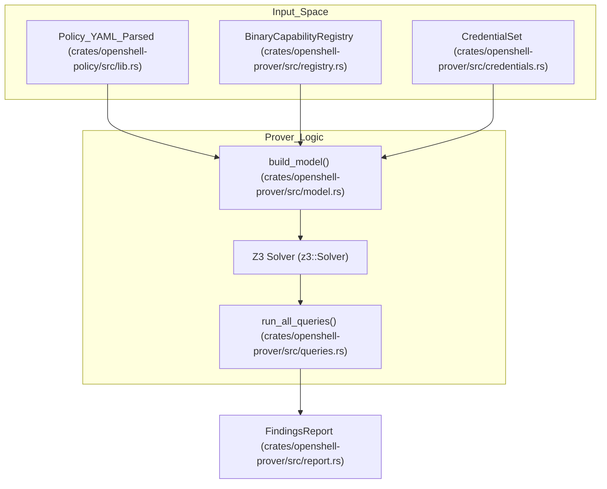
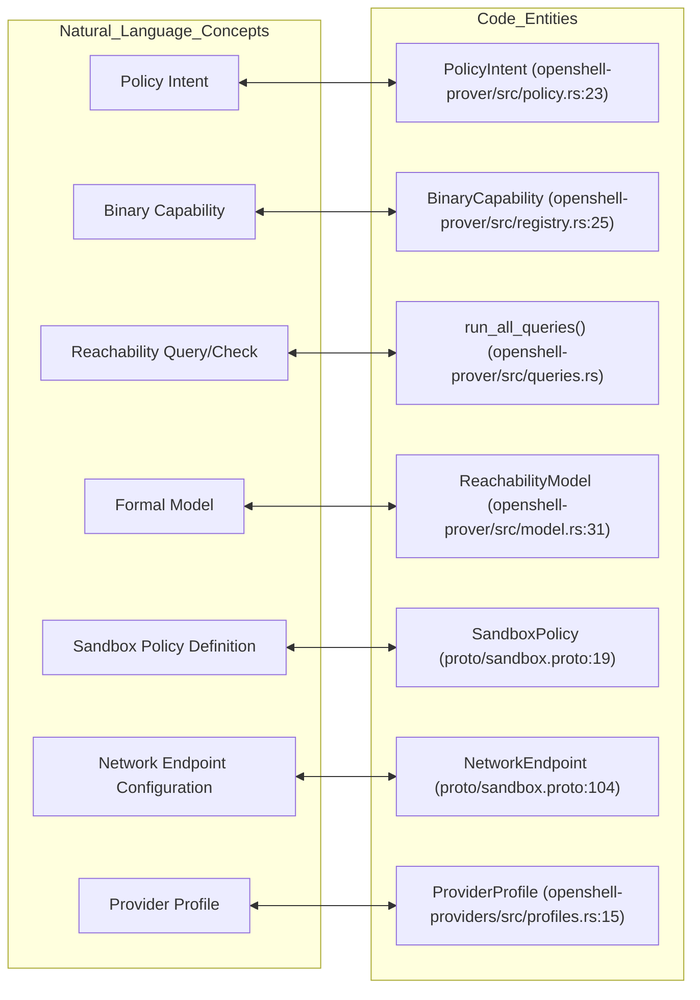

<!-- source: DeepWiki mcp.deepwiki.com · repo NVIDIA/OpenShell · page 7.6 Formal Policy Verification (openshell-prover) · fetched 2026-10-26 -->

# Formal Policy Verification (openshell-prover)

<details>
<summary>Relevant source files</summary>

The following files were used as context for generating this wiki page:

- [.agents/skills/build-openshell-mxc-windows/SKILL.md](.agents/skills/build-openshell-mxc-windows/SKILL.md)
- [.agents/skills/build-openshell-mxc-windows/reference.md](.agents/skills/build-openshell-mxc-windows/reference.md)
- [.github/workflows/snap-package.yml](.github/workflows/snap-package.yml)
- [.github/workflows/windows-msvc.yml](.github/workflows/windows-msvc.yml)
- [crates/openshell-driver-mxc/src/driver.rs](crates/openshell-driver-mxc/src/driver.rs)
- [crates/openshell-gateway/Cargo.toml](crates/openshell-gateway/Cargo.toml)
- [crates/openshell-prover-cli/Cargo.toml](crates/openshell-prover-cli/Cargo.toml)
- [crates/openshell-prover/Cargo.toml](crates/openshell-prover/Cargo.toml)
- [docs/about/support-matrix.mdx](docs/about/support-matrix.mdx)
- [docs/how-it-works/policies/prover.mdx](docs/how-it-works/policies/prover.mdx)
- [docs/observability/telemetry.mdx](docs/observability/telemetry.mdx)
- [e2e/run.sh](e2e/run.sh)
- [tasks/scripts/windows-msvc.ps1](tasks/scripts/windows-msvc.ps1)

</details>


The `openshell-prover` is OpenShell's formal verification engine designed to ensure sandbox policies comply with strict security and boundary constraints. It leverages the **Z3 SMT solver** to analyze the safety and reachability properties of sandbox policies, verifying that no unintended accesses or exfiltration paths exist within a given candidate policy relative to a specified boundary policy.

This page provides an in-depth technical overview of the `openshell-prover`, including its architecture, data flow, key components such as the binary capability registry, credential scope analysis, exfiltration detection, accepted-risks management, and the usage of the prover CLI.

## Purpose and Scope

`openshell-prover` performs automated formal policy verification over OpenShell sandbox policies. It transcends simple syntactic validation by encoding policies into logical constraints solved by the SMT solver, detecting potential security violations such as unauthorized L7 bypasses, data exfiltration opportunities, or credential misuse.

Key functions of the prover include:

- Validating that a candidate policy never grants more privilege than a boundary policy.
- Analyzing binary capabilities to assess bypass risks and exfiltration.
- Verifying network rules with respect to injected credentials.
- Integrating an accepted-risks workflow to allow controlled exceptions.
- Providing an independent CLI for use in automation, CI pipelines, or agent workflows.

This page documents the internal workings, core abstractions, and key APIs of the prover component in the OpenShell codebase.

---

## Core Architecture and Data Flow

The prover translates sandbox policies defined in YAML (and protobuf) into a formal model that is checked by Z3. The process integrates binary capabilities and supplementary credential scope data, composing a rich logical context to perform reachability queries.

The main prover entry function is `prove`, which orchestrates parsing input policies, loading the binary capability registry, building the reachability model, running SMT queries, and returning a detailed result [crates/openshell-prover/src/lib.rs:37-75]().

### Prover Verification Pipeline Diagram



This pipeline flows from policy input and auxiliary data, through model construction into Z3 constraints, culminating in queries that yield security findings or proofs of compliance.

Sources: `crates/openshell-prover/src/lib.rs:43-61`(), `crates/openshell-prover/src/model.rs:59-86`(), `crates/openshell-policy/src/lib.rs`(), `crates/openshell-prover/src/registry.rs:10-40`(), `crates/openshell-prover/src/credentials.rs:10-35`().

---

## Binary Capability Registry

A fundamental prover input is a registry cataloging known binaries and their network/protocol capabilities. This registry resides as declarative YAML files under `registry/binaries/` and is loaded at runtime to inform risk queries.

### Purpose

Binary capabilities regulate how the prover understands potential bypass or exfiltration risks. They include metadata such as:

- Whether a binary can bypass L7 inspection (`bypasses_l7`).
- Whether it can craft arbitrary HTTP requests (`can_construct_http`).
- Whether it can exfiltrate data (`can_exfiltrate`).

This information is crucial for assessing if a sandbox policy may permit a binary to circumvent expected L7 proxies or data governance.

### Data Representation

The `BinaryCapability` struct abstracts these properties [crates/openshell-prover/src/registry.rs:25-35]():

```rust
pub struct BinaryCapability {
    pub bypasses_l7: bool,
    pub can_construct_http: bool,
    pub can_exfiltrate: bool,
    // ... other fields ...
}
```

### Example Table of Binary Capabilities

| Binary  | Example Path         | Bypasses L7 | Can Construct HTTP | Can Exfiltrate |
|---------|----------------------|-------------|--------------------|----------------|
| `curl`  | `/usr/bin/curl`      | No          | Yes                | Yes            |
| `git`   | `/usr/bin/git`       | Yes         | Yes                | Yes            |
| `ssh`   | `/usr/bin/ssh`       | Yes         | No                 | Yes            |

This registry enables the prover to flag risky binaries when policies grant them access beyond intended controls.

Sources: `crates/openshell-prover/src/lib.rs:51-57`(), `crates/openshell-prover/src/registry.rs:25-35`(), `registry/binaries` files at repo root (implicit).

---

## Credential Scope Analysis

The prover analyzes credential scopes and how network endpoints may expose sensitive credentials, assessing potential leaks or misuse.

### CredentialSet Abstraction

Credentials available to a sandbox are represented via `CredentialSet` structures [crates/openshell-prover/src/credentials.rs:15-30](). The prover integrates these credentials with network endpoint definitions to understand which requests can access or modify sensitive data.

### Provider Profiles Role

Provider profiles [crates/openshell-providers/src/profiles.rs:10-15]() define the semantics and allowed scopes of credentials injected into sandboxes. They specify:

- Credential types (`aws`, `github`, etc.).
- Network endpoints associated with credentials.
- Refresh strategies and token lifecycles.

This information feeds into modeling credential-bound API allowances.

### API Capability Mapping

The prover models the scope and potential actions of credentials by tracking if a credential grants `read`, `write`, or `destructive` access. For example:

| Credential Type | Path / Permission  | Inferred Action | Risk Level |
|-----------------|--------------------|-----------------|------------|
| `github`        | `repo`             | Write/Delete    | High       |
| `aws`           | `s3:PutObject`     | Write           | Medium     |

This enables cross-checking of network allowances against credential risks, particularly for exfiltration or privilege escalation.

### NetworkCredentialBinding

The protobuf `NetworkCredentialBinding` binds credentials to policies statically [proto/sandbox.proto:96-101](), allowing the prover to understand endpoint-credential expectations.

Sources: `crates/openshell-prover/src/credentials.rs:15-30`(), `crates/openshell-providers/src/profiles.rs:10-15`(), `proto/sandbox.proto:96-101`(), `crates/openshell-prover/src/model.rs:230-250`().

---

## Policy Verification Logic

The core verification logic is implemented in the `ReachabilityModel` which asserts constraints over:

1. **L7 Bypass Detection:**  
   Identifies if a binary with `bypasses_l7` capability has network access to an endpoint that expects L7 enforcement. Such bypasses can allow unauthorized or unexamined traffic [crates/openshell-prover/src/model.rs:193-199]().

2. **Data Exfiltration Checks:**  
   Ensures binaries capable of exfiltration do not have `write` connectivity that would allow data leak outside policy boundaries [crates/openshell-prover/src/model.rs:205-215](). This guards the "deny-by-default" principle.

3. **Credential Exposure Risks:**  
   Detects if endpoints consuming sensitive credentials are reachable by binaries lacking proper L7 inspection or are inappropriately scoped [crates/openshell-prover/src/model.rs:230-245]().

### Natural Language to Code Entity Mapping Diagram



Sources: `crates/openshell-prover/src/policy.rs:23-29`(), `crates/openshell-prover/src/model.rs:31-56`(), `crates/openshell-prover/src/queries.rs`(), `proto/sandbox.proto:19`(), `proto/sandbox.proto:104`(), `crates/openshell-providers/src/profiles.rs:10-15`()

---

## Implementation Details

### Policy Modeling

The prover's `PolicyModel` representation encodes:

- **Endpoint Intent:**  
  Network endpoints are modeled as `ReadOnly`, `ReadWrite`, or `Full` access, based on allowed HTTP methods (e.g., `GET` vs `POST`/`DELETE`) derived from `access` fields in `NetworkEndpoint` or explicit L7 rules [crates/openshell-prover/src/policy.rs:165-192]().

- **Port Handling:**  
  Both singular `port` and plural `ports` fields are supported, with `ports` taking precedence if present, reflecting `NetworkEndpoint` protobuf changes [crates/openshell-prover/src/policy.rs:195-203](), [proto/sandbox.proto:110-111](), [proto/sandbox.proto:132-135]().

- **L7 Enforcement Logic:**  
  Whether L7 proxying applies is inferred from protocol and TLS flags in the endpoint config. For example, native TCP (`protocol: tcp`) disables payload inspection; REST (`protocol: rest`) enables it [crates/openshell-prover/src/model.rs:143-161]().

### Runtime Enforcement Context

At runtime, the `openshell-sandbox` enforces the policy using Landlock, `seccomp`, and local CONNECT proxy mediation, observing binary identities and sandbox-bound network connections [architecture/sandbox.md:40-49](), [crates/openshell-sandbox/src/lib.rs:70]().

Sources: `crates/openshell-prover/src/policy.rs:165-210`(), `crates/openshell-prover/src/model.rs:143-161`(), `proto/sandbox.proto:110-135`(), `architecture/sandbox.md:40-49`(), `crates/openshell-sandbox/src/lib.rs:111-164`()

---

## Accepted-Risks Workflow

To enable practical adoption, the prover supports an "Accepted Risks" mechanism allowing controlled suppressions of known or approved violations.

1. **Detection:**  
   When the solver finds a policy violation (e.g., `L7_BYPASS_CREDENTIALED`), it annotates the finding [crates/openshell-prover/src/lib.rs:200-203]().

2. **Suppression:**  
   If an `accepted_risks.yaml` file is provided, the prover cross-checks reported findings against this list and filters out any approved exceptions [crates/openshell-prover/src/accepted_risks.rs:10-20]().

3. **Exit Codes:**  
   The `prove` function exits with code `0` if no unaccepted findings exist; otherwise, it exits with code `1` to enable CI/CD gating or automated policy approval workflows [crates/openshell-prover/src/lib.rs:31-32]().

This approach balances strict security verification with the realities of complex policy authoring and incremental risk management.

Sources: `crates/openshell-prover/src/lib.rs:63-75`(), `crates/openshell-prover/src/accepted_risks.rs:10-20`(), `crates/openshell-prover/src/finding.rs:1-5`()

---

## Prover CLI

The `openshell-prover` is distributed as a standalone CLI binary, usable independently of the gateway or runtime environment. It reads policy YAML files for both candidate and boundary policies and outputs verification results in human-readable or JSON formats.

### Basic Usage Example

```shell
openshell-prover check candidate.yaml --boundary boundary.yaml
```

This command performs a boundary check, verifying that the candidate policy does not exceed permissions granted by the boundary policy.

### Output Types

- **within_boundary:** Candidate policy is strictly within boundary constraints (exit code 0).
- **exceeds_boundary:** Candidate allows more access than boundary (exit code 1); includes a counterexample showing the violating assertion.
- **unsupported:** Candidate includes policy features the prover cannot check (exit code 3).
- **inconclusive:** Solver timeout or resource limit (exit code 3).
- **error:** I/O or parse errors (exit code 2).

### Integration

Common usage includes running the prover in CI/CD pipelines or agent workflows to automatically enforce policy correctness and security compliance.

Sources: `docs/how-it-works/policies/prover.mdx` (lines 49-164)(), `crates/openshell-prover-cli` (implied from naming).

---

# Summary

`openshell-prover` provides a rigorous, formal validation layer atop the OpenShell policy system. By integrating binary behavior modeling, credential scope analysis, and SMT-based logical queries, it delivers strong guarantees that sandbox policies remain secure and within prescribed boundaries.

Its architecture cleanly separates policy parsing, modeling, registry loading, and solver interaction, enabling future extension of supported policy features and risk analyses. The accepted-risks workflow and CLI tooling facilitate integration into automated governance pipelines and agent-based policy synthesis validation.

---

# References and Sources

- `crates/openshell-prover/src/lib.rs:26-75`  
- `crates/openshell-prover/src/model.rs:31-56, 143-200, 205-215, 230-250`  
- `crates/openshell-prover/src/registry.rs:10-40`  
- `crates/openshell-prover/src/credentials.rs:10-35`  
- `crates/openshell-prover/src/queries.rs`  
- `crates/openshell-prover/src/accepted_risks.rs:10-20`  
- `crates/openshell-prover/src/finding.rs:1-5`  
- `crates/openshell-policy/src/lib.rs`  
- `crates/openshell-providers/src/profiles.rs:10-15`  
- `proto/sandbox.proto:19-21, 96-101, 104-135`  
- `docs/how-it-works/policies/prover.mdx:49-164`  
- `architecture/sandbox.md:40-49`  
- `crates/openshell-sandbox/src/lib.rs:111-164`

---

