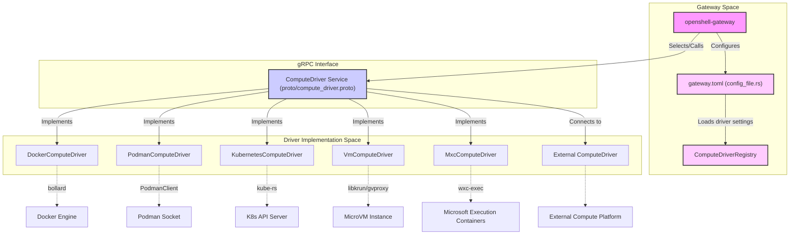

<!-- source: DeepWiki mcp.deepwiki.com · repo NVIDIA/OpenShell · page 8 Compute Drivers · fetched 2026-10-26 -->

# Compute Drivers

Relevant source files

The following files were used as context for generating this wiki page:

- [crates/openshell-core/src/config.rs](crates/openshell-core/src/config.rs)
- [crates/openshell-server/src/cli.rs](crates/openshell-server/src/cli.rs)
- [crates/openshell-server/src/config_file.rs](crates/openshell-server/src/config_file.rs)
- [crates/openshell-server/src/lib.rs](crates/openshell-server/src/lib.rs)
- [crates/openshell-server/src/test_support.rs](crates/openshell-server/src/test_support.rs)
- [docs/how-it-works/gateways/configuration.mdx](docs/how-it-works/gateways/configuration.mdx)
- [proto/compute_driver.proto](proto/compute_driver.proto)
- [skills/debug-openshell-cluster/SKILL.md](skills/debug-openshell-cluster/SKILL.md)

The compute driver layer is responsible for the lifecycle management of sandboxes across different execution environments. It abstracts the underlying infrastructure—whether it be local containers, remote Kubernetes clusters, or MicroVMs—behind a unified gRPC interface.

## Architecture Overview

OpenShell uses a driver-based architecture where the gateway communicates with a specific compute driver implementation via the `ComputeDriver` gRPC service defined in `proto/compute_driver.proto` [proto/compute_driver.proto:25-66](). The gateway selects a driver at startup based on configuration or auto-detection logic [crates/openshell-server/src/cli.rs:131-134]().

### Driver Registry and Selection

Compute drivers are installed into a registry at gateway startup [crates/openshell-server/src/lib.rs:12-14](). The gateway can be configured to use a specific driver via the `--compute-driver` CLI flag or `OPENSHELL_COMPUTE_DRIVER` environment variable [crates/openshell-server/src/cli.rs:135-139](). If no driver is explicitly selected, the gateway probes installed registrations in a predefined priority order (Kubernetes, Podman, then Docker) [skills/debug-openshell-cluster/SKILL.md:29-31](). The VM driver has no probe and must be explicitly opted-in [skills/debug-openshell-cluster/SKILL.md:31-32]().

External compute drivers can be integrated by specifying a Unix domain socket path via `--compute-driver-socket` or `OPENSHELL_COMPUTE_DRIVER_SOCKET` [crates/openshell-server/src/cli.rs:142-151](). This allows the gateway to connect to an operator-provided external endpoint, replacing normal construction for the selected driver name [crates/openshell-server/src/cli.rs:147-151]().

### Resource Admission

Compute drivers report their supported resource capabilities and an effective operator admission policy via the `GetCapabilitiesResponse` RPC [proto/compute_driver.proto:73-108](). The gateway requires an exact policy match before activating the driver [proto/compute_driver.proto:107-108](). This mechanism allows for fine-grained control over resource requests, such as CPU, memory, and GPU [proto/compute_driver.proto:127-148]().

### Configuration Passthrough

Driver-specific configuration is managed through TOML tables under `[openshell.drivers.<name>]` in the gateway configuration file [crates/openshell-server/src/config_file.rs:70-71](). These settings are passed verbatim to each driver's deserialization implementation, allowing drivers to evolve their schemas independently [crates/openshell-server/src/config_file.rs:66-71](). The gateway selector `compute_driver = "<driver>"` accepts a single scalar driver name, or can be omitted for auto-detection [docs/how-it-works/gateways/configuration.mdx:66-67]().

**Compute Driver System Entities**

Sources: [crates/openshell-server/src/lib.rs:12-14](), [crates/openshell-server/src/cli.rs:135-151](), [crates/openshell-server/src/config_file.rs:70-71](), [proto/compute_driver.proto:25-66](), [proto/compute_driver.proto:73-108](), [proto/compute_driver.proto:127-148](), [skills/debug-openshell-cluster/SKILL.md:29-32]()

---

## Docker and Podman Drivers

These drivers manage sandboxes as standard OCI containers. They handle image pinning, binary extraction, secrets management, networking, and GPU CDI.

For details, see [Docker and Podman Drivers](#8.1).

Sources: [crates/openshell-core/src/config.rs:43-44](), [crates/openshell-core/src/config.rs:86-87]()

---

## Kubernetes Driver

The Kubernetes driver orchestrates sandboxes as Pods, optionally using the `Agent Sandbox` CRD. It supports different supervisor sideloading methods and topology options.

For details, see [Kubernetes Driver](#8.2).

Sources: [skills/debug-openshell-cluster/SKILL.md:29-31]()

---

## VM Runtime (openshell-driver-vm)

The VM driver provides hardware-virtualized isolation using a MicroVM runtime based on `libkrun`. It manages rootfs application, kernel configuration, `gvproxy` networking, and VFIO for GPU passthrough.

For details, see [VM Runtime (openshell-driver-vm)](#8.3).

Sources: [skills/debug-openshell-cluster/SKILL.md:31-32]()

---

## Windows Native Support (MXC Driver)

The MXC driver provides native Windows 11 sandbox support using Microsoft Execution Containers. It supports AppContainer and IsolationSession backends, translates OpenShell policies to MXC configurations, and uses a host-side CONNECT proxy for network policy enforcement.

For details, see [Windows Native Support (MXC Driver)](#8.4).

Sources: [skills/debug-openshell-cluster/SKILL.md:33-35]()

---

## Credential Drivers

Credential drivers manage secure storage and retrieval of credentials for various backends, including encrypted databases, Kubernetes Secrets, and Vault/OpenBao.

For details, see [Credential Drivers](#8.5).

Sources: [crates/openshell-server/src/config_file.rs:73-76]()

---

