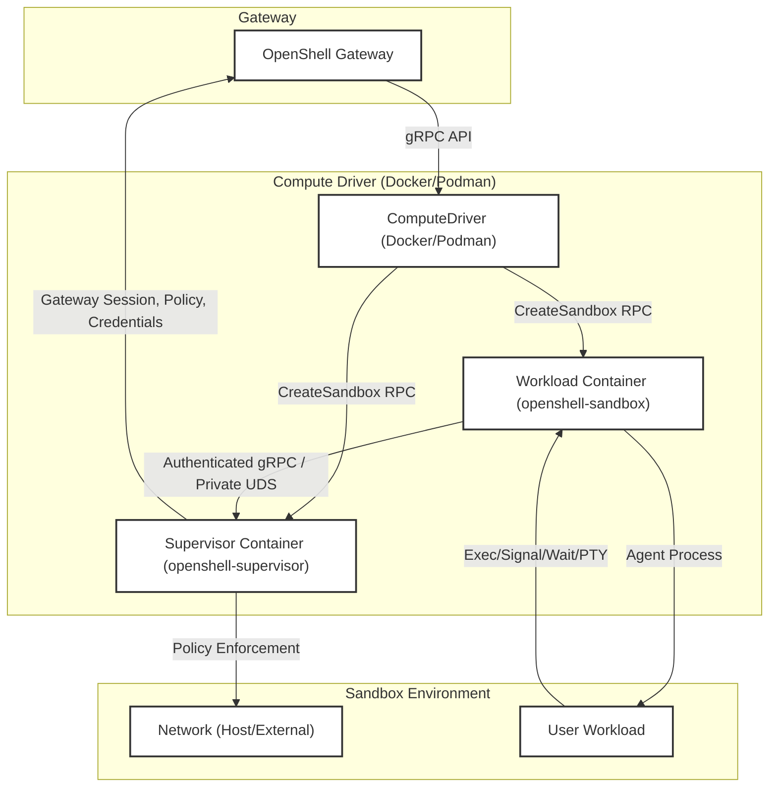
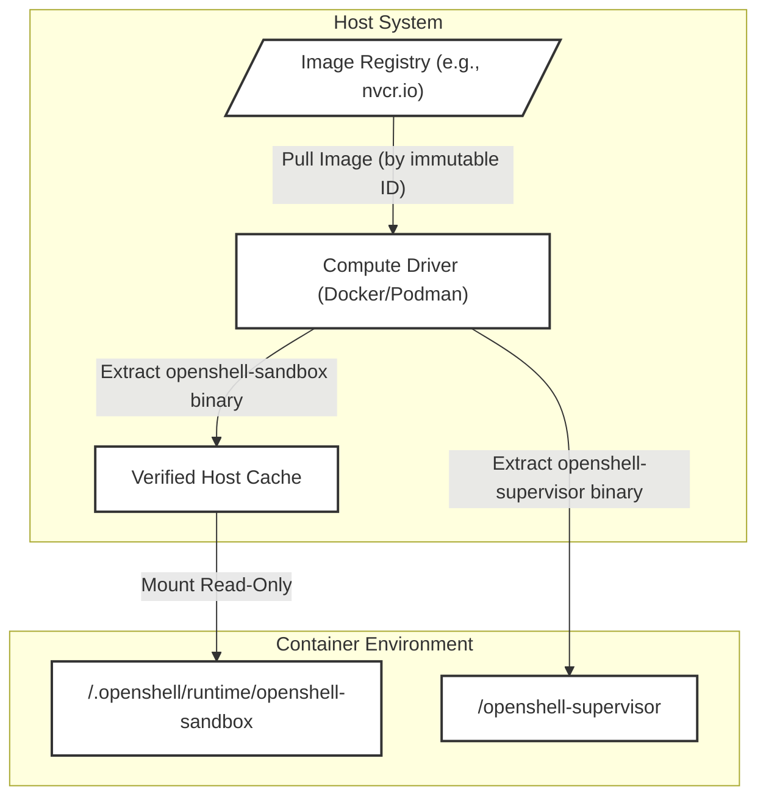
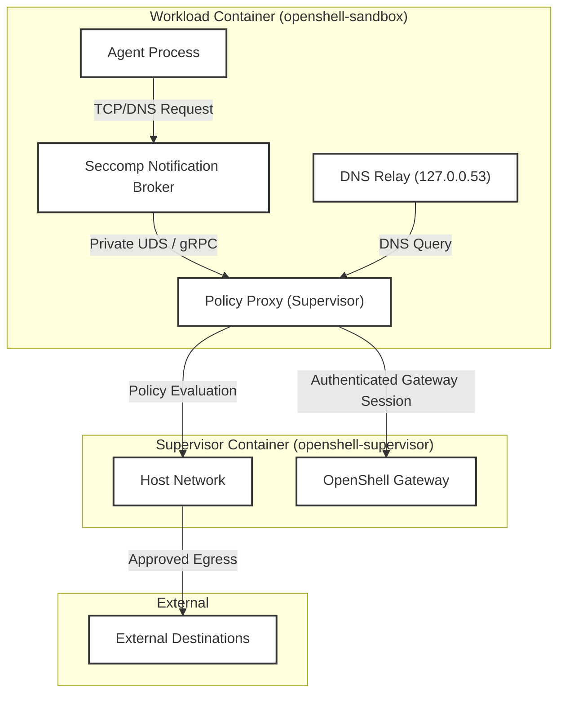

<!-- source: DeepWiki mcp.deepwiki.com · repo NVIDIA/OpenShell · page 8.1 Docker and Podman Drivers · fetched 2026-10-26 -->

# Docker and Podman Drivers

<details>
<summary>Relevant source files</summary>

The following files were used as context for generating this wiki page:

- [crates/openshell-core/src/driver_utils.rs](crates/openshell-core/src/driver_utils.rs)
- [crates/openshell-driver-docker/README.md](crates/openshell-driver-docker/README.md)
- [crates/openshell-driver-docker/src/lib.rs](crates/openshell-driver-docker/src/lib.rs)
- [crates/openshell-driver-docker/src/tests.rs](crates/openshell-driver-docker/src/tests.rs)
- [crates/openshell-driver-podman/Cargo.toml](crates/openshell-driver-podman/Cargo.toml)
- [crates/openshell-driver-podman/NETWORKING.md](crates/openshell-driver-podman/NETWORKING.md)
- [crates/openshell-driver-podman/README.md](crates/openshell-driver-podman/README.md)
- [crates/openshell-driver-podman/src/client.rs](crates/openshell-driver-podman/src/client.rs)
- [crates/openshell-driver-podman/src/config.rs](crates/openshell-driver-podman/src/config.rs)
- [crates/openshell-driver-podman/src/container.rs](crates/openshell-driver-podman/src/container.rs)
- [crates/openshell-driver-podman/src/driver.rs](crates/openshell-driver-podman/src/driver.rs)
- [crates/openshell-driver-podman/src/isolation.rs](crates/openshell-driver-podman/src/isolation.rs)
- [crates/openshell-driver-podman/src/main.rs](crates/openshell-driver-podman/src/main.rs)
- [crates/openshell-driver-podman/src/test_utils.rs](crates/openshell-driver-podman/src/test_utils.rs)
- [crates/openshell-driver-podman/src/watcher.rs](crates/openshell-driver-podman/src/watcher.rs)
- [crates/openshell-driver-podman/tests/podman_preflight.rs](crates/openshell-driver-podman/tests/podman_preflight.rs)
- [crates/openshell-driver-vm/src/lifecycle.rs](crates/openshell-driver-vm/src/lifecycle.rs)
- [e2e/rust/tests/live_policy_update.rs](e2e/rust/tests/live_policy_update.rs)
- [e2e/rust/tests/podman_gateway_start.rs](e2e/rust/tests/podman_gateway_start.rs)
- [e2e/rust/tests/podman_oci_identity.rs](e2e/rust/tests/podman_oci_identity.rs)
- [tests/ansible/playbooks/drivers/podman/e2e.yaml](tests/ansible/playbooks/drivers/podman/e2e.yaml)
- [tests/ansible/roles/openshell_gateway/templates/gateway-podman.toml.j2](tests/ansible/roles/openshell_gateway/templates/gateway-podman.toml.j2)
- [tests/artifacts.nix](tests/artifacts.nix)

</details>


This page details the implementation of the Docker and Podman compute drivers within OpenShell. These drivers are responsible for orchestrating sandboxed environments using container technologies. We will cover their architecture, how they manage container/supervisor pairs, image pinning, binary extraction, secrets management, networking, GPU CDI integration, and resource admission.

## Architecture: Container/Supervisor Pair

Both the Docker and Podman drivers employ a two-container architecture for each sandbox:

1.  **`openshell-sandbox` (Workload Container)**: This container runs the agent process and the user's workload. It is the isolated environment where user code executes. It is responsible for the workload process tree, seccomp notification broker, Landlock baseline, binary identity, and exec/signal/wait/PTY operations [crates/openshell-driver-docker/README.md:25-28]().
2.  **`openshell-supervisor` (Companion Container)**: This container acts as a trusted companion to the workload. It handles the gateway session, policy engine, credentials, interception CA, SSH relay, L7 inspection, and external upstream connections [crates/openshell-driver-docker/README.md:29-32]().

This separation ensures that sensitive operations and network mediation are handled by a trusted component, while the workload remains highly isolated.

The supervisor joins the workload's user namespace to preserve UID/GID mapping for shared-volume access, but PID, mount, and network namespaces remain separate [crates/openshell-driver-podman/README.md:37-39]().


Sources: [crates/openshell-driver-docker/README.md:24-32](), [crates/openshell-driver-podman/README.md:6-8](), [crates/openshell-driver-podman/README.md:37-39]()

## Image Pinning and Binary Extraction

Both workload and supervisor images are pinned by immutable image ID [crates/openshell-driver-podman/README.md:79](). The drivers extract trusted runtime binaries from these images.

For the `openshell-sandbox` binary, the driver extracts it from the `sandbox_runtime_image` into a verified host cache and mounts it read-only into each sandbox container [crates/openshell-driver-podman/src/config.rs:66-69](). This ensures that the sandbox always runs a trusted, statically linked binary. The path to this binary inside the container is `SANDBOX_RUNTIME_IMAGE_BINARY_PATH` (`/openshell-sandbox`) [crates/openshell-core/src/driver_utils.rs:81-85]().

The `openshell-supervisor` binary is supplied by the `supervisor_image` [crates/openshell-driver-podman/src/config.rs:71](). The Docker driver copies these trusted runtime bytes through the Docker archive API [crates/openshell-driver-docker/README.md:48-49]().

The `supervisor_image_should_refresh` function [crates/openshell-core/src/driver_utils.rs:31]() determines if a new supervisor image needs to be pulled. The `extract_first_tar_entry` function [crates/openshell-core/src/driver_utils.rs:31]() is used to extract binaries from tar archives.


Sources: [crates/openshell-driver-docker/README.md:48-49](), [crates/openshell-driver-docker/src/lib.rs:31](), [crates/openshell-driver-podman/README.md:79](), [crates/openshell-driver-podman/src/config.rs:66-71](), [crates/openshell-driver-podman/src/driver.rs:16](), [crates/openshell-core/src/driver_utils.rs:31](), [crates/openshell-core/src/driver_utils.rs:81-85]()

## Secrets Management

OpenShell handles sensitive information like gateway JWTs and upstream proxy credentials securely.

*   **Gateway JWTs**: For Podman, per-sandbox gateway JWTs are stored as Podman secrets [crates/openshell-driver-podman/README.md:29](). The `create_sandbox_token_secret` function [crates/openshell-driver-podman/src/driver.rs:159-177]() creates these secrets, and `cleanup_sandbox_token_secret` [crates/openshell-driver-podman/src/driver.rs:179-187]() removes them. The secret name is generated by `token_secret_name` [crates/openshell-driver-podman/src/container.rs:183-185](). These are mounted into the supervisor container at `SANDBOX_TOKEN_MOUNT_PATH` (`/etc/openshell/auth/sandbox.jwt`) [crates/openshell-core/src/driver_utils.rs:116-117]().
*   **Upstream Proxy Credentials**: Corporate proxy credentials (`user:pass`) are provided via a file specified by `proxy_auth_file` in the gateway configuration [crates/openshell-driver-docker/README.md:56](). The driver reads these credentials and copies them into the supervisor-only named volume for each supervisor launch [crates/openshell-driver-docker/README.md:67-68](). They are mounted at `SUPERVISOR_PROXY_AUTH_MOUNT_PATH` (`/.openshell/supervisor/upstream-proxy-auth`) [crates/openshell-driver-docker/src/lib.rs:110]().
*   **Proxy CA Bundle**: The corporate proxy CA bundle, if configured, is also copied into the supervisor-only volume and mounted at `SUPERVISOR_PROXY_CA_BUNDLE_MOUNT_PATH` (`/.openshell/supervisor/upstream-proxy-ca-bundle.pem`) [crates/openshell-driver-docker/src/lib.rs:111-112]().

These mechanisms ensure that credentials are not exposed in container environment variables or metadata.

```mermaid
graph TD
    subgraph "Gateway Configuration"
        A["gateway.toml"]
    end

    subgraph "Compute Driver (Docker/Podman)"
        B["ComputeDriver"]
    end

    subgraph "Container Environment"
        C["Supervisor Container"]
        D["Workload Container"]
    end

    A -- "proxy_auth_file" --> B
    A -- "proxy_ca_bundle" --> B
    A -- "SandboxLaunchAuthentication" --> B

    B -- "Create Podman Secret (sandbox_token)" --> C["/etc/openshell/auth/sandbox.jwt"]
    B -- "Copy to Supervisor Volume (proxy_auth_file)" --> C["/.openshell/supervisor/upstream-proxy-auth"]
    B -- "Copy to Supervisor Volume (proxy_ca_bundle)" --> C["/.openshell/supervisor/upstream-proxy-ca-bundle.pem"]

    C -- "Uses for Upstream Connections" --> E["External Network"]
    D -- "No direct access to secrets"

    style A fill:#fff,stroke:#333,stroke-width:2px
    style B fill:#fff,stroke:#333,stroke-width:2px
    style C fill:#fff,stroke:#333,stroke-width:2px
    style D fill:#fff,stroke:#333,stroke-width:2px
    style E fill:#fff,stroke:#333,stroke-width:2px
```
Sources: [crates/openshell-driver-docker/README.md:56-73](), [crates/openshell-driver-docker/src/lib.rs:110-112](), [crates/openshell-driver-podman/README.md:29](), [crates/openshell-driver-podman/src/container.rs:183-185](), [crates/openshell-driver-podman/src/driver.rs:159-187](), [crates/openshell-core/src/driver_utils.rs:116-117]()

## Networking

The networking model for sandboxes is designed for maximum isolation and controlled egress:

*   **Workload Container (`openshell-sandbox`)**: Uses `network_mode=none` [crates/openshell-driver-docker/README.md:39](). It has no external network interface or published ports. All TCP and DNS operations are mediated by a seccomp user-notification broker, which sends requests across a private channel to the supervisor [crates/openshell-driver-docker/README.md:39-43](). The driver mounts a read-only `/etc/resolv.conf` with `nameserver 127.0.0.53` to ensure DNS requests are routed through the supervisor [crates/openshell-driver-podman/NETWORKING.md:26-28]().
*   **Supervisor Container (`openshell-supervisor`)**: Uses host networking [crates/openshell-driver-docker/README.md:45](). This allows it to reach the gateway's primary loopback listener and originate approved upstream connections [crates/openshell-driver-docker/README.md:45-47](). The supervisor mediates all network traffic based on policy.
*   **Private Channel**: An authenticated Unix socket (or gRPC over UDS) connects the workload and supervisor containers. This channel carries TCP, DNS, and control streams [crates/openshell-driver-podman/NETWORKING.md:10](). A shared named volume carries the authenticated Unix socket and sandbox bootstrap material [crates/openshell-driver-docker/README.md:34-35]().


Sources: [crates/openshell-driver-docker/README.md:39-47](), [crates/openshell-driver-docker/README.md:34-35](), [crates/openshell-driver-podman/NETWORKING.md:10](), [crates/openshell-driver-podman/NETWORKING.md:26-28]()

## GPU CDI Integration

OpenShell supports GPU-enabled sandboxes through NVIDIA Container Device Interface (CDI).

*   **CDI Device Selection**: The `cdi_devices` field in `PodmanSandboxDriverConfig` [crates/openshell-driver-podman/src/container.rs:81]() allows specifying CDI devices. The `CdiGpuDefaultSelector` and `CdiGpuInventory` structs [crates/openshell-driver-docker/src/lib.rs:35-36]() are used to manage and select GPUs.
*   **Validation**: The `validate_specific_gpu_device_request` function [crates/openshell-driver-docker/src/lib.rs:36]() ensures that requested GPU devices are valid. Resource admission checks are performed, and GPU devices are temporarily exempt from certain admission policies [crates/openshell-driver-docker/README.md:21]().
*   **Resource Requirements**: GPU resource requirements are specified using `GpuResourceRequirements` [crates/openshell-driver-docker/src/lib.rs:43](). The `effective_driver_gpu_count` function [crates/openshell-driver-docker/src/lib.rs:36]() helps determine the number of GPUs.

The `admission_defaults_reject_even_gpu_driver_json_but_not_public_gpu_requests` test [crates/openshell-driver-docker/src/tests.rs:109]() demonstrates how admission policies interact with GPU requests.

Sources: [crates/openshell-driver-docker/README.md:21](), [crates/openshell-driver-docker/src/lib.rs:35-36](), [crates/openshell-driver-docker/src/lib.rs:43](), [crates/openshell-driver-docker/src/tests.rs:109](), [crates/openshell-driver-podman/src/container.rs:81]()

## Resource Admission

Resource admission is a critical security feature that governs what resources a sandbox can request.

*   **Default Behavior**: Caller driver configuration is disabled by default. Existing volumes require administrator-controlled approval labels. Raw bind mounts are denied under enforcement [crates/openshell-driver-docker/README.md:18-20]().
*   **`ResourceAdmissionConfig`**: The `resource_admission` field in `PodmanComputeConfig` [crates/openshell-driver-podman/src/config.rs:33]() defines the operator-owned external attachment approval policy.
*   **Bind Mounts**: Enabling bind mounts requires `enable_bind_mounts` to be set to `true` in the configuration [crates/openshell-driver-podman/src/config.rs:90](). However, even when enabled, bind mounts without a trusted label resolver will be rejected [crates/openshell-driver-docker/src/tests.rs:133-158](). The `admit_mount_types` function in `PodmanSandboxDriverConfig` [crates/openshell-driver-podman/src/container.rs:86-101]() performs this validation.
*   **Driver Config**: Driver JSON configuration requires `allow_driver_config = true` to be enabled [crates/openshell-driver-podman/README.md:115]().
*   **Validation**: Admission checks run before launch, restart, and periodically for running workloads [crates/openshell-driver-docker/README.md:21-22](). The `validate_sandbox` function in `DockerComputeDriver` [crates/openshell-driver-docker/src/tests.rs:117]() is responsible for this.

Sources: [crates/openshell-driver-docker/README.md:18-22](), [crates/openshell-driver-docker/src/tests.rs:133-158](), [crates/openshell-driver-podman/README.md:115](), [crates/openshell-driver-podman/src/config.rs:33](), [crates/openshell-driver-podman/src/config.rs:90](), [crates/openshell-driver-podman/src/container.rs:86-101]()

---

