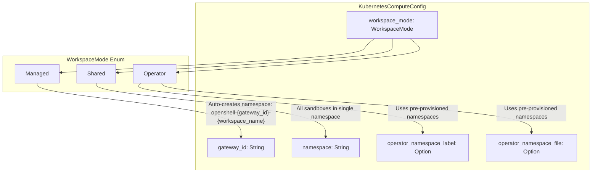

<!-- source: DeepWiki mcp.deepwiki.com · repo NVIDIA/OpenShell · page 8.2 Kubernetes Driver · fetched 2026-10-26 -->

# Kubernetes Driver

<details>
<summary>Relevant source files</summary>

The following files were used as context for generating this wiki page:

- [crates/openshell-driver-kubernetes/README.md](crates/openshell-driver-kubernetes/README.md)
- [crates/openshell-driver-kubernetes/src/config.rs](crates/openshell-driver-kubernetes/src/config.rs)
- [crates/openshell-driver-kubernetes/src/driver.rs](crates/openshell-driver-kubernetes/src/driver.rs)
- [crates/openshell-driver-kubernetes/src/lib.rs](crates/openshell-driver-kubernetes/src/lib.rs)
- [crates/openshell-driver-kubernetes/src/lifecycle.rs](crates/openshell-driver-kubernetes/src/lifecycle.rs)
- [crates/openshell-driver-kubernetes/src/lifecycle_tests.rs](crates/openshell-driver-kubernetes/src/lifecycle_tests.rs)
- [crates/openshell-driver-kubernetes/src/main.rs](crates/openshell-driver-kubernetes/src/main.rs)
- [e2e/mcp-conformance.sh](e2e/mcp-conformance.sh)
- [e2e/rust/tests/oidc_pkce.rs](e2e/rust/tests/oidc_pkce.rs)
- [e2e/rust/tests/workspace_namespace_managed.rs](e2e/rust/tests/workspace_namespace_managed.rs)
- [e2e/rust/tests/workspace_namespace_operator.rs](e2e/rust/tests/workspace_namespace_operator.rs)

</details>


This page documents the Kubernetes compute driver, which enables OpenShell to orchestrate sandboxes as Kubernetes pods. It covers the Agent Sandbox Custom Resource Definitions (CRDs), different workspace/namespace modes, the architecture of sandbox runtime pods, their lifecycle, and the necessary Kubernetes Role-Based Access Control (RBAC) configurations.

## Agent Sandbox CRDs

The Kubernetes driver interacts with the Kubernetes API to manage `Sandbox` custom resources. It dynamically detects the available `Sandbox` API version at runtime, preferring `v1beta1` over `v1alpha1`. If the Agent Sandbox controller is upgraded in-place, the gateway needs to be restarted for the driver to re-detect the API versions [crates/openshell-driver-kubernetes/README.md:108-112]().

The driver maps Kubernetes object states and platform events into the shared compute-driver protobuf surface used by the gateway [crates/openshell-driver-kubernetes/README.md:113-115]().

Sources:
* [crates/openshell-driver-kubernetes/README.md:108-115]()

## Workspace and Namespace Modes

The Kubernetes driver supports three modes for mapping OpenShell workspaces to Kubernetes namespaces, configured via the `workspace_mode` setting [crates/openshell-driver-kubernetes/README.md:15-16](), [crates/openshell-driver-kubernetes/src/config.rs:103-105]().

### Shared Mode

In `Shared` mode (the default), all sandboxes are rendered into a single, statically configured Kubernetes namespace [crates/openshell-driver-kubernetes/README.md:17-18](), [crates/openshell-driver-kubernetes/src/config.rs:106-108](). To avoid naming collisions, resource names use the format `{workspace}--{name}` [crates/openshell-driver-kubernetes/README.md:18-19]().

### Managed Mode

In `Managed` mode, the driver automatically creates and deletes a Kubernetes namespace for each workspace. The namespace names follow the convention `openshell-{gateway_id}-{workspace_name}` [crates/openshell-driver-kubernetes/README.md:20-22](), [crates/openshell-driver-kubernetes/src/config.rs:109-111](). A `ServiceAccount` is created within each managed namespace, and OpenShift SCC annotations are copied from the gateway namespace if present [crates/openshell-driver-kubernetes/README.md:22-23]().

When a workspace is deleted, the driver attempts to clean up the corresponding Kubernetes namespace. This cleanup is best-effort and depends on controller finalization timing [e2e/rust/tests/workspace_namespace_managed.rs:12-15]().

Sources:
* [crates/openshell-driver-kubernetes/README.md:17-23]()
* [crates/openshell-driver-kubernetes/src/config.rs:106-111]()
* [e2e/rust/tests/workspace_namespace_managed.rs:12-15]()

### Operator Mode

In `Operator` mode, workspace names are mapped one-to-one to pre-provisioned Kubernetes namespaces. These namespaces are discovered either through a label selector (`operator_namespace_label`) or a drop-in allowlist file (`operator_namespace_file`) [crates/openshell-driver-kubernetes/README.md:24-27](), [crates/openshell-driver-kubernetes/src/config.rs:112-115](). If a workspace's namespace is not in the current allowlist, sandbox creation will fail [crates/openshell-driver-kubernetes/README.md:27-28]().

Workspace deletion in operator mode only removes gateway state and does not delete or access the operator-managed Kubernetes namespace [crates/openshell-driver-kubernetes/README.md:28-29](). Granting a namespace to the operator allowlist implies trust, as the allowlist is not a tenant isolation boundary [crates/openshell-driver-kubernetes/README.md:49-51]().

Sources:
* [crates/openshell-driver-kubernetes/README.md:24-29]()
* [crates/openshell-driver-kubernetes/README.md:49-51]()
* [crates/openshell-driver-kubernetes/src/config.rs:112-115]()

### Workspace Mode Configuration

The `KubernetesComputeConfig` struct [crates/openshell-driver-kubernetes/src/config.rs:157]() defines the configuration for the Kubernetes compute driver, including `workspace_mode`, `gateway_id`, `namespace`, `operator_namespace_label`, and `operator_namespace_file`.


**KubernetesComputeConfig and Workspace Modes**

Sources:
* [crates/openshell-driver-kubernetes/src/config.rs:157]()

## Sandbox Runtime Pods

The Kubernetes driver orchestrates two main pods for each sandbox: a workload Pod and a supervisor Pod.

### Workload Pod

The workload Pod stages the statically linked `openshell-sandbox` binary from `sandbox_runtime_image` [crates/openshell-driver-kubernetes/README.md:57-58](). This pod runs the agent process, applies Landlock and child seccomp filters, identifies binaries behind network syscalls, and relays mediated streams to the supervisor [crates/openshell-driver-kubernetes/README.md:61-63](). The workload Pod does not receive gateway credentials, provider identity sockets, or corporate proxy credentials [crates/openshell-driver-kubernetes/README.md:64-65]().

### Supervisor Pod

A directly managed Pod runs the dynamically linked `openshell-supervisor` binary from `supervisor_image` [crates/openshell-driver-kubernetes/README.md:58-59](). The supervisor authenticates to the gateway using a JWT, loads policy and provider state, performs destination and L7 authorization, and opens upstream connections [crates/openshell-driver-kubernetes/README.md:63-64]().

The supervisor Pod has a direct, non-controller owner reference to the `Sandbox` resource, linking its garbage-collection lifecycle to the sandbox without competing with the Agent Sandbox controller for workload-Pod ownership [crates/openshell-driver-kubernetes/README.md:74-77]().

### Security and Isolation

Both pods run as the namespace-resolved non-root UID/GID with `allowPrivilegeEscalation: false` and `capabilities.drop: [ALL]`, using the runtime default seccomp profile [crates/openshell-driver-kubernetes/README.md:67-69](). The sandbox installs a nested seccomp user-notification filter without requesting a capability in the Pod spec [crates/openshell-driver-kubernetes/README.md:69-70](). Startup fails if the runtime blocks required seccomp or Landlock operations [crates/openshell-driver-kubernetes/README.md:70-72]().

### Network Policy

The driver creates a namespace-wide `NetworkPolicy` before releasing any workload Pod [crates/openshell-driver-kubernetes/README.md:78-79](). This policy selects every OpenShell workload, denies all workload egress, and permits OpenShell supervisor Pods to reach the sandbox TLS port [crates/openshell-driver-kubernetes/README.md:79-81](). The authenticated Sandbox Protocol binds each connection to the exact sandbox and supervisor Pod identities [crates/openshell-driver-kubernetes/README.md:81-82](). Supervisors have normal egress for gateway, DNS, and policy-approved upstream connections unless restricted by an operator policy [crates/openshell-driver-kubernetes/README.md:82-84]().

The cluster CNI must enforce ingress and egress `NetworkPolicy` for every sandbox namespace. Operators must verify CNI support before running sandboxes, as Kubernetes accepts policy objects without confirming enforcement [crates/openshell-driver-kubernetes/README.md:84-87]().

Sources:
* [crates/openshell-driver-kubernetes/README.md:57-87]()

## Sandbox Lifecycle

Each sandbox generation uses two immutable bootstrap Secrets [crates/openshell-driver-kubernetes/README.md:88-89](). A trusted init container stages the sandbox bootstrap into memory, which the sandbox removes before starting untrusted code [crates/openshell-driver-kubernetes/README.md:89-90](). The other Secret is mounted only by the supervisor [crates/openshell-driver-kubernetes/README.md:90-91](). If `proxy_ca_bundle` is configured, it also carries the operator's corporate proxy CA bundle, read from the gateway's filesystem to keep the anchor in the gateway's trust domain [crates/openshell-driver-kubernetes/README.md:91-94]().

The TLS channel binds the namespace, `Sandbox` CR, workload Pod, supervisor Pod, and shared network-policy identities [crates/openshell-driver-kubernetes/README.md:94-95]().

Stopping a sandbox deletes both the workload and supervisor Pods [crates/openshell-driver-kubernetes/README.md:95-96](). Starting a sandbox rotates both Secrets and creates a new supervisor Pod before releasing a new workload Pod [crates/openshell-driver-kubernetes/README.readme:96-98](). The shared network fence remains for the lifetime of the namespace [crates/openshell-driver-kubernetes/README.md:98-99]().

The `LifecycleGates` struct [crates/openshell-driver-kubernetes/src/lifecycle.rs:11]() manages per-sandbox serialization for lifecycle RPCs and driver reconciliation. The `gate_for` method [crates/openshell-driver-kubernetes/src/lifecycle.rs:16-24]() provides an `Arc<AsyncMutex<()>>` to serialize operations for a given sandbox ID.

```mermaid
graph TD
    A[Gateway] --> B{Kubernetes Driver};
    B -- "Creates Sandbox CR" --> C[Kubernetes API Server];
    C -- "Creates Workload Pod" --> D[Workload Pod (openshell-sandbox)];
    C -- "Creates Supervisor Pod" --> E[Supervisor Pod (openshell-supervisor)];

    D -- "Applies Landlock/seccomp" --> F[Agent Process];
    D -- "Mediates streams" --> E;

    E -- "Authenticates with JWT" --> B;
    E -- "Loads policy/provider state" --> B;
    E -- "Performs L7 authorization" --> B;
    E -- "Opens upstream connections" --> G[External Services];

    B -- "Creates NetworkPolicy" --> C;
    C -- "Enforces NetworkPolicy" --> H[CNI Plugin];
    H -- "Restricts Workload Egress" --> D;
    H -- "Permits Supervisor to Sandbox TLS" --> E;

    B -- "Manages Bootstrap Secrets" --> C;
    C -- "Stages Secrets to Pods" --> D;
    C -- "Stages Secrets to Pods" --> E;

    B -- "Stop Sandbox" --> C;
    C -- "Deletes Workload Pod" --> D;
    C -- "Deletes Supervisor Pod" --> E;

    B -- "Start Sandbox" --> C;
    C -- "Rotates Secrets" --> B;
    C -- "Creates new Supervisor Pod" --> E;
    C -- "Releases new Workload Pod" --> D;
```
**Kubernetes Sandbox Runtime Lifecycle**

Sources:
* [crates/openshell-driver-kubernetes/README.md:88-99]()
* [crates/openshell-driver-kubernetes/src/lifecycle.rs:11]()
* [crates/openshell-driver-kubernetes/src/lifecycle.rs:16-24]()

## RBAC Needs

Kubernetes policies are additive, and the API does not guarantee CNI enforcement [crates/openshell-driver-kubernetes/README.md:100-101](). Therefore, sandbox namespaces must be administratively controlled. Untrusted principals must not be able to create permissive policies, create Pods, read bootstrap Secrets, or spoof OpenShell role labels [crates/openshell-driver-kubernetes/README.md:101-103]().

Exact supervisor-to-sandbox authorization is enforced through TLS, JWT claims, session generation, and recorded Pod UIDs [crates/openshell-driver-kubernetes/README.md:103-104]().

In shared and managed modes, only the driver and its trusted Agent Sandbox controller are permitted to administer the sandbox namespace, `Sandbox` CRs, sandbox pods, or configured sandbox `ServiceAccount` [crates/openshell-driver-kubernetes/README.md:42-45]().

In operator mode, the platform operator owns the namespace lifecycle. However, they must prevent other principals from creating or mutating `Sandbox` CRs, creating sandbox pods with fabricated owner references, or using the configured sandbox `ServiceAccount` [crates/openshell-driver-kubernetes/README.md:45-49]().

The `e2e/rust/tests/workspace_namespace_operator.rs` test suite verifies that the gateway, when running in operator mode, does not have `Secret` access in namespaces without the `openshell-workspace` chart installed [e2e/rust/tests/workspace_namespace_operator.rs:197-207](). This ensures that the gateway's permissions are appropriately constrained.

Sources:
* [crates/openshell-driver-kubernetes/README.md:42-51]()
* [crates/openshell-driver-kubernetes/README.md:100-104]()
* [e2e/rust/tests/workspace_namespace_operator.rs:197-207]()

## Kubernetes Driver Implementation

The core logic for the Kubernetes driver resides in the `KubernetesComputeDriver` struct [crates/openshell-driver-kubernetes/src/driver.rs:11812](). This driver runs in-process with the gateway server [crates/openshell-driver-kubernetes/README.md:14]().

The `main.rs` file [crates/openshell-driver-kubernetes/src/main.rs]() defines the command-line arguments for the standalone Kubernetes driver, including configuration options for admission control, binding addresses, logging, OTLP tracing, workspace modes, image pull policies, and proxy settings.

```mermaid
graph TD
    A[OpenShell Gateway] --> B{KubernetesComputeDriver};
    B -- "Configures with" --> C[KubernetesComputeConfig];
    C -- "Determines namespace strategy" --> D{WorkspaceMode};
    D -- "Shared" --> E[Single K8s Namespace];
    D -- "Managed" --> F[Auto-created K8s Namespace per Workspace];
    D -- "Operator" --> G[Pre-provisioned K8s Namespace];

    B -- "Creates/Manages" --> H[Sandbox CR (agents.x-k8s.io)];
    H -- "Triggers creation of" --> I[Workload Pod (openshell-sandbox)];
    H -- "Triggers creation of" --> J[Supervisor Pod (openshell-supervisor)];

    I -- "Isolation" --> K[Landlock, Seccomp];
    J -- "Auth/Policy" --> L[Gateway API, Policy Engine];

    B -- "Sets up" --> M[NetworkPolicy];
    M -- "Enforced by" --> N[Cluster CNI];

    B -- "Manages" --> O[Bootstrap Secrets];
    O -- "Mounted into" --> I;
    O -- "Mounted into" --> J;

    subgraph "KubernetesComputeDriver (crates/openshell-driver-kubernetes/src/driver.rs)"
        B
    end

    subgraph "KubernetesComputeConfig (crates/openshell-driver-kubernetes/src/config.rs)"
        C
    end

    subgraph "WorkspaceMode (crates/openshell-driver-kubernetes/src/config.rs)"
        D
    end

    subgraph "Main Entrypoint (crates/openshell-driver-kubernetes/src/main.rs)"
        P[CLI Arguments] --> C;
    end
```
**Kubernetes Driver Architecture**

Sources:
* [crates/openshell-driver-kubernetes/README.md:14]()
* [crates/openshell-driver-kubernetes/src/driver.rs:11812]()
* [crates/openshell-driver-kubernetes/src/main.rs]()

---

