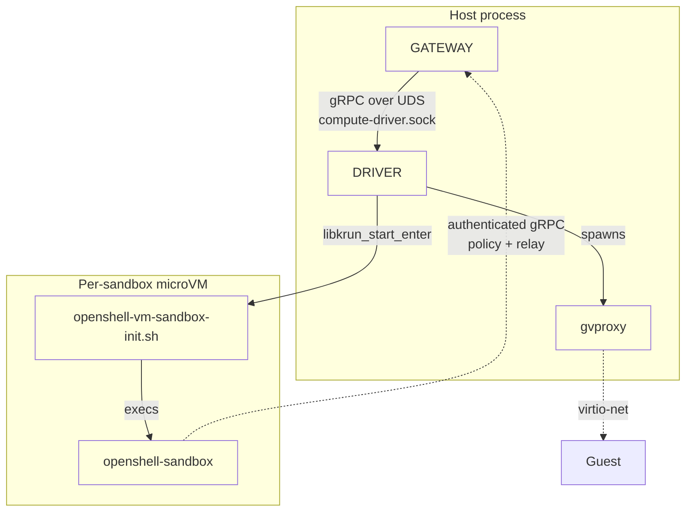
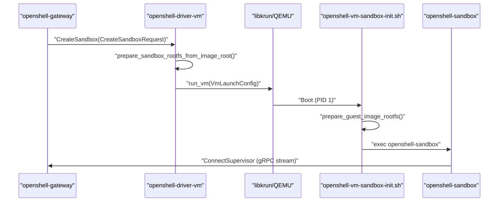

<!-- source: DeepWiki mcp.deepwiki.com · repo NVIDIA/OpenShell · page 8.3 VM Runtime (openshell-driver-vm) · fetched 2026-10-26 -->

# VM Runtime (openshell-driver-vm)

Relevant source files

The following files were used as context for generating this wiki page:

- [crates/openshell-core/src/e2fsprogs.rs](crates/openshell-core/src/e2fsprogs.rs)
- [crates/openshell-driver-vm/Cargo.toml](crates/openshell-driver-vm/Cargo.toml)
- [crates/openshell-driver-vm/README.md](crates/openshell-driver-vm/README.md)
- [crates/openshell-driver-vm/runtime/README.md](crates/openshell-driver-vm/runtime/README.md)
- [crates/openshell-driver-vm/runtime/kernel/openshell.kconfig](crates/openshell-driver-vm/runtime/kernel/openshell.kconfig)
- [crates/openshell-driver-vm/runtime/pins.env](crates/openshell-driver-vm/runtime/pins.env)
- [crates/openshell-driver-vm/scripts/openshell-vm-sandbox-init.sh](crates/openshell-driver-vm/scripts/openshell-vm-sandbox-init.sh)
- [crates/openshell-driver-vm/src/driver.rs](crates/openshell-driver-vm/src/driver.rs)
- [crates/openshell-driver-vm/src/layer_applier.rs](crates/openshell-driver-vm/src/layer_applier.rs)
- [crates/openshell-driver-vm/src/lib.rs](crates/openshell-driver-vm/src/lib.rs)
- [crates/openshell-driver-vm/src/main.rs](crates/openshell-driver-vm/src/main.rs)
- [crates/openshell-driver-vm/src/preparation.rs](crates/openshell-driver-vm/src/preparation.rs)
- [crates/openshell-driver-vm/src/rootfs.rs](crates/openshell-driver-vm/src/rootfs.rs)
- [crates/openshell-driver-vm/src/runtime.rs](crates/openshell-driver-vm/src/runtime.rs)
- [crates/openshell-driver-vm/tests/image_preparation.rs](crates/openshell-driver-vm/tests/image_preparation.rs)
- [crates/openshell-gateway/src/lib.rs](crates/openshell-gateway/src/lib.rs)
- [crates/openshell-gateway/src/vm.rs](crates/openshell-gateway/src/vm.rs)
- [crates/openshell-gateway/tests/config_preflight.rs](crates/openshell-gateway/tests/config_preflight.rs)
- [deploy/man/openshell-gateway.8.md](deploy/man/openshell-gateway.8.md)
- [e2e/rust/tests/vm_corporate_proxy.rs](e2e/rust/tests/vm_corporate_proxy.rs)
- [python/openshell/release_formula_test.py](python/openshell/release_formula_test.py)
- [python/release_tooling_test.py](python/release_tooling_test.py)
- [snap/hooks/post-refresh](snap/hooks/post-refresh)
- [tasks/scripts/release.py](tasks/scripts/release.py)
- [tasks/scripts/test-snap-post-refresh-hook.sh](tasks/scripts/test-snap-post-refresh-hook.sh)
- [tasks/scripts/vm/build-libkrun-macos.sh](tasks/scripts/vm/build-libkrun-macos.sh)
- [tasks/scripts/vm/build-libkrun.sh](tasks/scripts/vm/build-libkrun.sh)
- [tasks/scripts/vm/vm-setup.sh](tasks/scripts/vm/vm-setup.sh)

The OpenShell VM Runtime is a high-performance MicroVM execution layer designed to provide hardware-level isolation for AI agents. Built on `libkrun`, it supports macOS (via Apple Hypervisor.framework) and Linux (via KVM). The runtime is distributed as a self-contained system where the kernel, rootfs, and networking proxy are embedded directly into the binary [crates/openshell-driver-vm/README.md:1-6]().

## Architecture Overview

The VM system follows a "MicroVM-in-a-binary" philosophy. The `openshell-driver-vm` binary embeds a zstd-compressed runtime bundle consisting of `libkrun`, `libkrunfw` (kernel), `gvproxy`, and the `openshell-sandbox` supervisor [crates/openshell-driver-vm/README.md:12-14]().

### Component Interaction

The system operates across three distinct layers: the Host (macOS/Linux), the Guest VM (running the agent), and the Network Proxy.

**OpenShell VM Execution Flow**

Sources: [crates/openshell-driver-vm/README.md:9-28]()

## Compute Driver (openshell-driver-vm)

The `openshell-driver-vm` is the specific implementation of the `ComputeDriver` gRPC interface for VM-based sandboxes. The OpenShell gateway spawns this driver as a subprocess and communicates with it over a Unix Domain Socket (UDS) [crates/openshell-driver-vm/README.md:12-14]().

### Configuration and Discovery
The driver handles sandbox lifecycle through the `ComputeDriver` trait implementation in `driver.rs` [crates/openshell-driver-vm/src/driver.rs:62-63](). It manages state, including per-sandbox overlay disks and image caches, in a configurable `state_dir` [crates/openshell-driver-vm/src/main.rs:118-121](). The gateway resolves the driver binary by searching `driver_dir`, conventional paths like `/usr/libexec/openshell`, or siblings of the gateway binary [crates/openshell-driver-vm/README.md:139]().

### VM Launch Configuration
The `VmLaunchConfig` struct defines the parameters for the MicroVM execution:
- **Resources**: Defaulting to 2 vCPUs and 2048 MiB RAM [crates/openshell-driver-vm/src/driver.rs:106-107]().
- **Storage**: Each sandbox boots from a cached immutable bootstrap `ext4` root disk plus a per-sandbox writable sparse overlay disk (default 4096 MiB) [crates/openshell-driver-vm/src/driver.rs:108]().
- **Backends**: Supports `Libkrun` (standard) and `Qemu` (primarily for VFIO/GPU passthrough) [crates/openshell-driver-vm/src/runtime.rs:29-32]().

Sources: [crates/openshell-driver-vm/src/driver.rs:106-108](), [crates/openshell-driver-vm/src/main.rs:118-121](), [crates/openshell-driver-vm/src/runtime.rs:29-32](), [crates/openshell-driver-vm/README.md:139](), [crates/openshell-driver-vm/src/driver.rs:62-63]()

## Embedded Rootfs and Image Management

The driver implements a multi-stage rootfs preparation strategy to allow arbitrary OCI images to run within the VM environment.

### Layered Storage
1.  **Bootstrap Image**: An immutable `ext4` image containing the base OS and OpenShell runtime components [crates/openshell-driver-vm/README.md:5]().
2.  **Image Preparation**: If the requested sandbox image differs from the bootstrap, the driver extracts the OCI image (using `umoci`) inside a temporary bootstrap VM to create a read-only `ext4` image disk [crates/openshell-driver-vm/README.md:5](), [crates/openshell-driver-vm/src/rootfs.rs:175-177]().
3.  **Overlay**: A writable `ext4` overlay disk is mounted as the upper layer to persist changes [crates/openshell-driver-vm/src/driver.rs:108]().

### Guest Initialization
The `openshell-vm-sandbox-init.sh` script runs as PID 1. It is responsible for:
- Mounting essential filesystems (`/proc`, `/sys`, `/dev`, `/tmp`, `/run`) [crates/openshell-driver-vm/scripts/openshell-vm-sandbox-init.sh:28-32]().
- Configuring networking (gvproxy DHCP or static TAP) [crates/openshell-driver-vm/scripts/openshell-vm-sandbox-init.sh:5-8]().
- Preparing the guest image rootfs via `umoci` if required [crates/openshell-driver-vm/scripts/openshell-vm-sandbox-init.sh:152-182]().
- Executing the `openshell-sandbox` supervisor [crates/openshell-driver-vm/scripts/openshell-vm-sandbox-init.sh:207-217]().

Sources: [crates/openshell-driver-vm/src/driver.rs:108](), [crates/openshell-driver-vm/scripts/openshell-vm-sandbox-init.sh:1-10](), [crates/openshell-driver-vm/src/rootfs.rs:175-177](), [crates/openshell-driver-vm/scripts/openshell-vm-sandbox-init.sh:28-32](), [crates/openshell-driver-vm/scripts/openshell-vm-sandbox-init.sh:152-182](), [crates/openshell-driver-vm/scripts/openshell-vm-sandbox-init.sh:207-217](), [crates/openshell-driver-vm/README.md:5]()

## Networking via gvproxy

OpenShell utilizes `gvproxy` (from `gvisor-tap-vsock`) to provide a virtualized network stack with transparent host access.

- **Host Loopback**: `gvproxy` NAT-rewrites traffic to `192.168.127.254` to the host's `127.0.0.1`. This allows guests to reach the OpenShell gateway on the host [crates/openshell-driver-vm/src/runtime.rs:129]().
- **DNS**: The driver uses the hostname `host.openshell.internal` (aliased to `host.containers.internal` or `host.docker.internal`) which resolves to the loopback IP [crates/openshell-driver-vm/src/driver.rs:153-158]().
- **Isolation**: Traffic is routed through `gvproxy`, providing a layer of separation between the guest and the physical host network [crates/openshell-driver-vm/README.md:30]().

Sources: [crates/openshell-driver-vm/src/runtime.rs:129](), [crates/openshell-driver-vm/src/driver.rs:153-158](), [crates/openshell-driver-vm/README.md:30]()

## GPU Support (VFIO Passthrough)

The VM driver supports experimental GPU passthrough on Linux using VFIO.

- **Requirements**: Requires host support for IOMMU and root privileges for device bind/unbind operations [crates/openshell-driver-vm/README.md:67-72]().
- **Implementation**: The driver uses `openshell-vfio` to manage Sysfs interactions [crates/openshell-driver-vm/src/runtime.rs:182](). When enabled, the VM is launched with increased resource defaults [crates/openshell-driver-vm/src/main.rs:194-199]().
- **Backend**: GPU passthrough typically utilizes the `Qemu` backend for robust PCI passthrough support [crates/openshell-driver-vm/src/runtime.rs:78-82]().

Sources: [crates/openshell-driver-vm/src/main.rs:194-199](), [crates/openshell-driver-vm/src/runtime.rs:78-82](), [crates/openshell-driver-vm/README.md:67-72](), [crates/openshell-driver-vm/src/runtime.rs:182]()

## Platform Support and Security

### macOS Entitlements
On macOS, the `openshell-driver-vm` must be codesigned with specific entitlements to access the `Hypervisor.framework`. Specifically, the `com.apple.security.hypervisor` entitlement is required [crates/openshell-driver-vm/README.md:123-125]().

### Connectivity Model
As of recent updates, the gateway no longer dials the sandbox directly. Instead, the in-guest supervisor opens an outbound `ConnectSupervisor` gRPC stream to the gateway on startup [crates/openshell-driver-vm/README.md:38](). All SSH and `ExecSandbox` traffic is multiplexed over this single TCP+TLS+HTTP/2 connection [crates/openshell-driver-vm/README.md:38]().

**Entity Mapping: VM Lifecycle**

Sources: [crates/openshell-driver-vm/src/rootfs.rs:35-50](), [crates/openshell-driver-vm/src/runtime.rs:71-76](), [crates/openshell-driver-vm/scripts/openshell-vm-sandbox-init.sh:152-182](), [crates/openshell-driver-vm/README.md:38]()

### Kernel Configuration and Pins

The VM driver uses a custom Linux kernel configuration (`openshell.kconfig`) to enable necessary features for sandbox enforcement and networking. This configuration is applied during the `libkrunfw` build process [tasks/scripts/vm/build-libkrun.sh:37]().

Key kernel features enabled include:
-   `CONFIG_VIRTIO_NET`: For `gvproxy` networking.
-   `CONFIG_VSOCK`: For `virtio-vsock` communication between host and guest.
-   `CONFIG_BRIDGE`, `CONFIG_BRIDGE_NETFILTER`: For network bridging and filtering.
-   `CONFIG_VFIO_PCI`: For GPU passthrough.

Dependency versions for `umoci`, `libkrunfw`, and `libkrun` are pinned in `crates/openshell-driver-vm/runtime/pins.env` to ensure reproducible builds [crates/openshell-driver-vm/runtime/pins.env:1-33](). These pins can be overridden by environment variables for development or testing purposes [crates/openshell-driver-vm/runtime/pins.env:9-11]().

Sources: [tasks/scripts/vm/build-libkrun.sh:37](), [crates/openshell-driver-vm/runtime/pins.env:1-33]()

### Host Tooling Requirements

For Linux, the `openshell-gateway` performs a preflight check for essential host tools like `mke2fs` (or `mkfs.ext4`), `debugfs`, and `e2fsck`. These tools are part of the `e2fsprogs` package and are required for managing the `ext4` rootfs and overlay images. The preflight check ensures these tools are installed, executable, and meet minimum version requirements (e.g., `e2fsprogs` 1.43 or newer) [deploy/man/openshell-gateway.8.md:136-140]().

Sources: [deploy/man/openshell-gateway.8.md:136-140]()

---

