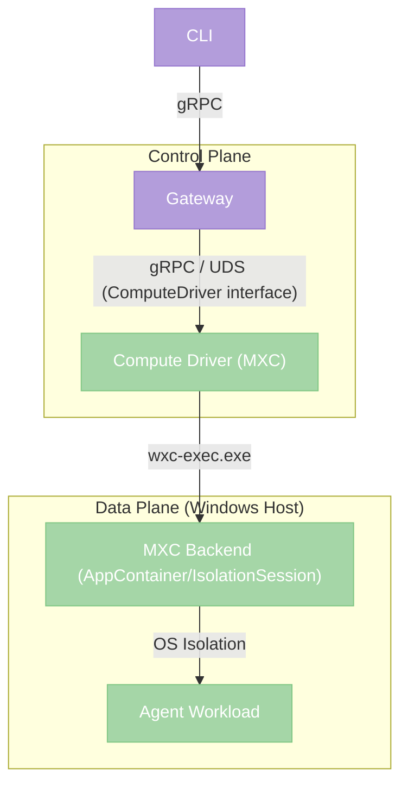

<!-- source: DeepWiki mcp.deepwiki.com · repo NVIDIA/OpenShell · page 8.4 Windows Native Support (MXC Driver) · fetched 2026-10-26 -->

# Windows Native Support (MXC Driver)

<details>
<summary>Relevant source files</summary>

The following files were used as context for generating this wiki page:

- [.agents/skills/build-openshell-mxc-windows/SKILL.md](.agents/skills/build-openshell-mxc-windows/SKILL.md)
- [.agents/skills/build-openshell-mxc-windows/reference.md](.agents/skills/build-openshell-mxc-windows/reference.md)
- [.github/workflows/windows-msvc.yml](.github/workflows/windows-msvc.yml)
- [crates/openshell-driver-mxc/Cargo.toml](crates/openshell-driver-mxc/Cargo.toml)
- [crates/openshell-driver-mxc/examples/probe-mxc-host.ps1](crates/openshell-driver-mxc/examples/probe-mxc-host.ps1)
- [crates/openshell-driver-mxc/examples/run-mxc-e2e.ps1](crates/openshell-driver-mxc/examples/run-mxc-e2e.ps1)
- [crates/openshell-driver-mxc/src/driver.rs](crates/openshell-driver-mxc/src/driver.rs)
- [crates/openshell-driver-mxc/src/grpc.rs](crates/openshell-driver-mxc/src/grpc.rs)
- [crates/openshell-driver-mxc/src/mxc.rs](crates/openshell-driver-mxc/src/mxc.rs)
- [crates/openshell-driver-mxc/src/policy.rs](crates/openshell-driver-mxc/src/policy.rs)
- [crates/openshell-driver-mxc/src/policy_map/loss.rs](crates/openshell-driver-mxc/src/policy_map/loss.rs)
- [crates/openshell-driver-mxc/src/policy_map/map.rs](crates/openshell-driver-mxc/src/policy_map/map.rs)
- [crates/openshell-driver-mxc/tests/policy_mapper_matrix.rs](crates/openshell-driver-mxc/tests/policy_mapper_matrix.rs)
- [crates/openshell-gateway/Cargo.toml](crates/openshell-gateway/Cargo.toml)
- [crates/openshell-prover-cli/Cargo.toml](crates/openshell-prover-cli/Cargo.toml)
- [crates/openshell-prover/Cargo.toml](crates/openshell-prover/Cargo.toml)
- [docs/observability/telemetry.mdx](docs/observability/telemetry.mdx)
- [e2e/run.sh](e2e/run.sh)
- [tasks/scripts/windows-msvc.ps1](tasks/scripts/windows-msvc.ps1)

</details>


This page documents the `openshell-driver-mxc` compute driver, which provides native Windows 11 support for OpenShell sandboxes using Microsoft Execution Containers (MXC, also known as `wxc-exec`). It covers the driver's architecture, its use of AppContainer and IsolationSession backends, how OpenShell policies are mapped to MXC configurations, network policy enforcement via a host-side CONNECT proxy, the filesystem grant model, driver configuration, packaging, and the design rationale outlined in RFC 0013. A key distinction of this driver is that it operates without an in-sandbox supervisor, unlike its Linux counterparts.

## Design Overview

The `openshell-driver-mxc` is an in-process `ComputeDriver` linked directly into `openshell-gateway` [crates/openshell-driver-mxc/README.md:7-8](). It reports runtime readiness, meaning the gateway does not expect a supervisor session to confirm sandbox health [crates/openshell-driver-mxc/README.md:8-10](). The driver directly launches and monitors the configured workload, eliminating the need for an in-sandbox supervisor or a `ConnectSupervisor` relay [crates/openshell-driver-mxc/README.md:14-16]().

The driver supports two primary backends for MXC:
*   **`ProcessContainer`**: This is the default backend and uses a one-shot AppContainer. It enforces a genuine default-deny filesystem policy, where any write to an ungranted path is denied by the OS [crates/openshell-driver-mxc/src/driver.rs:45-47]().
*   **`IsolationSession`**: This backend provides a persistent, attachable session with a lifecycle of `provision` → `start` → `exec` → `stop` → `deprovision`. However, its filesystem policy is grant-only and does not support a default-deny model [crates/openshell-driver-mxc/src/driver.rs:42-44]().

The canonical `SandboxPolicy` is passed to the driver via `DriverSandboxSpec.policy` during sandbox creation [crates/openshell-driver-mxc/README.md:10-11]().

### Core Architecture and MXC Driver Integration

The MXC driver fits into the OpenShell core architecture as a `ComputeDriver`, as described in RFC 0001 [rfc/0001-core-architecture/README.md:101-103](). It handles the platform-specific aspects of sandbox provisioning and lifecycle management on Windows.


**Diagram: MXC Driver in OpenShell Architecture**
Sources: [rfc/0001-core-architecture/README.md:37-103](), [crates/openshell-driver-mxc/README.md:7-16]()

### Capability Matrix

The MXC driver supports a specific set of capabilities:

| Capability | MXC driver |
|---|---|
| Filesystem policy | Read-only/read-write grants come only from `SandboxPolicy`. `process_container` enforces default-deny; `isolation_session` is an explicit grant-only compatibility mode. |
| Network policy | Rejected synchronously during sandbox creation until an enforcing egress path is bound. |
| Process policy | Unsupported; MXC supplies OS isolation only. |
| Interactive exec/connect/forward | Unsupported; the configured workload runs in-driver. |
| Restart durability | Unsupported; the in-memory registry cannot recover live sessions. |

Sources: [crates/openshell-driver-mxc/README.md:19-26]()

The filesystem enforcement for `process_container` works as follows:
*   A write to a path explicitly granted by the sandbox policy succeeds.
*   A write outside the granted paths is denied by Windows access control, and the driver reports the failed workload [crates/openshell-driver-mxc/README.md:28-31]().

## Policy Mapping

The `openshell-driver-mxc` translates the OpenShell `SandboxPolicy` into MXC configuration fragments. This translation happens before any MXC registry entry is created or `wxc-exec` is invoked, ensuring that mapping failures prevent partial sandbox creation [crates/openshell-driver-mxc/README.md:71-74]().

The `EmbeddedPolicyMapper` [crates/openshell-driver-mxc/src/policy.rs:99]() is the primary implementation of the `PolicyMapper` trait [crates/openshell-driver-mxc/src/policy.rs:80-83](). It directly calls the embedded `policy_map` module (which was originally a standalone `openshell-policy-mapper` crate) [crates/openshell-driver-mxc/src/policy.rs:11-12](). This mapper normalizes filesystem paths to Windows format and rejects sandbox creation if any `error`-severity policy loss occurs [crates/openshell-driver-mxc/src/policy.rs:14-18](). The rule is to "never silently drop policy" [crates/openshell-driver-mxc/src/policy.rs:18-19]().

The `PolicyMapper` trait defines the `map` method, which takes an optional `SandboxPolicy` and a `MapCtx` (containing the sandbox ID and an optional egress proxy address) and returns a `MappedConfig` or a `MapError` [crates/openshell-driver-mxc/src/policy.rs:80-83]().

The `MappedConfig` struct [crates/openshell-driver-mxc/src/policy.rs:29-41]() contains:
*   `readwrite_paths`: Paths granted read-write access.
*   `readonly_paths`: Paths granted read-only access.
*   `trimmed_policy`: An optional `SandboxPolicy` for the host CONNECT proxy, used when governed egress is enabled.
*   `proxy_addr`: An optional loopback address for MXC to redirect sandbox egress to.

### Network Policy Enforcement

Network policy enforcement is handled differently depending on whether a governed egress path is bound. If an egress proxy address is provided in the `MapCtx`, the `EmbeddedPolicyMapper` uses `split_policy` [crates/openshell-driver-mxc/src/policy.rs:121]() to separate the policy into MXC filesystem configuration and a `trimmed_policy` for the host CONNECT proxy [crates/openshell-driver-mxc/src/policy.rs:121-139](). Otherwise, it maps the policy directly to MXC configuration, and any network allowlist rules will result in an `error` loss, rejecting the sandbox creation [crates/openshell-driver-mxc/src/policy.rs:141-153]().

Currently, network policy is rejected synchronously during sandbox creation if an enforcing egress path is not bound [crates/openshell-driver-mxc/README.md:22-23](). Governed egress remains fail-closed until an enforcing proxy is implemented and bound to the sandbox lifecycle [crates/openshell-driver-mxc/README.md:125]().

```mermaid
graph TD
    A[SandboxPolicy] --> B{EmbeddedPolicyMapper::map};
    B -- "MapCtx (egress proxy present?)" --> C{Split Policy?};

    C -- "Yes (Pattern C)" --> D[mxc_config (filesystem)];
    C -- "Yes (Pattern C)" --> E[proxy_policy (network)];
    D --> F[MXC Backend];
    E --> G[Host CONNECT Proxy];
    F -- "OS Isolation" --> H[Agent Workload];
    G -- "Enforces Network Policy" --> H;

    C -- "No (Default MXC Map)" --> I[mxc_config (filesystem/network)];
    I --> J{Check for Network Policy Loss};
    J -- "Error Loss" --> K[Reject Sandbox Creation];
    J -- "No Error Loss" --> F;

    style A fill:#b39ddb,stroke:#9575cd,color:#fff
    style B fill:#b39ddb,stroke:#9575cd,color:#fff
    style C fill:#b39ddb,stroke:#9575cd,color:#fff
    style D fill:#a5d6a7,stroke:#81c784,color:#fff
    style E fill:#a5d6a7,stroke:#81c784,color:#fff
    style F fill:#a5d6a7,stroke:#81c784,color:#fff
    style G fill:#a5d6a7,stroke:#81c784,color:#fff
    style H fill:#a5d6a7,stroke:#81c784,color:#fff
    style I fill:#a5d6a7,stroke:#81c784,color:#fff
    style J fill:#b39ddb,stroke:#9575cd,color:#fff
    style K fill:#ffcdd2,stroke:#ef9a9a,color:#fff
```
**Diagram: Policy Mapping and Network Enforcement Flow**
Sources: [crates/openshell-driver-mxc/src/policy.rs:29-41](), [crates/openshell-driver-mxc/src/policy.rs:80-83](), [crates/openshell-driver-mxc/src/policy.rs:121-153]()

## Driver Configuration

The MXC driver's host runtime settings are configured in the gateway's TOML file under `[openshell.drivers.mxc]` [crates/openshell-driver-mxc/README.md:34-35]().

```toml
[openshell.drivers.mxc]
wxc_exec_path = "C:\\path\\to\\wxc-exec.exe"
backend = "process_container" # Default: process_container. isolation_session is grant-only and opt-in.
default_configuration_id = "composable"
pc_least_privilege = false
pc_capabilities = []
debug = false
```
Sources: [crates/openshell-driver-mxc/README.md:37-45]()

The `MxcComputeConfig` struct [crates/openshell-driver-mxc/src/driver.rs:54-71]() defines these fields:
*   `wxc_exec_path`: Path to the `wxc-exec.exe` executable, required for live runs [crates/openshell-driver-mxc/src/driver.rs:58]().
*   `backend`: Specifies whether to use `IsolationSession` or `ProcessContainer` [crates/openshell-driver-mxc/src/driver.rs:59]().
*   `pc_least_privilege`: For `ProcessContainer` only, requests a Less-Privileged AppContainer [crates/openshell-driver-mxc/src/driver.rs:61]().
*   `pc_capabilities`: For `ProcessContainer` only, a list of AppContainer capabilities to grant [crates/openshell-driver-mxc/src/driver.rs:63]().
*   `default_configuration_id`: The MXC `configurationId` for isolation sessions. Defaults to `"composable"`. The value `"small"` should never be used due to a known OS bug [crates/openshell-driver-mxc/src/driver.rs:65-67]().
*   `egress_proxy`: Enables Pattern-C governed egress. When true, MXC receives filesystem grants plus a `network.proxy` redirect, and the host CONNECT proxy receives the trimmed network-only policy [crates/openshell-driver-mxc/src/driver.rs:70-73]().
*   `egress_proxy_addr`: Loopback `IP:PORT` seed for MXC `network.proxy` when governed egress is enabled. The driver preserves the loopback IP and allocates a unique ephemeral port per sandbox [crates/openshell-driver-mxc/src/driver.rs:75-77]().
*   `debug`: Enables the `--debug` flag on `wxc-exec` invocations [crates/openshell-driver-mxc/src/driver.rs:80]().
*   `etw_audit`: Enables the in-process ETW → OCSF audit consumer (Plane A). This consumes the OS Sandboxing provider MXC drives and emits OCSF into the gateway trail. It requires the gateway account to be in "Performance Log Users" (or admin) [crates/openshell-driver-mxc/src/driver.rs:82-85]().

Per-sandbox MXC workload settings are supplied via `template.driver_config.mxc` or the `--driver-config-json` CLI flag [crates/openshell-driver-mxc/README.md:48-49]().

Example:
```powershell
$config = '{"mxc":{"command":["cmd","/c","echo hello > C:\\\\work\\\\demo\\\\hello.txt"],"cwd":"C:\\\\work\\\\demo"}}'
openshell sandbox create --name mxc-demo --policy demo.yaml `
  --driver-config-json $config --env MODE=demo --no-tty
```
Sources: [crates/openshell-driver-mxc/README.md:50-53]()

The `MxcSandboxConfig` struct [crates/openshell-driver-mxc/src/driver.rs:116-121]() defines these per-sandbox settings:
*   `command`: A required array of strings representing the command and its arguments.
*   `cwd`: An optional working directory for the command.

Environment variables are injected from the standard sandbox and template environment maps; the driver does not copy values from the gateway host environment [crates/openshell-driver-mxc/README.md:56-57]().

## Packaging and Prerequisites

### Prerequisites for Live Runs
*   Windows 11 Insider build ≥ 26300.8553 [crates/openshell-driver-mxc/README.md:62]().
*   `IsoSessionApp.dll` must be present and registered [crates/openshell-driver-mxc/README.md:63]().
*   `wxc-exec.exe` built with `--features isolation_session` [crates/openshell-driver-mxc/README.md:64]().

For off-box smoke tests using the in-process mock shim (without `wxc-exec` or an isolation session), set the environment variable `OPENSHELL_MXC_MOCK_WXC=1` [crates/openshell-driver-mxc/README.md:67-68]().

### Packaging the Demo
The `examples/package-demo.ps1` script [crates/openshell-driver-mxc/README.md:85]() is used to assemble the necessary components (gateway EXE, CLI EXE, runtime DLLs like `libz3.dll`, `demo.yaml`, gateway config, and runbook) into a single folder. This folder can then be copied to a demo Windows host, and the `mxc-demo-runbook.md` inside it can be followed [crates/openshell-driver-mxc/README.md:85-89](). The script also prints a SHA256 manifest for integrity verification [crates/openshell-driver-mxc/README.md:89-90]().

### CI/CD and Build Process
The `.github/workflows/windows-msvc.yml` GitHub Actions workflow [/.github/workflows/windows-msvc.yml:1-50]() is responsible for building and testing OpenShell on Windows using MSVC for both x64 and ARM64 architectures. This workflow ensures that `openshell-gateway.exe` and `openshell.exe` can compile and pass tests on Windows [/.agents/skills/build-openshell-mxc-windows/SKILL.md:18-20](). It uses `mise run --skip-tools windows:check:x64`, `windows:build:x64`, and `windows:test:x64` tasks [/.github/workflows/windows-msvc.yml:98-100]() for PR lint and test, and similar tasks for cache seeding [/.github/workflows/windows-msvc.yml:158-160]().

The build process explicitly avoids enabling Docker, Kubernetes, Podman, or VM runtimes on Windows, and unsupported Windows runtime crates are excluded from the Windows gateway dependency graph [/.agents/skills/build-openshell-mxc-windows/SKILL.md:71-74](). The `tasks/scripts/windows-msvc.ps1` PowerShell script [tasks/scripts/windows-msvc.ps1:53-54]() defines the `--exclude` list for unsupported driver packages, including `openshell-driver-docker`, `openshell-driver-kubernetes`, `openshell-driver-podman`, and `openshell-driver-vm`.

The `openshell-gateway` crate's `Cargo.toml` [crates/openshell-gateway/Cargo.toml:49]() includes `compute-driver-mxc` as a feature, which conditionally compiles `openshell-driver-mxc` only when `target_os = "windows"` [crates/openshell-gateway/Cargo.toml:39-40](). This ensures that the MXC driver is only built for Windows targets.

```mermaid
graph TD
    A[GitHub Actions Workflow] --> B[windows-msvc.yml];
    B --> C[PR Lint and Test Job];
    B --> D[Cache Seed Job];
    B --> E[Build Binaries Job];

    C -- "matrix: x64, arm64" --> F[mise run --skip-tools windows:lint:${arch}];
    C --> G[mise run --skip-tools windows:test:${arch}];

    D -- "matrix: x64, arm64" --> F;
    D --> G;

    E -- "matrix: x64, arm64" --> H[mise run --skip-tools windows:build:${arch}];

    subgraph Build Steps
        F
        G
        H
    end

    subgraph Exclusions
        I[Unsupported Driver Packages Excluded];
        J[--exclude openshell-driver-docker];
        K[--exclude openshell-driver-kubernetes];
        L[--exclude openshell-driver-podman];
        M[--exclude openshell-driver-vm];
    end

    H --> I;
    I --> J;
    I --> K;
    I --> L;
    I --> M;

    style A fill:#b39ddb,stroke:#9575cd,color:#fff
    style B fill:#b39ddb,stroke:#9575cd,color:#fff
    style C fill:#a5d6a7,stroke:#81c784,color:#fff
    style D fill:#a5d6a7,stroke:#81c784,color:#fff
    style E fill:#a5d6a7,stroke:#81c784,color:#fff
    style F fill:#a5d6a7,stroke:#81c784,color:#fff
    style G fill:#a5d6a7,stroke:#81c784,color:#fff
    style H fill:#a5d6a7,stroke:#81c784,color:#fff
    style I fill:#ffcdd2,stroke:#ef9a9a,color:#fff
    style J fill:#ffcdd2,stroke:#ef9a9a,color:#fff
    style K fill:#ffcdd2,stroke:#ef9a9a,color:#fff
    style L fill:#ffcdd2,stroke:#ef9a9a,color:#fff
    style M fill:#ffcdd2,stroke:#ef9a9a,color:#fff
```
**Diagram: Windows MSVC Build Workflow**
Sources: [/.github/workflows/windows-msvc.yml:1-188](), [/.agents/skills/build-openshell-mxc-windows/SKILL.md:18-20](), [tasks/scripts/windows-msvc.ps1:53-54](), [crates/openshell-gateway/Cargo.toml:39-40]()

## RFC 0013 Design Rationale

RFC 0013, "Native Windows MXC," outlines the design rationale for the `openshell-driver-mxc`. This RFC would detail the motivation for supporting native Windows, the specific challenges of Windows isolation, and how MXC addresses these. It would also cover the decision to operate without an in-sandbox supervisor, which is a significant departure from Linux-based drivers.

The RFC process in OpenShell ensures that substantial changes, like adding a new compute driver for a different OS, are thoroughly reviewed and documented [rfc/README.md:1-5](). RFCs provide a structured way to gather feedback, build consensus, and record design decisions [rfc/README.md:3-5](). The `0000-template` [rfc/0000-template/README.md:1-147]() provides the structure for such proposals, covering summary, motivation, non-goals, proposal, implementation plan, risks, alternatives, prior art, and open questions.

The MXC driver's design, particularly the absence of an in-sandbox supervisor, is a direct consequence of the architectural choices made to leverage native Windows isolation mechanisms effectively. This approach simplifies the sandbox runtime on Windows by relying on the host OS for enforcement, rather than deploying a separate supervisor process within each sandbox.

Sources: [rfc/README.md:1-5](), [rfc/0000-template/README.md:1-147]()

## MXC Compute Backend Implementation

The `MxcComputeBackend` struct [crates/openshell-driver-mxc/src/driver.rs:174]() is the core implementation of the MXC compute driver. It holds the driver's configuration (`MxcComputeConfig`), an `WxcExecInvoker` for interacting with `wxc-exec.exe`, an in-memory registry of active sandboxes, a broadcast channel for sandbox watch events, and an `Arc<dyn PolicyMapper>` [crates/openshell-driver-mxc/src/driver.rs:175-179]().

The `ComputeDriverService` [crates/openshell-driver-mxc/src/grpc.rs:26]() acts as a thin `tonic` adapter, delegating gRPC calls to `MxcComputeBackend` and mapping errors to gRPC `Status` [crates/openshell-driver-mxc/src/grpc.rs:4-5]().

Key gRPC methods implemented by `ComputeDriverService` include:
*   `get_capabilities`: Returns the driver's capabilities [crates/openshell-driver-mxc/src/grpc.rs:38-42]().
*   `authenticate_sandbox`: Unimplemented, as the MXC driver does not authenticate sandbox credentials [crates/openshell-driver-mxc/src/grpc.rs:54-59]().
*   `validate_sandbox_create`: Validates the sandbox creation request using the backend [crates/openshell-driver-mxc/src/grpc.rs:65-74]().
*   `get_sandbox`: Retrieves a sandbox by name [crates/openshell-driver-mxc/src/grpc.rs:76-98]().
*   `list_sandboxes`: Returns a list of all active sandboxes [crates/openshell-driver-mxc/src/grpc.rs:100-104]().
*   `create_sandbox`: Creates a new sandbox by calling `self.backend.create_sandbox` [crates/openshell-driver-mxc/src/grpc.rs:108-117]().
*   `stop_sandbox`: Stops a running sandbox [crates/openshell-driver-mxc/src/grpc.rs:119-129]().
*   `start_sandbox`: Unimplemented, as the MXC driver does not support restarting stopped sandboxes [crates/openshell-driver-mxc/src/grpc.rs:131-139]().
*   `delete_sandbox`: Deletes a sandbox [crates/openshell-driver-mxc/src/grpc.rs:141-157]().
*   `watch_sandboxes`: Provides a stream of sandbox events [crates/openshell-driver-mxc/src/grpc.rs:159-169]().
*   `ensure_workspace`: Currently a no-op, returning an empty response [crates/openshell-driver-mxc/src/grpc.rs:167-171]().
*   `delete_workspace`: Currently a no-op, returning an empty response [crates/openshell-driver-mxc/src/grpc.rs:173-177]().

The `SandboxEntry` struct [crates/openshell-driver-mxc/src/driver.rs:134-145]() in the `MxcComputeBackend`'s registry tracks the state of each sandbox, including its `DriverSandbox` proto, MXC isolation ID, stop status, phase state (`Starting`, `Running`, `Stopped`, `Failed`), a `lifecycle_gate` mutex for serialization, and `monitor_cancel`/`monitor_task` for managing the sandbox's monitoring task. It also stores the `trimmed_policy` and `proxy_addr` if governed egress is enabled, along with a `host_proxy` handle [crates/openshell-driver-mxc/src/driver.rs:143-145]().

Sources: [crates/openshell-driver-mxc/src/grpc.rs:4-5](), [crates/openshell-driver-mxc/src/grpc.rs:26](), [crates/openshell-driver-mxc/src/grpc.rs:38-177](), [crates/openshell-driver-mxc/src/driver.rs:134-145](), [crates/openshell-driver-mxc/src/driver.rs:174-179]()

---

