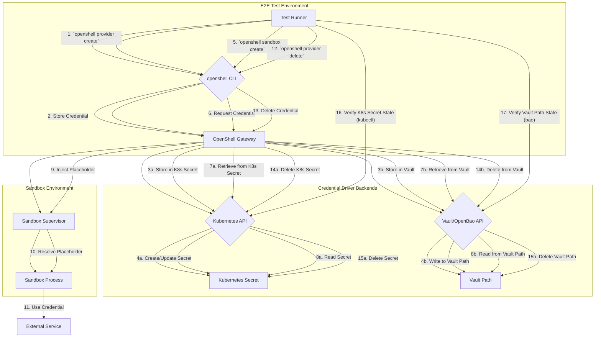
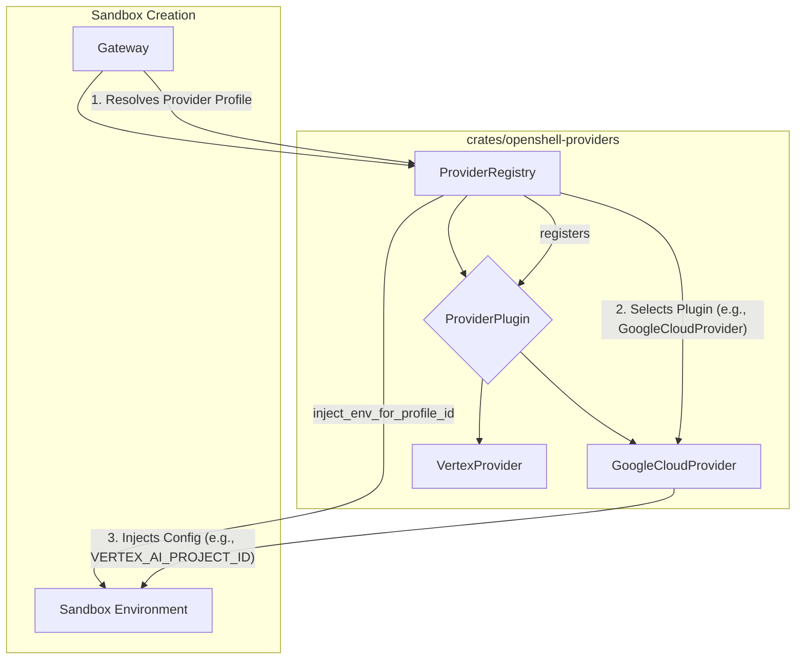

<!-- source: DeepWiki mcp.deepwiki.com · repo NVIDIA/OpenShell · page 8.5 Credential Drivers · fetched 2026-10-26 -->

# Credential Drivers

Relevant source files

The following files were used as context for generating this wiki page:

- [crates/openshell-providers/src/lib.rs](crates/openshell-providers/src/lib.rs)
- [crates/openshell-providers/src/providers/mod.rs](crates/openshell-providers/src/providers/mod.rs)
- [e2e/policy-advisor/test.sh](e2e/policy-advisor/test.sh)
- [e2e/policy-advisor/wait-smoke.sh](e2e/policy-advisor/wait-smoke.sh)
- [e2e/rust/tests/credential_drivers.rs](e2e/rust/tests/credential_drivers.rs)
- [e2e/rust/tests/driver_config_volume.rs](e2e/rust/tests/driver_config_volume.rs)
- [e2e/rust/tests/gpu/workloads.rs](e2e/rust/tests/gpu/workloads.rs)
- [e2e/rust/tests/provider_auto_create.rs](e2e/rust/tests/provider_auto_create.rs)

This page details the credential storage backends supported by OpenShell. These "credential drivers" are responsible for securely storing and retrieving sensitive information, such as API keys and tokens, used by providers. OpenShell supports an encrypted database credstore, Kubernetes Secrets, and Vault/OpenBao. This document covers their implementation, data flow, and how they are tested, including remote Unix Domain Socket (UDS) operation and end-to-end (E2E) coverage.

## Overview of Credential Management

OpenShell's credential management system allows users to define "providers" which encapsulate access to external services (e.g., OpenAI, Anthropic, AWS). These providers require credentials, which must be stored securely. Credential drivers abstract away the underlying storage mechanism, allowing OpenShell to integrate with various secure storage solutions.

When a user creates a provider using the `openshell provider create` command, the provided credentials are not stored directly in plain text. Instead, they are passed to the configured credential driver, which handles their secure persistence. When a sandbox needs to access a provider's credentials, OpenShell retrieves them from the credential driver and injects them into the sandbox environment as placeholders, which are then resolved by the supervisor.

### Provider Auto-Creation

OpenShell supports automatic provider creation. If a sandbox is launched with `--provider <type>` and no provider of that name exists, OpenShell attempts to discover credentials from the local environment (e.g., `ANTHROPIC_API_KEY`). If found, it auto-creates the provider and injects a supervisor-managed placeholder into the sandbox's environment. This is demonstrated in the E2E test `auto_created_provider_credential_available_in_sandbox` [e2e/rust/tests/provider_auto_create.rs:76-194]().

### Credential Resolution in Sandboxes

Within a sandbox, credentials are not directly exposed as their raw values. Instead, OpenShell injects special placeholders into the environment variables. These placeholders follow a pattern like `openshell:resolve:env:<KEY>` or `openshell:resolve:env:v<REVISION>_<KEY>` [e2e/rust/tests/credential_drivers.rs:78-84](). The supervisor process within the sandbox intercepts requests for these environment variables and resolves them to the actual credential values, ensuring that the raw secrets are never directly accessible to the sandbox process itself. This mechanism is crucial for maintaining the security boundary.

## Credential Driver Implementations

OpenShell currently supports the following credential drivers:

### 1. Encrypted Database Credstore

This is the default credential driver, storing encrypted credentials directly within OpenShell's persistence layer. The encryption key is managed by the gateway. This driver is suitable for deployments where the OpenShell gateway itself is considered a secure boundary.

### 2. Kubernetes Secrets

For Kubernetes deployments, OpenShell can leverage Kubernetes Secrets as a credential driver. This allows credentials to be managed using Kubernetes' native secret management capabilities.

**Implementation Details:**
When a provider is created, OpenShell generates a unique name for the Kubernetes Secret based on a SHA256 hash of the provider's identity (workspace, ID, provider name, and credential key) [e2e/rust/tests/credential_drivers.rs:53-70](). This ensures that each credential has a distinct and predictable secret name. The secret is then stored in the Kubernetes namespace where OpenShell is deployed.

**Data Flow:**
1. User creates a provider via `openshell provider create`.
2. OpenShell gateway receives the request and the credential.
3. The gateway, configured to use Kubernetes Secrets, calculates a unique secret name.
4. The gateway creates or updates a Kubernetes Secret in the configured namespace, storing the credential securely.
5. When a sandbox is created and requires this provider's credentials, the gateway retrieves the secret from Kubernetes.
6. The credential is then injected into the sandbox environment as a placeholder, which the supervisor resolves at runtime.

**E2E Coverage:**
The `e2e/rust/tests/credential_drivers.rs` suite includes tests specifically for the Kubernetes Secrets driver. For example, `kubernetes_secrets_driver_stores_and_retrieves_credentials` [e2e/rust/tests/credential_drivers.rs:200-260]() verifies the end-to-end flow of creating a provider, storing its credential in a Kubernetes Secret, and then successfully retrieving and using it within a sandbox. It also includes tests for cleanup, ensuring that secrets are deleted when providers are removed [e2e/rust/tests/credential_drivers.rs:262-299]().

### 3. Vault / OpenBao

OpenShell can integrate with HashiCorp Vault (or its open-source fork, OpenBao) as a credential driver. This provides advanced secret management features like dynamic secrets, lease management, and fine-grained access control.

**Implementation Details:**
Similar to Kubernetes Secrets, OpenShell generates a unique path within Vault for each credential [e2e/rust/tests/credential_drivers.rs:72-76](). This path is derived from the provider's identity. OpenShell interacts with Vault via its API, typically through `kubectl exec` commands to a Vault pod within the Kubernetes cluster [e2e/rust/tests/credential_drivers.rs:118-145]().

**Data Flow:**
1. User creates a provider via `openshell provider create`.
2. OpenShell gateway receives the request and the credential.
3. The gateway, configured to use Vault/OpenBao, calculates a unique path within Vault.
4. The gateway writes the credential to this path in Vault.
5. When a sandbox is created and requires this provider's credentials, the gateway retrieves the secret from Vault.
6. The credential is then injected into the sandbox environment as a placeholder, which the supervisor resolves at runtime.

**E2E Coverage:**
The `e2e/rust/tests/credential_drivers.rs` suite also covers the Vault/OpenBao driver. `vault_driver_stores_and_retrieves_credentials` [e2e/rust/tests/credential_drivers.rs:301-361]() tests the full lifecycle of credential management with Vault, including creation, retrieval, and deletion. It also verifies that the credentials are correctly stored and removed from Vault itself [e2e/rust/tests/credential_drivers.rs:363-411]().

## Remote UDS Operation

While not explicitly detailed in the provided snippets for credential drivers, OpenShell's architecture supports remote Unix Domain Socket (UDS) operation for various components. This typically involves a client (e.g., the CLI or a sandbox supervisor) communicating with a server (e.g., the gateway) over a UDS. For credential drivers, this would mean that the gateway, when acting as a client to an external secret management system (like Vault), could potentially communicate with a local Vault agent or sidecar via UDS for enhanced security and performance, though the E2E tests primarily show `kubectl exec` for Vault interaction.

## E2E Coverage Summary

The `e2e/rust/tests/credential_drivers.rs` file provides comprehensive end-to-end testing for the Kubernetes Secrets and Vault/OpenBao credential drivers. These tests ensure:
*   **Credential Creation:** Providers can be successfully created, and their credentials are securely stored by the chosen driver.
*   **Credential Retrieval:** Sandboxes can correctly retrieve and utilize credentials from the drivers.
*   **Secure Injection:** Credentials are injected as placeholders and resolved by the supervisor, not exposed directly.
*   **Cleanup:** Deleting a provider correctly removes its associated credentials from the backend storage.
*   **Error Handling:** The system handles cases where credentials or providers are not found.

The tests use `kubectl` and `bao` (OpenBao CLI) commands to directly interact with the Kubernetes and Vault backends, verifying the state of the secrets outside of OpenShell's internal mechanisms.

### Credential Driver E2E Test Flow

The following diagram illustrates the general flow of credential driver E2E tests.

**Diagram: Credential Driver E2E Test Flow**
Sources: [e2e/rust/tests/credential_drivers.rs:1-412]()

## Code Entities and Their Roles

The following table maps the conceptual components of credential drivers to their corresponding code entities.

| Concept | Code Entity | Role |
| :------ | :---------- | :--- |
| **Provider Definition** | `crates/openshell-providers/src/lib.rs` | Defines the `Provider` struct and related traits for managing provider types and their configurations. |
| | `crates/openshell-providers/src/profiles.rs` | Handles parsing and validation of provider profiles, including credential refresh strategies. |
| **Credential Storage Logic** | (Internal to Gateway) | The gateway service contains the logic for interacting with the configured credential driver (e.g., Kubernetes API client, Vault API client). |
| **Kubernetes Secret Naming** | `managed_kubernetes_secret_name` [e2e/rust/tests/credential_drivers.rs:68-70]() | Generates a unique Kubernetes Secret name based on provider identity. |
| **Vault Path Generation** | `managed_vault_path` [e2e/rust/tests/credential_drivers.rs:72-76]() | Generates a unique Vault path for storing credentials. |
| **Credential Placeholder** | `contains_placeholder_for_env_key` [e2e/rust/tests/credential_drivers.rs:78-84]() | Utility function to check for the presence of supervisor-managed credential placeholders in sandbox output. |
| **Kubernetes CLI Interaction** | `kubectl_command` [e2e/rust/tests/credential_drivers.rs:87-94](), `kubectl` [e2e/rust/tests/credential_drivers.rs:97-116]() | Helper functions for executing `kubectl` commands in E2E tests to verify Kubernetes Secret state. |
| **OpenBao CLI Interaction** | `bao` [e2e/rust/tests/credential_drivers.rs:118-145]() | Helper function for executing `bao` commands in E2E tests to verify Vault/OpenBao state. |
| **Provider Management CLI** | `openshell_cmd` [e2e/rust/tests/credential_drivers.rs:10-10](), `run_cli` [e2e/rust/tests/credential_drivers.rs:11-11]() | Used by E2E tests to interact with the `openshell` CLI for provider creation and deletion. |
| **Provider Auto-Creation Test** | `auto_created_provider_credential_available_in_sandbox` [e2e/rust/tests/provider_auto_create.rs:76-194]() | E2E test verifying automatic provider creation from environment variables. |

Sources:
* [e2e/rust/tests/credential_drivers.rs:1-412]()
* [e2e/rust/tests/provider_auto_create.rs:76-194]()
* [crates/openshell-providers/src/lib.rs:1-126]()
* [crates/openshell-providers/src/providers/mod.rs:1-5]()

## Provider Registry and Plugins

The `crates/openshell-providers` crate manages provider discovery and registry utilities. The `ProviderRegistry` [crates/openshell-providers/src/lib.rs:83-84]() holds a collection of `ProviderPlugin` [crates/openshell-providers/src/lib.rs:70-70]() implementations. These plugins are responsible for injecting provider-specific environment variables into the sandbox environment during creation. While the core credential storage is handled by the credential drivers, these plugins ensure that the sandbox receives the necessary configuration (e.g., project IDs, regions) in addition to the credentials themselves.

Currently, the `ProviderRegistry` includes plugins for `google_cloud` and `vertex` providers [crates/openshell-providers/src/lib.rs:94-96]().

**Diagram: Provider Registry and Environment Injection**
Sources:
* [crates/openshell-providers/src/lib.rs:83-126]()
* [crates/openshell-providers/src/providers/mod.rs:1-5]()

---

