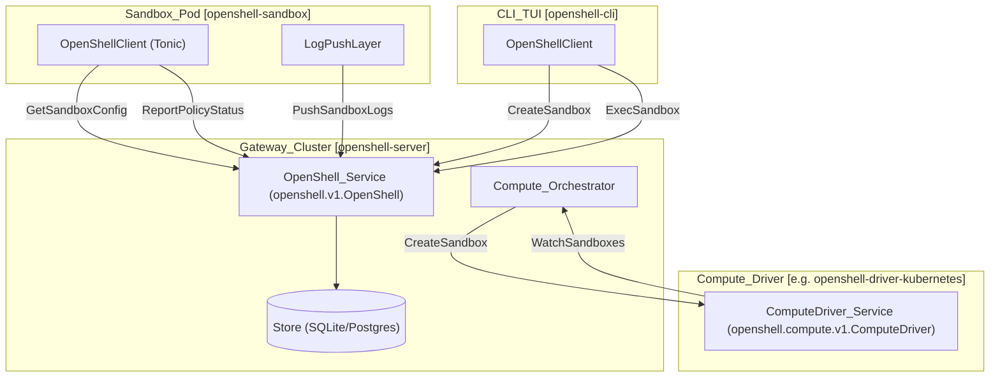
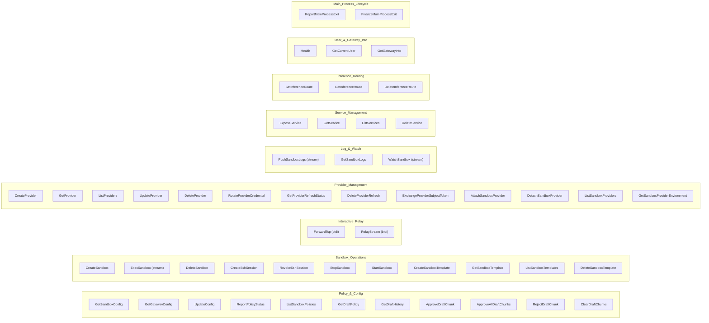
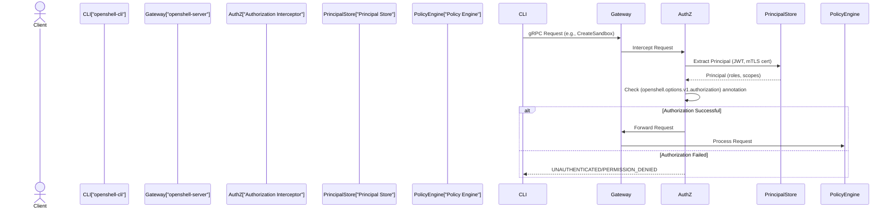

<!-- source: DeepWiki mcp.deepwiki.com · repo NVIDIA/OpenShell · page 9.1 gRPC API and Protobuf Definitions · fetched 2026-10-26 -->

# gRPC API and Protobuf Definitions

Relevant source files

The following files were used as context for generating this wiki page:

- [.github/actions/pr-gate/action.yml](.github/actions/pr-gate/action.yml)
- [crates/openshell-cli/src/main.rs](crates/openshell-cli/src/main.rs)
- [crates/openshell-cli/src/run.rs](crates/openshell-cli/src/run.rs)
- [crates/openshell-cli/tests/ensure_providers_integration.rs](crates/openshell-cli/tests/ensure_providers_integration.rs)
- [crates/openshell-cli/tests/mtls_integration.rs](crates/openshell-cli/tests/mtls_integration.rs)
- [crates/openshell-cli/tests/provider_commands_integration.rs](crates/openshell-cli/tests/provider_commands_integration.rs)
- [crates/openshell-cli/tests/sandbox_create_lifecycle_integration.rs](crates/openshell-cli/tests/sandbox_create_lifecycle_integration.rs)
- [crates/openshell-cli/tests/sandbox_name_fallback_integration.rs](crates/openshell-cli/tests/sandbox_name_fallback_integration.rs)
- [crates/openshell-server/src/compute/mod.rs](crates/openshell-server/src/compute/mod.rs)
- [crates/openshell-server/src/grpc/mod.rs](crates/openshell-server/src/grpc/mod.rs)
- [crates/openshell-server/src/grpc/policy.rs](crates/openshell-server/src/grpc/policy.rs)
- [crates/openshell-server/src/grpc/provider.rs](crates/openshell-server/src/grpc/provider.rs)
- [crates/openshell-server/src/grpc/sandbox.rs](crates/openshell-server/src/grpc/sandbox.rs)
- [crates/openshell-server/src/storage_proto.rs](crates/openshell-server/src/storage_proto.rs)
- [crates/openshell-server/tests/supervisor_relay_integration.rs](crates/openshell-server/tests/supervisor_relay_integration.rs)
- [proto/openshell.proto](proto/openshell.proto)
- [sdk/go/proto/openshellv1/openshell.pb.go](sdk/go/proto/openshellv1/openshell.pb.go)
- [tasks/scripts/check_proto_compatibility.py](tasks/scripts/check_proto_compatibility.py)
- [tasks/scripts/generate-qualification-summary.sh](tasks/scripts/generate-qualification-summary.sh)
- [tasks/scripts/test-qualification-summary.sh](tasks/scripts/test-qualification-summary.sh)

The gRPC API defines the bidirectional communication protocol between the OpenShell gateway (`openshell-server`), sandbox supervisors (`openshell-sandbox`), and the compute drivers. The API enables sandboxes to fetch policies, report status, and stream logs to the gateway for centralized management. It also provides the interface for the CLI and TUI to manage the sandbox lifecycle and for the gateway to orchestrate compute resources.

For information about the policy schema transmitted over this API, see [Policy Language and Schema](#7.1). For details on how policies are hot-reloaded inside a running sandbox, see [Formal Policy Verification (openshell-prover)](#7.6).

---

## Service Architecture

The gRPC communication follows a hub-and-spoke model where the gateway acts as the central control plane. Sandboxes establish persistent mTLS-authenticated connections for policy fetching and log streaming, while the gateway uses a separate internal driver API to communicate with compute backends (Docker, Kubernetes, etc.).

**Diagram: gRPC Service Topology**

Sources: [proto/openshell.proto:15-23](), [proto/compute_driver.proto:18-43](), [crates/openshell-cli/src/run.rs:47-64](), [crates/openshell-cli/src/main.rs:22-23]()

---

## Core RPC Methods

The `OpenShell` service defines several categories of RPCs: policy management, sandbox/provider CRUD, observability, and interactive relay.

**Diagram: RPC Method Categories**

Sources: [proto/openshell.proto:24-332](), [crates/openshell-cli/src/run.rs:47-64](), [crates/openshell-cli/src/main.rs:22-23]()

---

## Protobuf Definitions

The OpenShell project uses Protocol Buffers (Protobuf) for defining its gRPC services and message structures. The primary `.proto` files are located in the `proto/` directory.

### `proto/openshell.proto`

This file defines the main `OpenShell` gRPC service and the public API resource model exposed to OpenShell clients. It includes RPCs for sandbox management, provider interactions, policy updates, and user/gateway information.

Sources: [proto/openshell.proto:15-23]()

### `proto/sandbox.proto`

This file defines messages related to sandbox configuration, status, and events. It includes `Sandbox`, `SandboxSpec`, `SandboxStatus`, `SandboxPhase`, and various messages for interactive execution and log streaming.

Sources: [proto/openshell.proto:13]()

### `proto/compute_driver.proto`

This file defines the `ComputeDriver` gRPC service, which is the internal API used by the gateway to communicate with compute backends (e.g., Docker, Kubernetes). It includes RPCs for provisioning, watching, and managing sandboxes at the driver level. The messages here are driver-native and are translated by the gateway into public `openshell.v1` resources.

Sources: [proto/compute_driver.proto:18-43]()

### `proto/supervisor_middleware.proto`

This file defines the protocol for supervisor middleware, allowing for extensible processing of network traffic and other events within the sandbox.

### `proto/inference.proto`

This file defines messages and services related to inference routing, enabling transparent interception and redirection of AI model calls.

Sources: [proto/openshell.proto:239-247]()

### `proto/datamodel.proto`

This file defines common data models used across the OpenShell API, such as `ObjectMeta` for resource metadata and `WorkspaceSelector` for scoping operations.

Sources: [proto/datamodel.proto:12-29](), [proto/openshell.proto:8]()

---

## Authorization Metadata

All RPCs in `openshell.proto` include `(openshell.options.v1.authorization)` annotations to specify the required authentication mode, scope, and roles for accessing the method. This metadata is used by the gateway's authorization interceptors to enforce access control.

**Diagram: Authorization Flow**

Sources: [proto/openshell.proto:26-28](), [crates/openshell-server/src/grpc/mod.rs:121-129]()

---

## Compatibility Checks

Protobuf compatibility is crucial for maintaining API stability across different versions of OpenShell components. The project includes mechanisms to ensure backward and forward compatibility of `.proto` definitions.

The `check_proto_compatibility.py` script is used in CI to validate that changes to `.proto` files do not introduce breaking changes. This helps prevent issues when upgrading components or running mixed-version deployments.

Sources: [tasks/scripts/check_proto_compatibility.py]()

---

## Policy Management RPCs

### GetSandboxConfig

Fetches the current configuration and policy for a sandbox. Called periodically by the sandbox supervisor to detect policy updates.

**Request:** `GetSandboxConfigRequest` (defined in `sandbox.proto`)

| Field | Type | Description |
|-------|------|-------------|
| `sandbox_id` | `string` | The sandbox identifier |

**Response:** `GetSandboxConfigResponse`

| Field | Type | Description |
|-------|------|-------------|
| `policy` | `SandboxPolicy` | The complete policy definition |
| `revision` | `uint64` | Monotonically increasing version number |
| `policy_hash` | `string` | SHA-256 hash of the serialized policy |

Sources: [proto/openshell.proto:274-276](), [crates/openshell-cli/tests/sandbox_create_lifecycle_integration.rs:182-188](), [crates/openshell-cli/tests/provider_commands_integration.rs:20-21]()

### UpdateConfig

Updates settings or policy at sandbox or global scope. This is the primary mechanism for the CLI and TUI to push policy changes to running sandboxes.

**Request:** `UpdateConfigRequest`

| Field | Type | Description |
|-------|------|-------------|
| `name` | `string` | Target object name (sandbox name or "global") |
| `scope` | `SettingScope` | `GLOBAL` or `SANDBOX` |
| `policy` | `SandboxPolicy` | (Optional) New policy payload |

Sources: [proto/openshell.proto:282-284](), [crates/openshell-cli/src/run.rs:61-61]()

### ReportPolicyStatus

Reports the result of a policy load attempt from the sandbox to the gateway. Used to notify the gateway when a policy version is successfully applied or fails validation.

**Request:** `ReportPolicyStatusRequest`

| Field | Type | Description |
|-------|------|-------------|
| `sandbox_id` | `string` | Sandbox identifier |
| `version` | `uint32` | Policy version being reported |
| `status` | `PolicyStatus` | Load outcome (`LOADED`, `FAILED`, etc.) |
| `load_error` | `string` | Error message if status is `FAILED` |

Sources: [proto/openshell.proto:294-296](), [crates/openshell-cli/src/run.rs:56-56]()

### ListSandboxPolicies

Lists all policies associated with a sandbox.

**Request:** `ListSandboxPoliciesRequest`

| Field | Type | Description |
|-------|------|-------------|
| `sandbox_id` | `string` | Sandbox identifier |

**Response:** `ListSandboxPoliciesResponse`

| Field | Type | Description |
|-------|------|-------------|
| `policies` | `SandboxPolicy[]` | List of policies |

Sources: [proto/openshell.proto:286-288](), [crates/openshell-cli/src/run.rs:55-55]()

### GetDraftPolicy, GetDraftHistory, ApproveDraftChunk, ApproveAllDraftChunks, RejectDraftChunk, ClearDraftChunks

These RPCs manage the draft policy workflow, allowing for iterative policy development and approval.

Sources: [proto/openshell.proto:290-292](), [proto/openshell.proto:314-329](), [crates/openshell-cli/src/run.rs:47-48](), [crates/openshell-cli/src/run.rs:50-50]()

---

## Internal Compute Driver API

The gateway uses the `ComputeDriver` service to communicate with backends. This API uses driver-native types that are translated by the gateway into public `openshell.v1` resources.

### ComputeDriver RPCs

| RPC | Description |
|-----|-------------|
| `GetCapabilities` | Reports driver defaults (e.g., default image) and version. |
| `CreateSandbox` | Provisions platform resources (Pod, Container, VM). |
| `WatchSandboxes` | Streams real-time observations from the platform to the gateway. |
| `AuthenticateSandbox` | Authenticates a driver-native bootstrap credential and returns the stable sandbox identity. |
| `GetGatewayListenerRequirements` | Reports additional gateway listeners required by this driver instance. |
| `ValidateSandboxCreate` | Validates a sandbox before create-time provisioning. |
| `GetSandbox` | Fetches the platform-observed sandbox state for one sandbox. |
| `ListSandboxes` | Lists platform-observed sandbox state for all sandboxes. |
| `StopSandbox` | Idempotently stops platform resources without deleting persistent state. |
| `StartSandbox` | Idempotently starts platform resources for a stopped sandbox. |
| `DeleteSandbox` | Tears down platform resources for a sandbox. |
| `EnsureWorkspace` | Ensures platform resources for a workspace exist (e.g., namespace). |
| `DeleteWorkspace` | Tears down platform resources for a workspace. |

**Request/Response Model:**
The driver-native `DriverSandbox` message omits gateway-owned lifecycle fields (like `SandboxPhase`) and focuses on platform-observed status and `DriverSandboxSpec`.

Sources: [proto/compute_driver.proto:18-43](), [proto/compute_driver.proto:64-76]()

---

## Provider and Credential RPCs

### GetSandboxProviderEnvironment

Fetches provider credentials as environment variables to inject into the sandbox process. This is called by the sandbox supervisor during its startup sequence.

**Request:** `GetSandboxProviderEnvironmentRequest`

| Field | Type | Description |
|-------|------|-------------|
| `sandbox_id` | `string` | Sandbox identifier |

**Response:** `GetSandboxProviderEnvironmentResponse`

| Field | Type | Description |
|-------|------|-------------|
| `env_vars` | `map<string, string>` | Resolved credential key-value pairs |

Sources: [proto/openshell.proto:298-300](), [crates/openshell-cli/tests/sandbox_create_lifecycle_integration.rs:22-23](), [crates/openshell-cli/tests/provider_commands_integration.rs:22-23]()

### CreateProvider, GetProvider, ListProviders, UpdateProvider, DeleteProvider

These RPCs provide CRUD operations for managing provider configurations on the gateway.

Sources: [proto/openshell.proto:209-223](), [crates/openshell-cli/src/run.rs:51-51]()

### RotateProviderCredential, GetProviderRefreshStatus, DeleteProviderRefresh

These RPCs manage the lifecycle of provider credential rotation and refresh.

Sources: [proto/openshell.proto:225-233](), [crates/openshell-cli/src/run.rs:52-52]()

### ExchangeProviderSubjectToken

Exchanges a provider subject token for a credential token grant.

Sources: [proto/openshell.proto:235-237](), [crates/openshell-cli/tests/provider_commands_integration.rs:18-19]()

### AttachSandboxProvider, DetachSandboxProvider, ListSandboxProviders

These RPCs manage the association of providers with specific sandboxes.

Sources: [proto/openshell.proto:113-128](), [crates/openshell-cli/src/run.rs:32-33](), [crates/openshell-cli/tests/provider_commands_integration.rs:17-18]()

---

## Interactive Relay and SSH

### CreateSshSession

Creates a short-lived SSH session for a sandbox. The CLI uses this to obtain a one-time token and gateway endpoint information to establish an SSH connection via the `ProxyCommand`.

Sources: [proto/openshell.proto:130-136](), [crates/openshell-cli/src/run.rs:93-98]()

### RevokeSshSession

Revokes an active SSH session.

Sources: [proto/openshell.proto:138-140](), [crates/openshell-cli/src/run.rs:57-57]()

### ForwardTcp

A bidirectional stream RPC used to forward a CLI-side TCP connection to a loopback TCP target in a sandbox.

Sources: [proto/openshell.proto:193-199](), [crates/openshell-cli/src/run.rs:62-63]()

### RelayStream

A bidirectional byte-stream RPC used for raw traffic. The supervisor initiates this call after receiving a signal on the control stream. Raw service bytes flow over these separate HTTP/2 streams to avoid head-of-line blocking.

Sources: [proto/openshell.proto:308-312](), [crates/openshell-cli/src/run.rs:63-63]()

---

## Log Streaming

### PushSandboxLogs

Streams structured log events from the sandbox to the gateway using a client-streaming RPC.

**Request:** `PushSandboxLogsRequest` (stream)

| Field | Type | Description |
|-------|------|-------------|
| `sandbox_id` | `string` | Sandbox identifier |
| `lines` | `SandboxLogLine[]` | Batch of log entries |

Sources: [proto/openshell.proto:305-306](), [crates/openshell-cli/src/run.rs:54-54]()

### GetSandboxLogs

Retrieves historical logs for a sandbox.

**Request:** `GetSandboxLogsRequest`

| Field | Type | Description |
|-------|------|-------------|
| `sandbox_id` | `string` | Sandbox identifier |

**Response:** `GetSandboxLogsResponse` (stream of `SandboxLogLine`)

Sources: [proto/openshell.proto:302-303](), [crates/openshell-cli/src/run.rs:54-54]()

---

## Sandbox Lifecycle RPCs

### CreateSandbox

Creates a new sandbox.

**Request:** `CreateSandboxRequest`

| Field | Type | Description |
|-------|------|-------------|
| `name` | `string` | Desired sandbox name |
| `spec` | `SandboxSpec` | Sandbox specification |
| `template_name` | `string` | Optional template to use |
| `gpu_requirements` | `GpuResourceRequirements` | GPU resource requests |

**Response:** `SandboxResponse`

| Field | Type | Description |
|-------|------|-------------|
| `sandbox` | `Sandbox` | Created sandbox object |

Sources: [proto/openshell.proto:47-53](), [crates/openshell-cli/src/run.rs:48-48](), [crates/openshell-cli/src/main.rs:22-23](), [crates/openshell-cli/tests/sandbox_create_lifecycle_integration.rs:113-119]()

### GetSandbox, ListSandboxes, DeleteSandbox, StopSandbox, StartSandbox, WatchSandbox

These RPCs provide standard CRUD and watch operations for sandboxes.

Sources: [proto/openshell.proto:55-70](), [proto/openshell.proto:144-168](), [proto/openshell.proto:330-332](), [crates/openshell-cli/src/run.rs:54-57]()

### ExecSandbox

This RPC allows executing commands within a sandbox, with `ExecSandbox` providing an interactive terminal experience.

Sources: [proto/openshell.proto:185-191](), [crates/openshell-cli/src/run.rs:49-49](), [crates/openshell-cli/src/run.rs:62-63]()

### CreateSandboxTemplate, GetSandboxTemplate, ListSandboxTemplates, DeleteSandboxTemplate

These RPCs manage reusable sandbox workload templates.

Sources: [proto/openshell.proto:73-111](), [crates/openshell-cli/src/run.rs:48-49](), [crates/openshell-cli/src/run.rs:55-55]()

---

## Service Management RPCs

### ExposeService, GetService, ListServices, DeleteService

These RPCs manage the exposure and lifecycle of HTTP services within a sandbox for local routing.

Sources: [proto/openshell.proto:179-207](), [crates/openshell-cli/src/run.rs:49-50]()

---

## Inference Routing RPCs

### SetInferenceRoute, GetInferenceRoute, DeleteInferenceRoute

These RPCs manage the configuration of inference routing rules.

Sources: [proto/openshell.proto:239-247](), [crates/openshell-cli/src/run.rs:49-49]()

---

## User and Gateway Information RPCs

### Health

Checks the health of the service.

**Request:** `HealthRequest`

**Response:** `HealthResponse`

| Field | Type | Description |
|-------|------|-------------|
| `status` | `ServiceStatus` | Health status (`HEALTHY`, `UNHEALTHY`, etc.) |
| `version` | `string` | Service version |

Sources: [proto/openshell.proto:24-28](), [crates/openshell-cli/tests/provider_commands_integration.rs:131-137](), [crates/openshell-cli/tests/sandbox_create_lifecycle_integration.rs:96-103]()

### GetCurrentUser

Returns the authenticated caller identity established by the gateway.

**Request:** `GetCurrentUserRequest`

**Response:** `GetCurrentUserResponse`

| Field | Type | Description |
|-------|------|-------------|
| `subject` | `string` | Unique identifier of the user |
| `display_name` | `string` | Human-readable name |
| `roles` | `string[]` | List of assigned roles |
| `scopes` | `string[]` | List of granted scopes |
| `identity_provider` | `string` | Name of the identity provider |

Sources: [proto/openshell.proto:30-34](), [crates/openshell-cli/src/run.rs:49-49](), [crates/openshell-cli/src/run.rs:147-162]()

### GetGatewayInfo

Fetches elevated live gateway runtime metadata.

Sources: [proto/openshell.proto:37-43](), [crates/openshell-cli/src/run.rs:54-54]()

---

## Main Process Lifecycle RPCs

### ReportMainProcessExit, FinalizeMainProcessExit

These RPCs are used by the sandbox supervisor to report the exit status of the main process and finalize its lifecycle.

Sources: [proto/openshell.proto:249-256](), [crates/openshell-cli/tests/provider_commands_integration.rs:109-121](), [crates/openshell-cli/tests/sandbox_create_lifecycle_integration.rs:75-86]()

---

## Proto Message Reference

### Provider (datamodel.proto)

| Field | Type | Description |
|-------|------|-------------|
| `metadata` | `ObjectMeta` | Identity, labels, and resource versioning |
| `type` | `string` | Provider type (e.g., "claude", "gitlab") |
| `credentials` | `map<string, string>` | Secret authentication values |
| `config` | `map<string, string>` | Non-secret configuration |

Sources: [proto/openshell.proto:209-210](), [crates/openshell-cli/tests/provider_commands_integration.rs:24-24]()

### ObjectMeta (datamodel.proto)

Standard metadata shared by all top-level OpenShell domain objects, facilitating Kubernetes-style resource management.

| Field | Type | Description |
|-------|------|-------------|
| `id` | `string` | Stable object ID generated by the gateway |
| `name` | `string` | Human-readable object name |
| `resource_version`| `uint64` | Optimistic concurrency control version |
| `created_at_ms` | `int64` | Creation timestamp in milliseconds since epoch |
| `labels` | `map<string, string>` | Key-value pairs for organizing and selecting objects |
| `annotations` | `map<string, string>` | Unstructured key-value pairs for non-identifying metadata |
| `workspace` | `string` | Workspace the object belongs to |
| `deletion_timestamp_ms` | `int64` | Timestamp when the object was marked for deletion |

Sources: [proto/datamodel.proto:12-29](), [crates/openshell-cli/tests/sandbox_create_lifecycle_integration.rs:127-136]()

### GpuResourceRequirements (openshell.proto)

Specifies the GPU resources requested for a sandbox.

| Field | Type | Description |
|-------|------|-------------|
| `count` | `uint32` | Number of GPUs requested. If omitted, driver default is used. |

Sources: [proto/openshell.proto:260-263](), [crates/openshell-cli/src/main.rs:38-45](), [crates/openshell-cli/src/run.rs:54-54]()

---

## RPC Implementation Summary

| Category | Client | Server Implementation | Proto Service |
|----------|--------|-----------------------|---------------|
| **Management** | CLI/TUI | `OpenShellService` | `openshell.v1.OpenShell` |
| **Compute** | Gateway | `ComputeDriverService`| `openshell.compute.v1.ComputeDriver` |
| **Internal** | Supervisor | `OpenShellService` | `openshell.v1.OpenShell` |

Sources: [proto/openshell.proto:24-332](), [proto/compute_driver.proto:18-43](), [crates/openshell-cli/src/run.rs:47-64](), [crates/openshell-cli/src/main.rs:22-23]()

---

