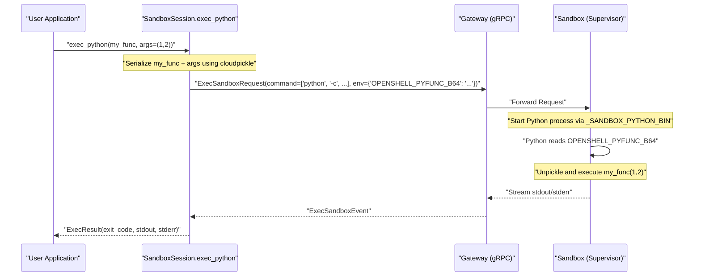
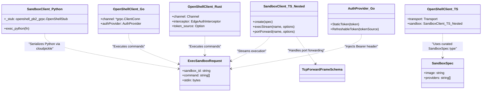

<!-- source: DeepWiki mcp.deepwiki.com · repo NVIDIA/OpenShell · page 9.2 Python, Go, TypeScript and Rust SDKs · fetched 2026-10-26 -->

# Python, Go, TypeScript and Rust SDKs

Relevant source files

The following files were used as context for generating this wiki page:

- [crates/openshell-cli/src/edge_tunnel.rs](crates/openshell-cli/src/edge_tunnel.rs)
- [crates/openshell-sdk/Cargo.toml](crates/openshell-sdk/Cargo.toml)
- [crates/openshell-sdk/README.md](crates/openshell-sdk/README.md)
- [crates/openshell-sdk/src/client.rs](crates/openshell-sdk/src/client.rs)
- [crates/openshell-sdk/src/config.rs](crates/openshell-sdk/src/config.rs)
- [crates/openshell-sdk/src/edge_tunnel.rs](crates/openshell-sdk/src/edge_tunnel.rs)
- [crates/openshell-sdk/src/error.rs](crates/openshell-sdk/src/error.rs)
- [crates/openshell-sdk/src/lib.rs](crates/openshell-sdk/src/lib.rs)
- [crates/openshell-sdk/src/oidc.rs](crates/openshell-sdk/src/oidc.rs)
- [crates/openshell-sdk/src/refresh.rs](crates/openshell-sdk/src/refresh.rs)
- [crates/openshell-sdk/src/transport.rs](crates/openshell-sdk/src/transport.rs)
- [crates/openshell-sdk/src/types.rs](crates/openshell-sdk/src/types.rs)
- [crates/openshell-sdk/tests/client_mock.rs](crates/openshell-sdk/tests/client_mock.rs)
- [crates/openshell-server/src/grpc/interactive_exec_tests.rs](crates/openshell-server/src/grpc/interactive_exec_tests.rs)
- [e2e/python/test_sandbox_api.py](e2e/python/test_sandbox_api.py)
- [python/openshell/sandbox.py](python/openshell/sandbox.py)
- [python/openshell/sandbox_test.py](python/openshell/sandbox_test.py)
- [sdk/go/README.md](sdk/go/README.md)
- [sdk/go/docs/src/api/exec.md](sdk/go/docs/src/api/exec.md)
- [sdk/go/docs/src/getting-started.md](sdk/go/docs/src/getting-started.md)
- [sdk/go/go.mod](sdk/go/go.mod)
- [sdk/go/go.sum](sdk/go/go.sum)
- [sdk/go/mise.toml](sdk/go/mise.toml)
- [sdk/go/openshell/v1/exec.go](sdk/go/openshell/v1/exec.go)
- [sdk/go/openshell/v1/exec_client.go](sdk/go/openshell/v1/exec_client.go)
- [sdk/go/openshell/v1/exec_client_test.go](sdk/go/openshell/v1/exec_client_test.go)
- [sdk/go/openshell/v1/exec_control_test.go](sdk/go/openshell/v1/exec_control_test.go)
- [sdk/typescript/README.md](sdk/typescript/README.md)
- [sdk/typescript/src/client.test.ts](sdk/typescript/src/client.test.ts)
- [sdk/typescript/src/client.ts](sdk/typescript/src/client.ts)
- [sdk/typescript/src/index.ts](sdk/typescript/src/index.ts)

OpenShell provides native SDKs for Python, Go, TypeScript, and Rust to facilitate programmatic sandbox management and secure code execution. These SDKs abstract the underlying gRPC communication, manage authentication via mTLS or OIDC, and provide language-specific features like Python function serialization and TypeScript stream handling.

## Python SDK

The Python SDK (`python/openshell/`) provides a high-level interface for managing sandboxes and executing code. It handles complex tasks such as Python function serialization via `cloudpickle` [pyproject.toml:16-21]().

### SandboxClient
The `SandboxClient` is the primary entry point, managing the gRPC connection to the OpenShell Gateway [python/openshell/sandbox.py:200-202]().

| Method | Description |
| :--- | :--- |
| `__init__(...)` | Initializes a client with a gRPC endpoint and optional `TlsConfig`. Supports OIDC bearer token authentication via interceptors [python/openshell/sandbox.py:223-274](). |
| `from_active_cluster()` | Resolves the gateway endpoint and mTLS certificates from `XDG_CONFIG_HOME/openshell/gateways/` [python/openshell/sandbox.py:281-320](). |
| `create(spec=...)` | Sends a `CreateSandboxRequest` to the gateway and returns a `SandboxRef` [python/openshell/sandbox.py:336-353](). |
| `exec(...)` | Executes a command in a sandbox. Supports `stdin` payloads and output streaming [python/openshell/sandbox.py:490-510](). |

### SandboxSession
A `SandboxSession` binds a `SandboxClient` to a specific sandbox ID [python/openshell/sandbox.py:513-517]().

*   **`exec(command, ...)`**: Executes a raw shell command. It supports streaming output and injecting environment variables via `ExecSandboxRequest` [python/openshell/sandbox.py:520-538]().
*   **`exec_python(function, ...)`**: Executes local Python functions inside the remote sandbox. It uses `cloudpickle` to serialize the function and closure, executing them via a bootstrap script (`_PYTHON_CLOUDPICKLE_BOOTSTRAP`) inside the sandbox [python/openshell/sandbox.py:540-560](), [python/openshell/sandbox_test.py:24-24]().

### Data Flow: Python Function Execution
This diagram illustrates how a local Python function is transported and executed within the isolated sandbox.

**Python Function Execution Flow**

Sources: [python/openshell/sandbox.py:200-560](), [python/openshell/sandbox_test.py:24-24](), [pyproject.toml:16-21]()

---

## Go SDK

The Go SDK (`sdk/go/`) provides idiomatic gRPC client bindings and authentication helpers [sdk/go/README.md:1-10]().

### AuthProvider
The `AuthProvider` interface allows for per-RPC credential injection. The SDK provides `StaticToken` for simple bearer token authentication and `RefreshableToken` for OIDC gateways with automatic token caching and refresh [sdk/go/README.md:47-100]().

*   **`StaticToken(token)`**: Injects a fixed `Authorization: Bearer <token>` header into every request [sdk/go/README.md:47-47]().
*   **`RefreshableToken(tokenSource, ...)`**: Wraps an `oauth2.TokenSource` for automatic token caching and coalesced refresh [sdk/go/README.md:78-88]().
*   **`WithExtraHeaders(base, headers)`**: Attaches proxy-specific headers alongside standard authentication [sdk/go/README.md:112-115]().

### Sandbox Management
The Go SDK provides typed sub-clients for resources like `Sandboxes()`, `Providers()`, and `Exec()`, mirroring `k8s.io/client-go` patterns [sdk/go/README.md:23-26](). It supports creating sandboxes, waiting for readiness, and executing commands [sdk/go/README.md:54-74]().

Sources: [sdk/go/README.md:1-10](), [sdk/go/README.md:23-26](), [sdk/go/README.md:47-115](), [sdk/go/docs/src/getting-started.md:64-101]()

---

## TypeScript SDK

The TypeScript SDK (`@nvidia/openshell-sdk`) provides a high-level async client for Node.js and browser environments.

### OpenShellClient
The `OpenShellClient` manages the gateway connection and provides a curated surface for sandbox CRUD and health checks [sdk/typescript/src/client.ts:4-12]().

*   **`connect(options)`**: Builds the underlying gRPC transport and creates a client instance [sdk/typescript/src/client.ts:300-303]().
*   **`health()`**: Retrieves the gateway's health status [sdk/typescript/src/client.ts:310-315]().
*   **`sandbox`**: A nested client for sandbox-specific operations, including `create`, `get`, `list`, `delete`, `waitReady`, `waitDeleted`, `execStream`, `execInteractive`, and `portForward` [sdk/typescript/src/client.ts:320-321]().

### SandboxClient
The `SandboxClient` within the TypeScript SDK provides methods for managing individual sandboxes.

*   **`create(spec)`**: Creates a new sandbox based on the provided `SandboxSpec` [sdk/typescript/src/client.ts:400-406]().
*   **`execStream(name, options)`**: Executes a command in a sandbox and streams its output. It returns an async iterable of `ExecSandboxOutput` [sdk/typescript/src/client.ts:560-579]().
*   **`execInteractive(name, options)`**: Provides an interactive shell session within the sandbox, allowing for bidirectional communication [sdk/typescript/src/client.ts:581-600]().
*   **`portForward(name, options)`**: Establishes a TCP port forwarding tunnel from the local machine to a specified port within the sandbox [sdk/typescript/src/client.ts:602-648]().

Sources: [sdk/typescript/src/client.ts:4-12](), [sdk/typescript/src/client.ts:300-648]()

---

## Rust SDK

The Rust SDK (`crates/openshell-sdk`) provides an async client for OpenShell gateways, focusing on gRPC channel setup, TLS, OIDC refresh, and Cloudflare Access tunnel integration [crates/openshell-sdk/README.md:1-7]().

### OpenShellClient
The `OpenShellClient` is the primary entry point for interacting with the gateway. It is cheap to clone, as the underlying `tonic::Channel` multiplexes RPCs over a shared HTTP/2 connection [crates/openshell-sdk/src/client.rs:36-46]().

*   **`connect(config: ClientConfig)`**: Establishes a connection to the gateway, performing the gRPC channel handshake immediately [crates/openshell-sdk/src/client.rs:53-64]().
*   **`from_parts(channel: Channel, interceptor: EdgeAuthInterceptor)`**: Constructs a client from an already-built `Channel` and interceptor, allowing for custom channel configurations [crates/openshell-sdk/src/client.rs:67-79]().
*   **`raw_grpc()`**: Provides direct access to the generated `tonic` clients for RPCs not covered by the curated surface [crates/openshell-sdk/src/client.rs:99-104]().
*   **`raw_grpc_fresh()`**: Similar to `raw_grpc()`, but proactively refreshes the bearer token if a refresher is wired and the token is near expiry [crates/openshell-sdk/src/client.rs:114-117]().
*   **`force_refresh()`**: Forces an OIDC refresh and writes the new token into the live bearer slot, useful for recovering from `Unauthenticated` errors [crates/openshell-sdk/src/client.rs:123-125]().
*   **`health()`**: Retrieves the gateway's health snapshot [crates/openshell-sdk/src/client.rs:128-136]().
*   **`create_sandbox(spec: SandboxSpec)`**: Creates a new sandbox from a curated `SandboxSpec` [crates/openshell-sdk/src/client.rs:139-147]().
*   **`exec(name: &str, options: ExecOptions)`**: Executes a command in a sandbox, returning an `ExecResult` [crates/openshell-sdk/src/client.rs:290-298]().
*   **`watch(name: &str, options: WatchOptions)`**: Streams events (logs, platform events, warnings) from a sandbox [crates/openshell-sdk/src/client.rs:301-309]().

### Auth and Refresh
The Rust SDK's curated surface automatically handles OIDC token refresh, both proactively before a request and reactively upon an `Unauthenticated` response. Refreshes are single-flight to prevent multiple concurrent refresh attempts [crates/openshell-sdk/README.md:18-22](). The SDK consumes a `Refresh` trait, which the caller implements to provide token refresh logic [crates/openshell-sdk/README.md:28-31]().

### Conformance Tests
The Rust SDK includes comprehensive conformance tests (`crates/openshell-sdk/tests/client_mock.rs`) that run against an in-process mock gateway. These tests validate the SDK's behavior for various operations, including sandbox CRUD, exec, and watch streams, without requiring a live gateway [crates/openshell-sdk/tests/client_mock.rs:4-9](). The mock gateway captures fixture state, allowing for assertions on observed requests and canned replies [crates/openshell-sdk/tests/client_mock.rs:47-82]().

Sources: [crates/openshell-sdk/README.md:1-7](), [crates/openshell-sdk/README.md:18-31](), [crates/openshell-sdk/src/client.rs:36-147](), [crates/openshell-sdk/src/client.rs:290-309](), [crates/openshell-sdk/tests/client_mock.rs:4-9](), [crates/openshell-sdk/tests/client_mock.rs:47-82]()

---

## Security and Authentication

All SDKs support mutual TLS (mTLS) and OIDC bearer tokens.

### TLS Configuration
*   **Python**: `TlsConfig` manages `ca_path`, `cert_path`, and `key_path`. It allows for full mTLS, CA-only trust, or system roots [python/openshell/sandbox.py:140-156]().
*   **Rust SDK**: Uses `transport::build_channel` to configure the underlying `tonic` channel with TLS material [crates/openshell-sdk/src/client.rs:52]().
*   **TypeScript SDK**: `ConnectOptions` in `transport.ts` handles TLS configuration.

### Bearer Token Rotation
OpenShell SDKs support dynamic token rotation to ensure long-lived sessions remain authenticated.
*   **Python**: `_BearerAuthInterceptor` invokes a `token_provider` per call, allowing for runtime token swaps [python/openshell/sandbox.py:176-195]().
*   **Rust SDK**: Uses a `BearerSlot` and `TokenSource` to drive OIDC token rotation, ensuring refreshed tokens reach in-flight requests [crates/openshell-sdk/src/client.rs:37-43]().
*   **TypeScript SDK**: `OidcTokenProvider` and `clientCredentials` in `oidc.ts` manage token acquisition and refresh.

### SDK Code Entity Mapping
This diagram maps the SDK abstractions to the underlying Protobuf messages and gRPC services.

**SDK to Code Entity Mapping**

Sources: [python/openshell/sandbox.py:140-156](), [python/openshell/sandbox.py:176-195](), [crates/openshell-sdk/src/client.rs:37-43](), [crates/openshell-sdk/src/client.rs:52]()

---

