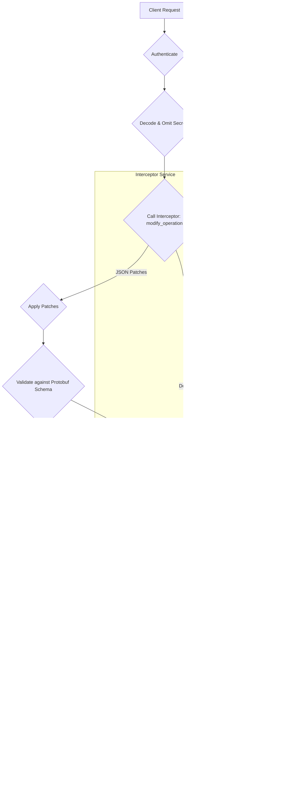
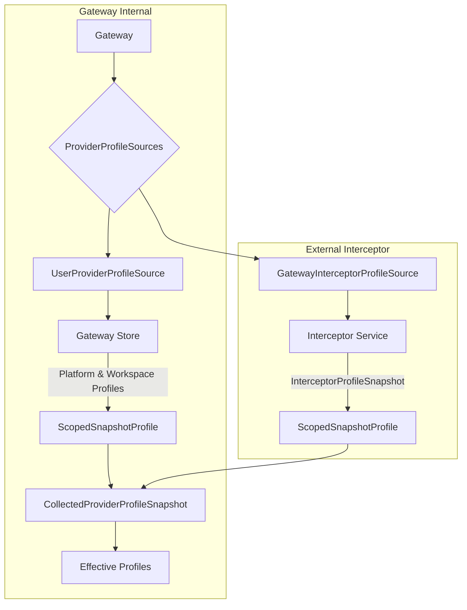

<!-- source: DeepWiki mcp.deepwiki.com · repo NVIDIA/OpenShell · page 9.3 Gateway Interceptors · fetched 2026-10-26 -->

# Gateway Interceptors

<details>
<summary>Relevant source files</summary>

The following files were used as context for generating this wiki page:

- [crates/openshell-server/src/provider_profile_sources.rs](crates/openshell-server/src/provider_profile_sources.rs)
- [docs/about/architecture.mdx](docs/about/architecture.mdx)
- [docs/extensibility/gateway-interceptors.mdx](docs/extensibility/gateway-interceptors.mdx)
- [docs/extensibility/overview.mdx](docs/extensibility/overview.mdx)
- [docs/extensibility/supervisor-middleware/configure.mdx](docs/extensibility/supervisor-middleware/configure.mdx)
- [docs/extensibility/supervisor-middleware/index.mdx](docs/extensibility/supervisor-middleware/index.mdx)
- [docs/images/openshell-extension-points.svg](docs/images/openshell-extension-points.svg)
- [docs/images/openshell-isolation-backend.svg](docs/images/openshell-isolation-backend.svg)
- [docs/images/openshell-kubernetes-runtime.svg](docs/images/openshell-kubernetes-runtime.svg)
- [docs/images/openshell-sandbox-authentication.svg](docs/images/openshell-sandbox-authentication.svg)
- [docs/images/openshell-sandbox-enforcement.svg](docs/images/openshell-sandbox-enforcement.svg)
- [docs/images/openshell-system-architecture.svg](docs/images/openshell-system-architecture.svg)
- [e2e/rust/Cargo.lock](e2e/rust/Cargo.lock)
- [examples/governance-interceptor/Cargo.lock](examples/governance-interceptor/Cargo.lock)
- [examples/governance-interceptor/Cargo.toml](examples/governance-interceptor/Cargo.toml)
- [examples/governance-interceptor/src/main.rs](examples/governance-interceptor/src/main.rs)

</details>


Gateway interceptors provide a mechanism to extend OpenShell's control plane with deployment-specific governance and business logic. They allow external gRPC services to modify or validate selected API writes before the gateway processes them, and to observe successful operations after they are committed. This page details their configuration, how they handle JWT extension tokens, their failure and binding policies, how they source provider profiles, and provides an example using the `governance-interceptor`.

## When to Use Gateway Interceptors

Gateway interceptors are ideal when an external service needs to enforce governance rules on gateway API operations without altering the core gateway logic. Typical use cases include:
*   Applying a mandatory policy to every new sandbox created.
*   Rejecting changes to provider configurations or policies that violate organizational rules.
*   Enforcing tenant-specific quotas or naming conventions.
*   Observing committed operations for auditing or inventory management.
*   Providing an authoritative or composed catalog of provider profiles.

It's important to note that gateway interceptors augment, rather than replace, the gateway's built-in persistence, authentication, authorization, policy safety checks, and driver validation. The gateway remains the system of record and performs its own validation after any interceptor modifications.
Sources: [docs/extensibility/gateway-interceptors.mdx:10-24]()

## How Interception Works

The gateway integrates interceptors into its request processing pipeline after authentication and before dispatching a request to its primary handler. The flow is as follows:

`authenticate → decode and omit secrets → modify_operation → validate → gateway handler → post_commit`
Sources: [docs/extensibility/gateway-interceptors.mdx:28-30]()

The interception process involves three distinct phases:

| Phase              | Input                                       | Capabilities                                     |
| :----------------- | :------------------------------------------ | :----------------------------------------------- |
| `modify_operation` | Proposed request                            | Allow, deny, or return RFC 6902 JSON patches.    |
| `validate`         | Modified request and optional current state | Allow or deny.                                   |
| `post_commit`      | Successful gateway response                 | Observe the response and attach log annotations. |

Sources: [docs/extensibility/gateway-interceptors.mdx:32-37]()

Only explicitly allowlisted unary mutation RPCs are interceptable. The gateway converts the operation to its protobuf JSON representation for evaluation, applies JSON patches atomically, validates the result against the RPC's protobuf schema, and then converts it back to protobuf before the handler receives it. Built-in operation and driver validation occur after `modify_operation`, ensuring that patched operations cannot bypass gateway-owned invariants. The `post_commit` phase is purely observational and cannot deny or modify an already committed operation.
Sources: [docs/extensibility/gateway-interceptors.mdx:39-44]()

### Gateway Interceptor Processing Flow


**Figure 1: Gateway Interceptor Processing Flow**

Sources: [docs/extensibility/gateway-interceptors.mdx:28-44]()

## Implement an Interceptor Service

An interceptor service must implement the `openshell.gateway_interceptor.v1.GatewayInterceptor` gRPC service, defined in `proto/gateway_interceptor.proto`. This service exposes three key RPCs:
*   `Describe`: Declares the service's bindings and capabilities.
*   `Evaluate`: Handles a selected operation phase.
*   `SnapshotProviderProfiles`: Optionally returns a catalog of provider profiles.
Sources: [docs/extensibility/gateway-interceptors.mdx:45-51]()

The `DescribeRequest` carries gateway protocol metadata, and `InterceptorManifest.extension` returns the interceptor's protocol and implementation metadata. The gateway enforces strict checks on this metadata, rejecting missing metadata, incompatible major versions, or unmet required capabilities before accepting bindings. This process is part of the [Extension Protocol Negotiation](/extensibility/overview#protocol-negotiation).
Sources: [docs/extensibility/gateway-interceptors.mdx:53-56]()

Each `InterceptorEvaluation` identifies the configured interceptor, manifest binding, public OpenShell service and method, authenticated principal, and the active phase. The phase dictates whether the payload contains a proposed operation, optional current state, or a committed response. The interceptor returns an `InterceptorResult` with an allow or deny decision, an optional denial status and reason, JSON patches during `modify_operation`, and non-secret log annotations.
Sources: [docs/extensibility/gateway-interceptors.mdx:58-63]()

## Declare and Authorize Bindings

Interceptors declare their bindings within the `InterceptorManifest` returned by the `Describe` RPC. Each binding specifies a public OpenShell RPC and one or more phases it intends to intercept. The gateway validates these declarations at startup against its compiled protobuf descriptors and an explicit allowlist of interceptable RPCs.
Sources: [docs/extensibility/gateway-interceptors.mdx:65-68]()

The `binding_policy` configuration determines how the manifest and gateway configuration interact:

| Policy      | Behavior                                                                                                                                          |
| :---------- | :------------------------------------------------------------------------------------------------------------------------------------------------ |
| `dynamic`   | Enables valid manifest bindings. Gateway configuration may narrow or disable them. This is the compatibility default and emits a startup warning. |
| `allowlist` | Enables only operator-configured RPCs and phases. Extra manifest bindings are ignored and logged.                                                 |
| `exact`     | Requires the configured RPCs and phases to match the manifest exactly.                                                                            |

Sources: [docs/extensibility/gateway-interceptors.mdx:70-76]()

For security-sensitive deployments, `allowlist` or `exact` policies are recommended as they select bindings by public RPC, ensuring that renaming a binding does not alter its authority.
Sources: [docs/extensibility/gateway-interceptors.mdx:78-79]()

## Register an Interceptor Service

To register an interceptor service, it must be started before the gateway and then configured in the gateway's `gateway.toml` file.

```toml
[[openshell.gateway.interceptors]]
name               = "policy-governance"
grpc_endpoint      = "https://governance.example:18081"
tls_ca_cert_path   = "/path/to/governance-ca.pem"
audience           = "urn:example:governance"
order              = 10
failure_policy     = "fail_closed"
binding_policy     = "allowlist"
timeout            = "500ms"
max_response_bytes = 1048576
max_patches        = 32

[[openshell.gateway.interceptors.bindings]]
rpc    = "openshell.v1.OpenShell/CreateSandbox"
phases = ["modify_operation", "validate"]

[[openshell.gateway.interceptors.bindings]]
rpc    = "openshell.v1.OpenShell/UpdateConfig"
phases = ["validate"]
```
Sources: [docs/extensibility/gateway-interceptors.mdx:77-96]()

The gateway supports `http://`, `https://`, and `unix://` endpoints for interceptors. When gateway JWT signing is enabled, authenticated network interceptors use `https://`. Unix sockets are available for local integrations. HTTPS connections use platform trust roots unless `tls_ca_cert_path` specifies a private CA, and normal hostname verification is performed. The gateway calls `Describe` during startup to build an immutable execution plan. An unavailable service, invalid manifest, missing credential, or unauthorized configured binding will prevent the gateway from starting.
Sources: [docs/extensibility/gateway-interceptors.mdx:98-99]()

### JWT Extension Tokens

When the gateway is configured for JWT signing, it issues a short-lived bearer token with every call to a gateway interceptor. Interceptor services should validate this token to confirm the call originates from the gateway.
Sources: [docs/extensibility/overview.mdx:110-112]()

The JWT contains the following claims:
*   `iss`: `openshell-gateway:<gateway_id>`
*   `aud`: The registration's `audience`. Defaults to `urn:openshell:extension:interceptor:<name>`.
*   `caller_kind`: `gateway`
*   `sandbox_id`: Not present for gateway interceptors.
Sources: [docs/extensibility/overview.mdx:113-118]()

To validate a token, the interceptor service needs the gateway ID and its public signing key (or JWKS). These should be obtained from the gateway operator. For key rotation, the service can fetch `/.well-known/openid-configuration` from the gateway over TLS and follow its `jwks_uri`.
Sources: [docs/extensibility/overview.mdx:120-123]()

The `governance-interceptor` example demonstrates how to sign and verify JWTs for policies and provider profiles. The `PolicySigner` struct [examples/governance-interceptor/src/main.rs:65-69]() handles the creation of `EncodingKey` and `DecodingKey` and manages the `kid` (key ID). The `sign_policy` [examples/governance-interceptor/src/main.rs:124-137]() and `sign_profile` [examples/governance-interceptor/src/main.rs:139-155]() methods generate JWTs with specific claims, including `iss`, `aud`, `sub`, `iat`, `exp`, `hash_algorithm`, and a hash of the policy or profile content. The `verify_policy_signature` [examples/governance-interceptor/src/main.rs:157-170]() method shows how to validate these tokens, checking the `kid`, algorithm, issuer, audience, and policy hash.

## Failure Policies

The `failure_policy` setting in the gateway configuration determines the behavior when an interceptor service fails or becomes unavailable.
*   `fail_closed`: (Default) If the interceptor fails or is unavailable, the operation is denied. This is the most secure option, preventing operations from bypassing governance.
*   `fail_open`: If the interceptor fails or is unavailable, the operation proceeds without interception. This prioritizes availability over strict enforcement.

## Provider Profile Sourcing

Gateway interceptors can also act as a source for provider profiles. The `GatewayInterceptorProfileSource` [crates/openshell-server/src/provider_profile_sources.rs:143-182]() implements the `ProviderProfileSource` trait, allowing it to provide a snapshot of `ProviderProfile` objects.

The `snapshot` method [crates/openshell-server/src/provider_profile_sources.rs:157-182]() of `GatewayInterceptorProfileSource` calls the interceptor's `SnapshotProviderProfiles` RPC. If this call fails, it returns an `openshell_core::rpc_error::unavailable` status. The profiles returned by the interceptor are then wrapped as `ScopedSnapshotProfile` with `ProfileScope::Static`.
Sources: [crates/openshell-server/src/provider_profile_sources.rs:157-182]()

The `UserProviderProfileSource` [crates/openshell-server/src/provider_profile_sources.rs:68-140]() is another built-in source that retrieves profiles from the gateway's persistent store, distinguishing between platform-scoped and workspace-scoped profiles. It calculates a SHA256 hash of the profiles to generate a revision.
Sources: [crates/openshell-server/src/provider_profile_sources.rs:90-139]()

### Provider Profile Sourcing Flow


**Figure 2: Provider Profile Sourcing Flow**

Sources: [crates/openshell-server/src/provider_profile_sources.rs:185-214]()

## Governance Interceptor Example

The `examples/governance-interceptor` [examples/governance-interceptor/]() provides a complete service that demonstrates the capabilities of gateway interceptors. This example:
*   Vends provider profiles.
*   Applies a signed policy to new sandboxes.
*   Rejects attempts to weaken that policy.
Sources: [docs/extensibility/gateway-interceptors.mdx:12-13]()

The `governance-interceptor` service implements the `GatewayInterceptor` trait [examples/governance-interceptor/src/main.rs:16-22]() and handles `Describe`, `Evaluate`, and `SnapshotProviderProfiles` RPCs. It uses JWTs to sign and verify policies and provider profiles, ensuring their integrity and authenticity. The `PolicySigner` struct [examples/governance-interceptor/src/main.rs:65-69]() is central to this, managing the cryptographic keys and signing/verification logic.

The `Evaluate` RPC implementation in the example [examples/governance-interceptor/src/main.rs:200-202]() checks the `GatewayInterceptorPhase` [examples/governance-interceptor/src/main.rs:17-18]() to determine the current interception phase (`modify_operation`, `validate`, or `post_commit`) and dispatches to appropriate handlers like `handle_create_sandbox_modify_operation` [examples/governance-interceptor/src/main.rs:209-211]() or `handle_update_config_validate` [examples/governance-interceptor/src/main.rs:213-215](). This allows the interceptor to apply specific logic based on the operation and its phase.

Sources:
*   [docs/extensibility/gateway-interceptors.mdx:10-99]()
*   [docs/extensibility/overview.mdx:110-123]()
*   [crates/openshell-server/src/provider_profile_sources.rs:1-214]()
*   [examples/governance-interceptor/src/main.rs:1-1435]()
*   [examples/governance-interceptor/Cargo.toml:1-35]()

---

