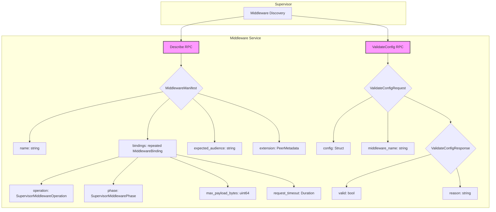
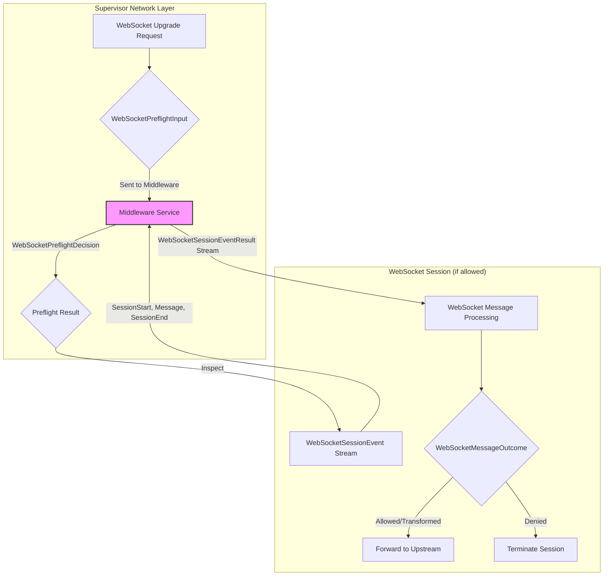

<!-- source: DeepWiki mcp.deepwiki.com · repo NVIDIA/OpenShell · page 9.4 Supervisor Middleware · fetched 2026-10-26 -->

# Supervisor Middleware

<details>
<summary>Relevant source files</summary>

The following files were used as context for generating this wiki page:

- [crates/openshell-core/src/middleware.rs](crates/openshell-core/src/middleware.rs)
- [crates/openshell-supervisor-middleware-builtins/Cargo.toml](crates/openshell-supervisor-middleware-builtins/Cargo.toml)
- [crates/openshell-supervisor-middleware-builtins/src/lib.rs](crates/openshell-supervisor-middleware-builtins/src/lib.rs)
- [crates/openshell-supervisor-middleware-builtins/src/regex.rs](crates/openshell-supervisor-middleware-builtins/src/regex.rs)
- [crates/openshell-supervisor-middleware/src/headers.rs](crates/openshell-supervisor-middleware/src/headers.rs)
- [crates/openshell-supervisor-middleware/src/lib.rs](crates/openshell-supervisor-middleware/src/lib.rs)
- [crates/openshell-supervisor-middleware/src/remote.rs](crates/openshell-supervisor-middleware/src/remote.rs)
- [crates/openshell-supervisor-middleware/src/websocket.rs](crates/openshell-supervisor-middleware/src/websocket.rs)
- [crates/openshell-supervisor-network/src/l7/middleware.rs](crates/openshell-supervisor-network/src/l7/middleware.rs)
- [crates/openshell-supervisor-network/src/l7/websocket.rs](crates/openshell-supervisor-network/src/l7/websocket.rs)
- [crates/openshell-supervisor-network/src/policy_local.rs](crates/openshell-supervisor-network/src/policy_local.rs)
- [examples/supervisor-middleware-content-guard/Cargo.lock](examples/supervisor-middleware-content-guard/Cargo.lock)
- [examples/supervisor-middleware-content-guard/Cargo.toml](examples/supervisor-middleware-content-guard/Cargo.toml)
- [examples/supervisor-middleware-content-guard/README.md](examples/supervisor-middleware-content-guard/README.md)
- [examples/supervisor-middleware-content-guard/policy.yaml](examples/supervisor-middleware-content-guard/policy.yaml)
- [examples/supervisor-middleware-content-guard/smoke.sh](examples/supervisor-middleware-content-guard/smoke.sh)
- [examples/supervisor-middleware-content-guard/src/main.rs](examples/supervisor-middleware-content-guard/src/main.rs)
- [proto/supervisor_middleware.proto](proto/supervisor_middleware.proto)

</details>


This page details the supervisor middleware chain in OpenShell, covering its protocol, remote middleware integration, built-in middleware, and how it handles HTTP headers and WebSocket messages. It also includes an example of a content-guard middleware. The supervisor middleware provides a powerful mechanism for inspecting, modifying, and enforcing policies on network traffic originating from sandboxes.

## Middleware Protocol

The supervisor middleware operates over a gRPC protocol defined in `proto/supervisor_middleware.proto` [proto/supervisor_middleware.proto:1-720](). This protocol allows external services to act as middleware, inspecting and potentially modifying HTTP requests, HTTP responses, and WebSocket messages.

The core services are:
*   `SupervisorMiddleware`: Handles HTTP request evaluation and WebSocket session management [proto/supervisor_middleware.proto:15-35]().
*   `HttpResponsePreReturn`: Handles HTTP response evaluation [proto/supervisor_middleware.proto:44-51]().

Middleware services must implement the `Describe` RPC to provide a `MiddlewareManifest` [proto/supervisor_middleware.proto:17-17, 53-71](), which declares the middleware's name, version, and supported `MiddlewareBinding`s [proto/supervisor_middleware.proto:61-62, 74-89](). A `MiddlewareBinding` specifies the `SupervisorMiddlewareOperation` (e.g., `HttpRequest`, `WebSocketMessage`) and `SupervisorMiddlewarePhase` (e.g., `PreCredentials`, `PreReturn`) it supports, along with optional `max_payload_bytes` and `request_timeout` [proto/supervisor_middleware.proto:74-89]().

The `ValidateConfig` RPC allows the supervisor to validate a middleware's policy configuration [proto/supervisor_middleware.proto:19-20, 91-105]().

### Middleware Manifest and Bindings

The `MiddlewareManifest` [proto/supervisor_middleware.proto:53-71]() is crucial for the supervisor to understand the capabilities of a middleware. It includes:
*   `name`: A human-readable name for diagnostic purposes [proto/supervisor_middleware.proto:56-57]().
*   `bindings`: A list of `MiddlewareBinding`s [proto/supervisor_middleware.proto:61-62](), each specifying an operation and phase.

The `SupervisorMiddlewareOperation` enum defines the types of traffic a middleware can inspect:
*   `HttpRequest`: For HTTP request evaluation.
*   `HttpResponse`: For HTTP response evaluation.
*   `WebSocketMessage`: For WebSocket message evaluation.

The `SupervisorMiddlewarePhase` enum defines when the middleware is invoked:
*   `PreCredentials`: Before credentials are injected.
*   `PreReturn`: Before the response is returned to the sandbox.


**Diagram: Middleware Service Protocol Overview**

Sources:
- [proto/supervisor_middleware.proto:15-35]()
- [proto/supervisor_middleware.proto:44-51]()
- [proto/supervisor_middleware.proto:53-71]()
- [proto/supervisor_middleware.proto:74-89]()
- [proto/supervisor_middleware.proto:91-105]()

## Remote Middleware

Remote middleware services communicate with the supervisor via gRPC. The `crates/openshell-supervisor-middleware/src/remote.rs` module handles this communication, adapting the supervisor's internal `InProcessMiddleware` trait to the gRPC protocol.

The `RemoteMiddlewareService` [crates/openshell-supervisor-middleware/src/remote.rs:123-126]() is responsible for connecting to a remote middleware endpoint. It uses `openshell_extension_core::connect_channel` [crates/openshell-supervisor-middleware/src/remote.rs:140]() to establish a gRPC channel, optionally secured with TLS and bearer tokens.

The `GrpcMiddlewareService` [crates/openshell-supervisor-middleware/src/remote.rs:31-33]() wraps the `SupervisorMiddlewareEndpoint` trait, providing methods to `describe`, `validate_config`, `evaluate_http_request`, `open_websocket_session`, and `open_http_response_pre_return` [crates/openshell-supervisor-middleware/src/remote.rs:63-119](). These methods convert the supervisor's internal data structures into the protobuf messages required by the gRPC service.

```mermaid
graph TD
    subgraph "Supervisor"
        A[Supervisor Internal Logic] --> B{InProcessMiddleware Trait};
        B -- "Calls describe(), validate_config(), evaluate_http_request(), etc." --> C[GrpcMiddlewareService];
    end

    subgraph "crates/openshell-supervisor-middleware/src/remote.rs"
        C --> D[RemoteMiddlewareService];
        D -- "Connects to remote gRPC endpoint" --> E[connect_channel()];
        E -- "Secured Channel" --> F[SupervisorMiddlewareClient];
        F -- "gRPC RPC Calls" --> G[Remote Middleware Service];
    end

    subgraph "Remote Middleware Service"
        G[Remote Middleware Service] -- "Implements SupervisorMiddleware gRPC service" --> H[MiddlewareManifest];
        G --> I[HttpRequestResult];
        G --> J[WebSocketResponseStream];
    end

    style B fill:#f9f,stroke:#333,stroke-width:2px
    style C fill:#f9f,stroke:#333,stroke-width:2px
    style D fill:#f9f,stroke:#333,stroke-width:2px
    style E fill:#f9f,stroke:#333,stroke-width:2px
    style F fill:#f9f,stroke:#333,stroke-width:2px
```
**Diagram: Remote Middleware Integration**

Sources:
- [crates/openshell-supervisor-middleware/src/remote.rs:31-33]()
- [crates/openshell-supervisor-middleware/src/remote.rs:63-119]()
- [crates/openshell-supervisor-middleware/src/remote.rs:123-126]()
- [crates/openshell-supervisor-middleware/src/remote.rs:140]()

## Built-in Middleware

OpenShell includes first-party built-in middleware implementations, located in `crates/openshell-supervisor-middleware-builtins`. These are in-process middleware services that do not require gRPC communication.

The `services()` function [crates/openshell-supervisor-middleware-builtins/src/lib.rs:23]() returns a vector of `Arc<dyn InProcessMiddleware>`, currently containing `BuiltinMiddlewareService` [crates/openshell-supervisor-middleware-builtins/src/lib.rs:23, 49]().

The `BuiltinMiddlewareService` [crates/openshell-supervisor-middleware-builtins/src/lib.rs:49]() acts as an aggregate service, dispatching calls to specific built-in implementations based on the `middleware_name`. An example is the `regex` built-in [crates/openshell-supervisor-middleware-builtins/src/lib.rs:20](), which can evaluate HTTP requests and WebSocket text messages against regular expressions.

The `validate_config` function [crates/openshell-supervisor-middleware-builtins/src/lib.rs:28]() is used to validate the configuration for built-in middleware before it's applied.

```mermaid
graph TD
    subgraph "Supervisor"
        A[Policy Engine] --> B{Middleware Configuration};
        B -- "Built-in Middleware Name" --> C[BuiltinMiddlewareService];
    end

    subgraph "crates/openshell-supervisor-middleware-builtins"
        C -- "Calls validate_config()" --> D[validate_config(implementation, config)];
        C -- "Calls evaluate_http_request()" --> E[evaluate_http_request(request)];
        C -- "Calls websocket_stream()" --> F[websocket_stream(requests)];
        D -- "Dispatches to specific built-in" --> D1[regex::validate_config()];
        E -- "Dispatches to specific built-in" --> E1[regex::evaluate_http_request()];
        F -- "Dispatches to specific built-in" --> F1[regex::websocket_stream()];
    end

    style C fill:#f9f,stroke:#333,stroke-width:2px
    style D fill:#f9f,stroke:#333,stroke-width:2px
    style E fill:#f9f,stroke:#333,stroke-width:2px
    style F fill:#f9f,stroke:#333,stroke-width:2px
```
**Diagram: Built-in Middleware Dispatch**

Sources:
- [crates/openshell-supervisor-middleware-builtins/src/lib.rs:20]()
- [crates/openshell-supervisor-middleware-builtins/src/lib.rs:23]()
- [crates/openshell-supervisor-middleware-builtins/src/lib.rs:28]()
- [crates/openshell-supervisor-middleware-builtins/src/lib.rs:49]()

## HTTP Header and WebSocket Handling

### HTTP Header Mutations

Middleware can propose mutations to HTTP headers. The `crates/openshell-supervisor-middleware/src/headers.rs` module defines the logic for validating and applying these mutations.

The `apply` function [crates/openshell-supervisor-middleware/src/headers.rs:124-129]() takes the `HeaderAuthority` (Request, Response, ResponseTrailers), existing headers, connection-nominated headers, and a list of `HeaderMutation`s [crates/openshell-supervisor-middleware/src/headers.rs:7]() to produce a new set of headers.

Several constraints are enforced to prevent malicious or unsafe header modifications:
*   **Count Limit**: A maximum of `MAX_HEADER_MUTATIONS` (64) mutations are allowed [crates/openshell-supervisor-middleware/src/headers.rs:10, 130-134]().
*   **Size Limit**: Total mutation bytes are capped at `MAX_HEADER_MUTATION_BYTES` (32 KiB) [crates/openshell-supervisor-middleware/src/headers.rs:11, 93-96]().
*   **Protected Headers**: Middleware cannot mutate protected headers (e.g., `Host`, `Content-Length`) [crates/openshell-supervisor-middleware/src/headers.rs:26, 71-74]().
*   **Hop-by-Hop Headers**: Hop-by-hop headers (e.g., `Connection`, `Keep-Alive`) cannot be mutated [crates/openshell-supervisor-middleware/src/headers.rs:27, 77-80]().
*   **Unsafe Values**: Header values containing unsafe characters are rejected [crates/openshell-supervisor-middleware/src/headers.rs:28, 83-86]().
*   **Credential Placeholders**: Middleware cannot inject credential placeholders into header values [crates/openshell-supervisor-middleware/src/headers.rs:29, 89-92]().

### WebSocket Message Handling

The supervisor middleware can inspect and modify WebSocket messages. The `crates/openshell-supervisor-middleware/src/websocket.rs` module manages the lifecycle of WebSocket sessions and message processing.

A `WebSocketPreflightInput` [crates/openshell-supervisor-middleware/src/websocket.rs:39-51]() is sent to middleware to determine if a WebSocket upgrade should be allowed and how messages should be handled. The middleware responds with a `WebSocketPreflightDecision` [crates/openshell-supervisor-middleware/src/websocket.rs:20](), which can be `Inspect`, `Allow`, or `Deny`.

If `Inspect` is chosen, a WebSocket session is established, and messages are streamed to the middleware for evaluation. The `WebSocketSessionEvent` [crates/openshell-supervisor-middleware/src/websocket.rs:20]() enum defines the events sent to the middleware, including `Preflight`, `SessionStart`, `Message`, and `SessionEnd`. The middleware responds with `WebSocketSessionEventResult` [crates/openshell-supervisor-middleware/src/websocket.rs:20]().

The `WebSocketMessageOutcome` [crates/openshell-supervisor-middleware/src/websocket.rs:134-143]() indicates the result of a message evaluation, including whether it was allowed, denied, or if its payload was transformed.

The `crates/openshell-supervisor-network/src/l7/websocket.rs` module implements the WebSocket relay logic, including message assembly, framing, and interaction with the middleware chain. It enforces limits on message size and concurrent assemblies [crates/openshell-supervisor-network/src/l7/websocket.rs:27-34]().


**Diagram: WebSocket Middleware Flow**

Sources:
- [crates/openshell-supervisor-middleware/src/headers.rs:7]()
- [crates/openshell-supervisor-middleware/src/headers.rs:10]()
- [crates/openshell-supervisor-middleware/src/headers.rs:11]()
- [crates/openshell-supervisor-middleware/src/headers.rs:20]()
- [crates/openshell-supervisor-middleware/src/headers.rs:26]()
- [crates/openshell-supervisor-middleware/src/headers.rs:27]()
- [crates/openshell-supervisor-middleware/src/headers.rs:28]()
- [crates/openshell-supervisor-middleware/src/headers.rs:29]()
- [crates/openshell-supervisor-middleware/src/headers.rs:71-74]()
- [crates/openshell-supervisor-middleware/src/headers.rs:77-80]()
- [crates/openshell-supervisor-middleware/src/headers.rs:83-86]()
- [crates/openshell-supervisor-middleware/src/headers.rs:89-92]()
- [crates/openshell-supervisor-middleware/src/headers.rs:93-96]()
- [crates/openshell-supervisor-middleware/src/headers.rs:124-129]()
- [crates/openshell-supervisor-middleware/src/headers.rs:130-134]()
- [crates/openshell-supervisor-middleware/src/websocket.rs:20]()
- [crates/openshell-supervisor-middleware/src/websocket.rs:39-51]()
- [crates/openshell-supervisor-middleware/src/websocket.rs:134-143]()
- [crates/openshell-supervisor-network/src/l7/websocket.rs:27-34]()

## Content Guard Example

The `examples/supervisor-middleware-content-guard` directory contains an example middleware service that acts as a content guard. This service demonstrates how to implement a remote middleware that inspects and optionally modifies HTTP request bodies and WebSocket messages.

The `ContentGuard` service [examples/supervisor-middleware-content-guard/src/main.rs:127]() can operate in two modes:
*   `Redact`: Replaces occurrences of configured terms with a `[REDACTED]` string [examples/supervisor-middleware-content-guard/src/main.rs:51, 60-61]().
*   `Deny`: Blocks requests or messages containing configured terms [examples/supervisor-middleware-content-guard/src/main.rs:51, 59]().

The `GuardConfig` struct [examples/supervisor-middleware-content-guard/src/main.rs:57-61]() parses the middleware's configuration, including the `mode`, `terms` to look for, and the `replacement` string (if in redact mode) [examples/supervisor-middleware-content-guard/src/main.rs:63-113]().

This example implements both `SupervisorMiddleware` and `HttpResponsePreReturn` gRPC services [examples/supervisor-middleware-content-guard/src/main.rs:10-13](). It demonstrates:
*   **Configuration Validation**: The `GuardConfig::parse` method validates the incoming configuration [examples/supervisor-middleware-content-guard/src/main.rs:63-113]().
*   **HTTP Request Body Inspection**: The middleware can inspect the `HttpRequestEvaluation` [proto/supervisor_middleware.proto:108-128]() and return an `HttpRequestResult` [proto/supervisor_middleware.proto:24]() with a `Decision::Deny` or `Decision::Transform` [proto/supervisor_middleware.proto:24]().
*   **WebSocket Message Inspection**: The `websocket_stream` function [examples/supervisor-middleware-content-guard/src/main.rs:131-134]() processes `WebSocketSessionEvent`s [proto/supervisor_middleware.proto:34](), inspecting text messages and returning `WebSocketMessageResult`s [proto/supervisor_middleware.proto:28]().

The `policy.yaml` file in the example directory shows how to configure this content guard middleware within an OpenShell policy.

Sources:
- [examples/supervisor-middleware-content-guard/src/main.rs:10-13]()
- [examples/supervisor-middleware-content-guard/src/main.rs:51]()
- [examples/supervisor-middleware-content-guard/src/main.rs:57-61]()
- [examples/supervisor-middleware-content-guard/src/main.rs:59]()
- [examples/supervisor-middleware-content-guard/src/main.rs:60-61]()
- [examples/supervisor-middleware-content-guard/src/main.rs:63-113]()
- [examples/supervisor-middleware-content-guard/src/main.rs:127]()
- [examples/supervisor-middleware-content-guard/src/main.rs:131-134]()
- [proto/supervisor_middleware.proto:24]()
- [proto/supervisor_middleware.proto:28]()
- [proto/supervisor_middleware.proto:34]()
- [proto/supervisor_middleware.proto:108-128]()

---

