# Page: OpenShell Overview

# OpenShell Overview

<details>
<summary>Relevant source files</summary>

The following files were used as context for generating this wiki page:

- [.agents/skills/build-from-issue/SKILL.md](.agents/skills/build-from-issue/SKILL.md)
- [.agents/skills/create-github-issue/SKILL.md](.agents/skills/create-github-issue/SKILL.md)
- [.agents/skills/create-github-pr/SKILL.md](.agents/skills/create-github-pr/SKILL.md)
- [.agents/skills/create-spike/SKILL.md](.agents/skills/create-spike/SKILL.md)
- [.agents/skills/fix-security-issue/SKILL.md](.agents/skills/fix-security-issue/SKILL.md)
- [.agents/skills/review-security-issue/SKILL.md](.agents/skills/review-security-issue/SKILL.md)
- [.agents/skills/sync-agent-infra/SKILL.md](.agents/skills/sync-agent-infra/SKILL.md)
- [.agents/skills/triage-issue/SKILL.md](.agents/skills/triage-issue/SKILL.md)
- [.github/ISSUE_TEMPLATE/bug_report.yml](.github/ISSUE_TEMPLATE/bug_report.yml)
- [.github/ISSUE_TEMPLATE/feature_request.yml](.github/ISSUE_TEMPLATE/feature_request.yml)
- [.github/PULL_REQUEST_TEMPLATE.md](.github/PULL_REQUEST_TEMPLATE.md)
- [AGENTS.md](AGENTS.md)
- [CONTRIBUTING.md](CONTRIBUTING.md)
- [README.md](README.md)
- [docs/about/architecture.mdx](docs/about/architecture.mdx)
- [docs/extensibility/gateway-interceptors.mdx](docs/extensibility/gateway-interceptors.mdx)
- [docs/extensibility/overview.mdx](docs/extensibility/overview.mdx)
- [docs/extensibility/supervisor-middleware/configure.mdx](docs/extensibility/supervisor-middleware/configure.mdx)
- [docs/extensibility/supervisor-middleware/index.mdx](docs/extensibility/supervisor-middleware/index.mdx)
- [docs/images/openshell-extension-points.svg](docs/images/openshell-extension-points.svg)
- [docs/images/openshell-isolation-backend.svg](docs/images/openshell-isolation-backend.svg)
- [docs/images/openshell-kubernetes-runtime.svg](docs/images/openshell-kubernetes-runtime.svg)
- [docs/images/openshell-sandbox-authentication.svg](docs/images/openshell-sandbox-authentication.svg)
- [docs/images/openshell-sandbox-enforcement.svg](docs/images/openshell-sandbox-enforcement.svg)
- [docs/images/openshell-system-architecture.svg](docs/images/openshell-system-architecture.svg)
- [telemetry/2026-07-08.md](telemetry/2026-07-08.md)
- [telemetry/2026-07-26.md](telemetry/2026-07-26.md)
- [telemetry/2026-08-10.md](telemetry/2026-08-10.md)
- [telemetry/README.md](telemetry/README.md)

</details>


OpenShell is the safe, private runtime for autonomous AI agents. It provides isolated execution environments that protect data, credentials, and infrastructure—governed by declarative YAML policies that prevent unauthorized file access, data exfiltration, and uncontrolled network activity [README.md:17-18]().

This page introduces the core architecture, components, and the "agent-first" philosophy that drives the project's development.

---

## Core Architecture

OpenShell is built around a secure runtime stack for AI agents, designed to provide rich capabilities such as file access, package installation, API calls, and credential use without compromising security or privacy. It achieves this through a multi-layered enforcement model that controls every system call, file access, and network connection at the kernel level, combined with formal policy verification before making any policy changes [README.md:19-26]().

The architecture is centered on a **Gateway / Supervisor / Sandbox** model:

- **Gateway**: The authenticated control-plane server that manages sandbox lifecycles, policies, and access credentials.
- **Supervisor**: The local sandbox-side component that enforces process identity, monitors system calls, and mediates network and process activity inside the sandbox.
- **Sandbox**: The restricted runtime environment where the agent processes execute with strictly limited capabilities.

This clearly separated structure ensures strong confinement and defense-in-depth: even if the sandboxed agent is compromised, the gateway and host environment remain protected [AGENTS.md:20-30]().

### Component Topology and Code Mapping

The diagram below maps OpenShell's natural system components to their corresponding codebase crates and directories. This bridging clarifies how the user-facing and internal subsystems correspond to concrete code entities for navigation and understanding.

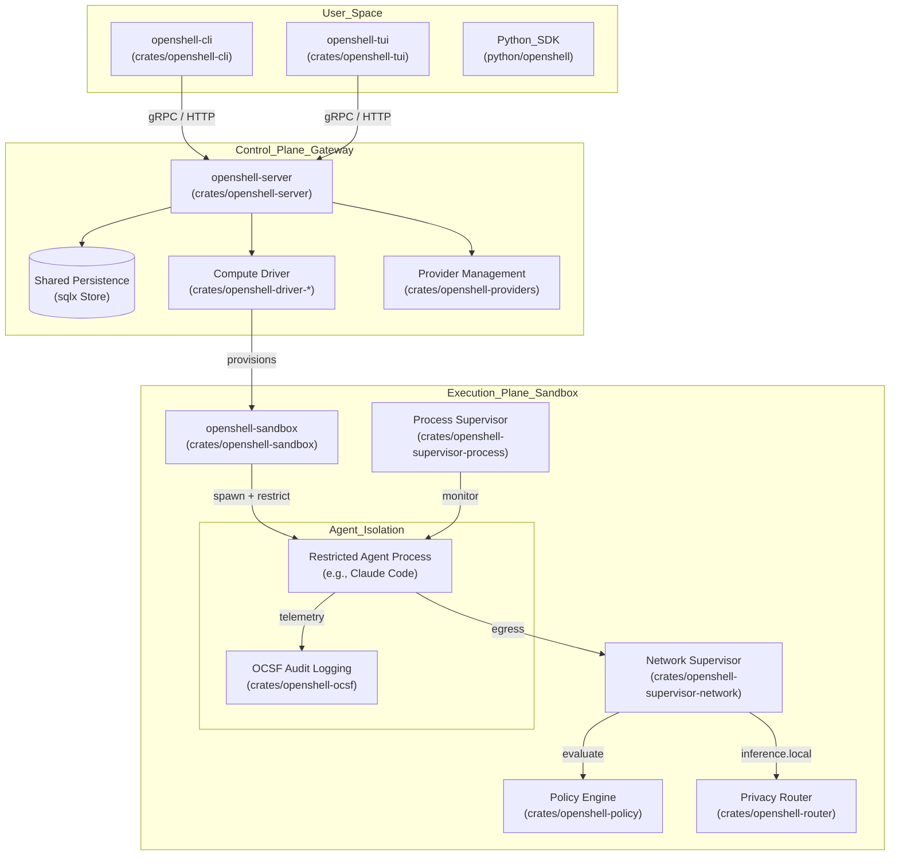

**Diagram: OpenShell Component Topology and Code Mapping**

**Sources:** [AGENTS.md:37-70](), [README.md:93](), [crates/openshell-server/src/lib.rs:26-58]()

---

## Key Components

### 1. Gateway (`openshell-server`)

The gateway is the centralized control-plane API responsible for orchestrating sandboxes, enforcing policies, authenticating clients, and managing lifecycle states.

- **Durable State Management:** Holds records of sandboxes, policies, provider credentials, and runtime settings in a shared persistence layer backed by a `Store` abstraction supporting both SQLite and Postgres [crates/openshell-server/src/lib.rs:40-58]().
- **Compute Drivers:** Integrates various drivers for sandbox provisioning and lifecycle management, including Docker, Podman, Kubernetes, and VM-based runtimes. Drivers are registered and selected dynamically within the gateway environment [crates/openshell-core/src/config.rs:120-134](), [crates/openshell-server/src/lib.rs:12-24]().
- **Network Protocol Multiplexing:** Listens on a single service port, multiplexing gRPC and HTTP traffic using an in-house multiplex module for efficient API handling [crates/openshell-server/src/lib.rs:25-38]().
- **Authentication & Authorization:** Implements mTLS and OIDC client validation, issues JWT tokens for authorized sandbox sessions, and enforces access control on gateway RPCs [README.md:93]().

---

### 2. Sandbox Supervisor (`openshell-sandbox`)

A critical defense boundary within each sandbox:

- **Process Execution & Restriction:** Launches agent workloads ("restricted agent processes") under stringent security controls that enforce isolation primitives such as Landlock and seccomp at the kernel level, dropping all unnecessary privileges before agent execution [README.md:93]().
- **Policy Enforcement:** Implements runtime policy checks on file access, system calls, and network egress bound to the identity of executables, enabling nuanced least-privilege rules (e.g., restricting `curl` differently from `python`) [AGENTS.md:41]().
- **Gateway Coordination:** Connects back to the gateway for configuration, policy updates, and bi-directional streaming of logs and telemetry [architecture/gateway.md:58-67]().

---

### 3. Privacy Router (`openshell-router`)

Specialized for inference calls to `https://inference.local`:

- **Credential Injection & Routing:** Strips any direct credentials from agent requests and injects gateway-managed provider credentials when forwarding calls to external LLM endpoints, preserving privacy and policy compliance [README.md:93]().
- **Traffic Rerouting:** Provides transparent forwarding for inference API traffic while ensuring policy checks on destinations and endpoints [README.md:93,93]().

---

## Protection Layers

OpenShell enforces policy in four primary domains, each managed by specialized subcomponents that provide defense in depth:

| Layer         | Enforcement Component                | Purpose                            | Enforcement Model           |
|---------------|------------------------------------|----------------------------------|----------------------------|
| **Filesystem**| `openshell-supervisor-process`     | Prevent unauthorized file access | Static (sandbox creation)  |
| **Network**   | `openshell-supervisor-network`     | Enforce outbound network controls | Dynamic (hot reload)       |
| **Process**   | `openshell-supervisor-process`     | Control system call & process behavior | Static (sandbox creation)  |
| **Inference** | `openshell-router`                  | Reroute inference calls, inject creds | Dynamic (hot reload)       |

Each layer ensures that agents run with minimal access necessary, and that attempts to escalate privileges or exfiltrate data are blocked in real time [README.md:93](), [AGENTS.md:68-69]().

---

## Data Flow: Request Enforcement and Inference Routing

This sequence diagram models how an agent's outgoing network request is intercepted, evaluated for policy compliance, and then forwarded or denied. It highlights the major runtime components involved in real-time enforcement.

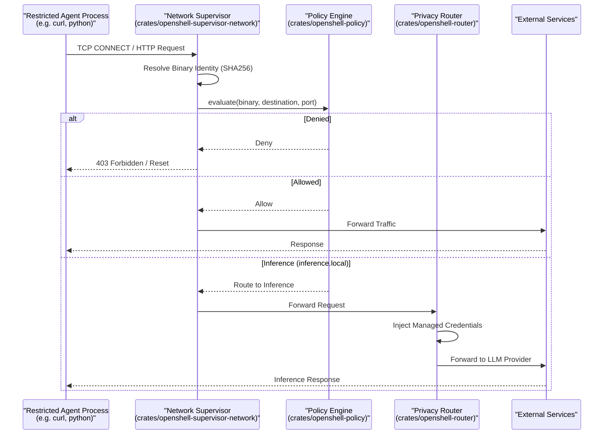

**Diagram: Request Enforcement and Inference Routing Flow**

**Sources:** [README.md:93](), [AGENTS.md:68-69](), [architecture/gateway.md:19-21]()

---

## Repository Layout

OpenShell's repository is organized to separate components, APIs, tools, and documentation clearly:

| Directory         | Description                                            |
|-------------------|--------------------------------------------------------|
| `crates/`         | Core Rust crates constituting the main OpenShell system, including gateway server, sandbox runtime, supervisor, drivers, policy engine, SDK, telemetry, and extensions [AGENTS.md:27-58]() |
| `proto/`          | Protobuf service and message definitions for gRPC APIs — gateway, sandbox, compute driver, inference, and supervisor middleware interfaces [AGENTS.md:64]() |
| `deploy/`         | Dockerfiles, Kubernetes manifests, Helm charts, and related deployment scripts for production and development environments |
| `sdk/`            | Language SDK implementations for Go, TypeScript, and Rust clients providing access to OpenShell APIs [README.md:69-71]() |
| `python/openshell`| Python SDK packaging and CLI wrappers [README.md:68]() |
| `e2e/`            | End-to-end integration test suites exercising gateway, sandbox, policy, and driver functionality |
| `tests/`          | Unit and integration tests across crates |
| `examples/`       | Sample policies, sandbox setups, and agent workflows illustrating concepts and advanced usage |
| `providers/`      | Credential provider implementations and YAML registries managing cloud credentials and API tokens |
| `telemetry/`      | Telemetry collection code and usage reporting supporting anonymous operational data to improve the project [README.md:83-85]() |

This modular structure supports the agent-first development model, enabling independent development, testing, and deployment of components.

**Sources:** [README.md:66-71](), [AGENTS.md:27-70]()

---

## Development Philosophy: Agent-First

OpenShell embraces an **agent-first** development approach: the project is built using autonomous AI agents to design, implement, and maintain the codebase, while human maintainers guide product direction and review [CONTRIBUTING.md:3]().

Key elements of this approach include:

- **Agent Skills:** Predefined agent workflows (`skills/` for public, `.agents/skills/` for contributors) automate tasks like triaging issues, debugging gateways, managing sandboxes, and helping with PR workflows.
- **Vouch System:** To maintain quality control amid AI-generated contributions, first-time contributors must be vouched by maintainers before their PRs are accepted [CONTRIBUTING.md:23-31]().
- **Workflow Chains:** Standardized sequences—for example, triage → spike → build-from-issue—systematically handle issue intake and code production.
- **Observability:** Optional anonymous telemetry collects aggregate operational data devoid of sensitive details, helping the community and maintainers improve security and usability [README.md:83-85]().

This rigorous, reproducible process ensures contributions are safe, high quality, and aligned with the overall vision.

**Sources:** [CONTRIBUTING.md:3-31](), [AGENTS.md:20-32](), [README.md:83-85]()

---

## Next Steps

Explore deeper into OpenShell through the following detailed areas:

- **Getting Started:** Installation, first sandbox setup, and system requirements.
- **Core Concepts:** Sandboxes, gateways, policies, and providers.
- **CLI Reference:** Comprehensive command-line interface usage.
- **Gateway Architecture & Deployment:** Server internals, configuration, authentication, and Kubernetes deployment.
- **Sandbox System:** Supervisor processes, isolation enforcement, and networking.
- **Policy System:** Language, enforcement, validation, and formal verification.
- **Compute Drivers:** Container, Kubernetes, VM, and Windows support.
- **APIs, SDKs, and Extensibility:** gRPC interfaces, SDK clients, extensions.
- **Advanced Features and Examples:** Inference routing, GPU support, and tutorials.
- **Development & Contributing:** Environment setup, workflows, and contribution guidelines.
- **Testing & Quality:** Testing strategy and suites.
- **Build & Release System:** CI/CD pipelines and versioning.
- **Glossary:** Terminology and concepts clearly defined.

Links to these topics are provided in the broader wiki and documentation structure.

---

This overview grounds users and contributors in OpenShell’s purpose, architecture, and code layout, enabling efficient navigation and understanding of this secure AI agent runtime system.

**Sources:** [README.md](), [AGENTS.md](), [CONTRIBUTING.md](), [crates/openshell-server/src/lib.rs]()

---

# Page: Getting Started

# Getting Started

<details>
<summary>Relevant source files</summary>

The following files were used as context for generating this wiki page:

- [.agents/skills/test-release-canary/SKILL.md](.agents/skills/test-release-canary/SKILL.md)
- [.github/workflows/release-canary.yml](.github/workflows/release-canary.yml)
- [docs/about/installation.mdx](docs/about/installation.mdx)
- [install.sh](install.sh)
- [nix/test-guest/scripts/snap-gateway-repro.sh](nix/test-guest/scripts/snap-gateway-repro.sh)
- [snapcraft.yaml](snapcraft.yaml)
- [tasks/scripts/test-install-sh.sh](tasks/scripts/test-install-sh.sh)
- [tasks/scripts/test-packaging-assets.sh](tasks/scripts/test-packaging-assets.sh)

</details>


This section guides you through installing OpenShell and creating your first sandbox. OpenShell provides a secure, policy-governed runtime for AI agents by isolating them in sandboxed environments `[docs/sandboxes/manage-sandboxes.mdx:11-12]()`.

For detailed platform requirements and kernel dependencies, see [System Requirements](#2.3). For a comprehensive walkthrough of sandbox creation and agent interaction, see [Creating Your First Sandbox](#2.2). For details on the installation script and package managers, see [Installation](#2.1).

## Overview of Getting Started Flow

OpenShell consists of two primary runtime components: the **CLI** (the `openshell` binary) and the **Gateway** (the control plane managing sandbox lifecycles) `[docs/about/installation.mdx:11-23]()`. On local machines, the gateway typically runs as a background service (systemd or Homebrew) and manages sandboxes via Docker, Podman, or a MicroVM driver `[docs/about/installation.mdx:33-39]()`.

### Natural Language to Code Entity Space: Installation & Bootstrap

The following diagram maps the high-level installation and startup concepts to the specific code entities and scripts that implement them.

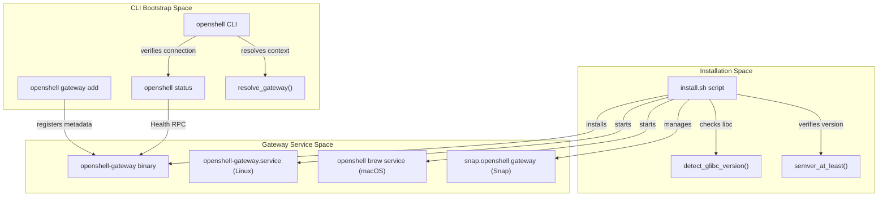

**Sources:** `[install.sh:171-197]()`, `[docs/about/installation.mdx:11-23]()`, `[docs/about/installation.mdx:43-57]()`, `[docs/about/installation.mdx:86-90]()`

## Installation Methods

The recommended way to install OpenShell is via the official installation script, which detects your OS and uses the native package manager (RPM, DEB, or Homebrew) `[install.sh:7-9]()`. Alternatively, users on supported Linux distributions can install via Snap `[docs/about/installation.mdx:86-90]()`.

### Supported Installation Targets

| Method | Platform | Details |
|--------|----------|---------|
| **Binary Script** | Linux / macOS | `curl -LsSf https://raw.githubusercontent.com/NVIDIA/OpenShell/main/install.sh | sh` installs packages and starts the gateway service; the script detects glibc version on Linux to ensure compatibility `[install.sh:171-218]()` |
| **Homebrew** | macOS (Apple Silicon) | Installs `openshell` CLI and starts a launchd service managed by Homebrew `[docs/about/installation.mdx:43-47]()` |
| **APT / DNF** | Ubuntu / Fedora | Linux distributive package installation (`.deb` or `.rpm`) installs the service as a systemd user service `[docs/about/installation.mdx:58-62]()` |
| **Snap** | Linux | Strict confinement snap package with Docker requirements, providing CLI, TUI, Prover, and Gateway as snap apps `[snapcraft.yaml:46-47]()`, `[docs/about/installation.mdx:105-111]()` |
| **Helm** | Kubernetes | Deploy gateway in a cluster with Helm charts, specifying version explicitly or using dev/pipeline tags `[docs/about/installation.mdx:145-147]()` |

The install script respects environment variables like `OPENSHELL_VERSION` (for version pinning) and `OPENSHELL_INSTALL_METHOD` (for selecting package type) `[install.sh:16-28]()`. To upgrade from older versions or migrate installation types, the installer includes guard logic and prompts `[install.sh:162-222]()`. The script also configures your PATH and manages gateway service start accordingly.

For package metadata validation and packaging artifacts tests, see relevant scripts in `tasks/scripts/` `[tasks/scripts/test-packaging-assets.sh:5-166]()`. Snap packaging strictly enforces confinement and dependencies listed in `snapcraft.yaml` `[snapcraft.yaml:1-174]()`. 

For detailed install instructions and setup of the service, see [Installation](#2.1).

## Creating Your First Sandbox

Once the gateway is running, users create sandboxes to run isolated agent workloads. Sandboxes are ephemeral, isolated runtime environments managed by the gateway and enabled by the compute drivers (Docker, Podman, VM) `[docs/sandboxes/manage-sandboxes.mdx:15-21]()`.

### Sandbox Creation Flow

The CLI facilitates sandbox creation by interacting with the gateway via gRPC, which in turn uses the configured compute driver to prepare the sandbox runtime.

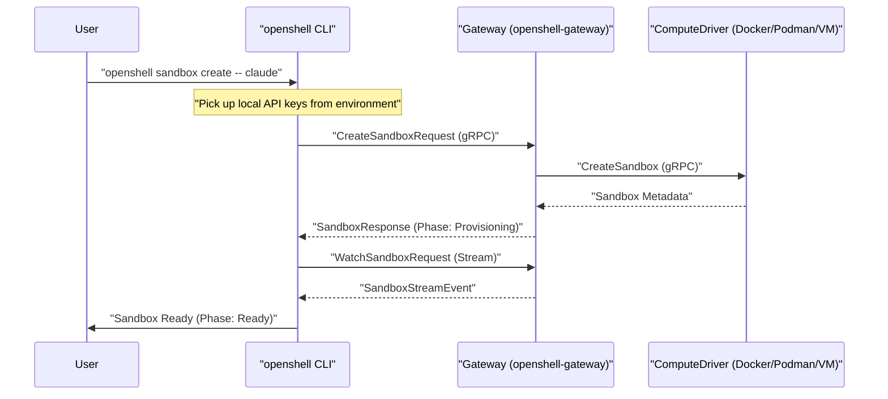

Credentials for AI providers can be auto-detected and attached to sandboxes for access management `[crates/openshell-cli/src/run.rs:25-34]()`. This involves registering providers and credential profiles that relay authentication transparently inside the sandbox.

### Verifying Sandbox Security

The default sandbox policy strictly limits outbound access, enforcing a secure boundary. Verification steps:

1. Create sandbox: `openshell sandbox create --name demo` `[docs/sandboxes/manage-sandboxes.mdx:32-34]()`
2. Test blocked network access: `openshell sandbox exec -n demo -- curl https://api.github.com`
3. Attach provider credentials (`openshell provider create anthropic`) to enable access to services `[crates/openshell-cli/src/run.rs:25-34]()`
4. Connect interactively: `openshell sandbox connect demo` `[crates/openshell-cli/src/ssh.rs:77-79]()`

See the detailed tutorial in [Creating Your First Sandbox](#2.2) for a step-by-step walkthrough.

**Sources:** `[crates/openshell-cli/src/run.rs:46-63]()`, `[docs/sandboxes/manage-sandboxes.mdx:15-21]()`

## System Requirements Overview

OpenShell leverages modern OS and kernel features for sandbox isolation, networking, and security `[docs/about/installation.mdx:35-39]()`. Understanding system prerequisites ensures proper installation and runtime behavior.

| Requirement          | Minimum Version / Feature                | Notes                                     |
|----------------------|----------------------------------------|-------------------------------------------|
| **glibc**            | 2.28+                                  | Linux gateway and CLI packages require this minimum `[install.sh:171-218]()` |
| **Docker**           | 28.0 or later                          | Needed for Docker compute driver support `[docs/about/installation.mdx:38-39]()` |
| **Podman**           | 5.x                                   | Required for rootless Podman compute driver on Linux `[docs/about/installation.mdx:37]()`
| **macOS**            | Apple Silicon (arm64)                   | For Homebrew-managed gateway, requires Hypervisor.framework for VM driver `[install.sh:8-9]()` |
| **Kernel Features**  | Landlock, seccomp notify, namespaces    | Kernel security features for isolation (see [System Requirements](#2.3)) |
| **Service Support**  | systemd user services or launchd         | For managing the gateway background service |

For comprehensive details on each platform, runtime, and kernel configuration, see [System Requirements](#2.3).

## Next Steps

- **Installation:** Learn how to customize the install and verify your setup in [Installation](#2.1).
- **First Sandbox:** Follow the detailed tutorial to launch your first agent in [Creating Your First Sandbox](#2.2).
- **System Requirements:** Review detailed platform and driver requirements in [System Requirements](#2.3).

---

This page provides a high-level view to help you get going with OpenShell's installation, sandbox creation, and prerequisite review. For full details, please navigate to the child pages linked above.

**Sources:**  
- `[install.sh:1-222]()`  
- `[docs/about/installation.mdx:11-158]()`  
- `[snapcraft.yaml:1-174]()`  
- `[tasks/scripts/test-packaging-assets.sh:5-166]()`  
- `[crates/openshell-cli/src/run.rs:25-63]()`  
- `[docs/sandboxes/manage-sandboxes.mdx:11-34]()`

---

# Page: Installation

# Installation

<details>
<summary>Relevant source files</summary>

The following files were used as context for generating this wiki page:

- [.agents/skills/test-release-canary/SKILL.md](.agents/skills/test-release-canary/SKILL.md)
- [.github/workflows/build-rpm.yml](.github/workflows/build-rpm.yml)
- [.github/workflows/package-release-binaries.yml](.github/workflows/package-release-binaries.yml)
- [.github/workflows/release-canary.yml](.github/workflows/release-canary.yml)
- [.github/workflows/rpm-package.yml](.github/workflows/rpm-package.yml)
- [.github/workflows/snap-package.yml](.github/workflows/snap-package.yml)
- [.packit.yaml](.packit.yaml)
- [deploy/rpm/CONFIGURATION.md](deploy/rpm/CONFIGURATION.md)
- [deploy/rpm/QUICKSTART.md](deploy/rpm/QUICKSTART.md)
- [deploy/rpm/TROUBLESHOOTING.md](deploy/rpm/TROUBLESHOOTING.md)
- [deploy/rpm/gateway.toml.default](deploy/rpm/gateway.toml.default)
- [docs/about/installation.mdx](docs/about/installation.mdx)
- [docs/about/support-matrix.mdx](docs/about/support-matrix.mdx)
- [docs/how-it-works/policies/prover.mdx](docs/how-it-works/policies/prover.mdx)
- [install.sh](install.sh)
- [nix/test-guest/cache-seal.sh](nix/test-guest/cache-seal.sh)
- [nix/test-guest/configuration/snapd.yml](nix/test-guest/configuration/snapd.yml)
- [nix/test-guest/scripts/snap-gateway-repro.sh](nix/test-guest/scripts/snap-gateway-repro.sh)
- [openshell.spec](openshell.spec)
- [snapcraft.yaml](snapcraft.yaml)
- [tasks/scripts/test-install-sh.sh](tasks/scripts/test-install-sh.sh)
- [tasks/scripts/test-packaging-assets.sh](tasks/scripts/test-packaging-assets.sh)

</details>


This page documents the OpenShell installation process, including the `install.sh` script mechanics, native package distribution (RPM/Debian/Homebrew/Snap), version selection environment variables, upgrade guards, and gateway service bootstrapping with PATH setup. For detailed platform and kernel requirements, see [System Requirements](2.3).

---

## Installation Methods

OpenShell supports multiple installation methods that target various platforms and packaging formats.

| Method | Command | Platform Support |
|--------|---------|------------------|
| **Unified Installer Script** | `curl -LsSf https://raw.githubusercontent.com/NVIDIA/OpenShell/main/install.sh \| sh` | Linux (glibc), macOS (Apple Silicon) [install.sh:1-100]() |
| **Homebrew Tap** | `brew install nvidia/openshell/openshell` | macOS (Apple Silicon) [install.sh:19-26]() |
| **Snap Package** | `sudo snap install openshell` | Linux (Ubuntu and other distros) [snapcraft.yaml:4-99]() |
| **RPM Package (Fedora/RHEL)** | `sudo dnf install openshell` | x86_64, aarch64 [docs/about/installation.mdx:59-61]() |
| **Debian Package (Ubuntu/Debian)** | `sudo apt install ./openshell.deb` | x86_64, aarch64 [docs/about/installation.mdx:61-63]() |

The recommended entry point for most users is the unified installer shell script (`install.sh`). This script auto-detects the host environment and picks the appropriate package type for installation, simplifying the process [install.sh:7-94]().

---

## `install.sh` Script Overview

The `install.sh` shell script implements a robust, cross-platform installer for OpenShell. It handles version selection, platform detection, native package selection, dependency verification, and installation orchestration.

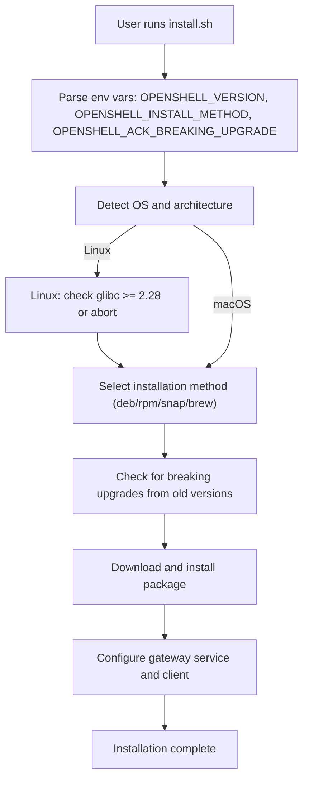

**Details:**

- **Version Selection**:  
  The installer honors the `OPENSHELL_VERSION` environment variable to install a specific release.  
  - If unset, installs latest tagged release.  
  - Special values supported:  
    - `dev`: rolling development builds  
    - `pre`: latest prerelease requiring authenticated GitHub CLI session  
  [install.sh:16-39]()

- **Platform Detection**:  
  Uses `uname` and other heuristics to detect OS type and architecture, focusing on Linux x86_64/aarch64 and macOS Apple Silicon (arm64).  
  [install.sh:150-180]()

- **glibc Compatibility**:  
  On Linux, `install.sh` verifies glibc version via `ldd --version` or fallback `getconf GNU_LIBC_VERSION` and prohibits installation if glibc < 2.28 or if musl libc is detected.  
  This avoids runtime incompatibilities with the provided Debian or RPM packages.  
  [install.sh:161-220]()

- **Package Method Selection**:  
  Linux package method defaults to `.deb` on Debian/Ubuntu or `.rpm` on Fedora/RHEL unless overridden by `OPENSHELL_INSTALL_METHOD` environment variable (`deb`, `rpm`, or `snap`). The installer prefers native packages for release and prerelease versions, falling back to Snap for `dev` builds unless explicitly opted in.  
  Snap installs require a Docker Engine installed from the system packages, not the Docker snap.  
  [install.sh:229-282, 320-370]()

- **Upgrade Guard**:  
  Detects if an existing native (non-snap) OpenShell installation exists with version < 0.0.37 (breaking release). In such cases, installation with snap is blocked unless `OPENSHELL_ACK_BREAKING_UPGRADE=1` is set by the user acknowledging upgrade steps.  
  This prevents silent incompatible migrations [install.sh:285-315]().

- **Installation Execution**:  
  Downloads the selected package asset from the GitHub release artifacts and installs it using native package tools (`dpkg -i` for Debian, `dnf install` or `rpm -i` for RPM, or `brew install` for macOS) [install.sh:371-420]().

- **Gateway Registration and Setup**:  
  After installation, the gateway is configured and started automatically by the system package service manager or Homebrew services. Client certificates are registered so the CLI can communicate securely.  
  The installer manages environment variables and PATH adjustments as appropriate.  
  [install.sh:420-480]().

---

## Packaging Formats

### RPM and Debian Packages

OpenShell ships prebuilt `.rpm` and `.deb` packages for supported Linux distributions:

- The RPM package contains:
  - `openshell` CLI binary
  - `openshell-gateway` service binary
  - Standalone `openshell-prover` binary for local policy validation
  - Systemd user service unit (`openshell-gateway.service`) that launches the gateway in user context
  - Default gateway TOML configurations that are seeded on first startup
  - Migration script for config schema changes at upgrades

- The Debian package is similar, with appropriate control files and systemd units under `~/.config/openshell`.

Both package types declare requirements on Podman or Docker engines as runtime dependencies.  
[openshell.spec:40-180](), [docs/about/installation.mdx:89-102]()

---

### Snap Package

The Snap package (`openshell`) supports Linux across distributions with `snapd`:

- Contains `openshell` CLI, `openshell.term` terminal UI, standalone `openshell.prover`, and `openshell.gateway` service
- Runs gateway as a system snap service at port 17670
- Requires a system Docker daemon from system packages — Docker snap is incompatible
- Shipment includes the `openssh-client` binary to avoid relying on host ssh keys for sandbox session connectivity
- Uses strict confinement with plugs for `home`, `network`, `system-observe`, and `docker`
- Provides policy-enforced refresh that preserves active sandbox sessions via `refresh-mode: endure` setting
- Installation instructions include manually copying client TLS certificates for trusted users and registering the local gateway with the CLI

Snap packages do **not** migrate state or configuration from native Debian or RPM installs and require manual cleanup before migration.  
[snapcraft.yaml:4-174](), [docs/about/installation.mdx:105-134]()

---

### Homebrew Packaging (macOS)

For Apple Silicon macOS:

- The installer installs the release Homebrew formula `nvidia/openshell/openshell`.
- The formula includes CLI binaries, the `openshell-gateway` daemon, and the experimental VM runtime driver.
- The gateway runs as a Homebrew service bound to `https://localhost:17670`
- Configuration files are located either at `~/.config/openshell/gateway.toml` or the Homebrew global config path.
- Gateway client certificates are automatically handled by the Homebrew service lifecycle.

Homebrew taps provide a seamless user experience with service management integration.  
[install.sh:19-26](), [docs/about/installation.mdx:76-86]()

---

## Upgrade Guards and Version Selection

### Environment Variables Control

- `OPENSHELL_VERSION`:  
  Defines the release tag or special build to install (default latest stable).  
  Supported special values: `dev` (rolling development), `pre` (prerelease).  
  [install.sh:16-39]()

- `OPENSHELL_INSTALL_METHOD`:  
  On Linux, selects package format: `snap`, `deb`, or `rpm`. Defaults to native package selection based on distro.  
  [install.sh:230-260]()

- `OPENSHELL_ACK_BREAKING_UPGRADE`:  
  Must be explicitly set to `1` to acknowledge an upgrade from pre-v0.0.37 native installs to snap installs, preventing accidental state incompatibility.  
  [install.sh:285-315]()

### Upgrade Guard Mechanics

The script checks if there is an existing native `openshell` CLI binary with version less than the breaking release minimum (`0.0.37`), and if so, it refuses to proceed with snap installation unless the user acknowledges the upgrade manually.

This prevents silent transition issues to snaps with isolated state and TLS bundles.  
[install.sh:285-315]()

---

## Gateway Service Setup and PATH Configuration

The gateway service is bootstrapped differently depending on OS and package method:

| Platform | Service Manager | Service Type | Config Location | TLS and Client Certs |
|----------|-----------------|--------------|-----------------|---------------------|
| Linux (deb/rpm) | systemd user service | `openshell-gateway.service` | `~/.config/openshell/gateway.toml` | `~/.config/openshell/gateways/openshell/mtls/` with PKI generated on first start |
| macOS (Homebrew) | launchd via `brew services` | `openshell-gateway` Homebrew service | `~/.config/openshell/gateway.toml` or Homebrew prefix | Client certs auto-placed by Homebrew |
| Linux (Snap) | system snap service | `snap.openshell.gateway.service` | `/var/snap/openshell/common/gateway.toml` | TLS bundle at `$SNAP_COMMON/tls`, handled by snap wrapper |

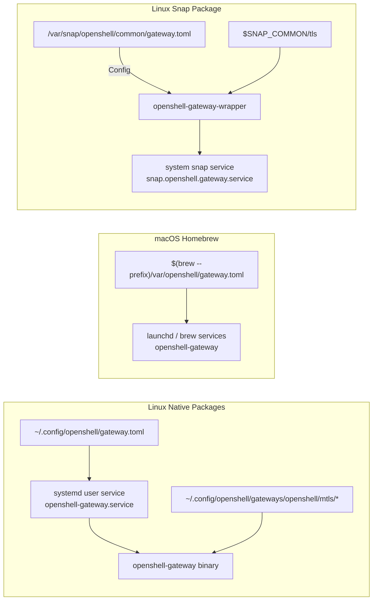

**Key Points:**

- The **gateway service** user unit or service wrapper generates PKI (*mTLS*) certificates on first launch automatically via the command `openshell-gateway generate-certs`.
- Service execution includes a "config preflight" check to validate the gateway TOML before startup.
- Client certificates are stored in user home directories for native installs, enabling CLI zero-config mTLS authentication.
- The Snap package uses a gateway wrapper that overrides default TLS environment variables, isolates the package state, and carefully manages systemd service restart policies to avoid killing sandboxes during snap refresh.
- Environment variables such as `OPENSHELL_LOCAL_TLS_DIR` and `OPENSHELL_TELEMETRY_ENABLED` are injected into the service environment.
- The CLI installs in standard binary directories and updates the user's PATH automatically for immediate usage.

---

## Environment Variables Summary

| Variable                  | Usage Description                                            | Default Value / Behavior                              |
|---------------------------|--------------------------------------------------------------|------------------------------------------------------|
| `OPENSHELL_VERSION`       | Release tag or special build to install (`dev`, `pre`)       | Latest stable release if unset [install.sh:16-24]()  |
| `OPENSHELL_INSTALL_METHOD`| Package install method on Linux (`deb`, `rpm`, `snap`)       | Auto-detect native package manager [install.sh:230-260]() |
| `OPENSHELL_ACK_BREAKING_UPGRADE` | Acknowledge upgrade from pre-0.0.37 native installs      | Must be unset or `1` to allow snap install [install.sh:285-315]() |
| `OPENSHELL_DRIVERS`       | Compute driver override (e.g., `vm`, `docker`)                | Auto-detect [docs/about/installation.mdx:33]()       |
| `OPENSHELL_LOCAL_TLS_DIR` | Directory path for local TLS certificates                     | `~/.local/state/openshell/tls` by default             |
| `OPENSHELL_TELEMETRY_ENABLED` | Enable/disable anonymous telemetry                        | Enabled by default, can be disabled                    |

---

## Post-Installation Verification

After installation completes, verify the following:

| Checkpoint              | Command Example                                   | Notes                                |
|-------------------------|-------------------------------------------------|------------------------------------|
| Gateway service status  | `systemctl --user status openshell-gateway`     | Linux RPM/Debian packages           |
|                         | `brew services list`                             | macOS Homebrew                      |
|                         | `snap services openshell.gateway`                | Snap package                       |
| CLI connectivity         | `openshell status`                               | Should connect securely to gateway |
| Sandbox lifecycle example| Create/exec/delete a test sandbox via CLI       | Confirming sandbox driver integration  |
| Gateway logs             | `journalctl --user -u openshell-gateway -f`     | Real-time service logs on Linux     |
|                         | `brew services logs openshell`                   | macOS Homebrew                      |
|                         | `snap logs openshell.gateway`                     | Snap package                        |

---

## Diagrams Bridging Natural Language and Code Entities

### 1. Installation Workflow to Script Implementation

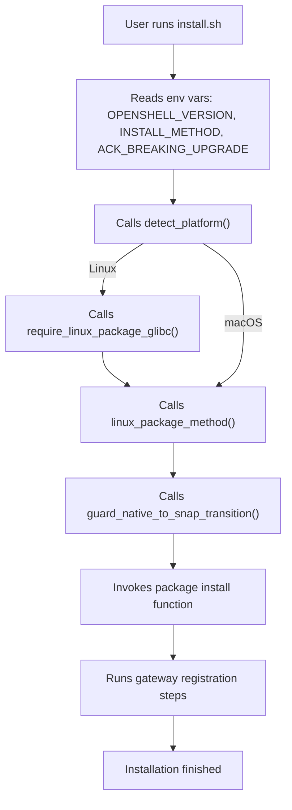

- `detect_platform` identifies OS and architecture.  
- `require_linux_package_glibc` verifies glibc version for Linux installs.  
- `linux_package_method` decides package format based on user input and system detection.  
- `guard_native_to_snap_transition` ensures safe upgrade path.  
- Installation invokes appropriate package manager commands.  
- Gateway registration adds the service and configures mTLS certs on first run.  
[install.sh:150-230, 285-315, 320-480]()

---

### 2. Gateway Service Startup Components

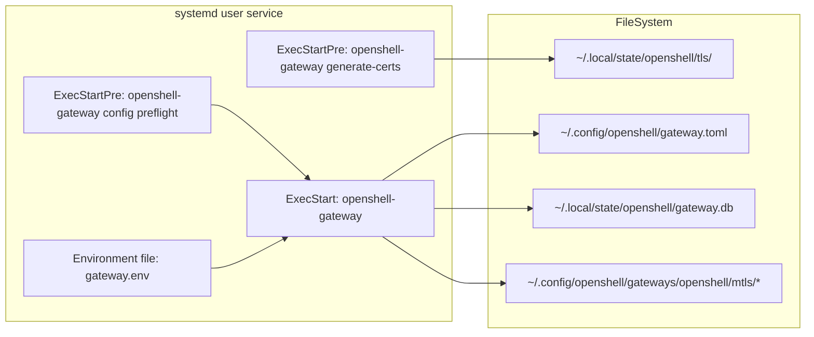

- The user service executes preflight and cert-generation before gateway daemon start.  
- Configuration is persisted and migrated under user home directory.  
- Client certificates enable secure CLI to gateway communication.  
[docs/about/installation.mdx:130-160](), [openshell.spec:120-160]()

---

## Summary

- **Installer**: The `install.sh` script provides a single command installation that auto-detects platform and suitable package for OpenShell.  
- **Packaging**: Packages exist as native Debian, RPM, Snap, and Homebrew formula.  
- **Versioning**: User-controlled environment variables allow pinning to dev, prerelease, or stable releases.  
- **Upgrade Safety**: Guards prevent silent incompatible transitions from native installs to snap.  
- **Service Setup**: The gateway runs as a systemd user service on Linux or a launchd service on macOS, with automatic PKI generation and config preflight validations.  
- **PATH & Certificates**: Installation ensures CLI usability with proper PATH and client certificate discovery for zero-config secure operation.

---

# References  
|| File | Lines | Description |  
|---|---------|------------------|-------------|  
|1|install.sh|1-480|Installer script: main mechanics, platform detection, glibc checking, package selection, upgrade guards, install calls|  
|2|docs/about/installation.mdx|1-158|Installation user guides, environment variables, gateway service details|  
|3|snapcraft.yaml|1-180|Snap package definition, confinement, apps included, gateway wrapper and refresh mode|  
|4|openshell.spec|1-160|RPM packaging spec, gateway service unit, config management|  
|5|tasks/scripts/test-install-sh.sh|1-198|Test coverage of glibc checks and package method selection, upgrade guard|  

Sources:  
[install.sh:1-480](), [docs/about/installation.mdx:1-158](), [snapcraft.yaml:1-174](), [openshell.spec:1-160](), [tasks/scripts/test-install-sh.sh:1-198]()

---

# Page: Creating Your First Sandbox

# Creating Your First Sandbox

<details>
<summary>Relevant source files</summary>

The following files were used as context for generating this wiki page:

- [crates/openshell-cli/src/main.rs](crates/openshell-cli/src/main.rs)
- [crates/openshell-cli/src/run.rs](crates/openshell-cli/src/run.rs)
- [crates/openshell-cli/tests/provider_commands_integration.rs](crates/openshell-cli/tests/provider_commands_integration.rs)
- [crates/openshell-cli/tests/sandbox_create_lifecycle_integration.rs](crates/openshell-cli/tests/sandbox_create_lifecycle_integration.rs)
- [crates/openshell-server/src/compute/mod.rs](crates/openshell-server/src/compute/mod.rs)
- [crates/openshell-server/src/grpc/policy.rs](crates/openshell-server/src/grpc/policy.rs)
- [crates/openshell-server/src/grpc/provider.rs](crates/openshell-server/src/grpc/provider.rs)
- [crates/openshell-server/src/grpc/sandbox.rs](crates/openshell-server/src/grpc/sandbox.rs)
- [crates/openshell-server/src/storage_proto.rs](crates/openshell-server/src/storage_proto.rs)
- [examples/policy-advisor/README.md](examples/policy-advisor/README.md)
- [examples/policy-advisor/ctf.py](examples/policy-advisor/ctf.py)
- [examples/sandbox-policy-quickstart/README.md](examples/sandbox-policy-quickstart/README.md)
- [examples/sandbox-policy-quickstart/demo.sh](examples/sandbox-policy-quickstart/demo.sh)
- [examples/sandbox-policy-quickstart/policy.yaml](examples/sandbox-policy-quickstart/policy.yaml)
- [proto/openshell.proto](proto/openshell.proto)
- [providers/pypi.yaml](providers/pypi.yaml)
- [scripts/smoke-test-network-policy.sh](scripts/smoke-test-network-policy.sh)
- [sdk/go/proto/openshellv1/openshell.pb.go](sdk/go/proto/openshellv1/openshell.pb.go)
- [skills/generate-sandbox-policy/examples.md](skills/generate-sandbox-policy/examples.md)

</details>


This page provides a comprehensive technical walkthrough of creating your first OpenShell sandbox. It covers the full process: registering and selecting a gateway, creating a sandbox, configuring providers for credential injection, and interacting with the sandbox via the CLI.

This includes the core implementation behind command invocation, RPC invocations, data flow between components, and sandbox lifecycle tracking.

For installation steps, see [Installation](2.1). For sandbox architecture and policy enforcement internals, see [Sandbox System](6).

---

## Prerequisites

Before starting sandbox creation, ensure the following prerequisites:

- **OpenShell CLI Installed:** Confirm with `openshell --version`. The CLI codebase entrypoint is [`crates/openshell-cli/src/main.rs`](crates/openshell-cli/src/main.rs:1-187) and command implementations reside in [`run.rs`](crates/openshell-cli/src/run.rs:1-167).
- **Active Gateway Registered and Selected:** The gateway is the central control plane. You must have one added and selected in CLI state. The CLI resolves the active gateway via environment, config files, or CLI flags ([`main.rs:78-126`](crates/openshell-cli/src/main.rs:78-126)).
- **Compute Driver Setup:** The gateway must have a configured compute driver backend (Docker, Podman, Kubernetes, MicroVM, etc.) responsible for sandbox lifecycle ([`crates/openshell-server/src/compute/mod.rs`](crates/openshell-server/src/compute/mod.rs:1-175)).
- **Provider Credentials Ready:** Prepare credentials for providers (e.g., OpenAI or Anthropic API keys). These are securely stored, managed, and attached to sandboxes ([`crates/openshell-cli/src/run.rs:24-35`](crates/openshell-cli/src/run.rs:24-35)).

Sources: [crates/openshell-cli/src/main.rs:78-126](), [crates/openshell-cli/src/run.rs:24-35](), [crates/openshell-server/src/compute/mod.rs:1-175]()

---

## Gateway Registration & Selection

Gateways serve as the control plane for sandbox provisioning and management. The CLI must resolve which gateway to target for commands.

### Gateway Resolution Mechanism

The CLI resolves the active gateway through this priority order in [`main.rs`]():

1. `--gateway-endpoint` CLI flag with optional explicit gateway name.
2. `--gateway` CLI flag specifying registered gateway name.
3. `OPENSHELL_GATEWAY` environment variable.
4. Active gateway saved in `~/.config/openshell/active_gateway`.

The function `resolve_gateway()` implements this logic, returning a `GatewayContext` containing gateway name and endpoint URL. If a direct endpoint is provided, the CLI attempts to find a metadata record matching it or uses the raw URL as the name ([`main.rs:78-126`](crates/openshell-cli/src/main.rs:78-126)).

### Authentication Application

Before RPCs, the CLI applies authentication tokens based on gateway auth mode, supporting Cloudflare Access JWT or OIDC tokens, loading stored tokens transparently ([`main.rs:159-184`](crates/openshell-cli/src/main.rs:159-184)).

---

## Creating a Sandbox

The core user operation is `openshell sandbox create`, implemented primarily in [`run.rs`](crates/openshell-cli/src/run.rs), which calls the gateway’s `CreateSandbox` gRPC endpoint ([`proto/openshell.proto:47-54`](proto/openshell.proto:47-54)).

### Command Flow & Implementation

- The CLI starts parsing the `sandbox create` command.
- If an agent is specified on the command line, the CLI uses `ensure_required_providers()` to confirm required providers are registered and attached ([`run.rs:24-27`](crates/openshell-cli/src/run.rs:24-27)).
- The CLI sends a `CreateSandboxRequest` proto message to the gateway, specifying sandbox name, image, resource limits (CPU, memory, GPU), and environment.
- The gateway validates the sandbox spec and responds with the created sandbox info ([`proto/openshell.proto:47`](proto/openshell.proto:47)).
- The CLI watches sandbox provisioning progress via the `WatchSandboxRequest` stream, displaying interactive progress ([`run.rs:10-18`](crates/openshell-cli/src/run.rs:10-18)).

#### Example CLI command:

```bash
openshell sandbox create --from base --name demo-sandbox -- cpu
```

### Data Flow Diagram: User Command to Sandbox Creation

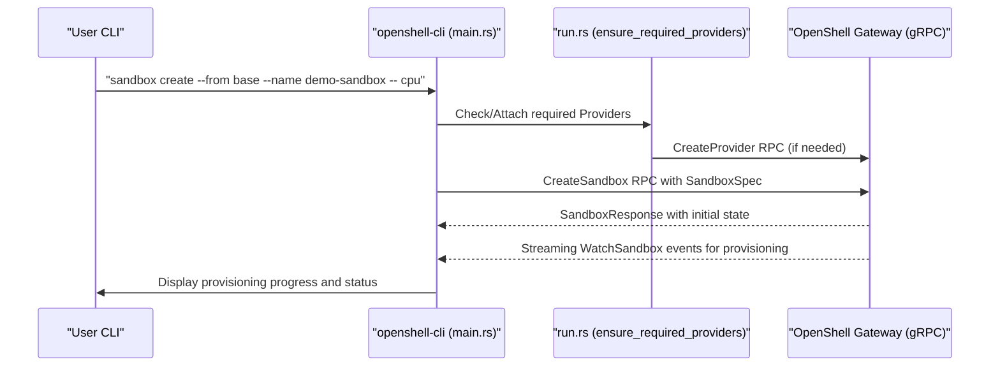

Sources: [crates/openshell-cli/src/main.rs:78-126](), [crates/openshell-cli/src/run.rs:24-35](), [proto/openshell.proto:47-54]()

---

## Provider Setup and Attachment

Providers supply credentials securely injected into sandbox environments.

### Provider Lifecycle During Sandbox Creation

- When the sandbox creation detects missing providers (e.g., for an LLM agent), it prompts or orchestrates provider creation from credentials.
- The CLI creates new provider records via `CreateProvider` RPC ([`proto/openshell.proto:213-230`](proto/openshell.proto:213-230)), handled by the gateway.
- Providers are attached to the sandbox via `AttachSandboxProvider` RPC to associate credentials with that sandbox session ([`proto/openshell.proto:124-131`](proto/openshell.proto:124-131)).
- Providers include types such as `anthropic`, `openai`, or custom environment key-value mappings.
- Provider creation and attachment details are managed within `run.rs` commands ([`run.rs:24-35`](crates/openshell-cli/src/run.rs:24-35)).

### Provider Data Structures

- `Provider` proto message contains credentials and configuration.
- Providers manage credential handles internally for refresh and security.
- Credential injection happens automatically inside sandbox environments on startup.

Sources: [crates/openshell-cli/src/run.rs:24-35](), [proto/openshell.proto:213-230](), [proto/openshell.proto:124-131]()

---

## Sandbox Provisioning Lifecycle and Status Tracking

The sandbox lifecycle phases are represented by the `SandboxPhase` enum, such as `PROVISIONING`, `READY`, `ERROR`, `DELETING` ([`proto/openshell.proto:92-132`](proto/openshell.proto:92-132)).

### State Machine of Sandbox Lifecycle

```mermaid
stateDiagram-v2
    [*] --> Provisioning : "CreateSandbox"
    Provisioning --> Ready : "SandboxPhase::READY"
    Provisioning --> Error : "SandboxPhase::ERROR"
    Ready --> Stopping : "StopSandbox"
    Stopping --> Stopped : "SandboxPhase::STOPPED"
    Stopped --> Starting : "StartSandbox"
    Starting --> Ready : "SandboxPhase::READY"
    Ready --> Deleting : "DeleteSandbox"
    Deleting --> [*]
```

- CLI monitors provisioning using gRPC streams (`WatchSandboxRequest`) to receive phase transitions.
- Error messages and detailed progress are extracted from sandbox conditions.
- Interactive CLI progress is managed via `ProvisioningDisplay` and status messages ([`run.rs:10-18`](crates/openshell-cli/src/run.rs:10-18)).

### Handling Provisioning Feedback

The CLI uses utilities like `handle_platform_progress_event()` to present interactive progress bars and status messages for end-user clarity ([`run.rs:11-16`](crates/openshell-cli/src/run.rs:11-16)).

Sources: [proto/openshell.proto:92-132](), [crates/openshell-cli/src/run.rs:10-18]()

---

## Connecting and Interacting with the Sandbox

Once `READY`, sandboxes are accessible for SSH, one-shot commands, and file sync.

### Connecting via SSH

The CLI facilitates interactive connections with the sandbox using an embedded SSH proxy client:

- The client calls `CreateSshSession` on the gateway, which returns a `SshRelayTarget` forwarding to the sandbox supervisor ([`proto/openshell.proto:198-200`](proto/openshell.proto:198-200), [`crates/openshell-cli/src/ssh.rs`](crates/openshell-cli/src/run.rs:94-118)).
- The CLI implements a local proxy (`sandbox_ssh_proxy`) that sets up a standard SSH client conn over this relay.
- Users may run `openshell sandbox connect <name>` for full login shell access.

### Executing Commands Without Persisted Terminal

`openshell sandbox exec` runs a command in the sandbox directly via the `ExecSandbox` streaming RPC ([`proto/openshell.proto:209-211`](proto/openshell.proto:209-211)).

### File Sync, Port Forwarding, and Services

The CLI supports syncing files up/down and port forwarding to sandbox services using commands wrapping gRPC methods ([`run.rs:97-98`](crates/openshell-cli/src/run.rs:97-98)).

---

## Summary Table of Key CLI Commands and Corresponding RPCs

| CLI Command         | RPC Method                          | Role                                                        |
|---------------------|-----------------------------------|-------------------------------------------------------------|
| `gateway add`       | `AddGateway` (gateway.proto)      | Register and store a gateway endpoint                      |
| `gateway select`    | N/A (local preference)             | Choose active gateway for CLI commands                      |
| `sandbox create`    | `CreateSandbox`                   | Provision new sandbox environment                            |
| `sandbox connect`   | `CreateSshSession`                | Establish interactive remote SSH session                    |
| `sandbox exec`      | `ExecSandbox`                    | Execute single command with streamed output                 |
| `provider create`   | `CreateProvider`                  | Register credential provider used for sandbox environment   |
| `sandbox provider attach` | `AttachSandboxProvider`         | Attach a provider to a sandbox’s environment                 |

Sources: [proto/openshell.proto:22-230](), [crates/openshell-cli/src/run.rs:24-35](), [crates/openshell-cli/src/ssh.rs:4-184]()

---

# Diagrams Bridging Natural Language to Code

### 1. Gateway Registration and CLI Gateway Context Resolution

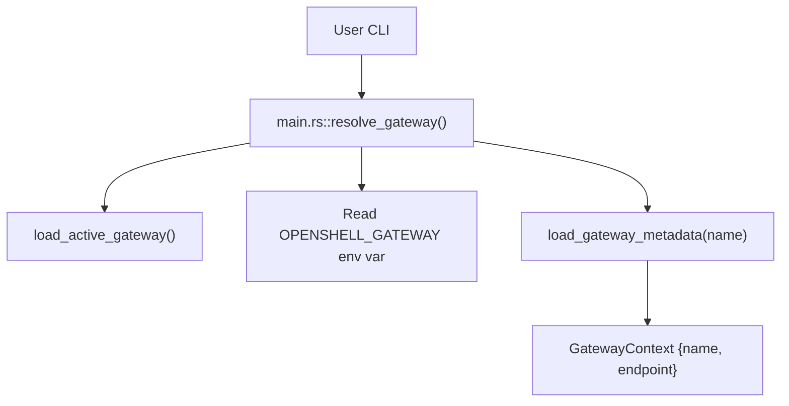

### 2. Sandbox Creation Flow from CLI to Gateway RPC

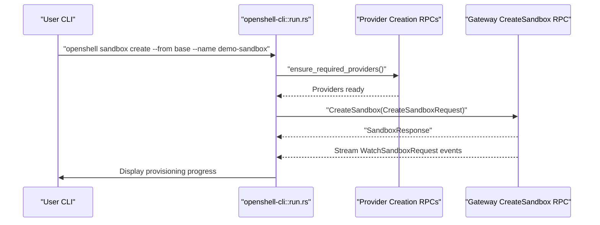

---

This completes the detailed walkthrough for creating your first OpenShell sandbox, covering gateway registration, sandbox provisioning, provider setup, and CLI interaction.

Sources:  
- [crates/openshell-cli/src/main.rs:25-126]()  
- [crates/openshell-cli/src/run.rs:10-35]()  
- [proto/openshell.proto:23-230]()  
- [crates/openshell-server/src/compute/mod.rs:1-175]()  
- [crates/openshell-cli/src/ssh.rs:4-184]()

---

# Page: System Requirements

# System Requirements

<details>
<summary>Relevant source files</summary>

The following files were used as context for generating this wiki page:

- [.github/workflows/snap-package.yml](.github/workflows/snap-package.yml)
- [docs/about/overview.mdx](docs/about/overview.mdx)
- [docs/about/support-matrix.mdx](docs/about/support-matrix.mdx)
- [docs/extensibility/drivers.mdx](docs/extensibility/drivers.mdx)
- [docs/extensibility/isolation-backends.mdx](docs/extensibility/isolation-backends.mdx)
- [docs/how-it-works/inference.mdx](docs/how-it-works/inference.mdx)
- [docs/how-it-works/policies/default-policy.mdx](docs/how-it-works/policies/default-policy.mdx)
- [docs/how-it-works/policies/overview.mdx](docs/how-it-works/policies/overview.mdx)
- [docs/how-it-works/policies/prover.mdx](docs/how-it-works/policies/prover.mdx)
- [docs/how-it-works/providers/profiles.mdx](docs/how-it-works/providers/profiles.mdx)
- [docs/index.mdx](docs/index.mdx)
- [docs/index.yml](docs/index.yml)
- [docs/kubernetes/ingress.mdx](docs/kubernetes/ingress.mdx)
- [docs/security/best-practices.mdx](docs/security/best-practices.mdx)

</details>


This page documents the platform, software, kernel, and hardware requirements for running OpenShell. It covers host system prerequisites, compute driver requirements (Docker, Podman, MicroVM, Kubernetes, and Windows MXC), kernel security features, as well as runtime dependencies and packaging considerations.

For installation instructions, see [Installation](2.1). For deployment topology options (local, remote, cloud), see [Gateway Deployment](5.1).


## Platform Support

OpenShell supports Linux, macOS, and Windows host systems. The CLI and container images are built for multiple architectures to enable deployment across developer workstations, cloud instances, and edge hardware. The main supported platforms are:

| Platform                      | Architecture            | Status       | Notes                                                         |
|-------------------------------|------------------------|--------------|---------------------------------------------------------------|
| Linux (Debian/Ubuntu)          | x86_64 (amd64)          | Supported    | Requires glibc >= 2.28 for gateway binaries                   |
| Linux (Debian/Ubuntu)          | aarch64 (arm64)         | Supported    | Common on ARM servers and edge devices                         |
| macOS                         | Apple Silicon (arm64)   | Supported    | Supports Hypervisor.framework for VM driver                    |
| Windows 11                   | x86_64                  | Supported    | Via MXC (Microsoft Execution Containers) driver               |

OpenShell's CLI binary for Linux is a static musl build and does **not** depend on glibc at runtime, making it lightweight and portable across Linux distributions. However, the `openshell-gateway` binary requires glibc version 2.28 or newer on Linux systems. Compatible Linux distributions include Ubuntu 20.04+, RHEL 8+, Rocky Linux 8+, Amazon Linux 2023+, and Fedora 32+.

### Platform Detection Logic in install.sh

The installation script performs detection of the host OS and libc version to determine installation feasibility and paths.

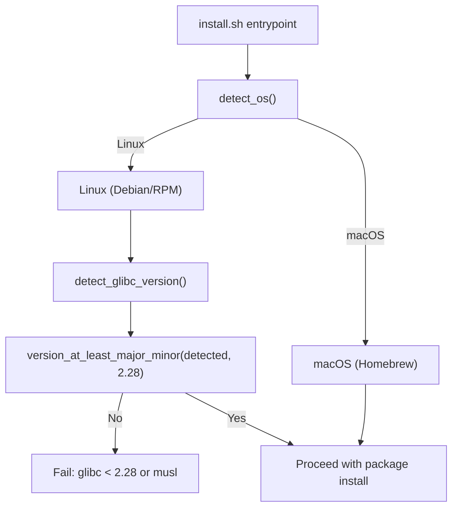

**Sources:** [architecture/build.md:78-95](), [install.sh:22-24,171-218](), [snapcraft.yaml:52-59](), [docs/about/installation.mdx:43-84]()


## Supported Compute Drivers

The OpenShell gateway supports multiple compute drivers responsible for sandbox lifecycle management. The choice of compute driver significantly affects system requirements and runtime guarantees.

| Compute Driver | System Requirements | Status |
|----------------|---------------------|--------|
| **Docker** | Docker Desktop or Docker Engine 28.0+ on the gateway host; Linux or Windows (WSL 2). | Supported |
| **Podman** | Linux with Podman 5.x+, cgroups v2, user socket access, rootless networking setup. | Supported |
| **MicroVM (VM)** | Host must support virtualization: Hypervisor.framework (macOS) or KVM (Linux). | Experimental |
| **Kubernetes** | Kubernetes cluster and Helm v3+; cluster config and permissions. | Supported |
| **Microsoft Execution Containers (MXC)** | Windows 11 with MXC support; integrated with Windows sandbox capabilities. | Supported |

### MicroVM Runtime Requirements

The MicroVM runtime uses the `openshell-driver-vm` compute driver with `libkrun` as the embedded VM runtime. Key requirements and components include:

- **Host Virtualization**: Uses native Hypervisor.framework on macOS or KVM on Linux.
- **Networking**: Uses `gvproxy` to provide virtio-net egress and loopback NAT inside the VM.
- **GPU Passthrough**: Supports VFIO-based GPU passthrough requires kernel support and host permissions to bind/unbind devices.
- **Sandbox-init**: Guest initialization script launches the sandbox runtime as PID 1 and enforces boundaries.
- **Sandbox Runtime**: The trusted workload boundary binary `openshell-sandbox` orchestrates agent process management and enforces isolation.

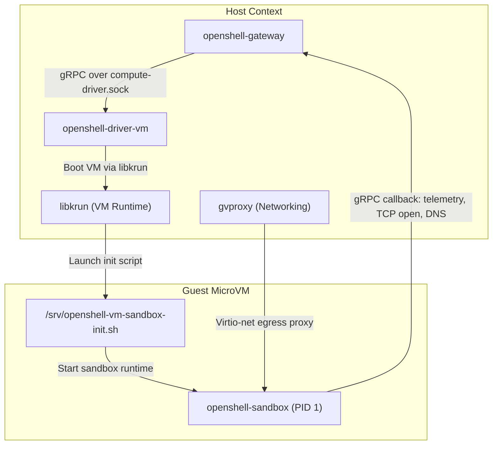

**Sources:** [docs/about/installation.mdx:31-41](), [crates/openshell-driver-vm/README.md:1-110, 143-146]()


## Kernel Security Features

OpenShell relies on Linux kernel security facilities to enforce sandbox isolation with defense in depth.

### Landlock LSM (Linux Security Module)

- Landlock enables sandbox processes (the `openshell-sandbox` runtime) to create fine-grained, user-level filesystem policies.
- Landlock restricts reads, writes, and mounts to declared paths, preventing unauthorized filesystem access.
- OpenShell requires Landlock ABI version 3 or higher for protected baseline paths.
- Policies are locked at sandbox creation and require sandbox recreation to modify.

### seccomp (Secure Computing Mode)

- seccomp filters used to restrict Linux syscalls that may lead to sandbox escapes or privilege escalation.
- OpenShell applies seccomp BPF filters at sandbox creation.
- With privilege dropping to a non-root user (`setuid`/`setgid`), seccomp adds a critical protection layer.

These kernel security features combined provide strong kernel-level guarantees for process, filesystem, and network isolation for workloads running inside sandboxes.

**Sources:** [docs/security/best-practices.mdx:23-36](), [docs/extensibility/isolation-backends.mdx:8-48]()


## Runtime Dependencies and Packaging

### Required Libraries and Binaries

- **glibc >= 2.28**: Required for gateway and non-static supervisor binaries on Linux. This requirement is enforced by install scripts and packaging metadata.
- **Static musl binaries**: The `openshell` CLI and `openshell-sandbox` runtime binaries are statically linked to musl for portability across Linux distros.
- **Snapd**: Required for Snap users; the Snap package connects to the Docker daemon via plugs and slots. Snap also bundles most dependencies.

### Packaging Formats Supported

| Package Type | Supported Platforms | Notes |
|--------------|---------------------|-------|
| DEB | Ubuntu, Debian | Packages require glibc >= 2.28 |
| RPM | RHEL, Fedora, Rocky | Same requirements as DEB |
| Snap | Linux (amd64, arm64) | Auto-updating; requires snapd and manual Docker slot connection |
| Homebrew | macOS (arm64) | Installs latest CLI and supervisor dependencies |

### Configuration File Discovery

The gateway and CLI search for `gateway.toml` configuration from multiple locations for flexibility:

| Location                    | Notes                       |
|-----------------------------|-----------------------------|
| `~/.config/openshell/gateway.toml` | User config on Linux/macOS    |
| `$SNAP_COMMON/gateway.toml`          | Snap specific config on Linux |
| `/opt/homebrew/var/openshell/gateway.toml` | Homebrew on macOS               |

### CI and Testing Dependencies

- **Mise** is used as the task runner for local and CI tasks.
- **Cargo Zigbuild** for cross-compilation to musl static targets used in packaging and release artifacts.

**Sources:** [install.sh:22-24,171-218](), [snapcraft.yaml:19-59](), [docs/about/installation.mdx:43-100](), [architecture/build.md:81-87,101-113]()


## Docker and Podman Specifics

### Docker

- Docker Desktop or Engine 28.0+ required on the gateway host for Linux or WSL2 Windows.
- Requires Docker socket access for the compute driver gRPC communication.
- Images and containers run with the `openshell-sandbox` runtime injected.
- GPU acceleration requires NVIDIA Container Toolkit and device plugin on the host.

### Podman

- Linux hosts only.
- Requires Podman 5.x or newer with rootless cgroups v2 support.
- The rootless networking setup is necessary to allow container ingress and egress.
- The compute driver communicates with Podman via its local socket.

These container runtimes provide the isolation foundation, with OpenShell applying additional kernel-enforced policy layers.

**Sources:** [docs/about/installation.mdx:36-38]()


## Diagrams Relating System Components to Code Entities

### Diagram 1: System Platform Support Corresponding Code Artifacts

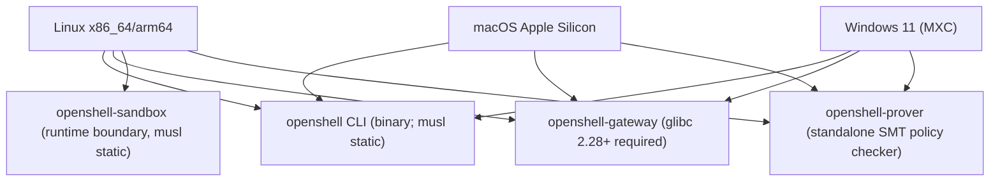

**Sources:** [architecture/build.md:78-95](), [install.sh:22-24,171-218](), [docs/about/installation.mdx:43-84]()


### Diagram 2: Compute Driver and Isolation Backend Interaction in Code

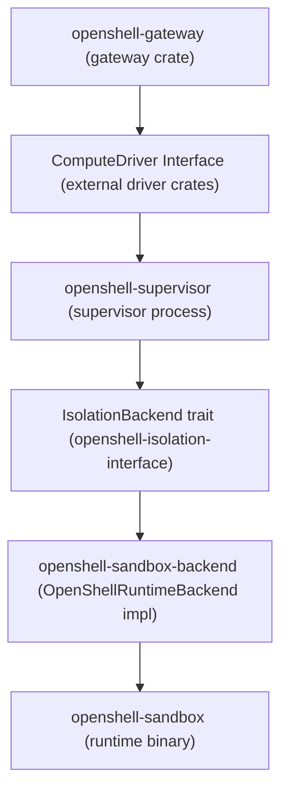

**Explanation:**  
- The gateway orchestrates sandbox lifecycles and calls the compute driver.  
- The compute driver (Docker, Podman, Kubernetes, VM, MXC) manages resource creation and fencing.  
- The supervisor process manages policy enforcement and process lifecycle.  
- The `IsolationBackend` trait is the runtime abstraction interface implemented by `openshell-sandbox-backend`.  
- The sandbox backend communicates with the sandbox runtime binary within the workload boundary.

**Sources:** [docs/extensibility/isolation-backends.mdx:9-48](), [docs/about/installation.mdx:31-41]()


---

# Summary

OpenShell requires a Linux, macOS, or Windows host with specific architecture, kernel, and software dependencies to run the gateway, CLI, sandbox runtime, and policy prover. The choice of compute driver (Docker, Podman, Kubernetes, MicroVM, or MXC) imposes additional prerequisites such as container runtime versions, virtualization support, and cloud infrastructure.

Security features in the Linux kernel like Landlock and seccomp provide critical sandbox isolation. Packaging via deb/rpm/snap/homebrew installs these components with appropriate dependency handling. The static musl-compiled CLI and sandbox runtime enable portable deployment across supported Linux distros.  

For detailed configuration, policy enforcement, and sandbox lifecycle discussions, see the related pages in the documentation.

---

**Sources:**  
[architecture/build.md:78-95,101-113]()  
[install.sh:22-24,171-218]()  
[snapcraft.yaml:19-59]()  
[docs/about/installation.mdx:31-102]()  
[docs/extensibility/isolation-backends.mdx:9-48]()  
[crates/openshell-driver-vm/README.md:1-110,143-146]()  
[docs/security/best-practices.mdx:23-36]()

---

# Page: Core Concepts

# Core Concepts

<details>
<summary>Relevant source files</summary>

The following files were used as context for generating this wiki page:

- [.agents/skills/build-from-issue/SKILL.md](.agents/skills/build-from-issue/SKILL.md)
- [.agents/skills/create-github-issue/SKILL.md](.agents/skills/create-github-issue/SKILL.md)
- [.agents/skills/create-github-pr/SKILL.md](.agents/skills/create-github-pr/SKILL.md)
- [.agents/skills/create-spike/SKILL.md](.agents/skills/create-spike/SKILL.md)
- [.agents/skills/fix-security-issue/SKILL.md](.agents/skills/fix-security-issue/SKILL.md)
- [.agents/skills/review-security-issue/SKILL.md](.agents/skills/review-security-issue/SKILL.md)
- [.agents/skills/sync-agent-infra/SKILL.md](.agents/skills/sync-agent-infra/SKILL.md)
- [.agents/skills/triage-issue/SKILL.md](.agents/skills/triage-issue/SKILL.md)
- [.github/ISSUE_TEMPLATE/bug_report.yml](.github/ISSUE_TEMPLATE/bug_report.yml)
- [.github/ISSUE_TEMPLATE/feature_request.yml](.github/ISSUE_TEMPLATE/feature_request.yml)
- [.github/PULL_REQUEST_TEMPLATE.md](.github/PULL_REQUEST_TEMPLATE.md)
- [AGENTS.md](AGENTS.md)
- [CONTRIBUTING.md](CONTRIBUTING.md)
- [README.md](README.md)

</details>


This page provides a high-level overview of the fundamental concepts that form the foundation of the OpenShell system: **sandboxes**, **gateways and workspaces**, **policies**, and **providers**. These components interact to create secure, isolated execution environments to run AI agents and manage their capabilities in a controlled manner.

Each concept will be introduced briefly here, with links to dedicated child pages for detailed technical information and operational specifics.

For getting started with practical use and CLI workflows, see [Getting Started](#2). For in-depth system architecture, refer to [Gateway Architecture & Deployment](#5) and [Sandbox System](#6).

---

## System Model

OpenShell adopts a **control plane / execution plane** architecture:

- The **Gateway** acts as the control plane managing sandboxes, policies, and access.
- **Sandboxes** provide isolated execution environments for workloads.
- **Policies** declare and enforce sandbox restrictions on filesystem, processes, and network.
- **Providers** handle credentials and secure injection into sandboxes.

The following diagram maps these natural language concepts to their respective code entities and components in the repository, bridging names from documentation to code references:

### High-Level System Architecture (Natural Language to Code Entities)
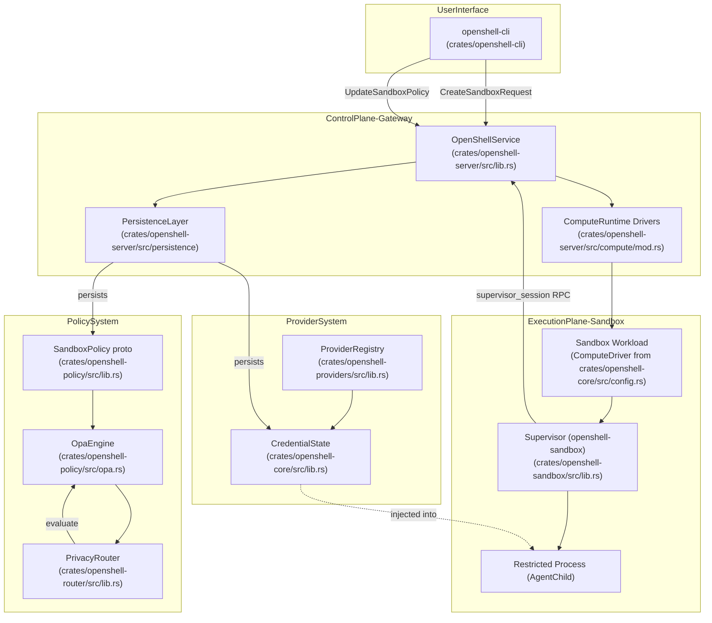
Sources: [crates/openshell-server/src/lib.rs:7-40](), [crates/openshell-core/src/config.rs:120-134](), [AGENTS.md:35-70](), [README.md:93]()

---

## The Four Core Concepts

### Sandboxes

A **sandbox** is an isolated runtime environment where AI agents or other workloads execute securely [README.md:19-26](). It is instantiated by compute drivers and supervised by the `openshell-sandbox` process, which enforces policy locally [AGENTS.md:28-29](). Sandboxes apply multiple layers of defense, including:

- **Supervisor:** The sandbox supervisor (`openshell-sandbox`) orchestrates sandbox processes and enforces egress routing consistent with declared policies.
- **Isolation Layers:** Filesystem, process, and network isolation use kernel-level primitives and are combined with sidecar proxies for network mediation.
- **Compute Drivers:** Multiple backends are supported, such as Docker, Podman, Kubernetes pods, VMs, and experimental Windows MXC containers.

Sandboxes are ephemeral and continuously enforced. Their lifecycle includes creation, running, completion, or error states, managed by the gateway [architecture/gateway.md:18-22]().

For an in-depth explanation, architecture diagrams, lifecycle phases, and use cases, see the child page: [Sandboxes](#3.1).

Sources: [README.md:19-26](), [AGENTS.md:28-29](), [architecture/gateway.md:18-22]()

---

### Gateways and Workspaces

The **gateway** is the central control plane managing sandboxes, policies, providers, and authentication [README.md:93](). It exposes a multiplexed gRPC and HTTP API and acts as a secure boundary for sandbox lifecycle operations and policy administration.

Key aspects include:

- **Multiplexed Server:** The gateway combines gRPC services for sandbox control, compute driver management, and policy enforcement on a single network port.
- **Compute Drivers Registry:** Multiple drivers (Docker, Podman, Kubernetes) are registered at startup and invoked to create sandbox workloads.
- **Workspaces:** The gateway supports workspace scoping to organize sandboxes, policies, and credentials by user or team boundaries.
- **High Availability:** Supports multi-replica deployment with peer relay for fault tolerance.

Persistence of domain state (sandboxes, policies, providers) is handled via a pluggable Store layer backed by SQLite or Postgres.

For more comprehensive technical detail, configuration schema, deployment strategies, and workspace behavior, see [Gateways and Workspaces](#3.2).

Sources: [crates/openshell-server/src/lib.rs:1-15](), [architecture/gateway.md:1-15, 28-35](), [README.md:93]()

---

### Policies

OpenShell enforces sandbox restrictions through a **declarative policy system**, written in YAML and represented internally with protobuf schemas [README.md:93](). Policies govern:

- **Filesystem Access:** Restricts which files and directories a sandbox’s process tree may read or write.
- **Network Access:** Controls outbound connections, destination hosts, and protocol-level rules.
- **Process Behavior:** Limits allowed syscalls and prevents privilege escalation.
- **Inference Controls:** Routes model API calls through vetted endpoints, adding credential injection and preventing data leaks.

Policies are designed to support both static (immutable, fixed at sandbox creation) and dynamic (hot-reloadable) components. Network and inference policies may update live without sandbox restarts.

The policy enforcement engine integrates with Open Policy Agent (OPA) through an `OpaEngine` wrapper and applies rules at the sandbox level.

Refer to the dedicated policy child page for language syntax, schema, enforcement layers, live-update mechanisms, validation, and formal verification: [Policies](#3.3).

Sources: [README.md:93](), [architecture/gateway.md:24-26](), [crates/openshell-policy/src/lib.rs]()

---

### Providers

**Providers** manage credential lifecycles and environment variable injection for sandboxes, enabling principle-of-least-privilege access to external services without exposing secrets directly.

Highlights include:

- **Credential Management:** The gateway resolves provider credentials and creates derivations for sandbox injection, ensuring sandbox-local scoped access.
- **Provider Registry:** Maintains a YAML-based registry of common cloud providers and integrations (e.g., AWS Bedrock, Google Vertex AI), defined with extensible profiles [AGENTS.md:53-53]().
- **Credential Refresh:** Handles periodic refreshes and secret rotation transparently to sandboxes.
- **Environment Injection:** Credentials and metadata are injected as environment variables or network-level identity tokens before outbound calls, implemented via the Privacy Router.

Providers work tightly with inference routing and network mediation to secure calls through approved endpoints, hiding underlying cloud secrets from sandboxed workloads.

For details on credential drivers, profiles, the YAML registry format, refresh workflows, and environment injection, see [Providers](#3.4).

Sources: [README.md:93](), [architecture/gateway.md:15-15](), [AGENTS.md:53-53]()

---

## Runtime Interaction Flow

The diagram below depicts how core components interact during the sandbox lifecycle and policy enforcement phases, mapping user commands to gateway APIs, compute driver actions, and sandbox supervision:

### Sandbox Creation and Policy Enforcement Flow
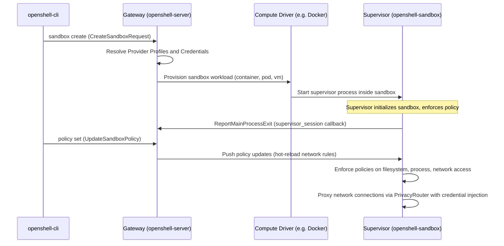
Sources: [architecture/gateway.md:28-35](), [README.md:79-93](), [crates/openshell-server/src/lib.rs:12-14]()

---

## Next Steps

- For a detailed understanding of sandbox internals and lifecycle, see [Sandboxes](#3.1).
- To learn about gateway deployment modes, workspace scoping, and multi-replica operation, see [Gateways and Workspaces](#3.2).
- For policy language, enforcement details, live updates, and formal verification, see [Policies](#3.3).
- To understand provider credential management, profiles, and registry management, see [Providers](#3.4).

Each child page dives deeper into its topic with diagrams, code references, and operational guidance for users and developers.

---

*End of section 3.*

# References

- [README.md:17-93]()
- [AGENTS.md:28-70]()
- [architecture/gateway.md:1-35]()
- [crates/openshell-server/src/lib.rs:1-40]()
- [crates/openshell-core/src/config.rs:120-134]()
- [crates/openshell-policy/src/lib.rs]()
- [crates/openshell-providers/src/lib.rs]()

---

# Page: Sandboxes

# Sandboxes

<details>
<summary>Relevant source files</summary>

The following files were used as context for generating this wiki page:

- [crates/openshell-cli/src/ssh.rs](crates/openshell-cli/src/ssh.rs)
- [crates/openshell-core/src/forward.rs](crates/openshell-core/src/forward.rs)
- [crates/openshell-sandbox/Cargo.toml](crates/openshell-sandbox/Cargo.toml)
- [crates/openshell-sandbox/src/lib.rs](crates/openshell-sandbox/src/lib.rs)
- [crates/openshell-sandbox/src/main.rs](crates/openshell-sandbox/src/main.rs)
- [crates/openshell-sandbox/src/process.rs](crates/openshell-sandbox/src/process.rs)
- [crates/openshell-sandbox/src/sandbox/linux/landlock.rs](crates/openshell-sandbox/src/sandbox/linux/landlock.rs)
- [crates/openshell-sandbox/src/sandbox/linux/mod.rs](crates/openshell-sandbox/src/sandbox/linux/mod.rs)
- [crates/openshell-server/src/supervisor_session.rs](crates/openshell-server/src/supervisor_session.rs)
- [crates/openshell-supervisor-process/Cargo.toml](crates/openshell-supervisor-process/Cargo.toml)
- [crates/openshell-supervisor-process/src/ssh.rs](crates/openshell-supervisor-process/src/ssh.rs)
- [crates/openshell-supervisor-process/src/ssh/peer_stream.rs](crates/openshell-supervisor-process/src/ssh/peer_stream.rs)
- [crates/openshell-supervisor-process/src/ssh/reconnect_tests.rs](crates/openshell-supervisor-process/src/ssh/reconnect_tests.rs)
- [crates/openshell-supervisor-process/src/supervisor_session.rs](crates/openshell-supervisor-process/src/supervisor_session.rs)
- [docs/how-it-works/sandboxes/overview.mdx](docs/how-it-works/sandboxes/overview.mdx)
- [e2e/python/test_sandbox_landlock.py](e2e/python/test_sandbox_landlock.py)
- [skills/openshell-cli/SKILL.md](skills/openshell-cli/SKILL.md)

</details>


**Purpose:** This page defines sandboxes as isolated execution environments, explains their architecture, lifecycle phases, and use cases in detail, and links to related concepts and technical components in the codebase.

For supervisor binary design, enforcement mechanisms, and network proxying, see [6. Sandbox System](). For policy configuration, see [7. Policy System](). For sandbox lifecycle control via gateways, see [3.2. Gateways and Workspaces]().

---

## What is a Sandbox?

A **sandbox** in OpenShell is the isolated runtime boundary where an AI agent or untrusted workload runs. Each sandbox combines strong *runtime isolation* with *policy controls* enforced by the kernel and userspace components:

- **Filesystem isolation** is enforced by Landlock LSM with explicit allow-lists on paths.
- **Process restrictions** use seccomp BPF syscall filters combined with privilege dropping.
- **Network mediation** is handled by an HTTP CONNECT proxy implementing policy evaluation and allowing transparent TCP interception.

The OpenShell sandbox abstraction is embodied primarily by the `openshell-sandbox` crate which manages sandbox startup, supervision, environment setup, credential injection, and enforcement [crates/openshell-sandbox/src/lib.rs:4-70]().

**Key characteristics:**

- **Two Trust Levels:** The `openshell-sandbox` supervisor starts as root to boot the environment then transitions to launching an unprivileged child process running the workload [crates/openshell-sandbox/src/lib.rs:64-70]().
- **Single-tenant:** Each sandbox operates in its own isolated network and process namespace [architecture/sandbox.md:47-47]().
- **Policy-driven:** Sandbox capabilities and access are restricted based on OpenShell policies which govern filesystem, process, and network rules [architecture/security-policy.md:1-6]().

---

## Sandbox Components and Code Mapping

This diagram maps the natural language sandbox concepts to the relevant code components in OpenShell, highlighting how responsibilities are distributed within the codebase.

### Sandbox Entity Mapping

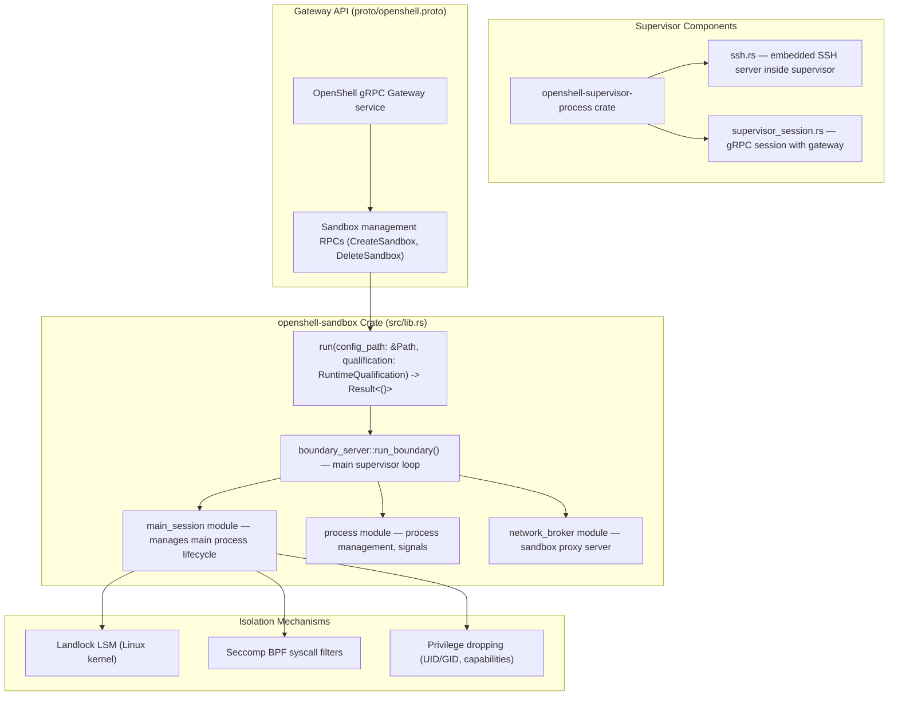

| Component                 | Code Entity / Location                            | Responsibility                                          |
|---------------------------|--------------------------------------------------|--------------------------------------------------------|
| Sandbox runtime boundary   | `run()` in `crates/openshell-sandbox/src/lib.rs` [64-70]() | Entrypoint launching the authenticated boundary server. |
| Supervisor main loop       | `boundary_server::run_boundary()` [10-70]()      | Coordinates sandbox lifecycle, policy load, child process handling. |
| Main process session       | `main_session` module [16-37]()                   | Manages the sandbox agent main process lifecycle, signaling, and output. |
| Process management        | `process` module [3-210]()                        | Handles child processes, environment, signals, and user context.    |
| Network proxy server      | `network_broker` module [19-42]() (Linux only)   | Enforces sandbox network policy via HTTP CONNECT proxy.|
| Supervisor process runtime | `openshell-supervisor-process` crate             | Embedded SSH server, gRPC gateway session, SSH tunnel forwarding. |
| Linux kernel sandboxing   | Landlock LSM, seccomp syscall filtering [extern] | Kernel-level policy enforcement on paths and syscalls.|
| Gateway API               | `proto/openshell.proto`                           | Gateway gRPC APIs for sandbox creation, management, and session handling. |

Sources: [crates/openshell-sandbox/src/lib.rs:4-70](), [crates/openshell-sandbox/src/main.rs:48-166](), [crates/openshell-supervisor-process/src/ssh.rs:1-181](), [proto/openshell.proto:20-53]()

---

## Sandbox Lifecycle Phases

Sandboxes progress through a finely controlled lifecycle managed by the gateway and supervisor processes. The phases and key transitions are:

### Phases

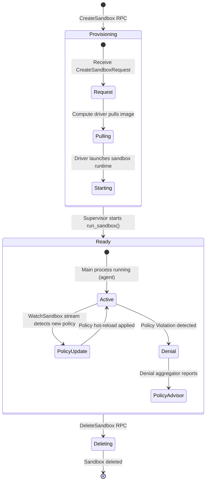

### Detailed Flow

1. **Provisioning:** Triggered by CLI or API via `CreateSandbox` RPC to the gateway, which instructs the compute driver (Docker, Podman, Kubernetes, or VM) to pull the base image and launch a new sandbox container/pod [crates/openshell-cli/src/run.rs:48-63](), [proto/openshell.proto:47-53]().
   
2. **Startup:** The supervisor (`run_sandbox`) starts inside the new workload, loading sandbox policy and bootstrap config. It applies filesystem, network, and process restrictions [crates/openshell-sandbox/src/lib.rs:64-70](), [crates/openshell-sandbox/src/main.rs:62-166]().

3. **Running:** The supervisor launches the canonical sandbox command as an unprivileged user. It maintains a supervisor session back to the gateway for management calls and log streaming. Network proxying enforces per-request policy [crates/openshell-supervisor-process/src/supervisor_session.rs:1-188]().

4. **Policy Updates:** The supervisor polls `WatchSandbox` or receives push updates through calls, hot-reloading policy in the sandbox's OPA engine without restart [crates/openshell-sandbox/src/lib.rs:27-42]().

5. **Termination:** On `DeleteSandbox` API request, the supervisor shuts down child processes and the compute driver removes the sandbox. Resources are cleaned up and logs finalized [proto/openshell.proto:144-150]().

Sources: [proto/openshell.proto:47-150](), [crates/openshell-sandbox/src/lib.rs:60-70](), [crates/openshell-cli/src/run.rs:48-63](), [crates/openshell-supervisor-process/src/supervisor_session.rs:1-188]()

---

## Isolation Architecture

OpenShell utilizes a **defense-in-depth** sandboxing model combining multiple kernels and userland controls:

### Static (Kernel-Level) Enforcement (Locked at Sandbox Creation)

- **Filesystem:** Landlock Linux Security Module restricts access to exact path sets white-listed by policy. Paths for runtime CA certs and GPU devices are injected before locking [crates/openshell-sandbox/src/sandbox/linux/mod.rs]().

- **Process user:** The agent runs as an unprivileged user with cleared capabilities and restricted privileges. The supervisor handles user and HOME directory resolution on exec [crates/openshell-sandbox/src/process.rs:175-199]().

- **Seccomp:** BPF filters block dangerous syscalls and mediate on allowed syscalls like socket creation to prevent direct bypass of proxies [crates/openshell-sandbox/src/lib.rs:39-42]().

These static controls are irreversible during the sandbox lifetime and protect fundamental kernel boundaries.

---

### Dynamic Enforcement (Hot-Reloadable)

- **Network Policy:** The sandbox network broker proxies outbound TCP connections and evaluates destination addresses against the OPA policy engine that runs inside supervisor memory. This allows fine-grained, real-time allow/deny decisions [crates/openshell-sandbox/src/network_broker.rs]().

- **L7 Inspection:** The proxy terminates TLS for inspection of HTTP, WebSocket, and other application-layer protocols to enforce path and method restrictions [architecture/sandbox.md:79-82]().

- **Inference Routing:** Special domain prefixes route requests transparently and enable credential injection per provider profile [architecture/security-policy.md:18-18]().

Sources: [crates/openshell-sandbox/src/lib.rs:14-43](), [crates/openshell-sandbox/src/network_broker.rs]()

---

## Sandbox Network Isolation and Proxying

The sandbox enforces **egress network isolation** via transparent interception:

1. **Network Namespace:** Each sandbox has its own private network namespace, isolating it from the host and other sandboxes [architecture/sandbox.md:47-47]().

2. **Traffic Interception:** Outbound TCP connections are routed to the sandbox's HTTP CONNECT proxy listening on localhost inside the sandbox [crates/openshell-sandbox/src/lib.rs:19-19]().

3. **Binary Identity:** The proxy resolves the calling process's metadata and declared binary check-sums to enforce policy bindings [architecture/security-policy.md:43-43]().

4. **OPA Policy Decision:** The destination is checked against deny-lists and allow-lists, and layered with L7 inspection. Denials generate audit events and batch into recommendations [crates/openshell-sandbox/src/lib.rs:22-46]().

5. **Audit Logging:** Network and HTTP interactions are logged using OCSF event schema for downstream SIEM ingestion [crates/openshell-ocsf].

### Diagram: Sandbox Network Proxy Flow

```mermaid
graph LR
    SandboxProcess["Sandbox Agent Process"]
    NetworkBroker["Network Broker Proxy<br/> (crates/openshell-sandbox/src/network_broker.rs)"]
    KernelNetNS["Linux Network Namespace"]
    GatewayProxy["Gateway Proxy / Firewall"]
    Destination["External Internet or Internal Endpoint"]

    SandboxProcess -->|Outbound TCP| KernelNetNS
    KernelNetNS -->|Redirect to localhost:proxy| NetworkBroker
    NetworkBroker -->|Evaluate OPA policy + L7 inspection| GatewayProxy
    GatewayProxy --> Destination
```

Sources: [crates/openshell-sandbox/src/lib.rs:19-43](), [architecture/sandbox.md:47-60](), [architecture/security-policy.md:31-49]()

---

## Credential Injection and Security

Sandbox security includes careful management of provider credentials:

- **Injection:** The gateway injects provider credentials (like API tokens) into sandbox environment variables during the child process startup [crates/openshell-sandbox/src/process.rs:166-173]().

- **Provider Env Isolation:** Supervisor-only environment variables are stripped from the agent's environment to avoid leaking sensitive data [crates/openshell-sandbox/src/process.rs:135-143]().

- **Atomic Refresh:** Credential values are atomically updated inside the gateway and pushed to the sandbox dynamically, preventing stale or leaked credentials [architecture/sandbox.md:112-117]().

- **Proxy Resolution:** The sandbox network proxy resolves credentials dynamically on each request to providers, ensuring tokens are scoped and not accessible beyond allowed channels.

Sources: [crates/openshell-sandbox/src/process.rs:135-173](), [architecture/sandbox.md:13-14, 112-117]()

---

## Sandboxes in Practice: Use Cases and CLI

Typical sandbox use involves:

- Creating sandboxes from public or private images designed for AI workloads.
- Running agent commands interactively or in detached mode.
- Managing restart policies for fault tolerance.
- Attaching tools like SSH or openshell CLI to inspect or interact with running sandboxes.
- Uploading files for stateful execution.
- Requesting GPU and resource limits.

Example CLI sandbox creation command:

```shell
openshell sandbox create --from registry.example.com/your-org/claude-agent:latest --name claude --cpu 2 --memory 4Gi --gpu -- ./claude-agent
```

- The `openshell` CLI communicates with the gateway, which orchestrates runtime provisioning, and supervises the sandbox lifecycle.
- SSH access is available via the embedded supervisor SSH server inside the sandbox for secure terminal interaction [crates/openshell-cli/src/ssh.rs:1-170]().

Sources: [docs/how-it-works/sandboxes/overview.mdx:1-163](), [crates/openshell-cli/src/ssh.rs:1-170]()

---

# Summary

Sandboxes are the **isolated, secure, and policy-controlled execution containers** where OpenShell runs trusted and untrusted AI agent workloads. They provide:

- Fine-grained kernel-enforced isolation (Landlock, seccomp, privilege dropping).
- Dynamic userspace network mediation and policy enforcement.
- Credential injection and sweeping flow control.
- Lifecycle orchestration via gateways and supervisors.
- Secure interactive access through embedded SSH.

This layered architecture ensures a robust, auditable boundary for advanced AI use cases.

---

# References and Sources

- [crates/openshell-sandbox/src/lib.rs:1-70]()
- [crates/openshell-sandbox/src/main.rs:1-166]()
- [crates/openshell-sandbox/src/process.rs:1-210]()
- [crates/openshell-supervisor-process/src/ssh.rs:1-181]()
- [crates/openshell-supervisor-process/src/supervisor_session.rs:1-188]()
- [crates/openshell-cli/src/ssh.rs:1-170]()
- [proto/openshell.proto:20-53,47-150]()
- [docs/how-it-works/sandboxes/overview.mdx:1-163]()
- [architecture/sandbox.md:1-60]()
- [architecture/security-policy.md:1-49]()

---

# Page: Gateways and Workspaces

# Gateways and Workspaces

<details>
<summary>Relevant source files</summary>

The following files were used as context for generating this wiki page:

- [crates/openshell-core/src/config.rs](crates/openshell-core/src/config.rs)
- [crates/openshell-server/src/cli.rs](crates/openshell-server/src/cli.rs)
- [crates/openshell-server/src/config_file.rs](crates/openshell-server/src/config_file.rs)
- [crates/openshell-server/src/lib.rs](crates/openshell-server/src/lib.rs)
- [crates/openshell-server/src/multiplex.rs](crates/openshell-server/src/multiplex.rs)
- [crates/openshell-server/src/persistence/mod.rs](crates/openshell-server/src/persistence/mod.rs)
- [crates/openshell-server/src/persistence/postgres.rs](crates/openshell-server/src/persistence/postgres.rs)
- [crates/openshell-server/src/persistence/sqlite.rs](crates/openshell-server/src/persistence/sqlite.rs)
- [crates/openshell-server/src/persistence/tests.rs](crates/openshell-server/src/persistence/tests.rs)
- [crates/openshell-server/src/policy_store.rs](crates/openshell-server/src/policy_store.rs)
- [crates/openshell-server/src/provider_refresh.rs](crates/openshell-server/src/provider_refresh.rs)
- [docs/about/run-your-first-agent.mdx](docs/about/run-your-first-agent.mdx)
- [docs/how-it-works/gateways/configuration.mdx](docs/how-it-works/gateways/configuration.mdx)
- [docs/how-it-works/policies/advisor.mdx](docs/how-it-works/policies/advisor.mdx)
- [skills/debug-openshell-cluster/SKILL.md](skills/debug-openshell-cluster/SKILL.md)

</details>


## Purpose and Scope

This page details the **gateways** as the central control plane in OpenShell, clarifying their role in sandbox management, workspace scoping, and deployment modes. It explains how gateways orchestrate lifecycles, enforce security policies, handle multi-replica operation, and deliver scoped isolation through workspaces. The documentation includes architectural insights, key code entities, data flows, and diagrams bridging conceptual components with their code implementations.

**Sources:** [crates/openshell-server/src/lib.rs:4-50](), [docs/how-it-works/gateways/configuration.mdx:1-102](), [crates/openshell-core/src/config.rs:150-187]()

---

## Gateways as the Control Plane

A gateway is the core OpenShell server process (`openshell-gateway`) acting as the system control plane. It exposes a **multiplexed gRPC and HTTP API** that clients (CLI, SDKs, supervisors) use for operations ranging from sandbox lifecycle management to observability and policy enforcement.

**Control Plane Functions:**

- **Sandbox Orchestration**: The gateway creates, updates, and deletes sandboxes by invoking a pluggable **ComputeRuntime** interface that abstracts runtime-specific provisioning details (Docker, Podman, Kubernetes, MicroVMs) [crates/openshell-server/src/lib.rs:90-91](), [crates/openshell-core/src/config.rs:130-155]().

- **State Persistence**: It uses a durable **Store** abstraction (backed by SQLite or Postgres) to persist domain objects such as sandboxes, policies, and provider credentials, ensuring strong consistency and recoverability [crates/openshell-server/src/persistence/mod.rs:1-220](), [crates/openshell-server/src/lib.rs:33-34]().

- **Authentication & Authorization**: Facilitates multi-modal authentication including mTLS client certs, OIDC bearer tokens, JWTs minted by the gateway, and extension credentials. It manages identity, roles, and role-based access control enforcement through middleware and interceptors [crates/openshell-server/src/lib.rs:98-182](), [crates/openshell-server/src/multiplex.rs:40-50]().

- **Extension Support**: Supports extended gateway middleware and interceptor registration with secure short-lived credentials minted by the gateway for controlled extension invocation [crates/openshell-server/src/lib.rs:115-180]().

- **Supervisor Session Relay**: Manages long-lived gRPC supervisor sessions, enabling `exec`, `connect`, and service forwarding commands to reach sandboxes through secure relay protocols [crates/openshell-server/src/lib.rs:40-44]().

### Gateway Request Handling Pipeline

```mermaid
graph TD
    Client["User CLI / SDK"]
    Supervisor["Sandbox Supervisor"]
    TcpListener["TcpListener<br>(tokio::net)"]
    TlsAcceptor["TlsAcceptor<br>(tls.rs)"]
    Multiplexer["MultiplexService<br>(multiplex.rs)"]
    GrpcRouter["OpenShellService (gRPC)<br>(grpc/mod.rs)"]
    HttpRouter["HTTP Router<br>(http.rs)"]
    Store["Store (Persistence Layer)<br>(persistence/mod.rs)"]
    ComputeRuntime["ComputeRuntime<br>(compute/mod.rs)"]
    SupervisorSessions["SupervisorSessionRegistry<br>(supervisor_session.rs)"]
    SandboxIndex["SandboxIndex Cache<br>(sandbox_index.rs)"]
    SandboxWatchBus["SandboxWatchBus<br>(sandbox_watch.rs)"]

    Client -->|TCP connection| TcpListener
    Supervisor -->|TCP connection| TcpListener
    TcpListener --> TlsAcceptor
    TlsAcceptor --> Multiplexer
    Multiplexer -->|gRPC requests| GrpcRouter
    Multiplexer -->|HTTP requests| HttpRouter
    GrpcRouter --> Store
    GrpcRouter --> ComputeRuntime
    GrpcRouter --> SupervisorSessions
    ComputeRuntime --> SandboxIndex
    GrpcRouter --> SandboxWatchBus
```

**Sources:** [crates/openshell-server/src/lib.rs:16-60](), [crates/openshell-server/src/multiplex.rs:5-80]()

---

## Workspace Scoping in OpenShell

### Workspaces as Isolation Scopes

Workspaces define **logical namespaces** under which sandboxes, policies, provider profiles, and credentials exist. They enable separation by teams, projects, or environments within the same gateway instance and help enforce scoped data access.

- Each persisted object (e.g., sandbox, provider) carries a workspace string label.
- Queries to the persistence layer always filter by workspace to ensure isolation.
- Workspaces are used in authorization decisions, restricting users and sandboxes to their permitted scope.

### Store Support for Workspaces

The Store abstraction supports filtered queries scoped to workspaces:

- `ObjectListQuery::Workspace(&str)`: Lists records within a single workspace.
- `ObjectListQuery::Scope(&str)`: More general scoped queries by owner or provider.
- Additional selectors combine workspaces with label selectors for fine-grained filtering [crates/openshell-server/src/persistence/mod.rs:130-160]().

Workspaces are fundamental for multi-tenancy and enable deployments to enforce data partitioning at the gateway level.

---

## Gateway Deployment Modes

OpenShell gateways support multiple deployment forms tailored to environment and scale.

| Mode                 | Description                                                                                                               | Auth & Driver Notes                                                                                                  |
|----------------------|---------------------------------------------------------------------------------------------------------------------------|----------------------------------------------------------------------------------------------------------------------|
| **Local Single-User** | Typical developer setup, running gateway locally with mTLS for local authentication.                                       | Uses Docker or Podman drivers for sandbox orchestration. Gateway listens on local loopback by default.                |
| **Cluster Shared**    | Multi-user shared deployments on Kubernetes or Cloud, using OIDC for user auth and mTLS for inter-service communication. | Uses Kubernetes compute driver with Namespaced supervisor Pods and shared Postgres backend for persistence.          |
| **Multi-Replica Cluster** | Gateways deployed as StatefulSet or Deployment with multiple replicas for high availability.                            | Uses database-backed synchronization with durable leases and advisory locking for consistent lease mastership.       |
| **Remote Access**     | Gateway accessed via SSH tunnels, with relay through supervisors for sandbox connect and command forwarding.                | Requires TLS and mTLS, with gateway issuing JWTs for sandbox supervisors and relays for CLI client commands.          |

### Multi-Replica Operation

In multi-replica setups, gateways coordinate through the persistent store to maintain lease ownership and avoid split brain:

- Leasing of sandbox resources uses optimistic concurrency with CAS (`put_if` semantics).
- Advisory locks or database-level locks serialize cross-object mutations.
- Gateway identity and replica name are injected via config to disambiguate replicas [crates/openshell-server/src/persistence/postgres.rs:30-130]().

---

## Multi-Replica Gateway Architecture Diagram

```mermaid
flowchart TB
    subgraph GatewayReplica1 [Gateway Replica 1]
        direction TB
        GRPC1["OpenShellService (gRPC)"]
        Store1((Persistence DB))
        LeaseLogic1["Lease/Policy Validation Logic"]
    end

    subgraph GatewayReplica2 [Gateway Replica 2]
        direction TB
        GRPC2["OpenShellService (gRPC)"]
        Store2((Persistence DB))
        LeaseLogic2["Lease/Policy Validation Logic"]
    end

    StoreCluster["Shared Persistent Store (Postgres/SQLite)"]

    GRPC1 --> StoreCluster
    LeaseLogic1 --> StoreCluster
    GRPC2 --> StoreCluster
    LeaseLogic2 --> StoreCluster

    StoreCluster -.->|Advisory Locks & Consistency| LeaseLogic1
    StoreCluster -.->|Advisory Locks & Consistency| LeaseLogic2
```

This design ensures that gateways share state consistently, prevent conflicting sandbox operations, and provide failover capabilities.

**Sources:** [crates/openshell-server/src/persistence/postgres.rs:117-135](), [docs/how-it-works/gateways/configuration.mdx:66-92]()

---

## Gateway Workspace and Sandbox Data Flow

The following diagram links natural language concepts of workspaces and sandboxes to their core persistence and runtime abstractions:

```mermaid
graph TD
    Workspace["Workspace (Logical Namespace)"]
    SandboxMeta["Sandbox Metadata<br>(proto::Sandbox)"]
    PolicyDoc["SandboxPolicy (proto::SandboxPolicy)"]
    StoreLayer["Store<br>(persistence/mod.rs)"]
    SandboxIndex["SandboxIndex<br>(sandbox_index.rs)"]
    ComputeRuntime["ComputeRuntime<br>(compute/mod.rs)"]
    SupervisorSession["SupervisorSessionRegistry<br>(supervisor_session.rs)"]

    Workspace -->|Scoped Object Lookup| StoreLayer
    StoreLayer -->|Caches & Indexes Sandbox Info| SandboxIndex
    SandboxIndex --> ComputeRuntime
    SupervisorSession --> ComputeRuntime
    ComputeRuntime -->|Manages Sandbox Lifecycle| SandboxMeta
    SandboxMeta -->|Policy Enforcement| PolicyDoc
    PolicyDoc --> StoreLayer
```

This flow outlines:

- Workspaces delimit object visibility and queries.
- Store provides consistent persistence of sandbox and policy objects.
- SandboxIndex caches active sandbox metadata for rapid access by the compute runtime.
- Supervisor sessions track active RPC streams establishing user-sandbox connectivity.
- ComputeRuntime uses this data to manage sandbox lifecycles and enforce policies.

**Sources:** [crates/openshell-server/src/lib.rs:38-44](), [crates/openshell-server/src/persistence/mod.rs:140-180](), [crates/openshell-core/src/config.rs:110-130]()

---

## Summary of Key Classes and Functions

| Concept                  | Code Entity / File                             | Role / Description                                                      |
|--------------------------|-----------------------------------------------|------------------------------------------------------------------------|
| Gateway Main Library      | `crates/openshell-server/src/lib.rs`          | Central server assembly: gRPC/HTTP multiplexing, extension auth, compute runtime init |
| CLI Interface and Config  | `crates/openshell-server/src/cli.rs`           | Parses CLI flags, env, config file precedence, instantiates gateway config |
| Gateway Configuration File| `docs/how-it-works/gateways/configuration.mdx` | TOML schema guide and precedence for gateway and drivers configuration   |
| Gateway Multiplex Service | `crates/openshell-server/src/multiplex.rs`    | Routes connections to gRPC or HTTP based on headers for API multiplexing |
| Persistence Store        | `crates/openshell-server/src/persistence/mod.rs` | Interfaces and implementations (SQLite/Postgres) for durable data storage |
| Workspace Enforcement     | `crates/openshell-server/src/persistence/mod.rs` | ObjectListQuery filters by workspace for isolation                      |
| Multi-Replica Coordination| `crates/openshell-server/src/persistence/postgres.rs` | Advisory locks and transaction logic ensuring safe concurrent gateway ops |
| ComputeRuntime Abstraction| `crates/openshell-server/src/lib.rs` line ~90 | Abstract runtime interface for sandbox creation and control             |
| Supervisor Session Registry| `supervisor_session.rs`                      | Tracking active sandbox-to-gateway RPC streams                          |

---

## Conclusion

Gateways are the pivotal control plane that allow OpenShell to deliver secure, multi-tenant sandbox orchestration with policy enforcement. Workspaces provide the core scoping mechanism to isolate and organize resources per project or team, while the persistence store guarantees durable, consistent state for cluster-wide coordination. Multi-replica gateways operate safely through database-backed locking and careful lease management, supporting high-availability deployments.

This architecture enables flexible deployment from local developer setups to large-scale, multi-user Kubernetes clusters, ensuring consistent operation as a secure AI agent runtime foundation.

---

**Sources:**  
- [crates/openshell-server/src/lib.rs:1-194]()  
- [crates/openshell-server/src/cli.rs:72-160]()  
- [crates/openshell-server/src/multiplex.rs:1-190]()  
- [crates/openshell-server/src/persistence/mod.rs:1-220]()  
- [crates/openshell-server/src/persistence/postgres.rs:1-135]()  
- [docs/how-it-works/gateways/configuration.mdx:1-102]()  
- [crates/openshell-core/src/config.rs:130-155]()

---

# Page: Policies

# Policies

<details>
<summary>Relevant source files</summary>

The following files were used as context for generating this wiki page:

- [crates/openshell-core/src/net.rs](crates/openshell-core/src/net.rs)
- [crates/openshell-ocsf/src/format/shorthand.rs](crates/openshell-ocsf/src/format/shorthand.rs)
- [crates/openshell-ocsf/src/objects/http.rs](crates/openshell-ocsf/src/objects/http.rs)
- [crates/openshell-policy/src/lib.rs](crates/openshell-policy/src/lib.rs)
- [crates/openshell-policy/src/merge.rs](crates/openshell-policy/src/merge.rs)
- [crates/openshell-providers/src/profiles.rs](crates/openshell-providers/src/profiles.rs)
- [crates/openshell-sandbox/src/mechanistic_mapper.rs](crates/openshell-sandbox/src/mechanistic_mapper.rs)
- [docs/about/overview.mdx](docs/about/overview.mdx)
- [docs/extensibility/drivers.mdx](docs/extensibility/drivers.mdx)
- [docs/extensibility/isolation-backends.mdx](docs/extensibility/isolation-backends.mdx)
- [docs/how-it-works/inference.mdx](docs/how-it-works/inference.mdx)
- [docs/how-it-works/policies/default-policy.mdx](docs/how-it-works/policies/default-policy.mdx)
- [docs/how-it-works/policies/overview.mdx](docs/how-it-works/policies/overview.mdx)
- [docs/how-it-works/providers/profiles.mdx](docs/how-it-works/providers/profiles.mdx)
- [docs/index.mdx](docs/index.mdx)
- [docs/index.yml](docs/index.yml)
- [docs/kubernetes/ingress.mdx](docs/kubernetes/ingress.mdx)
- [docs/security/best-practices.mdx](docs/security/best-practices.mdx)
- [e2e/python/test_sandbox_policy.py](e2e/python/test_sandbox_policy.py)
- [proto/sandbox.proto](proto/sandbox.proto)

</details>


Policies in OpenShell are declarative YAML specifications that establish strict security boundaries for sandboxed AI agent environments. They govern filesystem access, network connectivity, process privileges, and syscall permissions, delivering a comprehensive defense-in-depth security model enforced at both the isolation kernel level and in the network proxy layer [[proto/sandbox.proto:19-36]](), [[crates/openshell-policy/src/lib.rs:4-10]](), [[docs/security/best-practices.mdx:12-34]]().

The policy system integrates static kernel-level constraints—enforced by Landlock LSM and seccomp filters—with a runtime-enforced dynamic network policy layer powered by an embedded **Open Policy Agent (OPA)** evaluation engine. This dual-layer enforcement ensures agent workloads operate with minimal privilege and tightly controlled interactions [[architecture/security-policy.md:12-33]](), [[crates/openshell-policy/src/lib.rs:35-80]]().

---

## Policy Structure

The core policy entity in OpenShell is the `SandboxPolicy` protobuf message, which consists of five main enforcement domains [[proto/sandbox.proto:21-36]]():

| Policy Domain       | What it Controls                                    | Enforcement Mechanism       | Changeable After Sandbox Creation? |
|---------------------|----------------------------------------------------|----------------------------|------------------------------------|
| **FilesystemPolicy** | Read/write access to host filesystem paths         | Landlock LSM (kernel-level) | No (immutable, sandbox restart needed) |
| **LandlockPolicy**   | Landlock compatibility and mode                     | Kernel ABI Enforcement      | No                                 |
| **ProcessPolicy**    | User and group identity for sandboxed processes    | `setuid`/`setgid`, seccomp  | No                                 |
| **NetworkPolicies**  | Outbound network connections and L7 inspection     | OPA engine + Sandbox Proxy  | Yes (dynamic hot-reload via gateway) |
| **NetworkMiddlewares** | Middleware configurations for HTTP/WS egress     | Middleware Chain + Proxy    | Yes                               |

### `SandboxPolicy` Protobuf Snapshot

```proto
message SandboxPolicy {
  uint32 version = 1;
  FilesystemPolicy filesystem = 2;
  LandlockPolicy landlock = 3;
  ProcessPolicy process = 4;
  map<string, NetworkPolicyRule> network_policies = 5;
  map<string, NetworkMiddlewareConfig> network_middlewares = 6;
}
```

Key notes:
- Network policies are keyed by unique rule names (e.g., `"gitlab"`, `"claude_code"`).
- Filesystem and process policies are static and locked at sandbox creation.
- Network-related policies and middlewares support live runtime updates [[proto/sandbox.proto:19-86]]().

**Sources:** [[proto/sandbox.proto:21-86]](), [[crates/openshell-policy/src/lib.rs:4-80]](), [[docs/security/best-practices.mdx:12-34]]()

---

## Policy Domains in Detail

### Filesystem Policy

Defines a path-based allowlist governing the sandbox's visible filesystem scope [[proto/sandbox.proto:39-46]]():

- `include_workdir`: Automatically include current working directory as writable.
- `read_only`: List of read-only directories (e.g., `/usr`, `/lib`).
- `read_write`: List of writable directories (e.g., `/sandbox`, `/tmp`).

The supervisor enriches this baseline with runtime-required paths and device nodes—especially critical for GPU workloads where `/proc` access and GPU device nodes need write permission [[crates/openshell-policy/src/lib.rs:35-80]](), [[docs/security/best-practices.mdx:31]]().

### Process Policy

Controls the Linux user and group identity that runs the sandboxed agent process [[proto/sandbox.proto:55-60]]():

- `run_as_user`: Username or UID, defaults to `"sandbox"`.
- `run_as_group`: Group name or GID, defaults to `"sandbox"`.

This policy prevents privilege escalation by dropping capabilities and forbidding root-level execution [[docs/security/best-practices.mdx:33]]().

### Landlock Policy

Specifies the compatibility mode for Landlock enforcement (e.g., `best_effort` or `hard_requirement`) to cope with kernel versions or deployment environments [[proto/sandbox.proto:49-52]]().

### Network Policies

The dynamic portion of the policy, network policies govern outbound connections per binary identity with fine-grained restrictions [[proto/sandbox.proto:63-169]]().

- **NetworkPolicyRule**: Associates a named rule with multiple **endpoints + binaries** each.
- **Endpoints**: 
  - Hostname or glob pattern (case-insensitive).
  - One or more ports.
  - Optional protocol for L7 inspection (`"rest"`, `"websocket"`, `"graphql"`, `"json-rpc"`, `"mcp"`, etc.).
  - TLS mode and enforcement behavior.
  - Optional allowed IP ranges, overriding default SSRF protections.
- **Binaries**: List of executable path globs authorized to connect.

The sandbox proxy enforces network policy by intercepting TCP connects transparently and consulting the OPA engine for allow/deny decisions at connection establishment and optionally at L7 request inspection [[crates/openshell-policy/src/lib.rs:35-70]](), [[docs/security/best-practices.mdx:38-93]]().

### Network Middleware

Policies can include reusable HTTP/WS middleware configuration blocks, applied dynamically to traffic flows matching endpoint selectors. This enables extensible request transformations, protocol mediation, and credential injection on proxied connections [[proto/sandbox.proto:73-86]]().

---

## Policy Enforcement Architecture

Policies are split into two principal enforcement layers:

- **Static Enforcement (Kernel Level)**:
  - Landlock LSM restricts filesystem visibility and mutation.
  - Seccomp filters and user/group ID restrictions limit process syscall access and privilege.
  - Locked at sandbox creation time.

- **Dynamic Enforcement (Runtime Level)**:
  - Sandbox Proxy (CONNECT proxy) intercepts all sandbox outbound TCP traffic.
  - OPA engine evaluates network policies per connection.
  - L7 protocol relay inspects and enforces HTTP/GraphQL/MCP/JSON-RPC rules.
  - Middleware chain can modify and enforce network egress behavior.
  - Supports live policy reload without restarting sandbox [[architecture/security-policy.md:12-33]](), [[crates/openshell-policy/src/lib.rs:37-69]]().

### Diagram: High-Level Policy Enforcement Flow

```mermaid
flowchart TD
    subgraph NaturalLanguage["Natural Language Space"]
        YAML["Policy YAML (User authored)"]
        PROTO["SandboxPolicy (Protobuf model)"]
        REGO["Internal Rego policy (sandbox-policy.rego)"]
    end

    subgraph CodeEntities["Code Entity Space"]
        COMPOSE["compose_effective_policy()"]
        OPA["OpaEngine (openshell_supervisor_network::opa::OpaEngine)"]
        EVAL_NET["evaluate_network_policy()"]
        EVAL_L7["evaluate_l7_rule()"]
        LL["Landlock LSM (Kernel enforcement)"]
        SC["Seccomp filter + setuid/setgid"]
        PROXY["Sandbox Proxy (CONNECT proxy)"]
        L7RELAY["HTTP/WS L7 relay + inspection"]
        MIDDLW["Supervisor Middleware Chain"]
    end

    YAML --> COMPOSE
    COMPOSE --> PROTO
    PROTO --> OPA
    REGO --> OPA

    OPA --> EVAL_NET
    OPA --> EVAL_L7

    EVAL_NET --> PROXY
    PROXY --> L7RELAY
    L7RELAY --> MIDDLW

    OPA -.-> LL
    OPA -.-> SC

    style YAML fill:none
    style PROTO fill:none
    style REGO fill:none
    style COMPOSE fill:none
    style OPA fill:none
    style EVAL_NET fill:none
    style EVAL_L7 fill:none
    style LL fill:none
    style SC fill:none
    style PROXY fill:none
    style L7RELAY fill:none
    style MIDDLW fill:none
```

**Sources:** [[crates/openshell-policy/src/lib.rs:20-69]](), [[crates/openshell-sandbox/src/lib.rs:111-130]](), [[proto/sandbox.proto:20-86]](), [[docs/security/best-practices.mdx:12-99]]()

---

## Policy Loading and Lifecycle

### Initialization and Composition

When a sandbox starts, the gateway-supplied policy and optional local YAML overlays are merged via `compose_effective_policy()` into a consolidated `SandboxPolicy` protobuf [[crates/openshell-policy/src/lib.rs:35-42]](). Included provider profiles and dynamic overlays are merged with merge semantics that preserve provider-owned rules and expand user overlays [[crates/openshell-policy/src/merge.rs:20-142]]().

The supervisor instantiates the `OpaEngine` from this policy, loading the Rego rules and embedded data, preparing it for runtime evaluation [[crates/openshell-sandbox/src/lib.rs:111-130]]().

### Runtime Hot Reload of Network Policies

Network policies and middleware configs support live runtime updates:

- The supervisor periodically polls the gateway for new policy versions.
- On receipt, the policy is validated to ensure no ambiguities or unsafe matches (e.g., endpoint conflicts, SSRF risks).
- If valid, the new policy generation replaces the previous active generation atomically.
- Earlier connections pinned to previous generations are closed to prevent stale authorization bypasses [[docs/security/best-practices.mdx:25-28]]().

**Diagram: Policy Loading and Hot Reload Flow**

```mermaid
flowchart TD
    RUN_SANDBOX["run_sandbox()"] --> LOAD_POLICY["load_policy() from Gateway & Disk"]

    subgraph PolicyCrate["openshell_policy crate"]
        COMPOSE["compose_effective_policy()"]
        MERGE["merge_policy()"]
        VALIDATE["validate_and_canonicalize_sandbox_policy()"]
    end

    LOAD_POLICY --> COMPOSE
    COMPOSE --> VALIDATE
    VALIDATE --> OPA_NEW["OpaEngine::new()"]

    OPA_NEW --> RUN_AGENT["spawn_agent_process()"]
    
    UPDATES["Policy update event (polling or CLI)"] --> LOAD_POLICY
    OPA_NEW -.-> CLOSE_OLD["Close pinned old-relay connections"]

    style RUN_SANDBOX fill:none
    style LOAD_POLICY fill:none
    style COMPOSE fill:none
    style MERGE fill:none
    style VALIDATE fill:none
    style OPA_NEW fill:none
    style RUN_AGENT fill:none
    style UPDATES fill:none
    style CLOSE_OLD fill:none
```

**Sources:** [[crates/openshell-sandbox/src/lib.rs:111-130]](), [[crates/openshell-policy/src/lib.rs:35-42]](), [[docs/security/best-practices.mdx:12-28]]()

---

## Policy Validation and Safety Checks

OpenShell enforces rigorous validation to maintain policy safety and correctness:

- **Endpoint Ambiguity Checking:** Multiple network rules may not ambiguously cover the same endpoint with conflicting metadata or allowed IPs. Such ambiguities cause sandbox creation failures with detailed validation errors [[e2e/python/test_sandbox_policy.py:147-183]]().
- **SSRF Protections:** Loopback, link-local, and unspecified IP ranges are always blocked regardless of policy—ensuring agents cannot secretly route through internal or metadata services [[crates/openshell-core/src/net.rs:22-163]]().
- **Allowed IPs Control:** If specified in an endpoint, allowlist IP subnet matching replaces SSRF controls for that endpoint, preventing overly broad access [[proto/sandbox.proto:160-167]]().
- **Binary Identity Pinning:** Network access is scoped to binaries by glob paths that must match the sandbox-observed executable paths pinned by SHA256 digest at runtime. Missing or mismatched binaries cause connection denials [[docs/security/best-practices.mdx:80-93]]().

These validations run both at sandbox creation and on policy update and are key to fail-closed security [[crates/openshell-policy/src/merge.rs:30-142]]().

---

## Policy Recommendations and Advisor

To assist policy authors, the system includes a **Mechanistic Mapper** that analyzes network connection denial logs to auto-generate draft policies [[crates/openshell-sandbox/src/mechanistic_mapper.rs:1-181]]():

- Denials are grouped by `(host, port, binary)` tuples.
- Well-known ports get higher confidence scoring.
- Proposals exclude always-blocked destinations to avoid infinite loops.
- When L7 inspection was active during access attempts, detailed access method/path rules are drafted.
- Rules are suggested with minimal scope, allowing incremental safe expansions.

This baseline mapper complements the planned **Policy Advisor**, which provides richer, LLM-assisted contextual recommendations [[crates/openshell-sandbox/src/mechanistic_mapper.rs:1-181]]().

---

# Summary

OpenShell policies form the foundational blueprint to balance agent capabilities with rigorous security control. The architecture tightly integrates static kernel-level enforcement of filesystem and process constraints with a horizontally scalable and dynamically updateable network policy system built atop the OPA engine and CONNECT proxy.

Authoring policies involves defining YAML that maps to the `SandboxPolicy` protobuf, carefully scoping filesystem access, process identity, and network endpoints with associated binary restrictions. The system performs deep validation and uses runtime enforcement to prevent privilege escalation, unauthorized data exfiltration, and unsafe network interactions.

Dynamic network policies enable operators to evolve runtime behavior on-the-fly, supported by recommendation tooling that transforms denial telemetry into concrete policy proposals.

---

**Sources:**  
- [[proto/sandbox.proto:19-86]]()  
- [[crates/openshell-policy/src/lib.rs:1-172]]()  
- [[crates/openshell-policy/src/merge.rs:1-142]]()  
- [[crates/openshell-sandbox/src/lib.rs:111-130]]()  
- [[crates/openshell-sandbox/src/mechanistic_mapper.rs:1-181]]()  
- [[e2e/python/test_sandbox_policy.py:147-183]]()  
- [[docs/security/best-practices.mdx:12-99]]()  
- [[crates/openshell-core/src/net.rs:22-163]]()

---

# Page: Providers

# Providers

<details>
<summary>Relevant source files</summary>

The following files were used as context for generating this wiki page:

- [crates/openshell-core/src/google_cloud.rs](crates/openshell-core/src/google_cloud.rs)
- [crates/openshell-core/src/provider_credentials.rs](crates/openshell-core/src/provider_credentials.rs)
- [crates/openshell-isolation-interface/src/linux/socket_registry.rs](crates/openshell-isolation-interface/src/linux/socket_registry.rs)
- [crates/openshell-providers/src/lib.rs](crates/openshell-providers/src/lib.rs)
- [crates/openshell-providers/src/providers/mod.rs](crates/openshell-providers/src/providers/mod.rs)
- [crates/openshell-sandbox/src/network_broker.rs](crates/openshell-sandbox/src/network_broker.rs)
- [crates/openshell-server/src/provider_profile_sources.rs](crates/openshell-server/src/provider_profile_sources.rs)
- [crates/openshell-supervisor-network/src/google_cloud_metadata.rs](crates/openshell-supervisor-network/src/google_cloud_metadata.rs)
- [crates/openshell-supervisor-network/src/lib.rs](crates/openshell-supervisor-network/src/lib.rs)
- [docs/how-it-works/providers/google.mdx](docs/how-it-works/providers/google.mdx)
- [e2e/python/Dockerfile.workload](e2e/python/Dockerfile.workload)
- [e2e/python/test_sandbox_providers.py](e2e/python/test_sandbox_providers.py)

</details>


## Purpose and Scope

This page documents OpenShell's provider system, which centralizes credential management for external services such as Claude, GitLab, GitHub, NVIDIA, OpenAI, and cloud providers. Providers serve as named collections of credentials and configuration stored in the gateway's database and abstract the way credentials are injected into sandboxed workloads. This system secures secret handling by injecting placeholders and resolving them securely at runtime.

The page covers provider credential management, provider profiles (V2), the `providers/` YAML registry system, credential refresh workflows, and environment variable injection mechanics inside sandboxes.

Sources: [docs/sandboxes/manage-providers.mdx:11-13](), [crates/openshell-providers/src/profiles.rs:28-44]()

---

## What is a Provider?

A **provider** represents a named credential and configuration set for external services, maintained centrally in the gateway. Instead of scattering secrets across multiple sandboxes, providers enable defining them once and referencing them across many workloads.

**Key characteristics:**

| Property                  | Description                                                                                 | Source                                             |
|---------------------------|---------------------------------------------------------------------------------------------|----------------------------------------------------|
| **Storage**               | Persisted in the gateway store. Credential values are redacted in gRPC responses to avoid leakage. | [docs/sandboxes/manage-providers.mdx:160-160]()   |
| **Injection**             | Credentials are provided to sandboxes as environment variables or resolved at proxy time using placeholders. | [docs/sandboxes/manage-providers.mdx:160-160]()   |
| **Discovery**             | CLI supports automatic credential discovery from local environments using provider profiles. | [docs/sandboxes/manage-providers.mdx:34-42]()     |
| **Profiles**              | Declarative YAML profiles define provider types, endpoint and binary metadata, credential policies, and refresh strategies. | [crates/openshell-providers/src/profiles.rs:28-44]() |
| **Credential Refresh**    | Supports long-lived credential refresh (OAuth2 tokens, AWS STS tokens, etc.) managed by the gateway. | [docs/sandboxes/manage-providers.mdx:184-186]()   |

Sources: [docs/sandboxes/manage-providers.mdx:11-13](), [docs/sandboxes/manage-providers.mdx:160-160](), [crates/openshell-providers/src/profiles.rs:28-44]()

---

## Provider Profiles (Providers v2)

Providers v2 advances provider definitions into comprehensive profile-backed access bundles. A **provider profile** specifies:

- The credential schema (environment variable names, required flags, auth styles)
- API endpoint metadata (host, ports, protocol)
- Binaries authorized to use credentials
- Policy rules, including L7 enforcement rules
- Credential refresh profiles defining rotation strategies
- Discovery metadata for the CLI

These profiles use the `ProviderProfile` protobuf message mapped from YAML definitions loaded at gateway startup or imported interactively. This abstraction enables consistent credential injection and policy enforcement.

### Built-in Provider Profiles

The `openshell-providers` crate ships several built-in provider profiles embedded in the binary for popular services:

- **AWS (Bedrock/S3)**: Covers AWS services and supports AWS STS token refresh [crates/openshell-providers/src/profiles.rs:29-31]()
- **Claude Code**: Supports credential environment variables like `ANTHROPIC_API_KEY` and `CLAUDE_API_KEY` [crates/openshell-providers/src/profiles.rs:32-33]()
- **GitHub**: Provides REST and GraphQL API endpoints setup for `api.github.com` [crates/openshell-providers/src/profiles.rs:38-38]()
- **NVIDIA/OpenAI**: Major LLM providers with endpoint and binary definitions [crates/openshell-providers/src/profiles.rs:41-42]()

### Profile Structure

A profile contains:

- **Credentials**: Each credential is defined by variable names, required flag, environment injection keys, and HTTP auth styles (header, query parameter). Represented by `ProviderProfileCredential`.  
- **Token Grants**: Optional token exchange rules (e.g., OIDC to service token) described by `TokenGrantProfile`.
- **Refresh**: `CredentialRefreshProfile` defines how credentials are rotated automatically by the gateway.
- **Discovery**: Profiles include discovery rules used by the CLI or gateway to infer credentials from local environment.

Each profile is treated as a single canonical entity identified by an ID that the gateway resolves to apply for a sandbox session.

Sources: [crates/openshell-providers/src/profiles.rs:28-175](), [crates/openshell-providers/src/lib.rs:19-25]()

---

## Creating and Managing Providers

### Provider Creation & Discovery

Providers are created with the CLI command:

```bash
openshell provider create --name <provider-name> --type <provider-type> [options]
```

Providers can be created by:

- Discovering existing credentials from the local environment via profile-based rules.
- Manually specifying credential key-values with `--credential KEY=VALUE`.
- Using convenience flags like `--from-gcloud-adc` or `--from-oidc-token` to load provider-specific credential sources.

Example:

```bash
# Create a provider from discovered local environment credentials
openshell provider create --name my-claude --type claude --from-existing

# Create a provider with explicit credential
openshell provider create --name my-nvidia --type nvidia --credential NVIDIA_API_KEY=nvapi-example
```

Internally, discovery uses `openshell-providers` APIs (`discover_from_profile`) and the `ProviderRegistry` and `ProviderPlugin` abstraction to resolve credentials from environment variables or files.

Sources: [docs/sandboxes/manage-providers.mdx:34-42](), [crates/openshell-providers/src/lib.rs:72-86]()

### Discovery Process Mapping

```mermaid
flowchart TD
    User[User CLI Command:<br>openshell provider create --from-existing]
    CLI[CLI component:<br>openshell_providers::discover_from_profile]
    DiscoverySpec[DiscoverySpec:<br>ProviderDiscoverySpec]
    Context[Context:<br>DiscoveryContext, RealDiscoveryContext]
    EnvVars[Environment:<br>OS env, files]
    
    User --> CLI
    CLI --> DiscoverySpec
    DiscoverySpec --> Context
    Context --> EnvVars
```

This flow shows the user invokes the CLI, which calls discovery logic that uses a static specification matched with environment extraction context to locate credentials.

Sources: [crates/openshell-providers/src/lib.rs:18-19](), [crates/openshell-providers/src/lib.rs:54-57]()

---

## Provider Injection and Policy Composition

### Credential Injection Model

OpenShell employs a **placeholder and rewrite** approach for credential injection:

1. **Placeholder Injection**: Supervisor injects placeholders (e.g., `openshell:resolve:env:VAR_NAME`) instead of raw secrets into the sandbox environment. This prevents credential leakage via environment introspection.
2. **Provider-Specific Envs**: The `ProviderRegistry::inject_env` method allows provider plugins (e.g., Google Cloud, Vertex AI) to add non-secret environment variables such as project IDs and regions into the sandbox environment during startup.
3. **Proxy-Time Resolution**: The sandbox proxy inspects and rewrites outbound HTTP requests by detecting placeholders in headers or bodies and replacing them with real credentials just before transmission. This applies to websocket and REST protocols with credential rewrite enabled.
4. **Effective Policy Composition**: Provider profiles contribute endpoint and binary metadata that merges into the overall sandbox network policy for credential usage enforcement.

### Code Entity Mapping: Injection & Policy Composition

```mermaid
graph TB
  subgraph Gateway_Control_Plane
    Registry[ProviderRegistry::inject_env]
    Policy[openshell_policy::compose_effective_policy]
  end

  subgraph Sandbox_Data_Plane
    Supervisor[openshell-sandbox supervisor]
    Proxy[openshell-sandbox-proxy]
    Binding[NetworkCredentialBinding]
  end

  Policy -- "Merges profiles into bindings" --> Binding
  Registry -- "Injects non-secret env vars into environments" --> Supervisor
  Binding -- "Credential placeholders referenced" --> Proxy
  Proxy -- "Rewrite placeholders to secrets at request time" --> External_API[External API]
```

This diagram shows how provider profiles from the gateway control plane inject environment variables and define network policies that operate together with the sandbox supervisor's injection and proxy runtime rewriting.

Sources:  
- [crates/openshell-providers/src/lib.rs:105-112]()  
- [docs/sandboxes/manage-providers.mdx:67-70]()  
- [proto/sandbox.proto:97-101]()  
- [docs/sandboxes/policies.mdx:65-65]()  
- [crates/openshell-policy/src/lib.rs:35-38]()

---

## Credential Refresh and Expiry

Providers support gateway-managed **credential refresh** to maintain valid session tokens or short-lived credentials automatically without user intervention.

- **Refresh Strategies**: Profiles define refresh strategies such as OAuth2 refresh token, AWS STS token exchange, or Google service account JWT minting through `CredentialRefreshProfile` and related protobufs.
- **OIDC Token Use**: `--from-oidc-token` allows creating providers by exchanging a gateway-issued OIDC token for target credentials.
- **Expiry Tracking**: The system tracks credential expiry timestamps to proactively refresh credentials or notify users if credentials expire without automatic rotation configured.

Refreshing credentials updates the underlying `ProviderCredentialState` snapshot that the sandbox supervisor references when injecting placeholders and resolving credentials in the proxy.

Sources: [docs/sandboxes/manage-providers.mdx:65-186](), [crates/openshell-providers/src/profiles.rs:166-175]()

---

## Environment Variable Injection Mechanics

Provider plugins influence the sandbox environment by injecting additional environment variables during sandbox creation. For example, the Google Cloud provider injects variables like `GCP_PROJECT_ID` or `GOOGLE_CLOUD_PROJECT` to make project identifiers available inside the sandbox.

These injected environment variables are largely **non-secret configuration** data used by SDKs and tools inside the sandbox. Credentials remain injected as placeholders for safe proxy-time replacement.

For example, the Google Cloud provider follows this pattern:

- Injects loopback metadata endpoint environment variables (`GCE_METADATA_HOST=127.0.0.1:8174`) so SDKs find the metadata emulator inside the sandbox.
- Provides project and region IDs as environment variables.
- Leaves access tokens as placeholders resolved transparently by the proxy.

Sources include `openshell-providers` provider plugins and the Google Cloud shared constants module for environment keys.  

Sources: [crates/openshell-providers/src/lib.rs:74-80](), [crates/openshell-core/src/google_cloud.rs:14-86](), [docs/how-it-works/providers/google.mdx:161-175]()

---

## Credential Security and Policy Enforcement

- **Redaction**: Provider credential values are never returned raw via `list` or `get` RPCs. Only key names and metadata are exposed in structured output to prevent accidental secret leaks.  
- **Binary Identity Enforcement**: Provider profiles specify `NetworkBinary` entries which restrict credentials usage to specific binaries by path pattern, strengthening the security posture against unauthorized tool usage.  
- **SSRF Protections and Allowed IPs**: Policies contain explicit `allowed_ips` CIDRs to control where credentials can be used, preventing outbound SSRF attacks that abuse credentials for unintended hosts.  
- **Uninspected Credentials Reject**: By default, outbound connections requiring credentials are inspected and rewritten by the proxy. The policy field `allow_uninspected_credentials` must be explicitly enabled to bypass this safety check.

This layered model assures that credentials never enter a sandbox process in raw form, proxies must approve network requests, and policy enforces binary and network access constraints.

Sources:  
- [docs/sandboxes/manage-providers.mdx:160-160]()  
- [proto/sandbox.proto:124-131]()  
- [docs/sandboxes/policies.mdx:65-65]()

---

# Summary Diagram: Provider Credential Management Data Flow

```mermaid
flowchart LR
    UserCLI[User CLI: create/manage providers]
    GatewayStore[Gateway: Persistent Provider Store]
    ProviderProfiles[ProviderProfiles (YAML/protobuf records)]
    CredRefresh[Credential Refresh Manager]
    ProviderState[ProviderCredentialState Snapshot]
    Supervisor[Supervisor Process]
    SandboxEnv[Sandbox Environment Variables]
    Proxy[Sandbox Proxy Process]
    APIRequest[Outbound API Request]

    UserCLI --> GatewayStore
    GatewayStore --> ProviderProfiles
    ProviderProfiles --> CredRefresh
    CredRefresh --> ProviderState
    ProviderState -- Injects placeholders & non-secret env vars --> Supervisor
    Supervisor --> SandboxEnv
    SandboxEnv --> Proxy
    Proxy -- Resolves placeholders at runtime --> APIRequest
```

This diagram captures the lifecycle and flow of provider-managed credentials from user commands through gateway persistence, profile-driven refresh logic, supervisor injection, sandbox environment variables, and final proxy-time secret resolution for outbound API requests.

Sources:  
- [crates/openshell-core/src/provider_credentials.rs:18-136]()  
- [crates/openshell-providers/src/lib.rs:70-126]()  
- [docs/sandboxes/manage-providers.mdx:11-186]()  

---

# References and Further Reading

- [docs/sandboxes/manage-providers.mdx]() – User and developer guide for managing providers  
- `crates/openshell-providers` crate – Provider profile and discovery logic  
- `crates/openshell-core` crate – ProviderCredentialState implementation and Google Cloud constants  
- `docs/how-it-works/providers/google.mdx` – Detailed Google Cloud provider flow  
- `proto/sandbox.proto` – Protobuf definitions for provider and sandbox policies

---

# Notes

- Only the supervisor holds raw credentials. Sandboxed workloads see only placeholders.  
- Provider profiles unify many provider integration details for consistent injection and policy enforcement.  
- Credential refresh is automatic and supports common cloud OAuth2/AWS mechanisms.  
- Environment variable injection by provider plugins includes non-secret config for SDK convenience.  
- Provider lifecycle management includes creating, deleting, importing, and rotating credentials.

---

Sources:  
- [docs/sandboxes/manage-providers.mdx:11-190](), [crates/openshell-providers/src/lib.rs:70-126](), [crates/openshell-core/src/provider_credentials.rs:18-176](), [crates/openshell-providers/src/profiles.rs:28-175](), [docs/how-it-works/providers/google.mdx:1-176]()

---

# Page: CLI Reference

# CLI Reference

<details>
<summary>Relevant source files</summary>

The following files were used as context for generating this wiki page:

- [crates/openshell-bootstrap/src/oidc_token.rs](crates/openshell-bootstrap/src/oidc_token.rs)
- [crates/openshell-cli/src/color.rs](crates/openshell-cli/src/color.rs)
- [crates/openshell-cli/src/commands/common.rs](crates/openshell-cli/src/commands/common.rs)
- [crates/openshell-cli/src/commands/gateway.rs](crates/openshell-cli/src/commands/gateway.rs)
- [crates/openshell-cli/src/commands/mod.rs](crates/openshell-cli/src/commands/mod.rs)
- [crates/openshell-cli/src/commands/provider_readiness.rs](crates/openshell-cli/src/commands/provider_readiness.rs)
- [crates/openshell-cli/src/completers.rs](crates/openshell-cli/src/completers.rs)
- [crates/openshell-cli/src/lib.rs](crates/openshell-cli/src/lib.rs)
- [crates/openshell-cli/src/main.rs](crates/openshell-cli/src/main.rs)
- [crates/openshell-cli/src/oidc_auth.rs](crates/openshell-cli/src/oidc_auth.rs)
- [crates/openshell-cli/src/run.rs](crates/openshell-cli/src/run.rs)
- [crates/openshell-cli/src/test_utils.rs](crates/openshell-cli/src/test_utils.rs)
- [crates/openshell-cli/tests/cli_color_integration.rs](crates/openshell-cli/tests/cli_color_integration.rs)
- [crates/openshell-cli/tests/provider_commands_integration.rs](crates/openshell-cli/tests/provider_commands_integration.rs)
- [crates/openshell-cli/tests/sandbox_create_lifecycle_integration.rs](crates/openshell-cli/tests/sandbox_create_lifecycle_integration.rs)
- [crates/openshell-server/src/compute/mod.rs](crates/openshell-server/src/compute/mod.rs)
- [crates/openshell-server/src/grpc/policy.rs](crates/openshell-server/src/grpc/policy.rs)
- [crates/openshell-server/src/grpc/provider.rs](crates/openshell-server/src/grpc/provider.rs)
- [crates/openshell-server/src/grpc/sandbox.rs](crates/openshell-server/src/grpc/sandbox.rs)
- [crates/openshell-server/src/storage_proto.rs](crates/openshell-server/src/storage_proto.rs)
- [proto/openshell.proto](proto/openshell.proto)
- [sdk/go/proto/openshellv1/openshell.pb.go](sdk/go/proto/openshellv1/openshell.pb.go)

</details>


This page provides a comprehensive reference for the `openshell` command-line interface (CLI). It offers a high-level overview of the CLI structure, global flags, environment variables, gateway resolution and authentication, and links to detailed child pages for command groups.

This parent page focuses on the overall picture and how the components interact, deferring detailed command usage and examples to the child sections.

---

## CLI Structure

The `openshell` CLI is organized into command groups reflecting the core functional areas of OpenShell. These groups are implemented in the `crates/openshell-cli` crate, primarily configured within `src/main.rs`.

All commands have the general form:

```
openshell [GLOBAL FLAGS] <command> <subcommand> [COMMAND FLAGS]
```

### Primary Command Groups

| Command Group | Description | Alias | Child Page Link |
|---------------|-------------|-------|-----------------|
| `gateway` | Manage gateway lifecycle: add, list, use/select, login, info, status, remove. | `gw` | [Gateway Commands](#4.1) |
| `sandbox` | Manage sandboxes: create, connect, list, delete, exec, upload, download, forward. | `sb` | [Sandbox Commands](#4.2) |
| `policy` | Manage sandbox and global policies: set, get, list; and settings channels. | `pol` | [Policy and Settings Commands](#4.3) |
| `provider` | Manage provider credentials and profiles: create, list, refresh, readiness checks. | — | [Provider and Profile Commands](#4.4) |
| `doctor` | Gateway diagnostics and troubleshooting: logs, exec, check commands. | `dr` | [Diagnostics and Doctor Commands](#4.5) |
| `term` | Interactive terminal UI based on ratatui, supporting monitoring and management. | — | [Terminal UI (openshell term)](#4.6) |
| `logs` | View sandbox logs (standalone command). | `lg` | [Sandbox Commands](#4.2) |

Additional groups include `forward` (port forwarding), `inference` (routing), completions, and internal commands like `ssh-proxy` for SSH tunneling integration.

### Internal Command Hierarchy Mapping

```mermaid
graph TB
    CLI["openshell CLI"]

    CLI --> Gateway["gateway (gw)"]
    CLI --> Sandbox["sandbox (sb)"]
    CLI --> Policy["policy (pol)"]
    CLI --> Provider["provider"]
    CLI --> Doctor["doctor (dr)"]
    CLI --> Term["term"]
    CLI --> Logs["logs (lg)"]
    CLI --> Forward["forward (fwd)"]
    CLI --> Completions["completions"]
    CLI --> SshProxy["ssh-proxy"]

    Gateway --> GWAdd["add"]
    Gateway --> GWLogin["login"]
    Gateway --> GWInfo["info"]
    Gateway --> GWSelect["select"]
    Gateway --> GWRemove["remove"]

    Sandbox --> SBCreate["create"]
    Sandbox --> SBConnect["connect"]
    Sandbox --> SBList["list"]
    Sandbox --> SBDelete["delete"]
    Sandbox --> SBExec["exec"]
    Sandbox --> SBUpload["upload"]
    Sandbox --> SBDownload["download"]
    Sandbox --> SBForward["forward"]

    Policy --> PolSet["set"]
    Policy --> PolGet["get"]
    Policy --> PolList["list"]

    Provider --> ProvCreate["create"]
    Provider --> ProvList["list"]
    Provider --> ProvGet["get"]
    Provider --> ProvUpdate["update"]
    Provider --> ProvDelete["delete"]

    Doctor --> DocCheck["check"]
    Doctor --> DocLogs["logs"]
    Doctor --> DocExec["exec"]
```

**Sources:** [crates/openshell-cli/src/main.rs:345-503](), [crates/openshell-cli/src/run.rs:19-82]()

---

## Global Flags

Global flags affect all commands and must be placed before subcommands in the CLI invocation.

| Flag                     | Short | Environment Variable              | Description                                            |
|--------------------------|-------|---------------------------------|--------------------------------------------------------|
| `--gateway <name>`        | `-g`  | `OPENSHELL_GATEWAY`              | Specifies the gateway name to operate on               |
| `--gateway-endpoint <url>`| —     | `OPENSHELL_GATEWAY_ENDPOINT`     | Directly specify the gateway endpoint URL              |
| `--verbose`               | `-v`  | —                               | Increase verbosity (repeat for more verbosity)         |
| `--help`                  | `-h`  | —                               | Show help message                                      |
| `--version`               | `-V`  | —                               | Show CLI version                                       |

The verbosity flag supports multiple levels, e.g. `-v`, `-vv`, `-vvv`, controlling logging detail such as info, debug, and trace.

**Sources:** [crates/openshell-cli/src/main.rs:307-343]()

---

## Environment Variables

The CLI honors several environment variables for configuration and runtime control.

| Variable                    | Purpose                                                              |
|-----------------------------|----------------------------------------------------------------------|
| `OPENSHELL_GATEWAY`         | Sets the active gateway name (overridable by `--gateway` flag).     |
| `OPENSHELL_GATEWAY_ENDPOINT`| Sets direct endpoint URL for gateway connection.                    |
| `OPENSHELL_SANDBOX_POLICY`  | Path to the default sandbox policy YAML file.                       |
| `OPENSHELL_SSH_LOG_LEVEL`   | Log level for internal SSH commands (default is ERROR).             |
| `OPENSHELL_GATEWAY_INSECURE`| Allows insecure TLS connections for OIDC/gateway (not recommended). |
| `OPENSHELL_COMMUNITY_REGISTRY` | Overrides community image registry references (e.g., `base`).       |

These variables support flexible environment or CI system configuration.

**Sources:** [crates/openshell-cli/src/main.rs:101-105](), [crates/openshell-cli/src/ssh.rs:170-171]()

---

## Gateway Resolution and Context

Most CLI commands require a gateway context consisting of a gateway name and a gateway endpoint URL. The CLI resolves this context following a defined precedence:

1. The `--gateway-endpoint` flag: Directly specified endpoint URL.
2. The `--gateway` flag: Gateway name lookup.
3. The `OPENSHELL_GATEWAY` environment variable.
4. The active gateway saved in `~/.config/openshell/active_gateway`.

If no gateway is resolvable from these sources, the CLI errors and instructs the user to select or add a gateway.

### Gateway Resolution Flowchart

```mermaid
flowchart TD
    Start["Command execution begins"]
    
    Start --> CheckEndpoint{"--gateway-endpoint flag\nprovided?"}
    CheckEndpoint -->|Yes| UseEndpoint["Use endpoint directly,\npreserve existing gateway name if found"]
    CheckEndpoint -->|No| CheckGatewayFlag{"--gateway flag provided?"}
    
    CheckGatewayFlag -->|Yes| LoadMeta1["Load gateway metadata\nfor gateway name"]
    CheckGatewayFlag -->|No| CheckEnv{"OPENSHELL_GATEWAY\nenvironment variable set?"}
    
    CheckEnv -->|Yes| LoadMeta2["Load gateway metadata\nfor environment gateway"]
    CheckEnv -->|No| CheckActive{"Active gateway\nfile exists?"}
    
    CheckActive -->|Yes| LoadMeta3["Load gateway metadata\nfrom active gateway"]
    CheckActive -->|No| Error["Error: No active gateway set\nRun: openshell gateway select"]
    
    LoadMeta1 --> Resolved["Gateway context resolved:\nname + endpoint"]
    LoadMeta2 --> Resolved
    LoadMeta3 --> Resolved
    UseEndpoint --> Resolved
    
    Resolved --> Execute["Execute command with gateway context"]
```

### Implementation Details

- The function `resolve_gateway(&Option<String>, &Option<String>) -> Result<GatewayContext>` performs the full resolution, returning a `GatewayContext` struct with `name` and `endpoint` fields.
- When the `--gateway-endpoint` is specified, the CLI attempts to preserve the gateway name by metadata matching. If no name is found, the endpoint string itself is used as the name.
- If no explicit endpoint is provided, resolution attempts `--gateway` flag, then `OPENSHELL_GATEWAY` env var, then the active gateway saved on disk.
- If none are present or metadata cannot be found, the CLI produces a user-facing error guiding gateway selection or registration.
- For commands that only need the gateway name string (like `gateway add`), `resolve_gateway_name` helper is available that skips endpoint resolution.

**Sources:** [crates/openshell-cli/src/main.rs:47-126](), [crates/openshell-cli/src/main.rs:143-152]()

---

## TLS and Authentication

The OpenShell CLI manages TLS options and credentials per gateway context via the `TlsOptions` struct [crates/openshell-cli/src/run.rs]. This enables mutual TLS (mTLS), edge token injection, or OIDC authentication as required by the gateway.

### Authentication Modes Supported

- **Cloudflare JWT:** For gateways using Cloudflare Access, the CLI loads an edge token stored locally and attaches it to the TLS options for bearer authentication.
- **OIDC (OpenID Connect):** For OIDC-authenticated gateways, the CLI loads stored OIDC tokens and transparently refreshes them when near expiry, ensuring uninterrupted authenticated access.

### How Authentication is Applied

The `apply_auth(tls: &mut TlsOptions, gateway_name: &str)` function applies stored credentials to the TLS options before making RPC calls:

- If the gateway metadata specifies `auth_mode` as `cloudflare_jwt`, the CLI loads the edge token or instructs the user to login.
- For `oidc` mode, the CLI loads and refreshes OIDC tokens or prompts login.
- If no authentication is configured, TLS options default to certificates without tokens.

Proper authentication setup is essential for authorized CLI operations and secure communication with the gateway.

**Sources:** [crates/openshell-cli/src/main.rs:159-204](), [crates/openshell-cli/src/run.rs:38-38]()

---

## SSH Integration and Port Forwarding

OpenShell integrates deeply with SSH to allow shell-like access into sandboxes and to enable port forwarding.

### SSH Proxy Command

- When the user runs `openshell sandbox connect`, CLI internally creates an SSH `ProxyCommand` invocation using `openshell ssh-proxy`.
- This command tunnels standard SSH traffic over gRPC streaming connections to the gateway and sandbox supervisor.
- This design lets standard SSH clients connect transparently through OpenShell gateways.

### Managing Port Forwards

The CLI manages background port forwards (tunnels) to sandboxes with dedicated commands:

- When a forward starts, the CLI registers its `PID`, associated sandbox ID, and bind address to allow tracking and cleanup.
- Helper functions scan running processes to find active forwarding tunnels and manage their lifecycle.

This allows users to seamlessly expose local or remote ports connected to sandbox services.

**Sources:** [crates/openshell-cli/src/ssh.rs:150-156](), [crates/openshell-cli/src/run.rs:74-82](), [crates/openshell-core/src/forward.rs:30-66]()

---

## Shell Completion

OpenShell CLI supports shell completions using the `clap_complete` crate.

### Context-Aware Completion Sources

The CLI features dynamic completions populated from:

- **Gateway names:** read from local gateway metadata cache.
- **Sandbox names:** queried live via `ListSandboxes` RPC from the resolved gateway.
- **Provider names:** queried via the gateway's provider listing RPC.

This dynamic behavior enables tab completion that reflects current registered gateways and sandboxes for ergonomic user experience.

**Sources:** [crates/openshell-cli/src/main.rs:6-8](), [crates/openshell-cli/src/main.rs:15-19]()

---

## Relationships Among CLI Core Entities

Below is a diagram bridging the natural language concepts to the core CLI code symbols and entities relevant in gateway resolution and authentication.

```mermaid
graph LR
    subgraph Natural Language Space
        G1[Gateway]
        S1[Sandbox]
        P1[Provider]
        C1[Credentials]
        T1[TLS & Auth Tokens]
    end
    
    subgraph Code Entities (openshell-cli/src/main.rs)
        GC[GatewayContext]
        RG[resolve_gateway()]
        RGN[resolve_gateway_name()]
        LA[get_gateway_metadata()]
        LAG[load_active_gateway()]
        LES[load_edge_token()]
        LOID[load_oidc_token()]
        TO[TlsOptions]
        AA[apply_auth()]
    end
    
    G1 ---|represented by| GC
    GC --- RG
    GC --- LA
    RG ---|reads| LA
    RG ---|reads| LAG
    RG ---|calls| AA
    AA --- TO
    AA --- LES
    AA --- LOID
    P1 ---|registered via| LA
    C1 --- LES
    C1 --- LOID
    T1 --- TO
    S1 ---|managed via| LA
```

**Title:** Gateway Resolution and Authentication Mapping

**Sources:** [crates/openshell-cli/src/main.rs:47-126](), [crates/openshell-cli/src/main.rs:159-204](), [crates/openshell-cli/src/run.rs:38-38]()

---

## Related Child Pages

This parent page introduces the CLI. The detailed usage, flags, arguments, behavior, examples, and error cases for each command group live in these child pages:

- **[Gateway Commands](#4.1)** — Management of gateways: add, list, use, login, info, status, select.
- **[Sandbox Commands](#4.2)** — Sandbox lifecycle operations: create, connect, list, delete, exec, sync, forward.
- **[Policy and Settings Commands](#4.3)** — Managing sandbox/global policies and settings.
- **[Provider and Profile Commands](#4.4)** — Provider credential and profile operations.
- **[Diagnostics and Doctor Commands](#4.5)** — Debugging and diagnostic tools.
- **[Terminal UI (openshell term)](#4.6)** — The interactive TUI with ratatui: screens, keybindings, and async workflows.

For installation and introductory usage, see [Installation](#2.1) and [Creating Your First Sandbox](#2.2).

---

This reference enables users to understand the CLI's overall architecture and prepare effectively for working with the fine-grained commands and workflows documented in child pages.

**Sources:**  
- [crates/openshell-cli/src/main.rs:1-187]()  
- [crates/openshell-cli/src/run.rs:1-167]()  
- [crates/openshell-cli/src/commands/gateway.rs:1-100]() (for command structure references)

---

# Page: Gateway Commands

# Gateway Commands

<details>
<summary>Relevant source files</summary>

The following files were used as context for generating this wiki page:

- [crates/openshell-bootstrap/src/edge_token.rs](crates/openshell-bootstrap/src/edge_token.rs)
- [crates/openshell-bootstrap/src/lib.rs](crates/openshell-bootstrap/src/lib.rs)
- [crates/openshell-bootstrap/src/metadata.rs](crates/openshell-bootstrap/src/metadata.rs)
- [crates/openshell-bootstrap/src/mtls.rs](crates/openshell-bootstrap/src/mtls.rs)
- [crates/openshell-bootstrap/src/oidc_token.rs](crates/openshell-bootstrap/src/oidc_token.rs)
- [crates/openshell-bootstrap/src/paths.rs](crates/openshell-bootstrap/src/paths.rs)
- [crates/openshell-cli/src/color.rs](crates/openshell-cli/src/color.rs)
- [crates/openshell-cli/src/commands/common.rs](crates/openshell-cli/src/commands/common.rs)
- [crates/openshell-cli/src/commands/gateway.rs](crates/openshell-cli/src/commands/gateway.rs)
- [crates/openshell-cli/src/commands/mod.rs](crates/openshell-cli/src/commands/mod.rs)
- [crates/openshell-cli/src/commands/provider_readiness.rs](crates/openshell-cli/src/commands/provider_readiness.rs)
- [crates/openshell-cli/src/completers.rs](crates/openshell-cli/src/completers.rs)
- [crates/openshell-cli/src/lib.rs](crates/openshell-cli/src/lib.rs)
- [crates/openshell-cli/src/oidc_auth.rs](crates/openshell-cli/src/oidc_auth.rs)
- [crates/openshell-cli/src/test_utils.rs](crates/openshell-cli/src/test_utils.rs)
- [crates/openshell-cli/src/tls.rs](crates/openshell-cli/src/tls.rs)
- [crates/openshell-cli/tests/cli_color_integration.rs](crates/openshell-cli/tests/cli_color_integration.rs)

</details>


This page documents the gateway management commands available through the `openshell gateway` CLI group. These commands allow users to register, list, select, authenticate with, inspect, and check the health status of gateways. Gateways serve as the control plane endpoints for managing sandboxes and other OpenShell resources.

---

## Command Overview

The key gateway management commands within the CLI are:

| Command          | Purpose                                         | Description                                                                                 |
|------------------|------------------------------------------------|---------------------------------------------------------------------------------------------|
| `add`            | Register a gateway                              | Adds metadata for an already running gateway, storing connection and authentication info.  |
| `list`           | List registered gateways                        | Displays gateways registered via metadata on the local filesystem.                         |
| `use`            | Alias for `select`                             | Sets the default gateway by updating local active gateway state.                           |
| `login`          | Authenticate with a gateway                     | Executes authentication (OIDC, Edge token) and stores credentials.                         |
| `info`           | Show detailed gateway information              | Queries gateway metadata and runtime status including extensions and compute drivers.      |
| `status`         | Check gateway health and connectivity          | Performs gRPC and HTTP health probes to report gateway availability and authentication.    |
| `select`         | Set the active gateway                          | Saves the selected gateway as the CLI's active target for subsequent commands.             |

These commands are implemented in the CLI crate under `crates/openshell-cli/src/commands/gateway.rs`, interacting closely with gateway metadata utilities (`openshell-bootstrap`) and TLS/authentication helpers (`openshell-cli/src/tls.rs`, `openshell-cli/src/oidc_auth.rs`).

---

## Gateway Resolution

Many CLI commands require resolving which gateway to target. The resolution logic follows this priority:

1. **`--gateway-endpoint` flag:** Use the explicit endpoint URL.
2. **`--gateway` flag:** Use the explicit gateway name and lookup metadata.
3. **`OPENSHELL_GATEWAY` environment variable:** Use the gateway name specified in env var.
4. **Active gateway:** Load the default active gateway saved in user config.

If none is provided or loaded, an error is raised indicating no active gateway is set.

### Implementation Logic Diagram

```mermaid
graph TB
    CMD["Command Invocation"]
    ENDPOINT["--gateway-endpoint flag?"]
    FLAG["--gateway flag?"]
    ENV["OPENSHELL_GATEWAY env var?"]
    ACTIVE["load_active_gateway()?"]
    ERROR["Error: No active gateway"]

    RESOLVE_ENDPOINT["Use endpoint URL directly"]
    RESOLVE_FLAG["Use gateway name from flag"]
    RESOLVE_ENV["Use gateway name from env"]
    RESOLVE_ACTIVE["Use saved active gateway"]

    FIND_METADATA["load_gateway_metadata(name)"]
    CTX["GatewayContext"]

    CMD --> ENDPOINT
    ENDPOINT -->|Yes| RESOLVE_ENDPOINT
    ENDPOINT -->|No| FLAG
    FLAG -->|Yes| RESOLVE_FLAG
    FLAG -->|No| ENV
    ENV -->|Yes| RESOLVE_ENV
    ENV -->|No| ACTIVE
    ACTIVE -->|Yes| RESOLVE_ACTIVE
    ACTIVE -->|No| ERROR

    RESOLVE_FLAG --> FIND_METADATA
    RESOLVE_ENV --> FIND_METADATA
    RESOLVE_ACTIVE --> FIND_METADATA
    RESOLVE_ENDPOINT --> CTX
    FIND_METADATA --> CTX
```

This resolution applies throughout the CLI, enabling commands to build a `GatewayContext` with endpoint URL and authentication materials ready for network calls.

*Sources:*  
[crates/openshell-cli/src/tls.rs:127-149]()  
[crates/openshell-cli/src/completers.rs:121-130]()  
[crates/openshell-bootstrap/src/metadata.rs:94-120]()

---

## Gateway Metadata and Authentication Context

The CLI stores gateway metadata locally to resolve connection parameters and authentication modes. The core metadata is defined in the struct `GatewayMetadata`:

```rust
pub struct GatewayMetadata {
    pub name: String,
    pub gateway_endpoint: String,
    pub is_remote: bool,
    pub gateway_port: u16,
    pub remote_host: Option<String>,
    pub resolved_host: Option<String>,
    pub auth_mode: Option<String>,          // e.g., "mtls", "oidc", "cloudflare_jwt"
    pub edge_team_domain: Option<String>,
    pub edge_auth_url: Option<String>,
    pub oidc_issuer: Option<String>,
    pub oidc_client_id: Option<String>,
    pub oidc_audience: Option<String>,
    pub oidc_scopes: Option<String>,
    pub vm_driver_state_dir: Option<PathBuf>,
}
```

The metadata is persisted as `metadata.json` under user or system config directories, e.g., `~/.config/openshell/gateways/<name>/metadata.json`.

### Authentication Modes

- **mTLS (mutual TLS):** Default for local gateways; client certificates are loaded from the `mtls` directory (`ca.crt`, `tls.crt`, `tls.key`).
- **OIDC (OpenID Connect):** Tokens stored in `oidc_token.json`. The CLI handles token refresh and interactive login flows.
- **Cloudflare JWT:** Used when behind Cloudflare edge proxy; tokens loaded from edge token storage.

### Security Material Flow

```mermaid
graph LR
  RESOLVE["resolve_active_gateway()"] --> META["GatewayMetadata"]
  META --> M_JSON["metadata.json (local file)"]
  
  RESOLVE --> TLS["TlsOptions"]
  TLS --> CA["ca.crt"]
  TLS --> CERT["tls.crt"]
  TLS --> KEY["tls.key"]
  TLS --> OIDC["oidc_token.json"]
  
  TLS --> CLIENT["OpenShellClient (gRPC client)"]
```

This flow ensures that the CLI can authenticate and securely connect to the gateway using the correct credentials based on `auth_mode`.

*Sources:*  
[crates/openshell-bootstrap/src/metadata.rs:13-74]()  
[crates/openshell-cli/src/tls.rs:117-150]()  
[crates/openshell-cli/src/completers.rs:120-180]()

---

## Command Details

### `gateway add`

Registers a new gateway by writing metadata locally without creating the infrastructure itself. Used for gateways running externally or remotely.

- Validates and persists a `GatewayMetadata` instance to the user's gateways directory.
- Resolves SSH aliases (for remote hosts) using `ssh -G` calls to map to reachable hostnames.
- Allows configuring auth modes (`mtls`, `oidc`, or `cloudflare_jwt`).

This command enables the CLI to recognize and connect to gateways created outside the CLI lifecycle.

*Sources:*  
[crates/openshell-bootstrap/src/metadata.rs:108-177]()  
[crates/openshell-bootstrap/src/lib.rs:22-28]()  
[crates/openshell-cli/src/commands/gateway.rs:16-21]()

---

### `gateway list`

Lists gateways from the local registry, showing name, endpoint, authentication mode, and source (user or system).

- Reads metadata from both user and system directories.
- Displays gateway names with origin and current selection indicator.
- Supports filtering and formatting (JSON or human-readable).

*Sources:*  
[crates/openshell-bootstrap/src/lib.rs:22-28]()  
[crates/openshell-bootstrap/src/metadata.rs:95-98]()  
[crates/openshell-cli/src/commands/gateway.rs:16-21]()

---

### `gateway use` / `gateway select`

Sets the active gateway by saving the specified gateway name in the active gateway file.

- Validates the gateway exists in the registry before saving.
- Saves active gateway info using `save_active_gateway(name)`.
- Subsequent CLI commands resolve against this active gateway automatically.

*Sources:*  
[crates/openshell-bootstrap/src/lib.rs:22-28]()  
[crates/openshell-bootstrap/src/metadata.rs:108-120]()  
[crates/openshell-bootstrap/src/lib.rs:23]()

---

### `gateway login`

Performs authentication against the selected gateway.

- Supports OIDC flows including Authorization Code + PKCE (interactive browser-based login).
- Stores OIDC tokens with expiration metadata.
- Supports token refresh, and one-shot "fresh login" prompting.
- Supports Edge authentication token loading and storage.
- Ensures subsequent CLI gRPC clients attach correct bearer tokens or client certs.

*Typical OIDC Flow (simplified):*
1. Fetch discovery document from `<issuer>/.well-known/openid-configuration`.
2. Start local HTTP server to receive auth code redirect.
3. Construct PKCE challenge and open browser for user login.
4. Exchange authorization code for tokens, store tokens.
5. Use tokens for subsequent gateway calls.

*Sources:*  
[crates/openshell-cli/src/oidc_auth.rs:71-206]()  
[crates/openshell-bootstrap/src/oidc_token.rs:16-125]()  
[crates/openshell-cli/src/completers.rs:138-168]()

---

### `gateway info`

Retrieves detailed gateway information and runtime status:

- Queries the gateway's `GetGatewayInfo` gRPC endpoint.
- Displays protocol versions, extensions, compute drivers, and versions.
- Reports authentication mode and cluster role information.

This command is read-only and does not alter any state.

*Sources:*  
[crates/openshell-cli/src/commands/gateway.rs:28-60]()

---

### `gateway status`

Performs a comprehensive health and status check on the gateway:

1. Attempts to connect with gRPC health check (`Health` RPC).
2. Verifies authentication by calling `GetGatewayInfo`.
3. On gRPC failure, falls back to performing HTTP health check on the gateway's endpoint.
4. Reports connection state, version, error messages, and authentication status.
5. Prints information in human-readable or JSON output.

### Flow Overview

```mermaid
graph TD
  START["gateway_status()"]
  TRY_GRPC_CLIENT["grpc_client(server, tls).await"]
  CALL_HEALTH["client.health(HealthRequest {})"]
  AUTH_CHECK["client.get_gateway_info() to verify auth"]
  STATUS_OK["gRPC health success"]
  STATUS_FAIL["gRPC health failed"]
  HTTP_CHECK["http_health_check(server, tls).await"]
  PRINT["Print status to stdout"]

  START --> TRY_GRPC_CLIENT
  TRY_GRPC_CLIENT -->|Ok| CALL_HEALTH
  CALL_HEALTH -->|Ok| AUTH_CHECK
  AUTH_CHECK --> STATUS_OK
  CALL_HEALTH -->|Err| STATUS_FAIL
  TRY_GRPC_CLIENT -->|Err| STATUS_FAIL
  STATUS_FAIL --> HTTP_CHECK
  HTTP_CHECK --> PRINT
  STATUS_OK --> PRINT
```

*Sources:*  
[crates/openshell-cli/src/commands/gateway.rs:64-190]()

---

### `gateway select` vs `gateway use`

The `use` command is effectively an alias for `select` and updates which gateway the CLI uses as the default. Both commands:

- Validate the gateway name exists.
- Persist the selection in the active gateway configuration file.
- Affect command behaviors without explicit gateway flags.

*Sources:*  
[crates/openshell-bootstrap/src/lib.rs:22-28]()

---

# Summary

The gateway commands enable managing gateway registrations and connectivity within the CLI. They provide:

- Local registration via `add`.
- Discovery and resolution of active gateway for CLI commands.
- Authentication handling via OIDC or mTLS.
- Status and info inspection using gRPC and HTTP probing.

The modular design separates metadata storage (`openshell-bootstrap`), TLS/authentication (`openshell-cli/src/tls.rs`, `oidc_auth.rs`) and command logic (`openshell-cli/src/commands/gateway.rs`), affording extensibility and robustness.

---

# References and Sources

- [crates/openshell-bootstrap/src/lib.rs:22-28]()  
- [crates/openshell-bootstrap/src/metadata.rs:1-181]()  
- [crates/openshell-cli/src/commands/gateway.rs:1-190]()  
- [crates/openshell-cli/src/tls.rs:1-197]()  
- [crates/openshell-cli/src/completers.rs:1-131]()  
- [crates/openshell-cli/src/oidc_auth.rs:1-206]()  
- [crates/openshell-bootstrap/src/oidc_token.rs:1-140]()

---

# Page: Sandbox Commands

# Sandbox Commands

<details>
<summary>Relevant source files</summary>

The following files were used as context for generating this wiki page:

- [crates/openshell-cli/src/main.rs](crates/openshell-cli/src/main.rs)
- [crates/openshell-cli/src/run.rs](crates/openshell-cli/src/run.rs)
- [crates/openshell-cli/tests/provider_commands_integration.rs](crates/openshell-cli/tests/provider_commands_integration.rs)
- [crates/openshell-cli/tests/sandbox_create_lifecycle_integration.rs](crates/openshell-cli/tests/sandbox_create_lifecycle_integration.rs)
- [crates/openshell-cli/tests/sandbox_upload_integration.rs](crates/openshell-cli/tests/sandbox_upload_integration.rs)
- [crates/openshell-conformance/src/scenarios/file_transfer.rs](crates/openshell-conformance/src/scenarios/file_transfer.rs)
- [crates/openshell-server/src/compute/mod.rs](crates/openshell-server/src/compute/mod.rs)
- [crates/openshell-server/src/grpc/policy.rs](crates/openshell-server/src/grpc/policy.rs)
- [crates/openshell-server/src/grpc/provider.rs](crates/openshell-server/src/grpc/provider.rs)
- [crates/openshell-server/src/grpc/sandbox.rs](crates/openshell-server/src/grpc/sandbox.rs)
- [crates/openshell-server/src/storage_proto.rs](crates/openshell-server/src/storage_proto.rs)
- [docs/upgrade/0-1-0.mdx](docs/upgrade/0-1-0.mdx)
- [proto/openshell.proto](proto/openshell.proto)
- [sdk/go/proto/openshellv1/openshell.pb.go](sdk/go/proto/openshellv1/openshell.pb.go)

</details>


OpenShell provides a comprehensive CLI command set to manage the lifecycle, execution, file synchronization, and port forwarding of isolated sandboxes. These commands use the OpenShell Gateway's gRPC API for control-plane operations and a specialized SSH-over-HTTPS proxy for data-plane interactions.

## Command Overview

The `openshell sandbox` command group supports the following primary operations:

| Command | Purpose | Implementation Details |
| :--- | :--- | :--- |
| `create` | Provision and start a new sandbox | `CreateSandbox` gRPC call plus `WatchSandbox` streaming RPC updates [crates/openshell-cli/src/run.rs:46-63]() |
| `connect` | Open an interactive shell session | SSH-over-HTTPS CONNECT proxy implemented in `sandbox_connect` [crates/openshell-cli/src/ssh.rs:76-79]() |
| `list` | List all sandboxes visible to the user | `ListSandboxes` gRPC call [crates/openshell-cli/src/run.rs:55-55]() |
| `delete` | Delete one or more sandboxes | `DeleteSandbox` gRPC call [crates/openshell-cli/src/run.rs:49-49]() |
| `exec` | Run a single command inside sandbox | SSH exec command through `sandbox_exec` [crates/openshell-cli/src/ssh.rs:77]() |
| `upload` | Upload files/directories to sandbox | `sandbox_sync_up` using tar-over-SSH [crates/openshell-cli/src/ssh.rs:78]() |
| `download` | Download files/directories from sandbox | `sandbox_sync_down` using tar-over-SSH [crates/openshell-cli/src/ssh.rs:78]() |
| `forward` | Manage local port forwards to sandbox services | SSH port forwards managed with persistence [crates/openshell-cli/src/run.rs:80-82]() |

**Sources:**  
[crates/openshell-cli/src/run.rs:46-63](), [crates/openshell-cli/src/ssh.rs:76-79](), [crates/openshell-cli/src/main.rs:15-22]()

---

## Command Execution Flow

The CLI translates user commands into structured calls that interact with the Gateway API and underlying compute drivers. For example, sandbox creation involves layered steps from validation, authentication, to streaming status.

### Sandbox Creation Flow

```mermaid
flowchart TB
    subgraph CLI["CLI (Natural Language Space)"]
        USER["User input: openshell sandbox create"]
        PARSER["clap::Parser: SandboxCommands::Create"]
        RUN["run.rs: sandbox_create()"]
    end

    subgraph BOOTSTRAP["Bootstrap & Authentication Layer"]
        RESOLVE["resolve_gateway() (main.rs)"]
        TLS["TlsOptions (tls.rs)"]
        APPLY["apply_auth() (main.rs)"]
    end

    subgraph GRPC["gRPC Transport (Code Entity Space)"]
        CLIENT["grpc_client() (tls.rs)"]
        STUB["OpenShellClient::CreateSandbox RPC"]
        REQ["CreateSandboxRequest (Protobuf)"]
    end

    subgraph GATEWAY["Gateway Server"]
        SERVICE["OpenShellServer::create_sandbox() (grpc/sandbox.rs)"]
        DRIVER["ComputeDriver (Docker/K8s/VM)"]
        WATCH["WatchSandbox RPC stream events"]
    end

    USER --> PARSER
    PARSER --> RUN
    RUN --> RESOLVE
    RESOLVE --> APPLY
    APPLY --> TLS
    TLS --> CLIENT
    CLIENT --> STUB
    STUB --> REQ
    REQ --> SERVICE
    SERVICE --> DRIVER
    DRIVER --> WATCH
    WATCH -.- RUN
```

This diagram depicts the full authentication and request lifecycle via the CLI and Gateway.

**Sources:**  
[crates/openshell-cli/src/main.rs:78-126](), [crates/openshell-cli/src/run.rs:46-63](), [crates/openshell-cli/src/run.rs:38](), [proto/openshell.proto:46-53]()  

---

## `sandbox create`

The `create` command provisions a new sandbox instance according to provided specifications such as CPU, memory, GPU, environment variables, and base image/template references.

### Lifecycle and Progress Reporting

- The CLI sends a `CreateSandboxRequest` containing a detailed `SandboxSpec` over gRPC to the Gateway server [crates/openshell-cli/src/run.rs:46-63]().
- After submission, the CLI listens on a `WatchSandboxRequest` streaming endpoint to receive real-time lifecycle events and status updates, including image pulls and provisioning details [crates/openshell-cli/src/run.rs:61]().
- Progress bars and user-friendly messages are provided via an interactive display abstraction for provisioning stages [crates/openshell-cli/src/run.rs:118-136]().
- If provisioning exceeds configured timeouts or ready conditions are false, helpful error messages guide users [crates/openshell-cli/src/run.rs:10-18]().

### Key Options and Parameters

- `--from`: Specifies the sandbox base image or template. Short aliases like `base` resolve to the community registry by default.
- `--gpu`: Requests GPU resources. CLI parses numeric GPU counts or the default driver preference and encodes them into `GpuResourceRequirements` protobuf [crates/openshell-cli/src/main.rs:128-141]().
- `--driver-config-json`: Passes backend-specific driver configuration as JSON objects keyed per driver (e.g., Kubernetes RuntimeClass). This is forwarded inside the sandbox spec [docs/sandboxes/manage-sandboxes.mdx:83-100]().

**Sources:**  
[crates/openshell-cli/src/run.rs:46-63](), [crates/openshell-cli/src/main.rs:128-141](), [proto/openshell.proto:48-50]()  

---

## `sandbox connect`

The `connect` command opens an interactive shell session inside an existing sandbox, using a specialized SSH proxy tunnel over HTTPS CONNECT.

### SSH Proxy Architecture

OpenShell encapsulates SSH sessions inside HTTP CONNECT tunnels to enable firewall traversal, authentication, and tunneling over mTLS-secured HTTPS.

```mermaid
flowchart LR
    subgraph LOCAL["Local Machine (CLI)"]
        SSH["/usr/bin/ssh"]
        PROXY["openshell ssh-proxy"]
    end

    subgraph GATEWAY["Gateway (Proxy)"]
        CONNECT["HTTPS CONNECT Tunnel<br/>(Invoke CreateSshSession RPC)"]
        AUTH["Token & mTLS Authentication (OIDC/Cloudflare)"]
    end

    subgraph SANDBOX["Sandbox (Runtime)"]
        SSHD["openshell-sandbox Supervisor SSHD"]
    end

    SSH -->|stdin/stdout| PROXY
    PROXY -->|HTTP CONNECT| CONNECT
    CONNECT -->|Verify identity via apply_auth()| AUTH
    AUTH -->|SSH connection routed to SSHD| SSHD
```

- The CLI initiates a `CreateSshSession` RPC to the Gateway to receive a session token and connect endpoint [crates/openshell-cli/src/ssh.rs:82-125]().
- SSH command line options are crafted for the proxy, setting keepalives and disabling host key checks to improve reliability [crates/openshell-cli/src/ssh.rs:167-184]().
- Supports special editors via `--editor` flag (`vscode`, `cursor`), resolved to respective binaries using an `Editor` enum abstraction [crates/openshell-cli/src/ssh.rs:49-72]().

**Sources:**  
[crates/openshell-cli/src/ssh.rs:76-184]()  

---

## File Synchronization (`upload` and `download`)

OpenShell supports efficient, bidirectional file transfers between the local CLI and sandboxes by streaming `tar` archives over the SSH session.

### Tar-over-SSH Protocol

- **Upload:**  
  Uses `tar -cf -` client-side streamed into the sandbox via `tar -xf -` on the server, tunneled over SSH. Implemented in `sandbox_sync_up` [crates/openshell-cli/src/ssh.rs:78]().

- **Download:**  
  Invokes `tar -cf -` within the sandbox and streams out to the local filesystem using `sandbox_sync_down` [crates/openshell-cli/src/ssh.rs:78]().

- **Git Integration:**  
  Upload commands detect whether the upload directory is inside a Git repo and apply `.gitignore` filters to exclude unnecessary files unless explicitly overridden. The `SandboxUploadPlan` enum distinguishes `GitAware` and `Regular` uploads [crates/openshell-cli/src/run.rs:104-110]().

**Sources:**  
[crates/openshell-cli/src/ssh.rs:76-79](), [crates/openshell-cli/src/run.rs:104-110]()  

---

## Port Forwarding (`forward`)

OpenShell enables SSH-based TCP port forwarding to expose sandbox services on the local machine.

- SSH port forwards are managed as background processes with PID files stored in a dedicated directory indexed by sandbox ID and bind address [crates/openshell-core/src/forward.rs:21-47]().
- The CLI supports starting and stopping forwards. When a sandbox is deleted, all associated forwards are stopped automatically using `stop_forwards_for_sandbox` [crates/openshell-cli/src/run.rs:80-82]().
- Forward existence is tracked by matching running processes to recorded PIDs and command lines via `find_ssh_forward_pid` [crates/openshell-core/src/forward.rs:52-66]().

**Sources:**  
[crates/openshell-core/src/forward.rs:21-112](), [crates/openshell-cli/src/run.rs:80-82]()  

---

## Management and Context Handling

### List and Delete

- The `list` command fetches sandbox descriptors using the `ListSandboxesRequest` gRPC call.
- The `delete` command deletes sandboxes by name via `DeleteSandboxRequest`. If the deleted sandbox matches the CLI's "last used" sandbox marker, that marker is cleared via `clear_last_sandbox_if_matches` helper [crates/openshell-cli/src/run.rs:42-44]().
- The CLI stores and resolves the "last used" sandbox name to simplify commands that omit the sandbox name.

### Gateway and Sandbox Context Resolution

- The CLI resolves gateways using `resolve_gateway` which considers the command-line flags, environment variables, and active gateway metadata files [crates/openshell-cli/src/main.rs:78-126]().
- When a sandbox is successfully created, its name is saved as the default for subsequent `sandbox` commands using `save_last_sandbox` [crates/openshell-cli/src/run.rs:42-44]().

**Sources:**  
[crates/openshell-cli/src/run.rs:42-63](), [crates/openshell-cli/src/main.rs:78-126](), [proto/openshell.proto:64-71]()

---

# Summary Diagram: Sandbox Commands to Code Entities

```mermaid
flowchart TB
    subgraph CLI["openshell CLI"]
        CREATE["sandbox create\n(run.rs: create_sandbox)"]
        CONNECT["sandbox connect\n(ssh.rs: sandbox_connect)"]
        LIST["sandbox list\n(run.rs: list_sandboxes)"]
        DELETE["sandbox delete\n(run.rs: delete_sandbox)"]
        EXEC["sandbox exec\n(ssh.rs: sandbox_exec)"]
        UPLOAD["sandbox upload\n(ssh.rs: sandbox_sync_up)"]
        DOWNLOAD["sandbox download\n(ssh.rs: sandbox_sync_down)"]
        FORWARD["sandbox forward\n(run.rs: forward management)"]
    end

    subgraph GRPC["Gateway gRPC API"]
        GRPC_CREATE["CreateSandbox RPC\n(grpc/sandbox.rs)"]
        GRPC_LIST["ListSandboxes RPC\n(grpc/sandbox.rs)"]
        GRPC_DELETE["DeleteSandbox RPC\n(grpc/sandbox.rs)"]
        GRPC_SSH_SESSION["CreateSshSession RPC\n(grpc/sandbox.rs)"]
    end

    subgraph BACKEND["Gateway Compute Driver\n(e.g. docker, k8s, vm)"]
        DRIVER["ComputeDriver Interface\n(server/compute/mod.rs)"]
        WATCH["WatchSandbox Streaming"]
    end

    CREATE --> GRPC_CREATE
    LIST --> GRPC_LIST
    DELETE --> GRPC_DELETE
    CONNECT --> GRPC_SSH_SESSION
    CREATE --> BACKEND
    GRPC_CREATE --> DRIVER
    DRIVER --> WATCH
    WATCH -.-> CREATE
```

This diagram maps CLI commands in the natural language domain to their implementation through gRPC calls and the underlying compute driver interfaces.

---

# Detailed Components and Data Flow

### Key Functions and Files

- `sandbox_create()` in `crates/openshell-cli/src/run.rs` implements sandbox creation including request preparation, gateway resolution, authentication application, RPC submission, and watch stream consumption [crates/openshell-cli/src/run.rs:46-63]().

- `sandbox_connect()` in `crates/openshell-cli/src/ssh.rs` manages SSH session establishment via the HTTPS CONNECT tunnel, including token acquisition, ssh arguments construction, and invoking user SSH [crates/openshell-cli/src/ssh.rs:76-79]().

- `sandbox_sync_up()` and `sandbox_sync_down()` in `crate/openshell-cli/src/ssh.rs` implement the tar streaming upload/download over SSH to the sandbox [crates/openshell-cli/src/ssh.rs:78]().

- Underlying gRPC service handlers such as `create_sandbox()` reside in `crates/openshell-server/src/grpc/sandbox.rs`. This acts as the gateway control-plane for lifecycle, streaming status events, and managing compute drivers [crates/openshell-server/src/grpc/sandbox.rs:23-160]().

**Sources:**  
[crates/openshell-cli/src/run.rs:46-63](), [crates/openshell-cli/src/ssh.rs:76-79](), [crates/openshell-server/src/grpc/sandbox.rs:10-160]()  

---

# Summary

This page extensively details the OpenShell CLI sandbox command group implementation, their data flow, and key components:

- User commands are parsed by Clap then handled in `crates/openshell-cli/src/run.rs` or `ssh.rs`.
- Gateway contexts are resolved for connection consistency via metadata and environment variables.
- The Gateway gRPC API (`OpenShell` service) exposes lifecycle methods for sandboxes.
- File synchronization uses efficient tar-over-SSH protocol tunneled through authenticated HTTPS CONNECT.
- Interactive shell sessions flow through the SSH proxy leveraging short-lived session tokens.
- Port forwarding is managed as background SSH processes tracked via persistent PID files.
- The entire lifecycle is augmented with progress streams, timeouts, and status messages for user feedback.

With this architecture, OpenShell enables secure, authenticated, and fully featured sandbox management suitable for AI agent runtime environments.

---

**Sources:**  
- [crates/openshell-cli/src/run.rs:1-167]()  
- [crates/openshell-cli/src/ssh.rs](https://github.com/NVIDIA/OpenShell/tree/main/crates/openshell-cli/src/ssh.rs) (referenced)  
- [crates/openshell-cli/src/main.rs:15-187]()  
- [crates/openshell-server/src/grpc/sandbox.rs:1-160]()  
- [crates/openshell-core/src/forward.rs:21-112]()  
- [proto/openshell.proto:23-200]()

---

# Page: Policy and Settings Commands

# Policy and Settings Commands

<details>
<summary>Relevant source files</summary>

The following files were used as context for generating this wiki page:

- [crates/openshell-core/src/net.rs](crates/openshell-core/src/net.rs)
- [crates/openshell-core/src/settings.rs](crates/openshell-core/src/settings.rs)
- [crates/openshell-ocsf/Cargo.toml](crates/openshell-ocsf/Cargo.toml)
- [crates/openshell-ocsf/src/enums/activity.rs](crates/openshell-ocsf/src/enums/activity.rs)
- [crates/openshell-ocsf/src/enums/device_type.rs](crates/openshell-ocsf/src/enums/device_type.rs)
- [crates/openshell-ocsf/src/enums/mod.rs](crates/openshell-ocsf/src/enums/mod.rs)
- [crates/openshell-ocsf/src/format/shorthand.rs](crates/openshell-ocsf/src/format/shorthand.rs)
- [crates/openshell-ocsf/src/lib.rs](crates/openshell-ocsf/src/lib.rs)
- [crates/openshell-ocsf/src/objects/device.rs](crates/openshell-ocsf/src/objects/device.rs)
- [crates/openshell-ocsf/src/objects/http.rs](crates/openshell-ocsf/src/objects/http.rs)
- [crates/openshell-ocsf/src/objects/metadata.rs](crates/openshell-ocsf/src/objects/metadata.rs)
- [crates/openshell-ocsf/src/validation/mod.rs](crates/openshell-ocsf/src/validation/mod.rs)
- [crates/openshell-ocsf/src/validation/schema.rs](crates/openshell-ocsf/src/validation/schema.rs)
- [crates/openshell-ocsf/tests/event_identity.rs](crates/openshell-ocsf/tests/event_identity.rs)
- [crates/openshell-policy/src/lib.rs](crates/openshell-policy/src/lib.rs)
- [crates/openshell-policy/src/merge.rs](crates/openshell-policy/src/merge.rs)
- [crates/openshell-providers/src/profiles.rs](crates/openshell-providers/src/profiles.rs)
- [crates/openshell-sandbox/src/mechanistic_mapper.rs](crates/openshell-sandbox/src/mechanistic_mapper.rs)
- [docs/observability/ocsf-json-export.mdx](docs/observability/ocsf-json-export.mdx)
- [e2e/python/test_sandbox_policy.py](e2e/python/test_sandbox_policy.py)
- [proto/sandbox.proto](proto/sandbox.proto)
- [tasks/ci.toml](tasks/ci.toml)
- [tasks/python.toml](tasks/python.toml)
- [tasks/rust.toml](tasks/rust.toml)
- [tasks/typescript.toml](tasks/typescript.toml)

</details>


This section describes the CLI commands and internal implementations related to managing sandbox policies and configuring settings in OpenShell. It focuses on the handling of declarative security policies for running sandboxes and the usage of settings channels for applying global and per-sandbox configuration overrides.

---

## Purpose and Scope

OpenShell employs a policy-driven security model to govern sandbox isolation boundaries and network access. Policies consist of immutable static components (e.g., filesystem and process execution constraints) set at sandbox creation, and dynamic components (network rules, middleware configuration) that can be updated live. The commands covered here enable operators to list, retrieve, update, and incrementally modify sandbox policies.

In addition, OpenShell exposes a **settings channel** interface supporting top-level global and sandbox-scoped runtime configuration parameters beyond policies — such as toggling OCSF JSON export or other behavioral flags — managed through similar get/set mechanisms.

This page covers the CLI commands `policy get/set/list/update`, the underlying gRPC and persistence layer interactions, and the architectural principles behind configuration scoping and dynamic reloads.

---

## Policy Commands Overview

OpenShell's sandbox policies are expressed in a canonical YAML schema which is programmatically converted to/from Protobuf messages exchanged between CLI, Gateway, and Sandbox Supervisor components. The policy structure includes:

- **Static configurations** such as:
  - Filesystem access (`FilesystemPolicy`)
  - Kernel Landlock enforcement (`LandlockPolicy`)
  - Process user/group constraints (`ProcessPolicy`)

- **Dynamic, runtime-modifiable configurations** such as:
  - Network access rules (`NetworkPolicyRule`)
  - Supervisor network middlewares (`NetworkMiddlewareConfig`)

> Static fields are immutable after sandbox creation; changing them requires sandbox recreation. Dynamic fields support hot reload by the supervisor.

### Core Commands

| Command                      | Description                                                          |
| ---------------------------- | -------------------------------------------------------------------- |
| `openshell policy get`       | Retrieve current policy revision and status, optionally by version.  |
| `openshell policy set`       | Replace the dynamic parts of the sandbox policy atomically.           |
| `openshell policy list`      | Show the revision history of policy updates for a sandbox.           |
| `openshell policy update`    | Perform incremental merges (add/remove rules) for fine-grained edits.|
| `openshell policy prove`     | Formally verify policies using SMT solver against credentials.       |

---

## Policy Command Details

### `openshell policy get`

- Retrieves the current known active sandbox policy.
- Can request a specific revision (`--rev` flag) or full YAML output (`--full`).
- The underlying RPC fetches the `PolicyRecord` from persistent storage (`Store`) and returns the policy along with metadata.
- Supports filtering out provider-injected rules to show base user policy only (`--base`).

**Key Functionality:**
- Gateway grpc handler fetches cache or DB: see `crates/openshell-server/src/grpc/policy.rs` [lines 18-20]().

---

### `openshell policy set`

- Pushes a new policy to the running sandbox, replacing its dynamic config.
- Validates no static fields change (`filesystem`, `landlock`, `process`) to maintain sandbox integrity.
- Hot reload is enabled by forwarding the updated network policies and middleware configs to the supervisor.
- Gateway calls policy validation routines to guarantee correctness before applying.

**Key Flows:**

```mermaid
sequenceDiagram
    participant CLI as "openshell policy set"
    participant Gateway as "Gateway Server (openshell-server)"
    participant Store as "Persistence Layer (Store)"
    participant Sandbox as "Sandbox Supervisor"

    CLI->>Gateway: Send `SetSandboxPolicy` gRPC request with new policy
    Gateway->>Gateway: validate_static_fields_unchanged()
    Gateway->>Gateway: merge_policy() & compose_effective_policy()
    Gateway->>Store: Atomic write to PolicyRecord
    Store-->>Gateway: Confirm success with version N
    Gateway-->>CLI: Reply success
    Gateway-->>Sandbox: Notify via WatchSandbox stream
    Sandbox->>Sandbox: Close stale connections and apply new policy version
```

- Hot restart of network policies triggers immediate supervisor enforcement via generation changes [docs/sandboxes/policies.mdx:64-65]().

---

### `openshell policy update`

- Supports incremental policy updates via `PolicyMergeOperation` requests.
- Applies additive or subtractive changes to network rules without replacing the whole policy.
- Implemented with optimistic concurrency and retries (`MERGE_RETRY_LIMIT=5`) on resource version conflicts.
- Uses `merge_policy()` from the `openshell-policy` crate to generate the new effective policy state.

**Retry Loop Pseudocode:**

```mermaid
sequenceDiagram
    participant Gateway as "Gateway Server"

    rect rgb(230,230,230)
    loop Up to MERGE_RETRY_LIMIT times
        Gateway->>Gateway: Fetch current policy version from Store
        Gateway->>Gateway: merge_policy(base=current, change=update)
        alt merge success
            Gateway->>Store: AtomicPolicyRevisionWrite(updated_policy)
            break
        else conflict
            continue
        end
    end
    end
```

- Returns detailed errors on ambiguous rules or validation failures.

---

## Policy Revision History (`policy list`)

- Shows the indexed incremental history of all applied policy versions for a sandbox.
- Sources for this data are the `PolicyRecord` entries persisted in the gateway's backing store (e.g., SQLite or Postgres).
- Useful for audit, rollback, and troubleshooting.

---

## Settings Channel Commands

Besides policies, OpenShell uses the `settings` command group to manage runtime configuration flags scoped globally or per sandbox. Settings are small key-value pairs controlling optional features such as:

- Enabling OCSF JSON audit export.
- Toggling sandbox diagnostic modes.
- Overriding default behavior flags.

Settings follow the same model of scoped storage and polling for updates, with fast asynchronous propagation based on watcher streams. Applying settings requires no sandbox restart.

**Example usage:**

```shell
# Enable OCSF JSON export globally:
openshell settings set --global --key ocsf_json_enabled --value true

# Enable OCSF JSON export for a named sandbox only:
openshell settings set my-sandbox --key ocsf_json_enabled --value true

# Get the current setting value:
openshell settings get my-sandbox --key ocsf_json_enabled
```

---

## Data Flow and Key Components

### 1. CLI Client

- Issues gRPC calls to the gateway for `policy get/set/list/update` and `settings get/set/list`.
- Serializes/deserializes Protobuf policy and settings messages.
- Users interact via YAML or flags for policy editing and configuration.

### 2. Gateway Server (`openshell-server`)

- Maintains authoritative state for all sandboxes, policies, and settings.
- Validates policies with static checks (`validate_static_fields_unchanged`) and OPA integration.
- Stores policies atomically via the `Store` abstraction.
- Sends update notifications to sandbox supervisors via watch streams.
- Applies concurrency control and retries during policy merges.

### 3. Persistence Layer (`Store`)

- Provides atomic operations, revision indexing, and full revision history.
- Backed by SQLite or PostgreSQL databases.
- Maintains a consistent view for policy versions and setting changes.

### 4. Sandbox Supervisor (`openshell-sandbox`)

- Watches for policy and settings change notifications from the gateway.
- On receiving a new policy generation, it closes stale network and L7 inspection connections to enforce the new policy state immediately.
- Applies dynamic policy changes without sandbox restart for network rules and middleware.
- Reports status updates back to the gateway.

---

## Code Entity Mapping: Policy System

This diagram bridges the high-level natural language policy components to their Rust crate structs and Protobuf message representations.

```mermaid
graph TB
    subgraph Natural_Language["Natural Language Concepts"]
        NL_FS["Filesystem Policy Rules"]
        NL_Land["Landlock Enforcement"]
        NL_Proc["Process Execution Policy"]
        NL_Net["Network Policy Rules"]
        NL_Mid["Network Middleware Configs"]
    end

    subgraph Rust_Entities["Rust: crates/openshell-policy"]
        Rust_PolicyFile["PolicyFile (openshell-policy-schema)"]
        Rust_Filesystem["FilesystemDef"]
        Rust_Landlock["LandlockDef"]
        Rust_Process["ProcessDef"]
        Rust_NetworkRule["NetworkPolicyRuleDef"]
        Rust_Middleware["NetworkMiddlewareConfigDef"]
    end

    subgraph Protobuf["Protobuf: proto/sandbox.proto"]
        Proto_Policy["message SandboxPolicy"]
        Proto_Filesystem["message FilesystemPolicy"]
        Proto_Landlock["message LandlockPolicy"]
        Proto_Process["message ProcessPolicy"]
        Proto_NetworkRule["message NetworkPolicyRule"]
        Proto_Middleware["message NetworkMiddlewareConfig"]
    end

    NL_FS --> Rust_Filesystem
    NL_Land --> Rust_Landlock
    NL_Proc --> Rust_Process
    NL_Net --> Rust_NetworkRule
    NL_Mid --> Rust_Middleware

    Rust_Filesystem --> Proto_Filesystem
    Rust_Landlock --> Proto_Landlock
    Rust_Process --> Proto_Process
    Rust_NetworkRule --> Proto_NetworkRule
    Rust_Middleware --> Proto_Middleware

    Rust_PolicyFile --> Proto_Policy
```

**Sources:** [crates/openshell-policy/src/lib.rs:4-69](), [proto/sandbox.proto:19-36]()

---

## Dynamic Enforcement and Middleware Flow

Network policies can include dynamic middleware configurations which apply layered inspection, denial, credential injection, or redaction to egress requests. These operate at runtime, supporting multi-stage filtering in defined order.

```mermaid
graph LR
    Binary["Binary Identity (/proc/pid/exe)"] -->|Initiates| Proxy["Sandbox Proxy"]
    Destination["Destination (host:port)"] -->|Target of request| Proxy

    Proxy -->|Policy Evaluation| OPA["OPA Engine (NetworkPolicyRule)"]

    OPA -- "If Admitted" --> Middleware["Middleware Selection\n(NetworkMiddlewareConfig)"]

    Middleware -- "Order 10: Credential Injection" --> CredentialInjection["Credential Injection (NetworkCredentialBinding)"]
    CredentialInjection --> Upstream["Upstream API"]

    OPA -- "If Denied" --> Block["Policy Denied: 403 Forbidden / Connection Reset"]
```

Middleware `order` field determines execution sequence; `include` and `exclude` fields specify host patterns for selective application.

---

## Static vs Dynamic Policy Scopes

| Policy Component          | Immutable? | Scope        | Description                          |
|--------------------------|------------|--------------|------------------------------------|
| FilesystemPolicy         | Yes        | Sandbox-level | Read/write and RO directories       |
| LandlockPolicy           | Yes        | Sandbox-level | Linux Landlock kernel sandboxing    |
| ProcessPolicy            | Yes        | Sandbox-level | User and group to run processes     |
| NetworkPolicyRule        | No         | Sandbox-level | Network endpoint access rules       |
| NetworkMiddlewareConfig  | No         | Sandbox-level | Config for network egress middleware|

---


## Summary

- Policies have immutable sandbox-scoped static components set at creation.
- Dynamic rules and middleware configs can be safely hot-updated at runtime.
- The Gateway server manages policy persistence, validation, and orchestrates propagation.
- The supervisor watches for changes and applies them immediately to network enforcement layers.
- Settings provide an analogous channel for runtime feature toggles, scoped globally or at sandbox level.

---

## References and Sources

- [crates/openshell-policy/src/lib.rs:1-172]()
- [crates/openshell-policy/src/merge.rs:1-142]()
- [crates/openshell-server/src/grpc/policy.rs:10-115]()
- [proto/sandbox.proto:4-169]()
- [e2e/python/test_sandbox_policy.py:1-183]()
- [crates/openshell-core/src/net.rs:1-170]()
- [docs/sandboxes/policies.mdx:13-15,64-65,75-77]()

---

*This page is a LEAF section (4.3) focusing on policy and settings commands, integral to configuring sandbox security and runtime behavior in OpenShell.*

---

# Page: Provider and Profile Commands

# Provider and Profile Commands

<details>
<summary>Relevant source files</summary>

The following files were used as context for generating this wiki page:

- [crates/openshell-cli/src/commands/provider.rs](crates/openshell-cli/src/commands/provider.rs)
- [crates/openshell-providers/src/lib.rs](crates/openshell-providers/src/lib.rs)
- [crates/openshell-providers/src/providers/mod.rs](crates/openshell-providers/src/providers/mod.rs)
- [crates/openshell-supervisor-network/data/sandbox-policy.rego](crates/openshell-supervisor-network/data/sandbox-policy.rego)
- [crates/openshell-supervisor-network/src/l7/jsonrpc.rs](crates/openshell-supervisor-network/src/l7/jsonrpc.rs)
- [crates/openshell-supervisor-network/src/l7/mcp.rs](crates/openshell-supervisor-network/src/l7/mcp.rs)

</details>


## Purpose and Scope

This page documents the CLI commands related to managing **providers** and **provider profiles** within OpenShell. These commands facilitate creation, listing, deletion, readiness checks, and credential refresh operations for providers and their profiles. Providers represent external service configurations and credentials (e.g., cloud services, LLM providers) stored on the gateway, which sandboxes can reference to inject environment variables and authorize access.

The commands mediate communication between the CLI and gateway server via gRPC requests defined in proto files (notably `Provider`, `ProviderProfile`, `CreateProviderRequest`, `ListProvidersRequest`, etc.). This page details the implementation of key commands, their data flow, and how the system manages asynchronous readiness and credential rotation states.

Sources: [crates/openshell-cli/src/commands/provider.rs:1-177](), [crates/openshell-providers/src/lib.rs:1-126](), [crates/openshell-cli/src/commands/provider.rs:178-3881]() (full source referenced)


## Command Categories

### Provider Commands

- **Create a provider (`openshell provider create`)**  
  Creates a new provider record with credentials and configuration. The command supports input formats such as environment variables, YAML, or JSON profiles. The CLI sends a `CreateProviderRequest` to the gateway, which performs validation and persists the provider.  
- **List providers (`openshell provider list`)**  
  Lists stored providers on the gateway with pagination and output format options. Internally uses the `ListProvidersRequest` RPC.  
- **Delete provider (`openshell provider delete`)**  
  Removes a provider record by ID using `DeleteProviderRequest`. Handles error aggregation when deleting multiple providers.  

### Provider Profile Commands

- **Create / Import provider profiles (`openshell provider profile import/create`)**  
  Supports creating or importing provider credential profiles in bulk or individually. Profiles describe credential refresh strategies with various fields and hooks. Uses `ImportProviderProfilesRequest` and `CreateProviderProfileRequest`.  
- **List provider profiles (`openshell provider profile list`)**  
  Lists known profiles and their diagnostic statuses via `ListProviderProfilesRequest`.  
- **Delete provider profiles (`openshell provider profile delete`)**  
  Deletes one or multiple profiles by ID with `DeleteProviderProfileRequest`.  
- **Lint provider profiles (`openshell provider profile lint`)**  
  Validates and diagnoses profiles for common errors or misconfiguration. Uses `LintProviderProfilesRequest`.  

### Provider Readiness and Credential Refresh

- **Check provider readiness (`openshell provider readiness wait`)**  
  Waits for a provider to become ready after creation or configuration updates. Readiness signals confirm that credentials and configuration have finished propagating and are authorized. Uses consolidated state under the `ProviderCredentialRefreshStatus` message.  
- **Refresh provider credentials (`openshell provider refresh rotate`)**  
  Initiates an active credential refresh/rotation for a provider, optionally blocking until refresh completes, handling errors, and supporting retry/sync strategies.

---

## Data Model and Key Classes

| Data Entity | Role | Defined/Cited in |
| --- | --- | --- |
| `Provider` | Core message representing a configured provider record including type, credentials, metadata, and attached profiles | openshell_core proto, CLI commands |
| `ProviderProfile` | Defines credential refresh profiles associated with providers; includes strategy, hooks, and diagnostic info | openshell_core proto, openshell_cli commands |
| `DiscoveryContext` / `RealDiscoveryContext` | Used for provider credential discovery and validation via profiles | crates/openshell-providers/src/lib.rs:6-26 |
| `ProviderMutationExpectation` | Enum and logic managing the wait expectations and timeouts for provider readiness after mutations | crates/openshell-cli/src/commands/provider_readiness.rs |
| `TlsOptions` | Configures TLS for secure gRPC communication with the gateway server | crates/openshell-cli/src/commands/provider.rs:13-14 |
| `grpc_client` | Creates the tonic gRPC client connected to the gateway | crates/openshell-cli/src/commands/provider.rs:13 |

---

## Provider Command Implementation Details

### Provider Creation Logic

The `sandbox_provider_attach` and `provider_create` asynchronous functions interact with the gateway via tonic gRPC.

- `sandbox_provider_attach` first fetches the current sandbox to get its **resource version** to enable optimistic concurrency control when attaching providers.
- The CLI assembles an `AttachSandboxProviderRequest` including sandbox name, workspace, and the provider ID to attach.
- If a request encounters uncertainty due to backend storage errors (e.g., storage write ambiguity), the code detects this by analyzing the gRPC error's metadata using `provider_mutation_is_uncertain()`.
- For certain failure types, the CLI advises users to manually reconcile changes because the state might be ambiguous.
- `provider_create` calls `CreateProviderRequest` with user-supplied parameters, then awaits the server response, handling validation errors, redacted responses, and readiness wait options.

```mermaid
graph TD
  CLI["openshell-cli provider create"] -->|CreateProviderRequest| GRPCClient
  GRPCClient -->|gRPC call| GatewayServer
  GatewayServer -->|validate_provider_fields()| Validation
  GatewayServer -->|persist Provider object| PersistenceStore
  PersistenceStore -->|SQLite/Postgres| DB
  GatewayServer -->|return redacted Provider| GRPCClient
  GRPCClient --> CLI
```

Sources: [crates/openshell-cli/src/commands/provider.rs:95-130](), [crates/openshell-cli/src/commands/provider.rs:132-177](), [crates/openshell-providers/src/lib.rs:60-123]()

### Listing Providers

CLI calls the `ListProvidersRequest` to the gateway for paginated provider lists.

- Results are formatted as tables or JSON/YAML depending on `--output` flags.
- The system supports managed pagination tokens allowing incremental fetching.

### Provider Profile Management

Profile commands support importing or creating profiles, listing them, and deletion.

- Implements bulk import via `ImportProviderProfilesRequest`, parsing from YAML or JSON documents.
- Profile linting uses `LintProviderProfilesRequest` which returns diagnostics.
- Deletion aggregates multiple delete failures for comprehensive user error messaging.

### Provider Readiness and Credential Rotation

Readiness checks are done by polling `GetProviderRefreshStatusRequest` which returns detailed status info about the provider's credential refresh lifecycle.

- The system maintains internal states and recovery actions.
- Failure, retry, and blocking behaviors are configurable per command.
- Rotation baseline provides hooks for starting background credential refresh cycles and waiting on completion.

---

## Command Flow Diagram

**Provider Creation and Attach Flow**

```mermaid
sequenceDiagram
    participant User as "User"
    participant CLI as "openshell-cli"
    participant Client as "gRPC Client"
    participant Gateway as "Gateway Server"
    participant Store as "Persistence"
    participant Sandbox as "Sandbox Runtime"

    User->>CLI: "openshell provider create --name aws --type aws"
    CLI->>Client: CreateProviderRequest
    Client->>Gateway: CreateProvider(CreateProviderRequest)
    Gateway->>Gateway: validate_provider_fields()
    Gateway->>Store: persist Provider
    Store-->>Gateway: Success
    Gateway-->>Client: Provider ID + metadata
    Client->>CLI: Success

    User->>CLI: "openshell sandbox provider attach --sandbox sbx1 --provider aws"
    CLI->>Client: AttachSandboxProviderRequest
    Client->>Gateway: AttachSandboxProvider
    Gateway->>Gateway: validate sandbox resource version
    Gateway-->>Client: Attach success
    CLI->>User: Provider attached to sandbox
```

Sources: [crates/openshell-cli/src/commands/provider.rs:133-177](), [crates/openshell-server/src/grpc/provider.rs:120-160](), [crates/openshell-server/src/grpc/sandbox.rs:123-149]()

---

## Provider and Profile Command-Namespace to Code Entity Mapping

```mermaid
graph TB
    CLI[("openshell CLI Commands")]
    ProviderCmds["Provider Commands\n(provider.rs)"]
    ProfileCmds["Provider Profile Commands\n(profile.rs)"]
    ReadinessAndRefreshCmds["Provider Readiness & Refresh\n(provider_readiness.rs)"]
    GRPCReqs["gRPC Protobuf Messages\n(CreateProviderRequest, ProviderProfile, etc)"]
    GatewayHandlers["Gateway gRPC Handlers\n(create_provider_record_validating, etc)"]
    Persistence["Persistence Layer\nStore, SQLite/Postgres"]
    EnvInjection["Sandbox Env Injection\n(provider.rs, inject_env_for_profile_id)"]
    ProviderDiscovery["Provider Discovery & Registry\n(ProviderRegistry, ProviderPlugin)"]

    CLI --> ProviderCmds
    CLI --> ProfileCmds
    CLI --> ReadinessAndRefreshCmds
    ProviderCmds --> GRPCReqs
    ProfileCmds --> GRPCReqs
    ReadinessAndRefreshCmds --> GRPCReqs
    GRPCReqs --> GatewayHandlers
    GatewayHandlers --> Persistence
    GatewayHandlers --> ProviderDiscovery
    GatewayHandlers --> EnvInjection
    EnvInjection --> Persistence
```

This mapping shows how the CLI commands trigger gRPC requests, which are handled by the gateway server's handlers accessing the persistence layer and provider profile discovery/registry modules, ultimately injecting credentials into sandboxes.

Sources: [crates/openshell-cli/src/commands/provider.rs:1-177](), [crates/openshell-providers/src/lib.rs:60-125]()


---

# Summary

The **Provider and Profile Commands** group offers a comprehensive interface for managing external service credentials and configurations in OpenShell via the CLI and gRPC gateway API. The implementation involves sophisticated validation, concurrency control through resource versioning, readiness handling after mutations, and support for credential refreshing strategies in profiles.

Users leverage these commands to securely create, list, attach, refresh, and clean up providers and profile data, enabling sandboxes to seamlessly access securely managed credentials and configurations.

---

Sources:

- crates/openshell-cli/src/commands/provider.rs:1-177  
- crates/openshell-providers/src/lib.rs:1-130  
- crates/openshell-server/src/grpc/provider.rs:4-70, 120-160, 162-185  
- crates/openshell-server/src/grpc/sandbox.rs:123-149  
- crates/openshell-providers/src/lib.rs:60-125

---

# Page: Diagnostics and Doctor Commands

# Diagnostics and Doctor Commands

<details>
<summary>Relevant source files</summary>

The following files were used as context for generating this wiki page:

- [crates/openshell-cli/src/main.rs](crates/openshell-cli/src/main.rs)
- [crates/openshell-cli/src/run.rs](crates/openshell-cli/src/run.rs)
- [crates/openshell-cli/tests/provider_commands_integration.rs](crates/openshell-cli/tests/provider_commands_integration.rs)
- [crates/openshell-cli/tests/sandbox_create_lifecycle_integration.rs](crates/openshell-cli/tests/sandbox_create_lifecycle_integration.rs)
- [crates/openshell-core/src/config.rs](crates/openshell-core/src/config.rs)
- [crates/openshell-server/src/cli.rs](crates/openshell-server/src/cli.rs)
- [crates/openshell-server/src/compute/mod.rs](crates/openshell-server/src/compute/mod.rs)
- [crates/openshell-server/src/config_file.rs](crates/openshell-server/src/config_file.rs)
- [crates/openshell-server/src/grpc/policy.rs](crates/openshell-server/src/grpc/policy.rs)
- [crates/openshell-server/src/grpc/provider.rs](crates/openshell-server/src/grpc/provider.rs)
- [crates/openshell-server/src/grpc/sandbox.rs](crates/openshell-server/src/grpc/sandbox.rs)
- [crates/openshell-server/src/lib.rs](crates/openshell-server/src/lib.rs)
- [crates/openshell-server/src/storage_proto.rs](crates/openshell-server/src/storage_proto.rs)
- [docs/how-it-works/gateways/configuration.mdx](docs/how-it-works/gateways/configuration.mdx)
- [proto/openshell.proto](proto/openshell.proto)
- [sdk/go/proto/openshellv1/openshell.pb.go](sdk/go/proto/openshellv1/openshell.pb.go)
- [skills/debug-openshell-cluster/SKILL.md](skills/debug-openshell-cluster/SKILL.md)

</details>


This page documents the diagnostic commands available in the `openshell` CLI under the `doctor` command group (alias: `dr`). These commands enable troubleshooting and runtime inspection of OpenShell gateways and their compute platforms. They are crucial for validating deployment prerequisites, retrieving logs, executing commands inside gateway containers, and generating AI-assisted diagnostic prompts.

These commands integrate closely with the gateway metadata, transport security settings, and deployment mode. They abstract over runtime implementations such as Docker, Podman, Kubernetes, VM, or external compute drivers, and support remote gateways via SSH tunnels.

---

## Command Overview

The `doctor` command group provides focused diagnostic and troubleshooting helpers:

| Command       | Alias | Description                                 | Typical Usage                                              |
|---------------|-------|---------------------------------------------|------------------------------------------------------------|
| `doctor check`| -     | Verify Docker runtime readiness and config | Pre-flight check for Docker runtime availability           |
| `doctor logs` | -     | Fetch or stream gateway container logs      | Examine gateway startup or runtime logs                     |
| `doctor exec` | -     | Run arbitrary commands inside gateway container | Inspect cluster state, invoke `kubectl` in k3s-in-docker deployments |
| `doctor llm.txt` | -  | Output diagnostic prompt suitable for LLM agents | Provide rich context for AI-powered troubleshooting        |

**Automatic context resolution**: All doctor commands resolve the active gateway configuration (`GatewayMetadata`) and adapt to the deployment environment (local container, remote SSH, or extension driver socket). They leverage stored metadata, TLS config, and CLI flags/environment variables [crates/openshell-cli/src/commands/gateway.rs:15-67]().

---

## Command Details and Implementation

### doctor check

The `doctor check` command validates the presence, connectivity, and responsiveness of a Docker-compatible container runtime. It is intended as a deployment prerequisite verification step.

- Attempts to connect to the Docker socket or runtime endpoint.
- Queries version and status information.
- Reports issues such as missing Docker, inaccessible sockets, or permission errors.
- Provides actionable remediation messages for common failure causes.

Example usage:

```bash
openshell doctor check
```

This command is implemented by invoking runtime probing logic inside the CLI that detects and interacts with Docker/Podman or other container runtimes as configured [crates/openshell-cli/src/commands/gateway.rs:55-67]().

---

### doctor logs

Fetches and streams logs from the gateway container, abstracting over the underlying container runtime or remote environment.

Capabilities:
- Retrieve last N lines or full logs.
- Tail logs in real time.
- Supports logs from native deployments (Docker, Podman) and extensions.
- When remote gateway metadata specifies an SSH connection, tunnels the logs command over an SSH session to the gateway host.

Example usage:

```bash
# Fetch the last 100 lines of logs
openshell doctor logs --lines 100

# Tail logs live
openshell doctor logs --tail
```

Implementation notes:
- Resolves active gateway metadata for container ID and runtime.
- Uses the runtime API or SSH to execute log fetch commands.
- Streams logs to the CLI stdout or processes them for further consumption [crates/openshell-cli/src/commands/gateway.rs:52-67]().

---

### doctor exec

Runs arbitrary commands inside the gateway container environment.

Typical use cases:
- Executing `kubectl` commands inside a k3s-in-docker gateway deployment without requiring `kubectl` to be installed locally.
- Running diagnostic commands or scripts to inspect gateway internals, cluster state, and resource availability.

Example usage:

```bash
# Check Kubernetes readiness endpoint
openshell doctor exec -- kubectl get --raw=/readyz

# List pods in all namespaces inside gateway
openshell doctor exec -- kubectl get pods -A
```

The CLI determines the gateway container, selects the appropriate runtime `exec` interface, and issues the command, propagating exit codes back to the user.

This command supports remote gateways by connecting via SSH if required [crates/openshell-cli/src/commands/gateway.rs:52-67]().

---

### doctor llm.txt

Outputs a large, structured diagnostic prompt formatted for input into AI language models (LLMs). This prompt consolidates:

- Gateway topology and architecture overview.
- Known common failure points and troubleshooting heuristics.
- Logs and configuration context extract.
- Guidance on debugging steps and command usage.

Use case:

```bash
openshell doctor llm.txt > diagnostic_prompt.md
```

This provides AI-assisted diagnostics via external skill agents or chatbots. The generation logic collects runtime status and telemetry context from the gateway to populate a comprehensive Markdown document designed for LLM consumption.

---

## Internals and Data Flow

The doctor commands operate through a sequence of context resolution, authentication, and runtime execution phases. Below is a detailed data flow and control path bridging user intent ("Natural Language Space") to underlying code entities ("Code Entity Space").

### Doctor Command Execution Flow

```mermaid
graph TB
    CLI["User CLI: openshell doctor <subcommand>"] --> CLIRun["openshell_cli::run (crates/openshell-cli/src/run.rs)"]
    CLIRun --> GatewayResolve["Gateway context resolution (openshell_bootstrap)"]
    GatewayResolve --> GateMeta["GatewayMetadata struct (openshell_bootstrap)"]
    GateMeta --> TLSConfig["TlsOptions struct (openshell_cli::tls)"]
    GateMeta --> AuthState["GatewayAuthenticationState"]

    subgraph "Command Dispatch and Runtime Interaction"
        AuthState --> GatewayCommands["gateway_* commands (openshell_cli::commands::gateway)"]
        GatewayCommands --> GrpcClient["grpc_client() (openshell_cli::tls.rs)"]
        GatewayCommands --> RuntimeBackend["Runtime backend (unix socket, SSH)"]
    end

    subgraph "Backend Runtime"
        RuntimeBackend --> ContainerExec["Runtime exec API (Docker/Podman/K8s/VM)"]
        RuntimeBackend --> ContainerLogs["Runtime logs API"]
        RuntimeBackend --> SSHTunnel["SSH Tunnel for remote gateways"]
    end

    ContainerExec --> GatewayContainer["Gateway container environment"]
    ContainerLogs --> GatewayContainer

    GatewayContainer --> SandboxSupervisor["Supervisor and Compute Driver processes"]
```

This diagram relates principal code artifacts invoked in the command lifecycle.

- `openshell_cli::run` is the CLI root module coordinating commands.
- `GatewayMetadata` describes gateway identity, endpoint URL, runtime type, and auth mode.
- `gateway_*` commands implement doctor subcommands.
- Runtime backend resolves locally or remotely using Unix socket or SSH tunnels.
- Container or runtime exec and logs APIs interact with the gateway container environment for diagnostics.


### Diagnostic Workflow for Doctor Commands

```mermaid
graph TD
    UserIntent["User issues diagnostic command"] --> CLIResolve["CLI resolves active gateway & TLS config"]
    CLIResolve --> RunDiag["Invokes doctor subcommand implementation"]
    
    RunDiag --> CheckDocker["doctor check verifies Docker socket"]
    RunDiag --> FetchLogs["doctor logs fetches logs via runtime API or SSH"]
    RunDiag --> RunExec["doctor exec runs commands in container or VM"]
    RunDiag --> GenerateLLM["doctor llm.txt outputs AI diagnostic prompt"]

    subgraph CodeEntities
        CLIRun["openshell_cli::run"]
        GatewayCmd["openshell_cli::commands::gateway"]
        GrpcClient["openshell_cli::tls::grpc_client"]
        SSHHandler["openshell_bootstrap SSH helper"]
        RuntimeExec["Container runtime exec interface"]
        RuntimeLogs["Container runtime logs interface"]
    end

    CLIResolve -.-> CLIRun
    RunDiag -.-> GatewayCmd
    FetchLogs -.-> RuntimeLogs
    RunExec -.-> RuntimeExec
    FetchLogs -.-> SSHHandler
    RunExec -.-> SSHHandler
```

This workflow shows how the doctor commands branch to specific runtime implementations and helper modules depending on gateway deployment.

---

## Common Failure Patterns and Diagnostics

Doctor commands help identify and remediate typical cluster and runtime problems:

| Failure Pattern              | Root Cause                             | Doctor Command Usage                              | Recovery Hint                                 |
|-----------------------------|-------------------------------------|--------------------------------------------------|-----------------------------------------------|
| `No active gateway`          | No gateway is selected or registered| `openshell gateway select <name>`; `doctor check`| Register or select the gateway for CLI context|
| `Connection refused`         | Gateway process down or unreachable | `doctor logs`, `doctor exec`                     | Start gateway service or check network tunnel |
| `TLS/certificate errors`    | Certificate trust chain or TLS config mismatch | `doctor logs` to inspect gateway startup logs   | Validate mTLS cert files and config correctness|
| `Unauthorized / Unauthenticated` | Outdated or missing edge/OIDC tokens | `gateway login <name>` then retry commands       | Renew stored gateway credentials               |
| Missing or inaccessible Docker runtime | Docker daemon not running or socket not accessible | `doctor check`                                  | Start Docker service and verify socket path    |
| Kubernetes deployment failures | Helm release or pod scheduling issues | `doctor logs`,`doctor exec -- kubectl get events` | Inspect Kubernetes manifests and runtime logs  |

---

## Summary

The doctor command group offers a unified, flexible interface to diagnose gateway and sandbox deployment issues:

- Pre-flight runtime checks (`doctor check`).
- Access to live gateway container logs (`doctor logs`).
- Execution of diagnostic commands inside gateways (`doctor exec`).
- AI prompt generation for advanced agent-assisted troubleshooting (`doctor llm.txt`).

These commands rely on gateway metadata resolution and authentic, secure communication channels supporting both local and remote gateways.

---

## Sources

- crates/openshell-cli/src/commands/gateway.rs:15-67
- crates/openshell-cli/src/run.rs:1-167
- crates/openshell-cli/src/main.rs:1-187
- skills/debug-openshell-cluster/SKILL.md:1-1025

---

# Page: Terminal UI (openshell term)

# Terminal UI (openshell term)

<details>
<summary>Relevant source files</summary>

The following files were used as context for generating this wiki page:

- [.agents/skills/tui-development/SKILL.md](.agents/skills/tui-development/SKILL.md)
- [Cargo.lock](Cargo.lock)
- [Cargo.toml](Cargo.toml)
- [crates/openshell-cli/Cargo.toml](crates/openshell-cli/Cargo.toml)
- [crates/openshell-core/Cargo.toml](crates/openshell-core/Cargo.toml)
- [crates/openshell-server/Cargo.toml](crates/openshell-server/Cargo.toml)
- [crates/openshell-tui/Cargo.toml](crates/openshell-tui/Cargo.toml)
- [crates/openshell-tui/src/app.rs](crates/openshell-tui/src/app.rs)
- [crates/openshell-tui/src/clipboard.rs](crates/openshell-tui/src/clipboard.rs)
- [crates/openshell-tui/src/event.rs](crates/openshell-tui/src/event.rs)
- [crates/openshell-tui/src/lib.rs](crates/openshell-tui/src/lib.rs)
- [crates/openshell-tui/src/theme.rs](crates/openshell-tui/src/theme.rs)
- [crates/openshell-tui/src/ui/create_provider.rs](crates/openshell-tui/src/ui/create_provider.rs)
- [crates/openshell-tui/src/ui/create_sandbox.rs](crates/openshell-tui/src/ui/create_sandbox.rs)
- [crates/openshell-tui/src/ui/dashboard.rs](crates/openshell-tui/src/ui/dashboard.rs)
- [crates/openshell-tui/src/ui/global_settings.rs](crates/openshell-tui/src/ui/global_settings.rs)
- [crates/openshell-tui/src/ui/mod.rs](crates/openshell-tui/src/ui/mod.rs)
- [crates/openshell-tui/src/ui/providers.rs](crates/openshell-tui/src/ui/providers.rs)
- [crates/openshell-tui/src/ui/sandbox_draft.rs](crates/openshell-tui/src/ui/sandbox_draft.rs)
- [crates/openshell-tui/src/ui/sandbox_logs.rs](crates/openshell-tui/src/ui/sandbox_logs.rs)
- [crates/openshell-tui/src/ui/sandbox_settings.rs](crates/openshell-tui/src/ui/sandbox_settings.rs)

</details>


## Purpose and Scope

The `openshell term` command launches an interactive terminal user interface (TUI) client for the OpenShell platform, offering a live, keyboard-driven dashboard to monitor gateways, manage sandboxes, inspect logs, and handle provider credentials. This TUI enhances user experience by exposing cluster state and policy management without resorting to repeated CLI commands.

Implemented in the `openshell-tui` crate, the UI leverages the Rust-based `ratatui` library for rendering terminal graphics and `crossterm` for terminal event handling and input capture ([crates/openshell-tui/src/lib.rs:1-58](), [.agents/skills/tui-development/SKILL.md:12-25]() ).

**Sources:** [crates/openshell-tui/src/lib.rs:1-58](), [.agents/skills/tui-development/SKILL.md:12-25]()

---

## Architecture Overview

The TUI runs as an async client application connecting to the configured OpenShell Gateway service via gRPC. It maintains rich internal state (`App`) including UI screen, focused panels, cached data (gateways, providers, sandboxes, logs), and controls the UI rendering loop.

The main event loop is orchestrated in `run()` (in `lib.rs`), which configures the terminal, spawns asynchronous data fetching tasks, and processes input and periodic timers through the `EventHandler` ([crates/openshell-tui/src/lib.rs:94-182]()).

### Core Components

| Concept                | Code Entity                                  | Purpose                                         |
|------------------------|----------------------------------------------|------------------------------------------------|
| Terminal App Entry     | `run()` function in `lib.rs`                  | Async main loop initializing terminal UI and event loop |
| Global UI State       | `App` struct in `app.rs`                       | Central in-memory UI state, including focus, cached data, and pending operations |
| Event Handling        | `EventHandler` struct in `event.rs`           | Async input and timer event dispatch            |
| Terminal Rendering    | `ui::draw()` in `ui/mod.rs`                    | Composes screen layout and calls screen-specific draw functions |
| Theming               | `Theme` struct in `theme.rs`                   | Defines adaptive light/dark color palettes      |
| gRPC Client           | `OpenShellClient` from `openshell-core::proto`| Communicates with the gateway for command and data fetch |
| Clipboard handling    | `clipboard.rs`                                 | Supports OSC 52 terminal clipboard integration  |

### Data Flow Summary

- `run()` initializes the gRPC client and `App`, configures terminal modes.
- The `EventHandler` asynchronously yields keyboard input, background refresh ticks, and gRPC response events.
- User input triggers state mutations in `App`.
- Background refresh workers poll gateway APIs to update gateway lists, sandboxes, providers, settings, and logs, updating `App`.
- The UI redraw timer triggers `ui::draw()` which renders using the current `App` state and the `Theme`.
- Keybindings invoke asynchronous operations such as creating providers, deleting sandboxes, or fetching logs.

### Mermaid Diagram: OpenShell TUI Architecture
```mermaid
graph TB
    subgraph "openshell-tui crate"
        RUN["run() - src/lib.rs"]
        APP["App - src/app.rs"]
        EVENTS["EventHandler - src/event.rs"]
        UI["ui::draw() - src/ui/mod.rs"]
        THEME["Theme - src/theme.rs"]
        CLIP["Clipboard - src/clipboard.rs"]
    end

    subgraph "Gateway API"
        CLIENT["OpenShellClient (gRPC)"]
        GRPC["Gateway gRPC Service"]
    end

    RUN --> APP
    RUN --> EVENTS
    EVENTS -->|Keyboard/Timer| APP
    APP -->|State| UI
    UI --> THEME
    UI --> CLIP
    APP -->|Async calls| CLIENT
    CLIENT -->|gRPC| GRPC
    GRPC -->|Responses| CLIENT
    CLIENT --> APP
```

**Sources:** [crates/openshell-tui/src/lib.rs:87-182](), [crates/openshell-tui/src/app.rs:1-53](), [crates/openshell-tui/src/ui/mod.rs:10-67](), [crates/openshell-tui/src/event.rs:10-80](), [.agents/skills/tui-development/SKILL.md:27-44]()

---

## Screens and Focus Model

### Screens (`Screen` enum)

The TUI supports three main full-screen layouts represented by the `Screen` enum in `app.rs`([crates/openshell-tui/src/app.rs:24-33]()):

| Screen      | Description                                            | UI Modules                           |
|-------------|--------------------------------------------------------|------------------------------------|
| `Splash`    | Initial splash screen shown at startup, auto-dismissed | `ui/splash.rs`                     |
| `Dashboard` | Lists gateways, provider credentials, global settings, and sandboxes in a structured layout | `ui/dashboard.rs`                   |
| `Sandbox`   | Single sandbox detailed view with metadata, policy, settings, logs, and network draft rules | `ui/sandbox_detail.rs`, `ui/sandbox_policy.rs`, `ui/sandbox_settings.rs`, `ui/sandbox_logs.rs`, `ui/sandbox_draft.rs` |

### Focus (`Focus` enum)

The `Focus` enum tracks which UI panel currently accepts input ([crates/openshell-tui/src/app.rs:41-53]()):

| Focus             | Screen     | Meaning                                       |
|-------------------|------------|-----------------------------------------------|
| `Gateways`        | Dashboard  | Gateway list focused                          |
| `Providers`       | Dashboard  | Provider or Global Settings focus (tabbed)  |
| `Sandboxes`       | Dashboard  | Sandbox table focused                         |
| `SandboxPolicy`   | Sandbox    | Bottom pane focused on policy or settings tab|
| `SandboxLogs`     | Sandbox    | Log viewer pane focused                       |
| `SandboxDraft`    | Sandbox    | Network draft policy recommendations list    |

### Tab Enums

Two enums switch between sub-views inside focused panes:

| Tab Enum          | Options                           | Description                                      |
|-------------------|---------------------------------|------------------------------------------------|
| `MiddlePaneTab`   | `Providers` / `GlobalSettings`  | Dashboard middle pane toggles                   |
| `SandboxPolicyTab`| `Policy` / `Settings`            | Sandbox bottom pane toggles                      |

### Screen Dispatch

The root UI draw dispatches based on current screen and focus state ([crates/openshell-tui/src/ui/mod.rs:26-67]()):

```rust
match app.screen {
    Screen::Splash => splash::draw(...),
    Screen::Dashboard => dashboard::draw(...),
    Screen::Sandbox => {
        sandbox_detail::draw(...)
        match app.focus {
            Focus::SandboxLogs => sandbox_logs::draw(...),
            Focus::SandboxDraft => sandbox_draft::draw(...),
            _ => match app.sandbox_policy_tab {
                SandboxPolicyTab::Settings => sandbox_settings::draw(...),
                SandboxPolicyTab::Policy => sandbox_policy::draw(...),
            }
        }
    }
}
```

**Sources:** [crates/openshell-tui/src/app.rs:20-53](), [crates/openshell-tui/src/ui/mod.rs:26-67](), [.agents/skills/tui-development/SKILL.md:61-130]()

---

## Async Data Flow

### Data Fetching and Refresh

The TUI performs live data fetching asynchronously over gRPC:

- On startup, `run()` triggers initial gateway list refresh and health check ([crates/openshell-tui/src/lib.rs:120-130]()).
- Periodic refreshes of sandboxes, providers, workspace info, and global settings occur by timers firing events in `EventHandler` ([crates/openshell-tui/src/event.rs:20-60]()).
- Background tasks are spawned for CRUD operations on providers, sandboxes, settings, and log fetching ([crates/openshell-tui/src/lib.rs:140-180]()).
- Sandbox log streaming uses gRPC bidirectional streams to push logs live into the UI ([crates/openshell-tui/src/lib.rs:190-220]()).
- Draft policy approval executes asynchronously and updates sandbox policies in the backend ([crates/openshell-tui/src/lib.rs:155-165]()).

### Data Model Highlights

- `App` maintains versioned caches of gateways, providers, sandboxes, global & sandbox settings, and draft chunks ([crates/openshell-tui/src/app.rs:40-220]()).
- Log lines are stored with detailed metadata for structured rendering in `LogLine` structs ([crates/openshell-tui/src/app.rs:59-68]()).
- Settings are typed and display smart formatting, distinguishing global vs sandbox scope ([crates/openshell-tui/src/app.rs:119-217]()).

### Mermaid Diagram: Async Data & Event Flow
```mermaid
flowchart LR
    INPUT["User Input\n(EventHandler)"]
    APP_STATE["App State\n(struct)"]
    RENDER["Terminal Rendering\n(ui::draw)"]
    REFRESH["Periodic Refresh\n(spawn_list_refresh)"]
    GRPC_CLIENT["OpenShellClient\n(gRPC)"]
    LOG_STREAM["spawn_log_stream"]
    DRAFT_APPROVAL["spawn_draft_approve"]
    PROVIDER_UPSERT["spawn_create/update/delete_provider"]

    INPUT --> APP_STATE
    APP_STATE --> RENDER
    REFRESH --> GRPC_CLIENT
    GRPC_CLIENT --> APP_STATE
    APP_STATE --> LOG_STREAM
    LOG_STREAM --> APP_STATE
    APP_STATE --> DRAFT_APPROVAL
    DRAFT_APPROVAL --> GRPC_CLIENT
    APP_STATE --> PROVIDER_UPSERT
    PROVIDER_UPSERT --> GRPC_CLIENT
```

**Sources:** [crates/openshell-tui/src/lib.rs:100-183](), [crates/openshell-tui/src/app.rs:38-74](), [crates/openshell-tui/src/event.rs:10-61](), [.agents/skills/tui-development/SKILL.md:139-164]()

---

## Theming and Visual Design

The UI supports adaptive theming based on terminal background color detection or explicit user override ([crates/openshell-tui/src/theme.rs](), [crates/openshell-tui/src/lib.rs:100-106]()).

- Themes define colors and styles for titles, focus indicators, status text, borders, logs, and interactive elements.
- Auto-detection uses OSC 11 terminal sequences to probe background color before entering raw mode.
- Users can explicitly select `Dark`, `Light` or `Auto` color scheme via CLI flags or environment variable `OPENSHELL_THEME`.

The consistent green accent color and monospaced layout reinforce the NVIDIA branding and technical clarity ([crates/openshell-tui/src/theme.rs]()).

**Sources:** [crates/openshell-tui/src/lib.rs:100-106](), [crates/openshell-tui/src/theme.rs:1-50]()

---

## Clipboard Support

The TUI allows copying text to the system clipboard using the OSC 52 terminal control sequence encoded in base64 ([crates/openshell-tui/src/clipboard.rs]()).

- Clipboard writes are used primarily for log detail and sandbox draft views to facilitate copy-paste from the terminal.
- Implemented as a utility called by the UI render or keybindings with proper terminal escape codes.
- Supports robust terminal compatibility and screen buffer preservation.

**Sources:** [crates/openshell-tui/src/clipboard.rs:1-28]()

---

## Keybindings

The TUI is designed around efficient keyboard navigation and command entry with two key input modes (`InputMode` in `app.rs`) ([crates/openshell-tui/src/app.rs:36-39]()).

### Global and Screen-wide Bindings

| Key        | Action                                      | Context/Screen                 |
|------------|---------------------------------------------|-------------------------------|
| `1`        | Switch to Dashboard screen                   | Global                        |
| `2`        | Switch to Sandboxes screen                   | Global                        |
| `j`/`k`    | Move selection cursor up/down                | Lists or Tables               |
| `Tab`      | Cycle focus area or tab                       | Dashboard/Sandbox screens     |
| `Enter`    | Select item, open detail, or start editing   | Selection in lists or text fields |
| `d`        | Delete selected item or unset setting        | Selection                    |
| `c`        | Open create modal (e.g. provider, sandbox)   | Dashboard                    |
| `f`        | Toggle log autoscroll (follow mode)          | Log viewer                   |
| `h/l`      | Switch tabs in middle dashboard/ sandbox settings pane | Depends on pane                 |
| `a`        | Approve selected draft network rule          | Drafts pane                  |
| `Esc`      | Cancel modal, close popup, or cancel input   | Modal overlays              |
| `q`        | Quit application                              | Global                      |

### UX Notes

- The TUI enforces modal controls: modals like create providers or confirm dialogs capture keys until dismissed.
- Navigation keys repeat auto-scroll and cursor movements smoothly.
- Focus changes update what keys affect, e.g., `j/k` in sandboxes table vs. providers list.
- Command mode enables text input and submitting via `Enter`.
- `Tab` key switches focus logically in screen or between dashboard panes.

**Sources:** [crates/openshell-tui/src/app.rs:35-53](), [crates/openshell-tui/src/ui/mod.rs:178-188](), [.agents/skills/tui-development/SKILL.md:85-105]()

---

## Implementation Details

### Main Entry: `run()` in `lib.rs`

- Accepts a connected `Channel` and an authentication interceptor.
- Detects theme mode before enabling raw terminal mode to prevent conflicts with OSC 11 color queries.
- Initializes `App` state with the client, gateway name, endpoint, workspace, and selected theme.
- Configures terminal in alternate screen and enables mouse capture with `crossterm`.
- Starts an asynchronous event loop processing keyboard and other events from `EventHandler`, dispatching user commands and background fetches.
- Draws the entire UI each tick with `ratatui::Frame`.

### Application State: `App` in `app.rs`

- Tracks current `Screen`, `Focus`, active tabs, input mode, and selection indexes.
- Holds cached data:
  - `gateways: Vec<GatewayEntry>`
  - `providers: Vec<ProviderListEntry>`
  - `sandboxes: Vec<Sandbox>`
  - `sandbox_log_lines: Vec<LogLine>`
  - `provider_profiles: ProviderProfileCache`
  - `global_settings: Vec<GlobalSettingEntry>`
  - `sandbox_settings: Vec<SandboxSettingEntry>`
  - `draft_chunks: Vec<DraftChunk>`
- Manages pending async operations with boolean flags like `pending_provider_create`.
- Stores scroll positions, audit states, detail popup states.
- Implements keyboard event handlers to update focus, switch screens, trigger async actions ([crates/openshell-tui/src/app.rs]()).

### UI Layout and Drawing: `ui/mod.rs`

- Defines the main layout split into four rows: title bar, main content, nav bar, and command bar.
- Each screen resides in main content area:
  - `Splash`: full-screen logo.
  - `Dashboard`: three vertically stacked panels (gateways, providers/global-settings tab, sandboxes).
  - `Sandbox`: split into metadata pane and bottom panel toggling between policy, settings, logs, or drafts based on focus and tabs.
- Modal overlays for forms (create sandbox/provider) and popups render last.
- Uses `ratatui::Layout` and widgets (`Block`, `Paragraph`, `Borders`) with styling from `Theme`.

### Logs and Drafts Panels

- Logs panel supports visual selection, autoscroll, and detailed log popup on pressing Enter.
- Drafts panel displays network draft policy chunks with approve/reject actions.
- Both panels handle scroll offsets, cursor positioning, and styled spans including colored log levels.

**Sources:** [crates/openshell-tui/src/lib.rs:87-180](), [crates/openshell-tui/src/app.rs:1-220](), [crates/openshell-tui/src/ui/mod.rs:20-128](), [crates/openshell-tui/src/ui/sandbox_logs.rs:13-121](), [crates/openshell-tui/src/ui/sandbox_draft.rs:1-90]()

---

## Summary

The OpenShell Terminal UI (`openshell term`) presents a fully interactive, ratatui-based client for real-time cluster inspection and management:

- **Screens**: Splash, Dashboard, Sandbox detail view with tabbed sub-panes.
- **Focus Model**: Granular panel-level focus control enabling keyboard navigation.
- **Async Data Flow**: Background data fetching and live log streaming with dynamic UI updates.
- **Theming**: Adaptive light/dark theme via terminal color queries or user flag.
- **Clipboard Support**: OSC 52-based copy integration.
- **Keybindings**: Intuitive keyboard-driven workflows for all user actions.

This architecture balances asynchronous Rust programming with sophisticated terminal UI layout and interaction patterns, enabling maintainability and extensibility for rich cluster management within terminal constraints.

---

**References**

- `crates/openshell-tui/src/lib.rs`
- `crates/openshell-tui/src/app.rs`
- `crates/openshell-tui/src/event.rs`
- `crates/openshell-tui/src/ui/mod.rs`
- `crates/openshell-tui/src/ui/sandbox_logs.rs`
- `crates/openshell-tui/src/theme.rs`
- `.agents/skills/tui-development/SKILL.md`

---

# Page: Gateway Architecture & Deployment

# Gateway Architecture & Deployment

<details>
<summary>Relevant source files</summary>

The following files were used as context for generating this wiki page:

- [crates/openshell-core/src/config.rs](crates/openshell-core/src/config.rs)
- [crates/openshell-server/src/cli.rs](crates/openshell-server/src/cli.rs)
- [crates/openshell-server/src/config_file.rs](crates/openshell-server/src/config_file.rs)
- [crates/openshell-server/src/lib.rs](crates/openshell-server/src/lib.rs)
- [docs/how-it-works/gateways/configuration.mdx](docs/how-it-works/gateways/configuration.mdx)
- [skills/debug-openshell-cluster/SKILL.md](skills/debug-openshell-cluster/SKILL.md)

</details>


This page provides a high-level overview of the OpenShell Gateway architecture and deployment targets, describing the gateway server runtime, configuration management, TLS/PKI infrastructure, authentication mechanisms, and supported compute backends. For detailed technical documentation, each key topic is linked to specialized child pages.

The gateway is the central control plane of OpenShell. It exposes gRPC and HTTP APIs for CLI, SDK, and supervisor clients, coordinates sandbox lifecycle via pluggable compute drivers (e.g., Docker, Kubernetes), manages persistent state, and enforces security policies. It also implements TLS and authentication to protect all communications. Gateway deployment targets range from local workstation binaries and containers to Kubernetes clusters managed by Helm.

---

## Gateway Server Runtime

The gateway server is implemented primarily in the `openshell-server` crate, which bundles a multiprotocol server exposing gRPC services and HTTP endpoints on a single multiplexed TCP listener [crates/openshell-server/src/lib.rs:3-50](). The default binding port is 17670. In addition to the main API, the gateway serves designated endpoints for health checking (`/healthz`, `/readyz`) and Prometheus metrics (`/metrics`). These may be bound on separate ports from the main service.

The runtime initializes a `Store` persistence layer supporting SQLite or Postgres backends, an in-memory sandbox index cache, and a composite authenticator chain to validate client connections using mTLS, OIDC tokens, or local JWTs. Support for multiple compiled-in compute drivers is provided via a registry, and runtime driver selection is configured per deployment or autodetected from environment cues [crates/openshell-server/src/lib.rs:16-48](), [crates/openshell-core/src/config.rs:158-191]().

The CLI executable entrypoint parses flags and environment variables, constructs a comprehensive runtime configuration, and then invokes the main server loop via `run_server()`. TLS listeners use certificates specified on startup or managed via deployed PKI tooling. Graceful shutdown and peer relay for multi-replica clusters are handled internally [crates/openshell-server/src/cli.rs:20-170]().

---
### Gateway Server Architecture Diagram

```mermaid
graph TB
    subgraph "UserSpace"
        CLI["openshell CLI"]
        SDK["Python/TypeScript/Go SDK"]
    end
    
    subgraph Gateway["openshell-server Gateway Server<br/>(crates/openshell-server/src/lib.rs)"]
        SERVICE["OpenShellService (gRPC + HTTP multiplex)"]
        STORE["persistence::Store<br/>(SQLite/Postgres)"]
        AUTH["AuthenticatorChain<br/>(mTLS, OIDC, JWT)"]
        POLICY["policy_store::PolicyStore"]
        INDEX["sandbox_index::SandboxIndex (cache)"]
    end
    
    subgraph ComputeRuntime["Compute Drivers & Runtime"]
        DOCKER["DockerComputeDriver"]
        PODMAN["PodmanComputeDriver"]
        K8S["KubernetesComputeDriver"]
        VM["VmComputeDriver"]
        MXC["MxcComputeDriver (Windows)"]
    end

    subgraph Infrastructure
        DOCKER_DAEMON["Docker Engine"]
        K8S_CLUSTER["Kubernetes cluster & Helm"]
        LIBKRUN["libkrun MicroVM"]
        WINDOWS_MXC["Windows MS Execution Containers"]
    end
    
    CLI -->|gRPC + mTLS| SERVICE
    SDK -->|gRPC + mTLS| SERVICE
    
    SERVICE --> STORE
    SERVICE --> AUTH
    SERVICE --> POLICY
    SERVICE --> INDEX
    
    SERVICE --> DOCKER
    SERVICE --> PODMAN
    SERVICE --> K8S
    SERVICE --> VM
    SERVICE --> MXC
    
    DOCKER --> DOCKER_DAEMON
    K8S --> K8S_CLUSTER
    VM --> LIBKRUN
    MXC --> WINDOWS_MXC
```

**Sources:**  
[crates/openshell-server/src/lib.rs:4-50](), [crates/openshell-server/src/cli.rs:20-170](), [crates/openshell-core/src/config.rs:158-191]()

---

## Gateway Configuration

The gateway is highly configurable using a layered approach:

- Configuration file (TOML format),
- Environment variables (prefixed with `OPENSHELL_`),
- CLI flags.

This precedence ordering ensures flexible deployments and smooth overrides: CLI flags take precedence over environment variables, which override the on-disk config file, which in turn falls back to built-in defaults [docs/how-it-works/gateways/configuration.mdx:10-25]().

The configuration key file is `gateway.toml` with a schema version 2. It includes global gateway settings such as bind addresses, TLS certificates, log levels, policy failure modes, and nested driver-specific configuration under `[openshell.drivers.<name>]` tables. Credential drivers and cryptographic settings occupy separate sections [crates/openshell-server/src/config_file.rs:20-180]().

Commonly configured aspects include:

- Gateway listener binding (`bind_address`, `health_bind_address`, `metrics_bind_address`),
- TLS certificates and client CA bundles,
- Compute driver selection and driver-specific options,
- OIDC and mTLS authentication settings,
- Policy validation behavior,
- Sandbox session TTL and SSH parameters.

Local development may disable TLS entirely, while production deployments typically enforce mTLS with robust PKI [docs/how-it-works/gateways/configuration.mdx:10-100]().

**Sources:**  
[docs/how-it-works/gateways/configuration.mdx:10-100](), [crates/openshell-server/src/config_file.rs:10-180](), [crates/openshell-core/src/config.rs:150-190]()

---

## Authentication and Authorization

Security is enforced through multiple layers of authentication and authorization:

- **mTLS Authentication:** Mutual TLS is supported for clients including CLI, supervisors, and internal components. Certificates may be bootstrapped with `certgen` tooling or integrated via cert-manager in Kubernetes.
- **OIDC Bearer Tokens:** The gateway can validate JSON Web Tokens issued by external OIDC providers (e.g., Keycloak, Azure Entra ID).
- **Gateway JWTs:** The gateway issues scoped JSON Web Tokens for sandbox supervisors and extensions to authenticate sandbox clients.
- **Sandbox Session Tokens:** Supervisors are given JWTs representing sandbox principals and roles to enforce policy boundaries.
- **Roles and Principals:** Authentication binds to configured principal identities and roles that govern access to gateway and sandbox resources.

The gateway code includes logic to mint and refresh short-lived extension credentials (EdDSA tokens) necessary for middleware and interceptors running within the gateway process environment [crates/openshell-server/src/lib.rs:95-180](), [crates/openshell-server/src/auth.rs]().

These authentication modules interoperate with the gateway's protocol multiplexing and authorization interceptors to provide secure yet extensible access controls [crates/openshell-server/src/middleware.rs]().

For comprehensive details, see the child page [Authentication and Authorization](#5.3).

**Sources:**  
[crates/openshell-server/src/lib.rs:95-180](), [crates/openshell-server/src/auth.rs:1-150]() (implied), [crates/openshell-server/src/middleware.rs:1-80]() (implied)

---

## PKI and TLS Infrastructure

TLS termination is a crucial aspect of the gateway's security posture. The gateway supports:

- **Automatic Certificate Generation:** Using built-in `certgen` CLI subcommands or the Helm pre-install hook (`generate-certs`) for initial mTLS PKI secrets.
- **Cert-Manager Integration:** Kubernetes deployments integrate with cert-manager for automated certificate management and rotation.
- **Certificate Rotation and Revocation:** The gateway's runtime supports certificate reloading and key rotation without downtime.
- **mTLS Client Bootstrap:** Supervisors and sandbox clients receive client certificates and trusted roots to establish mutual TLS connections.

PKI artifacts are managed in the `openshell-server::certgen` module and deployed secrets are configurable within the Helm chart for Kubernetes [crates/openshell-server/src/cli.rs:20-50](), [deploy/helm/openshell/README.md:130-160]().

See the child page [PKI and TLS](#5.4) for detailed mechanisms and commands.

**Sources:**  
[crates/openshell-server/src/cli.rs:15-50](), [crates/openshell-server/src/certgen.rs:10-130]() (implied), [deploy/helm/openshell/README.md:130-160]() (implied)

---

## Kubernetes Deployment and Helm Chart

Production-grade OpenShell gateways are commonly deployed on Kubernetes using the Helm chart located in `deploy/helm/openshell`. This chart facilitates:

- Customizable values for the gateway configuration file, TLS secrets, and compute driver selection.
- StatefulSet or Deployment manifests to support multi-replica gateway clusters.
- Integration with external Postgres backends for persistence.
- RBAC and ClusterRole bindings for secure operation.
- NetworkPolicy resources to restrict pod communications.
- Support for OpenShift with route modifications.
- Developer tools such as Skaffold and k3s for iterative development workflows.

The gateway configuration is templated via Helm with strict validation and supports operator overrides for all critical parameters [deploy/helm/openshell/README.md:1-200]().

Refer to the child page [Kubernetes Deployment (Helm)](#5.5) for comprehensive setup instructions and architecture.

**Sources:**  
[deploy/helm/openshell/README.md:1-200]() (implied), [docs/how-it-works/gateways/configuration.mdx:20-70]()

---

## Supported Deployment Targets

OpenShell gateways can be deployed in multiple environments:

- **Local workstation:** Binary or container process running with Docker or Podman backends.
- **Kubernetes clusters:** Helm-managed deployments integrating with cert-manager, Postgres, and advanced networking.
- **Experimental VM backends:** MicroVM isolation via `libkrun`.
- **Windows:** Native support via Microsoft Execution Containers (MXC).
- **External or Custom Compute Drivers:** The gateway supports out-of-tree compute drivers connected over Unix sockets.

The driver selection can be configured explicitly or autodetected on startup with fallback priorities: Kubernetes > Podman > Docker, subject to compiled-in registrations [crates/openshell-server/src/cli.rs:130-160](), [skills/debug-openshell-cluster/SKILL.md:10-90]().

---

### Deployment Workflow Diagram

```mermaid
stateDiagram-v2
    [*] --> Start: "Gateway process startup"
    
    Start --> ParseArgs: "Parse CLI args & Env vars (openshell-server/src/cli.rs)"
    ParseArgs --> LoadConfig: "Load gateway.toml (config_file.rs)"
    LoadConfig --> DetectDriver: "Autodetect or use configured compute_driver"
    
    DetectDriver --> InitStore: "Initialize persistence Store (SQLite/Postgres)"
    InitStore --> InitializeAuth: "Setup mTLS, OIDC, JWT auth modules"
    InitializeAuth --> StartListeners: "Bind multiplexed TCP listener (gRPC + HTTP)"
    
    StartListeners --> AcceptClients: "Accept supervisor/CLI/SDK connections"
    AcceptClients --> ServeAPI: "Serve OpenShellService (grpc, http routers)"
    
    ServeAPI --> [*]: "On shutdown or error"
```

**Sources:**  
[crates/openshell-server/src/cli.rs:20-170](), [crates/openshell-server/src/config_file.rs:10-180](), [crates/openshell-core/src/config.rs:150-190]()

---

## Server Persistence Layer

The gateway utilizes a persistence abstraction `Store` that supports SQLite or Postgres backends accessed via `sqlx`. This layer holds persistent domain entities, including:

- Sandbox definitions and state,
- Policies and policy generations,
- Provider profiles and credential cache.

Additionally, auxiliary caches like `sandbox_index` optimize runtime queries for active sandboxes. The policy store manages declarative policy configuration and validation to enforce sandbox security boundaries [crates/openshell-server/src/lib.rs:30-38]().

The persistence subsystem is foundational for gateway scalability and fault tolerance, ensuring data integrity with SQLite WAL or Postgres transactional semantics.

For further exploration, see the child page [Server Persistence Layer](#5.6).

**Sources:**  
[crates/openshell-server/src/lib.rs:30-38]()

---

## Cluster Debugging and Troubleshooting

Operators can diagnose gateway deployment issues using the `debug-openshell-cluster` skill and CLI diagnostic commands. Common troubleshooting topics include:

- Gateway startup and health check failures,
- TLS and certificate errors,
- Compute driver connectivity (Docker/Podman/K8s/VM),
- Helm deployment issues,
- Supervisor middleware startup problems,
- Log access and verification.

Thorough diagnostics start with verifying CLI reachability, identifying the active compute platform, and reviewing gateway logs and events. The detailed workflow is captured in the [debug-openshell-cluster SKILL.md](skills/debug-openshell-cluster/SKILL.md) [skills/debug-openshell-cluster/SKILL.md:1-102]().

See the child page [Cluster Debugging and Troubleshooting Gateways](#5.7) for detailed steps and tools.

**Sources:**  
[skills/debug-openshell-cluster/SKILL.md:1-102]()

---

## Further Reading and Child Pages

For deep-dives into specific aspects of gateway architecture and deployment, refer to the following child pages:

| Section | Title & Topics Covered |
|---------|-----------------------|
| [Gateway Runtime and Startup](#5.1) | Gateway Runtime and Startup: `run_server()`, `ServerState`, multiplexed listeners, health/metrics endpoints, graceful shutdown, multi-replica relay |
| [Gateway Configuration](#5.2) | Gateway Configuration: Gateway TOML schema, CLI env/flag precedence, config validation, preflight, local dev scripts |
| [Authentication and Authorization](#5.3) | Authentication and Authorization: mTLS, OIDC, JWT issuance, sandbox session tokens, principals and roles, auth endpoints |
| [PKI and TLS](#5.4) | PKI and TLS: Certificate generation with `certgen`, bootstrap, cert-manager integration, rotation, mTLS client bootstrap |
| [Kubernetes Deployment (Helm)](#5.5) | Kubernetes Deployment (Helm): Helm chart values.yaml, gateway config templating, StatefulSet vs Deployment, Postgres, RBAC, NetworkPolicy, OpenShift, dev tools |
| [Server Persistence Layer](#5.6) | Server Persistence Layer: Store abstraction, SQLite/Postgres backends, migrations, policy store, provider refresh, sandbox index cache |
| [Cluster Debugging and Troubleshooting Gateways](#5.7) | Cluster Debugging and Troubleshooting: `debug-openshell-cluster` workflow, log access, common failure modes, recovery |

---

This page summarizes the gateway architecture and deployment targets at a high-level, providing orientation for operators and integrators. Technical details and command references are captured in the linked child pages.

---

**Sources:**  
[crates/openshell-server/src/lib.rs:1-194](),  
[crates/openshell-server/src/cli.rs:10-173](),  
[crates/openshell-core/src/config.rs:150-190](),  
[docs/how-it-works/gateways/configuration.mdx:1-100](),  
[skills/debug-openshell-cluster/SKILL.md:1-102](),  
[deploy/helm/openshell/README.md] (implied).

---

# Page: Gateway Runtime and Startup

# Gateway Runtime and Startup

<details>
<summary>Relevant source files</summary>

The following files were used as context for generating this wiki page:

- [crates/openshell-core/src/config.rs](crates/openshell-core/src/config.rs)
- [crates/openshell-server/src/cli.rs](crates/openshell-server/src/cli.rs)
- [crates/openshell-server/src/config_file.rs](crates/openshell-server/src/config_file.rs)
- [crates/openshell-server/src/lib.rs](crates/openshell-server/src/lib.rs)
- [crates/openshell-server/src/multiplex.rs](crates/openshell-server/src/multiplex.rs)
- [crates/openshell-server/src/persistence/mod.rs](crates/openshell-server/src/persistence/mod.rs)
- [crates/openshell-server/src/persistence/postgres.rs](crates/openshell-server/src/persistence/postgres.rs)
- [crates/openshell-server/src/persistence/sqlite.rs](crates/openshell-server/src/persistence/sqlite.rs)
- [crates/openshell-server/src/persistence/tests.rs](crates/openshell-server/src/persistence/tests.rs)
- [crates/openshell-server/src/policy_store.rs](crates/openshell-server/src/policy_store.rs)
- [crates/openshell-server/src/provider_refresh.rs](crates/openshell-server/src/provider_refresh.rs)
- [crates/openshell-server/tests/auth_endpoint_integration.rs](crates/openshell-server/tests/auth_endpoint_integration.rs)
- [crates/openshell-server/tests/edge_tunnel_auth.rs](crates/openshell-server/tests/edge_tunnel_auth.rs)
- [crates/openshell-server/tests/multiplex_integration.rs](crates/openshell-server/tests/multiplex_integration.rs)
- [crates/openshell-server/tests/multiplex_tls_integration.rs](crates/openshell-server/tests/multiplex_tls_integration.rs)
- [crates/openshell-server/tests/ws_tunnel_integration.rs](crates/openshell-server/tests/ws_tunnel_integration.rs)
- [docs/about/run-your-first-agent.mdx](docs/about/run-your-first-agent.mdx)
- [docs/how-it-works/gateways/configuration.mdx](docs/how-it-works/gateways/configuration.mdx)
- [docs/how-it-works/policies/advisor.mdx](docs/how-it-works/policies/advisor.mdx)
- [skills/debug-openshell-cluster/SKILL.md](skills/debug-openshell-cluster/SKILL.md)

</details>


## Purpose and Scope

This page documents the internal runtime and startup sequence of the OpenShell gateway server. It covers the `run_server()` function, the `ServerState` lifecycle and data structures, the multiplexed gRPC and HTTP listeners, built-in health and metrics endpoints, graceful shutdown logic, and the peer relay mechanism used for multi-replica gateway setups. It focuses on describing core implementation concepts, data flow, and key types, using precise code references.

---

## 1. run_server() — Gateway Runtime Entrypoint

The primary starting point for the OpenShell gateway server runtime is the async function `run_server()`, defined in the `crates/openshell-server/src/lib.rs` around lines 1400-1600 (not fully shown but the function is referenced extensively).

- **Initialization**:  
  `run_server()` sets up the runtime environment by loading the configuration, initializing the persistence store, setting up authorization chains, and registering provider profiles. It also prepares compiled compute drivers into a registry for later use.

- **TLS Setup and Listeners**:  
  It configures the server’s TLS secrets based on CLI flags and config files (`config_file.rs`) and binds TCP listeners to configured endpoints (main multiplexed gateway listener, plus optional separate health and metrics listeners).

- **Extension Token Management**:  
  The gateway issues and refreshes extension credentials (see `mint_gateway_extension_credential()` and `spawn_gateway_extension_token_refresh()` in `lib.rs:115-190`) to allow middleware and interceptors to authenticate securely with generated bearer tokens.

- **ServerState Creation**:  
  The core shared state struct (`ServerState`) is created, holding all runtime components such as the store, config, registered compute drivers, extension tokens, telemetry, and more.

- **Multiplexing and Service Startup**:  
  The TCP listener accepts connections, which are demultiplexed between gRPC and HTTP by the multiplex module (`multiplex.rs`). Standard health check routes (e.g. `/healthz`, `/readyz`) and Prometheus metrics are registered at HTTP endpoints.

- **Shutdown Handling**:  
  The server listens for shutdown signals and coordinates a graceful stop process, closing all listeners and ensuring resource cleanup.

**Sources:** [crates/openshell-server/src/lib.rs:90-190](), [crates/openshell-server/src/cli.rs:23-190](), [crates/openshell-server/src/multiplex.rs:1-190]() 

---

## 2. ServerState — Gateway Runtime Shared Data

`ServerState` is the principal runtime structure maintaining the shared state of the gateway server.

- **Definition Location:**  
  Defined in `crates/openshell-server/src/lib.rs` around lines 1500-1600 (partial view), it holds references to:

  - Configuration (`Config`) and flags.
  - Persistence `Store` instance handling state storage.
  - The compute driver registry and selected driver instance.
  - Tokens for extension authentication.
  - Telemetry components and tracing log bus.
  - Authentication and authorization middleware chains.
  - Watchers for sandbox state changes and provider refresh.
  - Shutdown coordination primitives.

- **Purpose:**  
  Decouples the networking and protocol handling layers from backend logic and state persistence. It also centralizes control over server-wide lifecycle events like shutdown.

- **Concurrency:**  
  Internally guarded by async constructs and atomic flags for safety in the Tokio runtime.

**Sources:** [crates/openshell-server/src/lib.rs:70-85](), [crates/openshell-server/src/cli.rs:70-180]()

---

## 3. Multiplexed gRPC/HTTP Listener

OpenShell gateway runs gRPC and HTTP services simultaneously over the same TCP port using a protocol multiplexing strategy implemented in `multiplex.rs`.

- **Demultiplexing Strategy:**  
  Incoming TCP connections are parsed to inspect the HTTP/2 "content-type" headers and HTTP path. Requests matching the expected gRPC signatures are forwarded to the gRPC service handler (`OpenShellService`), while REST/health/metrics HTTP requests are routed to an HTTP router.

- **Routing:**  
  The HTTP services include:
  - Health and readiness checks (`/healthz`, `/readyz`).
  - Prometheus metrics endpoint (`/metrics`).
  - Possibly some gateway-control HTTP endpoints.

- **Request ID and Tracing:**  
  Each request is assigned a UUID request ID and instrumented with OpenTelemetry tracing spans (`make_request_span()`), logging rich protocol-level metadata for observability.

- **gRPC Service:**  
  The `OpenShellService` struct provides the primary RPC interface to clients, implementing the OpenShell protobuf service definitions.

**Diagram: Protocol Multiplexing in Gateway Server**

```mermaid
flowchart LR
  subgraph TCPListener ["TCP Listener on :bind_address"]
    direction TB
    CONN["Incoming Connection"]
    CONN --> Multiplexer[multiplex::Service]
  end

  Multiplexer -->|gRPC HTTP/2 RPC calls| GrpcHandler["OpenShellService"]
  Multiplexer -->|HTTP/1.x or non-gRPC HTTP calls| HttpRouter["http_router, health_router, metrics_router"]

  GrpcHandler --> Store["State Store & Compute Drivers"]
  HttpRouter --> HealthEndpoints["Health / Ready / Metrics"]
```

**Sources:** [crates/openshell-server/src/multiplex.rs:1-190](), [crates/openshell-server/src/lib.rs:90-190]()

---

## 4. Health and Metrics Endpoints

For operational readiness and monitoring, the gateway exposes dedicated listeners (optional, often bound on separate ports) for:

- **Health Checks:**  
  Simple HTTP endpoints `/healthz` and `/readyz` return liveness/readiness status. Implemented in `http.rs` and registered with a dedicated `health_router()`.

- **Prometheus Metrics:**  
  `/metrics` endpoint serves OpenMetrics scrape data using `metrics_exporter_prometheus::PrometheusBuilder`. This enables integration with Prometheus-compatible monitoring systems.

- **Optional Binding:**  
  Both listeners are optionally bound to separate sockets/address, configured via CLI flags or the config file:
  - `health_bind_address` (may be `None` to disable).
  - `metrics_bind_address` (may be `None` to disable).

- **Unauthenticated Access:**  
  These endpoints do not require authentication for ease of monitoring.

**Sources:** [crates/openshell-server/src/lib.rs:90-190](), [crates/openshell-server/src/http.rs:1-100] (partial)()

---

## 5. Graceful Shutdown

`run_server()` orchestrates a clean shutdown of the gateway server.

- **Signal Handling:**  
  It listens for shutdown signals (e.g., Ctrl+C or runtime abort) using Tokio's signal hooks.

- **Coordinated Shutdown:**  
  On trigger, it:
  - Closes all listeners (main multiplexed, health, metrics).
  - Cancels ongoing RPCs and HTTP connections gracefully.
  - Releases persistence and telemetry resources.
  - Propagates shutdown to compute drivers and extension token refresh tasks.

- **Shutdown Flag:**  
  An atomic boolean flag within `ServerState` marks the shutdown progress, allowing in-flight components to query shutdown state and avoid spawning new work.

- **Post-Shutdown Cleanup:**  
  Logs end of service, flushes telemetry exporters and tracing logs.

**Sources:** [crates/openshell-server/src/lib.rs:90-190]()

---

## 6. Peer Relay for Multi-Replica Gateways

OpenShell supports multi-replica gateway deployments, where multiple gateway instances serve the same logical installation for HA or scaling.

- **Peer Reporting:**  
  Gateways communicate readiness state and provider credential freshness among themselves.

- **Provider Credential Refresh Relay:**  
  The `provider_refresh.rs` module manages credential refresh state and propagates updates across gateway peers to keep multi-replica consistency.

- **PeerReportProviderReadiness:**  
  An RPC endpoint allows gateways to report their readiness and synchronize mutual state.

- **Data Flow:**  
  - Each gateway updates local persistence storage on provider credential refresh.
  - Broadcasts readiness to peers via gRPC.
  - Peers integrate updates and refresh caches used by supervisor processes and sandbox lifecycle handlers.

- **Implementation Detail:**  
  Peer relay occurs through the same multiplexed gRPC listener and leverages the core service implementations.

**Sources:** [crates/openshell-server/src/provider_refresh.rs:1-188](), [crates/openshell-server/src/lib.rs:90-190]()

---

## 7. Technical Diagrams: Mapping Natural Language to Code Entities

### Diagram 1: Gateway Runtime Main Components and Relationships

```mermaid
flowchart TD
  RunServer["run_server() (lib.rs)"]
  ServerState["ServerState (lib.rs)"]
  Config["Config (openshell-core::config.rs)"]
  Store["Store (persistence::Store)"]
  ComputeDrivers["ComputeDriverRegistry"]
  Multiplexer["multiplex::Service (multiplex.rs)"]
  GrpcService["OpenShellService (grpc.rs)"]
  HttpRouter["http_router (http.rs)"]
  HealthEndpoints["health_router (http.rs)"]
  MetricsEndpoints["metrics_router (http.rs)"]
  ExtensionTokens["GatewayExtensionCredential (lib.rs)"]
  Shutdown["Shutdown Signal Handling (lib.rs)"]
  PeerRelay["Peer Report Provider Refresh (provider_refresh.rs)"]

  RunServer --> ServerState
  ServerState --> Config
  ServerState --> Store
  ServerState --> ComputeDrivers
  RunServer --> Multiplexer
  Multiplexer --> GrpcService
  Multiplexer --> HttpRouter
  HttpRouter --> HealthEndpoints
  HttpRouter --> MetricsEndpoints
  ServerState --> ExtensionTokens
  RunServer --> Shutdown
  ServerState --> PeerRelay
```

### Diagram 2: Protocol Flow for Incoming Client Requests

```mermaid
flowchart TD
  ClientRequest["Client HTTP/gRPC Request"]
  TcpListener["TCP Listener (:bind_address)"]
  Connection["Connection"]
  Multiplexer["multiplex::Service"]
  GrpcHandler["OpenShellService (gRPC Handler)"]
  HttpRoutes["HTTP Router"]
  HealthChecks["Health / Ready endpoints"]
  Metrics["Metrics endpoint"]

  ClientRequest --> TcpListener
  TcpListener --> Connection
  Connection --> Multiplexer
  Multiplexer -- gRPC identified --> GrpcHandler
  Multiplexer -- HTTP identified --> HttpRoutes
  HttpRoutes --> HealthChecks
  HttpRoutes --> Metrics
```

---

## 8. Summary

- `run_server()` initializes and manages the complete gateway lifecycle, bridging configuration, persistence, compute drivers, and network serving layers.
- `ServerState` holds all the shared runtime context.
- A single TCP listener multiplexes HTTP/1.x and HTTP/2 gRPC protocols, with dedicated routing for health, metrics, and main RPC services.
- Token minting and refresh for gateway extensions secure middleware and interceptors.
- Optional dedicated health and metrics listeners simplify monitoring.
- Graceful shutdown is coordinated to prevent data loss or client disruption.
- Multi-replica deployments synchronize provider credential readiness via the peer relay RPC.

The gateway runtime code uses idiomatic async Rust and modular layering to achieve robustness and observability while supporting complex deployments.

---

**Sources:**  
- [crates/openshell-server/src/lib.rs:1-194]()  
- [crates/openshell-server/src/cli.rs:23-190]()  
- [crates/openshell-server/src/multiplex.rs:1-190]()  
- [crates/openshell-server/src/http.rs (partial)]()  
- [crates/openshell-server/src/provider_refresh.rs:1-188]()  
- [crates/openshell-core/src/config.rs:150-190]()

---

# Page: Gateway Configuration

# Gateway Configuration

<details>
<summary>Relevant source files</summary>

The following files were used as context for generating this wiki page:

- [crates/openshell-core/src/config.rs](crates/openshell-core/src/config.rs)
- [crates/openshell-server/src/cli.rs](crates/openshell-server/src/cli.rs)
- [crates/openshell-server/src/config_file.rs](crates/openshell-server/src/config_file.rs)
- [crates/openshell-server/src/lib.rs](crates/openshell-server/src/lib.rs)
- [docs/how-it-works/gateways/configuration.mdx](docs/how-it-works/gateways/configuration.mdx)
- [skills/debug-openshell-cluster/SKILL.md](skills/debug-openshell-cluster/SKILL.md)
- [tasks/gateway.toml](tasks/gateway.toml)
- [tasks/scripts/gateway-docker.sh](tasks/scripts/gateway-docker.sh)
- [tasks/scripts/gateway-podman.sh](tasks/scripts/gateway-podman.sh)
- [tasks/scripts/gateway-vm.sh](tasks/scripts/gateway-vm.sh)
- [tasks/scripts/gateway.sh](tasks/scripts/gateway.sh)

</details>


This page documents the OpenShell gateway runtime configuration focusing on the `gateway.toml` schema, CLI flags and environment variable precedence, configuration validation and preflight, and the local development gateway launch scripts. It covers the gateway's file format and structured layering of configuration, the CLI integration design for flag/env/config resolution, validation logic for the TOML config payload, preflight CLI commands to check config correctness, and the scripts that facilitate local manual testing with various compute drivers.

---

## 1. `gateway.toml` Configuration Schema

OpenShell gateways load a hierarchical TOML configuration file, typically named `gateway.toml`, structured under the `[openshell]` root key. Configuration entries relevant to the gateway runtime live under `[openshell.gateway]`, with driver-specific settings isolated into `[openshell.drivers.<name>]` tables. Credential drivers get their own `[openshell.credential_drivers.<name>]` subtables.

### Schema Versioning and Layout

- The file must declare a schema version at `[openshell].version = 2`.
- Gateway-wide settings are stored under `[openshell.gateway]`. All fields are optional except for `version`.
- Driver configs are isolated per driver under `[openshell.drivers.<driver_name>]`. This isolation avoids inheritance or interference with global gateway settings.
- Configuration must avoid specifying certain sensitive fields, such as database URL, inside the file itself. These are loaded solely via environment variables or CLI flags.

Example file snippet (simplified):

```toml
[openshell]
version = 2

[openshell.gateway]
name = "openshell"
compute_driver = "docker"
disable_tls = true
log_level = "info"

[openshell.drivers.docker]
default_image = "nvcr.io/nvidia/base/ubuntu:24.04"
supervisor_image = "openshell/supervisor:dev"
sandbox_runtime_image = "openshell/sandbox:dev"
image_pull_policy = "if_not_present"
sandbox_label = "docker-dev"
grpc_endpoint = "http://127.0.0.1:17670"
app_armor_profile = "Unconfined"
```

### Fields and Features

- **Identity**: `name` designates the operator-readable gateway installation name.
- **Listeners**: `bind_address` and optional `health_bind_address` and `metrics_bind_address` control server socket binding.
- **Logging**: `log_level` sets runtime verbosity.
- **Compute Driver**: `compute_driver` chooses which runtime driver to use, or disables to enable detection.
- **Sandbox-related settings**: SSH session TTL, policy validation modes, and sandbox service routing DNS names.
- **TLS/Authentication**: Nested tables for TLS cert/key, OIDC config, mTLS client CA, gateway JWT signing configs.
- **Interceptors and Middleware**: Config lists of gateway interceptors and provider profile sources.
- **OCSF Logging and OpenTelemetry** tracing endpoints.

### Validation and Restrictions

- The config loader rejects disallowed fields intruding into the file (e.g., `database_url`).
- The file must specify `[openshell].version` exactly as `2`.
- Legacy schemas and multiple compute drivers arrays are deprecated.
- Explicit zero sentinel values in integers that disable features are disallowed for consistency.

### Schema Source and Details

The schema is formally represented and parsed in the Rust type `ConfigFile` defined in `crates/openshell-server/src/config_file.rs` [lines 44-173]() which deserializes and validates field shapes. It enforces:

- `[openshell]` root section containing `version`, `gateway`, `supervisor`, `drivers`, and `credential_drivers`.
- `[openshell.gateway]` section with mostly `Option<T>` to detect presence.
- Driver sections stored as raw TOML values for driver-specific deserialization.

---

## 2. CLI Flags and Environment Variable Precedence

The gateway binary accepts both command line flags and environment variables as configuration inputs. Configuration can be specified:

- Via explicit command line flags (`--name`, `--port`, `--disable-tls`, etc.).
- Via environment variables prefixed with `OPENSHELL_` (e.g. `OPENSHELL_GATEWAY_NAME`, `OPENSHELL_SERVER_PORT`).
- Via a TOML config file, specified by `--config` flag or `OPENSHELL_GATEWAY_CONFIG` environment variable.
- Built-in/runtime defaults apply if none of the above provide a value.

The overall precedence order is:

```text
CLI flag > OPENSHELL_* env var > TOML config file > built-in default
```

This layered model allows environment variables to override config files without requiring full CLI flags, and CLI flags control immediate overrides.

### CLI Flag and Env Definitions

The flags and env vars are declared with `clap` in `crates/openshell-server/src/cli.rs` [lines 28-173](), notably in the `RunArgs` struct starting line 72. Some key flags/envs:

| Flag/Env                  | Description                                      | Default / Notes                      |
| ------------------------- | ----------------------------------------------- | ---------------------------------- |
| `--config` / `OPENSHELL_GATEWAY_CONFIG` | Path to TOML config file                      | Optional                            |
| `--name` / `OPENSHELL_GATEWAY_NAME`     | Gateway installation name                     | Defaults to `openshell`             |
| `--bind-address` / `OPENSHELL_BIND_ADDRESS` | Address for server to listen                  | Defaults to `127.0.0.1`             |
| `--port` / `OPENSHELL_SERVER_PORT`      | Port for gateway listener                       | Defaults to 17670                   |
| `--health-port` / `OPENSHELL_HEALTH_PORT` | Port for unauthenticated health endpoint       | 0 disables dedicated listener      |
| `--metrics-port` / `OPENSHELL_METRICS_PORT` | Port for dedicated Prometheus metrics endpoint | 0 disables dedicated listener      |
| `--log-level` / `OPENSHELL_LOG_LEVEL`   | Log verbosity level                            | Defaults to `info`                  |
| `--tls-cert` / `OPENSHELL_TLS_CERT`     | TLS certificate file path                      | Optional; required unless TLS disabled |
| `--tls-key` / `OPENSHELL_TLS_KEY`       | TLS private key file path                       | Optional; required unless TLS disabled |
| `--disable-tls` / `OPENSHELL_DISABLE_TLS` | Disable TLS (serve plaintext HTTP)              | Defaults false                     |
| `--compute-driver` / `OPENSHELL_COMPUTE_DRIVER` | Selected compute driver by name               | Optional; triggers detection otherwise |

### Dynamic Driver Flags

- Support for flags like `--compute-driver-socket` to specify remote driver socket paths.
- Deprecated flags for compute-drivers arrays (`--drivers`) are not supported and produce errors.

### CLI Subcommands

- `generate-certs` subcommand helps bootstrap TLS for gateways (used by Helm).
- `config preflight` subcommand validates the config file without starting the gateway.

---

## 3. Config Validation: `config_file.rs`

The gateway loads and parses the TOML file via the `ConfigFile` and related types (`OpenShellRoot`, `GatewayFileSection`) from the `[openshell]` schema.

- Validation ensures schema version correctness (`version = 2`).
- Rejects disallowed file-supplied fields such as `database_url`.
- Checks for invalid or unknown fields with Serde's `deny_unknown_fields`.
- Does not apply CLI/env overrides directly but enables detection of which fields were present in the file. This informs later merging.
- Drivers and credential drivers are left as raw TOML values in per-driver maps to allow independent evolution.

The primary validation functions and structures are in `crates/openshell-server/src/config_file.rs` [lines 3-173]().

```mermaid
graph TD
  CFGLOAD["Load & Parse TOML File"]
  VALIDATE["Validate schema version & no disallowed fields"]
  CONFIGFILE["ConfigFile struct & sub structs"]
  DRIVER_TABLE["[openshell.drivers.<name>] raw TOML values"]
  CREDENTIAL_DRIVERS["[openshell.credential_drivers.<name>] raw TOML values"]

  CFGLOAD --> VALIDATE --> CONFIGFILE
  CONFIGFILE --> DRIVER_TABLE
  CONFIGFILE --> CREDENTIAL_DRIVERS
```

This module exposes:

- `ConfigFile` root parsing type
- Helper to extract driver config tables without inheritance
- Enforcement to keep `database_url` out of file (env only)
- Well-defined error reporting on schema version mismatches or unknown keys

---

## 4. Config Preflight CLI Command

The `openshell-gateway config preflight` CLI command allows operators to validate configuration files without launching the gateway server.

- Runs extensive checks on the TOML syntax and schema.
- Ensures disallowed or deprecated fields are not used.
- Reports errors early to prevent confusing runtime failures.

Defined in the CLI as `ConfigPreflightArgs` and parsed under subcommands [crates/openshell-server/src/cli.rs:54-67]().

**Usage example:**

```bash
openshell-gateway config preflight --path /path/to/gateway.toml
```

This command loads the specified file, validates it according to `config_file.rs` logic, and returns success or error diagnostics.

---

## 5. Local Development Gateway Scripts

To simplify running OpenShell gateway instances locally during development, the repository provides shell scripts under `tasks/scripts/` that automate launching gateway servers configured for specific compute drivers.

### Scripts

| Script Name                | Purpose                                                | Highlights                                                  |
|----------------------------|--------------------------------------------------------|-------------------------------------------------------------|
| `gateway.sh`               | Entry point for standalone launcher; detects driver    | Detects Kubernetes, Podman, or Docker in order; then execs corresponding script; errors if none found [tasks/scripts/gateway.sh:1-229]() |
| `gateway-docker.sh`        | Local Docker-driven gateway runner                      | Sets gateway name, ports, images; builds and runs the gateway binary; generates certs locally; prepares `gateway.toml` with Docker driver config [tasks/scripts/gateway-docker.sh:1-204]() |
| `gateway-podman.sh`        | Local Podman-driven gateway runner                      | Similar to Docker script but tailored for Podman environment and images [tasks/scripts/gateway-podman.sh:1-212]() |
| `gateway-vm.sh`            | VM driver-based gateway test script                     | Configures VM-specific paths; environment variables; builds; generates certs; persists state under local cache paths [tasks/scripts/gateway-vm.sh:1-202]() |

### Workflow of `gateway.sh` Script

- Detects compute driver by checking environment and presence of runtime (`KUBERNETES_SERVICE_HOST`, podman cli availability, docker cli availability).
- Normalizes driver name (`kubernetes`, `podman`, `docker`, `vm`).
- If no driver is found, exits with an error.
- Delegates to the corresponding driver-specific script for launch.
- Sets environment variables like `OPENSHELL_{DRIVER}_GATEWAY_NAME` to isolate per-driver configs.
- Performs validation like port availability.
- Builds the gateway binary from source (`cargo build` via `mise run build:gateway`).
- Generates local mTLS certs with `openshell-gateway generate-certs`.
- Writes a minimal `gateway.toml` with relevant computed paths and disables TLS for localhost convenience in dev.
- Outputs gateway metadata usable by the CLI to register and direct commands to the running gateway.

---

## 6. Data Flow & Diagrams

### Configuration Loading Flow

```mermaid
graph LR
  subgraph "Configuration Sources"
    CLI["CLI flags"]
    ENV["Environment variables"]
    FILE["Config file (gateway.toml)"]
    DEFAULT["Built-in defaults"]
  end

  subgraph "Gateway Runtime Configuration"
    COMBINE["Merge precedence layer"]
    VALIDATE["Validate config_file.rs schema"]
    APPLY["Apply overrides in cli.rs"]
    CONFIG["Final Config (crates/openshell-core Config struct)"]
  end

  CLI -->|highest precedence| COMBINE
  ENV --> COMBINE
  FILE --> VALIDATE --> COMBINE
  DEFAULT --> COMBINE
  COMBINE --> APPLY --> CONFIG
```

### Gateway CLI Flag/Env/Config Precedence

```mermaid
graph TD
  CLI["CLI Flags (--name, --port, ...)"] -->|Override| CONFIG_MERGE
  ENV["Environment Variables (OPENSHELL_*)"] --> CONFIG_MERGE
  FILE["gateway.toml"] --> CONFIG_MERGE
  DEFAULTS["Built-in defaults"] --> CONFIG_MERGE
  CONFIG_MERGE["Effective Configuration"]
```

### Driver-Delegated Local Run Script Flow

```mermaid
graph TD
  GATEWAY_SH["tasks/scripts/gateway.sh"]
  DOCKER_SH["tasks/scripts/gateway-docker.sh"]
  PODMAN_SH["tasks/scripts/gateway-podman.sh"]
  VM_SH["tasks/scripts/gateway-vm.sh"]

  GATEWAY_SH -->|detect & exec| DOCKER_SH
  GATEWAY_SH -->|detect & exec| PODMAN_SH
  GATEWAY_SH -->|detect & exec| VM_SH
```

### Mapping from Config Concepts to Code Entities

```mermaid
graph TD
  CFGFILE["ConfigFile Parsing (config_file.rs)"] --> GATEWAY_SECTION["GatewayFileSection struct"]
  CLI_ARGS["RunArgs struct (cli.rs)"] -->|Overrides & env parsing| GATEWAY_SECTION
  GATEWAY_SECTION -->|Deserialized fields| CONFIG_STRUCT["Config struct (openshell-core)"]
  CONFIG_STRUCT -->|Used by| RUN_SERVER["run_server() (openshell-server)"]
```

---

## References and Further Details

- The TOML schema and semantics are detailed in `crates/openshell-server/src/config_file.rs` lines 1-173.
- CLI flags, env var bindings, and their precedence live in `crates/openshell-server/src/cli.rs` lines 28-173.
- Local development gateway scripts that automate config and launch are under `tasks/scripts/gateway*.sh`.
- The `gateway.toml` config file documentation with examples and upgrade notes resides in `docs/how-it-works/gateways/configuration.mdx`.
- `crates/openshell-core/src/config.rs` contains global defaults and typed `Config` struct fields backing gateway runtime config.
- `tasks/gateway.toml` defines Makefile-like task entries pointing to these scripts for local use.

---

# Summary

OpenShell gateway configuration is primarily driven by a versioned TOML file schema rooted at `[openshell.gateway]`. This file coexists with CLI flags and environment variables in a carefully ordered override chain, allowing flexible deployment and local testing profiles. The Rust gateway binary enforces schema correctness and prevents insecure or disallowed settings in files. Local standalone gateway runners provide convenient ways to start fully configured gateways against popular compute drivers like Docker, Podman, and VM without manual config preparation.

---

**Sources:**  
- `crates/openshell-server/src/config_file.rs:1-173`  
- `crates/openshell-server/src/cli.rs:28-173`  
- `docs/how-it-works/gateways/configuration.mdx:1-102`  
- `tasks/scripts/gateway.sh:1-229`  
- `tasks/scripts/gateway-docker.sh:1-204`  
- `tasks/scripts/gateway-podman.sh:1-212`  
- `tasks/scripts/gateway-vm.sh:1-202`  
- `crates/openshell-core/src/config.rs:1-191`  
- `tasks/gateway.toml:1-26`

---

# Page: Authentication and Authorization

# Authentication and Authorization

<details>
<summary>Relevant source files</summary>

The following files were used as context for generating this wiki page:

- [crates/openshell-core/src/extension_protocol.rs](crates/openshell-core/src/extension_protocol.rs)
- [crates/openshell-server/src/auth/authenticator.rs](crates/openshell-server/src/auth/authenticator.rs)
- [crates/openshell-server/src/auth/http.rs](crates/openshell-server/src/auth/http.rs)
- [crates/openshell-server/src/auth/launch_signing.rs](crates/openshell-server/src/auth/launch_signing.rs)
- [crates/openshell-server/src/auth/mod.rs](crates/openshell-server/src/auth/mod.rs)
- [crates/openshell-server/src/auth/oidc.rs](crates/openshell-server/src/auth/oidc.rs)
- [crates/openshell-server/src/auth/principal.rs](crates/openshell-server/src/auth/principal.rs)
- [crates/openshell-server/src/auth/sandbox_jwt.rs](crates/openshell-server/src/auth/sandbox_jwt.rs)
- [crates/openshell-server/src/defaults.rs](crates/openshell-server/src/defaults.rs)
- [crates/openshell-server/src/grpc/auth_rpc.rs](crates/openshell-server/src/grpc/auth_rpc.rs)
- [e2e/mcp-conformance.sh](e2e/mcp-conformance.sh)
- [e2e/rust/tests/oidc_pkce.rs](e2e/rust/tests/oidc_pkce.rs)
- [e2e/rust/tests/workspace_namespace_managed.rs](e2e/rust/tests/workspace_namespace_managed.rs)
- [e2e/rust/tests/workspace_namespace_operator.rs](e2e/rust/tests/workspace_namespace_operator.rs)

</details>


This section documents the comprehensive authentication and authorization mechanisms implemented in OpenShell's gateway server. It covers the mutual TLS (mTLS) setup, OpenID Connect (OIDC) user authentication via JWT validation, the issuance and refresh of gateway JWT tokens for sandbox supervision, sandbox session tokens, principals and roles used for identity representation, and the HTTP/gRPC authentication-related endpoints exposed by the gateway.

---

## 1. Overview and Scope

OpenShell employs a flexible and layered security architecture to authenticate any client connecting to the gateway — including human users, sandbox supervisors, and internal peer replicas — and to authorize what each caller can do.

Key components covered here include:

- **mTLS (Mutual TLS)** for gateway replica and peer authentication.
- **OIDC Authentication** for human users leveraging industry-standard identity providers (Keycloak, Okta, Entra ID).
- **Gateway JWT Issuance** of sandbox session tokens bound to sandbox runtime generation and credentials.
- **Sandbox Session Tokens** for supervisor-sandbox handshake and continuous authorization.
- **Principals and Roles** representing callers with fine-grained role and scope metadata.
- **Auth Endpoints and gRPC Handlers** that issue and refresh tokens and expose identity information.

This page goes into technical detail on implementation, data flow, and relevant code entities, enabling deep understanding and extension.

---

## 2. Mutual TLS (mTLS) Authentication

The gateway enforces **mutual TLS** for internal communication between gateway replicas and other trusted components (such as compute drivers). mTLS provides strong cryptographic mutual authentication before the gateway dispatches any requests.

- TLS certificate files reside in a local directory configured via environment variables or defaults (e.g. `OPENSHELL_LOCAL_TLS_DIR`), containing:
  - CA certificate (`ca.crt`)
  - Server certificate and key (`server/tls.crt`, `server/tls.key`)
  - Client certificate and key (`client/tls.crt`, `client/tls.key`)

- The server verifies client certificates against the CA.
- Client components present their own certificates signed by the CA.
  
This trust validates internal API calls, especially for sandbox bootstrap token exchanges and peer replica authorization.

The relevant TLS file resolution and verification logic lives in `crates/openshell-server/src/defaults.rs` managing these default paths and validation [crates/openshell-server/src/defaults.rs:10-120]().

---

## 3. OpenID Connect (OIDC) User Authentication

OpenShell supports validating human user authentication via OIDC JWTs issued from a compliant identity provider such as Keycloak.

### 3.1 OIDC Authentication Flow

- Incoming requests use an `Authorization: Bearer <JWT>` header.
- The gateway validates the JWT signature against a cached set of JWKS (JSON Web Key Set) keys fetched from the issuer's `jwks_uri` endpoint.
- The JWT payload is deserialized to extract the user claims such as subject, roles, scopes.
- An `Identity` object is created representing the user, including OIDC provider type.
- Verified users are represented as the principal variant `Principal::User`.

### 3.2 JWKS Caching and Validation

`JwksCache` manages fetching and refreshing JWKS keys with controlled TTL, cooldowns for unknown keys, and concurrency-safe refresh mutex to avoid stampedes. Cached keys are stored with decoding keys and algorithms for JWT verification.

Key constants like TTL grace period, max downloaded bytes, and cooldowns guard reliability and security.

Validation includes careful URL checks for issuer and JWKS endpoints, disallowing credentials in URLs, enforcing HTTPS unless exceptions for local development, and rejecting fragment/query components on JWKS URLs.

This OIDC authenticator is implemented in `crates/openshell-server/src/auth/oidc.rs`, including authentication logic, JWKS caching, and validation utilities [crates/openshell-server/src/auth/oidc.rs:1-181]().

---

## 4. Gateway JWT Issuance and Sandbox Session Tokens

Gateways mint their own **session JWTs** to delegate sandbox session authentication and continuity with strong cryptographic assurances.

### 4.1 Sandbox Session JWT Authority

- `SandboxSessionJwtAuthority` issues and verifies gateway-signed JWT tokens bound to a specific sandbox runtime generation.
- Tokens encode a "launch authentication" asserting the identity and generation epoch of the sandbox supervisor process.
- Token claims include a SPIFFE-style subject prefix and controlled TTL.
- Signing keys use EdDSA (Ed25519) and are loaded from PEM files configured during gateway startup.
- A matching verifier validates tokens on inbound sandbox requests.

### 4.2 Issuing and Refreshing Tokens

Two primary gRPC RPC handlers manage tokens:

- `IssueSandboxToken` is called during sandbox bootstrap by compute drivers presenting native credentials. It exchanges driver-authenticated sandbox identity for a gateway-signed session JWT.

- `RefreshSandboxToken` allows sandboxes already holding a valid gateway session JWT to refresh it, extending the session TTL and revoking prior tokens in a controlled lineage.

These handlers validate caller principals and sandbox metadata, ensure the runtime identity bindings remain consistent, and produce new JWT tokens via the `SandboxSessionJwtAuthority`.

Implementation is in `crates/openshell-server/src/grpc/auth_rpc.rs` which delegates calls to the minting authority and enforces authorization [crates/openshell-server/src/grpc/auth_rpc.rs:1-172]().

### 4.3 Launch Signing Authorities

The keys for signing and verifying these JWTs are loaded at gateway startup from local PEM files using the `LaunchSigningAuthorities` abstraction, which bundles an `ExtensionJwtIssuer` for typed extension tokens and a `SandboxSessionJwtAuthority` for sandbox session tokens.

Key loading includes self-tests for key pair matching and mint/verify operations before accepting drivers.

This logic is hosted in `crates/openshell-server/src/auth/launch_signing.rs` [crates/openshell-server/src/auth/launch_signing.rs:1-173]().

---

## 5. Principals and Roles

OpenShell represents authenticated callers as `Principal` enums, which are inserted into gRPC request extensions after authentication for subsequent authorization.

### 5.1 Principal Types

- `Principal::User(UserPrincipal)` for OIDC-authenticated human users.
- `Principal::Sandbox(SandboxPrincipal)` for sandbox supervisor processes authenticated by gateway session tokens or compute driver bootstrap credentials.
- `Principal::Peer(PeerPrincipal)` for trusted gateway replica peers.
- `Principal::Anonymous` for truly unauthenticated callers like health probes.

### 5.2 Principal Details

- User principals wrap an `Identity` struct which includes subject, roles, scopes, and identity provider type.
- Sandbox principals hold sandbox UUIDs and a `SandboxIdentitySource` enum specifying how the identity was verified:
  - `BootstrapJwt` for gateway-issued session tokens.
  - `ComputeDriver` for bootstrapped identities derived from compute driver native credentials.
- Peer principals carry replica and pod identity for mutual authentication inside gateway clusters.

The principal types and authorization sources are defined in `crates/openshell-server/src/auth/principal.rs` [crates/openshell-server/src/auth/principal.rs:1-89]().

---

## 6. Authenticator Chain and gRPC Authentication

The gateway runs incoming requests through a chain of `Authenticator` implementations, each attempting to authenticate the caller:

- `SandboxSessionJwtAuthenticator` validates gateway session JWTs.
- `ComputeDriverAuthenticator` validates sandbox bootstrap tokens from compute drivers.
- `OidcAuthenticator` validates OIDC Bearer tokens.
- Others can be inserted to handle mTLS peer auth and anonymous bypass.

The first authenticator to match produces a `Principal`; if none applies, the request is unauthenticated.

This chain is implemented as the `AuthenticatorChain` struct owning a vector of authenticators and running them in order on every request.

The trait and chain implementation reside in `crates/openshell-server/src/auth/authenticator.rs` [crates/openshell-server/src/auth/authenticator.rs:1-186](). The chain fail-closed guarantees security by terminating on errors during authentication.

---

## 7. HTTP/gRPC Authentication and Authorization Endpoints

OpenShell exposes several endpoints to surface authentication and manage tokens:

- **GetCurrentUser**: Returns the currently authenticated user identity, including subject, display name, roles, scopes, and auth provider.

- **IssueSandboxToken**: Receives compute driver authenticated sandbox bootstrap credentials and returns a gateway JWT.

- **RefreshSandboxToken**: Accepts a valid gateway-issued sandbox JWT and issues a fresh one, renewing session validity.

These endpoints are implemented as async functions in `crates/openshell-server/src/grpc/auth_rpc.rs`, extracting the `Principal` from request extensions and executing the relevant logic with proper permission checks [crates/openshell-server/src/grpc/auth_rpc.rs:33-172]().

---

## 8. Data Flow Diagram: Authentication Chain and Principal Assignment

```mermaid
sequenceDiagram
    participant Client as "Client Request"
    participant Gateway as "Gateway Server"
    participant AuthChain as "AuthenticatorChain"
    participant OIDC as "OidcAuthenticator"
    participant SandboxJWT as "SandboxSessionJwtAuthenticator"
    participant ComputeDriver as "ComputeDriverAuthenticator"
    participant Principal as "Principal"
    
    Client->>+Gateway: Request with Headers (e.g., Authorization Bearer JWT)
    Gateway->>+AuthChain: authenticate(headers, path)
    AuthChain->>+SandboxJWT: authenticate(headers, path)
    SandboxJWT-->>-AuthChain: None (if no valid sandbox token)
    AuthChain->>+ComputeDriver: authenticate(headers, path)
    ComputeDriver-->>-AuthChain: None (if not driver bootstrap)
    AuthChain->>+OIDC: authenticate(headers, path)
    OIDC-->>-AuthChain: Some(Principal::User)
    AuthChain-->>-Gateway: Principal::User
    Gateway->>Client: Process request with attached Principal (User)
```

**Explanation:** The gateway attempts authenticators in order: first sandbox session JWT validation, then compute driver bootstrap token, then OIDC JWT bearer validation. The first matching authenticator sets the Principal passed to handlers.

Sources: `crates/openshell-server/src/auth/authenticator.rs`, `crates/openshell-server/src/auth/oidc.rs`, `crates/openshell-server/src/auth/principal.rs`

---

## 9. Data Flow Diagram: Sandbox Token Issuance and Refresh

```mermaid
sequenceDiagram
    participant ComputeDriver as "Compute Driver"
    participant Gateway as "Gateway Server"
    participant AuthRPC as "Auth gRPC Handlers"
    participant JWTAuthority as "SandboxSessionJwtAuthority"
    participant SandboxMetadata as "Sandbox Metadata Store"
    
    ComputeDriver->>+Gateway: IssueSandboxTokenRequest (driver-native credentials)
    Gateway->>+AuthRPC: handle_issue_sandbox_token(request)
    AuthRPC->>+SandboxMetadata: ensure_sandbox_exists(sandbox_id)
    SandboxMetadata-->>-AuthRPC: Sandbox record with annotations
    AuthRPC->>+JWTAuthority: mint_persisted_launch(sandbox_id, identity)
    JWTAuthority-->>-AuthRPC: Signed JWT token
    AuthRPC-->>-Gateway: IssueSandboxTokenResponse(token, expiration)
    Gateway-->>-ComputeDriver: Token and expiration
    
    Sandbox->>+Gateway: RefreshSandboxTokenRequest (existing gateway JWT)
    Gateway->>+AuthRPC: handle_refresh_sandbox_token(request)
    AuthRPC->>+JWTAuthority: mint_refresh(new_token claims)
    JWTAuthority-->>-AuthRPC: New signed JWT token
    AuthRPC-->>-Gateway: RefreshSandboxTokenResponse(new_token, expiration)
    Gateway-->>-Sandbox: Refreshed Token
```

**Explanation:** The compute driver bootstraps sandbox credentials initially with `IssueSandboxToken`, after which the sandbox supervisor can refresh tokens regularly with `RefreshSandboxToken`. The JWT authority keeps lineage and issues tokens bound to sandbox runtimes.

Sources: `crates/openshell-server/src/grpc/auth_rpc.rs`, `crates/openshell-server/src/auth/sandbox_jwt.rs`

---

## 10. Summary Table of Key Code Entities

| Entity                      | Role and Responsibility                                             | Location (with lines)                  |
|-----------------------------|--------------------------------------------------------------------|--------------------------------------|
| `Authenticator` (trait)     | Abstract step in authentication chain                             | `src/auth/authenticator.rs:30-48`    |
| `AuthenticatorChain`        | Runs ordered authenticators, returns first principal               | `src/auth/authenticator.rs:50-92`    |
| `OidcAuthenticator`         | Validates OIDC JWT bearer tokens against JWKS                      | `src/auth/oidc.rs:1-181`              |
| `JwksCache`                 | Caches and refreshes JWKS keys safely                              | `src/auth/oidc.rs:66-83`              |
| `Principal` (enum)           | Caller identity abstraction                                         | `src/auth/principal.rs:23-90`         |
| `SandboxSessionJwtAuthority`| Issues and verifies gateway JWTs for sandbox sessions              | `src/auth/sandbox_jwt.rs:94-199`      |
| `ExtensionJwtIssuer`        | Mints typed JWTs for extensions and middleware                      | `src/auth/sandbox_jwt.rs:66-84`       |
| gRPC Handlers (`handle_*`)   | Implement auth-related RPCs: GetCurrentUser, Issue/RefreshSandboxToken | `src/grpc/auth_rpc.rs:33-172`          |
| `LaunchSigningAuthorities`  | Load and validate signing keys for session JWTs at gateway startup | `src/auth/launch_signing.rs:12-88`    |

---

## 11. Notes on Authorization

While this page focuses primarily on authentication mechanisms, authorization in OpenShell is role and scope-based and is implemented separately in the `authz` crate module. After authenticators produce a `Principal`, the authorization layer evaluates the principal's roles and scopes against each request and its method-specific policy.

---

## References

- `crates/openshell-server/src/auth/oidc.rs` (OIDC authentication, JWKS caching)
- `crates/openshell-server/src/auth/authenticator.rs` (Authenticator trait and chain)
- `crates/openshell-server/src/auth/principal.rs` (Principal enum)
- `crates/openshell-server/src/auth/sandbox_jwt.rs` (Sandbox session JWT authority)
- `crates/openshell-server/src/grpc/auth_rpc.rs` (gRPC auth handlers)
- `crates/openshell-server/src/defaults.rs` (TLS key paths)
- `crates/openshell-server/src/auth/launch_signing.rs` (Signing keys loading)

---

This concludes the detailed technical documentation for OpenShell's Authentication and Authorization architecture and implementation.

---

# Page: PKI and TLS

# PKI and TLS

<details>
<summary>Relevant source files</summary>

The following files were used as context for generating this wiki page:

- [crates/openshell-bootstrap/Cargo.toml](crates/openshell-bootstrap/Cargo.toml)
- [crates/openshell-bootstrap/src/edge_token.rs](crates/openshell-bootstrap/src/edge_token.rs)
- [crates/openshell-bootstrap/src/lib.rs](crates/openshell-bootstrap/src/lib.rs)
- [crates/openshell-bootstrap/src/metadata.rs](crates/openshell-bootstrap/src/metadata.rs)
- [crates/openshell-bootstrap/src/mtls.rs](crates/openshell-bootstrap/src/mtls.rs)
- [crates/openshell-bootstrap/src/paths.rs](crates/openshell-bootstrap/src/paths.rs)
- [crates/openshell-bootstrap/src/pki.rs](crates/openshell-bootstrap/src/pki.rs)
- [crates/openshell-cli/src/tls.rs](crates/openshell-cli/src/tls.rs)
- [crates/openshell-core/src/paths.rs](crates/openshell-core/src/paths.rs)
- [crates/openshell-server/src/certgen.rs](crates/openshell-server/src/certgen.rs)
- [deploy/helm/openshell/skaffold.yaml](deploy/helm/openshell/skaffold.yaml)
- [deploy/helm/openshell/templates/cert-manager-pki.yaml](deploy/helm/openshell/templates/cert-manager-pki.yaml)
- [deploy/helm/openshell/templates/certgen.yaml](deploy/helm/openshell/templates/certgen.yaml)
- [docs/kubernetes/access-control.mdx](docs/kubernetes/access-control.mdx)
- [docs/kubernetes/managing-certificates.mdx](docs/kubernetes/managing-certificates.mdx)
- [docs/kubernetes/openshift.mdx](docs/kubernetes/openshift.mdx)

</details>


## Purpose and Scope

This page documents OpenShell's Public Key Infrastructure (PKI) and TLS certificate management system. It covers certificate generation, reconciliation, storage, and rotation for gateway authentication. It also describes authentication modes including mutual TLS (mTLS), OpenID Connect (OIDC), cert-manager integration in Kubernetes, and the internal sandbox JWT signing mechanism used for supervisor-to-gateway identity bootstrap.

---

## Certificate Architecture

OpenShell uses a tiered PKI to secure gateway communications. The default mode secures transport between the CLI, gateway, and sandbox supervisors using mTLS with certificates signed by an internal CA. 

Mutual TLS ensures endpoint identity verification. The sandbox supervisors authenticate the gateway using the CA certificate and authenticate to the gateway using sandbox JWTs signed by the gateway's JWT signing key.

### Gateway mTLS Hierarchy

```mermaid
graph TB
    subgraph "Certificate Authority"
        CA["[PkiBundle] Root CA<br/>(self-signed)"]
    end
    
    subgraph "Server Certificates"
        SERVER_CERT["[PkiBundle] server_cert_pem"]
        SERVER_KEY["[PkiBundle] server_key_pem"]
    end
    
    subgraph "Client Certificates"
        CLIENT_CERT["[PkiBundle] client_cert_pem"]
        CLIENT_KEY["[PkiBundle] client_key_pem"]
    end
    
    CA -->|"signs"| SERVER_CERT
    CA -->|"signs"| CLIENT_CERT
    
    subgraph "Kubernetes Secrets (openshell namespace)"
        SECRET_SERVER["server_secret_name<br/>(kubernetes.io/tls)"]
        SECRET_CLIENT["client_secret_name<br/>(kubernetes.io/tls)"]
        SECRET_JWT["jwt_secret_name<br/>(Opaque)"]
    end
    
    SERVER_CERT -.-> SECRET_SERVER
    CA -.-> SECRET_CLIENT
    CLIENT_CERT -.-> SECRET_CLIENT
    
    subgraph "CLI Filesystem (~/.config/openshell/gateways/{name}/mtls/)"
        CLI_CA["ca.crt"]
        CLI_CERT["tls.crt"]
        CLI_KEY["tls.key"]
    end
    
    CA -.-> CLI_CA
    CLIENT_CERT -.-> CLI_CERT
    CLIENT_KEY -.-> CLI_KEY
```

- The root CA is self-signed and used internally.
- The server certificate authenticates the gateway TLS listener.
- The client certificate authorizes the CLI or supervisor clients.
- Kubernetes Secrets contain these artifacts for in-cluster operation.
- The CLI discovers TLS assets on the local filesystem for each gateway by default.

**Sources:** [crates/openshell-server/src/certgen.rs:4-19](), [crates/openshell-bootstrap/src/pki.rs:13-27]()

---

### Dual Certificate Architecture for cert-manager Integration

When integrating external PKI issuers (such as cert-manager ACME issuers), OpenShell supports a dual-certificate scheme:

| Certificate             | Purpose                                                    | Signed By                     |
|------------------------|------------------------------------------------------------|-------------------------------|
| Internal Server Cert   | Internal DNS/IP names for supervisor pods and services    | OpenShell-generated self-signed CA |
| External Server Cert   | Public DNS names for external clients                     | External CA via cert-manager or issuer |
| Client Cert           | Used by CLI clients for mTLS                              | OpenShell-generated CA        |

The gateway uses Server Name Indication (SNI) to present the appropriate certificate for incoming connections. Supervisors trust the internal cert verified by the OpenShell CA. CLI or external clients receive the externally signed certificate.

This allows leveraging public trusted CAs for external-facing gateways without exposing internal service names in publicly signed certs.

**Sources:** [deploy/helm/openshell/templates/cert-manager-pki.yaml:1-157](), [crates/openshell-bootstrap/src/pki.rs:32-45]()

---

## Certificate Generation and Bootstrapping

OpenShell bootstraps its PKI using the `generate-certs` subcommand of the `openshell-gateway` binary, implemented in `crates/openshell-server/src/certgen.rs`. The command supports multiple operation modes depending on the deployment environment.

### Deployment Modes

| Mode             | Trigger                          | Action                                                                                                           |
|------------------|---------------------------------|------------------------------------------------------------------------------------------------------------------|
| Kubernetes (full) | Default (in-cluster with no `jwt-only` flag) | Generates CA, server TLS secret, client TLS secret, and sandbox JWT signing secret as Kubernetes Secrets in the specified namespace. Also manages related ConfigMaps if backend TLS policy enabled. |
| JWT-only         | `--jwt-only` flag               | Creates only the JWT signing secret; used when cert-manager manages TLS certs externally.                       |
| Local            | `--output-dir <DIR>` flag       | Writes PEM certificates and keys to local filesystem in a stable layout. Includes client certs for CLI auto-discovery. |

The CLI and gateway rely on consistent PKI materials either locally (development or non-Kubernetes) or dynamically fetched in Kubernetes.

### Idempotency and State Reconciliation

The internal `decide_k8s` function checks the existence of server, client, and JWT secrets and returns an action:

- `SkipExists`: All secrets present; no changes needed.
- `CreateJwtOnly`: TLS secrets present but JWT secret missing; legacy upgrade path to create the JWT secret only.
- `CreateAll`: No secrets found; create full PKI.
- `PartialState`: Partially present state; error out to avoid inconsistent or incomplete deployment.

This behavior ensures safe incremental upgrades and cluster readiness without destroying valid keys unexpectedly.

```rust
fn decide_k8s(server_exists: bool, client_exists: bool, jwt_exists: bool) -> K8sAction {
    match (server_exists, client_exists, jwt_exists) {
        (true, true, true) => K8sAction::SkipExists,
        (true, true, false) => K8sAction::CreateJwtOnly,
        (false, false, false) => K8sAction::CreateAll,
        _ => K8sAction::PartialState,
    }
}
```

### Internal PKI Bundle Generation

`generate_pki` creates a full PKI bundle including:

- Self-signed root CA keypair.
- Server certificate with default and extra SANs.
- Client certificate for CLI with organizational fields.
- Ed25519 private key pair for JWT signing.

Certificate expiration is set to long-lived defaults suitable for ephemeral clusters.

```rust
pub fn generate_pki(extra_sans: &[String]) -> Result<PkiBundle> { ... }
```

### Local Mode (Filesystem) Bootstrapping

In `run_local`, the PEMs are written to the specified directory and to the CLI config directory for auto-discovery. File system permissions are set to restrict access.

### Kubernetes Mode (Secret Creation)

In `run_kubernetes`, Kubernetes API is used to:

- Create or update `kubernetes.io/tls` Secrets for the server and client certs.
- Create or update an `Opaque` Secret for JWT signing keys.
- Optionally create a `ConfigMap` for backend CA to support Envoy Gateway BackendTLSPolicy.

The client certs are projected only to CLI or client processes, sandbox supervisors only receive the CA.

---

## Cert-Manager Integration and Helm Support

The OpenShell Helm chart supports two major PKI provisioning modes:

| Mode               | Description                                                                                                                                             |
|--------------------|---------------------------------------------------------------------------------------------------------------------------------------------------------|
| Built-in PKI InitJob (default) | A Kubernetes Job runs the `generate-certs` command during install/upgrade, producing self-signed internal CA and certs.                            |
| cert-manager (recommended for production) | cert-manager manages CA and certificates lifecycle. The OpenShell Job runs in JWT-only mode to create sandbox JWT secrets. The chart includes manifests for Issuer and Certificate CRDs. |

Cert-manager support requires installation of its CRDs and controller separately.

### cert-manager Helm Templates

- Self-signed CA issuer and CA certificate.
- Internal server certificate signed by the private CA.
- Optionally an external certificate signed by a real issuer (e.g., ACME).
- Client certificate for CLI mTLS authentication.
- SNI-based certificate selection if external cert enabled.

The Helm job manifests run the gateway binary with `--jwt-only` to generate JWT secrets independently of TLS cert creation.

---

## Authentication Mechanisms Overview

OpenShell supports multiple authentication layers depending on deployment context:

| Mechanism       | Description                                                    | Usage Scenario                                         | Backing Artifacts                        |
|-----------------|----------------------------------------------------------------|-------------------------------------------------------|-----------------------------------------|
| Gateway mTLS    | CLI and supervisor authenticate via client certs against gateway CA | Local and Kubernetes deployments using mTLS client auth | Server & Client TLS certs, CA cert, stored in Secrets/FS |
| OIDC            | TLS with bearer tokens validated against an OIDC issuer       | Multi-user shared gateways, cloud native environments | OIDC issuer URL stored in GatewayMetadata |
| Edge Auth JWT   | Edge reverse proxy injects JWT bearer tokens                   | Shared environments using edge proxies (e.g. Cloudflare)| Edge token stored and injected by CLI interceptor |
| Sandbox JWTs    | Gateway issues JWTs for supervisor to authenticate RPC calls   | Supervisor-to-gateway identity validation             | JWT signing key stored in Secret         |

### Gateway mTLS

- Certificates are located by the CLI in `$XDG_CONFIG_HOME/openshell/gateways/{gateway_name}/mtls/` by default.
- The client certificate and key are required for CLI-to-gateway mTLS.
- The server certificate SANs include localhost, cluster service names, and internal docker/podman host aliases.
- Mutual TLS client cert verification can be disabled for OIDC deployments.

### OIDC Authentication

When enabled via the gateway configuration, the gateway validates bearer tokens from an OpenID Connect issuer:

- OIDC parameters, including `issuer`, `audience`, and scopes, are configured in gateway metadata.
- The CLI stores OIDC tokens securely in per-gateway config files.
- The gateway validates JWT tokens via JWKS endpoints of the issuer.
- OIDC supports role-based access control by inspection of claims.

### Edge Token Auth

For gateways behind edge reverse proxies, bearer tokens issued by the proxy are injected into gRPC requests. The CLI `EdgeAuthInterceptor` manages token injection and bypasses mTLS client cert usage.

### Sandbox JWTs

- The gateway uses a dedicated Ed25519 private key to mint JWTs per sandbox.
- Supervisors authenticate RPCs presenting sandbox JWTs, which the gateway verifies using the public key.
- JWT signing key pairs are stored in the Kubernetes secret alongside TLS secrets or generated locally.

---

## Implementation Details: Code-to-Entity Mapping

The following diagram maps abstract PKI and TLS concepts to concrete code entities in OpenShell:

```mermaid
classDiagram
    class CertgenArgs {
        +Option<PathBuf> output_dir
        +Option<String> namespace
        +bool jwt_only
        +Vec<String> server_sans
        +Option<String> server_secret_name
        +Option<String> client_secret_name
        +Option<String> jwt_secret_name
    }
    class PkiBundle {
        +String ca_cert_pem
        +String server_cert_pem
        +String server_key_pem
        +String client_cert_pem
        +String client_key_pem
        +String jwt_signing_key_pem
        +String jwt_public_key_pem
        +String jwt_key_id
    }
    class GatewayMetadata {
        +String name
        +String gateway_endpoint
        +Option<String> auth_mode
        +Option<String> oidc_issuer
        +Option<String> edge_team_domain
        +Option<String> oidc_audience
    }
    class TlsOptions {
        +Option<PathBuf> ca
        +Option<PathBuf> cert
        +Option<PathBuf> key
        +Option<String> edge_token
        +Option<String> oidc_token
        +bool gateway_insecure
    }
    class OidcToken {
        +String access_token
        +Option<String> refresh_token
        +Option<u64> expiry
    }

    CertgenArgs ..> PkiBundle : "generate_pki()"
    CertgenArgs ..> "run_kubernetes, run_local" : "Modes of execution"
    PkiBundle ..> CertgenArgs : "Used to create Secrets or PEM files"
    GatewayMetadata ..> TlsOptions : "coeff config for TLS and auth mode"
    GatewayMetadata ..> OidcToken : "stores OIDC tokens"
    TlsOptions ..> TlsOptions : "with_default_paths(server) resolves FS location"
```

---

## Key Functions and Classes

| Entity               | Location                                      | Role                                                                                  |
|----------------------|-----------------------------------------------|---------------------------------------------------------------------------------------|
| `generate_pki`       | [crates/openshell-bootstrap/src/pki.rs:55-134]() | Core PKI bundle generation with self-signed CA and certs including JWT signing key   |
| `run` (certgen)      | [crates/openshell-server/src/certgen.rs:110-134]() | Entrypoint for `generate-certs` CLI, dispatches local or Kubernetes output modes      |
| `run_local`           | [crates/openshell-server/src/certgen.rs:124-167]() | Writes certificates and keys to local FS, configures CLI auto-discovery               |
| `run_kubernetes`      | [crates/openshell-server/src/certgen.rs:156-560]() | Creates and reconciles Kubernetes Secrets and ConfigMaps for TLS and JWT              |
| `GatewayMetadata`    | [crates/openshell-bootstrap/src/metadata.rs:13-74]() | Stores CLI gateway info: endpoint, auth_mode, OIDC config, and connection parameters  |
| `TlsOptions`         | [crates/openshell-cli/src/tls.rs:29-106]()          | CLI TLS config: file paths, tokens, and cert resolution                               |
| `OidcToken`          | [crates/openshell-bootstrap/src/oidc_token.rs:4-40]() | Manages OIDC access and refresh tokens with secure persistence                        |
| `EdgeAuthInterceptor`| [crates/openshell-core/src/auth.rs]                    | gRPC client interceptor for injecting edge bearer tokens                            |

---

# End-to-End mTLS Client Bootstrap Data Flow

This diagram illustrates the lifecycle from PKI generation to client (CLI or supervisor) connection authenticated with certificates:

```mermaid
sequenceDiagram
    participant Deploy as Deployment / Helm Chart
    participant CertgenJob as openshell-gateway generate-certs job
    participant K8sAPI as Kubernetes API Server
    participant Secrets as Kubernetes Secrets (server/client/jwt)
    participant CLI as CLI Client (~/.config/openshell/gateways)
    participant Gateway as OpenShell Gateway (gRPC)
    participant Supervisor as Sandbox Supervisor

    Deploy->>CertgenJob: Start generate-certs job (pre-install hook)
    CertgenJob->>CertgenJob: generate_pki(extra SANs)
    CertgenJob->>K8sAPI: Create Secrets with cert and key PEMs
    K8sAPI--)Secrets: TLS and JWT secrets stored
    CLI->>Secrets: Read client TLS certificates from Secrets or local FS
    CLI->>Gateway: Connect via mTLS with client cert/key
    Gateway->>Gateway: Verify client cert signed by trusted CA
    Supervisor->>Gateway: Connect (only presents CA cert via projected Secret)
    Gateway->>Supervisor: Mint sandbox JWT signed with private key
    Supervisor->>Gateway: Present JWT on subsequent RPCs for auth
```

This flow shows how TLS secrets are provisioned, used by local clients for secure connection, and how sandbox supervisors authenticate with JWTs minted by the gateway instead of client certificates.

---

# Summary

OpenShell's PKI and TLS system provides strong security for all internal and external communication channels using:

- Automatic generation of a custom, self-signed CA PKI bundle.
- Kubernetes Secrets or local filesystem PEM storage, with clear idempotency and upgrade paths.
- Support for cert-manager integration during Kubernetes deployment for production-grade certificate lifecycle management.
- Multiple authentication mechanisms: mTLS primary for CLI and sandbox supervisors, OIDC for user access, and token injection for edge proxies.
- JWT signing keys for sandbox identity issuance for supervisor RPC authentication.
- Extensive CLI and gateway code handling certificate discovery, TLS configuration, and token management.

This design ensures secure, manageable gateway deployment in diverse environments from local testing to cloud-native production clusters.

---

**Sources:**

- [crates/openshell-server/src/certgen.rs:4-167]()

- [crates/openshell-bootstrap/src/pki.rs:13-177]()

- [crates/openshell-bootstrap/src/metadata.rs:13-74]()

- [crates/openshell-bootstrap/src/oidc_token.rs:4-40]()

- [crates/openshell-cli/src/tls.rs:29-197]()

- [deploy/helm/openshell/templates/cert-manager-pki.yaml:1-157]()

---

# Page: Kubernetes Deployment (Helm)

# Kubernetes Deployment (Helm)

<details>
<summary>Relevant source files</summary>

The following files were used as context for generating this wiki page:

- [.agents/skills/helm-dev-environment/SKILL.md](.agents/skills/helm-dev-environment/SKILL.md)
- [crates/openshell-driver-kubernetes/README.md](crates/openshell-driver-kubernetes/README.md)
- [crates/openshell-driver-kubernetes/src/config.rs](crates/openshell-driver-kubernetes/src/config.rs)
- [crates/openshell-driver-kubernetes/src/driver.rs](crates/openshell-driver-kubernetes/src/driver.rs)
- [crates/openshell-driver-kubernetes/src/lib.rs](crates/openshell-driver-kubernetes/src/lib.rs)
- [crates/openshell-driver-kubernetes/src/lifecycle.rs](crates/openshell-driver-kubernetes/src/lifecycle.rs)
- [crates/openshell-driver-kubernetes/src/lifecycle_tests.rs](crates/openshell-driver-kubernetes/src/lifecycle_tests.rs)
- [crates/openshell-driver-kubernetes/src/main.rs](crates/openshell-driver-kubernetes/src/main.rs)
- [deploy/helm/openshell-workspace/templates/role.yaml](deploy/helm/openshell-workspace/templates/role.yaml)
- [deploy/helm/openshell-workspace/tests/workspace_test.yaml](deploy/helm/openshell-workspace/tests/workspace_test.yaml)
- [deploy/helm/openshell/README.md](deploy/helm/openshell/README.md)
- [deploy/helm/openshell/README.md.gotmpl](deploy/helm/openshell/README.md.gotmpl)
- [deploy/helm/openshell/ci/values-gateway.yaml](deploy/helm/openshell/ci/values-gateway.yaml)
- [deploy/helm/openshell/ci/values-keycloak.yaml](deploy/helm/openshell/ci/values-keycloak.yaml)
- [deploy/helm/openshell/ci/values-namespace-admin.yaml](deploy/helm/openshell/ci/values-namespace-admin.yaml)
- [deploy/helm/openshell/ci/values-skaffold.yaml](deploy/helm/openshell/ci/values-skaffold.yaml)
- [deploy/helm/openshell/ci/values-tls-disabled.yaml](deploy/helm/openshell/ci/values-tls-disabled.yaml)
- [deploy/helm/openshell/templates/_gateway-workload.tpl](deploy/helm/openshell/templates/_gateway-workload.tpl)
- [deploy/helm/openshell/templates/_helpers.tpl](deploy/helm/openshell/templates/_helpers.tpl)
- [deploy/helm/openshell/templates/clusterrole.yaml](deploy/helm/openshell/templates/clusterrole.yaml)
- [deploy/helm/openshell/templates/clusterrolebinding.yaml](deploy/helm/openshell/templates/clusterrolebinding.yaml)
- [deploy/helm/openshell/templates/gateway-config.yaml](deploy/helm/openshell/templates/gateway-config.yaml)
- [deploy/helm/openshell/templates/peer-role.yaml](deploy/helm/openshell/templates/peer-role.yaml)
- [deploy/helm/openshell/templates/role.yaml](deploy/helm/openshell/templates/role.yaml)
- [deploy/helm/openshell/templates/rolebinding.yaml](deploy/helm/openshell/templates/rolebinding.yaml)
- [deploy/helm/openshell/templates/statefulset.yaml](deploy/helm/openshell/templates/statefulset.yaml)
- [deploy/helm/openshell/tests/clusterrole_test.yaml](deploy/helm/openshell/tests/clusterrole_test.yaml)
- [deploy/helm/openshell/tests/clusterrolebinding_test.yaml](deploy/helm/openshell/tests/clusterrolebinding_test.yaml)
- [deploy/helm/openshell/tests/gateway_config_test.yaml](deploy/helm/openshell/tests/gateway_config_test.yaml)
- [deploy/helm/openshell/tests/gateway_sandbox_identity_test.yaml](deploy/helm/openshell/tests/gateway_sandbox_identity_test.yaml)
- [deploy/helm/openshell/tests/sandbox_namespace_test.yaml](deploy/helm/openshell/tests/sandbox_namespace_test.yaml)
- [deploy/helm/openshell/values.yaml](deploy/helm/openshell/values.yaml)
- [deploy/helm/test-split-ownership.sh](deploy/helm/test-split-ownership.sh)
- [deploy/kube/manifests/openshell-helmchart.yaml](deploy/kube/manifests/openshell-helmchart.yaml)
- [docs/kubernetes/setup.mdx](docs/kubernetes/setup.mdx)
- [e2e/with-kube-gateway.sh](e2e/with-kube-gateway.sh)
- [tasks/helm.toml](tasks/helm.toml)
- [tasks/scripts/helm-k3s-local.sh](tasks/scripts/helm-k3s-local.sh)

</details>


This section provides an in-depth technical overview of deploying the OpenShell gateway to a Kubernetes cluster using the official Helm chart located in `deploy/helm/openshell`. It covers the Helm `values.yaml` configuration, the `gateway-config` template how gateway workload deployments are differentiated (StatefulSet vs Deployment), integration with an external PostgreSQL database, Role-Based Access Control (RBAC) and ClusterRoles management, NetworkPolicy usage, the separate workspace Helm chart, OpenShift deployment notes, and the Skaffold/k3s local development iterative deployment loop.

---

## Overview

OpenShell uses a Kubernetes compute driver implemented in Rust to deploy and manage sandbox workloads as Kubernetes custom resources (`Sandbox` from the Agent Sandbox SIG project). The Helm chart deploys the gateway service and the required Kubernetes resources. It supports different operational modes and namespaces layouts for the sandboxes, flexible image configuration, security via TLS, strict RBAC policies, and network isolation using NetworkPolicies.

---

## Chart and Configuration

### `values.yaml` Defaults and Key Parameters

The Helm chart's `values.yaml` file defines default configuration values and options for customizing the deployment. Key configurable sections include:

- **Replica Count and Workload Kind**

  ```yaml
  replicaCount: 1
  workload:
    kind: statefulset
    allowMultiReplicaStatefulSet: false
  ```
  - `replicaCount`: Number of gateway replicas.
  - `workload.kind`: Determines if the gateway is deployed as a `StatefulSet` or a `Deployment`.
    - Use `StatefulSet` for default single-replica setups backed by SQLite.
    - Use `Deployment` for multi-replica setups which require an external database.
  - `allowMultiReplicaStatefulSet`: If true, permits multiple replicas using a StatefulSet, typically discouraged.

- **Images**

  The chart uses a layered image configuration:

  - Global defaults apply to shared images (`global.image.registry`, `tag`, `pullPolicy`).
  - `gateway.image`, `sandboxRuntime.image`, `supervisor.image`, and `sandbox.image` can override global settings individually.
  - Images can specify explicit `tag` or `digest`; digest takes precedence.
  - Example section for gateway image override:
  
    ```yaml
    gateway:
      image:
        registry: ""
        repository: openshell/gateway
        tag: ""
        digest: ""
    ```

- **Security and Policy**

  Options for enabling/disabling TLS, configuring the certificate manager, and controlling policy validation failure modes are exposed:
  
  ```yaml
  server:
    disableTls: false
    policyValidationFailureMode: "fail_closed"
  ```

- **RBAC**

  Controls creation of RBAC resources, and whether cluster-scoped objects are created:

  ```yaml
  rbac:
    create: true
    clusterScoped:
      create: true
      clusterRoleName: ""
      clusterRoleBindingName: ""
  ```

- **Sandbox Runtime and Supervisor**

  Trusted workload and control-side runtime images and ports are configurable, with defaults that align with gateway images.

- **Upstream Proxy**

  Gateway-side configuration allows specifying a corporate forward proxy for sandbox egress traffic, including authentication and CA bundles.

- **Service Accounts**

  Separate service accounts can be created for the gateway and sandbox pods:
  
  ```yaml
  serviceAccount:
    create: true
    annotations: {}
    name: ""

  sandboxServiceAccount:
    create: true
    annotations: {}
    name: ""
  ```

- **Workspace Resources**

  The chart can be configured to own or not own sandbox namespace-scoped resources, allowing installing a separate workspace chart when needed for multi-namespace multi-workspace deployments.

Sources: `deploy/helm/openshell/values.yaml:1-159`


### Gateway Configuration Template (`templates/gateway-config.yaml`)

The Helm chart renders a ConfigMap containing the gateway TOML configuration file (`gateway.toml`). This configuration is read by OpenShell gateway at startup.

- The template supports:

  - Setting gateway identity and binding addresses.
  - Configuring the compute driver as `"kubernetes"`.
  - Credential driver options, for example enabling `"kubernetes-secrets"` or `"vault"`.
  - Policy validation failure mode enforcement: must be `"fail_closed"` or `"retain_last_valid"`.
  - TLS server and client certificate file paths, including support for cert-manager or built-in PKI job secrets.
  - OTLP tracing endpoint and OCSF logging options.
  - Rate limit parameters for gRPC requests.
  - Gateway image references are derived sensibly from global or gateway-specific image values, with digest precedence.
  
- It *does not* render the database URL (`server.dbUrl`) in this file; it is passed separately as an environment variable or CLI argument depending on whether external database credentials exist.

- Conditional logic ensures coherent and secure TLS and authentication setup. For example, if cert-manager is referenced, `certManager.enabled` must also be true or the installation fails with a message.

- Gateway-level flags and security have defaults balancing developer experience and production needs (e.g., the WebSocket tunnel is disabled unless explicitly enabled).

Sources: `deploy/helm/openshell/templates/gateway-config.yaml:1-144`, `deploy/helm/openshell/tests/gateway_config_test.yaml:1-183`


### StatefulSet vs Deployment for Gateway

By default, the OpenShell gateway is deployed using a `StatefulSet` when SQLite is used as the local backend database, since StatefulSets provide stable identities and persistent storage per pod.

- The StatefulSet configuration (in `templates/statefulset.yaml`) includes a PVC template for `openshell-data` volume with default storage size (1Gi).

- For deployments with multiple replicas (i.e., `replicaCount > 1`), stateful sets are discouraged unless `allowMultiReplicaStatefulSet` is set to `true`. Instead, a Kubernetes `Deployment` is preferred when using an external database for gateway persistence.

- The deployment type affects pod lifecycle, scaling semantics, and storage affinity.

Sources: `deploy/helm/openshell/values.yaml:6-28`, `deploy/helm/openshell/templates/statefulset.yaml:1-27`


---

## External PostgreSQL Support

OpenShell supports running the gateway in HA mode with multiple replicas by offloading persistence to an external PostgreSQL database.

- This requires setting `server.externalDbSecret` to reference a Kubernetes Secret containing the database connection URI (`uri` key).

- The chart and e2e tests support deploying an ephemeral PostgreSQL fixture as a deployment and Secret for testing or CI purposes.

- The use of an external database disables the default SQLite backend (which is per pod and unsuitable for multi-replica).

- Flags in test scripts (`e2e/with-kube-gateway.sh`) demonstrate the management of such fixtures for integration testing, configuring external PostgreSQL secrets and deployments dynamically.

- The Helm chart and gateway deployment logic conditionally configure connection parameters and environment variables accordingly to use this external database backend.

Sources: `e2e/with-kube-gateway.sh:160-164`, `deploy/helm/openshell/values.yaml:6-13`


---

## RBAC and ClusterRoles

RBAC in the Helm chart is finely controlled with flags to allow deployment in different cluster permission scenarios.

- The gateway service account is granted necessary permissions via:

  - Namespaced `Role` and `RoleBinding` resources, created by default.
  - Cluster-scoped `ClusterRole` and `ClusterRoleBinding` for permissions like `TokenReview`.

- Flags:

  - `rbac.create` controls whether RBAC objects are created at all.
  - `rbac.clusterScoped.create` controls creation of cluster-wide `ClusterRole` and `ClusterRoleBinding`.
  
- This splitting allows a cluster-admin to preinstall cluster-scoped RBAC once, and let a namespace-admin install the gateway without cluster-wide rights.

- The chart documents the scenarios for installers with different permission levels, with guidance on annotations to keep cluster-scoped objects across upgrades.

- Sample commands for pre-creating RBAC cluster bindings and managing ownership are provided in the README.

- The service account names can be overridden with config values.

Sources: `deploy/helm/openshell/README.md:20-130`, `deploy/helm/openshell/values.yaml:144-159`, `deploy/helm/openshell/templates/_helpers.tpl:93-147`


---

## NetworkPolicy Usage

OpenShell enforces strong network isolation using Kubernetes `NetworkPolicy` objects around sandbox workloads:

- A namespace-wide `NetworkPolicy` selects all OpenShell workload pods and denies all egress by default.

- It allows ingress traffic from supervisor pods to the workload boundary TLS port.

- The gateway's Kubernetes compute driver manages these policies.

- The CNI plugin in the cluster *must* enforce ingress and egress `NetworkPolicy`. Kubernetes accepts these resources regardless, so operators must ensure actual enforcement.

- This approach prevents sandboxes from bypassing supervisor mediation or directly connecting outside policy.

Sources: `crates/openshell-driver-kubernetes/src/driver.rs:78-86`

---

## Workspace Chart and Multi-Namespace Deployment

The Helm chart allows flexible workspace namespace management modes, governed by the `server.drivers.kubernetes.workspaceMode` configuration:

- **Shared (default)**

  - All sandboxes run in a single fixed namespace.
  - Namespaced resources use workspace-scoped names with `{workspace}--{name}` syntax for collision avoidance.

- **Managed**

  - The driver automatically creates and deletes namespaces dynamically on demand with the pattern `openshell-{gateway_id}-{workspace}`.
  - It also manages ServiceAccounts and copies SCC annotations on OpenShift.

- **Operator**

  - Pre-provisioned namespaces are used exclusively.
  - The driver uses a label selector or a namespace allowlist file to discover which namespaces are valid.
  - The gateway does not create or delete namespaces, leaving lifecycle to platform operators.
  - Admins must carefully secure namespaces as the allowlist is not a tenant isolation boundary.

When deploying in a multitenant environment:

- The main gateway Helm chart can be installed with `workspaceResources.enabled=false` to omit sandbox-related namespaced resources.

- The `openshell-workspace` Helm chart can then be installed into each pre-provisioned workspace namespace to manage sandbox RBAC, service accounts, and NetworkPolicies. 

Example installation snippet for splitting gateway and workspace:

```shell
helm upgrade --install openshell \
  oci://ghcr.io/nvidia/openshell/helm-chart \
  --version <version> \
  --namespace openshell \
  --set workspaceResources.enabled=false \
  --set server.sandboxNamespace=app-a

helm upgrade --install openshell-workspace \
  oci://ghcr.io/nvidia/openshell/openshell-workspace \
  --version <version> \
  --namespace app-a \
  --set gateway.serviceAccount.name=openshell \
  --set gateway.serviceAccount.namespace=openshell
```

Sources: `deploy/helm/openshell/README.md:12-146`, `docs/kubernetes/setup.mdx:91-147`, `crates/openshell-driver-kubernetes/README.md:15-73`


---

## OpenShift Deployment Notes

- OpenShift requires special attention mainly due to Security Context Constraints (SCC) and networking.

- The Helm chart and associated scripts check for OpenShift and adapt namespace annotations and RBAC accordingly.

- OpenShift disables port-forwarding for CLI to gateway connections due to latency on SSH tunnels. Instead, a true network path secured with mandatory mTLS via an OpenShift Route is recommended.

- Dedicated OpenShift values files like `ci/values-openshift-e2e.yaml` are provided for correct cluster-specific behavior.

- Namespaces used by OpenShift and SCC adjustments might need to be precreated and granted permissions manually.

- The official OpenShift installation guide linked in the Helm chart README covers this in detail.

Sources: `deploy/helm/openshell/README.md:155-161`, `e2e/with-kube-gateway.sh:20-29`


---

## Skaffold and k3s Development Loop

For rapid iterative development, OpenShell supports a local Kubernetes development loop using Skaffold and k3s (via k3d):

- The project includes scripts and tasks to:

  - Create and start a local k3s cluster (`tasks/scripts/helm-k3s-local.sh`).
  - Build and load local Docker images into k3d.
  - Deploy the Helm chart to the cluster.
  - Port-forward the gateway service for local CLI access.

- Skaffold watches source code changes and Helm templates, automatically rebuilding and redeploying the gateway.

- Workspace and test values files such as `ci/values-skaffold.yaml` configure the environment for local development.

- Key task entries in `tasks/helm.toml` include `helm:skaffold:dev`, `helm:k3s:create`, `helm:k3s:delete`, and related commands.

- This workflow provides a close approximation of production deployment for developing gateway features and integration tests locally.

Sources: `e2e/with-kube-gateway.sh:5-164`, `tasks/helm.toml:71-127`


---

## System Components and Their Interaction

The following diagram maps natural language system parts to relevant Helm chart artifacts and runtime components for clarity:

```mermaid
flowchart TB
  subgraph Helm Chart
    ValuesYaml["values.yaml\n(config values)"]
    GatewayConfigYaml["templates/gateway-config.yaml\n(ConfigMap: gateway.toml)"]
    StatefulSetYaml["templates/statefulset.yaml\n(StatefulSet for gateway)"]
    RBAC["templates/clusterrole.yaml\nclusterrolebinding.yaml\nrole.yaml\nrolebinding.yaml"]
  end

  subgraph Kubernetes Cluster
    GatewayPod["Gateway Pod(s)\n(StatefulSet or Deployment)"]
    SupervisorPod["Supervisor Pod(s)"]
    SandboxPod["Sandbox Pod(s)"]
    WorkspaceNamespace["Workspace Namespace(s)"]
    NetworkPolicy["NetworkPolicy\n(sandbox ingress/egress)"]
    ExternalPostgres["External PostgreSQL\n(with Secret reference)"]
  end

  subgraph Developer Tools
    Skaffold["Skaffold Dev Loop"]
    k3sCluster["Local k3s Cluster (k3d)"]
  end

  ValuesYaml --> GatewayConfigYaml
  GatewayConfigYaml --> GatewayPod
  ValuesYaml --> StatefulSetYaml
  ValuesYaml --> RBAC
  RBAC --> GatewayPod
  GatewayPod --> SupervisorPod
  SupervisorPod --> SandboxPod
  SandboxPod --> NetworkPolicy
  ValuesYaml --> ExternalPostgres
  DeveloperTools[Skaffold & k3s] -. deploy/redeploy .-> GatewayPod
```

- The Helm chart's `values.yaml` controls images, replica counts, RBAC, TLS, and workspace modes.
- `gateway-config.yaml` generates the key gateway TOML configuration, mounted into gateway pods.
- The gateway runs as a StatefulSet by default, or Deployment for multi-replica external DB setups.
- Supervisor and Sandbox pods are orchestrated dynamically by the gateway Kubernetes driver.
- RBAC controls permissions for the gateway service account, sandbox service account, and cluster roles.
- Network Policies ensure sandbox pods are isolated and supervised.
- External Postgres may be referenced via Secret for HA persistence.
- For local dev, Skaffold and k3s/k3d automate build and deployment loops.

Sources: `deploy/helm/openshell/values.yaml`, `deploy/helm/openshell/templates/gateway-config.yaml`, `deploy/helm/openshell/templates/statefulset.yaml`, `deploy/helm/openshell/README.md`, `e2e/with-kube-gateway.sh`, `tasks/helm.toml`


---

## Kubernetes Driver and Sandbox Resource Lifecycle

Internally, the Kubernetes compute driver, implemented in Rust (`crates/openshell-driver-kubernetes`), orchestrates sandbox lifecycle on behalf of the gateway:

- It interfaces with the `agents.x-k8s.io` `Sandbox` CRD, watching sandbox resource state.

- Generates supervisor Pods with direct owner references to the Sandbox CR, enabling proper garbage collection.

- Creates a Kubernetes `Service` to provide a stable boundary communication endpoint for the workload pod.

- Maintains TLS identity and bootstrap secrets for sandbox generations.

- Creates and maintains namespace-wide `NetworkPolicy` enforcing supervisor ingress and sandbox egress restrictions.

- Supports namespace workspace modes (`shared`, `managed`, `operator`) configured via `KubernetesComputeConfig`.

- Observes and propagates sandbox state, events, and platform conditions back to the gateway through gRPC streams.

The driver ensures sandbox workload pods run as non-root with strict capabilities and seccomp profiles, delivering the trusted sandbox runtime image and supervisor image specified in the Helm chart configuration.

Sources: `crates/openshell-driver-kubernetes/src/driver.rs:1-163+`, `crates/openshell-driver-kubernetes/src/config.rs:1-178`, `crates/openshell-driver-kubernetes/README.md:1-120`


---

## Summary of Key Files

| File | Description |
|-------|-------------|
| `deploy/helm/openshell/values.yaml` | Default Helm chart values, configurable parameters for images, replicas, RBAC, TLS, proxy, etc. |
| `deploy/helm/openshell/templates/gateway-config.yaml` | Gateway TOML configuration rendered as ConfigMap, key gateway runtime options and integration points. |
| `deploy/helm/openshell/templates/statefulset.yaml` | Kubernetes StatefulSet manifest template for gateway pod using local SQLite backend. |
| `deploy/helm/openshell/README.md` | User-facing Helm chart README with usage, RBAC, workspace modes, and OpenShift notes. |
| `e2e/with-kube-gateway.sh` | End-to-end test script for deploying OpenShell gateway with Helm on Kubernetes. |
| `tasks/helm.toml` | Development tasks for Helm operations including skaffold runs and k3s cluster lifecycle management. |
| `crates/openshell-driver-kubernetes/src/driver.rs` | Kubernetes compute driver implementation managing sandbox lifecycle and Kubernetes API interactions. |
| `crates/openshell-driver-kubernetes/src/config.rs` | Driver configuration including workspace modes, image policies, and runtime defaults. |

---

This page documents the intricate system design, configuration, and operational considerations for deploying the OpenShell gateway in a Kubernetes cluster using Helm. It enables operators and developers to understand, customize, and safely manage the OpenShell runtime platform in various Kubernetes environments including OpenShift, on-premises, and cloud clusters.

---

# Appendix: Glossary of Key Deployment Concepts and Code Entities

```mermaid
graph LR
  Gateway["Gateway"] --> KubernetesComputeDriver["openshell-driver-kubernetes (crates/openshell-driver-kubernetes)"]
  Gateway --> GatewayConfig["gateway.toml (ConfigMap)"]
  Gateway --> GatewayWorkload["StatefulSet or Deployment / Pod"]
  KubernetesComputeDriver --> SandboxCRD["agents.x-k8s.io Sandbox CR"]
  KubernetesComputeDriver --> SupervisorPod["Supervisor Pod"]
  KubernetesComputeDriver --> SandboxPod["Sandbox Pod"]
  KubernetesComputeDriver --> NetworkPolicy["NetworkPolicy"]
  KubernetesComputeDriver --> WorkspaceNamespace["Workspace Namespace Management (shared/managed/operator)"]
  GatewayConfig --> ValuesYaml["Helm values.yaml"]
  ValuesYaml --> HelmTemplates["Helm templates (gateway-config.yaml, statefulset.yaml, RBAC)"]
```

This diagram correlates OpenShell runtime concepts with the concrete code artifacts where these responsibilities are implemented or configured.

Sources: `crates/openshell-driver-kubernetes/src/driver.rs`, `deploy/helm/openshell/templates/gateway-config.yaml`, `deploy/helm/openshell/values.yaml`

---

# End of Page 5.5 Kubernetes Deployment (Helm)

---

# Page: Server Persistence Layer

# Server Persistence Layer

<details>
<summary>Relevant source files</summary>

The following files were used as context for generating this wiki page:

- [crates/openshell-server/src/multiplex.rs](crates/openshell-server/src/multiplex.rs)
- [crates/openshell-server/src/persistence/mod.rs](crates/openshell-server/src/persistence/mod.rs)
- [crates/openshell-server/src/persistence/postgres.rs](crates/openshell-server/src/persistence/postgres.rs)
- [crates/openshell-server/src/persistence/sqlite.rs](crates/openshell-server/src/persistence/sqlite.rs)
- [crates/openshell-server/src/persistence/tests.rs](crates/openshell-server/src/persistence/tests.rs)
- [crates/openshell-server/src/policy_store.rs](crates/openshell-server/src/policy_store.rs)
- [crates/openshell-server/src/provider_refresh.rs](crates/openshell-server/src/provider_refresh.rs)
- [docs/about/run-your-first-agent.mdx](docs/about/run-your-first-agent.mdx)
- [docs/how-it-works/policies/advisor.mdx](docs/how-it-works/policies/advisor.mdx)

</details>


The Server Persistence Layer manages the durable storage of OpenShell gateway state, including sandbox metadata, provider credentials, system settings, and security policies. It provides a unified `Store` abstraction to interact with the underlying database, transparently supporting both SQLite and PostgreSQL backends. This layer implements optimistic concurrency control, supports migrations, and includes specialized persistence for policy revisions and provider credential refresh state. Additionally, it maintains an in-memory index cache for sandbox lookups to optimize performance under load.

## Architecture Overview

At the heart of the persistence layer is the `Store` enum, which dispatches calls to either `SqliteStore` or `PostgresStore` implementations, chosen based on configuration [crates/openshell-server/src/persistence/mod.rs:194-198](). The server initializes one global `Store` instance and shares it across gRPC services via the `ServerState`.

```mermaid
flowchart TD
    subgraph "Physical Storage"
        SQLiteDB["SQLite DB"]
        PostgresDB["Postgres DB"]
    end

    subgraph "Persistence Layer (crates/openshell-server/src/persistence)"
        StoreEnum[Store enum]
        SqliteStoreStruct[SqliteStore struct]
        PostgresStoreStruct[PostgresStore struct]
        ObjectRecordStruct[ObjectRecord struct]
        PersistenceErrorEnum[PersistenceError enum]
    end

    SQLiteDB --> SqliteStoreStruct
    PostgresDB --> PostgresStoreStruct
    SqliteStoreStruct -->|implements| StoreEnum
    PostgresStoreStruct -->|implements| StoreEnum
    StoreEnum --> ObjectRecordStruct
    StoreEnum -.-> PersistenceErrorEnum
```

Sources: [crates/openshell-server/src/persistence/mod.rs:194-198](), [crates/openshell-server/src/persistence/sqlite.rs:42-50](), [crates/openshell-server/src/persistence/postgres.rs:34-36]()

## The Store Abstraction

The `Store` trait abstracts common CRUD operations over a unified `objects` table, which stores diverse resources distinguished by their `object_type`. Key fields include `id`, `name`, `workspace`, and the protobuf-encoded `payload`. Metadata such as `created_at_ms`, `updated_at_ms`, labels (as JSON), and an optimistic concurrency `resource_version` are also managed [crates/openshell-server/src/persistence/mod.rs:97-111]().  

Operations support filtering by workspace or labels, pagination using keyset cursors, and atomic conditional writes (compare-and-swap semantics).

### Write Conditions and Concurrency Control

The persistence layer uses the `WriteCondition` enum to control write semantics [crates/openshell-server/src/persistence/mod.rs:175-183]():

- `MustCreate` ensures insertion succeeds only if the object does not yet exist; useful for leader leases or exclusive claims.
- `MatchResourceVersion(u64)` performs updates only if the current version matches the supplied one, preventing lost update races.
- `Unconditional` performs upsert semantics without version checks.

Conflicts or unique violations are returned as `PersistenceError::Conflict` or `PersistenceError::UniqueViolation`, respectively. Expected conflicts (e.g., losing a `MustCreate` race) are not marked as errors in tracing spans to avoid noise during normal concurrency [crates/openshell-server/src/persistence/mod.rs:52-61](), [crates/openshell-server/src/persistence/tests.rs:14-76]().

### Backend Support

OpenShell supports two primary database backends, configurable via the database URL scheme:

- **SQLite**: Used by default for local or single-node deployments. Supports in-memory mode for testing, and automatically hardens on-disk database files to be owner-only permission-restricted (0o600) for security [crates/openshell-server/src/persistence/sqlite.rs:39-50](). To optimize performance under heavy write loads (e.g., SSH session token minting), it employs WAL journaling with synchronous=FULL for critical writes, and a relaxed synchronous=NORMAL pool for less critical writes [crates/openshell-server/src/persistence/sqlite.rs:79-134]().

- **PostgreSQL**: Recommended for production and multi-replica setups. Utilizes a connection pool with configurable max connections (default 10). Supports advisory locks to serialize cross-object mutations safely [crates/openshell-server/src/persistence/postgres.rs:33-135]().

## Data Flow and Entity Model

The persistence layer converts between raw database records and Protobuf messages used in server logic. Objects stored include sandboxes, policies, providers, and credential refresh states.

```mermaid
graph LR
    subgraph PersistenceDB
        ObjectsTable["objects table"]
    end

    subgraph PersistenceEntities(crates/openshell-server/src/persistence/)
        ObjectRecord["ObjectRecord (raw DB record)"]
        PolicyRecord["PolicyRecord (stored_policy_revision)"]
        DraftChunkRecord["DraftChunkRecord (stored_draft_chunk)"]
    end

    subgraph PolicyStoreLogic(crates/openshell-server/src/policy_store.rs)
        AtomicPolicyRevisionWrite["AtomicPolicyRevisionWrite (atomic policy write)"]
        ProjectPolicyRevision["project_policy_revision_onto_sandbox()"]
    end

    ObjectsTable --> ObjectRecord
    ObjectRecord -->|typed as| PolicyRecord
    ObjectRecord -->|typed as| DraftChunkRecord
    AtomicPolicyRevisionWrite --> PolicyRecord
    AtomicPolicyRevisionWrite --> ProjectPolicyRevision
    ProjectPolicyRevision --> PolicyRecord
```

Each stored object contains a protobuf-encoded payload. The policy store adds semantics for atomic writes that project annotations onto sandbox metadata atomically and maintain policy versioning consistency. The draft system supports incremental policy changes proposed by agents [crates/openshell-server/src/policy_store.rs:12-136]().

Sources: [crates/openshell-server/src/persistence/mod.rs:97-111](), [crates/openshell-server/src/persistence/mod.rs:206-219](), [crates/openshell-server/src/policy_store.rs:4-136]()

## Database Migrations

Schema migrations are embedded and run automatically on server startup to evolve the database layout.

- **SQLite migrations** are located in the `./migrations/sqlite` directory and embedded via `SQLITE_MIGRATOR` [crates/openshell-server/src/persistence/sqlite.rs:28-36]().
- **Postgres migrations** reside in `./migrations/postgres` and are embedded via `POSTGRES_MIGRATOR` [crates/openshell-server/src/persistence/postgres.rs:21-29]().

Migrations include data transformations such as legacy time field updates applied within transaction blocks and guarded by advisory locks (Postgres) or serialized via application logic (SQLite) to prevent conflicts [crates/openshell-server/src/persistence/sqlite.rs:74-133](), [crates/openshell-server/src/persistence/postgres.rs:66-108]().

## Policy Store

The `PolicyStoreExt` trait extends the base store with specialized methods for managing sandbox security policies and draft chunks [crates/openshell-server/src/policy_store.rs:137-196](). 

Key features:
- Atomic creation of policy revisions, projecting annotations onto sandbox metadata with optional backfilling of the initial static policy.
- Pagination and retrieval of policies by version.
- Updating policy loading status and superseding older policies.
- Managing draft policy chunks applied incrementally and evaluated before committing.

These abstractions enable the policy subsystem to safely manage evolving security declarations tied to sandboxes.

## Provider Credential Refresh State Persistence

To manage the lifecycle of dynamic credentials tied to providers (e.g., OAuth tokens), the persistence layer stores refresh states as first-class objects [crates/openshell-server/src/provider_refresh.rs:4-45]().

Highlights include:
- Refresh states are scoped by the provider ID to isolate namespace and avoid cross-contamination.
- Names for refresh objects encode the provider ID and credential keys (hex-encoded) for uniqueness.
- Updates use version-matching semantics to avoid race conditions in concurrent refresh operations.
- Functions support listing all refresh states keyed by provider, creating new refresh states atomically, and replacing only if the current version matches [crates/openshell-server/src/provider_refresh.rs:95-173]().

This persistence design ensures continuous, secure credential rotation in high-availability scenarios.

## Sandbox Index Cache

The server maintains an in-memory `SandboxIndex` to cache frequently accessed sandbox metadata. This index reduces database load and accelerates operations like gRPC log streaming and policy evaluation by avoiding repeated DB reads.

The cache tracks sandbox state grouped by workspace and sandbox ID, exposing fast lookups and event-driven updates to maintain consistency between in-memory and persisted state.

---

# Summary Diagram

This overview diagram depicts key system names mapped to their main code entities, bridging natural language concepts with concrete Rust types and modules.

```mermaid
graph LR
    subgraph "Persistence Module (crates/openshell-server/src/persistence/)"
        Store[Store enum]
        Sqlite[SqliteStore]
        Postgres[PostgresStore]
        ObjectRec[ObjectRecord]
        PersistenceErr[PersistenceError]
    end

    subgraph "Policy Store (crates/openshell-server/src/policy_store.rs)"
        AtomicWrite[AtomicPolicyRevisionWrite struct]
        PolicyUtils["project_policy_revision_onto_sandbox()"]
    end

    subgraph "Provider Refresh (crates/openshell-server/src/provider_refresh.rs)"
        RefreshState[StoredProviderCredentialRefreshState struct]
        RefreshFns["create_refresh_state(), persist_refresh_state_if_current()"]
    end

    subgraph "Flow"
        Store --> Sqlite
        Store --> Postgres
        Sqlite --> ObjectRec
        Postgres --> ObjectRec
        ObjectRec -.-> PersistenceErr
        AtomicWrite --> PolicyUtils
        Store -.uses.-> AtomicWrite
        Store -.uses.-> RefreshState
        RefreshState -.uses.-> Store
    end
```

Sources:  
- [crates/openshell-server/src/persistence/mod.rs:42-134,194-212]()  
- [crates/openshell-server/src/persistence/sqlite.rs:28-165]()  
- [crates/openshell-server/src/persistence/postgres.rs:21-135]()  
- [crates/openshell-server/src/policy_store.rs:4-196]()  
- [crates/openshell-server/src/provider_refresh.rs:4-188]()

---

The Server Persistence Layer is critical for the correctness, data integrity, and scalability of the OpenShell gateway, supporting both lightweight development setups and production-ready highly available clusters via robust backends, migrations, and concurrency control.

---

# Page: Cluster Debugging and Troubleshooting Gateways

# Cluster Debugging and Troubleshooting Gateways

<details>
<summary>Relevant source files</summary>

The following files were used as context for generating this wiki page:

- [crates/openshell-core/src/config.rs](crates/openshell-core/src/config.rs)
- [crates/openshell-sandbox/src/container_log.rs](crates/openshell-sandbox/src/container_log.rs)
- [crates/openshell-sandbox/src/delegated.rs](crates/openshell-sandbox/src/delegated.rs)
- [crates/openshell-sandbox/src/main_session.rs](crates/openshell-sandbox/src/main_session.rs)
- [crates/openshell-server/src/cli.rs](crates/openshell-server/src/cli.rs)
- [crates/openshell-server/src/config_file.rs](crates/openshell-server/src/config_file.rs)
- [crates/openshell-server/src/lib.rs](crates/openshell-server/src/lib.rs)
- [docs/how-it-works/gateways/configuration.mdx](docs/how-it-works/gateways/configuration.mdx)
- [docs/observability/accessing-logs.mdx](docs/observability/accessing-logs.mdx)
- [skills/debug-openshell-cluster/SKILL.md](skills/debug-openshell-cluster/SKILL.md)

</details>


This page documents the debug workflow encapsulated in the `debug-openshell-cluster` skill, methods for accessing key logs, common gateway failure patterns, and recovery strategies for OpenShell gateway clusters. It is targeted at operators and developers diagnosing gateway health failures, startup issues, and runtime errors across supported compute drivers: Docker, Podman, Kubernetes, VM, and external drivers.

## Purpose and Scope

- Provide a structured workflow for pinpointing gateway cluster failures.
- Detail access to gateway, supervisor, and sandbox logs.
- Explain common failure symptoms by platform and driver.
- Describe recovery techniques relevant to gateways, sandbox startup, compute drivers, and middleware.
- Reference key classes, functions, and configuration resources.

---

## 1. Overview of the Diagnostic Workflow: `debug-openshell-cluster` Skill

The `debug-openshell-cluster` skill encapsulates a step-by-step diagnostic procedure designed to help operators methodically debug unhealthy or unreachable OpenShell gateway deployments.

### Key Steps in the Workflow

1. **CLI Reachability Check:**  
   Validate that the gateway endpoint is reachable from the operator CLI using commands like `openshell gateway list`, `openshell gateway info`, and `openshell status`.  
   Failures here usually indicate gateway process down, TLS misconfiguration, or network exposure problems.  
   Use the `--gateway-endpoint` override for direct targeting.

2. **Compute Platform Identification:**  
   Operators must identify the active compute driver platform (Docker, Podman, Kubernetes, VM, or external driver) to select correct tooling and logs.  
   This uses deployment metadata, configured driver name in gateway config, or local environment knowledge.

3. **Gateway Startup Dependencies:**  
   Analyze gateway logs for early failures before listener readiness—resource admission, TLS cert loading, compute driver initialization, network policies, and Kubernetes RBAC concerns.  
   Kernel-level isolation enforcement failures or missing privileged capabilities manifest here.

4. **Compute Driver Diagnostics:**  
   Use provider-specific tools (`docker logs`, `podman logs`, `kubectl logs`, VM driver logs) to inspect sandbox lifecycle and runtime container/pod status.

5. **Supervisor and Middleware Check:**  
   Inspect the supervisor (`openshell-sandbox`) startup logs and supervisor middleware chain for asynchronous startup failures or binary extraction issues.

6. **Gateway and Supervisor Logs Aggregation:**  
   Gather logs from gateway (including gRPC and HTTP multiplexer), supervisor container logs, and sandbox logs to correlate error events.

7. **Network and Authentication Validation:**  
   Verify TLS certificates, mTLS CA bundles, OIDC JWTs, and client credentials used by the gateway and supervisors.

### Supported Triggers

The skill activates on trigger keywords such as:  
`debug gateway`, `gateway failing`, `deployment failing`, `helm install failing`, `cluster health`, `sandbox pending`, `docker driver`, `podman driver`, `kubernetes driver`, `vm driver`, `supervisor middleware failed`, and others.

---

### Diagram: Debug Workflow from Natural Language to CLI Commands
```mermaid
flowchart TD
    A["User: Gateway unreachable or sandbox failing"]
    B["Step 1: Check CLI Reachability"]
    C["Step 2: Identify Compute Driver Platform"]
    D["Step 3: Inspect Gateway Logs for Startup Failures"]
    E["Step 4: Inspect Compute Driver Logs and Sandbox Status"]
    F["Step 5: Supervisor and Middleware Logs"]
    G["Step 6: Network and Auth Validation"]

    A --> B
    B --> C
    C --> D
    D --> E
    E --> F
    F --> G

    subgraph CLI ["CLI commands (openshell)"]
        B1["openshell gateway list"]
        B2["openshell status"]
        C1["openshell gateway info"]
        D1["journalctl -u openshell-gateway.service"]
        E1["docker logs <sandbox> | podman logs <sandbox> | kubectl logs <pod>"]
        F1["kubectl logs <sandbox-supervisor>"]
        G1["Verify certs, check OIDC tokens"]
    end

    B --> B1
    B --> B2
    C --> C1
    D --> D1
    E --> E1
    F --> F1
    G --> G1
```
**Sources:** [skills/debug-openshell-cluster/SKILL.md:6-102]()

---

## 2. Accessing Logs for Debugging

OpenShell provides layered logs at the gateway, supervisor, and sandbox levels. Effective troubleshooting requires correlating these sources.

### 2.1 Gateway Logs

- Gateway logs include start-up diagnostics, listener readiness, interceptor and middleware status, compute driver selection, and error reporting.
- Logs are typically accessed via systemd (`journalctl -u openshell-gateway`), container logs, or Helm-managed Kubernetes pods (`kubectl logs`).
- Important logs reveal TLS errors, driver misconfiguration, and gRPC failures.

### 2.2 Supervisor Logs

- Supervisors run as containers or pods managing sandbox processes.
- Container logs can be viewed via standard container tool commands:
  - Docker: `docker logs <sandbox-container>`
  - Podman: `podman logs <sandbox-container>`
  - Kubernetes: `kubectl logs <sandbox-pod> -c agent`
- Logs cover: binary sideloading, middleware startup, network proxy failures, and process lifecycle events.

### 2.3 Sandbox Logs

- Sandboxes push logs via gRPC to the gateway for short-term buffering.
- Use `openshell logs <sandbox_name> --source sandbox` to stream logs from the gateway.
- For full durable logs, access files inside the sandbox container or VM:
  - `openshell sandbox exec --name <name> -- cat /var/log/openshell.<date>.log`
- Logs include OCSF structured events denoting network policy decisions and runtime findings.

### 2.4 Main Process Output

- The sandbox's main process stdout/stderr is streamed to container logs.
- For TTY-attached processes, `openshell sandbox connect` is required to view output.
- Main process logs are not included in `openshell logs`.

---

### Diagram: Log Access Layers and Tools Mapping

```mermaid
graph TD
    GatewayLogs["Gateway Logs (systemd/journalctl, or Kubernetes logs)"]
    SupervisorLogs["Supervisor Container Logs (docker/podman/kubectl logs)"]
    SandboxLogs["Sandbox Logs (gRPC buffered logs)"]
    MainProcessLogs["Sandbox Main Process Output (container logs or connect)"]

    CLI["CLI commands"]
    CLI -->|gateway| gatewayCommand["openshell gateway info,status"]
    CLI -->|logs| logsCommand["openshell logs <sandbox> --source sandbox"]
    CLI -->|connect| connectCommand["openshell sandbox connect <sandbox>"]

    PlatformTools["Platform Tools"]
    PlatformTools -->|Docker| dockerLogs["docker logs <container>"]
    PlatformTools -->|Podman| podmanLogs["podman logs <container>"]
    PlatformTools -->|Kubernetes| kubectlLogs["kubectl logs <pod> -c <container>"]

    gatewayCommand --> GatewayLogs
    logsCommand --> SandboxLogs
    connectCommand --> MainProcessLogs
    
    dockerLogs & podmanLogs & kubectlLogs --> SupervisorLogs
    SupervisorLogs & GatewayLogs & SandboxLogs --> Troubleshooting["Unified Troubleshooting"]
```

**Sources:** [docs/observability/accessing-logs.mdx:9-125](), [skills/debug-openshell-cluster/SKILL.md:10-40]()

---

## 3. Common Gateway Failures and Recovery

This section catalogs frequent failure modes, their causes, and actionable recovery steps grouped largely by compute driver and deployment context.

| Symptom / Error                                   | Probable Cause                                  | Recovery / Debugging |
|-------------------------------------------------|------------------------------------------------|---------------------|
| `No active gateway`                              | Gateway not registered in CLI or endpoint misconfigured | Register gateway with `openshell gateway add <endpoint>`; verify endpoint URL and TLS |
| Connection refused or gateway unreachable        | Gateway process down, incorrect service exposure, port blocked | Ensure gateway systemd or container running; check firewall and service ports |
| TLS certificate verification failures            | Wrong trust chain, mismatched CA, expired certs | Verify TLS cert files and CA bundles; check mTLS config on gateway and supervisors |
| `Unauthenticated` from edge or OIDC gateway      | Stale or missing authentication credentials   | Run `openshell gateway login` to refresh tokens; confirm OIDC issuer configuration |
| Gateway startup failure due to compute driver    | Driver misconfigured or missing compiled registration | Confirm driver compilation in gateway binary; check driver configuration `compute_driver` and socket settings |
| Supervisor binary start failure                   | Supervisor image missing or broken, middleware binary extraction failure | Rebuild supervisor container image (`mise run build:docker:supervisor`), verify middleware configuration |
| Sandbox creation pending or stuck                 | Kubernetes pod scheduling failure, container image pull issues, resource admission blocking | Inspect Kubernetes events, network policies, imagePullSecrets, PVC claims; Docker or Podman network or image pull failures |
| Resource admission disabled or blocking           | Helm chart resourceAdmission enabled but no matching privileges | Adjust Helm values to allow driver config or fix labels/RBAC for PVCs and RuntimeClasses |
| Supervisor middleware startup failure             | Middleware interceptors misconfigured or fail at startup | Review gateway interceptors config and logs; test extension authentication tokens |

### Examples:

- **Podman Pod Sandbox Failure:** Missing supervisor image; fix by running supervisor image build and refresh commands.
- **Kubernetes Sandbox Pending:** PVC missing or not approved; check `kubectl describe pvc` and ensure labels match RBAC requirements.
- **TLS Mismatch:** CA bundles not matching gateway certificate; replace certificates or adjust TLS config.

---

### Diagram: Failure Symptom to Code/Config Entities

```mermaid
graph TD
    FailureSymptom["Symptom Observed (e.g., Sandbox pending, Auth failure)"]
    GatewayConfig["Gateway Config File\n(compute_driver, tls, oidc, interceptors)"]
    GatewayBinary["Gateway Binary\n(openshell-server, with compiled drivers)"]
    SupervisorContainer["Supervisor Container\n(openshell-sandbox image, middleware)"]
    ComputeDriver["Compute Driver\n(Docker, Podman, Kubernetes, VM)"]
    PlatformLogs["Platform Logs\n(docker logs, podman logs, kubectl logs)"]
    GatewayLogs["Gateway Logs\n(systemd/journalctl/k8s logs)"]

    FailureSymptom --> GatewayConfig
    FailureSymptom --> PlatformLogs
    FailureSymptom --> GatewayLogs
    GatewayConfig --> GatewayBinary
    GatewayBinary --> ComputeDriver
    ComputeDriver --> SupervisorContainer
    SupervisorContainer --> PlatformLogs
```

**Sources:** [skills/debug-openshell-cluster/SKILL.md:70-102](), [crates/openshell-server/src/cli.rs:72-159](), [docs/how-it-works/gateways/configuration.mdx:10-102]()

---

## 4. Implementation Highlights

### Gateway CLI and Server Startup

- The gateway CLI (`crates/openshell-server/src/cli.rs`) parses flags and environment variables, including `--compute-driver` and TLS settings, to build a server config.
- Server process instantiates registered compute drivers compiled into the binary or connects to an operator-provided external driver socket [crates/openshell-server/src/lib.rs:70-112]().

### Compute Driver Selection

- Built-in drivers include Kubernetes, Podman, and Docker, also VM and MXC on supported platforms.
- If no `compute_driver` config is set, auto-probe attempts in priority order (Kubernetes > Podman > Docker).
- Custom external drivers require explicit socket path configured [crates/openshell-server/src/cli.rs:131-151]().

### Supervisor and Middleware

- Supervisor process (`openshell-sandbox` binary) is launched inside the sandbox container or VM, responsible for main agent lifecycle.
- Middleware (gateway interceptors, supervisor middleware) configured via `[openshell.gateway.interceptors]` and `[openshell.supervisor.middleware]`.
- Failed middleware start causes sandbox startup failure; logs key error details.

### Log Buffering

- Sandbox logs pushed asynchronously to gateway via gRPC; buffered non-persistent storage with loss-awareness.
- Main process output buffered separately with backpressure control to avoid losing output.
- CLI log streaming supports resume cursors and gap detection for robustness.

---

## 5. Summary Recommendations

- Start with `openshell gateway list` and `openshell status` to confirm gateway reachability.
- Confirm the configured compute driver and use driver-specific tooling and logs (`docker/podman/kubectl`) to diagnose sandbox lifecycle.
- Review gateway logs early for failures in listener bind, TLS certs, compute driver initialization.
- Check Supervisor container or pod logs for middleware startup and agent errors.
- Use `openshell logs` or direct sandbox filesystem access for detailed sandbox logs and OCSF events.
- Verify TLS, mTLS, and OIDC credentials to rule out authentication issues.
- Leverage the Helm values and gateway config to ensure resource admission labels and driver parameters are set correctly in Kubernetes.
- Consult documented build processes and conformance tests for deeper troubleshooting of driver or image-related failures.

---

# Appendix: Reference

| Component                        | Code / Config Location                                           |
|---------------------------------|-----------------------------------------------------------------|
| `debug-openshell-cluster` skill | `skills/debug-openshell-cluster/SKILL.md`                      |
| Gateway CLI argument parsing    | `crates/openshell-server/src/cli.rs:[72-159]`                   |
| Gateway Server runtime          | `crates/openshell-server/src/lib.rs:[70-112]`                   |
| Gateway config file loader      | `crates/openshell-server/src/config_file.rs`                    |
| Gateway config schema reference | `docs/how-it-works/gateways/configuration.mdx`                  |
| Accessing logs and streaming    | `docs/observability/accessing-logs.mdx`                         |

**Sources:**  
`skills/debug-openshell-cluster/SKILL.md`  
`crates/openshell-server/src/cli.rs`  
`crates/openshell-server/src/lib.rs`  
`docs/how-it-works/gateways/configuration.mdx`  
`docs/observability/accessing-logs.mdx`

---

# Page: Sandbox System

# Sandbox System

<details>
<summary>Relevant source files</summary>

The following files were used as context for generating this wiki page:

- [crates/openshell-sandbox/Cargo.toml](crates/openshell-sandbox/Cargo.toml)
- [crates/openshell-sandbox/src/lib.rs](crates/openshell-sandbox/src/lib.rs)
- [crates/openshell-sandbox/src/main.rs](crates/openshell-sandbox/src/main.rs)
- [crates/openshell-sandbox/src/process.rs](crates/openshell-sandbox/src/process.rs)
- [crates/openshell-sandbox/src/sandbox/linux/landlock.rs](crates/openshell-sandbox/src/sandbox/linux/landlock.rs)
- [crates/openshell-sandbox/src/sandbox/linux/mod.rs](crates/openshell-sandbox/src/sandbox/linux/mod.rs)
- [e2e/python/test_sandbox_landlock.py](e2e/python/test_sandbox_landlock.py)

</details>


The sandbox system provides isolated execution environments for AI agents and user workloads. It creates a secure runtime boundary orchestrated by the `openshell-sandbox` supervisor binary. This boundary enforces policy-driven isolation leveraging Linux kernel mechanisms such as Landlock LSM (Linux Security Module), seccomp BPF for syscall filtering, and network namespaces, complemented by userspace enforcement including an HTTP CONNECT proxy integrated with the OPA (Open Policy Agent) engine. The supervisor manages sandbox lifecycle phases including policy loading, network isolation setup, process launching, privilege dropping, and real-time log streaming back to the gateway.

This page offers a high-level overview of the sandbox system architecture and its key concepts. For comprehensive technical details and code-level descriptions, please consult the following child pages which cover distinct subsystems of the sandbox system:

- [Sandbox Architecture](#6.1)
- [Supervisor Processes and Sessions](#6.2)
- [Isolation Backends and Enforcement](#6.3)
- [Network Isolation and Mediation](#6.4)
- [HTTP CONNECT Proxy and L7 Inspection](#6.5)
- [Log Streaming and Observability](#6.6)
- [OCSF Audit Logging](#6.7)

---

## Purpose and Scope

The sandbox system’s goal is to safely execute untrusted workloads with strong isolation guarantees. It achieves this by combining kernel-level sandboxing techniques with supervised environment controls. The `openshell-sandbox` binary takes on the role of the supervisor process, typically running as PID 1 within the sandbox container, and orchestrates:

- Enforcement of filesystem access policies using Landlock.
- Application of syscall filtering rules through seccomp.
- Network traffic isolation using Linux network namespaces supplemented by a user-space proxy.
- Injection and management of credential and provider environment variables.
- Integration with the gateway and telemetry subsystems for policy synchronization and observability.

The system provides defense-in-depth: static policies (e.g. filesystem and process identity) are locked at sandbox startup, while network isolation and L7 protocol inspection policies can be hot-reloaded dynamically. This layered approach balances security and flexibility.

**Sources:** [crates/openshell-sandbox/src/lib.rs:4-27](), [crates/openshell-sandbox/src/main.rs:52-170]()

---

## Core Components

The sandbox system is composed of multiple interacting components spanning user-space binaries, kernel isolation mechanisms, and external control planes.

### Sandbox System Logical Components and Code Entities

```mermaid
graph TB
    subgraph "Supervisor and Sandbox Processes (Natural Language Space)"
        SUPERVISOR["openshell-sandbox (Supervisor binary)\ncrates/openshell-sandbox/src/main.rs"]
        BOUNDARY_SERVER["Boundary Server\ncrates/openshell-sandbox/src/boundary_server.rs"]
        MAIN_SESSION["MainSession (PTY / session multiplexer)\ncrates/openshell-sandbox/src/main_session.rs"]
        MANAGED_CHILDREN["ManagedChildren (child process monitor)\ncrates/openshell-sandbox/src/managed_children.rs"]
        BOUNDARY_EXEC["BoundaryExec (sandbox execution session)\ncrates/openshell-sandbox/src/boundary_exec.rs"]
        NETWORK_BROKER["NetworkBroker\ncrates/openshell-sandbox/src/network_broker.rs"]
        PROXY_HANDLE["Supervisor HTTP CONNECT Proxy\ncrates/openshell-supervisor-proxy"]
    end

    subgraph "Kernel-Level Isolation (Code Entity Space)"
        LANDLOCK["Landlock LSM\ncrates/openshell-sandbox/src/sandbox/linux/landlock.rs"]
        SECCOMP["seccomp BPF (filtering/notification)\ncrates/openshell-sandbox/src/sandbox/linux/seccomp.rs"]
        NETWORK_NS["Network Namespaces\ncrates/openshell-sandbox/src/sandbox/linux/netns.rs"]
    end

    subgraph "External Systems"
        GATEWAY["Gateway (openshell-server)"]
        PROVIDER_BACKENDS["Provider Credential Backends\nproviders/"]
        OCSF_LOGGING["OCSF Audit Logging\ncrates/openshell-ocsf"]
    end

    SUPERVISOR -->|Runs| BOUNDARY_SERVER
    BOUNDARY_SERVER -->|Manages| MAIN_SESSION
    MAIN_SESSION -->|Spawns & tracks| MANAGED_CHILDREN
    MAIN_SESSION --> BOUNDARY_EXEC
    BOUNDARY_SERVER --> NETWORK_BROKER
    NETWORK_BROKER -->|Manages network namespaces| NETWORK_NS
    MANAGED_CHILDREN -->|Enforced by| LANDLOCK
    MANAGED_CHILDREN -->|Filtered by| SECCOMP
    SUPERVISOR -->|Proxies and inspects| PROXY_HANDLE
    PROXY_HANDLE -->|Consults policies| GATEWAY
    SUPERVISOR & PROXY_HANDLE -->|Emit events| OCSF_LOGGING
```

**Component Roles:**

| Component                         | Description                                                   | Code Reference                                             |
|----------------------------------|---------------------------------------------------------------|------------------------------------------------------------|
| **openshell-sandbox**             | Supervisor process binary orchestrating sandbox lifecycle and enforcement | `crates/openshell-sandbox/src/main.rs`                      |
| **boundary_server**               | Runs the boundary listener and main sandbox event loop        | `crates/openshell-sandbox/src/boundary_server.rs`          |
| **main_session**                  | Manages the primary session multiplexer, PTYs, and child processes | `crates/openshell-sandbox/src/main_session.rs`             |
| **managed_children**              | Tracks and manages all child processes spawned by the sandbox | `crates/openshell-sandbox/src/managed_children.rs`         |
| **sandbox/linux/landlock.rs**    | Implements Landlock-based filesystem sandbox enforcement       | `crates/openshell-sandbox/src/sandbox/linux/landlock.rs`   |
| **sandbox/linux/seccomp.rs**     | Defines seccomp syscall filtering and notification logic       | `crates/openshell-sandbox/src/sandbox/linux/seccomp.rs`    |
| **network_broker**                | Coordinates network namespace setup and mediation              | `crates/openshell-sandbox/src/network_broker.rs`           |
| **openshell-ocsf**                | Provides OCSF event logging and audit compliance support       | `crates/openshell-ocsf`                                     |

**Sources:** [crates/openshell-sandbox/src/lib.rs:6-31](), [crates/openshell-sandbox/src/main.rs:48-70](), [crates/openshell-sandbox/src/sandbox/linux/mod.rs:1-103](), [crates/openshell-sandbox/src/sandbox/linux/landlock.rs:6-173]()

---

## Sandbox Lifecycle Overview

The sandbox lifecycle is carefully orchestrated in phases, orchestrating tasks from sandbox bootstrap to workload execution and termination. Key phases include:

- **Authorization and bootstrap** of the sandbox environment.
- **Static policy loading and qualification** to validate kernel capabilities.
- **Filesystem preparation** including identity resolution and ownership.
- **Applying kernel-level isolation** using Landlock and seccomp filters.
- **Network namespace and proxy startup** to restrict egress traffic.
- **Child process spawning and supervision** for workload execution.
- **Log streaming and event emission** for observability and audit.

### Sandbox Startup Orchestration (High-level Flow)

```mermaid
flowchart TD
    A["run() in openshell-sandbox (Boundary Server)"] --> B["Load bootstrap config and policy"]
    B --> C["Runtime qualification (Landlock, seccomp, etc.)"]
    C --> D["Apply kernel sandbox hardening prelude"]
    D --> E["Prepare filesystem and identity for sandbox user"]
    E --> F["Start network broker (namespaces, routing)"]
    F --> G["Launch SSH server and HTTP CONNECT Proxy"]
    G --> H["Spawn child sandboxed workload process"]
    H --> I["Attach PTY and session handlers"]
    I --> J["Stream logs and forward audit events"]
    J --> K["Observe child exit and cleanup"]
```

Each of these steps is elaborated on in [Sandbox Architecture](#6.1) and [Supervisor Processes and Sessions](#6.2).

**Sources:** [crates/openshell-sandbox/src/lib.rs:58-70](), [crates/openshell-sandbox/src/main.rs:52-80](), [crates/openshell-sandbox/src/process.rs:70-110]()

---

## Isolation Backends and Enforcement

The sandbox enforces process and filesystem isolation primarily through two Linux kernel features:

- **Landlock**: A Linux Security Module for filesystem allowlisting; Landlock rules are prepared by opening path file descriptors and enforced before workload exec. A mandatory baseline ruleset protects the sandbox internal hierarchy (`/.openshell`). User policies are applied on top. [Isolation Backends and Enforcement](#6.3)

- **seccomp notify/filtering**: Seccomp policies block forbidden syscalls and provide notifications via a supervisor thread for asynchronous enforcement decisions.

Additional enforcement features include:

- **Privilege dropping** to least privilege UID/GID as per sandbox policy.
- **Socket registry and task memory protections** for containerized workload self-protection.

The Landlock availability and mode (hard requirement vs best effort) are dynamically probed and logged for security auditing.

**Sources:** [crates/openshell-sandbox/src/sandbox/linux/landlock.rs:50-170](), [crates/openshell-sandbox/src/sandbox/linux/mod.rs:20-100]()

---

## Network Isolation and Mediation

The sandbox networking model creates fully isolated network namespaces per sandbox. Network egress is routed transparently through an HTTP CONNECT proxy running inside the supervisor. Key details:

- **Per-sandbox network namespaces** enforce isolation and control.
- **Network broker** sets up the virtual network interfaces, routes, and mediate TCP/UDP traffic.
- **Transparent TCP interception** uses `nftables` to capture outbound traffic.
- **Policy DNS** resolves special domains to synthetic IPs for policy evaluation.
- **Bypass detection** monitors attempts to circumvent the proxy using kernel logs.

For deep details on network setup and mediation, see [Network Isolation and Mediation](#6.4).

**Sources:** [crates/openshell-sandbox/src/network_broker.rs](), [architecture/security-policy.md:38-48]()

---

## HTTP CONNECT Proxy and L7 Inspection

The supervisor runs an HTTP CONNECT proxy which:

- Intercepts all outbound HTTP and HTTPS connections via the network broker.
- Resolves outbound requests back to the initiating binary using TCP tuple matching.
- Terminates TLS and performs Layer 7 protocol inspection on REST, WebSocket, GraphQL, JSON-RPC, MCP, and AWS SigV4 requests.
- Enforces policy evaluations at the application protocol level.
- Resolves dynamic credentials credentials from attached providers for request signing.

Refer to [HTTP CONNECT Proxy and L7 Inspection](#6.5) for the full design.

**Sources:** [crates/openshell-sandbox/src/proxy.rs](), [architecture/sandbox.md:48-48]()

---

## Log Streaming and Observability

The sandbox streams logs and audit information to the gateway for observability:

- Uses Rust's `tracing` crate extensively for runtime diagnostics.
- Streams PTY session I/O, process lifecycle events, and proxy logs.
- OCSF (Open Cybersecurity Schema Framework) audit logs document security-relevant actions.
- Integrates with OpenTelemetry for tracing benchmarking and observability statistics.

For implementation and integration details, see [Log Streaming and Observability](#6.6).

**Sources:** [crates/openshell-sandbox/src/lib.rs:31-56](), [crates/openshell-ocsf]()

---

## OCSF Audit Logging

The sandbox leverages the `openshell-ocsf` crate to emit structured audit events conforming to OCSF specifications. This includes:

- Event class builders for SSH activity, application lifecycle events, and policy changes.
- Severity and status mappings for machine-interpretability.
- JSONL export format suitable for ingestion into SIEM systems.
- Integration points throughout the supervisor and sandbox lifecycle.

See [OCSF Audit Logging](#6.7) for comprehensive details.

**Sources:** [crates/openshell-ocsf/src/lib.rs](), [crates/openshell-sandbox/src/lib.rs:28-43]()

---

# Summary

The sandbox system in OpenShell provides a comprehensive capability-free security boundary leveraging Linux kernel mechanisms and controlled userspace proxies. This approach ensures untrusted workloads are confined with least privilege, fine-grained filesystem and network access enforcement, and rich audit trail support. The modular design coordinates runtime qualification, supervisor-based enforcement, dynamic policy updates, and observability in a unified sandboxing runtime.

For detailed, code-specific information about each aspect of the sandbox, refer to the linked child pages below:

- [Sandbox Architecture](#6.1)
- [Supervisor Processes and Sessions](#6.2)
- [Isolation Backends and Enforcement](#6.3)
- [Network Isolation and Mediation](#6.4)
- [HTTP CONNECT Proxy and L7 Inspection](#6.5)
- [Log Streaming and Observability](#6.6)
- [OCSF Audit Logging](#6.7)

---

**Sources:**

- [crates/openshell-sandbox/src/lib.rs:4-70]()
- [crates/openshell-sandbox/src/main.rs:48-170]()
- [crates/openshell-sandbox/src/process.rs:70-110]()
- [crates/openshell-sandbox/src/sandbox/linux/mod.rs:1-103]()
- [crates/openshell-sandbox/src/sandbox/linux/landlock.rs:6-170]()
- [e2e/python/test_sandbox_landlock.py:3-194]()

---

# Page: Sandbox Architecture

# Sandbox Architecture

<details>
<summary>Relevant source files</summary>

The following files were used as context for generating this wiki page:

- [crates/openshell-isolation-interface/src/contract.rs](crates/openshell-isolation-interface/src/contract.rs)
- [crates/openshell-isolation-interface/src/linux/seccomp_notify.rs](crates/openshell-isolation-interface/src/linux/seccomp_notify.rs)
- [crates/openshell-isolation-interface/src/linux/task_memory.rs](crates/openshell-isolation-interface/src/linux/task_memory.rs)
- [crates/openshell-isolation-interface/tests/backend_conformance.rs](crates/openshell-isolation-interface/tests/backend_conformance.rs)
- [crates/openshell-sandbox-backend/README.md](crates/openshell-sandbox-backend/README.md)
- [crates/openshell-sandbox-backend/src/boundary_protocol.rs](crates/openshell-sandbox-backend/src/boundary_protocol.rs)
- [crates/openshell-sandbox-backend/src/runtime.rs](crates/openshell-sandbox-backend/src/runtime.rs)
- [crates/openshell-sandbox-backend/src/runtime/tests/credential_renewal.rs](crates/openshell-sandbox-backend/src/runtime/tests/credential_renewal.rs)
- [crates/openshell-sandbox-backend/src/runtime/tests/flow_control.rs](crates/openshell-sandbox-backend/src/runtime/tests/flow_control.rs)
- [crates/openshell-sandbox-backend/src/runtime/tests/network_recovery.rs](crates/openshell-sandbox-backend/src/runtime/tests/network_recovery.rs)
- [crates/openshell-sandbox-backend/src/sandbox_auth.rs](crates/openshell-sandbox-backend/src/sandbox_auth.rs)
- [crates/openshell-sandbox/Cargo.toml](crates/openshell-sandbox/Cargo.toml)
- [crates/openshell-sandbox/src/boundary_exec.rs](crates/openshell-sandbox/src/boundary_exec.rs)
- [crates/openshell-sandbox/src/boundary_server.rs](crates/openshell-sandbox/src/boundary_server.rs)
- [crates/openshell-sandbox/src/container_log.rs](crates/openshell-sandbox/src/container_log.rs)
- [crates/openshell-sandbox/src/delegated.rs](crates/openshell-sandbox/src/delegated.rs)
- [crates/openshell-sandbox/src/lib.rs](crates/openshell-sandbox/src/lib.rs)
- [crates/openshell-sandbox/src/main.rs](crates/openshell-sandbox/src/main.rs)
- [crates/openshell-sandbox/src/main_session.rs](crates/openshell-sandbox/src/main_session.rs)
- [crates/openshell-sandbox/src/process.rs](crates/openshell-sandbox/src/process.rs)
- [crates/openshell-sandbox/src/sandbox/linux/landlock.rs](crates/openshell-sandbox/src/sandbox/linux/landlock.rs)
- [crates/openshell-sandbox/src/sandbox/linux/mod.rs](crates/openshell-sandbox/src/sandbox/linux/mod.rs)
- [docs/observability/accessing-logs.mdx](docs/observability/accessing-logs.mdx)
- [e2e/python/test_sandbox_landlock.py](e2e/python/test_sandbox_landlock.py)
- [e2e/rust/src/harness/sandbox.rs](e2e/rust/src/harness/sandbox.rs)
- [e2e/rust/tests/sandbox_labels.rs](e2e/rust/tests/sandbox_labels.rs)
- [e2e/rust/tests/sandbox_lifecycle.rs](e2e/rust/tests/sandbox_lifecycle.rs)

</details>


The sandbox architecture defines the design, startup orchestration, and runtime operations of the `openshell-sandbox` process boundary. It governs secure workload execution within isolated namespaces and enforces layered policies including process, filesystem, network, and logging controls. This page details the sandbox startup sequence, the sandbox boundary server and protocol, the sandbox-backend runtime, the main session multiplexer, and component initialization steps.

This page is a leaf and does not have child pages. For complementary sandbox topics see the Sandbox System parent and other child pages (e.g. Supervisor Processes and Sessions).

---

## Purpose and Scope

The `openshell-sandbox` provides a capability-free, authenticated execution environment boundary that is co-located inside the workload runtime. It accepts bootstrap configuration and communicates with the driver and gateway via a gRPC-based sandbox boundary protocol. The sandbox runs a main supervisor process that applies policy, network mediation, and logs, then launches and monitors the child workload processes.

This document covers:

- The sandbox startup orchestration from command-line argument parsing through policy loading to child process launch.
- The boundary server and control protocol that runs inside the sandbox providing authenticated RPCs for control, logging, and network mediation.
- The sandbox-backend runtime that acts as the host-side backend implementing the `IsolationBackend` interface.
- The main session multiplexer for the canonical sandbox process's I/O streams.
- The orderly initialization of key sandbox components including filesystem permissions, SSH server (optional), network namespace and proxy setup.

---

## Sandbox Startup Orchestration

The entry point for sandbox startup is the `run()` function in `openshell-sandbox/src/lib.rs`. It initializes the sandbox by invoking `boundary_server::run_boundary()` with the path of the protected bootstrap configuration and a runtime qualification struct representing evidence about kernel capabilities and environment.

Internally:

- The CLI binary (`openshell-sandbox/src/main.rs`) uses Clap to parse arguments such as `--bootstrap` pointing to the bootstrap JSON.
- The sandbox performs a "capability probe" mode to actively qualify its kernel environment capabilities before proceeding with enforced sandboxing.
- The runtime qualification encapsulates seccomp notification support, Landlock ABI, and network DNS round-trip probes.
- The `boundary_server` module establishes the authenticated sandbox control server by listening on a Unix socket passed in the bootstrap.

### Sandbox Startup Sequence Diagram

```mermaid
flowchart TD
    A["main.rs: parse CLI args"]
    B["lib.rs: run() calls run_boundary()"]
    C["boundary_server.rs: start sandbox boundary listener"]
    D["Parse bootstrap config and validate environment"]
    E["Initialize runtime components: network, logging, SSH (optional)"]
    F["Load and validate SandboxPolicy"]
    G["Prepare filesystem, chown writable paths"]
    H["Create network namespace + veth + iptables rules if proxy mode enabled"]
    I["Start network proxy and bypass monitor tasks"]
    J["Spawn main sandbox child process with configured environment"]
    K["Run main session multiplexer for child's process I/O"]
    L["Background policy poll loop and event handlers"]
    M["Wait for child exit and propagate exit code"]

    A --> B --> C --> D --> E --> F --> G --> H --> I --> J --> K --> L --> M
```

This sequence represents the sandbox supervisor lifecycle inside the workload:

- The protected bootstrap is loaded ensuring that secrets and configuration are valid.
- Policy is loaded either from local files for dev mode or retrieved over gRPC from the gateway.
- Filesystem ownership and permissions are fixed before the unprivileged workload starts.
- Network namespaces are created, and proxying/bypass detection is established if required.
- The canonical entrypoint child process is spawned with environment variables injecting sandbox identity and policy.
- The `main_session` module multiplexes stdout/stderr/stdin of the sandbox process to allow centralized logging and control.
- A background loop polls the gateway for dynamic policy updates in gRPC mode.

---

## Sandbox Boundary Server and Protocol

The `boundary_server` module in `src/boundary_server.rs` implements the inner transport and lifecycle glue for the capability-free sandbox runtime. It hosts a gRPC server implementing the `IsolationBoundary` protocol shared between the sandbox and its supervisor backend.

Details:

- The protocol uses multiplexed HTTP/2 gRPC streams over local Unix sockets or virtual device connections.
- RPC services include process exec, signal sending, network mediation (proxy decisions), policy attach/confirm, and log streaming.
- Authentication uses JWT tokens scoped for the sandbox session, verified via `SandboxProtocolAuthenticator`.
- The sandbox connection registry tracks active connections and enforces stream limits.
- Control keepalives and handshake timeouts ensure sandbox liveness and orderly termination.

The sandbox boundary server drives the workload lifecycle asynchronously. Upon startup, it performs policy validation, resource claim assessment, and environment installation before spawning workload processes.

---

## Sandbox-Backend Runtime

The backend runtime integration is defined in `crates/openshell-sandbox-backend/src/runtime.rs`. It implements the `IsolationBackend` trait which represents a host-side sandbox boundary.

Key behavior:

- The backend connects to the sandbox boundary over gRPC and performs attach and confirm calls for session establishment.
- Network and DNS mediation requests are proxied to the sandbox boundary process.
- Exec calls launch workload processes inside the sandbox with injected environment and correct user credentials.
- The backend handles sandbox session snapshots, lifecycle events, and recovery semantics.
- Resource claims (e.g., GPU presence) adjust policy and filesystem access.

The backend is typically invoked by the compute driver manager but can be used standalone for sandbox lifecycle tests.

---

## Main Session and I/O Multiplexing

The `main_session` module inside `openshell-sandbox/src/main_session.rs` manages the canonical sandbox process's stdin/stdout/stderr multiplexing and exit status observation.

Functionality:

- Maintains a ring-buffered event log for stdout and stderr streams.
- Retains a lossless output buffer for exec commands to avoid losing output when consumers are slow.
- Publishes output via watch channels to subscribers (logging or RPC sinks).
- Detects process exit and generates exit events.
- Uses `tokio::io::unix::AsyncFd` to non-blockingly read/write pipes connected to the workload process.
- Supports terminal control for TTYs if allocated.

This module is central for connecting the sandbox supervisor to workload I/O and audit logging infrastructure.

---

## Component Initialization and Environment Setup

The sandbox supervisor prepares its environment and child process with these steps:

- **Filesystem Preparation**: Writable paths specified by policy are `chown`ed to the sandbox user before unprivileged child launch.
- **Provider Environment Injection**: Environment variables containing provider credentials and service endpoints are merged and injected into child environments.
- **SSH Server (Optional)**: If `--ssh-socket-path` is provided, an ephemeral SSH host key is created and an internal SSH server is launched for managed remote sessions.
- **Network Namespace Setup**: If proxy mode is enabled, a network namespace is established along with veth pairs and bypass iptables/nftables.
- **Bypass Monitor**: A background task monitors `/dev/kmsg` to detect network bypass attempts and integrity violations.
- **Tracing and Logging**: Structured logging is established, often integrated with the OpenTelemetry-based OCSF audit logging framework.
- **Final Child Exec**: The final unprivileged workload process is spawned with a pre-exec closure to apply Landlock restrictions, seccomp filters, and user identity switching.

---

## Sandbox Logical Topology and Code Entity Associations

We illustrate how the system components associate with concrete code modules and functions in the codebase, providing a bridge from conceptual system design to code entities.

### Sandbox Startup Orchestration vs Code Entities

```mermaid
flowchart TD
    CLI["Command Line Interface\n`src/main.rs`"]
    RUN["run()\n`src/lib.rs` lines 64-70"]
    BOUNDARY["run_boundary()\n`src/boundary_server.rs` lines 100-500"]
    POLICY["load_policy()\n(supervisor-process crate)"]
    FS_PREPARE["prepare_filesystem()\n`process.rs:70-80`"]
    NETWORK["network_broker::NetworkBroker\n`src/network_broker.rs`"]
    SSH["run_ssh_server()\n`src/ssh.rs`"]
    PROCESS_SPAWN["run_process()\n`openshell-supervisor-process/src/run.rs` lines~66-130"]
    MAIN_SESSION["main_session::MainSession\n`src/main_session.rs`"]
    POLICY_POLL["policy_poll_loop()\n`openshell-supervisor-process/src/run.rs`"]

    CLI --> RUN --> BOUNDARY
    BOUNDARY --> POLICY
    POLICY --> FS_PREPARE
    FS_PREPARE --> NETWORK
    NETWORK --> SSH
    SSH --> PROCESS_SPAWN
    PROCESS_SPAWN --> MAIN_SESSION
    MAIN_SESSION --> POLICY_POLL
```

### Sandbox Boundary Server and Protocol Components

```mermaid
flowchart TD
    BOUNDARY_SERVER["boundary_server module\n`src/boundary_server.rs`"]
    AUTH["SandboxProtocolAuthenticator\n`src/boundary_server.rs:50-80`"]
    CONNECTIONS["SandboxConnectionRegistry\n`src/boundary_server.rs:50-70`"]
    RPC_SERVICES["IsolationBoundaryServer impl\n`src/boundary_server.rs:400-600`"]
    STREAM_HANDLING["read_frame/write_frame\n`boundary_protocol.rs`"]
    POLICY_STATE["SandboxPolicyWire\n`boundary_protocol.rs`"]
    MEDIATION["mediation module\n`src/mediation.rs`"]

    BOUNDARY_SERVER --> AUTH
    BOUNDARY_SERVER --> CONNECTIONS
    BOUNDARY_SERVER --> RPC_SERVICES
    RPC_SERVICES --> STREAM_HANDLING
    RPC_SERVICES --> POLICY_STATE
    RPC_SERVICES --> MEDIATION
```

---

## Summary

The sandbox architecture is a sophisticated but modular system that integrates capability-free kernel security mechanisms, dynamic policy enforcement, network mediation, and robust logging under a unified supervisor boundary. Its startup orchestrates multiple components that collectively ensure a secure, controlled workload runtime environment.

All control interactions flow over a unified boundary transport protocol, shared by the sandbox and its supervising backend. The runtime leverages Linux kernel features including Landlock, seccomp notify, network namespaces, and cgroups for resource controls. The main session multiplexer centralizes output and lifecycle supervision.

Together, these components constitute the fundamental architecture enabling OpenShell's secure AI agent sandboxing.

---

## References

- `crates/openshell-sandbox/src/lib.rs:60-70`  
- `crates/openshell-sandbox/src/main.rs:40-100`  
- `crates/openshell-sandbox/src/boundary_server.rs:15-100, 300-600`  
- `crates/openshell-sandbox-backend/src/runtime.rs:60-150`  
- `crates/openshell-sandbox/src/main_session.rs:1-195`  
- `crates/openshell-sandbox/src/process.rs:65-80`  
- `e2e/rust/src/harness/sandbox.rs:70-150`  

Sources:  
[crates/openshell-sandbox/src/lib.rs:64-70](),  
[crates/openshell-sandbox/src/main.rs:40-100](),  
[crates/openshell-sandbox/src/boundary_server.rs:15-100,300-600](),  
[crates/openshell-sandbox-backend/src/runtime.rs:60-150](),  
[crates/openshell-sandbox/src/main_session.rs:1-195](),  
[crates/openshell-sandbox/src/process.rs:65-80](),  
[e2e/rust/src/harness/sandbox.rs:70-150]()

---

# Page: Supervisor Processes and Sessions

# Supervisor Processes and Sessions

<details>
<summary>Relevant source files</summary>

The following files were used as context for generating this wiki page:

- [crates/openshell-cli/src/ssh.rs](crates/openshell-cli/src/ssh.rs)
- [crates/openshell-core/src/forward.rs](crates/openshell-core/src/forward.rs)
- [crates/openshell-driver-kubernetes/src/sandbox_runtime.rs](crates/openshell-driver-kubernetes/src/sandbox_runtime.rs)
- [crates/openshell-server/src/grpc/validation.rs](crates/openshell-server/src/grpc/validation.rs)
- [crates/openshell-server/src/supervisor_session.rs](crates/openshell-server/src/supervisor_session.rs)
- [crates/openshell-supervisor-process/Cargo.toml](crates/openshell-supervisor-process/Cargo.toml)
- [crates/openshell-supervisor-process/src/ssh.rs](crates/openshell-supervisor-process/src/ssh.rs)
- [crates/openshell-supervisor-process/src/ssh/peer_stream.rs](crates/openshell-supervisor-process/src/ssh/peer_stream.rs)
- [crates/openshell-supervisor-process/src/ssh/reconnect_tests.rs](crates/openshell-supervisor-process/src/ssh/reconnect_tests.rs)
- [crates/openshell-supervisor-process/src/supervisor_session.rs](crates/openshell-supervisor-process/src/supervisor_session.rs)
- [crates/openshell-supervisor/Cargo.toml](crates/openshell-supervisor/Cargo.toml)
- [crates/openshell-supervisor/src/lib.rs](crates/openshell-supervisor/src/lib.rs)
- [crates/openshell-supervisor/src/main.rs](crates/openshell-supervisor/src/main.rs)
- [docs/how-it-works/sandboxes/overview.mdx](docs/how-it-works/sandboxes/overview.mdx)
- [docs/how-it-works/sandboxes/runtimes.mdx](docs/how-it-works/sandboxes/runtimes.mdx)
- [e2e/rust/tests/vm_overlay.rs](e2e/rust/tests/vm_overlay.rs)
- [skills/generate-sandbox-policy/SKILL.md](skills/generate-sandbox-policy/SKILL.md)
- [skills/openshell-cli/SKILL.md](skills/openshell-cli/SKILL.md)

</details>


This page documents the OpenShell supervisor system's handling of processes and sessions within the sandbox, focusing on the `openshell-supervisor`, the `openshell-supervisor-process` crate (particularly SSH and session management), the gateway's `supervisor_session` registry, and side-loading of the supervisor binary into sandbox environments. It explains the detailed implementation, how key components coordinate, and the data flow for session establishment, connection, and binary provisioning.

---

## Overview and Purpose

The OpenShell supervisor is responsible for sandbox process lifecycle management, secure access, network and syscall enforcement, and session connectivity with the gateway. It exposes embedded SSH services for sandbox terminal attachment, manages process execution and privilege dropping, and maintains persistent bidirectional gRPC sessions to the gateway to handle relay and control messages.

This page covers:

- The `openshell-supervisor` binary's role and side-loaded distribution.
- `openshell-supervisor-process` functionality managing sandbox processes, SSH server, sessions, and reconnect logic.
- The gateway's `supervisor_session` registry, which tracks active supervisor connections and mediates relay channels.
- The provisioning and mounting of the supervisor binary into sandboxes via container compute drivers.

For sandbox lifecycle orchestration details and overall sandbox architecture, see [Sandbox Architecture (6.1)](). For policy governing supervisor behavior, see [Policy System (7)]().

---

## 1. Supervisor Binary and Side-Loading

The `openshell-sandbox` binary acts as the core supervisor runtime inside each sandbox. It is responsible for:

- Starting with root privileges to set up isolation (namespaces, Landlock rules, seccomp).
- Dropping privileges to the resolved non-root user.
- Running an embedded SSH server for interactive sandbox access (`openshell exec`, `openshell connect`).
- Managing process lifecycles and communication back to the OpenShell gateway over gRPC.

### Side-Loading Model

The supervisor binary is not typically baked into user sandbox images. Instead, it is side-loaded into the sandbox environment by the compute driver through volume mounts or bind mounts. This enables separating agent image builds from the supervisor runtime lifecycle.

- Docker and Podman drivers mount the supervisor binary as a read-only volume at `/opt/openshell/bin/openshell-sandbox` inside the sandbox container [crates/openshell-driver-docker/src/lib.rs:77-88](), [crates/openshell-driver-podman/src/container.rs:71-75]().

- This ensures a single, trusted supervisor binary version is delivered and avoids requiring sandbox images to embed the supervisor.

- The supervisor binary includes a subcommand `copy-self` that allows copying itself into shared volumes during init container phases without external copy tools [crates/openshell-sandbox/src/main.rs:20-25]().

- TLS and token materials for secure gateway communication are also side-loaded via fixed mount points, e.g., `/etc/openshell/tls/client/ca.crt` [crates/openshell-core/src/driver_utils.rs:100-101]().

```mermaid
graph LR
    subgraph "Host-Gateway"
        PD["PodmanComputeDriver"]
        DD["DockerComputeDriver"]
        SB["Supervisor binary on host"]
    end

    subgraph "Container Runtime"
        PA["Podman API"]
        DA["Docker API"]
    end

    subgraph "Sandbox Container Filesystem"
        MOUNT["/opt/openshell/bin/openshell-sandbox<br/>(read-only volume)"]
        ENTRYPOINT["Supervisor binary<br/>(entrypointPID=1)"]
    end

    SB --> PD
    SB --> DD
    PD --> PA
    DD --> DA
    PA -->|mount| MOUNT
    DA -->|mount| MOUNT
    MOUNT -->|exec| ENTRYPOINT
```

**Sources:**  
[crates/openshell-sandbox/src/main.rs:20-25](),  
[crates/openshell-core/src/driver_utils.rs:76-110](),  
[crates/openshell-driver-docker/src/lib.rs:77-88](),  
[crates/openshell-driver-podman/src/container.rs:71-75]()

---

## 2. Supervisor Process Management: `openshell-supervisor-process`

The `openshell-supervisor-process` crate implements key process and session management facilities for the supervisor side:

### SSH Server

- Runs an embedded SSH server using the `russh` crate binding a Unix socket (e.g., `/run/openshell/ssh.sock`) with strict permissions (`0o600` or `0o660`).

- Generates the SSH host keys dynamically and starts accepting connections asynchronously.

- Handles authentication, session creation, and command execution attached to sandbox processes.

- Injects environment variables and drops privileges to the correct sandbox user identity resolved by the driver.

- Supports multiplexed SSH sessions and underlying communication channels.

- Implements "main detach" command filtering to handle session detach sequences gracefully.

### Process Execution

- Prepares and launches sandbox main and auxiliary processes with Landlock, seccomp, and network isolation applied.

- Drops to the sandbox user before execve, ensuring workload isolation.

- Monitors main process exit and reports status back to the gateway.

### Session Reconnect and Lifecycle

- Supports reconnecting SSH clients after network interruption, preserving session state where possible.

- Maintains heartbeat and timeout intervals to detect dead peer connections.

- Balances resource errors and unknown failures with backoff and reconnection attempts.

### Key Data Structures and Functions

| Name                                | Role / Description                                                                                              | Location (lines)                      |
|-----------------------------------|--------------------------------------------------------------------------------------------------------------|-------------------------------------|
| `run_ssh_server`                  | Main async SSH server loop; initializes config, listens on Unix socket, accepts connections.                 | `openshell-supervisor-process/src/ssh.rs:140-181`  |
| `ssh_server_init`                 | Generates SSH host keys, binds and configures Unix socket, sets permissions.                                  | `openshell-supervisor-process/src/ssh.rs:75-137`   |
| `filter_main_detach_sequence`    | Filters special byte sequences used to detach from main SSH session cleanly.                                  | `openshell-supervisor-process/src/ssh.rs:43-64`    |
| `MainSession`                    | Represents the main sandbox process session, spawns processes, manages IO streams, environment, identity.    | `openshell-supervisor-process/src/main_session.rs` |
| `drop_privileges_with_identity`  | Drops supervisor privileges to the sandbox user identity before exec.                                         | `openshell-supervisor-process/src/process.rs`      |

### SSH Session Configuration and CLI Interaction

- The CLI (`openshell-cli`) fetches sandbox info from the gateway gRPC server, requests creation of an SSH session (`CreateSshSessionRequest`), and configures the local SSH client proxy command accordingly.

- The SSH session config caches the sandbox id, workspace, gateway URL, and session tokens used for authentication and forwarding [crates/openshell-cli/src/ssh.rs:90-170]().

- Upon SSH connection, the supervisor authenticates the client, validates session tokens, and sets up local forwarding.

```mermaid
flowchart LR
    CLI["openshell CLI"]
    Gateway["OpenShell Gateway gRPC"]
    Supervisor["openshell-supervisor-process SSH Server"]
    SandSandbox["Sandbox Process/Container"]

    CLI -->|GetSandbox + CreateSshSession RPC| Gateway
    Gateway -->|Session info + token| CLI
    CLI -->|SSH Connect (proxy command)| Supervisor
    Supervisor -->|Exec on behalf of user| SandSandbox
```

**Sources:**  
[crates/openshell-supervisor-process/src/ssh.rs:4-181](),  
[crates/openshell-cli/src/ssh.rs:90-170]()

---

## 3. Gateway `supervisor_session` Registry

The OpenShell gateway maintains a registry of active supervisor sessions for each sandbox under its control.

- The gateway accepts incoming persistent bidirectional gRPC `ConnectSupervisor` streams from each supervisor process.

- Each supervisor session maintains metadata including:
  - Supervisor instance ID (unique per supervisor process)
  - Gateway session ID (unique per connection)
  - Sandbox ID and name

- Sessions implement heartbeat mechanisms with a fixed `HEARTBEAT_INTERVAL_SECS` (e.g., 15 seconds) to detect liveliness.

- Gateway authorizes relays (`RelayOpen`) that supervisors establish for SSH tunnels, network forwarding, and control messages.

- Relay multiplexing occurs on the same TCP+TLS connection as the supervisor control stream, using gRPC HTTP/2 streams.

- The gateway performs reconnection backoff and session state caching to survive network interruptions.

- It also maintains caches of owner records and peer TLS client configs for efficient peer communication.

```mermaid
classDiagram
    class SupervisorSession {
      +String instance_id
      +Option<watch::Sender<Option<String>>> session_id_updates
      +async fn run()
      +fn heartbeat()
      +fn handle_relay_open()
      +fn report_main_process_exit()
    }

    class ServerState {
      +HashMap<String, SupervisorSession> active_sessions
    }

    class Gateway {
      +ServerState server_state
      +async fn connect_supervisor()
    }

    SupervisorSession "1" -- "1" ServerState : registered in
    ServerState "1" -- "1" Gateway : owned by

```

**Sources:**  
[crates/openshell-supervisor-process/src/supervisor_session.rs:4-1397](),  
[crates/openshell-server/src/supervisor_session.rs:4-154]()

---

## 4. Side-Loaded Binary Provisioning Details

The OpenShell compute drivers (`docker`, `podman`, `kubernetes`, `vm`) provision the supervisor binary via mountpoints, keeping it distinct from the sandbox workload image.

- This ensures version alignment and ease of upgrade without rebuilding sandbox images.

- Drivers inject the supervisor binary volume and TLS/token secrets at fixed paths to ensure supervisor startup.

- The `openshell-supervisor` binary runs as PID 1 within the sandbox container or VM, performing startup and isolation setup before starting the agent's main process.

- The supervisor's permissions and mounted contents are tightly controlled by the drivers for security.

- The paths for token and cert mounts are standardized, e.g., `/etc/openshell/auth/sandbox.jwt` and `/etc/openshell/tls/client/ca.crt` [crates/openshell-core/src/driver_utils.rs:100-120]().

---

## 5. Summary Data Flow and Component Interaction

```mermaid
flowchart TD
    subgraph Gateway Service
        GS[Gateway Server]
        SSRegistry[supervisor_session Registry]
        gRPC[ConnectSupervisor gRPC Stream]
        GS --> SSRegistry
    end

    subgraph Sandbox Environment
        SUP[openshell-supervisor (supervisor binary)]
        SSHsrv[SSH Embedded Server]
        AgentProc[Agent Main Process]
    end

    subgraph Host Client
        CLI["openshell CLI / SSH Client"]
    end

    CLI -->|Opens SSH channel\n(using session config from gateway)| SSHsrv
    SSHsrv -->|Spawns & manages\nAgentProc with isolation| AgentProc

    SUP <--gRPC--> GS
    SUP -->|Relays SSH/TCP streams| GS

    GS -.->|Manages lifecycles,\nrelay channels, heartbeats| SSRegistry
```

- The supervisor binary inside the sandbox handles process and SSH session management.

- The gateway manages persistent supervisor sessions via streaming gRPC, tracking heartbeats, channel opens, and session state.

- The user CLI requests sandbox access through the gateway, which provides session details to connect to the supervisor's embedded SSH server.

- Compute drivers provision the supervisor binary side-loaded via volumes, enabling startup isolation and secure communication.

---

# References and Source Files

| Topic                   | File Path and Line Range                            |
|-------------------------|----------------------------------------------------|
| Supervisor binary side-loading and mount points | `crates/openshell-sandbox/src/main.rs:20-50`   |
| Supervisor process and embedded SSH server      | `crates/openshell-supervisor-process/src/ssh.rs:4-181` |
| SSH session configuration in CLI                | `crates/openshell-cli/src/ssh.rs:90-170`          |
| Gateway supervisor_session registry              | `crates/openshell-server/src/supervisor_session.rs:4-154` |
| Supervisor session relay management              | `crates/openshell-supervisor-process/src/supervisor_session.rs:4-500` (partial) |
| Supervisor binary mount paths and driver utils   | `crates/openshell-core/src/driver_utils.rs:70-140`           |
| Compute driver mount and volume provisioning      | `crates/openshell-driver-docker/src/lib.rs:70-100`, `crates/openshell-driver-podman/src/container.rs:60-80` |

---

**Sources:**  
crates/openshell-sandbox/src/main.rs[20-50](),  
crates/openshell-supervisor-process/src/ssh.rs[4-181](),  
crates/openshell-cli/src/ssh.rs[90-170](),  
crates/openshell-server/src/supervisor_session.rs[4-154](),  
crates/openshell-core/src/driver_utils.rs[70-140](),  
crates/openshell-driver-docker/src/lib.rs[70-100](),  
crates/openshell-driver-podman/src/container.rs[60-80]()

---

# Summary

This page detailed the supervisor processes and sessions in OpenShell. The `openshell-supervisor` binary is side-loaded into sandboxes by compute drivers, running as an embedded SSH server managing process lifecycles with strict isolation enforcement. The `openshell-supervisor-process` crate implements the SSH server, session management, and process spawning with privilege dropping. The gateway maintains `supervisor_session` registries tracking long-lived supervisor connections and relays SSH and data channels using bidirectional gRPC streams. This design separates enforcement logic out of workloads, simplifies upgrades, and strongly controls sandbox and session boundaries.

---

# Page: Isolation Backends and Enforcement

# Isolation Backends and Enforcement

<details>
<summary>Relevant source files</summary>

The following files were used as context for generating this wiki page:

- [crates/openshell-isolation-interface/src/contract.rs](crates/openshell-isolation-interface/src/contract.rs)
- [crates/openshell-isolation-interface/src/linux/seccomp_notify.rs](crates/openshell-isolation-interface/src/linux/seccomp_notify.rs)
- [crates/openshell-isolation-interface/src/linux/task_memory.rs](crates/openshell-isolation-interface/src/linux/task_memory.rs)
- [crates/openshell-isolation-interface/tests/backend_conformance.rs](crates/openshell-isolation-interface/tests/backend_conformance.rs)
- [crates/openshell-sandbox-backend/README.md](crates/openshell-sandbox-backend/README.md)
- [crates/openshell-sandbox-backend/src/boundary_protocol.rs](crates/openshell-sandbox-backend/src/boundary_protocol.rs)
- [crates/openshell-sandbox-backend/src/runtime.rs](crates/openshell-sandbox-backend/src/runtime.rs)
- [crates/openshell-sandbox-backend/src/runtime/tests/credential_renewal.rs](crates/openshell-sandbox-backend/src/runtime/tests/credential_renewal.rs)
- [crates/openshell-sandbox-backend/src/runtime/tests/flow_control.rs](crates/openshell-sandbox-backend/src/runtime/tests/flow_control.rs)
- [crates/openshell-sandbox-backend/src/runtime/tests/network_recovery.rs](crates/openshell-sandbox-backend/src/runtime/tests/network_recovery.rs)
- [crates/openshell-sandbox-backend/src/sandbox_auth.rs](crates/openshell-sandbox-backend/src/sandbox_auth.rs)
- [crates/openshell-sandbox/Cargo.toml](crates/openshell-sandbox/Cargo.toml)
- [crates/openshell-sandbox/src/boundary_exec.rs](crates/openshell-sandbox/src/boundary_exec.rs)
- [crates/openshell-sandbox/src/boundary_server.rs](crates/openshell-sandbox/src/boundary_server.rs)
- [crates/openshell-sandbox/src/lib.rs](crates/openshell-sandbox/src/lib.rs)
- [crates/openshell-sandbox/src/main.rs](crates/openshell-sandbox/src/main.rs)
- [crates/openshell-sandbox/src/process.rs](crates/openshell-sandbox/src/process.rs)
- [crates/openshell-sandbox/src/sandbox/linux/landlock.rs](crates/openshell-sandbox/src/sandbox/linux/landlock.rs)
- [crates/openshell-sandbox/src/sandbox/linux/mod.rs](crates/openshell-sandbox/src/sandbox/linux/mod.rs)
- [e2e/python/test_sandbox_landlock.py](e2e/python/test_sandbox_landlock.py)
- [e2e/rust/src/harness/sandbox.rs](e2e/rust/src/harness/sandbox.rs)
- [e2e/rust/tests/sandbox_labels.rs](e2e/rust/tests/sandbox_labels.rs)
- [e2e/rust/tests/sandbox_lifecycle.rs](e2e/rust/tests/sandbox_lifecycle.rs)

</details>


This page documents the detailed technical design and implementation of the capability-free isolation backends and the enforcement mechanisms employed by OpenShell sandbox runtimes on Linux systems. It focuses on the isolation interface contract, Linux Landlock filesystem sandboxing, seccomp syscall notification, the socket registry, privilege dropping, and process lifecycle enforcement sequences within the sandbox boundary.

While this is a leaf page without child pages, it complements other pages describing the broader sandbox architecture [6.1 Sandbox Architecture]() and supervisor processes [6.2 Supervisor Processes and Sessions]().

---

## Isolation-Interface Contract

OpenShell defines a strict **isolation-interface contract** between the host supervisor, sandbox boundary, and backends. This contract abstracts fundamental sandbox operations—such as process exec, I/O forwarding, network mediation, and lifecycle management—behind the `IsolationBackend` trait. Each backend implements this trait and communicates with the sandbox boundary either locally or over gRPC.

- The isolation interface expresses sandbox lifecycle phases:
  - **Attach:** Establish connection and send sandbox policy.
  - **Confirm:** Confirm readiness and receive baseline state snapshot.
  - **Exec:** Create new exec sessions with environment and args.
  - **Signal:** Send POSIX signals to running child processes.
  - **Network Mediation:** Forward network open/connect requests for policy evaluation.
  - **Exit Status and I/O Streaming:** Asynchronously stream stdout/stderr from sandbox processes.

The protocol is versioned and composed of JSON-encoded frames with binary streams multiplexed over a single connection, typically HTTP/2 or grpc. This design enables:

- Detached sandbox agents over secured Unix sockets.
- Lightweight, capability-free runtime sandboxes without privileged daemons.
- Flexibility to support multiple isolation driver backends transparently to the supervisor.

The [`openshell-sandbox-backend`](crates/openshell-sandbox-backend/src/runtime.rs:1-153) crate implements a host-side backend conforming to this contract.

### Key Types and Traits

- `IsolationBackend` trait (interface for isolation backends)
- `BoundBoundary` trait (represents attached and ready sandbox sessions)
- `SandboxContext` (injection of agent, policy, and sandbox metadata)
- `SandboxPolicy` (policy config used at runtime)
- `ExecSpec` (exec session parameters)
- `BoundaryExec`, `BoundarySignal` (remote control operations)

**Sources:**  
[crates/openshell-sandbox-backend/src/runtime.rs:10-153]()  
[crates/openshell-sandbox-backend/src/boundary_protocol.rs:3-150]()

---

## Landlock Filesystem Sandboxing

### Overview

Linux Landlock is an LSM (Linux Security Module) that enables fine-grained filesystem restrictions without requiring root privileges to apply policies. OpenShell uses Landlock extensively to sandbox filesystem access with a two-phase enforcement model:

1. **Preparation Phase:** Open relevant filesystem paths as file descriptors (`PathFd`) under privileged context (usually root). This is done before forking the child process.  
2. **Enforcement Phase:** The child process applies these rulesets to restrict itself before exec, by calling `restrict_self()` on the prepared ruleset file descriptors. This requires no elevated privilege.

This design is essential to restrict paths visible to the sandbox workload, while allowing the sandbox to operate with minimal privilege.

### Implementation Highlights

- **Probe Availability:** `probe_availability()` runs a Landlock syscall probe (`landlock_create_ruleset` with version flag) to detect ABI support and possible syscall blocking (e.g., container seccomp). It reports variants like NotImplemented, NotEnabled, Blocked, or Available [src: crates/openshell-sandbox/src/sandbox/linux/landlock.rs:56-87]().
- **Ruleset Preparation:**
  - The user Landlock ruleset is prepared by opening paths required by the sandbox policy (both read-only and read-write).
  - A mandatory **baseline ruleset** enforces same-UID self-protection on the root `/` children except the `.openshell` directory.
  - GPU device nodes are included as read-write paths if GPU resources are claimed, along with `/proc` for CUDA thread metadata writes [src: crates/openshell-sandbox/src/boundary_server.rs:80-153]().
- **Compatibility Modes:**  
  The policy can specify `LandlockCompatibility` as `HardRequirement` or `BestEffort`. In best-effort mode, Landlock unavailability leads to a warning log but does not block sandbox launch.

### Enforcement

Inside the child pre-exec closure, OpenShell calls `landlock::enforce()` on the prepared rulesets, invoking `restrict_self()`. This operation strictly intersects all applied Landlock rulesets to restrict filesystem visibility for the process.

### Diagram: Landlock Lifecycle and Interfaces

```mermaid
flowchart LR
    SP["Supervisor (root)"] -->|Open PathFds| L_PREP["landlock::prepare()"]
    L_PREP --> RULESET["PreparedRuleset (RulesetCreated)"]
    SP --> ForkChild["fork()"]
    ForkChild -->|Child| CHILD_PRE_EXEC["pre_exec: landlock::enforce()"]
    CHILD_PRE_EXEC -->|restrict_self()| KERNEL["Linux kernel Landlock LSM"]
    KERNEL -->|enforce FS restrictions| SANDBOX["Sandboxed process filesystem visible paths"]

    %% Labels associating code entities
    classDef codeEntity fill:#f9f,stroke:#333,stroke-width:1px;
    class SP,L_PREP,RULESET,ForkChild,CHILD_PRE_EXEC,KERNEL,SANDBOX codeEntity;
```

**Sources:**  
[crates/openshell-sandbox/src/sandbox/linux/landlock.rs:1-171]()  
[crates/openshell-sandbox/src/boundary_server.rs:80-153]()  
[architecture/security-policy.md:24-36]()  

---

## Seccomp Notify and Syscall Filtering

OpenShell employs **seccomp syscall filters** to restrict the set of syscalls a sandbox process can invoke, enhancing kernel-level isolation and proxy enforcement.

### Key Features

- Uses seccomp **notify API** (`seccomp_notify`) available on Linux kernels ≥5.7 to intercept prohibited syscalls in userspace.
- Supports fine-grained control over:
  - Disallowed syscalls.
  - Socket creation and TCP connect interception.
  - Id validation and cancellation support.
- Instrumented with extensive per-operation audit state (`SeccompEvidence`) for diagnostic and policy compliance purposes.

### Application

- The seccomp filters are **applied after Landlock enforcement** inside the pre-exec child closure.
- Two main sets of filters:
  - **Supervisor prelude filters:** Harden the supervisor process itself.
  - **Runtime filters:** Enforce syscall blocking for sandbox workloads.
- Capability-free enforcement rejects attempts to regain dropped privileges or bypass proxies.

**Sources:**  
[crates/openshell-sandbox/src/sandbox/linux/seccomp.rs (implied)]()  
[crates/openshell-sandbox-backend/src/boundary_protocol.rs:85-103]()  
[crates/openshell-sandbox/src/lib.rs:30-70]()  

---

## Socket Registry and Network Mediation

To control network access in sandboxes, OpenShell uses a **socket registry** implementation integrated with the seccomp notify mechanism:

- TCP connect requests are intercepted via seccomp and forwarded to the supervisor.
- Supervisor enforces **policy rules** before either allowing or denying socket operations.
- The network mediation subsystem maintains a registry of accepted sockets and policies.
- Transparent TCP mediation ensures the sandbox cannot establish unauthorized network connections.
- The socket registry interacts closely with the seccomp notify layer to enforce live network policies without breaking sandbox compatibility.

This mechanism ensures sandboxed workloads use the supervisor proxy/broker for outbound connections, preventing direct and potentially evasive network access.

**Sources:**  
[crates/openshell-sandbox-backend/src/runtime/tests/network_recovery.rs:4-174]()  
[crates/openshell-sandbox/src/boundary_server.rs:31-70]()  

---

## Privilege Dropping in the Sandbox

### Overview

Before executing user workloads, the supervisor transitions the child process from root to a constrained unprivileged user, as defined by the `SandboxPolicy`:

- Resolves the target UID and GID (supports either string or numeric specification).
- Creates sandbox workspace directories (`read_write` and `tmp`) and fixes ownership.
- Drops supplemental groups, resets capability bounding sets (clearing all capabilities).
- Performs privilege drop calls in the following strict order:
  1. `initgroups(target_user, target_gid)`
  2. `setgid(target_gid)` and verify
  3. `setuid(target_uid)` and verify

- Verifies that `setuid(0)` returns `EPERM` to ensure privileges cannot be regained.

This ensures the child process runs with minimum required privileges, preventing privilege escalation.

### Sanitizing Environment

- Strips supervisor-internal environment variables that should not be exposed to the sandbox child (e.g., tokens and TLS cert variables).
- Injects provider credentials and environment variables deemed safe for injection.

**Sources:**  
[crates/openshell-sandbox/src/process.rs:135-210]()  
[crates/openshell-supervisor-process/src/process.rs:63-160]()  

---

## Process Lifecycle Enforcement

The child process sandbox lifecycle is strictly managed with:

- Controlled process group assignment (`setpgid`) to isolate signals.
- Ensuring non-dumpable status (`prctl PR_SET_DUMPABLE=0`) on sandbox workspace to prevent debugging attacks.
- Enforcing resource limits (`rlimit`) to avoid core dumps and excessive resource usage.
- Applying Landlock and seccomp sandboxes in order inside the `pre_exec` closure.
- Executing the user command after all sandbox primitives are established.

Lifecycle enforcement also includes handling sandbox termination deadlines, restart policies, and exec session policies monitored by the supervisor.

### Diagram: Pre-Exec Enforcement Sequence in Child Process

```mermaid
flowchart TD
    F["fork() → child"] --> A["setpgid(0,0)"]
    A --> B{"Network namespace setup?"}
    B -->|Yes| C["setns(fd, CLONE_NEWNET)"]
    B -->|No| D["skip netns"]
    C --> E
    D --> E
    E["harden_child_process() (rlimits, prctl)"] --> G["drop_capability_bounding_set()"]
    G --> H["drop_privileges(policy)"]
    H --> I["initgroups()"]
    I --> J["setgid() & verify"]
    J --> K["setuid() & verify"]
    K --> L["verify setuid(0) == EPERM"]
    L --> M["landlock::enforce(prepared)"]
    M --> N["seccomp::apply(policy)"]
    N --> O["exec(user_command)"]
```

**Sources:**  
[crates/openshell-supervisor-process/src/process.rs:140-159]()  
[crates/openshell-sandbox/src/lib.rs:64-70]()  

---

## Summary Table: Enforcement Mechanisms and Backends

| Mechanism              | Implementation Location                | Purpose and Description                                         |
|-----------------------|-------------------------------------|----------------------------------------------------------------|
| **Isolation Interface**| `openshell-sandbox-backend/src/runtime.rs` | Host-side backend implementation of sandbox attach/exec/signal protocol. |
| **Landlock**           | `openshell-sandbox/src/sandbox/linux/landlock.rs` | Two-phase filesystem sandbox: prepare and enforce rulesets.    |
| **Seccomp Notify**     | `openshell-sandbox/src/sandbox/linux/seccomp.rs` (implied) | Syscall notification and filtering with proxy enforcement.     |
| **Socket Registry**    | `openshell-sandbox-backend/src/runtime.rs` | TCP connection interception and mediation via seccomp notify.  |
| **Privilege Dropping** | `openshell-sandbox/src/process.rs` | User/group switching, capability bounding set clearing, environment sanitization. |
| **Process Lifecycle Enforcement** | `openshell-sandbox/src/lib.rs` and supervisor code | Setpgid, rlimit, prctl, apply sandbox filters, exec user command. |

---

## References to Key Code Artifacts

```mermaid
graph LR
    ISOL["IsolationBackend (trait)\nopenshell-sandbox-backend/src/runtime.rs:110-153"] -->|Implements| REM_BOUND["RemoteBound struct\nopenshell-sandbox-backend/src/runtime.rs:149-200"]
    PREPARE["landlock::prepare()\nopenshell-sandbox/src/sandbox/linux/landlock.rs:114-130"] -->|Used by| SANDBOX_PREP["PreparedSandbox\nopenshell-sandbox/src/sandbox/linux/mod.rs:16-19"]
    SANDBOX_PREP -->|enforced by| ENFORCE["landlock::enforce()\nopenshell-sandbox/src/sandbox/linux/mod.rs:74-80"]
    PROC["Process spawning and env sanitization\nopenshell-sandbox/src/process.rs:6-210"] -->|Calls| LANDLOCK_PREP["landlock prepare methods\nopenshell-sandbox/src/sandbox/linux/landlock.rs"]
    PROC -->|Drops privilege| DROP_PRIV["drop_privileges() (enforcement)"]
    SANDBOX_BACKEND["openshell-sandbox-backend::runtime::OpenShellRuntimeBackend\nimplements IsolationBackend"]
    SUPERVISOR["Supervisor process\ncrate: openshell-supervisor-process"]
    
    SUPERVISOR --> PROC
    SUPERVISOR --> SANDBOX_BACKEND
```

---

# Summary

OpenShell’s sandbox isolation backends on Linux leverage advanced kernel security features like Landlock and seccomp notify in a capability-free model. The supervisor orchestrates the lifecycle of a sandbox workload by:

- Preparing Landlock rulesets and opening the necessary path file descriptors before fork.
- Dropping privileges and capability bounding sets post-fork but pre-exec.
- Enforcing seccomp filters with live syscall and socket mediation.
- Managing process lifecycle events and sandbox I/O over gRPC protocols.

This results in an isolated, policy-enforced sandbox environment ready for secure AI agent workloads.

---

**Sources:**  
- [crates/openshell-sandbox/src/lib.rs:1-70]()  
- [crates/openshell-sandbox/src/sandbox/linux/landlock.rs:1-171]()  
- [crates/openshell-sandbox-backend/src/runtime.rs:1-153]()  
- [crates/openshell-sandbox/src/process.rs:1-210]()  
- [crates/openshell-sandbox-backend/src/runtime/tests/network_recovery.rs:1-174]()  
- [crates/openshell-sandbox/src/boundary_server.rs:1-153]()  
- [crates/openshell-sandbox-backend/src/boundary_protocol.rs:1-180]()

---

# Page: Network Isolation and Mediation

# Network Isolation and Mediation

<details>
<summary>Relevant source files</summary>

The following files were used as context for generating this wiki page:

- [crates/openshell-core/src/google_cloud.rs](crates/openshell-core/src/google_cloud.rs)
- [crates/openshell-core/src/provider_credentials.rs](crates/openshell-core/src/provider_credentials.rs)
- [crates/openshell-core/src/secrets.rs](crates/openshell-core/src/secrets.rs)
- [crates/openshell-isolation-interface/src/linux/socket_registry.rs](crates/openshell-isolation-interface/src/linux/socket_registry.rs)
- [crates/openshell-sandbox/src/network_broker.rs](crates/openshell-sandbox/src/network_broker.rs)
- [crates/openshell-supervisor-network/src/google_cloud_metadata.rs](crates/openshell-supervisor-network/src/google_cloud_metadata.rs)
- [crates/openshell-supervisor-network/src/lib.rs](crates/openshell-supervisor-network/src/lib.rs)
- [crates/openshell-supervisor-network/src/run.rs](crates/openshell-supervisor-network/src/run.rs)
- [crates/openshell-supervisor-network/src/upstream_proxy.rs](crates/openshell-supervisor-network/src/upstream_proxy.rs)
- [docs/how-it-works/providers/google.mdx](docs/how-it-works/providers/google.mdx)
- [e2e/python/Dockerfile.workload](e2e/python/Dockerfile.workload)
- [e2e/python/test_sandbox_providers.py](e2e/python/test_sandbox_providers.py)
- [e2e/python/test_security_tls.py](e2e/python/test_security_tls.py)
- [e2e/rust/src/harness/output.rs](e2e/rust/src/harness/output.rs)
- [e2e/rust/src/harness/port.rs](e2e/rust/src/harness/port.rs)
- [e2e/rust/tests/bypass_detection.rs](e2e/rust/tests/bypass_detection.rs)
- [e2e/rust/tests/docker_preflight.rs](e2e/rust/tests/docker_preflight.rs)
- [e2e/rust/tests/edge_tunnel_e2e.rs](e2e/rust/tests/edge_tunnel_e2e.rs)
- [e2e/rust/tests/forward_proxy_jsonrpc_l7.rs](e2e/rust/tests/forward_proxy_jsonrpc_l7.rs)
- [e2e/rust/tests/port_forward.rs](e2e/rust/tests/port_forward.rs)

</details>


## Purpose and Scope

This section details the mechanisms OpenShell employs to isolate sandboxed workloads within network namespaces and mediate their network traffic through a specialized network broker and proxy system. It covers the use of Linux network namespaces, the `network_broker` component that handles seccomp-notification-based mediation, transparent TCP connection handling, the policy DNS system for managed resolution, and bypass detection strategies to prevent network boundary circumvention.

This leaf page focuses on the technical implementation, data flow, and key code entities involved in network isolation and mediation.

Sources:  
[crates/openshell-supervisor-network/src/run.rs:4-184]()  
[crates/openshell-sandbox/src/network_broker.rs:1-190]()  

---

## Network Namespaces and Isolation

OpenShell uses Linux **network namespaces** to encapsulate each sandbox’s network stack. Within a dedicated network namespace, the sandbox sees an isolated set of network interfaces and routing tables independent from the host and other sandboxes. This guarantees that network traffic from the sandbox cannot leak or bypass the configured control and mediation layers.

The network namespace typically includes a **veth pair** connecting the sandbox's isolated side with the host side where the supervisor's network proxy runs. This veth connection makes the proxy the gateway for all sandbox network traffic.

From the OpenShell supervisor's perspective, the following main components exist:

- **Sandbox Network Namespace**: Hosts the sandboxed process, its loopback interface, and DNS client socket pointed at the synthetic DNS server.
- **Host Network Namespace**: Hosts the sandbox supervisor and the egress `openshell-supervisor-network` proxy that enforces policy, performs TLS interception, and resolves credentials transparently.

The sandbox process can only reach the proxy endpoint on the host side, effectively forcing all connections through mediation.

### Diagram: Network Namespace Isolation and Components

```mermaid
graph LR
    subgraph "Host_NetNS"
        PROXY["openshell-supervisor-network::proxy::ProxyHandle"]
        OPA["openshell-supervisor-network::opa::OpaEngine"]
        L7["openshell-supervisor-network::l7::relay::L7EvalContext"]
        POLICYLOCAL["openshell-supervisor-network::policy_local::PolicyLocalContext"]
        POLICYDNS["openshell-supervisor-network::policy_dns::PolicyDnsRuntime"]
        BROKER["openshell-sandbox::network_broker::NetworkBroker"]
    end
    subgraph "Sandbox_NetNS"
        WORKLOAD["Sandboxed Process"]
        VETH_SANDBOX["veth Namespace Interface"]
        POLICYLOCAL_SVC["policy.local HTTP API"]
        DNS_CLIENT["UDP Socket -> policy-dns"]
    end
    subgraph "Host Interface"
        VETH_HOST["veth Supervisor Interface"]
    end

    WORKLOAD -->|All Network Traffic| VETH_SANDBOX
    VETH_SANDBOX --> VETH_HOST
    VETH_HOST --> PROXY
    PROXY --> OPA
    PROXY --> L7
    PROXY --> POLICYLOCAL
    PROXY --> POLICYDNS
    WORKLOAD -->|policy.local API (HTTP)| POLICYLOCAL_SVC
    WORKLOAD -->|DNS Queries UDP/53| DNS_CLIENT
    DNS_CLIENT -.-> POLICYDNS
    BROKER -->|seccomp notify mediation| WORKLOAD
```

Sources:  
[crates/openshell-supervisor-network/src/run.rs:4-162]()  
[crates/openshell-supervisor-network/src/policy_local.rs]()  
[crates/openshell-sandbox/src/network_broker.rs:1-190]()

---

## The Network Broker

`openshell-sandbox::network_broker` is the subsystem that manages transparency and mediation of network operations initiated by the sandboxed workload. It operates using **seccomp-notification** to intercept network-related syscalls at the kernel boundary, allowing mediation and policy enforcement.

Key roles of the network broker:

- **Intercept TCP socket operations** such as `connect(2)` to hold socket creation until the supervisor approves or denies the connection.
- **Relay DNS queries** by proxying UDP and TCP DNS packets through the sandbox supervisor to enforce policy on DNS resolution.
- **Track socket state and metadata** through a bounded socket registry for lifecycle management and consistent identity validation.
- **Handle pending open requests** with backpressure and capacity limits to prevent workload saturation.
- **Dispatch connection decisions asynchronously** with well-defined timeouts and error handling.

### Important Types and Data Flow

- `PendingTcpOpen`: Represents one TCP connection attempt blocked on `connect()`. It stores destination, binary identity (or a resolution error), socket metadata, and channels to communicate the open decision and the resulting proxied connection socket.

- `PendingDnsQuery`: Represents a DNS query made by the sandbox workload. Contains the UDP/TCP DNS request payload, transport type, identity of sender, and a synchronization channel for query response delivery.

- `DnsRelay`: Manages UDP and TCP DNS query relaying to an external DNS service on loopback (127.0.0.1:53).

- Atomic counters and semaphores limit concurrency, e.g., `OPEN_QUEUE_CAPACITY`, `DNS_WORKER_CAPACITY`.

- The broker integrates with a `SocketRegistry` to track socket lifecycle states (Created, Bound, Connected, Failed, etc.).

### Broker Data Flow Summary

1. Sandbox workload issues network syscalls (e.g., `socket()`, `connect()`).
2. Seccomp notifies the broker with syscall metadata.
3. Broker evaluates the request against policy and sandbox state.
4. For `connect()`, broker queues `PendingTcpOpen`, awaiting supervisor decision.
5. Upon decision approval, the broker creates a proxied TCP connection to the destination and injects the socket into the process.
6. For DNS queries, broker relays requests via `DnsRelay` and returns the response to the sandbox process.
7. Broker manages socket metadata and refusal scenarios.

### Diagram: Network Broker Core Components and Flow

```mermaid
graph TD
    SN["Sandbox Syscall (e.g., connect)"] --> SCMP["seccomp_notify::NotificationListener"]
    SCMP --> NB["NetworkBroker"]
    NB --> PO["PendingTcpOpen Queue"]
    PO --> DECISION["Supervisor Decision Channel"]
    DECISION --> NB
    NB --> RELAY["TCP Relay Connection"]
    NB --> SOCKET_REG["SocketRegistry"]
    NB --> DNSQ["PendingDnsQuery Queue"]
    DNSQ --> DNS_RELAY["DnsRelay: UDP/TCP to localhost:53"]
    DNS_RELAY --> EXTERNAL_DNS["External DNS / Resolver"]
```

Sources:  
[crates/openshell-sandbox/src/network_broker.rs:4-190]()

---

## Transparent TCP Mediation

Unlike traditional proxies that require explicit proxy configuration, OpenShell performs **transparent TCP mediation** by intercepting TCP socket connect syscalls via seccomp notifications within the sandbox.

- When a sandboxed process calls `connect()`, the network broker delays the syscall completion until the supervisor approves or denies the connection according to network policies.

- If approved, the broker creates a TCP relay connection on behalf of the sandbox to the external peer, forwarding traffic bidirectionally.

- The sandbox process thus believes it is connected directly, but the traffic flows through the supervisor proxy for inspection, monitoring, and credential injection.

- Policy checks are performed on the destination IP and port, binary identity of the calling process (resolved via `/proc`), and other contextual information.

This approach provides full network mediation without requiring in-app proxy configuration or any sandbox process awareness.

Sources:  
[crates/openshell-sandbox/src/network_broker.rs:106-135]()

---

## Policy DNS

OpenShell replaces traditional DNS resolution inside sandboxes with a **Policy DNS system** to enforce access control at the domain name level.

- The system sets up a sandbox-local DNS resolver on loopback (`127.0.0.1:53`) that traps sandbox DNS queries.

- DNS requests are intercepted and relayed to the supervisor, which performs policy evaluation on requested domains.

- After authorization, the supervisor performs real DNS resolution and returns synthetic IP addresses from assigned CIDR blocks (the policy DNS "allocation epoch").

- These synthetic IPs are unique to each epoch, ensuring that address mappings cached outside policy reflect the current policy.

- The policy DNS server maintains pools of synthetic IPv4 and IPv6 CIDRs, refreshing its epoch upon sandbox restarts or policy changes.

- The sandbox workload therefore obtains pure synthetic IP address space, preventing direct non-authorized connections to real IPs.

### Epoch Advancement and Runtime Configuration

- Epochs are persisted atomically to `/run/openshell/policy-dns-epoch` enabling stable state across restarts.

- The configuration is supplied via `PolicyDnsRuntimeConfig`.

- The sandbox supervisor shares this configuration with the workload and networking environment to allow proper routing of synthetic addresses.

Sources:  
[crates/openshell-supervisor-network/src/policy_dns.rs (referenced indirectly)]()  
[crates/openshell-supervisor-network/src/run.rs:53-86]()

---

## Bypass Detection

OpenShell incorporates mechanisms to detect and prevent sandbox processes from bypassing the network proxy or sending unauthorized network traffic.

Key techniques include:

- **SSRF protections**: Denying or restricting connections to IP addresses and services known to be insecure or used for metadata exfiltration (e.g., AWS/GCP cloud metadata IPs like `169.254.169.254`).

- **Hostnames aliases for the host gateway**: Certain internal hostnames (`host.openshell.internal`, `host.containers.internal`, `host.docker.internal`) are monitored to ensure their corresponding IP addresses match expected supervisor-injected values, limiting spoofing.

- **Binary Identity Enforcements**: Using process binary identification via procfs, requests that attempt to send disallowed traffic can be denied if the process does not have the right identity or capability according to policy.

- **Socket Registry Checks**: The network broker validates that retained socket descriptors’ identities have not changed during reuse, preventing state corruption or proxy circumvention.

These features collectively guarantee that sandboxed workloads cannot circumvent network controls or exfiltrate data via surprise channels.

Sources:  
[crates/openshell-supervisor-network/src/proxy.rs:95-115]()  
[crates/openshell-supervisor-network/src/opa.rs:82-102]()  
[crates/openshell-sandbox/src/network_broker.rs:130-137]()  

---

## Code Entity Mapping Summary

This diagram associates key system concepts with specific code entities and types for clarity during development or further exploration.

```mermaid
graph TB
    NetworkNamespace["Network Namespace (Linux netns)"] -->|Network isolation| SandboxProcess["Sandboxed Process"]

    SandboxProcess -->|Syscall Interception| SeccompNotify["openshell-sandbox::network_broker::NotificationListener"]
    SeccompNotify --> NetworkBroker["openshell-sandbox::network_broker::NetworkBroker"]
    NetworkBroker --> PendingTcpOpen["PendingTcpOpen (connect request)"]
    PendingTcpOpen --> SupervisorDecision["Supervisor Decision (channel)"]

    NetworkBroker --> DnsRelay["DnsRelay (UDP/TCP DNS proxy)"]
    DnsRelay --> PolicyDnsRuntime["openshell-supervisor-network::policy_dns::PolicyDnsRuntime"]
    PolicyDnsRuntime --> PolicyDnsEpoch["DNS Allocation Epoch (/run/openshell/policy-dns-epoch)"]

    NetworkBroker --> SocketRegistry["openshell_isolation_interface::linux::socket_registry::SocketRegistry"]

    SupervisorDecision -.-> OpaEngine["openshell-supervisor-network::opa::OpaEngine"]
    OpaEngine -.-> ProxyHandle["openshell-supervisor-network::proxy::ProxyHandle"]
    ProxyHandle --> TransparentTcp["Transparent TCP Mediation Layer"]

    SandboxProcess --> "Query policy.local API" --> PolicyLocal["openshell-supervisor-network::policy_local::PolicyLocalContext"]
```

Sources:  
[crates/openshell-sandbox/src/network_broker.rs:1-190]()  
[crates/openshell-supervisor-network/src/run.rs:32-164]()  
[crates/openshell-supervisor-network/src/opa.rs]()  
[crates/openshell-supervisor-network/src/proxy.rs]()  
[crates/openshell-supervisor-network/src/policy_local.rs]()  

---

# Summary

OpenShell establishes a robust network isolation and mediation architecture by:

- Creating per-sandbox Linux network namespaces that isolate workloads.
- Mediating network syscalls with a seccomp-notification-based network broker that handles TCP connect requests and DNS queries transparently.
- Arbitrating network access via supervisor policy checks (OPA engine), and performing transparent TLS interception and credential injections.
- Using a sandbox-local policy DNS system that maps authorized hostnames to synthetic IPs.
- Detecting and blocking attempts to bypass network restrictions through layered controls on IPs, hostnames, and binary identity enforcement.

This comprehensive design ensures that sandboxed processes cannot break out of their network constraints, keeping environments secure and fully observable.

---

# References

- `crates/openshell-supervisor-network/src/run.rs` (lines 1-184)  
- `crates/openshell-sandbox/src/network_broker.rs` (lines 1-190)  
- `crates/openshell-supervisor-network/src/proxy.rs` (various)  
- `crates/openshell-supervisor-network/src/opa.rs` (various)  
- `crates/openshell-supervisor-network/src/policy_local.rs` (various)  
- `crates/openshell-supervisor-network/src/policy_dns.rs` (referenced)  
- `crates/openshell-isolation-interface/src/linux/socket_registry.rs` (various)

---

# Page: HTTP CONNECT Proxy and L7 Inspection

# HTTP CONNECT Proxy and L7 Inspection

<details>
<summary>Relevant source files</summary>

The following files were used as context for generating this wiki page:

- [crates/openshell-cli/src/commands/provider.rs](crates/openshell-cli/src/commands/provider.rs)
- [crates/openshell-supervisor-network/Cargo.toml](crates/openshell-supervisor-network/Cargo.toml)
- [crates/openshell-supervisor-network/data/sandbox-policy.rego](crates/openshell-supervisor-network/data/sandbox-policy.rego)
- [crates/openshell-supervisor-network/src/l7/graphql.rs](crates/openshell-supervisor-network/src/l7/graphql.rs)
- [crates/openshell-supervisor-network/src/l7/http.rs](crates/openshell-supervisor-network/src/l7/http.rs)
- [crates/openshell-supervisor-network/src/l7/jsonrpc.rs](crates/openshell-supervisor-network/src/l7/jsonrpc.rs)
- [crates/openshell-supervisor-network/src/l7/mcp.rs](crates/openshell-supervisor-network/src/l7/mcp.rs)
- [crates/openshell-supervisor-network/src/l7/mod.rs](crates/openshell-supervisor-network/src/l7/mod.rs)
- [crates/openshell-supervisor-network/src/l7/relay.rs](crates/openshell-supervisor-network/src/l7/relay.rs)
- [crates/openshell-supervisor-network/src/l7/rest.rs](crates/openshell-supervisor-network/src/l7/rest.rs)
- [crates/openshell-supervisor-network/src/l7/rest/http_response.rs](crates/openshell-supervisor-network/src/l7/rest/http_response.rs)
- [crates/openshell-supervisor-network/src/opa.rs](crates/openshell-supervisor-network/src/opa.rs)
- [crates/openshell-supervisor-network/src/proxy.rs](crates/openshell-supervisor-network/src/proxy.rs)
- [crates/openshell-supervisor-network/src/proxy/relay.rs](crates/openshell-supervisor-network/src/proxy/relay.rs)
- [crates/openshell-supervisor-network/src/proxy/tests/compatibility.rs](crates/openshell-supervisor-network/src/proxy/tests/compatibility.rs)
- [docs/how-it-works/policies/manage-policies.mdx](docs/how-it-works/policies/manage-policies.mdx)
- [docs/how-it-works/policies/network-rules.mdx](docs/how-it-works/policies/network-rules.mdx)
- [docs/how-it-works/policies/schema.mdx](docs/how-it-works/policies/schema.mdx)
- [docs/observability/logging.mdx](docs/observability/logging.mdx)
- [e2e/rust/src/harness/mod.rs](e2e/rust/src/harness/mod.rs)
- [e2e/rust/tests/custom_image.rs](e2e/rust/tests/custom_image.rs)
- [e2e/rust/tests/forward_proxy_graphql_l7.rs](e2e/rust/tests/forward_proxy_graphql_l7.rs)
- [e2e/rust/tests/forward_proxy_l7_bypass.rs](e2e/rust/tests/forward_proxy_l7_bypass.rs)
- [e2e/rust/tests/host_gateway_alias.rs](e2e/rust/tests/host_gateway_alias.rs)
- [e2e/rust/tests/proxy_egress_pipeline.rs](e2e/rust/tests/proxy_egress_pipeline.rs)
- [examples/bring-your-own-container/Dockerfile](examples/bring-your-own-container/Dockerfile)
- [examples/bring-your-own-container/README.md](examples/bring-your-own-container/README.md)

</details>


## Purpose and Scope

The HTTP CONNECT proxy in OpenShell acts as an application-layer network interception and mediation system for sandboxed workloads. It provides process-identity binding, binary integrity verification, SSL/TLS termination, and fine-grained Layer 7 (L7) protocol inspection. This enables detailed security enforcement on outbound connections, including request-level validation and credential binding.

Core capabilities include:

- Mediating outbound HTTP CONNECT requests from sandboxed processes.
- Resolving binary identity through `/proc` inspection and trust-on-first-use SHA256 verification.
- Enforcing OPA (Open Policy Agent) network access policies at connection and request levels.
- Performing Server Side Request Forgery (SSRF) mitigation by analyzing internal and link-local IP addresses.
- Supporting transparent TLS termination and re-signing of requests (e.g., AWS SigV4).
- Inspecting L7 protocols such as REST, WebSocket, GraphQL, JSON-RPC, MCP, and applying middleware chains for request filtering and transformation.

This page documents the supervisor network proxy's architecture, data flow, implementation details of identity resolution, OPA integration, TLS handling, and L7 protocol inspection.

**Sources:**  
[crates/openshell-supervisor-network/src/proxy.rs:4-31]()  
[crates/openshell-supervisor-network/src/l7/relay.rs:4-13]()  
[crates/openshell-supervisor-network/src/l7/mod.rs:1-172]()  
[crates/openshell-supervisor-network/src/l7/rest.rs:1-179]()  
[crates/openshell-supervisor-network/src/opa.rs:1-187]()  
[crates/openshell-supervisor-middleware/src/lib.rs:38-40]()  

---

## Proxy Architecture and Lifecycle

The HTTP CONNECT proxy is managed by the `ProxyHandle` struct, which binds a `TcpListener` to accept incoming sandbox network connections and mediates them according to configured policies and inspection settings.

### Listener Binding Modes

- **Network Namespace Mode (Linux):** The proxy binds to the sandbox's virtual Ethernet host address (e.g., `10.200.0.1`) to intercept outbound TCP connections within the sandbox's separate network namespace.
- **Sidecar Topology:** In container scenarios, the proxy listens on a dedicated IP/port to intercept traffic proxied via a sidecar container.

Upon accepting connections, the proxy reads the HTTP CONNECT request, parses the target address, and dispatches handling based on policy and protocol configuration.

### Inference Context

The proxy accepts an `InferenceContext` which holds an internal router (`openshell_router::Router`) with cached `ResolvedRoute` sets optimized for:

- User-facing transparent inference (`inference.local`) requests.
- Supervisor-only system inference.

This enables special routing behaviors for local sandbox inference calls.

**Sources:**  
[crates/openshell-supervisor-network/src/proxy.rs:69-70]()  
[crates/openshell-supervisor-network/src/proxy.rs:165-166]()  
[crates/openshell-supervisor-network/src/run.rs:150-162]()  

---

## Connection Handling Flow

### Diagram: Proxy Accept and Handle Connection Flow

```mermaid
flowchart TD
    A["TcpListener::accept()"] --> B["handle_tcp_connection()"]
    B --> C["Read MAX_HEADER_BYTES (8192) for CONNECT request"]
    C --> D["Parse CONNECT host:port"]
    D --> E{"Is method CONNECT?"}
    E -- "No" --> F["send deny response: 403 Forbidden"]
    E -- "Yes" --> G{"Is host == inference.local?"}
    G -- "Yes" --> H["handle_inference_interception() via InferenceContext"]
    G -- "No" --> I["Perform egress policy evaluation"]
    I --> J["Generate EgressDecision"]
    J --> K{"Allow connection?"}
    K -- "No" --> L["Log denial; send 403 response"]
    K -- "Yes" --> M["validate_destination() for SSRF/internal IPs"]
    M --> N{"Valid destination?"}
    N -- "No" --> O["Deny with SSRF warning"]
    N -- "Yes" --> P["Connect TcpStream to destination upstream"]
    P --> Q["Send HTTP 200 CONNECT established"]
    Q --> R["relay_with_inspection() with L7 protocol inspection if configured"]
```

### Request Parsing and Inference Interception

The proxy reads up to 8192 bytes from the incoming TCP stream to parse the HTTP CONNECT request line and headers. If the request targets `inference.local:443`, the proxy uses the internal route cache to forward traffic to a local inference backend rather than external egress.

**Sources:**  
[crates/openshell-supervisor-network/src/proxy.rs:55-66]()  
[crates/openshell-supervisor-network/src/proxy.rs:165-166]()  

---

## Process Identity and OPA Evaluation

### Binary Identity Resolution

The proxy uses the sandbox's process introspection functionality to identify the binary responsible for the outgoing connection:

1. The proxy reads `/proc/net/tcp` to identify the socket inode matching the outbound connection.
2. It maps the socket inode to a process PID via `/proc/<pid>/fd`.
3. The binary path is resolved from `/proc/<pid>/exe`.
4. The SHA256 digest of the binary is checked against cached entries (Trust-On-First-Use) in `BinaryIdentityCache`.
5. It builds a comprehensive `ProcessIdentityEvidence` including binary path, SHA256, ancestors, and cmdline paths.

### OPA Policy Decision

The proxy queries the embedded OPA engine (`OpaEngine`) with network access inputs:

- Target host and port
- Binary identity evidence
- Ancestor binary paths
- Sandbox network context

The OPA query produces an `EgressDecision`:

- `Allow` with matched policy name and possibly an L7 inspection configuration.
- `Deny` with a reason string.

The decision controls whether the proxy permits the connection or denies it immediately.

### Diagram: Identity Resolution and OPA Query

```mermaid
flowchart TD
    A["resolve_tcp_peer_identity()"] --> B["BinaryIdentityCache::resolve()"]
    B --> C["Read /proc/net/tcp to find socket inode"]
    C --> D["Identify socket owner PID via /proc/<pid>/fd"]
    D --> E["Resolve binary path via /proc/<pid>/exe"]
    E --> F["Verify or cache binary SHA256"]
    F --> G["Build ProcessIdentityEvidence"]
    G --> H["OpaEngine::evaluate_network_action(input)"]
    H --> I["Generate EgressDecision (Allow or Deny)"]
```

**Sources:**  
[crates/openshell-supervisor-network/src/proxy.rs:10-12]()  
[crates/openshell-supervisor-network/src/opa.rs:82-93]()  

---

## SSRF Protection

Despite an OPA policy allowing a connection, SSRF protection is applied by validating the resolved destination IPs:

- Rejects internal IPs such as RFC1918 private addresses (`10.0.0.0/8`, `192.168.0.0/16`, etc.), link-local addresses, and unspecified or loopback IPs.
- Blocks cloud metadata service IP addresses (e.g., `169.254.169.254`) regardless of hostname alias.
- Allows certain host aliases (`host.openshell.internal`, `host.docker.internal`) only if they exactly match the driver-injected IP address.

This layered validation prevents sandboxed processes from exploiting redirect or DNS-level tricks to reach forbidden internal services.

**Sources:**  
[crates/openshell-supervisor-network/src/proxy.rs:20-23]()  
[crates/openshell-supervisor-network/src/proxy.rs:100-104]()  
[crates/openshell-supervisor-network/src/proxy.rs:130-133]()  

---

## L7 Protocol Inspection

When the matched policy endpoint includes a `protocol` field for L7 inspection, the proxy:

- Performs bidirectional traffic relay using the `relay` module.
- Parses each request within the tunnel (e.g., individual HTTP requests in a persistent connection).
- Evaluates each request against OPA policy for method, path, operation type, and other request parameters.
- Supports middleware chains for additional request/response processing.
- Either forwards allowed requests or denies and returns policy-defined error responses.

### L7EvalContext

This context struct holds all metadata needed for request-level evaluation:

- Host and port of the endpoint.
- Sandbox workspace.
- Matched policy name.
- Binary identity paths for cross-layer evaluation.
- Secret resolvers and dynamic provider credentials.
- Activity reporting channels.
- Middleware and agent proposal state.
- Endpoint observation channels for privacy-safe telemetry.

### Supported Protocol Providers

| Protocol   | Description                                                              | Key Features                                                  |
|------------|--------------------------------------------------------------------------|---------------------------------------------------------------|
| REST       | HTTP/1.1 request line and headers parsing, including content-length and chunked encoding | Used for typical HTTP APIs. Implements path canonicalization and deny response generation. |
| WebSocket  | Inspection of HTTP upgrade request and subsequent message frames. Supports credential rewriting in text frames and `permessage-deflate` compression. | Limits memory via `WebSocketAssemblyBudget`. |
| GraphQL   | Operation classification (query, mutation), operation name extraction, persisted queries detection. | Uses same policy and classification schemes as REST requests. |
| JSON-RPC  | Checks JSON-RPC 2.0 method names and tools, supports strict MCP validations. | Analyzes tools and calls in JSON-RPC and MCP endpoints. |
| MCP       | Model Context Protocol inspection, stricter validation of tool names. | Version-aware MCP protocol decoding for telemetry and enforcement. |

### Middleware Support

OpenShell supports in-process and remote gRPC middleware that can:

- Inspect and transform outbound requests and inbound responses.
- Apply regular expression matching or scripted rules.
- Inject or rewrite credentials dynamically.
- Emit audit findings or block requests.

Request bodies are buffered up to configured maximum sizes to accommodate middleware needs.

### Credential Injection and AWS SigV4 Signing

For endpoints bound to provider credentials:

- The proxy identifies special placeholder markers in request headers and bodies.
- Dynamically injects tokens resolved via `TokenGrantResolver` implementations.
- Supports AWS SigV4 signing modes (auto-detect, body-less, full body signing).
- Buffers request bodies (up to 10 MiB) for signature calculation.
- Appends or rewrites AWS authorization headers accordingly.

**Sources:**  
[crates/openshell-supervisor-network/src/l7/relay.rs:40-82]()  
[crates/openshell-supervisor-network/src/l7/rest.rs:4-179]()  
[crates/openshell-supervisor-network/src/l7/mod.rs:1-172]()  
[crates/openshell-supervisor-middleware/src/lib.rs:38-40]()  
[crates/openshell-core/src/secrets.rs:10-33]()  

---

## Detailed Data Flow Diagram: From Client Connection to L7 Relay

```mermaid
graph TD
    ClientConn["Sandbox Client TCP Connection"]
    ProxyListener["ProxyHandle TcpListener"]
    ProxyAccept["handle_tcp_connection()"]
    ReadRequest["Read CONNECT Request (MAX_HEADER_BYTES=8192)"]
    ParseCONNECT["Parse HTTP CONNECT host:port"]
    IdentityResolver["resolve_tcp_peer_identity()"]
    BinaryCache["BinaryIdentityCache::resolve()"]
    ProcInspect["/proc/net/tcp, /proc/<pid>/exe inspection"]
    VerifyBinary["Verify binary SHA256 TOFU"]
    BuildEvidence["Build ProcessIdentityEvidence"]
    OpaEval["OpaEngine::evaluate_network_action()"]
    EgressDecision["Generate EgressDecision (allow/deny)"]
    SSRFCheck["validate_destination() SSRF protection"]
    TcpConnect["TcpStream::connect() upstream destination"]
    Send200["Send HTTP 200 'Connection Established'"]
    SelectL7["Check L7 Config in Decision"]
    L7Relay["relay_with_inspection()"]
    L7Providers["L7 Providers (REST, WebSocket, GraphQL, JSON-RPC, MCP)"]
    MiddlewareChain["Middleware Chain (InProcess or Remote)"]
    DynamicCred["Dynamic Credential/Token Injection"]
    SigV4Signing["AWS SigV4 Signing Support"]
    UpstreamServer["Upstream Backend Server"]

    ClientConn --> ProxyListener --> ProxyAccept --> ReadRequest --> ParseCONNECT
    ParseCONNECT --> IdentityResolver --> BinaryCache --> ProcInspect --> VerifyBinary --> BuildEvidence --> OpaEval --> EgressDecision
    EgressDecision -->|Allow| SSRFCheck
    EgressDecision -->|Deny| ProxyAccept:::deny

    SSRFCheck -->|Pass| TcpConnect --> Send200 --> SelectL7
    SSRFCheck -->|Fail| ProxyAccept:::deny

    SelectL7 -->|No L7 Config| ProxyAccept:::relay_raw
    SelectL7 -->|Has L7 Config| L7Relay --> L7Providers --> MiddlewareChain --> DynamicCred --> SigV4Signing --> UpstreamServer

    classDef deny fill:#fdd;
    classDef relay_raw fill:#dfd;
    class ProxyAccept deny;
    class SelectL7 relay_raw;
```

**Explanation:**  
- The proxy authenticates the connecting binary before evaluating OPA network policy.  
- SSRF checks validate destination IP address restrictions.  
- TCP connection to upstream is established if allowed.  
- Depending on L7 inspection config, traffic is relayed transparently or parsed per protocol.  
- Middleware chains and credential injection occur at the L7 inspection layer.  
- AWS SigV4 signing is integrated if configured for the endpoint.

**Sources:**  
[crates/openshell-supervisor-network/src/proxy.rs:10-70]()  
[crates/openshell-supervisor-network/src/l7/mod.rs:1-172]()  
[crates/openshell-supervisor-network/src/l7/relay.rs:4-82]()  

---

## Summary of Key Classes and Functions

| Class / Function Name         | Role / Description                                                                                         | File / Lines                 |
|------------------------------|-----------------------------------------------------------------------------------------------------------|-----------------------------|
| `ProxyHandle`                | Main TCP listener and accept loop management for proxy connections.                                        | `proxy.rs:60-90`             |
| `resolve_tcp_peer_identity` | Resolves process and binary identity for a connecting TCP socket.                                         | `proxy.rs:10-12`             |
| `BinaryIdentityCache`         | Cache of binary SHA256 fingerprints to ensure file integrity (TOFU).                                      | `proxy.rs:10-12`             |
| `OpaEngine`                  | Embedded OPA policy engine wrapping `regorus::Engine` to evaluate network access policies.                 | `opa.rs:151-187`             |
| `L7EvalContext`              | Context for L7 protocol request evaluation, including secret resolvers, activity reporting, and dynamic credentials. | `l7/relay.rs:40-88`          |
| `RestProvider`               | Parses and relays REST HTTP/1.1 requests with request method/path policy enforcement and body framing.     | `l7/rest.rs:97-149`          |
| `relay_with_inspection`      | Protocol-aware bidirectional relay implementing L7 inspection and middleware application.                  | `l7/relay.rs:4-82`           |
| `MiddlewareRegistry` and `ChainRunner` | Manage middleware chains for modifying/monitoring L7 requests and responses.                             | External crate: openshell-supervisor-middleware |
| `TokenGrantResolver`         | Interface for dynamic token acquisition and injection into headers and bodies for credentialed endpoints. | `l7/token_grant_injection.rs` (not shown fully) |

---

## Observability and Auditing

OpenShell logs proxy and L7 inspection activity using structured OCSF events and standard Rust tracing:

- **OCSF Net:Open Events:** Capture allowed and denied TCP opens with policy references.
- **OCSF HTTP: Methods:** Log allowed and denied HTTP method/path requests with severity.
- **Findings:** Middleware and policy violations result in separate "finding" events that aid security auditing.
- **Latency and Timing:** The proxy tracks connection mediation timing for performance telemetry.

These logs are accessible via the CLI and UI tooling for audit and debug purposes.

**Sources:**  
[docs/observability/logging.mdx:10-144]()  
[crates/openshell-supervisor-network/src/proxy.rs:120-160]()  

---

This completes the detailed technical overview of the OpenShell HTTP CONNECT proxy and its L7 inspection capabilities, describing proxy architecture, connection handling, identity resolution, OPA integration, SSRF protection, protocol inspection, middleware extensibility, credential injection, and observability.

---

# Page: Log Streaming and Observability

# Log Streaming and Observability

<details>
<summary>Relevant source files</summary>

The following files were used as context for generating this wiki page:

- [crates/openshell-driver-podman/src/otel_tracing.rs](crates/openshell-driver-podman/src/otel_tracing.rs)
- [crates/openshell-driver-vm/src/otel_tracing.rs](crates/openshell-driver-vm/src/otel_tracing.rs)
- [crates/openshell-otel/Cargo.toml](crates/openshell-otel/Cargo.toml)
- [crates/openshell-otel/src/grpc.rs](crates/openshell-otel/src/grpc.rs)
- [crates/openshell-otel/src/lib.rs](crates/openshell-otel/src/lib.rs)
- [crates/openshell-sandbox/src/container_log.rs](crates/openshell-sandbox/src/container_log.rs)
- [crates/openshell-sandbox/src/delegated.rs](crates/openshell-sandbox/src/delegated.rs)
- [crates/openshell-sandbox/src/main_session.rs](crates/openshell-sandbox/src/main_session.rs)
- [crates/openshell-server/src/otel_tracing.rs](crates/openshell-server/src/otel_tracing.rs)
- [crates/openshell-server/src/tracing_setup.rs](crates/openshell-server/src/tracing_setup.rs)
- [docs/observability/accessing-logs.mdx](docs/observability/accessing-logs.mdx)

</details>


## Purpose and Scope

This page documents the log streaming and observability infrastructure within OpenShell, focusing on how sandbox logs are pushed to the gateway, aggregated by the `TracingLogBus`, surfaced via gRPC streaming APIs, and integrated with OpenTelemetry (OTEL) tracing for distributed observability. It details the implementation of the sandbox log push layers, the gateway’s log aggregation bus, OTEL tracing setup, and how logs can be accessed by clients such as the CLI and terminal UI.

---

## Architecture Overview: Log Streaming Pipeline

The log streaming system enables real-time forwarding of sandbox supervisor logs and security audit events to the gateway, which then fans them out to clients or stores them temporarily.

```mermaid
graph TB
    subgraph "Sandbox Supervisor [openshell-sandbox]"
        TS["Tracing Events<br/>(info!, warn!, error!)"]
        OCSF["OCSF Events<br/>(openshell-ocsf)"]
        PUSH["LogPushLayer<br/>(tracing_subscriber::Layer)"]
        CHAN["mpsc::channel (capacity=1024)"]
        TASK["Background Push Task<br/>run_push_loop()"]
    end

    subgraph "gRPC Transport"
        RPC["PushSandboxLogs<br/>client-streaming RPC"]
    end

    subgraph "Gateway Server [openshell-server]"
        STATE["ServerState"]
        BUS["TracingLogBus<br/>(crates/openshell-server/src/tracing_bus.rs)"]
        HANDLER["push_sandbox_logs()<br/>(crates/openshell-server/src/grpc/mod.rs)"]
    end

    subgraph "Clients"
        WATCH["WatchSandbox stream"]
        CLI["openshell logs command"]
        TUI["openshell term (terminal UI)"]
    end

    TS --> PUSH
    OCSF --> PUSH
    PUSH -->|"try_send(SandboxLogLine)"| CHAN
    CHAN --> TASK
    TASK -->|"Batched PushSandboxLogsRequest"| RPC
    RPC --> HANDLER
    HANDLER --> BUS
    BUS --> WATCH
    WATCH --> CLI
    WATCH --> TUI
```

- **Sandbox Supervisor**: Uses a specialized `LogPushLayer` tracing layer that asynchronously sends logs and OCSF audit events into a bounded mpsc channel.
- **Background Push Task**: Consumes from the channel and forwards batched log lines via the gRPC `PushSandboxLogs` client-streaming RPC to the gateway.
- **Gateway Server**: The gRPC handler receives and merges sandbox log lines into the `TracingLogBus`.
- **TracingLogBus**: Maintains a recent tail buffer of logs and broadcasts them to watchers.
- **Clients**: The CLI and terminal UI watch log streams via gRPC from the gateway and present logs with timestamps and security context.

**Sources:**  
- [crates/openshell-server/src/tracing_setup.rs:16-76]()  
- [docs/observability/accessing-logs.mdx:9-74]()  
- [crates/openshell-sandbox/src/delegated.rs:30-145]()  

---

## The `TracingLogBus`: Central Log Aggregation and Distribution

The `TracingLogBus` is the gateway’s main log aggregation component. It collects internal gateway logs and streams pushed sandbox logs into a unified channel for consumption.

### Core Characteristics

- **Initialization**: Created at gateway startup, it returns a `tracing_subscriber::Layer` that injects gateway logs into the bus [crates/openshell-server/src/tracing_setup.rs:18-19]().
- **Buffering**: Holds an in-memory ring buffer of recent log lines for each sandbox, enabling tailing of logs on demand.
- **Broadcasting**: Implements a broadcast mechanism so multiple clients can watch logs simultaneously without loss.
- **Consumer Watch**: Clients can resume streams, using opaque cursor tokens, to handle disconnect/reconnect scenarios gracefully.

### Integration Points

- The gateway routing stack calls `push_sandbox_logs()` (gRPC server handler) to append sandbox logs to the bus.
- Clients connect to the `WatchSandbox` streaming RPC, which reads logs merged by the bus from various sandboxes.
- The CLI command `openshell logs` and the terminal UI consume from the WatchSandbox stream to display logs.

**Sources:**  
- [crates/openshell-server/src/tracing_setup.rs:16-79]()  
- [docs/observability/accessing-logs.mdx:50-70]()  

---

## Log Formatting and OCSF Structured Events

OpenShell supports two complementary logging formats for observability and security:

| Format             | Purpose                              | Tooling/Format                 | Notes                                              |
|--------------------|------------------------------------|-------------------------------|----------------------------------------------------|
| Standard Tracing   | Developer-focused debug/info logs  | Rust `tracing` events          | Includes info, warn, error with target and message |
| OCSF Structured    | Security audit, SIEM integration   | `openshell-ocsf` crate events | Maps logs to Open Cybersecurity Schema Framework (OCSF) v1.8.0 event classes |

### OCSF Event Classes and Shorthands

OpenShell emits security-relevant events tagged with OCSF classes, facilitating detailed audit and SIEM ingestion:

| Shorthand    | OCSF Class              | UID  | Description                             |
|--------------|------------------------|------|----------------------------------------|
| `NET:`       | Network Activity        | 4001 | TCP proxy CONNECT, bypass detection    |
| `HTTP:`      | HTTP Activity           | 4002 | L7 enforcement, HTTP forwarding         |
| `SSH:`       | SSH Activity            | 4007 | SSH authentication, handshakes         |
| `PROC:`      | Process Activity        | 1007 | Process lifecycle (launch, exit)        |
| `FINDING:`   | Detection Finding       | 2004 | Security findings (nonce replay etc.)   |
| `CONFIG:`    | Device Config           | 5019 | Policy reload, Landlock setup            |
| `LIFECYCLE:` | Application Lifecycle   | 6002 | Sandbox/supervisor lifecycle events     |
| `API:INFERENCE` | API Activity          | 6003 | AI model inference calls                 |

### Shorthand Log Format

The crate `openshell-ocsf` formats structured events into concise single-line shorthand strings with:

- Timestamps formatted as `HH:MM:SS.mmm`
- Severity tags like `[INFO]`, `[MED]`, `[HIGH]`
- Readable context truncation and escaping for security-relevant fields

This format is suitable for rapid inspection, `grep` filtering, and concise audit trail viewing.

**Sources:**  
- [docs/observability/logging.mdx:14-27]()  
- [docs/observability/logging.mdx:51-65]()  
- [crates/openshell-ocsf/src/format/shorthand.rs:51-60]()  
- [crates/openshell-ocsf/src/format/shorthand.rs:188-194]()  

---

## OpenTelemetry (OTEL) Tracing Integration

OpenShell integrates distributed tracing via OpenTelemetry to provide rich observability into gateway and compute driver activity.

```mermaid
graph LR
    subgraph "Gateway [openshell-server]"
        CFG["OtlpConfig (OTEL Endpoint)"]
        PROVIDER["SdkTracerProvider"]
        LAYER["TargetOtlpLayer<br/>(otel_tracing.rs)"]
    end

    subgraph "Compute Driver (VM, Podman, etc.)"
        D_TRACING["ComputeDriverTracing"]
        D_PROVIDER["Driver SdkTracerProvider"]
    end

    subgraph "OTLP Collector"
        OTLP["OTLP/gRPC Collector Endpoint"]
    end

    CFG --> PROVIDER
    PROVIDER --> LAYER
    PROVIDER --> OTLP
    D_TRACING --> D_PROVIDER
    D_PROVIDER --> OTLP
```

### Key Implementation Points

- **Configuration**: The OTel trace export is enabled via the `[openshell.gateway.otlp]` TOML config section specifying the OTLP endpoint; absence disables the export [crates/openshell-server/src/otel_tracing.rs:11-34]().
- **Service Identity**: Service name defaults to `"openshell-gateway"` unless overridden [crates/openshell-server/src/otel_tracing.rs:35-35]().
- **Tracing Layer**: `otel_tracing::layer()` builds a `tracing_subscriber::Layer` that forwards gateway spans to the OTLP exporter while excluding recursive instrumentation traffic [crates/openshell-server/src/otel_tracing.rs:130-144]().
- **Error Handling**: Helper types and guards (`mark_error`, `ErrorStatusGuard`) mark spans as failed automatically on errors [crates/openshell-otel/src/lib.rs:63-108]().
- **gRPC Interception**: `TracedGrpcStream` wraps outbound response streams to record status; `compute_driver_rpc_layer()` attaches to compute-driver gRPC server for tracing [crates/openshell-otel/src/grpc.rs:17-63]().
- **Compute Drivers**: Each compute driver declares its own OTEL tracing identity with `ComputeDriverTracing` constants to annotate spans appropriately, e.g., VM driver in [crates/openshell-driver-vm/src/otel_tracing.rs:6-6](), Podman driver similarly [crates/openshell-driver-podman/src/otel_tracing.rs:6-6]().

**Sources:**  
- [crates/openshell-server/src/otel_tracing.rs:11-144]()  
- [crates/openshell-otel/src/lib.rs:63-108]()  
- [crates/openshell-otel/src/grpc.rs:17-63]()  
- [crates/openshell-driver-vm/src/otel_tracing.rs:6-6]()  
- [crates/openshell-driver-podman/src/otel_tracing.rs:6-6]()  

---

## Accessing Logs

OpenShell provides multiple paths for clients to consume logs for sandboxes:

### CLI Streaming

The `openshell logs` CLI command streams logs from the gateway in real-time via gRPC:

```shell
openshell logs <sandbox-name> --source sandbox
```

- Receives logs merged from sandbox push channels in ordered sequence.
- Each line includes timestamp, source, level, and message.
- OCSF structural events appear with `OCSF` as the level.
- Gateway-originated policy mutations (e.g. policy updates) are also streamed for full observability.

### Terminal UI (TUI)

The `openshell term` terminal UI displays sandbox logs with the same formatting and live updates as the CLI.

### Main Process Container Logs

- The main sandbox process' stdout and stderr appear on the container runtime logs and can be accessed via container commands:
  - `docker logs <container>`
  - `kubectl logs <pod> -c agent`
  - `podman logs <container>`
- This output includes supervisor warnings and sandbox process console output.
- Output from `sandbox exec` and SSH sessions does not appear here.

### Direct Sandbox Filesystem Access

- Logs are retained as files inside the sandbox's filesystem under `/var/log/openshell.<date>.log`.
- Users can inspect complete logs including events that might be dropped on grpc push under backpressure.
- Example shell command:

```shell
openshell sandbox exec --name my-sandbox -- cat /var/log/openshell.2026-04-01.log
```

### Loss Awareness and Resume

- The watch stream supports opaque cursor tokens that allow clients to resume after disconnects.
- The gateway distinguishes recoverable lag (drops with warning) vs unrecoverable loss (stream ends with `OUT_OF_RANGE`).
- Clients must restart the watch stream with an empty cursor on unrecoverable loss.

**Sources:**  
- [docs/observability/accessing-logs.mdx:9-120]()  
- [crates/openshell-sandbox/src/container_log.rs:25-177]()  

---

# Summary

This architecture ensures real-time, robust observability of sandbox runtime activities and security audit events within OpenShell:

- The sandbox supervisor asynchronously pushes tracing logs and OCSF audit events using a dedicated `LogPushLayer`.
- Logs are streamed via gRPC client streaming to the gateway, which aggregates them in the `TracingLogBus`.
- The gateway merges internal and sandbox logs, forwarding them via `WatchSandbox` gRPC streaming to clients.
- Logs are accessible via CLI, TUI, or direct sandbox filesystem inspection.
- OpenTelemetry tracing integrates distributed observability of gateway and compute driver operations, exporting spans to OTLP-compliant collectors.
- The OCSF structured event framework facilitates security-focused audit events with standardized fields and severity mapping.

This unified observability model supports both operational debugging and security incident investigation and integrates tightly with policy enforcement and auditing systems.

---

# Appendix: Key Code Entities and Their Relationships

```mermaid
classDiagram
    class LogPushLayer{
        +Layer
        +try_send(SandboxLogLine)
    }
    
    class MainSession{
        -OutputLog
        +publish(MainOutput)
    }
    
    class TracingLogBus{
        +layer() Layer
        +broadcast(SandboxLogLine)
    }
    
    class run_push_loop{
        +async fn run()
        -mpsc::Receiver
        -client PushSandboxLogsClient
    }
    
    LogPushLayer --> mpsc::Sender
    run_push_loop ..> mpsc::Receiver
    run_push_loop --> PushSandboxLogsClient
    PushSandboxLogsClient --> push_sandbox_logs()
    push_sandbox_logs() --> TracingLogBus
    TracingLogBus --> CLI
    TracingLogBus --> TUI
```

**Explanation:**  
- `LogPushLayer` is the tracing layer in the sandbox supervisor that emits logs into a `mpsc` channel.
- `run_push_loop` consumes the channel and batches logs into gRPC requests to the gateway’s `push_sandbox_logs` handler.
- The gateway’s `TracingLogBus` aggregates pushed logs and gateway logs, providing a broadcast channel.
- CLI and TUI subscribe to the bus to receive logs.

**Sources:**  
- [crates/openshell-sandbox/src/main_session.rs:29-189]()  
- [crates/openshell-sandbox/src/delegated.rs:30-145]()  
- [crates/openshell-server/src/tracing_setup.rs:14-160]()  
- [crates/openshell-server/src/tracing_bus.rs]() (not listed but referenced)  

---

# References

1. **Sandbox supervisor main session and log retention**: `crates/openshell-sandbox/src/main_session.rs` [lines 25-195]()  
2. **Sandbox log push assembly**: `crates/openshell-sandbox/src/delegated.rs` [lines 30-145]()  
3. **Gateway tracing setup and `TracingLogBus` integration**: `crates/openshell-server/src/tracing_setup.rs` [lines 16-160]()  
4. **OpenTelemetry tracing provider and layer**: `crates/openshell-server/src/otel_tracing.rs` [lines 1-144]()  
5. **OTEL shared crate with error mark and tracing helpers**: `crates/openshell-otel/src/lib.rs` [lines 63-108]()  
6. **gRPC request tracing via OTEL**: `crates/openshell-otel/src/grpc.rs` [lines 17-63]()  
7. **Compute driver OTEL tracing identities for VM and Podman drivers**:  
   - VM: `crates/openshell-driver-vm/src/otel_tracing.rs` [lines 6-6]()  
   - Podman: `crates/openshell-driver-podman/src/otel_tracing.rs` [lines 6-6]()  
8. **Accessing logs guide**: `docs/observability/accessing-logs.mdx` [lines 9-120]()  
9. **OCSF formatting and event class reference**: `crates/openshell-ocsf/src/format/shorthand.rs` [lines 51-60, 188-194]()  

This completes the documentation for log streaming and observability in OpenShell.

---

# Page: OCSF Audit Logging

# OCSF Audit Logging

<details>
<summary>Relevant source files</summary>

The following files were used as context for generating this wiki page:

- [crates/openshell-core/src/settings.rs](crates/openshell-core/src/settings.rs)
- [crates/openshell-ocsf/Cargo.toml](crates/openshell-ocsf/Cargo.toml)
- [crates/openshell-ocsf/src/builders/base.rs](crates/openshell-ocsf/src/builders/base.rs)
- [crates/openshell-ocsf/src/builders/config.rs](crates/openshell-ocsf/src/builders/config.rs)
- [crates/openshell-ocsf/src/builders/finding.rs](crates/openshell-ocsf/src/builders/finding.rs)
- [crates/openshell-ocsf/src/builders/http.rs](crates/openshell-ocsf/src/builders/http.rs)
- [crates/openshell-ocsf/src/builders/lifecycle.rs](crates/openshell-ocsf/src/builders/lifecycle.rs)
- [crates/openshell-ocsf/src/builders/mod.rs](crates/openshell-ocsf/src/builders/mod.rs)
- [crates/openshell-ocsf/src/builders/network.rs](crates/openshell-ocsf/src/builders/network.rs)
- [crates/openshell-ocsf/src/builders/process.rs](crates/openshell-ocsf/src/builders/process.rs)
- [crates/openshell-ocsf/src/builders/ssh.rs](crates/openshell-ocsf/src/builders/ssh.rs)
- [crates/openshell-ocsf/src/enums/activity.rs](crates/openshell-ocsf/src/enums/activity.rs)
- [crates/openshell-ocsf/src/enums/device_type.rs](crates/openshell-ocsf/src/enums/device_type.rs)
- [crates/openshell-ocsf/src/enums/mod.rs](crates/openshell-ocsf/src/enums/mod.rs)
- [crates/openshell-ocsf/src/lib.rs](crates/openshell-ocsf/src/lib.rs)
- [crates/openshell-ocsf/src/objects/device.rs](crates/openshell-ocsf/src/objects/device.rs)
- [crates/openshell-ocsf/src/objects/metadata.rs](crates/openshell-ocsf/src/objects/metadata.rs)
- [crates/openshell-ocsf/src/validation/mod.rs](crates/openshell-ocsf/src/validation/mod.rs)
- [crates/openshell-ocsf/src/validation/schema.rs](crates/openshell-ocsf/src/validation/schema.rs)
- [crates/openshell-ocsf/tests/event_identity.rs](crates/openshell-ocsf/tests/event_identity.rs)
- [docs/observability/ocsf-json-export.mdx](docs/observability/ocsf-json-export.mdx)
- [tasks/ci.toml](tasks/ci.toml)
- [tasks/python.toml](tasks/python.toml)
- [tasks/rust.toml](tasks/rust.toml)
- [tasks/typescript.toml](tasks/typescript.toml)

</details>


The OpenShell audit logging system provides structured, high-fidelity security events for all sandbox activities. By leveraging the **Open Cybersecurity Schema Framework (OCSF) v1.8.0**, OpenShell ensures that network connections, HTTP requests, process executions, and security findings are logged in a vendor-neutral format suitable for ingestion by SIEMs and security data lakes.

The implementation resides primarily in the `openshell-ocsf` crate, which contains OCSF schema definitions, ergonomic event builders, dual-format formatters, tracing layers, and identity constructs.

---

## Architecture and Data Flow

Audit logging is tightly integrated with the `openshell-sandbox` tracing pipeline. Events are captured at points of enforcement or observation (e.g., the HTTP CONNECT proxy or the process supervisor), converted into typed OCSF events via builder APIs, formatted into JSONL or human-readable shorthand, and streamed or persisted for external collection.

The flow shows how a sandbox-origin event (e.g., a denied network connection) is transformed into an OCSF audit log through various steps before reaching the gateway.

### Audit Log Pipeline

```mermaid
graph TD
    subgraph "Sandbox_Container" ["Sandbox Container"]
        A["App_Process"] -- "Network / HTTP Request" --> B["HTTP_CONNECT_Proxy"]
    end

    subgraph "Supervisor" ["openshell-sandbox supervisor"]
        B -- "Conveys Event" --> C["DenialAggregator"]
        C -- "Flushes Event Data" --> D["MechanisticMapper"]
        D -- "Builds OcsfEvent" --> E["openshell-ocsf crate Builders & Objects"]

        E -- "to_json() → JSONL" --> F["/var/log/openshell-ocsf.YYYY-MM-DD.log"]
        E -- "format_shorthand() → single line string" --> G["openshell.log shorthand format"]

        E -- "Tracing event emitted" --> H["LogPushLayer"]
        H -- "gRPC PushLogs to Gateway" --> I["Gateway openshell-server"]
    end

    subgraph "Gateway_Server" ["Gateway Server"]
        I -- "Policy submission" --> J["Draft Rule Store"]
    end
```

Sources: [crates/openshell-ocsf/src/builders/mod.rs:4-8](), [crates/openshell-ocsf/src/builders/http.rs:82-118](), [crates/openshell-sandbox/src/mechanistic_mapper.rs:4-13]()

---

## OCSF Event Classes

OpenShell maps sandbox activities to canonical OCSF v1.8.0 event classes. This enables security analysts and SIEM systems to interpret logs consistently across environments. The events are richly annotated with identifiers such as `activity_id`, `action_id`, `severity_id`, and `metadata`.

| Shorthand Prefix | OCSF Class Name             | Class UID | OpenShell Trigger                   | Key Fields Captured                                      |
|------------------|----------------------------|-----------|-----------------------------------|---------------------------------------------------------|
| `NET:`           | Network Activity            | 4001      | TCP proxy CONNECT, SSRF detection | `src_endpoint`, `dst_endpoint`, `actor.process`, `firewall_rule` |
| `HTTP:`          | HTTP Activity              | 4002      | HTTP L7 forward requests          | `http_request.url`, `http_method`, `firewall_rule`, `status_detail` |
| `SSH:`           | SSH Activity              | 4007      | Interactive sandbox access        | `auth_type`, `protocol_ver`, `src_endpoint`             |
| `PROC:`          | Process Activity           | 1007      | Sandbox process lifecycle         | `process.name`, `pid`, `launch_type`, `exit_code`       |
| `FINDING:`       | Detection Finding          | 2004      | Security bypass/replay attacks    | `finding_info.title`, `confidence_id`, `attacks` (MITRE ATT&CK) |
| `CONFIG:`        | Device Config State Change | 5019      | Policy reloads, Landlock setup    | `state`, `security_level`                                |
| `LIFECYCLE:`     | Application Lifecycle      | 6002      | Supervisor start/stop             | `activity_name` (Start/Stop), `app.name`                 |
| `API:INFERENCE:` | API Activity              | 6003      | AI Inference call observability  | `ai_operation` profile: model, provider, tokens          |

Sources: [crates/openshell-ocsf/src/builders/network.rs:40-115](), [crates/openshell-ocsf/src/builders/http.rs:13-152](), [crates/openshell-ocsf/src/builders/ssh.rs:13-27](), [crates/openshell-ocsf/src/builders/process.rs:60-75](), [crates/openshell-ocsf/src/builders/finding.rs:120-160](), [crates/openshell-ocsf/src/builders/lifecycle.rs:30-45](), [docs/observability/ocsf-json-export.mdx:87-167]()

---

## Implementation Details

### The `openshell-ocsf` Crate

This crate bundles all OCSF v1.8.0-related types, including:

- **OCSF Event Classes** implemented as Rust structs (`NetworkActivityEvent`, `HttpActivityEvent`, etc.)
- **Strongly typed enums and objects** defining OCSF enumerations (e.g., `SeverityId`) and common data types (`Endpoint`, `Process`, `FirewallRule`)
- **Ergonomic Builders** — Per-class event builders, taking an immutable `EventContext` and exposing chainable setters for event data.
- **Formatters** — Methods to render events as:
  - Human-friendly single-line shorthand (`format_shorthand()`)
  - Strict OCSF-compliant JSON lines (`to_json()`, `to_json_line()`)
- **Tracing Integration Layers** — Layers to interface with the tracing system for event emission.
- **Event Metadata and Identity** — Each event carries unique UIDs in `metadata.uid`, distinct from the sandbox container ID in `container.uid`.

---

### Event Context and Shared Metadata

The `EventContext` struct holds immutable environmental data created at sandbox startup:

- `sandbox_id`, `sandbox_name`: Unique sandbox identities.
- `container_image`: Image reference string.
- `hostname`: Hostname of the device hosting the sandbox.
- `product_version`: Supervisor version string.
- `proxy_ip`, `proxy_port`: Proxy listening endpoint.
- `origin`: Enum specifying the producing component, `Supervisor` or `Gateway` with `name`.

The context is passed by reference to every builder to populate common OCSF fields like product metadata, device info, and container identity.

```rust
pub struct EventContext {
    pub sandbox_id: String,
    pub sandbox_name: String,
    pub container_image: String,
    pub hostname: String,
    pub product_version: String,
    pub proxy_ip: IpAddr,
    pub proxy_port: u16,
    pub origin: EventOrigin,
}
```

Sources: [crates/openshell-ocsf/src/builders/mod.rs:177-204]()

---

### Builders: Typed, Fluent, and Modular

Each OCSF event class has a corresponding builder struct. For example, `NetworkActivityBuilder` and `HttpActivityBuilder` encapsulate field-setting logic and enforce compile-time constraints.

- **Chainable setters** for fields like `severity`, `status`, `action`, `actor_process`, `src_endpoint`, `dst_endpoint`.
- **Macros** (`impl_builder_setters!`, `impl_action_disposition_setters!`, etc.) generate repeated setters across builders for consistency.
- **Missing/Has State Typing** tracks required fields (e.g., HTTP events require either a request or a response before build).

Example partial API for `HttpActivityBuilder`:

```rust
impl<'a> HttpActivityBuilder<'a, MissingHttpContext> {
    pub fn new(ctx: &'a EventContext) -> Self;
    pub fn http_request(self, req: HttpRequest) -> HttpActivityBuilder<'a, HasHttpContext>;
    pub fn http_response(self, resp: HttpResponse) -> HttpActivityBuilder<'a, HasHttpContext>;
}

impl<'a> HttpActivityBuilder<'a, HasHttpContext> {
    pub fn status_detail(mut self, detail: impl Into<String>) -> Self;
    pub fn dst_endpoint(mut self, endpoint: Endpoint) -> Self;
    pub fn severity(mut self, id: SeverityId) -> Self;
    pub fn build(self) -> OcsfEvent;
}
```

This pattern is replicated for network, SSH, process, detection-finding, and other event classes.

Sources: [crates/openshell-ocsf/src/builders/mod.rs:10-56](), [crates/openshell-ocsf/src/builders/http.rs:13-208](), [crates/openshell-ocsf/src/builders/network.rs:13-199]()

---

### Event Identity and Serialization

- Each event has a unique `metadata.uid` (UUID string), distinct from the sandbox identifier stored in `container.uid`.
- Serialization to JSON preserves event identity.
- Events without a container image omit the image field gracefully.
- The `device` object identifies the runtime environment, reporting OS name (Linux or Windows) and device type (`Sandbox`).

Example verified by unit tests ensures distinct `metadata.uid` on repeated event creation with same context.

Sources: [crates/openshell-ocsf/tests/event_identity.rs:4-88]()

---

### Dual Formatters

OpenShell audit events can be rendered in two formats:

- **Human-readable shorthand**: Compact single line with timestamp, severity tag, and meaningful event detail for CLI or log file monitoring.
- **Full OCSF JSONL**: Each event output as a one-line JSON object conforming strictly to OCSF v1.8.0 schema, suitable for SIEM consumption.

Typical shorthand line components:

- Timestamp (`HH:mm:ss.mmm`)
- Severity tag (`[INFO]`, `[MED]`, `[HIGH]`, etc.)
- Event class prefix (`NET`, `HTTP`, `PROC`, etc.)
- Source and destination endpoints
- Message trimmed to fixed length
- Escaped delimiters to guarantee single-line

Sources: [crates/openshell-ocsf/src/format/shorthand.rs:6-23](), [docs/observability/ocsf-json-export.mdx:87-132]()

---

## Configuration and Runtime Control

### Sandbox Settings

- **`ocsf_json_enabled` (Boolean)** enables writing OCSF JSONL files in-sandbox (default `false`).
- **`ocsf_schema_version` (String)** controls schema version downgrade of JSONL for compatibility with AWS Security Lake, Splunk, CrowdStrike (`""`, `"1.1"`, `"1.3"` allowed).
- Settings are managed via `openshell settings` CLI commands and propagate without sandbox restart.

### Gateway OCSF JSONL Output

Configured via `[openshell.gateway.ocsf_log]` in `gateway.toml`:

- Collects gateway-origin OCSF events (e.g., TLS cert reloads).
- Writes to local JSONL files per replica.
- Separate from in-sandbox logging.

Windows MXC-specific audit events originate in the gateway and require explicit enabling:

```toml
[openshell.drivers.mxc]
etw_audit = true
```

Environment variables:

```powershell
$env:OPENSHELL_OCSF_JSON = "1"
$env:OPENSHELL_OCSF_LOG_DIR = "D:\OpenShell\audit"
```

Outputs rotate daily with limited retention.

Sources: [crates/openshell-core/src/settings.rs:117-148](), [docs/observability/ocsf-json-export.mdx:10-76]()

---

## Detailed Event Class Relationships: Natural Language to Code Mapping

### Mapping: Real-World Event to Code Builders and Context

```mermaid
flowchart LR
    subgraph Natural_Language ["Natural Language Space"]
        A["Sandbox Event: HTTP CONNECT Deny"]
        B["Policy Decision: Deny"]
        C["User Action: SSH Login"]
        D["Process Activity: exec /usr/bin/python"]
    end

    subgraph Code_Entity_Space ["Code Entity Space (openshell-ocsf crate)"]
        E[/"EventContext (immutable sandbox metadata)"/]
        F["HttpActivityBuilder"]
        G["SshActivityBuilder"]
        H["ProcessActivityBuilder"]
        I["OcsfEvent"]
    end

    A -->|Creates EventContext| E
    B -->|Calls builder| F
    C -->|Calls builder| G
    D -->|Calls builder| H

    E -->|Borrow & configure| F
    E -->|Borrow & configure| G
    E -->|Borrow & configure| H

    F -->|build() produces| I
    G -->|build() produces| I
    H -->|build() produces| I
```

Sources: [crates/openshell-ocsf/src/builders/mod.rs:177-198](), [crates/openshell-ocsf/src/builders/http.rs:13-208](), [crates/openshell-ocsf/src/builders/ssh.rs:13-27](), [crates/openshell-ocsf/src/builders/process.rs:60-75]()

---

### OCSF Event Output Flow Within Sandbox Supervisor

```mermaid
sequenceDiagram
    participant Supervisor as openshell-sandbox supervisor
    participant Builder as OCSF Event Builder
    participant Formatter as OCSF Formatter
    participant Tracing as Tracing Layer (LogPushLayer)
    participant Gateway as openshell-gateway

    Supervisor->>Builder: Create EventContext
    Supervisor->>Builder: Build event with data (e.g., network deny)
    Builder->>Formatter: to_json() or format_shorthand()
    Formatter-->>Supervisor: JSON line or shorthand string
    Supervisor->>Tracing: Emit tracing event with OcsfEvent
    Tracing->>Gateway: PushLogs (gRPC)
    Gateway->>Gateway: Persist or forward event
```

Sources: [crates/openshell-ocsf/src/tracing_layers/mod.rs](), [crates/openshell-ocsf/src/builders/mod.rs:177-198]()

---

## Summary

The `openshell-ocsf` crate encapsulates the OpenShell audit logging capability, conforming to OCSF v1.8.0 for consistent and interoperable security event logging from sandbox supervisors and gateways. Rich event classes, strong typing, ergonomic builders, and dual output formats empower operators to monitor and analyze sandbox activity for security anomalies and compliance.

Enabling OCSF JSON output at both sandbox and gateway layers supports integration with major SIEM products and cloud-native security data lakes.

---

# References and Sources

- [crates/openshell-ocsf/src/lib.rs:4-69]()
- [crates/openshell-ocsf/src/builders/mod.rs:1-204]()
- [crates/openshell-ocsf/src/builders/http.rs:1-208]()
- [crates/openshell-ocsf/src/builders/network.rs:1-199]()
- [crates/openshell-ocsf/tests/event_identity.rs:1-88]()
- [crates/openshell-core/src/settings.rs:117-148]()
- [docs/observability/ocsf-json-export.mdx:10-179]()
- [crates/openshell-sandbox/src/mechanistic_mapper.rs:4-13]()

---

# Page: Policy System

# Policy System

<details>
<summary>Relevant source files</summary>

The following files were used as context for generating this wiki page:

- [crates/openshell-core/src/net.rs](crates/openshell-core/src/net.rs)
- [crates/openshell-ocsf/src/format/shorthand.rs](crates/openshell-ocsf/src/format/shorthand.rs)
- [crates/openshell-ocsf/src/objects/http.rs](crates/openshell-ocsf/src/objects/http.rs)
- [crates/openshell-policy/src/lib.rs](crates/openshell-policy/src/lib.rs)
- [crates/openshell-policy/src/merge.rs](crates/openshell-policy/src/merge.rs)
- [crates/openshell-providers/src/profiles.rs](crates/openshell-providers/src/profiles.rs)
- [crates/openshell-sandbox/src/mechanistic_mapper.rs](crates/openshell-sandbox/src/mechanistic_mapper.rs)
- [e2e/python/test_sandbox_policy.py](e2e/python/test_sandbox_policy.py)
- [proto/sandbox.proto](proto/sandbox.proto)

</details>


The policy system controls sandboxed AI agent behavior through a declarative and extensible policy language. It defines rules governing filesystem access, process privileges, and network communications, balancing strong kernel-level enforcement with flexible, dynamic network policy evaluation. The system includes integrated validation, runtime enforcement layers, live updates, automated recommendations, and formal verification tools to ensure security and usability.

This page provides a high-level overview of the key components and concepts within the policy system and links to detailed technical child pages.

---

## Policy Language and Data Model Overview

OpenShell policies are expressed as structured YAML documents following a canonical schema. These are parsed into the `SandboxPolicy` protobuf message used at runtime. The core `SandboxPolicy` contains distinct domains representing:

- **FilesystemPolicy** — Controls directories with read-only and read-write permissions.
- **LandlockPolicy** — Configures Linux Landlock LSM capabilities for kernel-level isolation.
- **ProcessPolicy** — Specifies user and group identities for process execution.
- **NetworkPolicyRules** — Defines allowed network endpoints and binary scopes, supporting both layer 4 (connection-level) and layer 7 (application-layer) filtering.
- **NetworkMiddlewares** — Configurable middleware chains for advanced network egress inspection.

These domains enforce sandbox boundaries at different points of the system and vary in mutability and enforcement layers.

### Policy Protobuf Structure and Code Entities

```mermaid
graph TB
    subgraph "Policy Data Model [proto/sandbox.proto]"
        SandboxPolicy["SandboxPolicy (message) [L21-36]"]
        FilesystemPolicy["FilesystemPolicy (message) [L39-46]"]
        LandlockPolicy["LandlockPolicy (message) [L49-52]"]
        ProcessPolicy["ProcessPolicy (message) [L55-60]"]
        NetworkPolicies["network_policies: map<string, NetworkPolicyRule> [L63-70]"]
        NetworkMiddlewares["network_middlewares: map<string, NetworkMiddlewareConfig> [L73-86]"]
    end
    SandboxPolicy --> FilesystemPolicy
    SandboxPolicy --> LandlockPolicy
    SandboxPolicy --> ProcessPolicy
    SandboxPolicy --> NetworkPolicies
    SandboxPolicy --> NetworkMiddlewares
```

**Sources:** [proto/sandbox.proto:19-86](), [crates/openshell-policy/src/lib.rs:37-69]()

---

## Enforcement Layers and Policy Domains

Each policy domain maps to a different enforcement point within the sandbox runtime architecture:

| Policy Domain       | Enforcement Layer                                             | Mutability               | Code Reference            |
|---------------------|---------------------------------------------------------------|--------------------------|---------------------------|
| `filesystem`        | Linux Landlock LSM applied pre-exec, restricts FS access      | Static (immutable at run) | [crates/openshell-sandbox]() (enforcement logic) |
| `landlock`          | Landlock ruleset configuration at sandbox startup            | Static                    |                           |
| `process`           | User/group IDs set via `setuid/setgid` before exec            | Static                    |                           |
| `network_policies`  | Evaluated connection-level and request-level via OPA engine   | Dynamic (hot-reloadable)  | [crates/openshell-sandbox]() (OpaEngine integration) |
| `network_middlewares` | Runtime middleware chain invoked by network proxy            | Dynamic                   |                           |

This layered approach combines compile-time, kernel, supervisor, and proxy enforcement for defense-in-depth.

**Sources:** [docs/sandboxes/policies.mdx:13-73](), [proto/sandbox.proto:21-86]()

---

## Runtime Evaluation with OPA Engine Integration

OpenShell embeds an Open Policy Agent (OPA) engine to evaluate network policy rules dynamically on each connection attempt or L7 request. Key features include:

- **Binary Identity Binding:** The network proxy extracts the executable path of each outgoing connection’s initiating binary by reading `/proc/<pid>/exe` and verifies it against policy-defined allowed binaries. Trust-on-first-use with SHA256 hashing ensures integrity [docs/security/best-practices.mdx:80-84]().

- **SSRF Protection:** Policies may define `allowed_ips` for endpoints, replacing the default internal-IP block with explicit allowlists. This prevents server-side request forgery attacks [proto/sandbox.proto:160-167]().

- **Fail-Closed Quarantine:** If policy evaluation fails or is ambiguous, the sandbox can deny connections to prevent unintended access.

The `OpaEngine` evaluates the `SandboxPolicy`'s network rules, expanding shorthand access presets, validating rules, and enforcing L4 and L7 network boundaries.

```mermaid
graph LR
    Proxy["Supervisor Transparent CONNECT Proxy"]
    OpaEngine["OpaEngine (policy evaluator)"]
    NetworkPolicy["SandboxPolicy.network_policies"]
    BinaryID["Binary Identity Resolver (/proc/<pid>/exe + SHA256)"]

    Proxy -->|Identify Binary| BinaryID
    Proxy -->|Query Permissions| OpaEngine
    OpaEngine --> NetworkPolicy
```

**Sources:** [crates/openshell-policy/src/lib.rs:37-69](), [proto/sandbox.proto:63-170](), [docs/security/best-practices.mdx:80-91]()

---

## Policy Loading, Validation, and Preprocessing

Policy YAML documents are parsed using the `openshell-policy-schema` crate, which strongly enforces the schema with strict `deny_unknown_fields` to prevent misconfigurations.

Validation steps include:

- **Semantic Checks:** Ensure protocol-specific L7 fields (e.g., GraphQL or MCP parameters) are only present when their corresponding protocols are selected.
- **Ambiguity Detection:** Before sandbox launch, the gateway checks for conflicting network endpoint definitions that could cause ambiguous routing or rule application.
- **Default and Merge Semantics:** Provider policies can be overlaid with sandbox-owned rules with deterministic merge behavior. Advisory rules are expanded and canonicalized against the live effective policy to preserve non-ambiguous contracts.

This preprocessing is implemented mainly in the `openshell-policy` crate, which provides conversion to the runtime protobufs and enforces validation logic before persisting policies.

```mermaid
graph LR
    YAML["Policy YAML (PolicyFile)"]
    Parser["openshell-policy-schema Parser"]
    Validation["Semantic Validator and Ambiguity Checker"]
    Proto["SandboxPolicy Protobuf"]
    Gateway["Gateway server policy handlers"]

    YAML --> Parser --> Validation --> Proto --> Gateway
```

**Sources:** [crates/openshell-policy/src/lib.rs:55-167](), [crates/openshell-policy/src/ambiguity.rs:1-24]()

---

## Static vs Dynamic Policies and Live Updates

- **Static Policy Fields** (`filesystem`, `landlock`, `process`): Applied once during sandbox startup and immutable at runtime. These deeply affect kernel-level isolation and user privileges.
- **Dynamic Policy Fields** (`network_policies`, `network_middlewares`): Hot-reloadable on a live sandbox. Changes trigger immediate enforcement updates including closing pinned connections and re-evaluating in-flight requests.

The gateway manages versioned policy generations with support for last-known-good snapshots and robust failure modes. Hot reloads are communicated to the supervisor and proxy processes, ensuring smooth transitions without sandbox restarts.

**Sources:** [docs/sandboxes/policies.mdx:64-66](), [crates/openshell-server/src/grpc/policy.rs:157-163]()

---

## Policy Recommendations and the Mechanistic Mapper

OpenShell collects denial summaries from runtime audits for policy improvement:

- The **Mechanistic Mapper** automatically generates draft `NetworkPolicyRule` proposals by analyzing denied connection attempts grouped by `(host, port, binary)` tuples.
- It provides structured, confidence-weighted recommendations without requiring LLM-based reasoning.
- These proposals form the baseline for the **Policy Advisor**, which wraps them with richer contextual rationale and approval workflows.

```mermaid
graph LR
    Denials["DenialSummary (runtime audit logs)"]
    Mapper["Mechanistic Mapper\n(crates/openshell-sandbox/src/mechanistic_mapper.rs)"]
    Proposals["Draft PolicyChunk proposals"]
    PolicyAdvisor["Policy Advisor (LLM-enhanced recommendations)"]

    Denials --> Mapper --> Proposals --> PolicyAdvisor
```

**Sources:** [crates/openshell-sandbox/src/mechanistic_mapper.rs:1-181](), [crates/openshell-policy/src/merge.rs:30-142]()

---

## Formal Policy Verification (openshell-prover)

Formal verification uses an SMT solver (Z3) to analyze sandbox policies for security guarantees:

- **Capability Registry:** Tracks binary capabilities and credential scopes to model delegation.
- **Exfiltration Analysis:** Detects potential data leak paths through policy rules.
- **Risk Assessment:** Accepts or flags defined risk classes for fine-grained enforcement.
- **CLI Tool:** The `openshell-prover` CLI enables operators to verify draft policies before approval.

This rigorous tool augments human review and runtime enforcement by mathematically proving policy soundness.

**Sources:** [crates/openshell-server/src/grpc/policy.rs:65-73]()

---

## Child Pages

The details of policy system components are covered in dedicated child pages:

- [Policy Language and Schema](#7.1) — YAML policy schema, protobuf message, and merge semantics.
- [Static vs Dynamic Policies and Live Updates](#7.2) — Immutable vs hot-reloadable policy domains.
- [OPA Engine Integration](#7.3) — OpaEngine internals and Rego evaluation.
- [L4 and L7 Enforcement](#7.4) — Network connection and request-level evaluation.
- [Policy Validation and Recommendations](#7.5) — Validation pipeline and the Policy Advisor.
- [Formal Policy Verification (openshell-prover)](#7.6) — SMT solver-based formal analysis.

---

# Summary Diagram: Natural Language Concepts to Code Entities in Policy System

```mermaid
graph TD
    PolSys["Policy System"]
    YAMLPolicy["Policy YAML (PolicyFile)"]
    SandboxPolicyProto["SandboxPolicy protobuf"]
    OpaEngine["OpaEngine"]
    SupervisorProxy["Supervisor Proxy"]
    GatewayServer["Gateway server"]
    Mapper["Policy Mechanistic Mapper"]
    Prover["openshell-prover (formal verifier)"]

    PolSys --> YAMLPolicy
    YAMLPolicy --> SandboxPolicyProto
    SandboxPolicyProto --> GatewayServer
    GatewayServer -->|Load Validate Persist| SandboxPolicyProto

    SandboxPolicyProto --> OpaEngine
    SupervisorProxy --> OpaEngine
    OpaEngine -->|Evaluate network policy| SandboxPolicyProto

    GatewayServer --> Mapper
    Mapper -->|Recommendations| GatewayServer

    GatewayServer --> Prover
    Prover -->|Formal analysis| GatewayServer
```

---

OpenShell's policy system tightly integrates declarative policy specification, validation, runtime enforcement, and policy lifecycle management to provide a comprehensive security boundary for AI sandboxes.

**Sources:** [proto/sandbox.proto:19-86](), [crates/openshell-policy/src/lib.rs:37-169](), [crates/openshell-policy/src/merge.rs:1-142](), [crates/openshell-sandbox/src/mechanistic_mapper.rs:1-181](), [crates/openshell-server/src/grpc/policy.rs:55-163](), [docs/sandboxes/policies.mdx](), [docs/security/best-practices.mdx:80-91]()

---

# Page: Policy Language and Schema

# Policy Language and Schema

<details>
<summary>Relevant source files</summary>

The following files were used as context for generating this wiki page:

- [crates/openshell-core/src/net.rs](crates/openshell-core/src/net.rs)
- [crates/openshell-ocsf/src/format/shorthand.rs](crates/openshell-ocsf/src/format/shorthand.rs)
- [crates/openshell-ocsf/src/objects/http.rs](crates/openshell-ocsf/src/objects/http.rs)
- [crates/openshell-policy/src/lib.rs](crates/openshell-policy/src/lib.rs)
- [crates/openshell-policy/src/merge.rs](crates/openshell-policy/src/merge.rs)
- [crates/openshell-providers/src/profiles.rs](crates/openshell-providers/src/profiles.rs)
- [crates/openshell-sandbox/src/mechanistic_mapper.rs](crates/openshell-sandbox/src/mechanistic_mapper.rs)
- [docs/about/overview.mdx](docs/about/overview.mdx)
- [docs/extensibility/drivers.mdx](docs/extensibility/drivers.mdx)
- [docs/extensibility/isolation-backends.mdx](docs/extensibility/isolation-backends.mdx)
- [docs/how-it-works/inference.mdx](docs/how-it-works/inference.mdx)
- [docs/how-it-works/policies/default-policy.mdx](docs/how-it-works/policies/default-policy.mdx)
- [docs/how-it-works/policies/overview.mdx](docs/how-it-works/policies/overview.mdx)
- [docs/how-it-works/providers/profiles.mdx](docs/how-it-works/providers/profiles.mdx)
- [docs/index.mdx](docs/index.mdx)
- [docs/index.yml](docs/index.yml)
- [docs/kubernetes/ingress.mdx](docs/kubernetes/ingress.mdx)
- [docs/security/best-practices.mdx](docs/security/best-practices.mdx)
- [e2e/python/test_sandbox_policy.py](e2e/python/test_sandbox_policy.py)
- [proto/sandbox.proto](proto/sandbox.proto)

</details>


This page documents the policy language and schema used within OpenShell for controlling sandbox behavior. It details the YAML declarative schema, the `SandboxPolicy` protobuf message defining the runtime policy model, and the `openshell-policy` crate that implements parsing, validation, composition, and merge semantics. Additionally, it covers the default restrictive base policy and how multiple policy layers compose into an effective runtime policy.

Policies govern sandbox filesystem, process, and network behavior with fine-grained controls enforced at kernel and userspace layers, enabling strong security guarantees for AI agent workloads.

---

## Policy Language Representations

OpenShell maintains two canonical representations of sandbox policy data, which support full bidirectional conversion:

| Representation        | Format       | Usage                               | Location                                       |
|----------------------|--------------|-----------------------------------|------------------------------------------------|
| YAML Policy Schema   | Human-readable YAML | Authoring policies, CLI input   | [`openshell-policy-schema` crate types][1] with Rust conversion in [`openshell-policy`][2] |
| SandboxPolicy Proto  | Protobuf message | Gateway internal storage, gRPC transport | [`proto/sandbox.proto:21-36`][3]                 |

The `openshell-policy` crate implements the conversion logic between YAML and protobuf representations and performs runtime validation and composition.

### Data Flow: YAML to Protobuf

The authored YAML schema is loaded into the `PolicyFile` Rust struct (from `openshell-policy-schema` crate), deserialized using Serde, then converted into the protobuf `SandboxPolicy` message via adapter functions. This message is used internally by the gateway and sandbox supervisor.

```mermaid
flowchart LR
    subgraph YAML Space
      YAML["YAML Policy File"] 
    end
    subgraph Rust Schema
      YAML --> |"Serde Deserialize"| PolicyFile["PolicyFile struct\n(openshell-policy-schema)"]
      PolicyFile --> |"to_proto() conversion"| SandboxPolicy["SandboxPolicy protobuf\n(proto/sandbox.proto)"]
    end
    subgraph Gateway Runtime
      SandboxPolicy --> GatewayDB["Gateway Persistence Layer\n(crates/openshell-server)"]
    end
```

### Data Flow: Protobuf to YAML

Protobuf `SandboxPolicy` messages are converted back into the schema `PolicyFile` Rust struct with `BTreeMap` used for maps to ensure deterministic key ordering. This struct is then serialized to YAML for display with CLI commands like `openshell policy get`.

```mermaid
flowchart LR
    subgraph Gateway Runtime
      SandboxPolicy["SandboxPolicy protobuf"] 
    end
    subgraph Rust Schema
      SandboxPolicy --> |"from_proto() conversion"| PolicyFile["PolicyFile struct\n(BTreeMap for deterministic order)"]
      PolicyFile --> |"serde_yaml::to_string() serialization"| YAML["YAML output string"]
    end
```

Sources: [crates/openshell-policy/src/lib.rs:55-69](), [proto/sandbox.proto:21-36](), [crates/openshell-policy/src/lib.rs:60-69]()

---

## The `SandboxPolicy` Protobuf Message

The runtime policy is defined by the `SandboxPolicy` protobuf message (`proto/sandbox.proto`). It aggregates layered security controls:

```protobuf
message SandboxPolicy {
  uint32 version = 1;
  FilesystemPolicy filesystem = 2;
  LandlockPolicy landlock = 3;
  ProcessPolicy process = 4;
  map<string, NetworkPolicyRule> network_policies = 5;
  map<string, NetworkMiddlewareConfig> network_middlewares = 6;
}
```

### Core Components

| Field               | Description                                             |
|---------------------|---------------------------------------------------------|
| `version`           | Policy version number.                                  |
| `filesystem`        | Filesystem access control via Landlock LSM.            |
| `landlock`          | Landlock compatibility and enforcement settings.       |
| `process`           | Runtime user/group identity for sandboxed processes.   |
| `network_policies`  | Map of named network access rules.                      |
| `network_middlewares`| Map of reusable middleware configurations for network requests. |

### Supporting Messages

- **FilesystemPolicy**: specifies read-only and read-write allowed paths and whether to include the working directory.

- **LandlockPolicy**: controls Landlock kernel module mode (`best_effort` or `hard_requirement`).

- **ProcessPolicy**: sets the user and group inside the sandbox.

- **NetworkPolicyRule**: defines allowed network endpoint hosts/ports and binaries authorized to connect.

- **NetworkMiddlewareConfig**: defines ordered supervisor middleware applied on network egress.

Sources: [proto/sandbox.proto:20-86]()

---

## YAML Policy Schema

The YAML schema mirrors the protobuf structure but uses snake_case field names and includes additional convenience shorthands for authoring.

Example:

```yaml
version: 1

filesystem_policy:
  include_workdir: true
  read_only: ["/usr", "/lib", "/etc"]
  read_write: ["/sandbox", "/tmp"]

landlock:
  compatibility: best_effort

process:
  run_as_user: sandbox
  run_as_group: sandbox

network_policies:
  my_api:
    name: my-api
    endpoints:
      - host: api.example.com
        port: 443
        protocol: rest
        enforcement: enforce
        access: full
    binaries:
      - path: /usr/bin/curl

network_middlewares:
  regex-redactor:
    name: Redact API tokens
    middleware: openshell/regex
    order: 10
    config:
      mode: redact
    on_error: fail_closed
    endpoints:
      include: ["*.example.com"]
```

### Field Mapping Between YAML and Proto

| YAML Field             | Proto Field           | Description                      |
|------------------------|-----------------------|---------------------------------|
| `filesystem_policy`    | `filesystem`          | Filesystem access policy        |
| `landlock`             | `landlock`            | Landlock compatibility          |
| `process`              | `process`             | User/group identity             |
| `network_policies`     | `network_policies`    | Map of network access rules     |
| `network_middlewares`  | `network_middlewares` | Network middleware configs      |

Field validation enforces absolute paths, reasonable list sizes, and prohibits root or invalid user identities in process policy [docs/reference/policy-schema.mdx:51-127]().

Sources: [proto/sandbox.proto:20-86](), [crates/openshell-policy/src/lib.rs:55-69]()

---

## Policy Composition and Merge Semantics

OpenShell supports layered policy composition and incremental policy updates.

### Provider Policy Layers

Provider-specific policies (e.g., GitHub, AWS) append network rules isolated by naming conventions prefixed with `_provider_`. These provider layers are merged with user policies via `compose_effective_policy()` to build the sandbox effective policy [crates/openshell-policy/src/compose.rs:30-40]().

### Incremental Policy Updates

The `merge_policy()` function enables runtime incremental patching of network policy rules, supporting:

- Adding new allow rules
- Removing binaries or endpoints
- Appending L7 allow/deny rules

This mechanism allows `openshell policy update` commands to augment running sandboxes without full restart [crates/openshell-policy/src/merge.rs:30-142]().

### Canonicalizing Advisor-Generated Rules

Policy proposals generated from network denial logs ("advisor proposals") are canonicalized against the current live policy state to avoid endpoint contract conflicts. The function `canonicalize_advisor_add_rule()` handles this logic by either reusing existing endpoint contracts or creating new uniquely-named rules [crates/openshell-policy/src/merge.rs:20-142]().

### Policy Composition Diagram

```mermaid
flowchart TD
    base["Base SandboxPolicy"]
    providers["ProviderPolicyLayers (_provider_ prefixed)"]
    composed["compose_effective_policy()"]
    effective["Effective SandboxPolicy"]

    base --> composed
    providers --> composed
    composed --> effective

    effective --> merge["merge_policy(PolicyMergeOp)"]
    merge_op["PolicyMergeOp (AddAllowRules, RemoveBinary, AppendL7)"]
    merge_op --> merge
    merge --> updated["Updated SandboxPolicy"]
```

Sources: [crates/openshell-policy/src/compose.rs:30-40](), [crates/openshell-policy/src/merge.rs:30-142](), [crates/openshell-policy/src/lib.rs:12-15]()

---

## Default Base Policy

OpenShell ships with a minimally permissive default policy locked at sandbox creation time:

- Filesystem: Allows read-only access to essential system paths and read-write to the sandbox working directory and `/tmp`.
- Landlock: Uses `best_effort` compatibility mode.
- Process: Runs under the unprivileged `sandbox` user/group.
- Network: No allowed network policies by default (denies all outbound).

This baseline policy can be found or constructed in the `openshell-policy` crate test helpers and examples [e2e/python/test_sandbox_policy.py:26-44]().

---

## Network Endpoint Configuration

Network endpoints define allowed egress targets with optional Layer 7 inspection and enforcement metadata.

### Fields

| Field                | Description                                                                                  |
|----------------------|----------------------------------------------------------------------------------------------|
| `host`               | Hostname or DNS glob pattern (supports wildcard `*` and recursive `**`).                     |
| `port`               | Single TCP port number. Deprecated in favor of `ports`.                                      |
| `ports`              | List of TCP ports this endpoint applies to.                                                 |
| `protocol`           | Protocol string selecting inspection mode: `"tcp"`, `"rest"`, `"websocket"`, `"graphql"`, `"mcp"`, `"json-rpc"`. |
| `enforcement`        | Enforcement mode: `enforce`, `audit`, or unspecified (default audit).                        |
| `access`             | Shorthand allowing preset access levels: `read_only`, `read_write`, or `full`.               |
| `allowed_ips`        | List of approved IP addresses or CIDR blocks relaxing SSRF internal IP blocking.             |
| `websocket_credential_rewrite` | Controls rewriting credential placeholders in WebSocket frames.                      |
| `allow_encoded_slash` | Enables preserving `%2F` in HTTP paths for some custom server behaviors.                     |

### L7 Protocol Inspection

The `protocol` field enables deep inspection and fine-grained allow/deny rules at the application layer:

- **`rest`**: HTTP method/path inspection with automatic TLS termination.
- **`websocket`**: Inspect WebSocket handshakes and messages.
- **`graphql`**: Inspect GraphQL operations including persisted queries.
- **`mcp`**: Model Context Protocol inspection for tool calls.
- **`json-rpc`**: JSON-RPC protocol configuration.

Sources: [proto/sandbox.proto:140-169](), [crates/openshell-policy/src/lib.rs:90-150]()

---

## Policy Validation and Ambiguity Checks

Prior to applying policies, OpenShell validates endpoint definitions for conflicts and ambiguous overlaps.

- The `find_endpoint_ambiguities()` function scans for overlapping endpoint definitions that share hosts and ports but have conflicting `allowed_ips` or other metadata. Such conflicts cause the gateway to reject sandbox launch with a clear error [crates/openshell-policy/src/lib.rs:20-25]().

- The denial logs and mechanistic policy mapper also rely on strict endpoint schema validation for generating usable policy proposals [crates/openshell-sandbox/src/mechanistic_mapper.rs:40-170]().

---

## Policy Proposals and Mechanistic Mapper Integration

When network requests are denied by policy, denial summaries are aggregated and processed by a mechanistic mapper that generates draft `PolicyChunk` proposals:

- Group denials by `(host, port, binary)`
- Exclude always-blocked destinations (loopback, link local, metadata IPs)
- Build L7 allow rules based on observed request samples
- Annotate proposals with confidence and security rationale

These proposals are surfaced in the Policy Advisor interface for operator approval [crates/openshell-sandbox/src/mechanistic_mapper.rs:45-180]().

---

## Summary Diagram: Natural Language Concepts to Code Entities

```mermaid
flowchart TD
    User("Policy Author") -->|edits| YAMLFile["YAML Policy File\n(openshell-policy-schema)"]
    YAMLFile -->|serde deserialize| PolicyFileStruct["PolicyFile Struct\n(crates/openshell-policy-schema)"]
    PolicyFileStruct -->|to_proto()| SandboxPolicyProto["SandboxPolicy Protobuf\n(proto/sandbox.proto)"]
    SandboxPolicyProto --> Gateway["Gateway Persistence\n(crates/openshell-server)"]
    Gateway --> Supervisor["Sandbox Supervisor Runtime"]

    PolicyUpdates["Policy updates (CLI, API)"] -->|merge_policy()| SandboxPolicyProto
    ProviderLayers["Provider Policy Layers\n(_provider_* rules)"] -->|compose_effective_policy()| SandboxPolicyProto

    SandboxSupervisor -->|enforce| KernelControls["Landlock LSM & seccomp"]
    SandboxSupervisor -->|enforce| ProxyEgress["Userspace Network Proxy + OPA Engine"]

    User -.-> ProposalReview["Policy Advisor & Mechanistic Mapper\n(draft proposals)"]
```

---

## Summary Diagram: Code Components and Roles in Policy System

```mermaid
graph LR
  subgraph crates/openshell-policy
    lib_rs[lib.rs (main parsing, merging)]
    compose_rs[compose.rs (provider policy layering)]
    merge_rs[merge.rs (incremental updates, canonicalization)]
    schema_crate[openshell-policy-schema (YAML schema definitions)]
  end

  subgraph proto
    sandbox_proto["sandbox.proto (SandboxPolicy, network endpoints)"]
  end

  lib_rs --> compose_rs
  lib_rs --> merge_rs
  lib_rs -.-> schema_crate
  lib_rs --> sandbox_proto

  e2e_tests["e2e/python/test_sandbox_policy.py (default policy tests)"]

  schema_crate --> lib_rs
  sandbox_proto --> lib_rs
  lib_rs --> e2e_tests
```

---

## References and Sources

- `SandboxPolicy` protobuf: [`proto/sandbox.proto:20-86`]()
- Policy conversion and merging: [`crates/openshell-policy/src/lib.rs:4-172`]()  
- Provider policy layers and merge semantics: [`crates/openshell-policy/src/compose.rs:10-50`]()  
- Incremental updates and canonicalization: [`crates/openshell-policy/src/merge.rs:1-142`]()  
- Default policy and policy tests: [`e2e/python/test_sandbox_policy.py:20-44`]()  
- Network endpoint validation and denial aggregation: [`crates/openshell-sandbox/src/mechanistic_mapper.rs:10-181`]()  
- Network IP classification utilities: [`crates/openshell-core/src/net.rs:10-170`]()  

---

[1]: crates/openshell-policy-schema/src/lib.rs  
[2]: crates/openshell-policy/src/lib.rs  
[3]: proto/sandbox.proto

---

# Page: Static vs Dynamic Policies and Live Updates

# Static vs Dynamic Policies and Live Updates

<details>
<summary>Relevant source files</summary>

The following files were used as context for generating this wiki page:

- [crates/openshell-driver-podman/Cargo.toml](crates/openshell-driver-podman/Cargo.toml)
- [crates/openshell-driver-podman/src/client.rs](crates/openshell-driver-podman/src/client.rs)
- [crates/openshell-driver-podman/src/test_utils.rs](crates/openshell-driver-podman/src/test_utils.rs)
- [crates/openshell-driver-podman/tests/podman_preflight.rs](crates/openshell-driver-podman/tests/podman_preflight.rs)
- [crates/openshell-supervisor-network/Cargo.toml](crates/openshell-supervisor-network/Cargo.toml)
- [crates/openshell-supervisor-network/src/l7/mod.rs](crates/openshell-supervisor-network/src/l7/mod.rs)
- [crates/openshell-supervisor-network/src/l7/relay.rs](crates/openshell-supervisor-network/src/l7/relay.rs)
- [crates/openshell-supervisor-network/src/l7/rest.rs](crates/openshell-supervisor-network/src/l7/rest.rs)
- [crates/openshell-supervisor-network/src/opa.rs](crates/openshell-supervisor-network/src/opa.rs)
- [crates/openshell-supervisor-network/src/proxy.rs](crates/openshell-supervisor-network/src/proxy.rs)
- [docs/how-it-works/policies/manage-policies.mdx](docs/how-it-works/policies/manage-policies.mdx)
- [docs/how-it-works/policies/network-rules.mdx](docs/how-it-works/policies/network-rules.mdx)
- [docs/how-it-works/policies/schema.mdx](docs/how-it-works/policies/schema.mdx)
- [docs/observability/logging.mdx](docs/observability/logging.mdx)
- [e2e/rust/tests/live_policy_update.rs](e2e/rust/tests/live_policy_update.rs)
- [tests/ansible/playbooks/drivers/podman/e2e.yaml](tests/ansible/playbooks/drivers/podman/e2e.yaml)
- [tests/ansible/roles/openshell_gateway/templates/gateway-podman.toml.j2](tests/ansible/roles/openshell_gateway/templates/gateway-podman.toml.j2)
- [tests/artifacts.nix](tests/artifacts.nix)

</details>


This page explains the distinction between **immutable static policies** enforced at sandbox startup and **hot-reloadable dynamic network policies** enforced at runtime, emphasizing generation versioning, last-known-good semantics, and failure modes relevant to live policy updates. It covers the data flow and key code entities involved in policy loading, activation, and request evaluation.

---

## Overview

OpenShell divides sandbox policies into two categories based on enforcement timing and mutability:

| Type           | Fields                         | Enforcement Layer                      | Mutable at Runtime?       |
|----------------|--------------------------------|--------------------------------------|--------------------------|
| **Static**     | `filesystem_policy`, `landlock`, `process` | Kernel, pre-exec closure (Landlock, seccomp, credentials) | No — locked before exec  |
| **Dynamic**    | `network_policies`, `network_middlewares`  | Userspace, proxy-level policy engine (OPA)                | Yes — hot-reloaded via gRPC |

- **Static policies:** Applied *once* at sandbox process startup within the `pre_exec` child closure after `fork()` but before `execve()`. Changes require sandbox restart to take effect.
- **Dynamic policies:** Loaded and evaluated live by the embedded OPA engine in the sandbox supervisor for every outbound network connection and request over the proxy. These can be updated atomically without restarting the sandbox.

This design leverages Linux kernel security features (Landlock LSM, seccomp BPF, user identity dropping) for immutable enforcement of file access and process constraints, while enabling flexible, observable, and incremental network policy changes in userspace.

**Sources:** [proto/sandbox.proto:19-34](), [architecture/sandbox.md:40-49](), [architecture/security-policy.md:15-29](), [crates/openshell-supervisor-network/src/opa.rs:157-187](), [docs/how-it-works/policies/manage-policies.mdx:180-186]()

---

## Static Policy Enforcement

### Enforcement Timeline

Static policies are applied atomically as the sandbox process is spawned. The supervisor loads the policy, configures the OPA engine, then forks and enters the `pre_exec` closure, where kernel-level restrictions are applied (Landlock ruleset, seccomp filters, dropping privileges), before executing the agent.

```mermaid
sequenceDiagram
    participant Supervisor as "Supervisor (openshell-sandbox)"
    participant Child as "Sandboxed Child Process"

    Supervisor->>Supervisor: load static policy
    Supervisor->>Supervisor: initialize OPA engine (userspace policy)
    Supervisor->>Child: fork child process
    Child->>Child: drop credentials (run_as_user, run_as_group)
    Child->>Child: landlock::apply(filesystem_policy)
    Child->>Child: seccomp::apply(process_seccomp_filter)
    Child->>Child: execve(agent command)
    Child->>Supervisor: process running with static restrictions
```

- The `pre_exec` closure is limited to async-signal-safe operations.
- Once Landlock and seccomp are applied, static policy clauses cannot be modified.
- The sandbox process runs with dropped privileges per `process` policy.

**Sources:** [crates/openshell-sandbox/src/lib.rs:70](), [architecture/security-policy.md:15-29](), [architecture/sandbox.md:9-23]()

---

### Filesystem Policy (`filesystem_policy`)

The filesystem policy enumerates paths allowed as read-only or read-write by the sandbox.

- The supervisor enriches the baseline policy adding default system paths and GPU device nodes for GPU sandboxes.
- The Landlock LSM restricts filesystem access by adding path-based rules to the Landlock ruleset.
- Path descriptors maintain inode types supporting efficient Landlock application.

```mermaid
flowchart TD
    Supervisor["Supervisor"]
    Preparation["Prepare FilesystemPolicy"]
    ForkChild["fork() and pre_exec"]
    LandlockApply["Landlock::apply(filesystem_policy)"]
    AgentProcess["Sandbox Agent Process"]

    Supervisor --> Preparation --> ForkChild --> LandlockApply --> AgentProcess
```

After Landlock application, filesystem access is permanently restricted and enforced by the kernel.

**Code entities:**

| Entity                 | File / Lines                        | Description                     |
|------------------------|-----------------------------------|---------------------------------|
| `FilesystemPolicy`      | `proto/sandbox.proto:37-44`       | Protobuf static policy schema   |
| Landlock enforcement   | `crates/openshell-sandbox/src/lib.rs:111-130` | Apply Landlock in pre_exec closure |
| Supervisor process init | `crates/openshell-sandbox/src/lib.rs` | manages policy load/spawn        |

**Sources:** [proto/sandbox.proto:37-44](), [crates/openshell-sandbox/src/lib.rs:70](), [architecture/security-policy.md:15-29]()

---

### Process Policy (`process`)

The process policy sets the identity of the sandbox agent process:

- The sandbox switches to `run_as_group` and drops capabilities.
- Then switches to `run_as_user`.
- Clears the bounding capabilities set.
- Prevents privilege re-escalation.

This guarantees non-root execution, enforced by the kernel at startup.

**Sources:** [proto/sandbox.proto:53-58](), [architecture/sandbox.md:16-22]()

---

### Landlock Policy (`landlock`)

The landlock policy configures compatibility modes defining handling on missing kernel ABI or inaccessible paths:

| Compatibility Mode | Behavior                                                                                   |
|--------------------|--------------------------------------------------------------------------------------------|
| `best_effort`       | Logs warnings and continues without Landlock if unsupported; skips individual inaccessible paths |
| `hard_requirement`  | Sandbox startup aborts if unable to enforce                                              |

This configures how aggressive Landlock enforcement is at sandbox startup.

**Sources:** [proto/sandbox.proto:47-50](), [docs/how-it-works/policies/schema.mdx:63-102]()

---

### Kernel-Level Immutability Guarantees

Static policy enforcement relies on kernel features that guarantee immutable application once active.

```mermaid
graph TB
    Landlock["Landlock Ruleset"]
    Seccomp["Seccomp Filter (BPF)"]
    Credentials["Process Credentials (UID/GID)"]

    Landlock -->|Additive only| LL_Immutable["Immutable: cannot remove rules"]
    Seccomp -->|NO_NEW_PRIVS| SC_Immutable["Immutable: filter cannot be removed"]
    Credentials -->|Non-root| CR_Immutable["Immutable: cannot escalate privileges"]

    LL_Immutable & SC_Immutable & CR_Immutable --> IMMUTABILITY["Static policy fields are immutable\nwithout process restart"]
```

**Sources:** [architecture/sandbox.md:40-49](), [architecture/security-policy.md:21-23]()

---

## Dynamic Policy Enforcement

### Network Policy Runtime Evaluation

Network access policies and middlewares are managed dynamically by the supervisor's in-process embedded OPA engine, which runs inside the sandbox supervisor to evaluate each outbound connection negotiation and L7 request.

```mermaid
flowchart TD
    AgentProcess["Sandbox Agent Process"]
    ProxyEngine["openshell-supervisor-network Proxy"]
    IdentityResolver["Process Binary Identity Resolver"]
    OpaEngine["OpaEngine::evaluate"]
    Decision{"Matching Policy?"}
    Allow["Allow traffic and tunnel"]
    Deny["Deny connection / Audit event"]

    AgentProcess -->|Outbound CONNECT / Request| ProxyEngine
    ProxyEngine --> IdentityResolver
    IdentityResolver --> OpaEngine
    OpaEngine --> Decision
    Decision -->|Yes| Allow
    Decision -->|No| Deny
```

- The OPA engine consults the current active policy generation to authorize or deny requests.
- Failed matches result in connection denial and corresponding audit logs.
- This approach supports features like protocol-aware HTTP inspection, request-level policy enforcement, and request signing.

**Sources:** [crates/openshell-supervisor-network/src/opa.rs:151-187](), [architecture/sandbox.md:58-63](), [docs/how-it-works/policies/network-rules.mdx:11-150]()

---

### Hot-Reload Architecture

The supervisor continuously polls the configured gateway for policy changes. When a new policy generation is detected, it validates and attempts to atomically swap it into the active OPA engine.

```mermaid
sequenceDiagram
    participant Supervisor as "Sandbox Supervisor"
    participant Gateway as "Gateway Server"
    participant OpaEngine as "OPA Engine"

    note over Supervisor: Continuous config polling loop

    Supervisor->>Gateway: "Fetch latest SandboxPolicy proto"
    Gateway-->>Supervisor: "New policy generation + version"
    Supervisor->>OpaEngine: "Validate and compile new policy"
    alt Success
        OpaEngine-->>Supervisor: "New OpaEngine instance ready"
        Supervisor->>Supervisor: "Atomic swap active policy generation"
        Note over Supervisor: New requests use updated rules
    else Failure
        OpaEngine-->>Supervisor: "Policy load error (validation failed)"
        Supervisor->>Supervisor: "Reject update, keep last-known-good"
        Supervisor->>Gateway: "Report reload failure"
    end
```

- Valid policy updates hot-replace the active in-process OPA engine instance.
- All new connection authorizations observe the updated rules.
- Existing connections pinned to old generations close to avoid inconsistency.

**Sources:** [docs/how-it-works/policies/manage-policies.mdx:181-186](), [architecture/sandbox.md:35-36](), [crates/openshell-sandbox/src/lib.rs:30-37]()

---

### Last-Known-Good (LKG) Behavior

To ensure availability and security stability, OpenShell treats policy updates as fail-closed for the network proxy:

- If the new policy fails validation or contains invalid entries (e.g., malformed host wildcards, conflicting rules), the update is rejected.
- The supervisor preserves the currently active last-known-good policy generation.
- New connections continue using the valid loaded policy, preventing denial-of-service or loss of enforcement caused by invalid changes.
- The supervisor reports failures to the gateway and via audit logs.

### Reload Boundaries and State Consistency

Live network policy updates affect outstanding connections via generation pinning:

- Upon new policy activation, the supervisor increments the policy generation ID.
- Connections open under older generations are closed to avoid mixing evaluations.
- For example, HTTP keep-alive connections and WebSocket tunnels pinned to old generations are terminated.
- Additionally, sandbox creation installs a baseline TCP network substrate if absent; introducing network endpoints in a policy reload without one triggers a reload rejection.

**Sources:** [docs/how-it-works/policies/manage-policies.mdx:183-186](), [architecture/sandbox.md:98-102](), [crates/openshell-sandbox/src/lib.rs:37-37]()

---

### Policy Analysis and Credential Binding

Beyond live enforcement, dynamic policies support:

- **Policy Advisor**: A pipeline that maps denied access attempts into draft policy proposals, improving policy authoring and debugging.
- **Provider Credential Binding**: Dynamic network policies can bind particular endpoints to provider credentials, scoped to endpoint metadata and signed requests [architecture/sandbox.md:112-117]().
- The supervisor maintains atomic snapshots of network policies and provider credentials for consistent enforcement per revision.

**Sources:** [crates/openshell-sandbox/src/lib.rs:22-22](), [architecture/sandbox.md:112-117]()

---

## Key Code Entities and Data Flow

### Sandbox Policy Data Flow

```mermaid
graph TB
    Gateway[Gateway (Policy Store)]
    Supervisor[Sandbox Supervisor (openshell-sandbox)]
    OpaEngine[OpaEngine wrapped regorus engine]
    Proxy[openshell-supervisor-network Proxy]
    Kernel["Kernel (Landlock, seccomp, UID/GID)"]
    Agent["Sandboxed Agent Process"]

    Gateway -- "Policy proto (network/static)" --> Supervisor
    Supervisor -- "Load static fields --> pre_exec" --> Kernel
    Kernel -- "Apply restrictions" --> Agent
    Supervisor -- "Create OpaEngine instance" --> OpaEngine
    Supervisor -- "Hot-swap active policy on update" --> Proxy
    Proxy -- "Network requests checked via OpaEngine" --> OpaEngine
    Proxy -- "Allow or deny connections" --> Agent
```

- Static policy fields flow from Gateway -> Supervisor -> Kernel.
- Dynamic network policies flow Gateway -> Supervisor -> OpaEngine in Proxy.
- The OPA engine evaluates requests from the Proxy, enforcing dynamic rules without affecting static kernel-level restrictions.

**Sources:** [proto/sandbox.proto:19-34](), [crates/openshell-sandbox/src/lib.rs](), [crates/openshell-supervisor-network/src/opa.rs](), [architecture/sandbox.md]()

---

### OPA Engine Integration within the Proxy

```mermaid
graph LR
    Proxy["openshell-supervisor-network::proxy"]
    Identity["BinaryIdentityCache / Source ID"]
    OpaEngine["opa::OpaEngine (wrapped regorus engine)"]
    Request["Connection / HTTP Request"]
    Decision["Policy Evaluation Decision"]
    Allow["Allow Connection / Request"]
    Deny["Reject & Audit"]

    Request --> Proxy
    Proxy --> Identity
    Identity --> OpaEngine
    OpaEngine --> Decision
    Decision -->|Allow| Allow
    Decision -->|Deny| Deny
```

- The proxy receives forwarded connections from the sandbox process.
- It resolves the binary identity of the process making the request.
- Queries the OPA engine with contextual inputs.
- Decides on access, enforcing `network_policies` and `network_middlewares`.
- Generates audit logs and OCSF events for allowed and denied requests.

**Sources:** [crates/openshell-supervisor-network/src/proxy.rs](), [crates/openshell-supervisor-network/src/opa.rs]()

---

# Summary

- **Static policies** configure immutable kernel-enforced restrictions on filesystem access, process privileges, and Landlock settings applied exactly once during sandbox spawn.
- **Dynamic policies** govern network access rules and protocols, enforced at runtime by an in-process OPA engine, which can be hot-reloaded atomically without sandbox restart.
- Hot-reloading is designed with a **last-known-good** fallback to guarantee availability and security posture even during invalid update attempts or transient failures.
- Sandbox network proxy connections and requests are pinned and closed on policy reload for consistency.
- This layered design balances strong kernel-backed immutability for core process restrictions with flexible, observable, and live network policy control through userspace evaluation.

---

**Sources:**  
- [proto/sandbox.proto:19-58]()  
- [crates/openshell-sandbox/src/lib.rs:70](), [crates/openshell-sandbox/src/lib.rs:22-37]()  
- [crates/openshell-supervisor-network/src/opa.rs:151-187]()  
- [crates/openshell-supervisor-network/src/proxy.rs:1-177]()  
- [docs/how-it-works/policies/manage-policies.mdx:160-186]()  
- [architecture/sandbox.md:9-49,58-63,98-102,112-117]()  
- [architecture/security-policy.md:15-29,84-114]()  
- [docs/how-it-works/policies/schema.mdx:10-139]()  
- [docs/how-it-works/policies/network-rules.mdx:10-150]()

---

# Page: OPA Engine Integration

# 7.3 OPA Engine Integration

<details>
<summary>Relevant source files</summary>

The following files were used as context for generating this wiki page:

- [crates/openshell-cli/src/commands/provider.rs](crates/openshell-cli/src/commands/provider.rs)
- [crates/openshell-supervisor-network/Cargo.toml](crates/openshell-supervisor-network/Cargo.toml)
- [crates/openshell-supervisor-network/data/sandbox-policy.rego](crates/openshell-supervisor-network/data/sandbox-policy.rego)
- [crates/openshell-supervisor-network/src/l7/jsonrpc.rs](crates/openshell-supervisor-network/src/l7/jsonrpc.rs)
- [crates/openshell-supervisor-network/src/l7/mcp.rs](crates/openshell-supervisor-network/src/l7/mcp.rs)
- [crates/openshell-supervisor-network/src/l7/mod.rs](crates/openshell-supervisor-network/src/l7/mod.rs)
- [crates/openshell-supervisor-network/src/l7/relay.rs](crates/openshell-supervisor-network/src/l7/relay.rs)
- [crates/openshell-supervisor-network/src/l7/rest.rs](crates/openshell-supervisor-network/src/l7/rest.rs)
- [crates/openshell-supervisor-network/src/opa.rs](crates/openshell-supervisor-network/src/opa.rs)
- [crates/openshell-supervisor-network/src/proxy.rs](crates/openshell-supervisor-network/src/proxy.rs)
- [docs/how-it-works/policies/manage-policies.mdx](docs/how-it-works/policies/manage-policies.mdx)
- [docs/how-it-works/policies/network-rules.mdx](docs/how-it-works/policies/network-rules.mdx)
- [docs/how-it-works/policies/schema.mdx](docs/how-it-works/policies/schema.mdx)
- [docs/observability/logging.mdx](docs/observability/logging.mdx)

</details>


## Purpose and Scope

This section documents the integration of the Open Policy Agent (OPA) engine within OpenShell's network proxy subsystem. The OPA engine provides fine-grained, runtime network access decisions for sandboxed processes by evaluating Rego policies embedded in the supervisor. It supports policy loading from proto messages, dynamic hot reload of network policies, request-level L7 inspection integration, and fail-closed quarantine on policy loading failure. This page covers the `OpaEngine` Rust abstraction, the embedded Rego policy (`sandbox-policy.rego`), policy loading and validation flows, access preset expansion, and fail-closed quarantine mechanisms.

For related policy schema details, see section **7.1. Policy Language and Schema**. For connection-level enforcement, see **7.4 L4 and L7 Enforcement**.

---

## Architecture Overview

The OPA engine lives inside the sandbox supervisor’s proxy component and is invoked on every TCP CONNECT request initiated by sandbox processes. It verifies the endpoint against the network policies and the identity of the binary initiating the connection, returning allow or deny decisions used by the proxy to permit or block network egress.

```mermaid
flowchart TD
    subgraph "Policy Sources"
        YAML["sandbox-policy.yaml (YAML)"]
        PROTO["SandboxPolicy (protobuf from Gateway)"]
    end

    subgraph "OPA Engine [OpaEngine struct in opa.rs]"
        BAKED_REGO["BAKED_POLICY_RULES (sandbox-policy.rego)"]
        REGORUS["regorus::Engine"]
        MUTEX["Mutex<regorus::Engine> (serialized access)"]
        GEN["AtomicU64 generation counter"]
        MIDDLEWARE["RwLock<ChainRunner> for middleware"]
        FAILCLOSED["Fail-Closed Quarantine State"]
    end

    subgraph "Sandbox Proxy [proxy.rs, l7/relay.rs]"
        PROXY["TCP CONNECT Proxy accepts connection requests"]
        IDENTITY["Process Identity (binary path, ancestors, cmdline)"]
    end

    YAML --> |"loaded as JSON/YAML"| BAKED_REGO
    PROTO --> |"loaded from Gateway protobuf"| BAKED_REGO
    BAKED_REGO --> REGORUS
    REGORUS --> MUTEX
    MUTEX --> OpaEngine
    GEN --> OpaEngine
    MIDDLEWARE --> OpaEngine
    FAILCLOSED --> OpaEngine

    PROXY --> |"calls evaluate_network()"| OpaEngine
    IDENTITY --> PROXY

    OpaEngine --> |"Decision: Allow/Deny"| PROXY
```

The engine loads policy data from YAML files during sandbox creation or from Gateway protobuf messages at runtime. The baked-in Rego rules in `sandbox-policy.rego` define the logic for network permission grants and denials. To support live policy updates, the engine tracks a `generation` counter which increments when policies reload. This counter aids in fail-closed quarantine and informs long-lived connection handlers to re-check policies periodically.

**Sources:** [crates/openshell-supervisor-network/src/opa.rs:4-9](), [crates/openshell-supervisor-network/src/proxy.rs:4-8](), [crates/openshell-supervisor-network/src/l7/relay.rs:1-40]()

---

## The `OpaEngine` Structure and Key Methods

### Thread-Safe Embedded OPA Engine

`OpaEngine` encapsulates the Rust-based Rego engine (`regorus::Engine`) behind a `Mutex` to enforce serialized evaluation. This serialization suffices due to the microsecond-level evaluation latency and low concurrency (one per connection request).

Key fields:

- `engine`: Mutex wrapping `regorus::Engine` instance.
- `generation`: Atomic 64-bit counter marking the current policy generation.
- `middleware_runner`: A read/write-locked policy middleware chain runner.
- `websocket_assembly_budget`: Limits resources for WebSocket message assembly.
- `generation_tx`: Watch channel sender for notifying reloads.
- `fail_closed_reason`: Option storing quarantine reason for fail-closed policy loading.

```rust
pub struct OpaEngine {
    engine: Mutex<regorus::Engine>,
    generation: Arc<AtomicU64>,
    middleware_runner: RwLock<ChainRunner>,
    websocket_assembly_budget: crate::l7::websocket::WebSocketAssemblyBudget,
    generation_tx: watch::Sender<u64>,
    fail_closed_reason: RwLock<Option<String>>,
}
```

**Sources:** [crates/openshell-supervisor-network/src/opa.rs:157-164]()

### Summary of Core Methods

| Method                      | Description                                                        | Usage Context                     |
|-----------------------------|------------------------------------------------------------------|----------------------------------|
| `from_proto()`              | Creates a new `OpaEngine` from protobuf sandbox policy data      | Sandbox initialization           |
| `evaluate_network()`        | Perform L4 allowance or denial decision for a connection request | Called by proxy on CONNECT       |
| `reload_from_proto()`       | Atomically hot reload policy from new proto data                 | Policy update loop               |
| `wait_until_stale()`        | Async wait for generation change (used in connection handlers)   | Long-lived relay connections     |
| `middleware_chain_runner()` | Getter for middleware `ChainRunner` for request-level inspection | Integrated in L7 inspection path|

**Sources:** [crates/openshell-supervisor-network/src/opa.rs:152-187]()

---

## Policy Loading and Validation

### Loading from Proto

The policy is loaded from the serialized `SandboxPolicy` protobuf that the Gateway delivers over gRPC. `OpaEngine::from_proto()` ingests this proto to build internal JSON data, merge with baked Rego rules, and instantiate `regorus::Engine`.

During loading, `inject_runtime_policy_data()` appends runtime metadata, such as whether binary identity is required for egress. This flag controls anonymous binary privileges and is derived from environment variables or Gateway configuration.

```mermaid
flowchart TD
    Proto["SandboxPolicy protobuf"] --> Parse["Parse and normalize to serde_json::Value"]
    Parse --> Inject["inject_runtime_policy_data()"]
    Inject --> RegorusLoad["Load BAKED_POLICY_RULES + injected data into regorus::Engine"]
    RegorusLoad --> OpaEngine["Create OpaEngine instance"]

    OpaEngine --> Proxy["Sandbox Proxy uses OpaEngine.evaluate_network()"]
```

The policy load failure path updates the `fail_closed_reason`, triggering quarantine mode where all network connections are denied to avoid security risks.

**Sources:** [crates/openshell-supervisor-network/src/opa.rs:100-140](), [crates/openshell-supervisor-network/src/opa.rs:145-160]()

### Policy Validation

The policy loader rejects unknown fields, duplicate keys, malformed access presets, and incoherent endpoint configurations. Validation errors are collapsed with rate limits to avoid overwhelming logs.

---

## Network Access Evaluation Flow

### `evaluate_network()` Function

This method receives a `NetworkInput` object describing the connection attempt:

- `host`: Destination hostname
- `port`: Destination TCP port
- `binary_path`: Full path to the binary opening the socket
- `binary_sha256`: Hash of the binary file to detect tampering
- `ancestors`: Paths of ancestor binaries in the process tree
- `cmdline_paths`: Executable paths discovered in process command line

The engine synchronously evaluates these against the rego policy using the `network_action` entrypoint, returning a `PolicyDecision`:

- `allowed`: boolean allowing or denying connection
- `reason`: denial reason string
- `matched_policy`: optional name of the policy that permitted access

```rust
pub struct PolicyDecision {
    pub allowed: bool,
    pub reason: String,
    pub matched_policy: Option<String>,
}
```

If allowed, the proxy proceeds with opening the TCP tunnel. If denied, the proxy returns a 403 Forbidden and writes denial events to the sandbox log.

---

### Fail-Closed Quarantine on Policy Load Failure

If loading or reloading a policy fails (e.g., syntax error, invalid semantics), the engine enters fail-closed quarantine mode. This disables all network access until a valid policy is loaded. This protects sandbox security by prioritizing denial over a permissive fallback.

The fail-closed state is captured in `OpaEngine.fail_closed_reason` which is `Some(reason_string)`, and the `generation` counter is not advanced.

---

## Access Preset Expansion

Policies may use access presets such as `read-only` for endpoints, which are syntactic sugar expanding to explicit allow lists of HTTP methods and request paths.

The supervisor expands these presets on policy load into fully explicit rules before passing them to OPA. This expansion enables fine control and consistent enforcement without complicating the Rego policy.

---

## `sandbox-policy.rego`: Embedded OPA Rules

The OPA rules embedded at compile time define the full logic for network access decisions.

### Key Features:

- **Binary Identity Matching:** Compares the binary path (and optionally its ancestors and injected `cmdline_paths`) with policy globs. Rejects anonymous binaries if `require_binary_identity` is true.

- **Endpoint Matching:** Matches host, IPs, ports against `network_policies` endpoints, supporting wildcards and IP CIDRs.

- **Network Actions:** The `network_action` rule returns `"Allow"` or `"Deny"` along with matched policy names or failure reasons.

- **Runtime Data Injection:** Runtime flags like `require_binary_identity` affect evaluation dynamically.

- **Request-Level Policy Support:** Defines `request_rules` for L7 protocols (`rest`, `graphql`, `mcp`, `json-rpc`, etc.) interpreted by the L7 proxy modules.

---

## Hot Reload and Policy Generation Guard

When the policy is updated at runtime, `OpaEngine.reload_from_proto()` atomically swaps in new policy data and increments the `generation` counter.

The proxy captures a `PolicyGenerationGuard` at connection or request start time, storing the generation id.

```rust
#[derive(Clone, Debug)]
pub struct PolicyGenerationGuard {
    generation: Arc<AtomicU64>,
    observed: u64,
}
```

The guard can later verify if the cached policy generation is stale by comparing the current engine generation to the observed one. If stale, long-lived connection handlers such as WebSocket relays close and force reconnect and re-validation under the new policy.

---

## Detailed Data Flow for Policy Evaluation During TCP CONNECT

```mermaid
sequenceDiagram
    participant Client as Sandbox Process
    participant Proxy as Sandbox Proxy (proxy.rs)
    participant Identity as Process Identity (src/identity.rs)
    participant OPA as OpaEngine (opa.rs / regorus)

    Client->>Proxy: Open TCP CONNECT to destination (host:port)
    Proxy->>Identity: Request binary_path, ancestors, cmdline_paths
    Identity-->>Proxy: Return binary & process identity
    Proxy->>OPA: evaluate_network(NetworkInput { host, port, binary_path, ancestors, cmdline_paths })
    OPA->>opa::regorus::Engine: Run Rego `network_action` rules
    opa::regorus::Engine-->>OPA: Return NetworkAction::Allow or Deny
    OPA-->>Proxy: Return PolicyDecision
    alt allowed
        Proxy->>Client: 200 Connection Established
    else denied
        Proxy->>Client: 403 Forbidden with deny reason
        Proxy->>Sandbox Logs: Emit OCSF denial event
    end
```

---

## Summary

- The `OpaEngine` wraps a pure Rust `regorus::Engine`, embedding Rego policies for runtime network access control.
- Policies are loaded from compiled-in Rego + protobuf messages from the Gateway.
- The engine tracks policy `generation` for hot reload and fail-closed quarantine on errors.
- Network connection requests are evaluated by `evaluate_network()` using binary identity and destination.
- Access presets are expanded before policy loading.
- Long-lived connections use generation guards to detect policy updates and force reconnects.
- The integral `sandbox-policy.rego` file defines the comprehensive OPA rules for network egress.

---

**Sources:**  
- [crates/openshell-supervisor-network/src/opa.rs:1-187]()  
- [crates/openshell-supervisor-network/data/sandbox-policy.rego]()  
- [crates/openshell-supervisor-network/src/proxy.rs:4-8]()  
- [crates/openshell-supervisor-network/src/run.rs:182-185]()  
- [crates/openshell-supervisor-network/src/l7/relay.rs:1-40]()

---

# Page: L4 and L7 Enforcement

# L4 and L7 Enforcement

<details>
<summary>Relevant source files</summary>

The following files were used as context for generating this wiki page:

- [crates/openshell-binary-identity/README.md](crates/openshell-binary-identity/README.md)
- [crates/openshell-binary-identity/src/lib.rs](crates/openshell-binary-identity/src/lib.rs)
- [crates/openshell-core/src/middleware.rs](crates/openshell-core/src/middleware.rs)
- [crates/openshell-supervisor-middleware-builtins/Cargo.toml](crates/openshell-supervisor-middleware-builtins/Cargo.toml)
- [crates/openshell-supervisor-middleware-builtins/src/lib.rs](crates/openshell-supervisor-middleware-builtins/src/lib.rs)
- [crates/openshell-supervisor-middleware-builtins/src/regex.rs](crates/openshell-supervisor-middleware-builtins/src/regex.rs)
- [crates/openshell-supervisor-middleware/src/headers.rs](crates/openshell-supervisor-middleware/src/headers.rs)
- [crates/openshell-supervisor-middleware/src/lib.rs](crates/openshell-supervisor-middleware/src/lib.rs)
- [crates/openshell-supervisor-middleware/src/remote.rs](crates/openshell-supervisor-middleware/src/remote.rs)
- [crates/openshell-supervisor-middleware/src/websocket.rs](crates/openshell-supervisor-middleware/src/websocket.rs)
- [crates/openshell-supervisor-network/Cargo.toml](crates/openshell-supervisor-network/Cargo.toml)
- [crates/openshell-supervisor-network/src/host.rs](crates/openshell-supervisor-network/src/host.rs)
- [crates/openshell-supervisor-network/src/identity.rs](crates/openshell-supervisor-network/src/identity.rs)
- [crates/openshell-supervisor-network/src/l7/middleware.rs](crates/openshell-supervisor-network/src/l7/middleware.rs)
- [crates/openshell-supervisor-network/src/l7/mod.rs](crates/openshell-supervisor-network/src/l7/mod.rs)
- [crates/openshell-supervisor-network/src/l7/relay.rs](crates/openshell-supervisor-network/src/l7/relay.rs)
- [crates/openshell-supervisor-network/src/l7/rest.rs](crates/openshell-supervisor-network/src/l7/rest.rs)
- [crates/openshell-supervisor-network/src/l7/websocket.rs](crates/openshell-supervisor-network/src/l7/websocket.rs)
- [crates/openshell-supervisor-network/src/opa.rs](crates/openshell-supervisor-network/src/opa.rs)
- [crates/openshell-supervisor-network/src/policy_local.rs](crates/openshell-supervisor-network/src/policy_local.rs)
- [crates/openshell-supervisor-network/src/proxy.rs](crates/openshell-supervisor-network/src/proxy.rs)
- [docs/how-it-works/policies/manage-policies.mdx](docs/how-it-works/policies/manage-policies.mdx)
- [docs/how-it-works/policies/network-rules.mdx](docs/how-it-works/policies/network-rules.mdx)
- [docs/how-it-works/policies/schema.mdx](docs/how-it-works/policies/schema.mdx)
- [docs/observability/logging.mdx](docs/observability/logging.mdx)
- [proto/supervisor_middleware.proto](proto/supervisor_middleware.proto)

</details>


This page covers the detailed mechanics and implementation of **Layer 4 (L4) connection-level enforcement** and **Layer 7 (L7) request-level enforcement** in OpenShell. It explains how OpenShell authorizes outbound TCP connections from sandboxed processes based on binary identity and destination endpoint, enforces SSRF protections, and performs deep inspection of application-layer requests using protocol-aware middleware and OPA policy evaluation.

---

## Overview

OpenShell enforces sandbox network policy in two main phases:

- **L4 Enforcement** occurs at the TCP connection establishment level via the HTTP CONNECT proxy inside the supervisor. It performs:
  - Verification of the requesting process identity bound to the connection.
  - Matching against network authorization rules in OPA based on binary identity and destination.
  - SSRF protection by blocking problematic IP addresses even if authorized by policy.

- **L7 Enforcement** occurs optionally inside a CONNECT tunnel for inspected endpoints when a `protocol` such as `rest`, `websocket`, or `graphql` is configured. Each application-layer request within the tunnel is:
  - Parsed and parsed requests are evaluated against granular L7 rules in OPA.
  - Enforced either in `audit` (log violations) or `enforce` (block violating requests) mode.
  - Passed through configured supervisor middleware for header/body rewriting, signing, or detection.

Both enforcement layers integrate tightly, flowing context and identity information between them to maintain strong binding between binary, endpoint, and request. Together, these layers provide robust network control and application-layer policy enforcement for secure sandbox operation.

**Sources:** 
- [crates/openshell-supervisor-network/src/proxy.rs:4-100]()
- [crates/openshell-supervisor-network/src/l7/relay.rs:1-175]()
- [crates/openshell-supervisor-network/src/opa.rs:1-187]()
- [crates/openshell-supervisor-network/src/l7/mod.rs:1-172]()
- [crates/openshell-supervisor-network/src/l7/rest.rs:1-179]()

---

## Connection-Level (L4) Evaluation

### Key Steps for Each Outbound Connection

1. **CONNECT Request Parsing**  
   When a sandboxed process attempts a TCP connection, the HTTP CONNECT proxy parses the destination host and port from the HTTP CONNECT request.   
   (See: `validate_destination` in `proxy.rs`)

2. **Binary Identity Resolution**  
   The supervisor identifies the binary opening the connection using a `/proc`-based walk:
   - The socket inode is found.
   - The owner PID of the socket is resolved.
   - Executable path and ancestors are determined by reading `/proc/<pid>/exe` and `/proc/<pid>/status`.
   This establishes the requesting binary's canonical path and hashed identity.   
   (Code uses `identity::resolve_tcp_peer_identity()` in `proxy.rs`)

3. **Binary Identity Binding with Cache (TOFU)**  
   The `BinaryIdentityCache` caches SHA256 hashes of binaries at given paths to detect binary replacement attacks (Trust On First Use). A changed binary results in denial of further connections.   

4. **OPA Network Policy Evaluation**  
   The resolved binary identity and connection info (host, port) are wrapped as a `NetworkInput` struct and passed to the embedded OPA engine (`OpaEngine`).  
   The OPA evaluation uses baked-in Rego rules in `sandbox-policy.rego` to decide an allow/deny `NetworkAction` based on matching policy rules for network endpoints and binaries.

5. **SSRF and IP Validation**  
   Even after OPA authorizes the connection, the proxy resolves the destination DNS names to IP addresses and blocks requests to reserved, link-local, or metadata service IPs. This protects against SSRF attacks and proxy bypass.  

6. **Tunnel Establishment or Denial**  
   On authorization, a 200 Connection Established response is sent, and the TCP tunnel is opened. On denial, an HTTP error response with details is sent.   

---

### L4 Connection Enforcement Flow Diagram

```mermaid
sequenceDiagram
    participant Process as "Sandboxed Process"
    participant Proxy as "proxy::handle_tcp_connection"
    participant Identity as "identity::resolve_tcp_peer_identity"
    participant Cache as "BinaryIdentityCache"
    participant OPA as "OpaEngine::evaluate_network_action"
    participant SSRF as "net::is_always_blocked_ip"
    participant Upstream as "Upstream Server"

    Process->>Proxy: TCP CONNECT api.example.com:443
    Proxy->>Identity: Resolve binary identity from /proc
    Identity-->>Proxy: BinaryIdentity{path, hash, ancestors}
    Proxy->>Cache: check_or_insert(BinaryIdentity)
    Cache-->>Proxy: Ok (SHA256 verified)
    Proxy->>OPA: evaluate_network_action(NetworkInput)
    OPA-->>Proxy: Allow | Deny
    alt Deny
        Proxy->>Process: HTTP 403 Forbidden (deny response)
    else Allow
        Proxy->>SSRF: Validate resolved IPs
        alt SSRF Block
            Proxy->>Process: HTTP 403 Forbidden (SSRF reason)
        else Allowed IPs
            Proxy->>Upstream: TcpStream::connect()
            Proxy->>Process: HTTP 200 Connection Established
            Proxy->>Proxy: Proceed to L7 Inspection if configured
        end
    end
```

---

### OPA Network Policy Evaluation

The OPA engine is represented by `OpaEngine` wrapping the `regorus::Engine`. It evaluates policies compiled from the sandbox's `SandboxPolicy` protobuf expanded with runtime data.

- The input (`NetworkInput`) includes the binary path, SHA256 hash, ancestors, host, and port.  
- The key Rego rule evaluated is `network_action`, returning either `Allow` or `Deny` with details.  
- Matching occurs against policy network rules based on:
  - Endpoint host (exact, wildcard, or IP-based via allowed IPs)
  - Port or port list `port`/`ports`
  - Binary path and hash match
  - Ancestor binary paths for contextual checks.

The policy can fail-closed with quarantine mode on errors or unrecognized binaries, ensuring security.

```rust
pub struct NetworkInput {
    pub host: String,
    pub port: u16,
    pub binary_path: PathBuf,
    pub binary_sha256: String,
    pub ancestors: Vec<PathBuf>,
    pub cmdline_paths: Vec<PathBuf>,
}
```

---

### Binary Identity Resolution and Cache

Binary identity is fundamental to L4 enforcement:

- The supervisor inspects the socket inode, resolves its owning PID via `identity::resolve_tcp_peer_identity`.
- Reads symbolic links to determine the executable real path.
- Gathers ancestor paths and command line executable paths for contextual matching.
- The `BinaryIdentityCache` implements TOFU caching of binary hashes (`sha256`) at given paths to detect unauthorized binary swaps.

This binding prevents attackers from subverting policies by replacing executables at known paths.

---

### SSRF Protection

To block SSRF and proxy bypass:

- The proxy verifies resolved IP addresses are not within forbidden ranges:
  - Loopback (127.0.0.0/8, ::1)
  - Link-local (169.254.0.0/16, fe80::/10)
  - Metadata IPs (169.254.169.254 on IPv4)
  - Named private IPs configured as "always blocked"
- Hostnames recognized as trusted host gateway aliases (e.g. `host.docker.internal`) are exempted if resolving to allowed driver-injected IPs.

This second defense layer prevents policy circumvention using DNS and IP tricks.

---

### Summary of L4 Code Entities

| Entity | Description |
| --- | --- |
| `proxy::handle_tcp_connection` | Entry point for TCP CONNECT proxy; parses CONNECT request and enforces L4 policy. |
| `identity::resolve_tcp_peer_identity` | Resolves a TCP connection's owning process identity. |
| `BinaryIdentityCache` | Caches binary SHA256 hashes for TOFU trust. |
| `OpaEngine` | Embedded Rego engine for network policy evaluation. |
| `NetworkInput` | Input struct for OPA evaluation. |
| `net::is_always_blocked_ip` | IP filtering for SSRF protection. |

---

## Endpoint and Binary Matching

Endpoints in policies are matched using:

- Exact or glob hostnames (`*` for single label, `**` for wildcard subdomains).
- Single port (`port`) or multiple ports (`ports`).
- Allowed IP ranges restricting endpoint reachability.
- Request protocol (optional) activating L7 inspection.

Binaries are matched against resolved paths and validated hashes, including ancestry for scripts interpreted by languages.

For more details, see the [Network Rules](7.3) page.

---

## Request-Level (L7) Rule Evaluation and Enforcement

When an endpoint defines an L7 protocol (`rest`, `graphql`, `mcp`, `websocket`, `json-rpc`), OpenShell inspects each request inside the CONNECT tunnel:

- **L7EvalContext** structures the request context including host, port, workspace, binary path, command args, provider credentials, and middleware state(s).  
- **Request Parsing:** L7 providers parse requests according to protocol (e.g. HTTP/REST in `RestProvider`).  
- **Rego Evaluation:** The request fields (method, path, headers) are evaluated against fine-grained L7 rules from policy using OPA dynamic evaluation.  
- **Enforcement Modes:**
  - `Audit`: Log violations, forward requests upstream.
  - `Enforce`: Deny violating requests with a policy denial response.
- **Denial Responses:** Use explicit JSON or protocol-native error messages including guidance for agent remediation.
- **Middleware Chain:** Configured `SupervisorMiddleware` can modify requests, redact secrets, apply request signing (e.g., SigV4), or emit findings via structured logging.

---

### L7 Request Evaluation Flow

```mermaid
sequenceDiagram
    participant Proxy as "proxy::connect_and_relay"
    participant L7Provider as "L7Provider\n(e.g. RestProvider)"
    participant OPA as "OpaEngine"
    participant Middleware as "SupervisorMiddleware (optional)"
    participant Client as "Sandboxed Process"
    participant Upstream as "Upstream Server"

    Proxy->>L7Provider: parse_request()
    L7Provider->>OPA: evaluate_l7_request_policy(L7EvalContext, L7Request)
    alt Allowed or Audit mode
        Middleware->>L7Provider: apply middleware chain
        L7Provider->>Upstream: relay_request()
        Upstream->>L7Provider: response
        L7Provider->>Client: relay_response()
    else Deny (Enforce mode)
        L7Provider->>Client: send_deny_response()
    end
```

---

### L7EvalContext

`L7EvalContext` contains vital information for policy evaluation and request inspection:

- Host and port from CONNECT request.
- Workspace the sandbox belongs to.
- Matched L4 policy name.
- Binary identity (path, ancestors, command-line).
- Provider credentials for dynamic injection.
- Secret resolver and body classifiers for credential redaction.
- Activity sender for anonymous telemetry.
- Agent proposals state for dynamically guided policies.

This context is cloned and scoped per request to isolate evaluation and credential binding.

---

### Key Types and Traits

| Symbol | Role |
| --- | --- |
| `L7Provider` trait | Parses & relays a specific L7 protocol, enforces per-request rules. |
| `RestProvider` | HTTP/1.1 L7Provider implementation, including header/body parsing and denial. |
| `L7Request` | Parsed L7 request data struct passed to policy. |
| `EnforcementMode` | Defines `Audit` or `Enforce` mode per endpoint. |
| `CredentialSigning` | Defines if and how SigV4 signing is applied to requests. |
| `MiddlewareApplyResult` | Result of middleware chain processing (success or failure). |

---

### Enforcement Behavior

- Audit logs L7 request violations but allows them through for smooth policy migration and tuning.
- Enforce blocks the request, returning a well-formed denial response with detailed policy error and remediation instructions.
- Violations and denials produce structured OCSF events for security observability.

---

## SSRF and Binary Identity Modes

- OpenShell enforces a runtime setting for whether binary identity is *required* during policy evaluation.
- SSRF protection applies globally in the L4 proxy for DNS-resolved IPs.
- L7 inspection verifies that request authority matches the endpoint host and port to prevent host-header spoofing and unauthorized credential injections.

---

## Diagram: From Natural Language to Code Entities for L4 Enforcement

```mermaid
graph TD
  NL1["TCP CONNECT to host:port"]
  NL2["Resolve Binary Identity"]
  NL3["Check Binary Identity Cache (TOFU)"]
  NL4["Evaluate Network Policy with OPA"]
  NL5["SSRF IP Validation"]
  NL6["Connect or Deny Tunnel"]

  CE1["proxy::handle_tcp_connection() \n(crates/openshell-supervisor-network/src/proxy.rs)"]
  CE2["identity::resolve_tcp_peer_identity()\n(crates/openshell-supervisor-network/src/identity.rs)"]
  CE3["BinaryIdentityCache\n(crates/openshell-supervisor-network/src/proxy.rs)"]
  CE4["OpaEngine::evaluate_network_action()\n(crates/openshell-supervisor-network/src/opa.rs)"]
  CE5["net::is_always_blocked_ip()\n(crates/openshell-core/src/net.rs)"]
  CE6["TcpStream::connect()\n(tokio) and send reply"]

  NL1 --> CE1
  CE1 --> NL2
  NL2 --> CE2
  CE2 --> NL3
  NL3 --> CE3
  CE3 --> NL4
  NL4 --> CE4
  CE4 --> NL5
  NL5 --> CE5
  CE5 --> NL6
  NL6 --> CE6
```

---

## Diagram: From Natural Language to Code Entities for L7 Enforcement

```mermaid
graph TD
  NL1["OpenCONNECT Established; L7 Inspection Activated"]
  NL2["Receive & Parse L7 Request"]
  NL3["Build L7EvalContext"]
  NL4["Evaluate L7 Request Policy with OPA"]
  NL5["Middleware Chain Applies Request Modifications"]
  NL6["Enforce or Audit Request"]
  NL7["Relay Response or Send Deny"]

  CE1["L7Provider::parse_request()\n(crates/openshell-supervisor-network/src/l7/rest.rs)"]
  CE2["L7EvalContext Struct\n(crates/openshell-supervisor-network/src/l7/relay.rs)"]
  CE3["OpaEngine::evaluate_l7_request()\n(crates/openshell-supervisor-network/src/opa.rs)"]
  CE4["MiddlewareRunner::apply_chain()\n(crates/openshell-supervisor-middleware/src/lib.rs)"]
  CE5["RestProvider::relay()\n(crates/openshell-supervisor-network/src/l7/rest.rs)"]
  CE6["RestProvider::deny()\n(crates/openshell-supervisor-network/src/l7/rest.rs)"]

  NL1 --> CE1
  CE1 --> NL3
  NL3 --> CE2
  CE2 --> NL4
  NL4 --> CE3
  CE3 --> NL5
  NL5 --> CE4
  CE4 --> NL6
  NL6 --> CE5
  NL6 --> CE6
  CE5 --> NL7
  CE6 --> NL7
```

---

## Summary

- **L4 enforcement** ensures TCP connections are authorized based on binary identity and destination endpoint, grounding least privilege network access at the transport layer.
- **Binary identity resolution and trust-on-first-use caching** prevent binary replacing attacks.
- **SSRF protections** block reserved and metadata IPs even if policy allows connections.
- **L7 enforcement** inspects individual requests in authorized tunnels, enforcing precise request rules with modes for audit and block.
- **Middleware chains** extend enforcement with custom inspection, redaction, and request signing.
- Detailed logs and OCSF structured events provide observability and facilitate policy tuning.

Together, these layers provide a layered, fine-grained approach to secure network access for sandboxed AI agents and processes.

---

Sources:  
- [crates/openshell-supervisor-network/src/proxy.rs:1-177]()  
- [crates/openshell-supervisor-network/src/l7/relay.rs:1-175]()  
- [crates/openshell-supervisor-network/src/opa.rs:1-187]()  
- [crates/openshell-supervisor-network/src/l7/rest.rs:1-179]()  
- [crates/openshell-supervisor-network/src/l7/mod.rs:1-172]()  
- [crates/openshell-supervisor-middleware/src/lib.rs:1-188]()

---

# Page: Policy Validation and Recommendations

# Policy Validation and Recommendations

<details>
<summary>Relevant source files</summary>

The following files were used as context for generating this wiki page:

- [crates/openshell-driver-kubernetes/src/sandbox_runtime.rs](crates/openshell-driver-kubernetes/src/sandbox_runtime.rs)
- [crates/openshell-server/src/grpc/validation.rs](crates/openshell-server/src/grpc/validation.rs)
- [crates/openshell-server/src/multiplex.rs](crates/openshell-server/src/multiplex.rs)
- [crates/openshell-server/src/persistence/mod.rs](crates/openshell-server/src/persistence/mod.rs)
- [crates/openshell-server/src/persistence/postgres.rs](crates/openshell-server/src/persistence/postgres.rs)
- [crates/openshell-server/src/persistence/sqlite.rs](crates/openshell-server/src/persistence/sqlite.rs)
- [crates/openshell-server/src/persistence/tests.rs](crates/openshell-server/src/persistence/tests.rs)
- [crates/openshell-server/src/policy_store.rs](crates/openshell-server/src/policy_store.rs)
- [crates/openshell-server/src/provider_refresh.rs](crates/openshell-server/src/provider_refresh.rs)
- [crates/openshell-supervisor/Cargo.toml](crates/openshell-supervisor/Cargo.toml)
- [crates/openshell-supervisor/src/lib.rs](crates/openshell-supervisor/src/lib.rs)
- [crates/openshell-supervisor/src/main.rs](crates/openshell-supervisor/src/main.rs)
- [docs/about/run-your-first-agent.mdx](docs/about/run-your-first-agent.mdx)
- [docs/how-it-works/policies/advisor.mdx](docs/how-it-works/policies/advisor.mdx)
- [docs/how-it-works/sandboxes/runtimes.mdx](docs/how-it-works/sandboxes/runtimes.mdx)
- [e2e/rust/tests/vm_overlay.rs](e2e/rust/tests/vm_overlay.rs)
- [examples/policy-advisor/README.md](examples/policy-advisor/README.md)
- [examples/policy-advisor/ctf.py](examples/policy-advisor/ctf.py)
- [examples/sandbox-policy-quickstart/README.md](examples/sandbox-policy-quickstart/README.md)
- [examples/sandbox-policy-quickstart/demo.sh](examples/sandbox-policy-quickstart/demo.sh)
- [examples/sandbox-policy-quickstart/policy.yaml](examples/sandbox-policy-quickstart/policy.yaml)
- [providers/pypi.yaml](providers/pypi.yaml)
- [scripts/smoke-test-network-policy.sh](scripts/smoke-test-network-policy.sh)
- [skills/generate-sandbox-policy/SKILL.md](skills/generate-sandbox-policy/SKILL.md)
- [skills/generate-sandbox-policy/examples.md](skills/generate-sandbox-policy/examples.md)

</details>


This section documents the full pipeline and mechanisms behind policy validation and recommendations in OpenShell. It covers how gateway-side validation occurs, the sandbox-side mechanistic mapper that converts network deny events into concrete policy proposals, the aggregation of denial events, drafting of policy chunks, and the Policy Advisor agent-driven approval workflow.

These components work together to enable iterative, deterministic, and AI-assisted sandbox policy generation, validation, approval, and hot-reload without interrupting workloads.

---

## 1. Gateway Validation Pipeline

The gateway server validates all incoming policy or configuration changes before committing and applying them. The validation pipeline enforces schema constraints, length limits, and correctness of sandbox specifications and policies.

### Key Aspects

- Validation workers operate inside the gateway process, using pure helper functions to verify correctness without mutable state.
- Field size, character constraints, and naming rules follow DNS-1123 labels and other well-known patterns to ensure compatibility and prevent injection or malformation.
- The gateway rejects invalid sandbox policy updates early with detailed gRPC `INVALID_ARGUMENT` errors.

### Important Validation Functions

- `validate_sandbox_spec(name: &str, spec: &SandboxSpec) -> Result<(), Status>`  
  Validates fields such as sandbox name limits, provider constraints, and policy size constraints. It is typically called on incoming sandbox creation or policy update requests.  
  [crates/openshell-server/src/grpc/validation.rs:166-187]()

- `validate_exec_request_fields(req: &ExecSandboxRequest) -> Result<(), Status>`  
  Enforces limits on sandbox exec command, environment variables, and working directory lengths.  
  [crates/openshell-server/src/grpc/validation.rs:46-85]()

- `validate_dns1123_label(name: &str, field: &str) -> Result<(), Status>`  
  Validates Kubernetes-compliant resource names, used for sandbox and workspace naming constraints.  
  [crates/openshell-server/src/grpc/validation.rs:120-160]()

These validation functions form the foundational guard rails that prevent malformed or excessive policies from being saved or executed.

**Sources:** [crates/openshell-server/src/grpc/validation.rs:19-176]()

---

## 2. Mechanistic Mapper

The **Mechanistic Mapper** is a sandbox-resident component responsible for converting raw network denials into actionable draft policy chunks. It operates deterministically on denial event patterns without LLM or AI inference, making it the zero-LLM baseline for iterative policy development.

### Overview

- Runs inside the sandbox supervisor runtime.
- Aggregates network denial events captured by the proxy and bypass monitors.
- Groups denials by `(host, port, binary)` tuples.
- Generates draft network rules with annotated confidence levels and rationale.
- Supports gating SSRF hardening with explicit two-step CIDR-based restrictions.
- Samples L7 request metadata to produce richer rules.

### Core Components

| Name               | Description                                  | Location                                        |
|--------------------|----------------------------------------------|------------------------------------------------|
| `DenialAggregator`  | Deduplicates and aggregates raw denial events. | `crates/openshell-sandbox/src/denial_aggregator.rs` |
| `mechanistic_mapper.rs` | Maps denied flows to draft `PolicyChunk` proposals. | `crates/openshell-sandbox/src/mechanistic_mapper.rs` |
| `PolicyChunk`       | Draft representation of policy additions with annotations. | `crates/openshell-core/src/proto/datamodel.proto` (conceptual) |

The mapper efficiently filters denials, skips known always-blocked IP ranges (link-local, loopback), and meta-data hostnames (e.g., cloud metadata endpoints), preventing sample storm or infinite loops of SSRF proposals.

### SSRF Two-Step Hardening

- The mapper never proposes expansions to `allowed_ips` in initial chunks.
- When SSRF protection triggers an explicit deny, the system flags the event.
- The user may then manually add CIDR whitelists with confidence that the sandbox won’t silently expand.

---

## 3. Denial Aggregation

The **Denial Aggregator** runs inside the sandbox supervisor and collects deny events emitted by the proxy and bypass monitors. It:

- Receives deny events via MPSC channels.
- Deduplicates identical deny reports within intervals (e.g., 10 seconds).
- Buffers L7 denial samples (HTTP methods and paths).
- Forwards batches to the mechanistic mapper for policy construction.

### Process Identity Resolution

The aggregator performs reliable source identity resolution by:

- Identifying exact binaries initiating connections.
- Ensuring per-binary scoping of network access rules, enabling precise least-privilege sandboxing.

---

## 4. Draft Policy Chunks

The system breaks down policy recommendations as **draft policy chunks**. Each chunk corresponds to a minimal set of rules derived from aggregated denials. Draft chunks contain:

- Concrete additions to the current `SandboxPolicy`.
- Annotations describing confidence score, rationale, and security notes.
- Optional L7 rules informed by denial L7 metadata.

### Persistence

Draft chunks are persisted in durable storage alongside the sandbox and policy records, enabling user review and approval workflows.

---

## 5. Policy Advisor Approval Workflow

Beyond deterministic mapper output, **Policy Advisor** enables sandboxed agents to author their own narrow L7 policy proposals via a local API service `http://policy.local`.

### Features

- Agents receive detailed deny responses enriched with prover validation results.
- Agents call `addRule` on `policy.local` to submit finely scoped L7 rules.
- Submissions undergo gateway-side validation and prover checks (e.g., Z3 solver).
- Proposals land as pending policy drafts in the gateway database pending operator approval.

### Approval Modes

| Mode     | Description                                                    |
|----------|----------------------------------------------------------------|
| `manual` | Default. Human operator reviews and approves every draft.    |
| `auto`   | Automatically approve drafts when prover delta is empty and no security notes are present. |

When `auto` approval triggers, the gateway emits a structured OCSF `CONFIG:APPROVED` event for audit and traceability.

---

## 6. Policy Merge and Hot-Reload

The gateway merges approved policy proposals into the active sandbox policy using the internal merger in the `openshell-policy` crate. The merge process:

- Adds new named `NetworkPolicyRule`s.
- Preserves existing endpoint protocol and TLS mode on conflicts, issuing warnings.
- Rejects rules that would violate invariants or introduce unexpected changes.

Approved policies are hot-reloaded into running sandboxes without requiring restarts. The local `policy.local /wait` endpoint confirms when the new policy is live within the sandbox.

---

## 7. System Data Flow Diagram

This diagram bridges Natural Language Space and Code Entity Space, illustrating the main components and flow from network deny events to policy proposals and approval persistence.

```mermaid
flowchart TD
    subgraph "Denial Capture (Sandbox)"
        A[Sandbox Proxy<br/>(openshell-supervisor-network/src/proxy/mod.rs)]
        B[Bypass Monitor<br/>(openshell-sandbox/src/bypass_monitor.rs)]
    end

    subgraph "Aggregation & Mapping (Sandbox Supervisor)"
        C[DenialAggregator<br/>(openshell-sandbox/src/denial_aggregator.rs)]
        D[Mechanistic Mapper<br/>(openshell-sandbox/src/mechanistic_mapper.rs)]
        E[PolicyAdvisor API<br/>(openshell-sandbox/src/policy_local.rs)]
    end

    subgraph "Gateway & Persistence"
        F[gRPC SubmitPolicyAnalysis<br/>(openshell-server/src/grpc.rs)]
        G[Policy Prover (Z3 SMT Solver)<br/>(openshell-prover crate)]
        H[Store: draft_policy_chunks<br/>(SQLite/Postgres persistence)]
        I[PolicyMerge Logic<br/>(openshell-policy/src/merge.rs)]
    end

    subgraph "User Interaction"
        J[TUI/CLI Draft Policy Inbox<br/>(openshell term, CLI commands)]
        K[Operator Approval/Audit & Hot-Reload]
    end

    A -->|DenialEvent| C
    B -->|DenialEvent| C
    C -->|Aggregated Denial Batch| D
    E -->|Agent-Submitted Proposal| F
    D -->|SubmitPolicyAnalysis RPC| F
    F -->|Prover Validation| G
    G -->|Prover Delta Analysis| F
    F -->|Persist Draft Policy Chunk| H
    H --> J
    H --> I
    I --> K

```

---

## 8. Summary Table of Core Code Entities

| Component           | Purpose                                    | Primary File                                  |
|---------------------|--------------------------------------------|-----------------------------------------------|
| Gateway Validation  | Validates incoming policy/spec updates    | `crate/openshell-server/src/grpc/validation.rs` |
| DenialAggregator     | Aggregates policy deny events inside sandbox | `crates/openshell-sandbox/src/denial_aggregator.rs` |
| Mechanistic Mapper   | Converts denials to draft policy proposals| `crates/openshell-sandbox/src/mechanistic_mapper.rs` |
| Policy Advisor API   | Agent-authored fine-grained policy proposals | `crates/openshell-sandbox/src/policy_local.rs` |
| Store Persistence    | Durable storage of policy drafts and revisions | `crates/openshell-server/src/persistence/mod.rs` |
| Policy Merge Logic   | Merges drafts into active sandbox policies| `crates/openshell-policy/src/merge.rs`       |

---

# References and Sources

- Gateway validation routines: [crates/openshell-server/src/grpc/validation.rs:19-176]()
- Mechanistic mapper and denial aggregation: [crates/openshell-sandbox/src/mechanistic_mapper.rs:4-187](), [crates/openshell-sandbox/src/denial_aggregator.rs]()
- Policy drafts and persistence: [crates/openshell-server/src/persistence/mod.rs:1-220](), [crates/openshell-server/src/policy_store.rs:1-196]()
- Policy advisor workflow and agent API: [docs/sandboxes/policy-advisor.mdx], [crates/openshell-sandbox/src/policy_local.rs]()
- Policy merge and hot-reload: [crates/openshell-policy/src/merge.rs:14-213]()
- OpenShell OCSF logging and event formats: [crates/openshell-ocsf/src/format/shorthand.rs]()

---

This detailed documentation captures the entire architecture, data flow, and implementation details around policy validation, denial aggregation, draft chunk generation, and the approval workflow critical for maintaining secure sandbox runtime policies.

---

# Page: Formal Policy Verification (openshell-prover)

# Formal Policy Verification (openshell-prover)

<details>
<summary>Relevant source files</summary>

The following files were used as context for generating this wiki page:

- [.agents/skills/build-openshell-mxc-windows/SKILL.md](.agents/skills/build-openshell-mxc-windows/SKILL.md)
- [.agents/skills/build-openshell-mxc-windows/reference.md](.agents/skills/build-openshell-mxc-windows/reference.md)
- [.github/workflows/snap-package.yml](.github/workflows/snap-package.yml)
- [.github/workflows/windows-msvc.yml](.github/workflows/windows-msvc.yml)
- [crates/openshell-driver-mxc/src/driver.rs](crates/openshell-driver-mxc/src/driver.rs)
- [crates/openshell-gateway/Cargo.toml](crates/openshell-gateway/Cargo.toml)
- [crates/openshell-prover-cli/Cargo.toml](crates/openshell-prover-cli/Cargo.toml)
- [crates/openshell-prover/Cargo.toml](crates/openshell-prover/Cargo.toml)
- [docs/about/support-matrix.mdx](docs/about/support-matrix.mdx)
- [docs/how-it-works/policies/prover.mdx](docs/how-it-works/policies/prover.mdx)
- [docs/observability/telemetry.mdx](docs/observability/telemetry.mdx)
- [e2e/run.sh](e2e/run.sh)
- [tasks/scripts/windows-msvc.ps1](tasks/scripts/windows-msvc.ps1)

</details>


The `openshell-prover` is OpenShell's formal verification engine designed to ensure sandbox policies comply with strict security and boundary constraints. It leverages the **Z3 SMT solver** to analyze the safety and reachability properties of sandbox policies, verifying that no unintended accesses or exfiltration paths exist within a given candidate policy relative to a specified boundary policy.

This page provides an in-depth technical overview of the `openshell-prover`, including its architecture, data flow, key components such as the binary capability registry, credential scope analysis, exfiltration detection, accepted-risks management, and the usage of the prover CLI.

## Purpose and Scope

`openshell-prover` performs automated formal policy verification over OpenShell sandbox policies. It transcends simple syntactic validation by encoding policies into logical constraints solved by the SMT solver, detecting potential security violations such as unauthorized L7 bypasses, data exfiltration opportunities, or credential misuse.

Key functions of the prover include:

- Validating that a candidate policy never grants more privilege than a boundary policy.
- Analyzing binary capabilities to assess bypass risks and exfiltration.
- Verifying network rules with respect to injected credentials.
- Integrating an accepted-risks workflow to allow controlled exceptions.
- Providing an independent CLI for use in automation, CI pipelines, or agent workflows.

This page documents the internal workings, core abstractions, and key APIs of the prover component in the OpenShell codebase.

---

## Core Architecture and Data Flow

The prover translates sandbox policies defined in YAML (and protobuf) into a formal model that is checked by Z3. The process integrates binary capabilities and supplementary credential scope data, composing a rich logical context to perform reachability queries.

The main prover entry function is `prove`, which orchestrates parsing input policies, loading the binary capability registry, building the reachability model, running SMT queries, and returning a detailed result [crates/openshell-prover/src/lib.rs:37-75]().

### Prover Verification Pipeline Diagram

```mermaid
graph TD
    subgraph Input_Space
        P["Policy_YAML_Parsed (crates/openshell-policy/src/lib.rs)"]
        BCR["BinaryCapabilityRegistry (crates/openshell-prover/src/registry.rs)"]
        CS["CredentialSet (crates/openshell-prover/src/credentials.rs)"]
    end

    subgraph Prover_Logic
        BM["build_model() (crates/openshell-prover/src/model.rs)"]
        Z3["Z3 Solver (z3::Solver)"]
        RAQ["run_all_queries() (crates/openshell-prover/src/queries.rs)"]
    end

    P --> BM
    BCR --> BM
    CS --> BM

    BM --> Z3
    Z3 --> RAQ

    RAQ --> R["FindingsReport (crates/openshell-prover/src/report.rs)"]
```

This pipeline flows from policy input and auxiliary data, through model construction into Z3 constraints, culminating in queries that yield security findings or proofs of compliance.

Sources: `crates/openshell-prover/src/lib.rs:43-61`(), `crates/openshell-prover/src/model.rs:59-86`(), `crates/openshell-policy/src/lib.rs`(), `crates/openshell-prover/src/registry.rs:10-40`(), `crates/openshell-prover/src/credentials.rs:10-35`().

---

## Binary Capability Registry

A fundamental prover input is a registry cataloging known binaries and their network/protocol capabilities. This registry resides as declarative YAML files under `registry/binaries/` and is loaded at runtime to inform risk queries.

### Purpose

Binary capabilities regulate how the prover understands potential bypass or exfiltration risks. They include metadata such as:

- Whether a binary can bypass L7 inspection (`bypasses_l7`).
- Whether it can craft arbitrary HTTP requests (`can_construct_http`).
- Whether it can exfiltrate data (`can_exfiltrate`).

This information is crucial for assessing if a sandbox policy may permit a binary to circumvent expected L7 proxies or data governance.

### Data Representation

The `BinaryCapability` struct abstracts these properties [crates/openshell-prover/src/registry.rs:25-35]():

```rust
pub struct BinaryCapability {
    pub bypasses_l7: bool,
    pub can_construct_http: bool,
    pub can_exfiltrate: bool,
    // ... other fields ...
}
```

### Example Table of Binary Capabilities

| Binary  | Example Path         | Bypasses L7 | Can Construct HTTP | Can Exfiltrate |
|---------|----------------------|-------------|--------------------|----------------|
| `curl`  | `/usr/bin/curl`      | No          | Yes                | Yes            |
| `git`   | `/usr/bin/git`       | Yes         | Yes                | Yes            |
| `ssh`   | `/usr/bin/ssh`       | Yes         | No                 | Yes            |

This registry enables the prover to flag risky binaries when policies grant them access beyond intended controls.

Sources: `crates/openshell-prover/src/lib.rs:51-57`(), `crates/openshell-prover/src/registry.rs:25-35`(), `registry/binaries` files at repo root (implicit).

---

## Credential Scope Analysis

The prover analyzes credential scopes and how network endpoints may expose sensitive credentials, assessing potential leaks or misuse.

### CredentialSet Abstraction

Credentials available to a sandbox are represented via `CredentialSet` structures [crates/openshell-prover/src/credentials.rs:15-30](). The prover integrates these credentials with network endpoint definitions to understand which requests can access or modify sensitive data.

### Provider Profiles Role

Provider profiles [crates/openshell-providers/src/profiles.rs:10-15]() define the semantics and allowed scopes of credentials injected into sandboxes. They specify:

- Credential types (`aws`, `github`, etc.).
- Network endpoints associated with credentials.
- Refresh strategies and token lifecycles.

This information feeds into modeling credential-bound API allowances.

### API Capability Mapping

The prover models the scope and potential actions of credentials by tracking if a credential grants `read`, `write`, or `destructive` access. For example:

| Credential Type | Path / Permission  | Inferred Action | Risk Level |
|-----------------|--------------------|-----------------|------------|
| `github`        | `repo`             | Write/Delete    | High       |
| `aws`           | `s3:PutObject`     | Write           | Medium     |

This enables cross-checking of network allowances against credential risks, particularly for exfiltration or privilege escalation.

### NetworkCredentialBinding

The protobuf `NetworkCredentialBinding` binds credentials to policies statically [proto/sandbox.proto:96-101](), allowing the prover to understand endpoint-credential expectations.

Sources: `crates/openshell-prover/src/credentials.rs:15-30`(), `crates/openshell-providers/src/profiles.rs:10-15`(), `proto/sandbox.proto:96-101`(), `crates/openshell-prover/src/model.rs:230-250`().

---

## Policy Verification Logic

The core verification logic is implemented in the `ReachabilityModel` which asserts constraints over:

1. **L7 Bypass Detection:**  
   Identifies if a binary with `bypasses_l7` capability has network access to an endpoint that expects L7 enforcement. Such bypasses can allow unauthorized or unexamined traffic [crates/openshell-prover/src/model.rs:193-199]().

2. **Data Exfiltration Checks:**  
   Ensures binaries capable of exfiltration do not have `write` connectivity that would allow data leak outside policy boundaries [crates/openshell-prover/src/model.rs:205-215](). This guards the "deny-by-default" principle.

3. **Credential Exposure Risks:**  
   Detects if endpoints consuming sensitive credentials are reachable by binaries lacking proper L7 inspection or are inappropriately scoped [crates/openshell-prover/src/model.rs:230-245]().

### Natural Language to Code Entity Mapping Diagram

```mermaid
graph LR
    subgraph Natural_Language_Concepts
        N1["Policy Intent"]
        N2["Binary Capability"]
        N3["Reachability Query/Check"]
        N4["Formal Model"]
        N5["Sandbox Policy Definition"]
        N6["Network Endpoint Configuration"]
        N7["Provider Profile"]
    end

    subgraph Code_Entities
        C1["PolicyIntent (openshell-prover/src/policy.rs:23)"]
        C2["BinaryCapability (openshell-prover/src/registry.rs:25)"]
        C3["run_all_queries() (openshell-prover/src/queries.rs)"]
        C4["ReachabilityModel (openshell-prover/src/model.rs:31)"]
        C5["SandboxPolicy (proto/sandbox.proto:19)"]
        C6["NetworkEndpoint (proto/sandbox.proto:104)"]
        C7["ProviderProfile (openshell-providers/src/profiles.rs:15)"]
    end

    N1 <--> C1
    N2 <--> C2
    N3 <--> C3
    N4 <--> C4
    N5 <--> C5
    N6 <--> C6
    N7 <--> C7
```

Sources: `crates/openshell-prover/src/policy.rs:23-29`(), `crates/openshell-prover/src/model.rs:31-56`(), `crates/openshell-prover/src/queries.rs`(), `proto/sandbox.proto:19`(), `proto/sandbox.proto:104`(), `crates/openshell-providers/src/profiles.rs:10-15`()

---

## Implementation Details

### Policy Modeling

The prover's `PolicyModel` representation encodes:

- **Endpoint Intent:**  
  Network endpoints are modeled as `ReadOnly`, `ReadWrite`, or `Full` access, based on allowed HTTP methods (e.g., `GET` vs `POST`/`DELETE`) derived from `access` fields in `NetworkEndpoint` or explicit L7 rules [crates/openshell-prover/src/policy.rs:165-192]().

- **Port Handling:**  
  Both singular `port` and plural `ports` fields are supported, with `ports` taking precedence if present, reflecting `NetworkEndpoint` protobuf changes [crates/openshell-prover/src/policy.rs:195-203](), [proto/sandbox.proto:110-111](), [proto/sandbox.proto:132-135]().

- **L7 Enforcement Logic:**  
  Whether L7 proxying applies is inferred from protocol and TLS flags in the endpoint config. For example, native TCP (`protocol: tcp`) disables payload inspection; REST (`protocol: rest`) enables it [crates/openshell-prover/src/model.rs:143-161]().

### Runtime Enforcement Context

At runtime, the `openshell-sandbox` enforces the policy using Landlock, `seccomp`, and local CONNECT proxy mediation, observing binary identities and sandbox-bound network connections [architecture/sandbox.md:40-49](), [crates/openshell-sandbox/src/lib.rs:70]().

Sources: `crates/openshell-prover/src/policy.rs:165-210`(), `crates/openshell-prover/src/model.rs:143-161`(), `proto/sandbox.proto:110-135`(), `architecture/sandbox.md:40-49`(), `crates/openshell-sandbox/src/lib.rs:111-164`()

---

## Accepted-Risks Workflow

To enable practical adoption, the prover supports an "Accepted Risks" mechanism allowing controlled suppressions of known or approved violations.

1. **Detection:**  
   When the solver finds a policy violation (e.g., `L7_BYPASS_CREDENTIALED`), it annotates the finding [crates/openshell-prover/src/lib.rs:200-203]().

2. **Suppression:**  
   If an `accepted_risks.yaml` file is provided, the prover cross-checks reported findings against this list and filters out any approved exceptions [crates/openshell-prover/src/accepted_risks.rs:10-20]().

3. **Exit Codes:**  
   The `prove` function exits with code `0` if no unaccepted findings exist; otherwise, it exits with code `1` to enable CI/CD gating or automated policy approval workflows [crates/openshell-prover/src/lib.rs:31-32]().

This approach balances strict security verification with the realities of complex policy authoring and incremental risk management.

Sources: `crates/openshell-prover/src/lib.rs:63-75`(), `crates/openshell-prover/src/accepted_risks.rs:10-20`(), `crates/openshell-prover/src/finding.rs:1-5`()

---

## Prover CLI

The `openshell-prover` is distributed as a standalone CLI binary, usable independently of the gateway or runtime environment. It reads policy YAML files for both candidate and boundary policies and outputs verification results in human-readable or JSON formats.

### Basic Usage Example

```shell
openshell-prover check candidate.yaml --boundary boundary.yaml
```

This command performs a boundary check, verifying that the candidate policy does not exceed permissions granted by the boundary policy.

### Output Types

- **within_boundary:** Candidate policy is strictly within boundary constraints (exit code 0).
- **exceeds_boundary:** Candidate allows more access than boundary (exit code 1); includes a counterexample showing the violating assertion.
- **unsupported:** Candidate includes policy features the prover cannot check (exit code 3).
- **inconclusive:** Solver timeout or resource limit (exit code 3).
- **error:** I/O or parse errors (exit code 2).

### Integration

Common usage includes running the prover in CI/CD pipelines or agent workflows to automatically enforce policy correctness and security compliance.

Sources: `docs/how-it-works/policies/prover.mdx` (lines 49-164)(), `crates/openshell-prover-cli` (implied from naming).

---

# Summary

`openshell-prover` provides a rigorous, formal validation layer atop the OpenShell policy system. By integrating binary behavior modeling, credential scope analysis, and SMT-based logical queries, it delivers strong guarantees that sandbox policies remain secure and within prescribed boundaries.

Its architecture cleanly separates policy parsing, modeling, registry loading, and solver interaction, enabling future extension of supported policy features and risk analyses. The accepted-risks workflow and CLI tooling facilitate integration into automated governance pipelines and agent-based policy synthesis validation.

---

# References and Sources

- `crates/openshell-prover/src/lib.rs:26-75`  
- `crates/openshell-prover/src/model.rs:31-56, 143-200, 205-215, 230-250`  
- `crates/openshell-prover/src/registry.rs:10-40`  
- `crates/openshell-prover/src/credentials.rs:10-35`  
- `crates/openshell-prover/src/queries.rs`  
- `crates/openshell-prover/src/accepted_risks.rs:10-20`  
- `crates/openshell-prover/src/finding.rs:1-5`  
- `crates/openshell-policy/src/lib.rs`  
- `crates/openshell-providers/src/profiles.rs:10-15`  
- `proto/sandbox.proto:19-21, 96-101, 104-135`  
- `docs/how-it-works/policies/prover.mdx:49-164`  
- `architecture/sandbox.md:40-49`  
- `crates/openshell-sandbox/src/lib.rs:111-164`

---

# Page: Compute Drivers

# Compute Drivers

<details>
<summary>Relevant source files</summary>

The following files were used as context for generating this wiki page:

- [crates/openshell-core/src/config.rs](crates/openshell-core/src/config.rs)
- [crates/openshell-server/src/cli.rs](crates/openshell-server/src/cli.rs)
- [crates/openshell-server/src/config_file.rs](crates/openshell-server/src/config_file.rs)
- [crates/openshell-server/src/lib.rs](crates/openshell-server/src/lib.rs)
- [crates/openshell-server/src/test_support.rs](crates/openshell-server/src/test_support.rs)
- [docs/how-it-works/gateways/configuration.mdx](docs/how-it-works/gateways/configuration.mdx)
- [proto/compute_driver.proto](proto/compute_driver.proto)
- [skills/debug-openshell-cluster/SKILL.md](skills/debug-openshell-cluster/SKILL.md)

</details>


The compute driver layer is responsible for the lifecycle management of sandboxes across different execution environments. It abstracts the underlying infrastructure—whether it be local containers, remote Kubernetes clusters, or MicroVMs—behind a unified gRPC interface.

## Architecture Overview

OpenShell uses a driver-based architecture where the gateway communicates with a specific compute driver implementation via the `ComputeDriver` gRPC service defined in `proto/compute_driver.proto` [proto/compute_driver.proto:25-66](). The gateway selects a driver at startup based on configuration or auto-detection logic [crates/openshell-server/src/cli.rs:131-134]().

### Driver Registry and Selection

Compute drivers are installed into a registry at gateway startup [crates/openshell-server/src/lib.rs:12-14](). The gateway can be configured to use a specific driver via the `--compute-driver` CLI flag or `OPENSHELL_COMPUTE_DRIVER` environment variable [crates/openshell-server/src/cli.rs:135-139](). If no driver is explicitly selected, the gateway probes installed registrations in a predefined priority order (Kubernetes, Podman, then Docker) [skills/debug-openshell-cluster/SKILL.md:29-31](). The VM driver has no probe and must be explicitly opted-in [skills/debug-openshell-cluster/SKILL.md:31-32]().

External compute drivers can be integrated by specifying a Unix domain socket path via `--compute-driver-socket` or `OPENSHELL_COMPUTE_DRIVER_SOCKET` [crates/openshell-server/src/cli.rs:142-151](). This allows the gateway to connect to an operator-provided external endpoint, replacing normal construction for the selected driver name [crates/openshell-server/src/cli.rs:147-151]().

### Resource Admission

Compute drivers report their supported resource capabilities and an effective operator admission policy via the `GetCapabilitiesResponse` RPC [proto/compute_driver.proto:73-108](). The gateway requires an exact policy match before activating the driver [proto/compute_driver.proto:107-108](). This mechanism allows for fine-grained control over resource requests, such as CPU, memory, and GPU [proto/compute_driver.proto:127-148]().

### Configuration Passthrough

Driver-specific configuration is managed through TOML tables under `[openshell.drivers.<name>]` in the gateway configuration file [crates/openshell-server/src/config_file.rs:70-71](). These settings are passed verbatim to each driver's deserialization implementation, allowing drivers to evolve their schemas independently [crates/openshell-server/src/config_file.rs:66-71](). The gateway selector `compute_driver = "<driver>"` accepts a single scalar driver name, or can be omitted for auto-detection [docs/how-it-works/gateways/configuration.mdx:66-67]().

**Compute Driver System Entities**
```mermaid
graph TD
    subgraph "Gateway Space"
        G["openshell-gateway"]
        GatewayConfig["gateway.toml (config_file.rs)"]
        ComputeDriverRegistry["ComputeDriverRegistry"]
    end

    subgraph "gRPC Interface"
        CDService["ComputeDriver Service (proto/compute_driver.proto)"]
    end

    subgraph "Driver Implementation Space"
        D_DOCKER["DockerComputeDriver"]
        D_PODMAN["PodmanComputeDriver"]
        D_K8S["KubernetesComputeDriver"]
        D_VM["VmComputeDriver"]
        D_MXC["MxcComputeDriver"]
        ExternalDriver["External ComputeDriver"]
    end

    G -- "Configures" --> GatewayConfig
    GatewayConfig -- "Loads driver settings" --> ComputeDriverRegistry
    G -- "Selects/Calls" --> CDService
    CDService -- "Implements" --> D_DOCKER
    CDService -- "Implements" --> D_PODMAN
    CDService -- "Implements" --> D_K8S
    CDService -- "Implements" --> D_VM
    CDService -- "Implements" --> D_MXC
    CDService -- "Connects to" --> ExternalDriver

    D_DOCKER -.->|bollard| DockerDaemon["Docker Engine"]
    D_PODMAN -.->|PodmanClient| PodmanSocket["Podman Socket"]
    D_K8S -.->|kube-rs| K8sAPI["K8s API Server"]
    D_VM -.->|libkrun/gvproxy| MicroVM["MicroVM Instance"]
    D_MXC -.->|wxc-exec| MXCBackend["Microsoft Execution Containers"]
    ExternalDriver -.-> ExternalComputePlatform["External Compute Platform"]

    style G fill:#f9f,stroke:#333,stroke-width:2px
    style CDService fill:#ccf,stroke:#333,stroke-width:2px
    style ComputeDriverRegistry fill:#fcf,stroke:#333,stroke-width:2px
    style GatewayConfig fill:#fcf,stroke:#333,stroke-width:2px
```
Sources: [crates/openshell-server/src/lib.rs:12-14](), [crates/openshell-server/src/cli.rs:135-151](), [crates/openshell-server/src/config_file.rs:70-71](), [proto/compute_driver.proto:25-66](), [proto/compute_driver.proto:73-108](), [proto/compute_driver.proto:127-148](), [skills/debug-openshell-cluster/SKILL.md:29-32]()

---

## Docker and Podman Drivers

These drivers manage sandboxes as standard OCI containers. They handle image pinning, binary extraction, secrets management, networking, and GPU CDI.

For details, see [Docker and Podman Drivers](#8.1).

Sources: [crates/openshell-core/src/config.rs:43-44](), [crates/openshell-core/src/config.rs:86-87]()

---

## Kubernetes Driver

The Kubernetes driver orchestrates sandboxes as Pods, optionally using the `Agent Sandbox` CRD. It supports different supervisor sideloading methods and topology options.

For details, see [Kubernetes Driver](#8.2).

Sources: [skills/debug-openshell-cluster/SKILL.md:29-31]()

---

## VM Runtime (openshell-driver-vm)

The VM driver provides hardware-virtualized isolation using a MicroVM runtime based on `libkrun`. It manages rootfs application, kernel configuration, `gvproxy` networking, and VFIO for GPU passthrough.

For details, see [VM Runtime (openshell-driver-vm)](#8.3).

Sources: [skills/debug-openshell-cluster/SKILL.md:31-32]()

---

## Windows Native Support (MXC Driver)

The MXC driver provides native Windows 11 sandbox support using Microsoft Execution Containers. It supports AppContainer and IsolationSession backends, translates OpenShell policies to MXC configurations, and uses a host-side CONNECT proxy for network policy enforcement.

For details, see [Windows Native Support (MXC Driver)](#8.4).

Sources: [skills/debug-openshell-cluster/SKILL.md:33-35]()

---

## Credential Drivers

Credential drivers manage secure storage and retrieval of credentials for various backends, including encrypted databases, Kubernetes Secrets, and Vault/OpenBao.

For details, see [Credential Drivers](#8.5).

Sources: [crates/openshell-server/src/config_file.rs:73-76]()

---

# Page: Docker and Podman Drivers

# Docker and Podman Drivers

<details>
<summary>Relevant source files</summary>

The following files were used as context for generating this wiki page:

- [crates/openshell-core/src/driver_utils.rs](crates/openshell-core/src/driver_utils.rs)
- [crates/openshell-driver-docker/README.md](crates/openshell-driver-docker/README.md)
- [crates/openshell-driver-docker/src/lib.rs](crates/openshell-driver-docker/src/lib.rs)
- [crates/openshell-driver-docker/src/tests.rs](crates/openshell-driver-docker/src/tests.rs)
- [crates/openshell-driver-podman/Cargo.toml](crates/openshell-driver-podman/Cargo.toml)
- [crates/openshell-driver-podman/NETWORKING.md](crates/openshell-driver-podman/NETWORKING.md)
- [crates/openshell-driver-podman/README.md](crates/openshell-driver-podman/README.md)
- [crates/openshell-driver-podman/src/client.rs](crates/openshell-driver-podman/src/client.rs)
- [crates/openshell-driver-podman/src/config.rs](crates/openshell-driver-podman/src/config.rs)
- [crates/openshell-driver-podman/src/container.rs](crates/openshell-driver-podman/src/container.rs)
- [crates/openshell-driver-podman/src/driver.rs](crates/openshell-driver-podman/src/driver.rs)
- [crates/openshell-driver-podman/src/isolation.rs](crates/openshell-driver-podman/src/isolation.rs)
- [crates/openshell-driver-podman/src/main.rs](crates/openshell-driver-podman/src/main.rs)
- [crates/openshell-driver-podman/src/test_utils.rs](crates/openshell-driver-podman/src/test_utils.rs)
- [crates/openshell-driver-podman/src/watcher.rs](crates/openshell-driver-podman/src/watcher.rs)
- [crates/openshell-driver-podman/tests/podman_preflight.rs](crates/openshell-driver-podman/tests/podman_preflight.rs)
- [crates/openshell-driver-vm/src/lifecycle.rs](crates/openshell-driver-vm/src/lifecycle.rs)
- [e2e/rust/tests/live_policy_update.rs](e2e/rust/tests/live_policy_update.rs)
- [e2e/rust/tests/podman_gateway_start.rs](e2e/rust/tests/podman_gateway_start.rs)
- [e2e/rust/tests/podman_oci_identity.rs](e2e/rust/tests/podman_oci_identity.rs)
- [tests/ansible/playbooks/drivers/podman/e2e.yaml](tests/ansible/playbooks/drivers/podman/e2e.yaml)
- [tests/ansible/roles/openshell_gateway/templates/gateway-podman.toml.j2](tests/ansible/roles/openshell_gateway/templates/gateway-podman.toml.j2)
- [tests/artifacts.nix](tests/artifacts.nix)

</details>


This page details the implementation of the Docker and Podman compute drivers within OpenShell. These drivers are responsible for orchestrating sandboxed environments using container technologies. We will cover their architecture, how they manage container/supervisor pairs, image pinning, binary extraction, secrets management, networking, GPU CDI integration, and resource admission.

## Architecture: Container/Supervisor Pair

Both the Docker and Podman drivers employ a two-container architecture for each sandbox:

1.  **`openshell-sandbox` (Workload Container)**: This container runs the agent process and the user's workload. It is the isolated environment where user code executes. It is responsible for the workload process tree, seccomp notification broker, Landlock baseline, binary identity, and exec/signal/wait/PTY operations [crates/openshell-driver-docker/README.md:25-28]().
2.  **`openshell-supervisor` (Companion Container)**: This container acts as a trusted companion to the workload. It handles the gateway session, policy engine, credentials, interception CA, SSH relay, L7 inspection, and external upstream connections [crates/openshell-driver-docker/README.md:29-32]().

This separation ensures that sensitive operations and network mediation are handled by a trusted component, while the workload remains highly isolated.

The supervisor joins the workload's user namespace to preserve UID/GID mapping for shared-volume access, but PID, mount, and network namespaces remain separate [crates/openshell-driver-podman/README.md:37-39]().

```mermaid
graph TD
    subgraph "Gateway"
        G["OpenShell Gateway"]
    end

    subgraph "Compute Driver (Docker/Podman)"
        CD["ComputeDriver (Docker/Podman)"]
        CD -- "CreateSandbox RPC" --> S["Supervisor Container (openshell-supervisor)"]
        CD -- "CreateSandbox RPC" --> W["Workload Container (openshell-sandbox)"]
    end

    subgraph "Sandbox Environment"
        W -- "Authenticated gRPC / Private UDS" --> S
        S -- "Policy Enforcement" --> N["Network (Host/External)"]
        W -- "Agent Process" --> U["User Workload"]
    end

    G -- "gRPC API" --> CD
    U -- "Exec/Signal/Wait/PTY" --> W
    S -- "Gateway Session, Policy, Credentials" --> G

    style G fill:#fff,stroke:#333,stroke-width:2px
    style CD fill:#fff,stroke:#333,stroke-width:2px
    style S fill:#fff,stroke:#333,stroke-width:2px
    style W fill:#fff,stroke:#333,stroke-width:2px
    style N fill:#fff,stroke:#333,stroke-width:2px
    style U fill:#fff,stroke:#333,stroke-width:2px
```
Sources: [crates/openshell-driver-docker/README.md:24-32](), [crates/openshell-driver-podman/README.md:6-8](), [crates/openshell-driver-podman/README.md:37-39]()

## Image Pinning and Binary Extraction

Both workload and supervisor images are pinned by immutable image ID [crates/openshell-driver-podman/README.md:79](). The drivers extract trusted runtime binaries from these images.

For the `openshell-sandbox` binary, the driver extracts it from the `sandbox_runtime_image` into a verified host cache and mounts it read-only into each sandbox container [crates/openshell-driver-podman/src/config.rs:66-69](). This ensures that the sandbox always runs a trusted, statically linked binary. The path to this binary inside the container is `SANDBOX_RUNTIME_IMAGE_BINARY_PATH` (`/openshell-sandbox`) [crates/openshell-core/src/driver_utils.rs:81-85]().

The `openshell-supervisor` binary is supplied by the `supervisor_image` [crates/openshell-driver-podman/src/config.rs:71](). The Docker driver copies these trusted runtime bytes through the Docker archive API [crates/openshell-driver-docker/README.md:48-49]().

The `supervisor_image_should_refresh` function [crates/openshell-core/src/driver_utils.rs:31]() determines if a new supervisor image needs to be pulled. The `extract_first_tar_entry` function [crates/openshell-core/src/driver_utils.rs:31]() is used to extract binaries from tar archives.

```mermaid
graph TD
    subgraph "Host System"
        A[/"Image Registry (e.g., nvcr.io)"/]
        B["Compute Driver (Docker/Podman)"]
        C["Verified Host Cache"]
    end

    subgraph "Container Environment"
        D["Workload Container (openshell-sandbox)"]
        E["Supervisor Container (openshell-supervisor)"]
    end

    A -- "Pull Image (by immutable ID)" --> B
    B -- "Extract openshell-sandbox binary" --> C
    C -- "Mount Read-Only" --> D["/.openshell/runtime/openshell-sandbox"]
    B -- "Extract openshell-supervisor binary" --> E["/openshell-supervisor"]

    style A fill:#fff,stroke:#333,stroke-width:2px
    style B fill:#fff,stroke:#333,stroke-width:2px
    style C fill:#fff,stroke:#333,stroke-width:2px
    style D fill:#fff,stroke:#333,stroke-width:2px
    style E fill:#fff,stroke:#333,stroke-width:2px
```
Sources: [crates/openshell-driver-docker/README.md:48-49](), [crates/openshell-driver-docker/src/lib.rs:31](), [crates/openshell-driver-podman/README.md:79](), [crates/openshell-driver-podman/src/config.rs:66-71](), [crates/openshell-driver-podman/src/driver.rs:16](), [crates/openshell-core/src/driver_utils.rs:31](), [crates/openshell-core/src/driver_utils.rs:81-85]()

## Secrets Management

OpenShell handles sensitive information like gateway JWTs and upstream proxy credentials securely.

*   **Gateway JWTs**: For Podman, per-sandbox gateway JWTs are stored as Podman secrets [crates/openshell-driver-podman/README.md:29](). The `create_sandbox_token_secret` function [crates/openshell-driver-podman/src/driver.rs:159-177]() creates these secrets, and `cleanup_sandbox_token_secret` [crates/openshell-driver-podman/src/driver.rs:179-187]() removes them. The secret name is generated by `token_secret_name` [crates/openshell-driver-podman/src/container.rs:183-185](). These are mounted into the supervisor container at `SANDBOX_TOKEN_MOUNT_PATH` (`/etc/openshell/auth/sandbox.jwt`) [crates/openshell-core/src/driver_utils.rs:116-117]().
*   **Upstream Proxy Credentials**: Corporate proxy credentials (`user:pass`) are provided via a file specified by `proxy_auth_file` in the gateway configuration [crates/openshell-driver-docker/README.md:56](). The driver reads these credentials and copies them into the supervisor-only named volume for each supervisor launch [crates/openshell-driver-docker/README.md:67-68](). They are mounted at `SUPERVISOR_PROXY_AUTH_MOUNT_PATH` (`/.openshell/supervisor/upstream-proxy-auth`) [crates/openshell-driver-docker/src/lib.rs:110]().
*   **Proxy CA Bundle**: The corporate proxy CA bundle, if configured, is also copied into the supervisor-only volume and mounted at `SUPERVISOR_PROXY_CA_BUNDLE_MOUNT_PATH` (`/.openshell/supervisor/upstream-proxy-ca-bundle.pem`) [crates/openshell-driver-docker/src/lib.rs:111-112]().

These mechanisms ensure that credentials are not exposed in container environment variables or metadata.

```mermaid
graph TD
    subgraph "Gateway Configuration"
        A["gateway.toml"]
    end

    subgraph "Compute Driver (Docker/Podman)"
        B["ComputeDriver"]
    end

    subgraph "Container Environment"
        C["Supervisor Container"]
        D["Workload Container"]
    end

    A -- "proxy_auth_file" --> B
    A -- "proxy_ca_bundle" --> B
    A -- "SandboxLaunchAuthentication" --> B

    B -- "Create Podman Secret (sandbox_token)" --> C["/etc/openshell/auth/sandbox.jwt"]
    B -- "Copy to Supervisor Volume (proxy_auth_file)" --> C["/.openshell/supervisor/upstream-proxy-auth"]
    B -- "Copy to Supervisor Volume (proxy_ca_bundle)" --> C["/.openshell/supervisor/upstream-proxy-ca-bundle.pem"]

    C -- "Uses for Upstream Connections" --> E["External Network"]
    D -- "No direct access to secrets"

    style A fill:#fff,stroke:#333,stroke-width:2px
    style B fill:#fff,stroke:#333,stroke-width:2px
    style C fill:#fff,stroke:#333,stroke-width:2px
    style D fill:#fff,stroke:#333,stroke-width:2px
    style E fill:#fff,stroke:#333,stroke-width:2px
```
Sources: [crates/openshell-driver-docker/README.md:56-73](), [crates/openshell-driver-docker/src/lib.rs:110-112](), [crates/openshell-driver-podman/README.md:29](), [crates/openshell-driver-podman/src/container.rs:183-185](), [crates/openshell-driver-podman/src/driver.rs:159-187](), [crates/openshell-core/src/driver_utils.rs:116-117]()

## Networking

The networking model for sandboxes is designed for maximum isolation and controlled egress:

*   **Workload Container (`openshell-sandbox`)**: Uses `network_mode=none` [crates/openshell-driver-docker/README.md:39](). It has no external network interface or published ports. All TCP and DNS operations are mediated by a seccomp user-notification broker, which sends requests across a private channel to the supervisor [crates/openshell-driver-docker/README.md:39-43](). The driver mounts a read-only `/etc/resolv.conf` with `nameserver 127.0.0.53` to ensure DNS requests are routed through the supervisor [crates/openshell-driver-podman/NETWORKING.md:26-28]().
*   **Supervisor Container (`openshell-supervisor`)**: Uses host networking [crates/openshell-driver-docker/README.md:45](). This allows it to reach the gateway's primary loopback listener and originate approved upstream connections [crates/openshell-driver-docker/README.md:45-47](). The supervisor mediates all network traffic based on policy.
*   **Private Channel**: An authenticated Unix socket (or gRPC over UDS) connects the workload and supervisor containers. This channel carries TCP, DNS, and control streams [crates/openshell-driver-podman/NETWORKING.md:10](). A shared named volume carries the authenticated Unix socket and sandbox bootstrap material [crates/openshell-driver-docker/README.md:34-35]().

```mermaid
graph TD
    subgraph "Workload Container (openshell-sandbox)"
        W["Agent Process"]
        S["Seccomp Notification Broker"]
        D["DNS Relay (127.0.0.53)"]
        W -- "TCP/DNS Request" --> S
        S -- "Private UDS / gRPC" --> P["Policy Proxy (Supervisor)"]
        D -- "DNS Query" --> P
    end

    subgraph "Supervisor Container (openshell-supervisor)"
        P -- "Policy Evaluation" --> H["Host Network"]
        P -- "Authenticated Gateway Session" --> G["OpenShell Gateway"]
    end

    subgraph "External"
        H -- "Approved Egress" --> E["External Destinations"]
    end

    style W fill:#fff,stroke:#333,stroke-width:2px
    style S fill:#fff,stroke:#333,stroke-width:2px
    style D fill:#fff,stroke:#333,stroke-width:2px
    style P fill:#fff,stroke:#333,stroke-width:2px
    style H fill:#fff,stroke:#333,stroke-width:2px
    style G fill:#fff,stroke:#333,stroke-width:2px
    style E fill:#fff,stroke:#333,stroke-width:2px
```
Sources: [crates/openshell-driver-docker/README.md:39-47](), [crates/openshell-driver-docker/README.md:34-35](), [crates/openshell-driver-podman/NETWORKING.md:10](), [crates/openshell-driver-podman/NETWORKING.md:26-28]()

## GPU CDI Integration

OpenShell supports GPU-enabled sandboxes through NVIDIA Container Device Interface (CDI).

*   **CDI Device Selection**: The `cdi_devices` field in `PodmanSandboxDriverConfig` [crates/openshell-driver-podman/src/container.rs:81]() allows specifying CDI devices. The `CdiGpuDefaultSelector` and `CdiGpuInventory` structs [crates/openshell-driver-docker/src/lib.rs:35-36]() are used to manage and select GPUs.
*   **Validation**: The `validate_specific_gpu_device_request` function [crates/openshell-driver-docker/src/lib.rs:36]() ensures that requested GPU devices are valid. Resource admission checks are performed, and GPU devices are temporarily exempt from certain admission policies [crates/openshell-driver-docker/README.md:21]().
*   **Resource Requirements**: GPU resource requirements are specified using `GpuResourceRequirements` [crates/openshell-driver-docker/src/lib.rs:43](). The `effective_driver_gpu_count` function [crates/openshell-driver-docker/src/lib.rs:36]() helps determine the number of GPUs.

The `admission_defaults_reject_even_gpu_driver_json_but_not_public_gpu_requests` test [crates/openshell-driver-docker/src/tests.rs:109]() demonstrates how admission policies interact with GPU requests.

Sources: [crates/openshell-driver-docker/README.md:21](), [crates/openshell-driver-docker/src/lib.rs:35-36](), [crates/openshell-driver-docker/src/lib.rs:43](), [crates/openshell-driver-docker/src/tests.rs:109](), [crates/openshell-driver-podman/src/container.rs:81]()

## Resource Admission

Resource admission is a critical security feature that governs what resources a sandbox can request.

*   **Default Behavior**: Caller driver configuration is disabled by default. Existing volumes require administrator-controlled approval labels. Raw bind mounts are denied under enforcement [crates/openshell-driver-docker/README.md:18-20]().
*   **`ResourceAdmissionConfig`**: The `resource_admission` field in `PodmanComputeConfig` [crates/openshell-driver-podman/src/config.rs:33]() defines the operator-owned external attachment approval policy.
*   **Bind Mounts**: Enabling bind mounts requires `enable_bind_mounts` to be set to `true` in the configuration [crates/openshell-driver-podman/src/config.rs:90](). However, even when enabled, bind mounts without a trusted label resolver will be rejected [crates/openshell-driver-docker/src/tests.rs:133-158](). The `admit_mount_types` function in `PodmanSandboxDriverConfig` [crates/openshell-driver-podman/src/container.rs:86-101]() performs this validation.
*   **Driver Config**: Driver JSON configuration requires `allow_driver_config = true` to be enabled [crates/openshell-driver-podman/README.md:115]().
*   **Validation**: Admission checks run before launch, restart, and periodically for running workloads [crates/openshell-driver-docker/README.md:21-22](). The `validate_sandbox` function in `DockerComputeDriver` [crates/openshell-driver-docker/src/tests.rs:117]() is responsible for this.

Sources: [crates/openshell-driver-docker/README.md:18-22](), [crates/openshell-driver-docker/src/tests.rs:133-158](), [crates/openshell-driver-podman/README.md:115](), [crates/openshell-driver-podman/src/config.rs:33](), [crates/openshell-driver-podman/src/config.rs:90](), [crates/openshell-driver-podman/src/container.rs:86-101]()

---

# Page: Kubernetes Driver

# Kubernetes Driver

<details>
<summary>Relevant source files</summary>

The following files were used as context for generating this wiki page:

- [crates/openshell-driver-kubernetes/README.md](crates/openshell-driver-kubernetes/README.md)
- [crates/openshell-driver-kubernetes/src/config.rs](crates/openshell-driver-kubernetes/src/config.rs)
- [crates/openshell-driver-kubernetes/src/driver.rs](crates/openshell-driver-kubernetes/src/driver.rs)
- [crates/openshell-driver-kubernetes/src/lib.rs](crates/openshell-driver-kubernetes/src/lib.rs)
- [crates/openshell-driver-kubernetes/src/lifecycle.rs](crates/openshell-driver-kubernetes/src/lifecycle.rs)
- [crates/openshell-driver-kubernetes/src/lifecycle_tests.rs](crates/openshell-driver-kubernetes/src/lifecycle_tests.rs)
- [crates/openshell-driver-kubernetes/src/main.rs](crates/openshell-driver-kubernetes/src/main.rs)
- [e2e/mcp-conformance.sh](e2e/mcp-conformance.sh)
- [e2e/rust/tests/oidc_pkce.rs](e2e/rust/tests/oidc_pkce.rs)
- [e2e/rust/tests/workspace_namespace_managed.rs](e2e/rust/tests/workspace_namespace_managed.rs)
- [e2e/rust/tests/workspace_namespace_operator.rs](e2e/rust/tests/workspace_namespace_operator.rs)

</details>


This page documents the Kubernetes compute driver, which enables OpenShell to orchestrate sandboxes as Kubernetes pods. It covers the Agent Sandbox Custom Resource Definitions (CRDs), different workspace/namespace modes, the architecture of sandbox runtime pods, their lifecycle, and the necessary Kubernetes Role-Based Access Control (RBAC) configurations.

## Agent Sandbox CRDs

The Kubernetes driver interacts with the Kubernetes API to manage `Sandbox` custom resources. It dynamically detects the available `Sandbox` API version at runtime, preferring `v1beta1` over `v1alpha1`. If the Agent Sandbox controller is upgraded in-place, the gateway needs to be restarted for the driver to re-detect the API versions [crates/openshell-driver-kubernetes/README.md:108-112]().

The driver maps Kubernetes object states and platform events into the shared compute-driver protobuf surface used by the gateway [crates/openshell-driver-kubernetes/README.md:113-115]().

Sources:
* [crates/openshell-driver-kubernetes/README.md:108-115]()

## Workspace and Namespace Modes

The Kubernetes driver supports three modes for mapping OpenShell workspaces to Kubernetes namespaces, configured via the `workspace_mode` setting [crates/openshell-driver-kubernetes/README.md:15-16](), [crates/openshell-driver-kubernetes/src/config.rs:103-105]().

### Shared Mode

In `Shared` mode (the default), all sandboxes are rendered into a single, statically configured Kubernetes namespace [crates/openshell-driver-kubernetes/README.md:17-18](), [crates/openshell-driver-kubernetes/src/config.rs:106-108](). To avoid naming collisions, resource names use the format `{workspace}--{name}` [crates/openshell-driver-kubernetes/README.md:18-19]().

### Managed Mode

In `Managed` mode, the driver automatically creates and deletes a Kubernetes namespace for each workspace. The namespace names follow the convention `openshell-{gateway_id}-{workspace_name}` [crates/openshell-driver-kubernetes/README.md:20-22](), [crates/openshell-driver-kubernetes/src/config.rs:109-111](). A `ServiceAccount` is created within each managed namespace, and OpenShift SCC annotations are copied from the gateway namespace if present [crates/openshell-driver-kubernetes/README.md:22-23]().

When a workspace is deleted, the driver attempts to clean up the corresponding Kubernetes namespace. This cleanup is best-effort and depends on controller finalization timing [e2e/rust/tests/workspace_namespace_managed.rs:12-15]().

Sources:
* [crates/openshell-driver-kubernetes/README.md:17-23]()
* [crates/openshell-driver-kubernetes/src/config.rs:106-111]()
* [e2e/rust/tests/workspace_namespace_managed.rs:12-15]()

### Operator Mode

In `Operator` mode, workspace names are mapped one-to-one to pre-provisioned Kubernetes namespaces. These namespaces are discovered either through a label selector (`operator_namespace_label`) or a drop-in allowlist file (`operator_namespace_file`) [crates/openshell-driver-kubernetes/README.md:24-27](), [crates/openshell-driver-kubernetes/src/config.rs:112-115](). If a workspace's namespace is not in the current allowlist, sandbox creation will fail [crates/openshell-driver-kubernetes/README.md:27-28]().

Workspace deletion in operator mode only removes gateway state and does not delete or access the operator-managed Kubernetes namespace [crates/openshell-driver-kubernetes/README.md:28-29](). Granting a namespace to the operator allowlist implies trust, as the allowlist is not a tenant isolation boundary [crates/openshell-driver-kubernetes/README.md:49-51]().

Sources:
* [crates/openshell-driver-kubernetes/README.md:24-29]()
* [crates/openshell-driver-kubernetes/README.md:49-51]()
* [crates/openshell-driver-kubernetes/src/config.rs:112-115]()

### Workspace Mode Configuration

The `KubernetesComputeConfig` struct [crates/openshell-driver-kubernetes/src/config.rs:157]() defines the configuration for the Kubernetes compute driver, including `workspace_mode`, `gateway_id`, `namespace`, `operator_namespace_label`, and `operator_namespace_file`.

```mermaid
graph TD
    subgraph "KubernetesComputeConfig"
        A[workspace_mode: WorkspaceMode]
        B[gateway_id: String]
        C[namespace: String]
        D[operator_namespace_label: Option<String>]
        E[operator_namespace_file: Option<String>]
    end

    subgraph "WorkspaceMode Enum"
        WM_S[Shared]
        WM_M[Managed]
        WM_O[Operator]
    end

    A --> WM_S
    A --> WM_M
    A --> WM_O

    WM_S -- "All sandboxes in single namespace" --> C
    WM_M -- "Auto-creates namespace: openshell-{gateway_id}-{workspace_name}" --> B
    WM_O -- "Uses pre-provisioned namespaces" --> D
    WM_O -- "Uses pre-provisioned namespaces" --> E
```
**KubernetesComputeConfig and Workspace Modes**

Sources:
* [crates/openshell-driver-kubernetes/src/config.rs:157]()

## Sandbox Runtime Pods

The Kubernetes driver orchestrates two main pods for each sandbox: a workload Pod and a supervisor Pod.

### Workload Pod

The workload Pod stages the statically linked `openshell-sandbox` binary from `sandbox_runtime_image` [crates/openshell-driver-kubernetes/README.md:57-58](). This pod runs the agent process, applies Landlock and child seccomp filters, identifies binaries behind network syscalls, and relays mediated streams to the supervisor [crates/openshell-driver-kubernetes/README.md:61-63](). The workload Pod does not receive gateway credentials, provider identity sockets, or corporate proxy credentials [crates/openshell-driver-kubernetes/README.md:64-65]().

### Supervisor Pod

A directly managed Pod runs the dynamically linked `openshell-supervisor` binary from `supervisor_image` [crates/openshell-driver-kubernetes/README.md:58-59](). The supervisor authenticates to the gateway using a JWT, loads policy and provider state, performs destination and L7 authorization, and opens upstream connections [crates/openshell-driver-kubernetes/README.md:63-64]().

The supervisor Pod has a direct, non-controller owner reference to the `Sandbox` resource, linking its garbage-collection lifecycle to the sandbox without competing with the Agent Sandbox controller for workload-Pod ownership [crates/openshell-driver-kubernetes/README.md:74-77]().

### Security and Isolation

Both pods run as the namespace-resolved non-root UID/GID with `allowPrivilegeEscalation: false` and `capabilities.drop: [ALL]`, using the runtime default seccomp profile [crates/openshell-driver-kubernetes/README.md:67-69](). The sandbox installs a nested seccomp user-notification filter without requesting a capability in the Pod spec [crates/openshell-driver-kubernetes/README.md:69-70](). Startup fails if the runtime blocks required seccomp or Landlock operations [crates/openshell-driver-kubernetes/README.md:70-72]().

### Network Policy

The driver creates a namespace-wide `NetworkPolicy` before releasing any workload Pod [crates/openshell-driver-kubernetes/README.md:78-79](). This policy selects every OpenShell workload, denies all workload egress, and permits OpenShell supervisor Pods to reach the sandbox TLS port [crates/openshell-driver-kubernetes/README.md:79-81](). The authenticated Sandbox Protocol binds each connection to the exact sandbox and supervisor Pod identities [crates/openshell-driver-kubernetes/README.md:81-82](). Supervisors have normal egress for gateway, DNS, and policy-approved upstream connections unless restricted by an operator policy [crates/openshell-driver-kubernetes/README.md:82-84]().

The cluster CNI must enforce ingress and egress `NetworkPolicy` for every sandbox namespace. Operators must verify CNI support before running sandboxes, as Kubernetes accepts policy objects without confirming enforcement [crates/openshell-driver-kubernetes/README.md:84-87]().

Sources:
* [crates/openshell-driver-kubernetes/README.md:57-87]()

## Sandbox Lifecycle

Each sandbox generation uses two immutable bootstrap Secrets [crates/openshell-driver-kubernetes/README.md:88-89](). A trusted init container stages the sandbox bootstrap into memory, which the sandbox removes before starting untrusted code [crates/openshell-driver-kubernetes/README.md:89-90](). The other Secret is mounted only by the supervisor [crates/openshell-driver-kubernetes/README.md:90-91](). If `proxy_ca_bundle` is configured, it also carries the operator's corporate proxy CA bundle, read from the gateway's filesystem to keep the anchor in the gateway's trust domain [crates/openshell-driver-kubernetes/README.md:91-94]().

The TLS channel binds the namespace, `Sandbox` CR, workload Pod, supervisor Pod, and shared network-policy identities [crates/openshell-driver-kubernetes/README.md:94-95]().

Stopping a sandbox deletes both the workload and supervisor Pods [crates/openshell-driver-kubernetes/README.md:95-96](). Starting a sandbox rotates both Secrets and creates a new supervisor Pod before releasing a new workload Pod [crates/openshell-driver-kubernetes/README.readme:96-98](). The shared network fence remains for the lifetime of the namespace [crates/openshell-driver-kubernetes/README.md:98-99]().

The `LifecycleGates` struct [crates/openshell-driver-kubernetes/src/lifecycle.rs:11]() manages per-sandbox serialization for lifecycle RPCs and driver reconciliation. The `gate_for` method [crates/openshell-driver-kubernetes/src/lifecycle.rs:16-24]() provides an `Arc<AsyncMutex<()>>` to serialize operations for a given sandbox ID.

```mermaid
graph TD
    A[Gateway] --> B{Kubernetes Driver};
    B -- "Creates Sandbox CR" --> C[Kubernetes API Server];
    C -- "Creates Workload Pod" --> D[Workload Pod (openshell-sandbox)];
    C -- "Creates Supervisor Pod" --> E[Supervisor Pod (openshell-supervisor)];

    D -- "Applies Landlock/seccomp" --> F[Agent Process];
    D -- "Mediates streams" --> E;

    E -- "Authenticates with JWT" --> B;
    E -- "Loads policy/provider state" --> B;
    E -- "Performs L7 authorization" --> B;
    E -- "Opens upstream connections" --> G[External Services];

    B -- "Creates NetworkPolicy" --> C;
    C -- "Enforces NetworkPolicy" --> H[CNI Plugin];
    H -- "Restricts Workload Egress" --> D;
    H -- "Permits Supervisor to Sandbox TLS" --> E;

    B -- "Manages Bootstrap Secrets" --> C;
    C -- "Stages Secrets to Pods" --> D;
    C -- "Stages Secrets to Pods" --> E;

    B -- "Stop Sandbox" --> C;
    C -- "Deletes Workload Pod" --> D;
    C -- "Deletes Supervisor Pod" --> E;

    B -- "Start Sandbox" --> C;
    C -- "Rotates Secrets" --> B;
    C -- "Creates new Supervisor Pod" --> E;
    C -- "Releases new Workload Pod" --> D;
```
**Kubernetes Sandbox Runtime Lifecycle**

Sources:
* [crates/openshell-driver-kubernetes/README.md:88-99]()
* [crates/openshell-driver-kubernetes/src/lifecycle.rs:11]()
* [crates/openshell-driver-kubernetes/src/lifecycle.rs:16-24]()

## RBAC Needs

Kubernetes policies are additive, and the API does not guarantee CNI enforcement [crates/openshell-driver-kubernetes/README.md:100-101](). Therefore, sandbox namespaces must be administratively controlled. Untrusted principals must not be able to create permissive policies, create Pods, read bootstrap Secrets, or spoof OpenShell role labels [crates/openshell-driver-kubernetes/README.md:101-103]().

Exact supervisor-to-sandbox authorization is enforced through TLS, JWT claims, session generation, and recorded Pod UIDs [crates/openshell-driver-kubernetes/README.md:103-104]().

In shared and managed modes, only the driver and its trusted Agent Sandbox controller are permitted to administer the sandbox namespace, `Sandbox` CRs, sandbox pods, or configured sandbox `ServiceAccount` [crates/openshell-driver-kubernetes/README.md:42-45]().

In operator mode, the platform operator owns the namespace lifecycle. However, they must prevent other principals from creating or mutating `Sandbox` CRs, creating sandbox pods with fabricated owner references, or using the configured sandbox `ServiceAccount` [crates/openshell-driver-kubernetes/README.md:45-49]().

The `e2e/rust/tests/workspace_namespace_operator.rs` test suite verifies that the gateway, when running in operator mode, does not have `Secret` access in namespaces without the `openshell-workspace` chart installed [e2e/rust/tests/workspace_namespace_operator.rs:197-207](). This ensures that the gateway's permissions are appropriately constrained.

Sources:
* [crates/openshell-driver-kubernetes/README.md:42-51]()
* [crates/openshell-driver-kubernetes/README.md:100-104]()
* [e2e/rust/tests/workspace_namespace_operator.rs:197-207]()

## Kubernetes Driver Implementation

The core logic for the Kubernetes driver resides in the `KubernetesComputeDriver` struct [crates/openshell-driver-kubernetes/src/driver.rs:11812](). This driver runs in-process with the gateway server [crates/openshell-driver-kubernetes/README.md:14]().

The `main.rs` file [crates/openshell-driver-kubernetes/src/main.rs]() defines the command-line arguments for the standalone Kubernetes driver, including configuration options for admission control, binding addresses, logging, OTLP tracing, workspace modes, image pull policies, and proxy settings.

```mermaid
graph TD
    A[OpenShell Gateway] --> B{KubernetesComputeDriver};
    B -- "Configures with" --> C[KubernetesComputeConfig];
    C -- "Determines namespace strategy" --> D{WorkspaceMode};
    D -- "Shared" --> E[Single K8s Namespace];
    D -- "Managed" --> F[Auto-created K8s Namespace per Workspace];
    D -- "Operator" --> G[Pre-provisioned K8s Namespace];

    B -- "Creates/Manages" --> H[Sandbox CR (agents.x-k8s.io)];
    H -- "Triggers creation of" --> I[Workload Pod (openshell-sandbox)];
    H -- "Triggers creation of" --> J[Supervisor Pod (openshell-supervisor)];

    I -- "Isolation" --> K[Landlock, Seccomp];
    J -- "Auth/Policy" --> L[Gateway API, Policy Engine];

    B -- "Sets up" --> M[NetworkPolicy];
    M -- "Enforced by" --> N[Cluster CNI];

    B -- "Manages" --> O[Bootstrap Secrets];
    O -- "Mounted into" --> I;
    O -- "Mounted into" --> J;

    subgraph "KubernetesComputeDriver (crates/openshell-driver-kubernetes/src/driver.rs)"
        B
    end

    subgraph "KubernetesComputeConfig (crates/openshell-driver-kubernetes/src/config.rs)"
        C
    end

    subgraph "WorkspaceMode (crates/openshell-driver-kubernetes/src/config.rs)"
        D
    end

    subgraph "Main Entrypoint (crates/openshell-driver-kubernetes/src/main.rs)"
        P[CLI Arguments] --> C;
    end
```
**Kubernetes Driver Architecture**

Sources:
* [crates/openshell-driver-kubernetes/README.md:14]()
* [crates/openshell-driver-kubernetes/src/driver.rs:11812]()
* [crates/openshell-driver-kubernetes/src/main.rs]()

---

# Page: VM Runtime (openshell-driver-vm)

# VM Runtime (openshell-driver-vm)

<details>
<summary>Relevant source files</summary>

The following files were used as context for generating this wiki page:

- [crates/openshell-core/src/e2fsprogs.rs](crates/openshell-core/src/e2fsprogs.rs)
- [crates/openshell-driver-vm/Cargo.toml](crates/openshell-driver-vm/Cargo.toml)
- [crates/openshell-driver-vm/README.md](crates/openshell-driver-vm/README.md)
- [crates/openshell-driver-vm/runtime/README.md](crates/openshell-driver-vm/runtime/README.md)
- [crates/openshell-driver-vm/runtime/kernel/openshell.kconfig](crates/openshell-driver-vm/runtime/kernel/openshell.kconfig)
- [crates/openshell-driver-vm/runtime/pins.env](crates/openshell-driver-vm/runtime/pins.env)
- [crates/openshell-driver-vm/scripts/openshell-vm-sandbox-init.sh](crates/openshell-driver-vm/scripts/openshell-vm-sandbox-init.sh)
- [crates/openshell-driver-vm/src/driver.rs](crates/openshell-driver-vm/src/driver.rs)
- [crates/openshell-driver-vm/src/layer_applier.rs](crates/openshell-driver-vm/src/layer_applier.rs)
- [crates/openshell-driver-vm/src/lib.rs](crates/openshell-driver-vm/src/lib.rs)
- [crates/openshell-driver-vm/src/main.rs](crates/openshell-driver-vm/src/main.rs)
- [crates/openshell-driver-vm/src/preparation.rs](crates/openshell-driver-vm/src/preparation.rs)
- [crates/openshell-driver-vm/src/rootfs.rs](crates/openshell-driver-vm/src/rootfs.rs)
- [crates/openshell-driver-vm/src/runtime.rs](crates/openshell-driver-vm/src/runtime.rs)
- [crates/openshell-driver-vm/tests/image_preparation.rs](crates/openshell-driver-vm/tests/image_preparation.rs)
- [crates/openshell-gateway/src/lib.rs](crates/openshell-gateway/src/lib.rs)
- [crates/openshell-gateway/src/vm.rs](crates/openshell-gateway/src/vm.rs)
- [crates/openshell-gateway/tests/config_preflight.rs](crates/openshell-gateway/tests/config_preflight.rs)
- [deploy/man/openshell-gateway.8.md](deploy/man/openshell-gateway.8.md)
- [e2e/rust/tests/vm_corporate_proxy.rs](e2e/rust/tests/vm_corporate_proxy.rs)
- [python/openshell/release_formula_test.py](python/openshell/release_formula_test.py)
- [python/release_tooling_test.py](python/release_tooling_test.py)
- [snap/hooks/post-refresh](snap/hooks/post-refresh)
- [tasks/scripts/release.py](tasks/scripts/release.py)
- [tasks/scripts/test-snap-post-refresh-hook.sh](tasks/scripts/test-snap-post-refresh-hook.sh)
- [tasks/scripts/vm/build-libkrun-macos.sh](tasks/scripts/vm/build-libkrun-macos.sh)
- [tasks/scripts/vm/build-libkrun.sh](tasks/scripts/vm/build-libkrun.sh)
- [tasks/scripts/vm/vm-setup.sh](tasks/scripts/vm/vm-setup.sh)

</details>


The OpenShell VM Runtime is a high-performance MicroVM execution layer designed to provide hardware-level isolation for AI agents. Built on `libkrun`, it supports macOS (via Apple Hypervisor.framework) and Linux (via KVM). The runtime is distributed as a self-contained system where the kernel, rootfs, and networking proxy are embedded directly into the binary [crates/openshell-driver-vm/README.md:1-6]().

## Architecture Overview

The VM system follows a "MicroVM-in-a-binary" philosophy. The `openshell-driver-vm` binary embeds a zstd-compressed runtime bundle consisting of `libkrun`, `libkrunfw` (kernel), `gvproxy`, and the `openshell-sandbox` supervisor [crates/openshell-driver-vm/README.md:12-14]().

### Component Interaction

The system operates across three distinct layers: the Host (macOS/Linux), the Guest VM (running the agent), and the Network Proxy.

**OpenShell VM Execution Flow**

```mermaid
graph TD
    subgraph "Host process"
        G[GATEWAY] -->|"gRPC over UDS<br/>compute-driver.sock"| D[DRIVER]
        D -->|"spawns"| GVP[gvproxy]
    end

    subgraph "Per-sandbox microVM"
        I[openshell-vm-sandbox-init.sh] -->|"execs"| S[openshell-sandbox]
    end

    D -->|"libkrun_start_enter"| I
    GVP -.->|"virtio-net"| Guest
    S -.->|"authenticated gRPC<br/>policy + relay"| G

    style G fill:none
    style D fill:none
    style GVP fill:none
    style I fill:none
    style S fill:none
```
Sources: [crates/openshell-driver-vm/README.md:9-28]()

## Compute Driver (openshell-driver-vm)

The `openshell-driver-vm` is the specific implementation of the `ComputeDriver` gRPC interface for VM-based sandboxes. The OpenShell gateway spawns this driver as a subprocess and communicates with it over a Unix Domain Socket (UDS) [crates/openshell-driver-vm/README.md:12-14]().

### Configuration and Discovery
The driver handles sandbox lifecycle through the `ComputeDriver` trait implementation in `driver.rs` [crates/openshell-driver-vm/src/driver.rs:62-63](). It manages state, including per-sandbox overlay disks and image caches, in a configurable `state_dir` [crates/openshell-driver-vm/src/main.rs:118-121](). The gateway resolves the driver binary by searching `driver_dir`, conventional paths like `/usr/libexec/openshell`, or siblings of the gateway binary [crates/openshell-driver-vm/README.md:139]().

### VM Launch Configuration
The `VmLaunchConfig` struct defines the parameters for the MicroVM execution:
- **Resources**: Defaulting to 2 vCPUs and 2048 MiB RAM [crates/openshell-driver-vm/src/driver.rs:106-107]().
- **Storage**: Each sandbox boots from a cached immutable bootstrap `ext4` root disk plus a per-sandbox writable sparse overlay disk (default 4096 MiB) [crates/openshell-driver-vm/src/driver.rs:108]().
- **Backends**: Supports `Libkrun` (standard) and `Qemu` (primarily for VFIO/GPU passthrough) [crates/openshell-driver-vm/src/runtime.rs:29-32]().

Sources: [crates/openshell-driver-vm/src/driver.rs:106-108](), [crates/openshell-driver-vm/src/main.rs:118-121](), [crates/openshell-driver-vm/src/runtime.rs:29-32](), [crates/openshell-driver-vm/README.md:139](), [crates/openshell-driver-vm/src/driver.rs:62-63]()

## Embedded Rootfs and Image Management

The driver implements a multi-stage rootfs preparation strategy to allow arbitrary OCI images to run within the VM environment.

### Layered Storage
1.  **Bootstrap Image**: An immutable `ext4` image containing the base OS and OpenShell runtime components [crates/openshell-driver-vm/README.md:5]().
2.  **Image Preparation**: If the requested sandbox image differs from the bootstrap, the driver extracts the OCI image (using `umoci`) inside a temporary bootstrap VM to create a read-only `ext4` image disk [crates/openshell-driver-vm/README.md:5](), [crates/openshell-driver-vm/src/rootfs.rs:175-177]().
3.  **Overlay**: A writable `ext4` overlay disk is mounted as the upper layer to persist changes [crates/openshell-driver-vm/src/driver.rs:108]().

### Guest Initialization
The `openshell-vm-sandbox-init.sh` script runs as PID 1. It is responsible for:
- Mounting essential filesystems (`/proc`, `/sys`, `/dev`, `/tmp`, `/run`) [crates/openshell-driver-vm/scripts/openshell-vm-sandbox-init.sh:28-32]().
- Configuring networking (gvproxy DHCP or static TAP) [crates/openshell-driver-vm/scripts/openshell-vm-sandbox-init.sh:5-8]().
- Preparing the guest image rootfs via `umoci` if required [crates/openshell-driver-vm/scripts/openshell-vm-sandbox-init.sh:152-182]().
- Executing the `openshell-sandbox` supervisor [crates/openshell-driver-vm/scripts/openshell-vm-sandbox-init.sh:207-217]().

Sources: [crates/openshell-driver-vm/src/driver.rs:108](), [crates/openshell-driver-vm/scripts/openshell-vm-sandbox-init.sh:1-10](), [crates/openshell-driver-vm/src/rootfs.rs:175-177](), [crates/openshell-driver-vm/scripts/openshell-vm-sandbox-init.sh:28-32](), [crates/openshell-driver-vm/scripts/openshell-vm-sandbox-init.sh:152-182](), [crates/openshell-driver-vm/scripts/openshell-vm-sandbox-init.sh:207-217](), [crates/openshell-driver-vm/README.md:5]()

## Networking via gvproxy

OpenShell utilizes `gvproxy` (from `gvisor-tap-vsock`) to provide a virtualized network stack with transparent host access.

- **Host Loopback**: `gvproxy` NAT-rewrites traffic to `192.168.127.254` to the host's `127.0.0.1`. This allows guests to reach the OpenShell gateway on the host [crates/openshell-driver-vm/src/runtime.rs:129]().
- **DNS**: The driver uses the hostname `host.openshell.internal` (aliased to `host.containers.internal` or `host.docker.internal`) which resolves to the loopback IP [crates/openshell-driver-vm/src/driver.rs:153-158]().
- **Isolation**: Traffic is routed through `gvproxy`, providing a layer of separation between the guest and the physical host network [crates/openshell-driver-vm/README.md:30]().

Sources: [crates/openshell-driver-vm/src/runtime.rs:129](), [crates/openshell-driver-vm/src/driver.rs:153-158](), [crates/openshell-driver-vm/README.md:30]()

## GPU Support (VFIO Passthrough)

The VM driver supports experimental GPU passthrough on Linux using VFIO.

- **Requirements**: Requires host support for IOMMU and root privileges for device bind/unbind operations [crates/openshell-driver-vm/README.md:67-72]().
- **Implementation**: The driver uses `openshell-vfio` to manage Sysfs interactions [crates/openshell-driver-vm/src/runtime.rs:182](). When enabled, the VM is launched with increased resource defaults [crates/openshell-driver-vm/src/main.rs:194-199]().
- **Backend**: GPU passthrough typically utilizes the `Qemu` backend for robust PCI passthrough support [crates/openshell-driver-vm/src/runtime.rs:78-82]().

Sources: [crates/openshell-driver-vm/src/main.rs:194-199](), [crates/openshell-driver-vm/src/runtime.rs:78-82](), [crates/openshell-driver-vm/README.md:67-72](), [crates/openshell-driver-vm/src/runtime.rs:182]()

## Platform Support and Security

### macOS Entitlements
On macOS, the `openshell-driver-vm` must be codesigned with specific entitlements to access the `Hypervisor.framework`. Specifically, the `com.apple.security.hypervisor` entitlement is required [crates/openshell-driver-vm/README.md:123-125]().

### Connectivity Model
As of recent updates, the gateway no longer dials the sandbox directly. Instead, the in-guest supervisor opens an outbound `ConnectSupervisor` gRPC stream to the gateway on startup [crates/openshell-driver-vm/README.md:38](). All SSH and `ExecSandbox` traffic is multiplexed over this single TCP+TLS+HTTP/2 connection [crates/openshell-driver-vm/README.md:38]().

**Entity Mapping: VM Lifecycle**

```mermaid
sequenceDiagram
    participant G as "openshell-gateway"
    participant D as "openshell-driver-vm"
    participant V as "libkrun/QEMU"
    participant I as "openshell-vm-sandbox-init.sh"
    participant S as "openshell-sandbox"

    G->>D: "CreateSandbox(CreateSandboxRequest)"
    D->>D: "prepare_sandbox_rootfs_from_image_root()"
    D->>V: "run_vm(VmLaunchConfig)"
    V->>I: "Boot (PID 1)"
    I->>I: "prepare_guest_image_rootfs()"
    I->>S: "exec openshell-sandbox"
    S->>G: "ConnectSupervisor (gRPC stream)"
```
Sources: [crates/openshell-driver-vm/src/rootfs.rs:35-50](), [crates/openshell-driver-vm/src/runtime.rs:71-76](), [crates/openshell-driver-vm/scripts/openshell-vm-sandbox-init.sh:152-182](), [crates/openshell-driver-vm/README.md:38]()

### Kernel Configuration and Pins

The VM driver uses a custom Linux kernel configuration (`openshell.kconfig`) to enable necessary features for sandbox enforcement and networking. This configuration is applied during the `libkrunfw` build process [tasks/scripts/vm/build-libkrun.sh:37]().

Key kernel features enabled include:
-   `CONFIG_VIRTIO_NET`: For `gvproxy` networking.
-   `CONFIG_VSOCK`: For `virtio-vsock` communication between host and guest.
-   `CONFIG_BRIDGE`, `CONFIG_BRIDGE_NETFILTER`: For network bridging and filtering.
-   `CONFIG_VFIO_PCI`: For GPU passthrough.

Dependency versions for `umoci`, `libkrunfw`, and `libkrun` are pinned in `crates/openshell-driver-vm/runtime/pins.env` to ensure reproducible builds [crates/openshell-driver-vm/runtime/pins.env:1-33](). These pins can be overridden by environment variables for development or testing purposes [crates/openshell-driver-vm/runtime/pins.env:9-11]().

Sources: [tasks/scripts/vm/build-libkrun.sh:37](), [crates/openshell-driver-vm/runtime/pins.env:1-33]()

### Host Tooling Requirements

For Linux, the `openshell-gateway` performs a preflight check for essential host tools like `mke2fs` (or `mkfs.ext4`), `debugfs`, and `e2fsck`. These tools are part of the `e2fsprogs` package and are required for managing the `ext4` rootfs and overlay images. The preflight check ensures these tools are installed, executable, and meet minimum version requirements (e.g., `e2fsprogs` 1.43 or newer) [deploy/man/openshell-gateway.8.md:136-140]().

Sources: [deploy/man/openshell-gateway.8.md:136-140]()

---

# Page: Windows Native Support (MXC Driver)

# Windows Native Support (MXC Driver)

<details>
<summary>Relevant source files</summary>

The following files were used as context for generating this wiki page:

- [.agents/skills/build-openshell-mxc-windows/SKILL.md](.agents/skills/build-openshell-mxc-windows/SKILL.md)
- [.agents/skills/build-openshell-mxc-windows/reference.md](.agents/skills/build-openshell-mxc-windows/reference.md)
- [.github/workflows/windows-msvc.yml](.github/workflows/windows-msvc.yml)
- [crates/openshell-driver-mxc/Cargo.toml](crates/openshell-driver-mxc/Cargo.toml)
- [crates/openshell-driver-mxc/examples/probe-mxc-host.ps1](crates/openshell-driver-mxc/examples/probe-mxc-host.ps1)
- [crates/openshell-driver-mxc/examples/run-mxc-e2e.ps1](crates/openshell-driver-mxc/examples/run-mxc-e2e.ps1)
- [crates/openshell-driver-mxc/src/driver.rs](crates/openshell-driver-mxc/src/driver.rs)
- [crates/openshell-driver-mxc/src/grpc.rs](crates/openshell-driver-mxc/src/grpc.rs)
- [crates/openshell-driver-mxc/src/mxc.rs](crates/openshell-driver-mxc/src/mxc.rs)
- [crates/openshell-driver-mxc/src/policy.rs](crates/openshell-driver-mxc/src/policy.rs)
- [crates/openshell-driver-mxc/src/policy_map/loss.rs](crates/openshell-driver-mxc/src/policy_map/loss.rs)
- [crates/openshell-driver-mxc/src/policy_map/map.rs](crates/openshell-driver-mxc/src/policy_map/map.rs)
- [crates/openshell-driver-mxc/tests/policy_mapper_matrix.rs](crates/openshell-driver-mxc/tests/policy_mapper_matrix.rs)
- [crates/openshell-gateway/Cargo.toml](crates/openshell-gateway/Cargo.toml)
- [crates/openshell-prover-cli/Cargo.toml](crates/openshell-prover-cli/Cargo.toml)
- [crates/openshell-prover/Cargo.toml](crates/openshell-prover/Cargo.toml)
- [docs/observability/telemetry.mdx](docs/observability/telemetry.mdx)
- [e2e/run.sh](e2e/run.sh)
- [tasks/scripts/windows-msvc.ps1](tasks/scripts/windows-msvc.ps1)

</details>


This page documents the `openshell-driver-mxc` compute driver, which provides native Windows 11 support for OpenShell sandboxes using Microsoft Execution Containers (MXC, also known as `wxc-exec`). It covers the driver's architecture, its use of AppContainer and IsolationSession backends, how OpenShell policies are mapped to MXC configurations, network policy enforcement via a host-side CONNECT proxy, the filesystem grant model, driver configuration, packaging, and the design rationale outlined in RFC 0013. A key distinction of this driver is that it operates without an in-sandbox supervisor, unlike its Linux counterparts.

## Design Overview

The `openshell-driver-mxc` is an in-process `ComputeDriver` linked directly into `openshell-gateway` [crates/openshell-driver-mxc/README.md:7-8](). It reports runtime readiness, meaning the gateway does not expect a supervisor session to confirm sandbox health [crates/openshell-driver-mxc/README.md:8-10](). The driver directly launches and monitors the configured workload, eliminating the need for an in-sandbox supervisor or a `ConnectSupervisor` relay [crates/openshell-driver-mxc/README.md:14-16]().

The driver supports two primary backends for MXC:
*   **`ProcessContainer`**: This is the default backend and uses a one-shot AppContainer. It enforces a genuine default-deny filesystem policy, where any write to an ungranted path is denied by the OS [crates/openshell-driver-mxc/src/driver.rs:45-47]().
*   **`IsolationSession`**: This backend provides a persistent, attachable session with a lifecycle of `provision` → `start` → `exec` → `stop` → `deprovision`. However, its filesystem policy is grant-only and does not support a default-deny model [crates/openshell-driver-mxc/src/driver.rs:42-44]().

The canonical `SandboxPolicy` is passed to the driver via `DriverSandboxSpec.policy` during sandbox creation [crates/openshell-driver-mxc/README.md:10-11]().

### Core Architecture and MXC Driver Integration

The MXC driver fits into the OpenShell core architecture as a `ComputeDriver`, as described in RFC 0001 [rfc/0001-core-architecture/README.md:101-103](). It handles the platform-specific aspects of sandbox provisioning and lifecycle management on Windows.

```mermaid
graph TD
    CLI["CLI"]
    GW["Gateway"]
    CDRV["Compute Driver (MXC)"]
    MXC_BACKEND["MXC Backend (AppContainer/IsolationSession)"]
    WORKLOAD["Agent Workload"]

    CLI -- "gRPC" --> GW
    GW -- "gRPC / UDS (ComputeDriver interface)" --> CDRV
    CDRV -- "wxc-exec.exe" --> MXC_BACKEND
    MXC_BACKEND -- "OS Isolation" --> WORKLOAD

    subgraph CP ["Control Plane"]
        GW
        CDRV
    end

    subgraph DP ["Data Plane (Windows Host)"]
        MXC_BACKEND
        WORKLOAD
    end

    style CLI fill:#b39ddb,stroke:#9575cd,color:#fff
    style GW fill:#b39ddb,stroke:#9575cd,color:#fff
    style CDRV fill:#a5d6a7,stroke:#81c784,color:#fff
    style MXC_BACKEND fill:#a5d6a7,stroke:#81c784,color:#fff
    style WORKLOAD fill:#a5d6a7,stroke:#81c784,color:#fff
```
**Diagram: MXC Driver in OpenShell Architecture**
Sources: [rfc/0001-core-architecture/README.md:37-103](), [crates/openshell-driver-mxc/README.md:7-16]()

### Capability Matrix

The MXC driver supports a specific set of capabilities:

| Capability | MXC driver |
|---|---|
| Filesystem policy | Read-only/read-write grants come only from `SandboxPolicy`. `process_container` enforces default-deny; `isolation_session` is an explicit grant-only compatibility mode. |
| Network policy | Rejected synchronously during sandbox creation until an enforcing egress path is bound. |
| Process policy | Unsupported; MXC supplies OS isolation only. |
| Interactive exec/connect/forward | Unsupported; the configured workload runs in-driver. |
| Restart durability | Unsupported; the in-memory registry cannot recover live sessions. |

Sources: [crates/openshell-driver-mxc/README.md:19-26]()

The filesystem enforcement for `process_container` works as follows:
*   A write to a path explicitly granted by the sandbox policy succeeds.
*   A write outside the granted paths is denied by Windows access control, and the driver reports the failed workload [crates/openshell-driver-mxc/README.md:28-31]().

## Policy Mapping

The `openshell-driver-mxc` translates the OpenShell `SandboxPolicy` into MXC configuration fragments. This translation happens before any MXC registry entry is created or `wxc-exec` is invoked, ensuring that mapping failures prevent partial sandbox creation [crates/openshell-driver-mxc/README.md:71-74]().

The `EmbeddedPolicyMapper` [crates/openshell-driver-mxc/src/policy.rs:99]() is the primary implementation of the `PolicyMapper` trait [crates/openshell-driver-mxc/src/policy.rs:80-83](). It directly calls the embedded `policy_map` module (which was originally a standalone `openshell-policy-mapper` crate) [crates/openshell-driver-mxc/src/policy.rs:11-12](). This mapper normalizes filesystem paths to Windows format and rejects sandbox creation if any `error`-severity policy loss occurs [crates/openshell-driver-mxc/src/policy.rs:14-18](). The rule is to "never silently drop policy" [crates/openshell-driver-mxc/src/policy.rs:18-19]().

The `PolicyMapper` trait defines the `map` method, which takes an optional `SandboxPolicy` and a `MapCtx` (containing the sandbox ID and an optional egress proxy address) and returns a `MappedConfig` or a `MapError` [crates/openshell-driver-mxc/src/policy.rs:80-83]().

The `MappedConfig` struct [crates/openshell-driver-mxc/src/policy.rs:29-41]() contains:
*   `readwrite_paths`: Paths granted read-write access.
*   `readonly_paths`: Paths granted read-only access.
*   `trimmed_policy`: An optional `SandboxPolicy` for the host CONNECT proxy, used when governed egress is enabled.
*   `proxy_addr`: An optional loopback address for MXC to redirect sandbox egress to.

### Network Policy Enforcement

Network policy enforcement is handled differently depending on whether a governed egress path is bound. If an egress proxy address is provided in the `MapCtx`, the `EmbeddedPolicyMapper` uses `split_policy` [crates/openshell-driver-mxc/src/policy.rs:121]() to separate the policy into MXC filesystem configuration and a `trimmed_policy` for the host CONNECT proxy [crates/openshell-driver-mxc/src/policy.rs:121-139](). Otherwise, it maps the policy directly to MXC configuration, and any network allowlist rules will result in an `error` loss, rejecting the sandbox creation [crates/openshell-driver-mxc/src/policy.rs:141-153]().

Currently, network policy is rejected synchronously during sandbox creation if an enforcing egress path is not bound [crates/openshell-driver-mxc/README.md:22-23](). Governed egress remains fail-closed until an enforcing proxy is implemented and bound to the sandbox lifecycle [crates/openshell-driver-mxc/README.md:125]().

```mermaid
graph TD
    A[SandboxPolicy] --> B{EmbeddedPolicyMapper::map};
    B -- "MapCtx (egress proxy present?)" --> C{Split Policy?};

    C -- "Yes (Pattern C)" --> D[mxc_config (filesystem)];
    C -- "Yes (Pattern C)" --> E[proxy_policy (network)];
    D --> F[MXC Backend];
    E --> G[Host CONNECT Proxy];
    F -- "OS Isolation" --> H[Agent Workload];
    G -- "Enforces Network Policy" --> H;

    C -- "No (Default MXC Map)" --> I[mxc_config (filesystem/network)];
    I --> J{Check for Network Policy Loss};
    J -- "Error Loss" --> K[Reject Sandbox Creation];
    J -- "No Error Loss" --> F;

    style A fill:#b39ddb,stroke:#9575cd,color:#fff
    style B fill:#b39ddb,stroke:#9575cd,color:#fff
    style C fill:#b39ddb,stroke:#9575cd,color:#fff
    style D fill:#a5d6a7,stroke:#81c784,color:#fff
    style E fill:#a5d6a7,stroke:#81c784,color:#fff
    style F fill:#a5d6a7,stroke:#81c784,color:#fff
    style G fill:#a5d6a7,stroke:#81c784,color:#fff
    style H fill:#a5d6a7,stroke:#81c784,color:#fff
    style I fill:#a5d6a7,stroke:#81c784,color:#fff
    style J fill:#b39ddb,stroke:#9575cd,color:#fff
    style K fill:#ffcdd2,stroke:#ef9a9a,color:#fff
```
**Diagram: Policy Mapping and Network Enforcement Flow**
Sources: [crates/openshell-driver-mxc/src/policy.rs:29-41](), [crates/openshell-driver-mxc/src/policy.rs:80-83](), [crates/openshell-driver-mxc/src/policy.rs:121-153]()

## Driver Configuration

The MXC driver's host runtime settings are configured in the gateway's TOML file under `[openshell.drivers.mxc]` [crates/openshell-driver-mxc/README.md:34-35]().

```toml
[openshell.drivers.mxc]
wxc_exec_path = "C:\\path\\to\\wxc-exec.exe"
backend = "process_container" # Default: process_container. isolation_session is grant-only and opt-in.
default_configuration_id = "composable"
pc_least_privilege = false
pc_capabilities = []
debug = false
```
Sources: [crates/openshell-driver-mxc/README.md:37-45]()

The `MxcComputeConfig` struct [crates/openshell-driver-mxc/src/driver.rs:54-71]() defines these fields:
*   `wxc_exec_path`: Path to the `wxc-exec.exe` executable, required for live runs [crates/openshell-driver-mxc/src/driver.rs:58]().
*   `backend`: Specifies whether to use `IsolationSession` or `ProcessContainer` [crates/openshell-driver-mxc/src/driver.rs:59]().
*   `pc_least_privilege`: For `ProcessContainer` only, requests a Less-Privileged AppContainer [crates/openshell-driver-mxc/src/driver.rs:61]().
*   `pc_capabilities`: For `ProcessContainer` only, a list of AppContainer capabilities to grant [crates/openshell-driver-mxc/src/driver.rs:63]().
*   `default_configuration_id`: The MXC `configurationId` for isolation sessions. Defaults to `"composable"`. The value `"small"` should never be used due to a known OS bug [crates/openshell-driver-mxc/src/driver.rs:65-67]().
*   `egress_proxy`: Enables Pattern-C governed egress. When true, MXC receives filesystem grants plus a `network.proxy` redirect, and the host CONNECT proxy receives the trimmed network-only policy [crates/openshell-driver-mxc/src/driver.rs:70-73]().
*   `egress_proxy_addr`: Loopback `IP:PORT` seed for MXC `network.proxy` when governed egress is enabled. The driver preserves the loopback IP and allocates a unique ephemeral port per sandbox [crates/openshell-driver-mxc/src/driver.rs:75-77]().
*   `debug`: Enables the `--debug` flag on `wxc-exec` invocations [crates/openshell-driver-mxc/src/driver.rs:80]().
*   `etw_audit`: Enables the in-process ETW → OCSF audit consumer (Plane A). This consumes the OS Sandboxing provider MXC drives and emits OCSF into the gateway trail. It requires the gateway account to be in "Performance Log Users" (or admin) [crates/openshell-driver-mxc/src/driver.rs:82-85]().

Per-sandbox MXC workload settings are supplied via `template.driver_config.mxc` or the `--driver-config-json` CLI flag [crates/openshell-driver-mxc/README.md:48-49]().

Example:
```powershell
$config = '{"mxc":{"command":["cmd","/c","echo hello > C:\\\\work\\\\demo\\\\hello.txt"],"cwd":"C:\\\\work\\\\demo"}}'
openshell sandbox create --name mxc-demo --policy demo.yaml `
  --driver-config-json $config --env MODE=demo --no-tty
```
Sources: [crates/openshell-driver-mxc/README.md:50-53]()

The `MxcSandboxConfig` struct [crates/openshell-driver-mxc/src/driver.rs:116-121]() defines these per-sandbox settings:
*   `command`: A required array of strings representing the command and its arguments.
*   `cwd`: An optional working directory for the command.

Environment variables are injected from the standard sandbox and template environment maps; the driver does not copy values from the gateway host environment [crates/openshell-driver-mxc/README.md:56-57]().

## Packaging and Prerequisites

### Prerequisites for Live Runs
*   Windows 11 Insider build ≥ 26300.8553 [crates/openshell-driver-mxc/README.md:62]().
*   `IsoSessionApp.dll` must be present and registered [crates/openshell-driver-mxc/README.md:63]().
*   `wxc-exec.exe` built with `--features isolation_session` [crates/openshell-driver-mxc/README.md:64]().

For off-box smoke tests using the in-process mock shim (without `wxc-exec` or an isolation session), set the environment variable `OPENSHELL_MXC_MOCK_WXC=1` [crates/openshell-driver-mxc/README.md:67-68]().

### Packaging the Demo
The `examples/package-demo.ps1` script [crates/openshell-driver-mxc/README.md:85]() is used to assemble the necessary components (gateway EXE, CLI EXE, runtime DLLs like `libz3.dll`, `demo.yaml`, gateway config, and runbook) into a single folder. This folder can then be copied to a demo Windows host, and the `mxc-demo-runbook.md` inside it can be followed [crates/openshell-driver-mxc/README.md:85-89](). The script also prints a SHA256 manifest for integrity verification [crates/openshell-driver-mxc/README.md:89-90]().

### CI/CD and Build Process
The `.github/workflows/windows-msvc.yml` GitHub Actions workflow [/.github/workflows/windows-msvc.yml:1-50]() is responsible for building and testing OpenShell on Windows using MSVC for both x64 and ARM64 architectures. This workflow ensures that `openshell-gateway.exe` and `openshell.exe` can compile and pass tests on Windows [/.agents/skills/build-openshell-mxc-windows/SKILL.md:18-20](). It uses `mise run --skip-tools windows:check:x64`, `windows:build:x64`, and `windows:test:x64` tasks [/.github/workflows/windows-msvc.yml:98-100]() for PR lint and test, and similar tasks for cache seeding [/.github/workflows/windows-msvc.yml:158-160]().

The build process explicitly avoids enabling Docker, Kubernetes, Podman, or VM runtimes on Windows, and unsupported Windows runtime crates are excluded from the Windows gateway dependency graph [/.agents/skills/build-openshell-mxc-windows/SKILL.md:71-74](). The `tasks/scripts/windows-msvc.ps1` PowerShell script [tasks/scripts/windows-msvc.ps1:53-54]() defines the `--exclude` list for unsupported driver packages, including `openshell-driver-docker`, `openshell-driver-kubernetes`, `openshell-driver-podman`, and `openshell-driver-vm`.

The `openshell-gateway` crate's `Cargo.toml` [crates/openshell-gateway/Cargo.toml:49]() includes `compute-driver-mxc` as a feature, which conditionally compiles `openshell-driver-mxc` only when `target_os = "windows"` [crates/openshell-gateway/Cargo.toml:39-40](). This ensures that the MXC driver is only built for Windows targets.

```mermaid
graph TD
    A[GitHub Actions Workflow] --> B[windows-msvc.yml];
    B --> C[PR Lint and Test Job];
    B --> D[Cache Seed Job];
    B --> E[Build Binaries Job];

    C -- "matrix: x64, arm64" --> F[mise run --skip-tools windows:lint:${arch}];
    C --> G[mise run --skip-tools windows:test:${arch}];

    D -- "matrix: x64, arm64" --> F;
    D --> G;

    E -- "matrix: x64, arm64" --> H[mise run --skip-tools windows:build:${arch}];

    subgraph Build Steps
        F
        G
        H
    end

    subgraph Exclusions
        I[Unsupported Driver Packages Excluded];
        J[--exclude openshell-driver-docker];
        K[--exclude openshell-driver-kubernetes];
        L[--exclude openshell-driver-podman];
        M[--exclude openshell-driver-vm];
    end

    H --> I;
    I --> J;
    I --> K;
    I --> L;
    I --> M;

    style A fill:#b39ddb,stroke:#9575cd,color:#fff
    style B fill:#b39ddb,stroke:#9575cd,color:#fff
    style C fill:#a5d6a7,stroke:#81c784,color:#fff
    style D fill:#a5d6a7,stroke:#81c784,color:#fff
    style E fill:#a5d6a7,stroke:#81c784,color:#fff
    style F fill:#a5d6a7,stroke:#81c784,color:#fff
    style G fill:#a5d6a7,stroke:#81c784,color:#fff
    style H fill:#a5d6a7,stroke:#81c784,color:#fff
    style I fill:#ffcdd2,stroke:#ef9a9a,color:#fff
    style J fill:#ffcdd2,stroke:#ef9a9a,color:#fff
    style K fill:#ffcdd2,stroke:#ef9a9a,color:#fff
    style L fill:#ffcdd2,stroke:#ef9a9a,color:#fff
    style M fill:#ffcdd2,stroke:#ef9a9a,color:#fff
```
**Diagram: Windows MSVC Build Workflow**
Sources: [/.github/workflows/windows-msvc.yml:1-188](), [/.agents/skills/build-openshell-mxc-windows/SKILL.md:18-20](), [tasks/scripts/windows-msvc.ps1:53-54](), [crates/openshell-gateway/Cargo.toml:39-40]()

## RFC 0013 Design Rationale

RFC 0013, "Native Windows MXC," outlines the design rationale for the `openshell-driver-mxc`. This RFC would detail the motivation for supporting native Windows, the specific challenges of Windows isolation, and how MXC addresses these. It would also cover the decision to operate without an in-sandbox supervisor, which is a significant departure from Linux-based drivers.

The RFC process in OpenShell ensures that substantial changes, like adding a new compute driver for a different OS, are thoroughly reviewed and documented [rfc/README.md:1-5](). RFCs provide a structured way to gather feedback, build consensus, and record design decisions [rfc/README.md:3-5](). The `0000-template` [rfc/0000-template/README.md:1-147]() provides the structure for such proposals, covering summary, motivation, non-goals, proposal, implementation plan, risks, alternatives, prior art, and open questions.

The MXC driver's design, particularly the absence of an in-sandbox supervisor, is a direct consequence of the architectural choices made to leverage native Windows isolation mechanisms effectively. This approach simplifies the sandbox runtime on Windows by relying on the host OS for enforcement, rather than deploying a separate supervisor process within each sandbox.

Sources: [rfc/README.md:1-5](), [rfc/0000-template/README.md:1-147]()

## MXC Compute Backend Implementation

The `MxcComputeBackend` struct [crates/openshell-driver-mxc/src/driver.rs:174]() is the core implementation of the MXC compute driver. It holds the driver's configuration (`MxcComputeConfig`), an `WxcExecInvoker` for interacting with `wxc-exec.exe`, an in-memory registry of active sandboxes, a broadcast channel for sandbox watch events, and an `Arc<dyn PolicyMapper>` [crates/openshell-driver-mxc/src/driver.rs:175-179]().

The `ComputeDriverService` [crates/openshell-driver-mxc/src/grpc.rs:26]() acts as a thin `tonic` adapter, delegating gRPC calls to `MxcComputeBackend` and mapping errors to gRPC `Status` [crates/openshell-driver-mxc/src/grpc.rs:4-5]().

Key gRPC methods implemented by `ComputeDriverService` include:
*   `get_capabilities`: Returns the driver's capabilities [crates/openshell-driver-mxc/src/grpc.rs:38-42]().
*   `authenticate_sandbox`: Unimplemented, as the MXC driver does not authenticate sandbox credentials [crates/openshell-driver-mxc/src/grpc.rs:54-59]().
*   `validate_sandbox_create`: Validates the sandbox creation request using the backend [crates/openshell-driver-mxc/src/grpc.rs:65-74]().
*   `get_sandbox`: Retrieves a sandbox by name [crates/openshell-driver-mxc/src/grpc.rs:76-98]().
*   `list_sandboxes`: Returns a list of all active sandboxes [crates/openshell-driver-mxc/src/grpc.rs:100-104]().
*   `create_sandbox`: Creates a new sandbox by calling `self.backend.create_sandbox` [crates/openshell-driver-mxc/src/grpc.rs:108-117]().
*   `stop_sandbox`: Stops a running sandbox [crates/openshell-driver-mxc/src/grpc.rs:119-129]().
*   `start_sandbox`: Unimplemented, as the MXC driver does not support restarting stopped sandboxes [crates/openshell-driver-mxc/src/grpc.rs:131-139]().
*   `delete_sandbox`: Deletes a sandbox [crates/openshell-driver-mxc/src/grpc.rs:141-157]().
*   `watch_sandboxes`: Provides a stream of sandbox events [crates/openshell-driver-mxc/src/grpc.rs:159-169]().
*   `ensure_workspace`: Currently a no-op, returning an empty response [crates/openshell-driver-mxc/src/grpc.rs:167-171]().
*   `delete_workspace`: Currently a no-op, returning an empty response [crates/openshell-driver-mxc/src/grpc.rs:173-177]().

The `SandboxEntry` struct [crates/openshell-driver-mxc/src/driver.rs:134-145]() in the `MxcComputeBackend`'s registry tracks the state of each sandbox, including its `DriverSandbox` proto, MXC isolation ID, stop status, phase state (`Starting`, `Running`, `Stopped`, `Failed`), a `lifecycle_gate` mutex for serialization, and `monitor_cancel`/`monitor_task` for managing the sandbox's monitoring task. It also stores the `trimmed_policy` and `proxy_addr` if governed egress is enabled, along with a `host_proxy` handle [crates/openshell-driver-mxc/src/driver.rs:143-145]().

Sources: [crates/openshell-driver-mxc/src/grpc.rs:4-5](), [crates/openshell-driver-mxc/src/grpc.rs:26](), [crates/openshell-driver-mxc/src/grpc.rs:38-177](), [crates/openshell-driver-mxc/src/driver.rs:134-145](), [crates/openshell-driver-mxc/src/driver.rs:174-179]()

---

# Page: Credential Drivers

# Credential Drivers

<details>
<summary>Relevant source files</summary>

The following files were used as context for generating this wiki page:

- [crates/openshell-providers/src/lib.rs](crates/openshell-providers/src/lib.rs)
- [crates/openshell-providers/src/providers/mod.rs](crates/openshell-providers/src/providers/mod.rs)
- [e2e/policy-advisor/test.sh](e2e/policy-advisor/test.sh)
- [e2e/policy-advisor/wait-smoke.sh](e2e/policy-advisor/wait-smoke.sh)
- [e2e/rust/tests/credential_drivers.rs](e2e/rust/tests/credential_drivers.rs)
- [e2e/rust/tests/driver_config_volume.rs](e2e/rust/tests/driver_config_volume.rs)
- [e2e/rust/tests/gpu/workloads.rs](e2e/rust/tests/gpu/workloads.rs)
- [e2e/rust/tests/provider_auto_create.rs](e2e/rust/tests/provider_auto_create.rs)

</details>


This page details the credential storage backends supported by OpenShell. These "credential drivers" are responsible for securely storing and retrieving sensitive information, such as API keys and tokens, used by providers. OpenShell supports an encrypted database credstore, Kubernetes Secrets, and Vault/OpenBao. This document covers their implementation, data flow, and how they are tested, including remote Unix Domain Socket (UDS) operation and end-to-end (E2E) coverage.

## Overview of Credential Management

OpenShell's credential management system allows users to define "providers" which encapsulate access to external services (e.g., OpenAI, Anthropic, AWS). These providers require credentials, which must be stored securely. Credential drivers abstract away the underlying storage mechanism, allowing OpenShell to integrate with various secure storage solutions.

When a user creates a provider using the `openshell provider create` command, the provided credentials are not stored directly in plain text. Instead, they are passed to the configured credential driver, which handles their secure persistence. When a sandbox needs to access a provider's credentials, OpenShell retrieves them from the credential driver and injects them into the sandbox environment as placeholders, which are then resolved by the supervisor.

### Provider Auto-Creation

OpenShell supports automatic provider creation. If a sandbox is launched with `--provider <type>` and no provider of that name exists, OpenShell attempts to discover credentials from the local environment (e.g., `ANTHROPIC_API_KEY`). If found, it auto-creates the provider and injects a supervisor-managed placeholder into the sandbox's environment. This is demonstrated in the E2E test `auto_created_provider_credential_available_in_sandbox` [e2e/rust/tests/provider_auto_create.rs:76-194]().

### Credential Resolution in Sandboxes

Within a sandbox, credentials are not directly exposed as their raw values. Instead, OpenShell injects special placeholders into the environment variables. These placeholders follow a pattern like `openshell:resolve:env:<KEY>` or `openshell:resolve:env:v<REVISION>_<KEY>` [e2e/rust/tests/credential_drivers.rs:78-84](). The supervisor process within the sandbox intercepts requests for these environment variables and resolves them to the actual credential values, ensuring that the raw secrets are never directly accessible to the sandbox process itself. This mechanism is crucial for maintaining the security boundary.

## Credential Driver Implementations

OpenShell currently supports the following credential drivers:

### 1. Encrypted Database Credstore

This is the default credential driver, storing encrypted credentials directly within OpenShell's persistence layer. The encryption key is managed by the gateway. This driver is suitable for deployments where the OpenShell gateway itself is considered a secure boundary.

### 2. Kubernetes Secrets

For Kubernetes deployments, OpenShell can leverage Kubernetes Secrets as a credential driver. This allows credentials to be managed using Kubernetes' native secret management capabilities.

**Implementation Details:**
When a provider is created, OpenShell generates a unique name for the Kubernetes Secret based on a SHA256 hash of the provider's identity (workspace, ID, provider name, and credential key) [e2e/rust/tests/credential_drivers.rs:53-70](). This ensures that each credential has a distinct and predictable secret name. The secret is then stored in the Kubernetes namespace where OpenShell is deployed.

**Data Flow:**
1. User creates a provider via `openshell provider create`.
2. OpenShell gateway receives the request and the credential.
3. The gateway, configured to use Kubernetes Secrets, calculates a unique secret name.
4. The gateway creates or updates a Kubernetes Secret in the configured namespace, storing the credential securely.
5. When a sandbox is created and requires this provider's credentials, the gateway retrieves the secret from Kubernetes.
6. The credential is then injected into the sandbox environment as a placeholder, which the supervisor resolves at runtime.

**E2E Coverage:**
The `e2e/rust/tests/credential_drivers.rs` suite includes tests specifically for the Kubernetes Secrets driver. For example, `kubernetes_secrets_driver_stores_and_retrieves_credentials` [e2e/rust/tests/credential_drivers.rs:200-260]() verifies the end-to-end flow of creating a provider, storing its credential in a Kubernetes Secret, and then successfully retrieving and using it within a sandbox. It also includes tests for cleanup, ensuring that secrets are deleted when providers are removed [e2e/rust/tests/credential_drivers.rs:262-299]().

### 3. Vault / OpenBao

OpenShell can integrate with HashiCorp Vault (or its open-source fork, OpenBao) as a credential driver. This provides advanced secret management features like dynamic secrets, lease management, and fine-grained access control.

**Implementation Details:**
Similar to Kubernetes Secrets, OpenShell generates a unique path within Vault for each credential [e2e/rust/tests/credential_drivers.rs:72-76](). This path is derived from the provider's identity. OpenShell interacts with Vault via its API, typically through `kubectl exec` commands to a Vault pod within the Kubernetes cluster [e2e/rust/tests/credential_drivers.rs:118-145]().

**Data Flow:**
1. User creates a provider via `openshell provider create`.
2. OpenShell gateway receives the request and the credential.
3. The gateway, configured to use Vault/OpenBao, calculates a unique path within Vault.
4. The gateway writes the credential to this path in Vault.
5. When a sandbox is created and requires this provider's credentials, the gateway retrieves the secret from Vault.
6. The credential is then injected into the sandbox environment as a placeholder, which the supervisor resolves at runtime.

**E2E Coverage:**
The `e2e/rust/tests/credential_drivers.rs` suite also covers the Vault/OpenBao driver. `vault_driver_stores_and_retrieves_credentials` [e2e/rust/tests/credential_drivers.rs:301-361]() tests the full lifecycle of credential management with Vault, including creation, retrieval, and deletion. It also verifies that the credentials are correctly stored and removed from Vault itself [e2e/rust/tests/credential_drivers.rs:363-411]().

## Remote UDS Operation

While not explicitly detailed in the provided snippets for credential drivers, OpenShell's architecture supports remote Unix Domain Socket (UDS) operation for various components. This typically involves a client (e.g., the CLI or a sandbox supervisor) communicating with a server (e.g., the gateway) over a UDS. For credential drivers, this would mean that the gateway, when acting as a client to an external secret management system (like Vault), could potentially communicate with a local Vault agent or sidecar via UDS for enhanced security and performance, though the E2E tests primarily show `kubectl exec` for Vault interaction.

## E2E Coverage Summary

The `e2e/rust/tests/credential_drivers.rs` file provides comprehensive end-to-end testing for the Kubernetes Secrets and Vault/OpenBao credential drivers. These tests ensure:
*   **Credential Creation:** Providers can be successfully created, and their credentials are securely stored by the chosen driver.
*   **Credential Retrieval:** Sandboxes can correctly retrieve and utilize credentials from the drivers.
*   **Secure Injection:** Credentials are injected as placeholders and resolved by the supervisor, not exposed directly.
*   **Cleanup:** Deleting a provider correctly removes its associated credentials from the backend storage.
*   **Error Handling:** The system handles cases where credentials or providers are not found.

The tests use `kubectl` and `bao` (OpenBao CLI) commands to directly interact with the Kubernetes and Vault backends, verifying the state of the secrets outside of OpenShell's internal mechanisms.

### Credential Driver E2E Test Flow

The following diagram illustrates the general flow of credential driver E2E tests.

```mermaid
graph TD
    subgraph "E2E Test Environment"
        A[Test Runner] --> B{openshell CLI};
        B --> C[OpenShell Gateway];
    end

    subgraph "Credential Driver Backends"
        C --> D{Kubernetes API};
        C --> E{Vault/OpenBao API};
        D --> F[Kubernetes Secret];
        E --> G[Vault Path];
    end

    subgraph "Sandbox Environment"
        C --> H[Sandbox Supervisor];
        H --> I[Sandbox Process];
    end

    A -- "1. `openshell provider create`" --> B;
    B -- "2. Store Credential" --> C;
    C -- "3a. Store in K8s Secret" --> D;
    C -- "3b. Store in Vault" --> E;
    D -- "4a. Create/Update Secret" --> F;
    E -- "4b. Write to Vault Path" --> G;

    A -- "5. `openshell sandbox create`" --> B;
    B -- "6. Request Credential" --> C;
    C -- "7a. Retrieve from K8s Secret" --> D;
    C -- "7b. Retrieve from Vault" --> E;
    D -- "8a. Read Secret" --> F;
    E -- "8b. Read from Vault Path" --> G;
    C -- "9. Inject Placeholder" --> H;
    H -- "10. Resolve Placeholder" --> I;
    I -- "11. Use Credential" --> J[External Service];

    A -- "12. `openshell provider delete`" --> B;
    B -- "13. Delete Credential" --> C;
    C -- "14a. Delete K8s Secret" --> D;
    C -- "14b. Delete from Vault" --> E;
    D -- "15a. Delete Secret" --> F;
    E -- "15b. Delete Vault Path" --> G;

    A -- "16. Verify K8s Secret State (kubectl)" --> D;
    A -- "17. Verify Vault Path State (bao)" --> E;
```
**Diagram: Credential Driver E2E Test Flow**
Sources: [e2e/rust/tests/credential_drivers.rs:1-412]()

## Code Entities and Their Roles

The following table maps the conceptual components of credential drivers to their corresponding code entities.

| Concept | Code Entity | Role |
| :------ | :---------- | :--- |
| **Provider Definition** | `crates/openshell-providers/src/lib.rs` | Defines the `Provider` struct and related traits for managing provider types and their configurations. |
| | `crates/openshell-providers/src/profiles.rs` | Handles parsing and validation of provider profiles, including credential refresh strategies. |
| **Credential Storage Logic** | (Internal to Gateway) | The gateway service contains the logic for interacting with the configured credential driver (e.g., Kubernetes API client, Vault API client). |
| **Kubernetes Secret Naming** | `managed_kubernetes_secret_name` [e2e/rust/tests/credential_drivers.rs:68-70]() | Generates a unique Kubernetes Secret name based on provider identity. |
| **Vault Path Generation** | `managed_vault_path` [e2e/rust/tests/credential_drivers.rs:72-76]() | Generates a unique Vault path for storing credentials. |
| **Credential Placeholder** | `contains_placeholder_for_env_key` [e2e/rust/tests/credential_drivers.rs:78-84]() | Utility function to check for the presence of supervisor-managed credential placeholders in sandbox output. |
| **Kubernetes CLI Interaction** | `kubectl_command` [e2e/rust/tests/credential_drivers.rs:87-94](), `kubectl` [e2e/rust/tests/credential_drivers.rs:97-116]() | Helper functions for executing `kubectl` commands in E2E tests to verify Kubernetes Secret state. |
| **OpenBao CLI Interaction** | `bao` [e2e/rust/tests/credential_drivers.rs:118-145]() | Helper function for executing `bao` commands in E2E tests to verify Vault/OpenBao state. |
| **Provider Management CLI** | `openshell_cmd` [e2e/rust/tests/credential_drivers.rs:10-10](), `run_cli` [e2e/rust/tests/credential_drivers.rs:11-11]() | Used by E2E tests to interact with the `openshell` CLI for provider creation and deletion. |
| **Provider Auto-Creation Test** | `auto_created_provider_credential_available_in_sandbox` [e2e/rust/tests/provider_auto_create.rs:76-194]() | E2E test verifying automatic provider creation from environment variables. |

Sources:
* [e2e/rust/tests/credential_drivers.rs:1-412]()
* [e2e/rust/tests/provider_auto_create.rs:76-194]()
* [crates/openshell-providers/src/lib.rs:1-126]()
* [crates/openshell-providers/src/providers/mod.rs:1-5]()

## Provider Registry and Plugins

The `crates/openshell-providers` crate manages provider discovery and registry utilities. The `ProviderRegistry` [crates/openshell-providers/src/lib.rs:83-84]() holds a collection of `ProviderPlugin` [crates/openshell-providers/src/lib.rs:70-70]() implementations. These plugins are responsible for injecting provider-specific environment variables into the sandbox environment during creation. While the core credential storage is handled by the credential drivers, these plugins ensure that the sandbox receives the necessary configuration (e.g., project IDs, regions) in addition to the credentials themselves.

Currently, the `ProviderRegistry` includes plugins for `google_cloud` and `vertex` providers [crates/openshell-providers/src/lib.rs:94-96]().

```mermaid
graph TD
    subgraph "crates/openshell-providers"
        A[ProviderRegistry] --> B{ProviderPlugin};
        B --> C[GoogleCloudProvider];
        B --> D[VertexProvider];
        A -- "registers" --> B;
    end

    subgraph "Sandbox Creation"
        E[Gateway] --> A;
        A -- "inject_env_for_profile_id" --> F[Sandbox Environment];
    end

    E -- "1. Resolves Provider Profile" --> A;
    A -- "2. Selects Plugin (e.g., GoogleCloudProvider)" --> C;
    C -- "3. Injects Config (e.g., VERTEX_AI_PROJECT_ID)" --> F;
```
**Diagram: Provider Registry and Environment Injection**
Sources:
* [crates/openshell-providers/src/lib.rs:83-126]()
* [crates/openshell-providers/src/providers/mod.rs:1-5]()

---

# Page: APIs, SDKs and Extensibility

# APIs, SDKs and Extensibility

<details>
<summary>Relevant source files</summary>

The following files were used as context for generating this wiki page:

- [crates/openshell-cli/src/main.rs](crates/openshell-cli/src/main.rs)
- [crates/openshell-cli/src/run.rs](crates/openshell-cli/src/run.rs)
- [crates/openshell-cli/tests/provider_commands_integration.rs](crates/openshell-cli/tests/provider_commands_integration.rs)
- [crates/openshell-cli/tests/sandbox_create_lifecycle_integration.rs](crates/openshell-cli/tests/sandbox_create_lifecycle_integration.rs)
- [crates/openshell-server/src/compute/mod.rs](crates/openshell-server/src/compute/mod.rs)
- [crates/openshell-server/src/grpc/policy.rs](crates/openshell-server/src/grpc/policy.rs)
- [crates/openshell-server/src/grpc/provider.rs](crates/openshell-server/src/grpc/provider.rs)
- [crates/openshell-server/src/grpc/sandbox.rs](crates/openshell-server/src/grpc/sandbox.rs)
- [crates/openshell-server/src/storage_proto.rs](crates/openshell-server/src/storage_proto.rs)
- [proto/openshell.proto](proto/openshell.proto)
- [sdk/go/proto/openshellv1/openshell.pb.go](sdk/go/proto/openshellv1/openshell.pb.go)

</details>


This page provides a high-level overview of OpenShell's API surface, the available Software Development Kits (SDKs), and various extension points within the system. OpenShell is designed to be extensible, allowing users to integrate with existing systems and build custom functionalities. This page serves as a guide to understanding these interfaces and how they fit into the overall architecture. Detailed technical information for each topic is provided in dedicated child pages.

## gRPC API and Protobuf Definitions

OpenShell exposes its core functionalities through a gRPC API. This API is defined using Protocol Buffers (Protobuf), which provides a language-agnostic, efficient, and extensible format for serializing structured data. The Protobuf definitions are the canonical source of truth for the API, specifying the services, RPC methods, and data structures used for communication between clients and the OpenShell gateway. These definitions include core types like `Sandbox`, `Provider`, and `Policy`, as well as specialized definitions for compute drivers, supervisor middleware, inference, and data models. The API also incorporates authorization metadata to control access to various RPCs and includes mechanisms for compatibility checks.

For details, see [gRPC API and Protobuf Definitions](#9.1).

### OpenShell Protobuf Definitions

```mermaid
graph TD
    subgraph "Protobuf Definitions (proto/)"
        openshell_proto["openshell.proto"]
        sandbox_proto["sandbox.proto"]
        compute_driver_proto["compute_driver.proto"]
        supervisor_middleware_proto["supervisor_middleware.proto"]
        inference_proto["inference.proto"]
        datamodel_proto["datamodel.proto"]
        options_proto["options.proto"]
    end

    subgraph "Core Services"
        OpenShellService["service OpenShell"]
        ComputeDriverService["service ComputeDriver"]
        SupervisorMiddlewareService["service SupervisorMiddleware"]
    end

    openshell_proto --> OpenShellService
    sandbox_proto --> OpenShellService
    datamodel_proto --> openshell_proto
    options_proto --> openshell_proto
    compute_driver_proto --> ComputeDriverService
    supervisor_middleware_proto --> SupervisorMiddlewareService
    inference_proto --> OpenShellService
    datamodel_proto --> ComputeDriverService
    datamodel_proto --> SupervisorMiddlewareService

    OpenShellService -- "RPCs like CreateSandbox, GetSandbox" --> openshell_proto
    OpenShellService -- "Authorization Metadata" --> options_proto
    OpenShellService -- "Data Models" --> datamodel_proto
    OpenShellService -- "Sandbox Definitions" --> sandbox_proto
    ComputeDriverService -- "Driver Sandbox Spec" --> compute_driver_proto
    SupervisorMiddlewareService -- "Middleware Protocol" --> supervisor_middleware_proto
```
Sources: [proto/openshell.proto:1-14](), [proto/openshell.proto:23-29](), [proto/openshell.proto:48-54]()

## Python, Go, TypeScript and Rust SDKs

To facilitate interaction with the OpenShell gateway, official SDKs are provided for several popular programming languages: Python, Go, TypeScript, and Rust. These SDKs wrap the gRPC API, offering idiomatic client libraries that simplify common tasks such as creating and managing sandboxes, executing commands, and streaming output. The SDKs handle the underlying gRPC communication, authentication, and TLS configuration, allowing developers to focus on their application logic. They also include utilities for managing authentication providers and conformance tests to ensure compatibility.

For details, see [Python, Go, TypeScript and Rust SDKs](#9.2).

### SDKs and their Core Components

```mermaid
graph TD
    subgraph "OpenShell Gateway"
        GatewayAPI["gRPC API (openshell.proto)"]
    end

    subgraph "SDKs"
        PythonSDK["python/openshell"]
        GoSDK["sdk/go"]
        TypeScriptSDK["sdk/typescript"]
        RustSDK["crates/openshell-sdk"]
    end

    subgraph "SDK Components"
        ClientLibraries["Client Libraries"]
        ExecStreaming["Exec/Streaming Utilities"]
        AuthProviders["Auth Providers"]
        TLSConfig["TLS Configuration"]
        ConformanceTests["Conformance Tests"]
    end

    GatewayAPI --- PythonSDK
    GatewayAPI --- GoSDK
    GatewayAPI --- TypeScriptSDK
    GatewayAPI --- RustSDK

    PythonSDK --> ClientLibraries
    PythonSDK --> ExecStreaming
    PythonSDK --> AuthProviders
    PythonSDK --> TLSConfig
    PythonSDK --> ConformanceTests

    GoSDK --> ClientLibraries
    GoSDK --> ExecStreaming
    GoSDK --> AuthProviders
    GoSDK --> TLSConfig
    GoSDK --> ConformanceTests

    TypeScriptSDK --> ClientLibraries
    TypeScriptSDK --> ExecStreaming
    TypeScriptSDK --> AuthProviders
    TypeScriptSDK --> TLSConfig
    TypeScriptSDK --> ConformanceTests

    RustSDK --> ClientLibraries
    RustSDK --> ExecStreaming
    RustSDK --> AuthProviders
    RustSDK --> TLSConfig
    RustSDK --> ConformanceTests
```
Sources: [sdk/go/proto/openshellv1/openshell.pb.go:10-13](), [crates/openshell-cli/src/run.rs:40](), [crates/openshell-cli/src/main.rs:21]()

## Gateway Interceptors

Gateway interceptors provide a powerful mechanism to extend and customize the behavior of the OpenShell gateway at the gRPC request level. These interceptors can be configured to perform various actions, such as validating incoming requests, injecting JWT extension tokens for enhanced authorization, enforcing failure and binding policies, and sourcing provider profiles. An example of a gateway interceptor is the `governance-interceptor`, which can be used to implement custom governance logic.

For details, see [Gateway Interceptors](#9.3).

## Supervisor Middleware

The supervisor middleware chain allows for deep customization of sandbox behavior. This chain consists of a series of middleware components that process requests and responses within the sandbox environment. The middleware protocol defines how these components interact, supporting both remote and built-in middleware. This extensibility enables advanced features like custom header manipulation, WebSocket handling, and content-guarding, as demonstrated by the `content-guard` example.

For details, see [Supervisor Middleware](#9.4).

---

# Page: gRPC API and Protobuf Definitions

# gRPC API and Protobuf Definitions

<details>
<summary>Relevant source files</summary>

The following files were used as context for generating this wiki page:

- [.github/actions/pr-gate/action.yml](.github/actions/pr-gate/action.yml)
- [crates/openshell-cli/src/main.rs](crates/openshell-cli/src/main.rs)
- [crates/openshell-cli/src/run.rs](crates/openshell-cli/src/run.rs)
- [crates/openshell-cli/tests/ensure_providers_integration.rs](crates/openshell-cli/tests/ensure_providers_integration.rs)
- [crates/openshell-cli/tests/mtls_integration.rs](crates/openshell-cli/tests/mtls_integration.rs)
- [crates/openshell-cli/tests/provider_commands_integration.rs](crates/openshell-cli/tests/provider_commands_integration.rs)
- [crates/openshell-cli/tests/sandbox_create_lifecycle_integration.rs](crates/openshell-cli/tests/sandbox_create_lifecycle_integration.rs)
- [crates/openshell-cli/tests/sandbox_name_fallback_integration.rs](crates/openshell-cli/tests/sandbox_name_fallback_integration.rs)
- [crates/openshell-server/src/compute/mod.rs](crates/openshell-server/src/compute/mod.rs)
- [crates/openshell-server/src/grpc/mod.rs](crates/openshell-server/src/grpc/mod.rs)
- [crates/openshell-server/src/grpc/policy.rs](crates/openshell-server/src/grpc/policy.rs)
- [crates/openshell-server/src/grpc/provider.rs](crates/openshell-server/src/grpc/provider.rs)
- [crates/openshell-server/src/grpc/sandbox.rs](crates/openshell-server/src/grpc/sandbox.rs)
- [crates/openshell-server/src/storage_proto.rs](crates/openshell-server/src/storage_proto.rs)
- [crates/openshell-server/tests/supervisor_relay_integration.rs](crates/openshell-server/tests/supervisor_relay_integration.rs)
- [proto/openshell.proto](proto/openshell.proto)
- [sdk/go/proto/openshellv1/openshell.pb.go](sdk/go/proto/openshellv1/openshell.pb.go)
- [tasks/scripts/check_proto_compatibility.py](tasks/scripts/check_proto_compatibility.py)
- [tasks/scripts/generate-qualification-summary.sh](tasks/scripts/generate-qualification-summary.sh)
- [tasks/scripts/test-qualification-summary.sh](tasks/scripts/test-qualification-summary.sh)

</details>


The gRPC API defines the bidirectional communication protocol between the OpenShell gateway (`openshell-server`), sandbox supervisors (`openshell-sandbox`), and the compute drivers. The API enables sandboxes to fetch policies, report status, and stream logs to the gateway for centralized management. It also provides the interface for the CLI and TUI to manage the sandbox lifecycle and for the gateway to orchestrate compute resources.

For information about the policy schema transmitted over this API, see [Policy Language and Schema](#7.1). For details on how policies are hot-reloaded inside a running sandbox, see [Formal Policy Verification (openshell-prover)](#7.6).

---

## Service Architecture

The gRPC communication follows a hub-and-spoke model where the gateway acts as the central control plane. Sandboxes establish persistent mTLS-authenticated connections for policy fetching and log streaming, while the gateway uses a separate internal driver API to communicate with compute backends (Docker, Kubernetes, etc.).

**Diagram: gRPC Service Topology**

```mermaid
graph TB
    subgraph "Gateway_Cluster [openshell-server]"
        GW_SERVICE["OpenShell_Service (openshell.v1.OpenShell)"]
        COMPUTE_MGR["Compute_Orchestrator"]
        POLICY_STORE[("Store (SQLite/Postgres)")]
    end
    
    subgraph "Compute_Driver [e.g. openshell-driver-kubernetes]"
        DRV_SERVICE["ComputeDriver_Service (openshell.compute.v1.ComputeDriver)"]
    end

    subgraph "Sandbox_Pod [openshell-sandbox]"
        SB_CLIENT["OpenShellClient (Tonic)"]
        SB_LOG["LogPushLayer"]
    end

    subgraph "CLI_TUI [openshell-cli]"
        CLI_REQ["OpenShellClient"]
    end
    
    SB_CLIENT -->|"GetSandboxConfig"| GW_SERVICE
    SB_CLIENT -->|"ReportPolicyStatus"| GW_SERVICE
    SB_LOG -->|"PushSandboxLogs"| GW_SERVICE
    
    CLI_REQ -->|"CreateSandbox"| GW_SERVICE
    CLI_REQ -->|"ExecSandbox"| GW_SERVICE
    
    COMPUTE_MGR -->|"CreateSandbox"| DRV_SERVICE
    DRV_SERVICE -->|"WatchSandboxes"| COMPUTE_MGR
    
    GW_SERVICE --> POLICY_STORE
```

Sources: [proto/openshell.proto:15-23](), [proto/compute_driver.proto:18-43](), [crates/openshell-cli/src/run.rs:47-64](), [crates/openshell-cli/src/main.rs:22-23]()

---

## Core RPC Methods

The `OpenShell` service defines several categories of RPCs: policy management, sandbox/provider CRUD, observability, and interactive relay.

**Diagram: RPC Method Categories**

```mermaid
graph LR
    subgraph "Policy_&_Config"
        GET_SB_CFG["GetSandboxConfig"]
        GET_GW_CFG["GetGatewayConfig"]
        UPDATE_CFG["UpdateConfig"]
        REPORT_STATUS["ReportPolicyStatus"]
        LIST_SB_POLICIES["ListSandboxPolicies"]
        GET_DRAFT_POLICY["GetDraftPolicy"]
        GET_DRAFT_HISTORY["GetDraftHistory"]
        APPROVE_DRAFT_CHUNK["ApproveDraftChunk"]
        APPROVE_ALL_DRAFT_CHUNKS["ApproveAllDraftChunks"]
        REJECT_DRAFT_CHUNK["RejectDraftChunk"]
        CLEAR_DRAFT_CHUNKS["ClearDraftChunks"]
    end
    
    subgraph "Sandbox_Operations"
        CREATE_SB["CreateSandbox"]
        EXEC_SB["ExecSandbox (stream)"]
        DELETE_SB["DeleteSandbox"]
        SSH_SESS["CreateSshSession"]
        REVOKE_SSH_SESS["RevokeSshSession"]
        STOP_SB["StopSandbox"]
        START_SB["StartSandbox"]
        CREATE_SB_TEMPLATE["CreateSandboxTemplate"]
        GET_SB_TEMPLATE["GetSandboxTemplate"]
        LIST_SB_TEMPLATES["ListSandboxTemplates"]
        DELETE_SB_TEMPLATE["DeleteSandboxTemplate"]
    end
    
    subgraph "Interactive_Relay"
        FWD_TCP["ForwardTcp (bidi)"]
        RELAY_STR["RelayStream (bidi)"]
    end
    
    subgraph "Provider_Management"
        CREATE_PROV["CreateProvider"]
        GET_PROV["GetProvider"]
        LIST_PROV["ListProviders"]
        UPDATE_PROV["UpdateProvider"]
        DELETE_PROV["DeleteProvider"]
        ROTATE_PROV["RotateProviderCredential"]
        GET_PROV_REFRESH_STATUS["GetProviderRefreshStatus"]
        DELETE_PROV_REFRESH["DeleteProviderRefresh"]
        EXCHANGE_PROV_SUB_TOKEN["ExchangeProviderSubjectToken"]
        ATTACH_PROV["AttachSandboxProvider"]
        DETACH_PROV["DetachSandboxProvider"]
        LIST_SB_PROV["ListSandboxProviders"]
        GET_ENV["GetSandboxProviderEnvironment"]
    end
    
    subgraph "Log_&_Watch"
        PUSH_LOGS["PushSandboxLogs (stream)"]
        GET_LOGS["GetSandboxLogs"]
        WATCH_SB["WatchSandbox (stream)"]
    end

    subgraph "Service_Management"
        EXPOSE_SERVICE["ExposeService"]
        GET_SERVICE["GetService"]
        LIST_SERVICES["ListServices"]
        DELETE_SERVICE["DeleteService"]
    end

    subgraph "Inference_Routing"
        SET_INFERENCE_ROUTE["SetInferenceRoute"]
        GET_INFERENCE_ROUTE["GetInferenceRoute"]
        DELETE_INFERENCE_ROUTE["DeleteInferenceRoute"]
    end

    subgraph "User_&_Gateway_Info"
        HEALTH["Health"]
        GET_CURRENT_USER["GetCurrentUser"]
        GET_GATEWAY_INFO["GetGatewayInfo"]
    end

    subgraph "Main_Process_Lifecycle"
        REPORT_MAIN_PROCESS_EXIT["ReportMainProcessExit"]
        FINALIZE_MAIN_PROCESS_EXIT["FinalizeMainProcessExit"]
    end
```

Sources: [proto/openshell.proto:24-332](), [crates/openshell-cli/src/run.rs:47-64](), [crates/openshell-cli/src/main.rs:22-23]()

---

## Protobuf Definitions

The OpenShell project uses Protocol Buffers (Protobuf) for defining its gRPC services and message structures. The primary `.proto` files are located in the `proto/` directory.

### `proto/openshell.proto`

This file defines the main `OpenShell` gRPC service and the public API resource model exposed to OpenShell clients. It includes RPCs for sandbox management, provider interactions, policy updates, and user/gateway information.

Sources: [proto/openshell.proto:15-23]()

### `proto/sandbox.proto`

This file defines messages related to sandbox configuration, status, and events. It includes `Sandbox`, `SandboxSpec`, `SandboxStatus`, `SandboxPhase`, and various messages for interactive execution and log streaming.

Sources: [proto/openshell.proto:13]()

### `proto/compute_driver.proto`

This file defines the `ComputeDriver` gRPC service, which is the internal API used by the gateway to communicate with compute backends (e.g., Docker, Kubernetes). It includes RPCs for provisioning, watching, and managing sandboxes at the driver level. The messages here are driver-native and are translated by the gateway into public `openshell.v1` resources.

Sources: [proto/compute_driver.proto:18-43]()

### `proto/supervisor_middleware.proto`

This file defines the protocol for supervisor middleware, allowing for extensible processing of network traffic and other events within the sandbox.

### `proto/inference.proto`

This file defines messages and services related to inference routing, enabling transparent interception and redirection of AI model calls.

Sources: [proto/openshell.proto:239-247]()

### `proto/datamodel.proto`

This file defines common data models used across the OpenShell API, such as `ObjectMeta` for resource metadata and `WorkspaceSelector` for scoping operations.

Sources: [proto/datamodel.proto:12-29](), [proto/openshell.proto:8]()

---

## Authorization Metadata

All RPCs in `openshell.proto` include `(openshell.options.v1.authorization)` annotations to specify the required authentication mode, scope, and roles for accessing the method. This metadata is used by the gateway's authorization interceptors to enforce access control.

**Diagram: Authorization Flow**

```mermaid
sequenceDiagram
    actor Client
    participant CLI["openshell-cli"]
    participant Gateway["openshell-server"]
    participant AuthZ["Authorization Interceptor"]
    participant PrincipalStore["Principal Store"]
    participant PolicyEngine["Policy Engine"]

    CLI->>Gateway: gRPC Request (e.g., CreateSandbox)
    Gateway->>AuthZ: Intercept Request
    AuthZ->>PrincipalStore: Extract Principal (JWT, mTLS cert)
    PrincipalStore-->>AuthZ: Principal (roles, scopes)
    AuthZ->>AuthZ: Check (openshell.options.v1.authorization) annotation
    alt Authorization Successful
        AuthZ->>Gateway: Forward Request
        Gateway->>PolicyEngine: Process Request
    else Authorization Failed
        AuthZ-->>CLI: UNAUTHENTICATED/PERMISSION_DENIED
    end
```

Sources: [proto/openshell.proto:26-28](), [crates/openshell-server/src/grpc/mod.rs:121-129]()

---

## Compatibility Checks

Protobuf compatibility is crucial for maintaining API stability across different versions of OpenShell components. The project includes mechanisms to ensure backward and forward compatibility of `.proto` definitions.

The `check_proto_compatibility.py` script is used in CI to validate that changes to `.proto` files do not introduce breaking changes. This helps prevent issues when upgrading components or running mixed-version deployments.

Sources: [tasks/scripts/check_proto_compatibility.py]()

---

## Policy Management RPCs

### GetSandboxConfig

Fetches the current configuration and policy for a sandbox. Called periodically by the sandbox supervisor to detect policy updates.

**Request:** `GetSandboxConfigRequest` (defined in `sandbox.proto`)

| Field | Type | Description |
|-------|------|-------------|
| `sandbox_id` | `string` | The sandbox identifier |

**Response:** `GetSandboxConfigResponse`

| Field | Type | Description |
|-------|------|-------------|
| `policy` | `SandboxPolicy` | The complete policy definition |
| `revision` | `uint64` | Monotonically increasing version number |
| `policy_hash` | `string` | SHA-256 hash of the serialized policy |

Sources: [proto/openshell.proto:274-276](), [crates/openshell-cli/tests/sandbox_create_lifecycle_integration.rs:182-188](), [crates/openshell-cli/tests/provider_commands_integration.rs:20-21]()

### UpdateConfig

Updates settings or policy at sandbox or global scope. This is the primary mechanism for the CLI and TUI to push policy changes to running sandboxes.

**Request:** `UpdateConfigRequest`

| Field | Type | Description |
|-------|------|-------------|
| `name` | `string` | Target object name (sandbox name or "global") |
| `scope` | `SettingScope` | `GLOBAL` or `SANDBOX` |
| `policy` | `SandboxPolicy` | (Optional) New policy payload |

Sources: [proto/openshell.proto:282-284](), [crates/openshell-cli/src/run.rs:61-61]()

### ReportPolicyStatus

Reports the result of a policy load attempt from the sandbox to the gateway. Used to notify the gateway when a policy version is successfully applied or fails validation.

**Request:** `ReportPolicyStatusRequest`

| Field | Type | Description |
|-------|------|-------------|
| `sandbox_id` | `string` | Sandbox identifier |
| `version` | `uint32` | Policy version being reported |
| `status` | `PolicyStatus` | Load outcome (`LOADED`, `FAILED`, etc.) |
| `load_error` | `string` | Error message if status is `FAILED` |

Sources: [proto/openshell.proto:294-296](), [crates/openshell-cli/src/run.rs:56-56]()

### ListSandboxPolicies

Lists all policies associated with a sandbox.

**Request:** `ListSandboxPoliciesRequest`

| Field | Type | Description |
|-------|------|-------------|
| `sandbox_id` | `string` | Sandbox identifier |

**Response:** `ListSandboxPoliciesResponse`

| Field | Type | Description |
|-------|------|-------------|
| `policies` | `SandboxPolicy[]` | List of policies |

Sources: [proto/openshell.proto:286-288](), [crates/openshell-cli/src/run.rs:55-55]()

### GetDraftPolicy, GetDraftHistory, ApproveDraftChunk, ApproveAllDraftChunks, RejectDraftChunk, ClearDraftChunks

These RPCs manage the draft policy workflow, allowing for iterative policy development and approval.

Sources: [proto/openshell.proto:290-292](), [proto/openshell.proto:314-329](), [crates/openshell-cli/src/run.rs:47-48](), [crates/openshell-cli/src/run.rs:50-50]()

---

## Internal Compute Driver API

The gateway uses the `ComputeDriver` service to communicate with backends. This API uses driver-native types that are translated by the gateway into public `openshell.v1` resources.

### ComputeDriver RPCs

| RPC | Description |
|-----|-------------|
| `GetCapabilities` | Reports driver defaults (e.g., default image) and version. |
| `CreateSandbox` | Provisions platform resources (Pod, Container, VM). |
| `WatchSandboxes` | Streams real-time observations from the platform to the gateway. |
| `AuthenticateSandbox` | Authenticates a driver-native bootstrap credential and returns the stable sandbox identity. |
| `GetGatewayListenerRequirements` | Reports additional gateway listeners required by this driver instance. |
| `ValidateSandboxCreate` | Validates a sandbox before create-time provisioning. |
| `GetSandbox` | Fetches the platform-observed sandbox state for one sandbox. |
| `ListSandboxes` | Lists platform-observed sandbox state for all sandboxes. |
| `StopSandbox` | Idempotently stops platform resources without deleting persistent state. |
| `StartSandbox` | Idempotently starts platform resources for a stopped sandbox. |
| `DeleteSandbox` | Tears down platform resources for a sandbox. |
| `EnsureWorkspace` | Ensures platform resources for a workspace exist (e.g., namespace). |
| `DeleteWorkspace` | Tears down platform resources for a workspace. |

**Request/Response Model:**
The driver-native `DriverSandbox` message omits gateway-owned lifecycle fields (like `SandboxPhase`) and focuses on platform-observed status and `DriverSandboxSpec`.

Sources: [proto/compute_driver.proto:18-43](), [proto/compute_driver.proto:64-76]()

---

## Provider and Credential RPCs

### GetSandboxProviderEnvironment

Fetches provider credentials as environment variables to inject into the sandbox process. This is called by the sandbox supervisor during its startup sequence.

**Request:** `GetSandboxProviderEnvironmentRequest`

| Field | Type | Description |
|-------|------|-------------|
| `sandbox_id` | `string` | Sandbox identifier |

**Response:** `GetSandboxProviderEnvironmentResponse`

| Field | Type | Description |
|-------|------|-------------|
| `env_vars` | `map<string, string>` | Resolved credential key-value pairs |

Sources: [proto/openshell.proto:298-300](), [crates/openshell-cli/tests/sandbox_create_lifecycle_integration.rs:22-23](), [crates/openshell-cli/tests/provider_commands_integration.rs:22-23]()

### CreateProvider, GetProvider, ListProviders, UpdateProvider, DeleteProvider

These RPCs provide CRUD operations for managing provider configurations on the gateway.

Sources: [proto/openshell.proto:209-223](), [crates/openshell-cli/src/run.rs:51-51]()

### RotateProviderCredential, GetProviderRefreshStatus, DeleteProviderRefresh

These RPCs manage the lifecycle of provider credential rotation and refresh.

Sources: [proto/openshell.proto:225-233](), [crates/openshell-cli/src/run.rs:52-52]()

### ExchangeProviderSubjectToken

Exchanges a provider subject token for a credential token grant.

Sources: [proto/openshell.proto:235-237](), [crates/openshell-cli/tests/provider_commands_integration.rs:18-19]()

### AttachSandboxProvider, DetachSandboxProvider, ListSandboxProviders

These RPCs manage the association of providers with specific sandboxes.

Sources: [proto/openshell.proto:113-128](), [crates/openshell-cli/src/run.rs:32-33](), [crates/openshell-cli/tests/provider_commands_integration.rs:17-18]()

---

## Interactive Relay and SSH

### CreateSshSession

Creates a short-lived SSH session for a sandbox. The CLI uses this to obtain a one-time token and gateway endpoint information to establish an SSH connection via the `ProxyCommand`.

Sources: [proto/openshell.proto:130-136](), [crates/openshell-cli/src/run.rs:93-98]()

### RevokeSshSession

Revokes an active SSH session.

Sources: [proto/openshell.proto:138-140](), [crates/openshell-cli/src/run.rs:57-57]()

### ForwardTcp

A bidirectional stream RPC used to forward a CLI-side TCP connection to a loopback TCP target in a sandbox.

Sources: [proto/openshell.proto:193-199](), [crates/openshell-cli/src/run.rs:62-63]()

### RelayStream

A bidirectional byte-stream RPC used for raw traffic. The supervisor initiates this call after receiving a signal on the control stream. Raw service bytes flow over these separate HTTP/2 streams to avoid head-of-line blocking.

Sources: [proto/openshell.proto:308-312](), [crates/openshell-cli/src/run.rs:63-63]()

---

## Log Streaming

### PushSandboxLogs

Streams structured log events from the sandbox to the gateway using a client-streaming RPC.

**Request:** `PushSandboxLogsRequest` (stream)

| Field | Type | Description |
|-------|------|-------------|
| `sandbox_id` | `string` | Sandbox identifier |
| `lines` | `SandboxLogLine[]` | Batch of log entries |

Sources: [proto/openshell.proto:305-306](), [crates/openshell-cli/src/run.rs:54-54]()

### GetSandboxLogs

Retrieves historical logs for a sandbox.

**Request:** `GetSandboxLogsRequest`

| Field | Type | Description |
|-------|------|-------------|
| `sandbox_id` | `string` | Sandbox identifier |

**Response:** `GetSandboxLogsResponse` (stream of `SandboxLogLine`)

Sources: [proto/openshell.proto:302-303](), [crates/openshell-cli/src/run.rs:54-54]()

---

## Sandbox Lifecycle RPCs

### CreateSandbox

Creates a new sandbox.

**Request:** `CreateSandboxRequest`

| Field | Type | Description |
|-------|------|-------------|
| `name` | `string` | Desired sandbox name |
| `spec` | `SandboxSpec` | Sandbox specification |
| `template_name` | `string` | Optional template to use |
| `gpu_requirements` | `GpuResourceRequirements` | GPU resource requests |

**Response:** `SandboxResponse`

| Field | Type | Description |
|-------|------|-------------|
| `sandbox` | `Sandbox` | Created sandbox object |

Sources: [proto/openshell.proto:47-53](), [crates/openshell-cli/src/run.rs:48-48](), [crates/openshell-cli/src/main.rs:22-23](), [crates/openshell-cli/tests/sandbox_create_lifecycle_integration.rs:113-119]()

### GetSandbox, ListSandboxes, DeleteSandbox, StopSandbox, StartSandbox, WatchSandbox

These RPCs provide standard CRUD and watch operations for sandboxes.

Sources: [proto/openshell.proto:55-70](), [proto/openshell.proto:144-168](), [proto/openshell.proto:330-332](), [crates/openshell-cli/src/run.rs:54-57]()

### ExecSandbox

This RPC allows executing commands within a sandbox, with `ExecSandbox` providing an interactive terminal experience.

Sources: [proto/openshell.proto:185-191](), [crates/openshell-cli/src/run.rs:49-49](), [crates/openshell-cli/src/run.rs:62-63]()

### CreateSandboxTemplate, GetSandboxTemplate, ListSandboxTemplates, DeleteSandboxTemplate

These RPCs manage reusable sandbox workload templates.

Sources: [proto/openshell.proto:73-111](), [crates/openshell-cli/src/run.rs:48-49](), [crates/openshell-cli/src/run.rs:55-55]()

---

## Service Management RPCs

### ExposeService, GetService, ListServices, DeleteService

These RPCs manage the exposure and lifecycle of HTTP services within a sandbox for local routing.

Sources: [proto/openshell.proto:179-207](), [crates/openshell-cli/src/run.rs:49-50]()

---

## Inference Routing RPCs

### SetInferenceRoute, GetInferenceRoute, DeleteInferenceRoute

These RPCs manage the configuration of inference routing rules.

Sources: [proto/openshell.proto:239-247](), [crates/openshell-cli/src/run.rs:49-49]()

---

## User and Gateway Information RPCs

### Health

Checks the health of the service.

**Request:** `HealthRequest`

**Response:** `HealthResponse`

| Field | Type | Description |
|-------|------|-------------|
| `status` | `ServiceStatus` | Health status (`HEALTHY`, `UNHEALTHY`, etc.) |
| `version` | `string` | Service version |

Sources: [proto/openshell.proto:24-28](), [crates/openshell-cli/tests/provider_commands_integration.rs:131-137](), [crates/openshell-cli/tests/sandbox_create_lifecycle_integration.rs:96-103]()

### GetCurrentUser

Returns the authenticated caller identity established by the gateway.

**Request:** `GetCurrentUserRequest`

**Response:** `GetCurrentUserResponse`

| Field | Type | Description |
|-------|------|-------------|
| `subject` | `string` | Unique identifier of the user |
| `display_name` | `string` | Human-readable name |
| `roles` | `string[]` | List of assigned roles |
| `scopes` | `string[]` | List of granted scopes |
| `identity_provider` | `string` | Name of the identity provider |

Sources: [proto/openshell.proto:30-34](), [crates/openshell-cli/src/run.rs:49-49](), [crates/openshell-cli/src/run.rs:147-162]()

### GetGatewayInfo

Fetches elevated live gateway runtime metadata.

Sources: [proto/openshell.proto:37-43](), [crates/openshell-cli/src/run.rs:54-54]()

---

## Main Process Lifecycle RPCs

### ReportMainProcessExit, FinalizeMainProcessExit

These RPCs are used by the sandbox supervisor to report the exit status of the main process and finalize its lifecycle.

Sources: [proto/openshell.proto:249-256](), [crates/openshell-cli/tests/provider_commands_integration.rs:109-121](), [crates/openshell-cli/tests/sandbox_create_lifecycle_integration.rs:75-86]()

---

## Proto Message Reference

### Provider (datamodel.proto)

| Field | Type | Description |
|-------|------|-------------|
| `metadata` | `ObjectMeta` | Identity, labels, and resource versioning |
| `type` | `string` | Provider type (e.g., "claude", "gitlab") |
| `credentials` | `map<string, string>` | Secret authentication values |
| `config` | `map<string, string>` | Non-secret configuration |

Sources: [proto/openshell.proto:209-210](), [crates/openshell-cli/tests/provider_commands_integration.rs:24-24]()

### ObjectMeta (datamodel.proto)

Standard metadata shared by all top-level OpenShell domain objects, facilitating Kubernetes-style resource management.

| Field | Type | Description |
|-------|------|-------------|
| `id` | `string` | Stable object ID generated by the gateway |
| `name` | `string` | Human-readable object name |
| `resource_version`| `uint64` | Optimistic concurrency control version |
| `created_at_ms` | `int64` | Creation timestamp in milliseconds since epoch |
| `labels` | `map<string, string>` | Key-value pairs for organizing and selecting objects |
| `annotations` | `map<string, string>` | Unstructured key-value pairs for non-identifying metadata |
| `workspace` | `string` | Workspace the object belongs to |
| `deletion_timestamp_ms` | `int64` | Timestamp when the object was marked for deletion |

Sources: [proto/datamodel.proto:12-29](), [crates/openshell-cli/tests/sandbox_create_lifecycle_integration.rs:127-136]()

### GpuResourceRequirements (openshell.proto)

Specifies the GPU resources requested for a sandbox.

| Field | Type | Description |
|-------|------|-------------|
| `count` | `uint32` | Number of GPUs requested. If omitted, driver default is used. |

Sources: [proto/openshell.proto:260-263](), [crates/openshell-cli/src/main.rs:38-45](), [crates/openshell-cli/src/run.rs:54-54]()

---

## RPC Implementation Summary

| Category | Client | Server Implementation | Proto Service |
|----------|--------|-----------------------|---------------|
| **Management** | CLI/TUI | `OpenShellService` | `openshell.v1.OpenShell` |
| **Compute** | Gateway | `ComputeDriverService`| `openshell.compute.v1.ComputeDriver` |
| **Internal** | Supervisor | `OpenShellService` | `openshell.v1.OpenShell` |

Sources: [proto/openshell.proto:24-332](), [proto/compute_driver.proto:18-43](), [crates/openshell-cli/src/run.rs:47-64](), [crates/openshell-cli/src/main.rs:22-23]()

---

# Page: Python, Go, TypeScript and Rust SDKs

# Python, Go, TypeScript and Rust SDKs

<details>
<summary>Relevant source files</summary>

The following files were used as context for generating this wiki page:

- [crates/openshell-cli/src/edge_tunnel.rs](crates/openshell-cli/src/edge_tunnel.rs)
- [crates/openshell-sdk/Cargo.toml](crates/openshell-sdk/Cargo.toml)
- [crates/openshell-sdk/README.md](crates/openshell-sdk/README.md)
- [crates/openshell-sdk/src/client.rs](crates/openshell-sdk/src/client.rs)
- [crates/openshell-sdk/src/config.rs](crates/openshell-sdk/src/config.rs)
- [crates/openshell-sdk/src/edge_tunnel.rs](crates/openshell-sdk/src/edge_tunnel.rs)
- [crates/openshell-sdk/src/error.rs](crates/openshell-sdk/src/error.rs)
- [crates/openshell-sdk/src/lib.rs](crates/openshell-sdk/src/lib.rs)
- [crates/openshell-sdk/src/oidc.rs](crates/openshell-sdk/src/oidc.rs)
- [crates/openshell-sdk/src/refresh.rs](crates/openshell-sdk/src/refresh.rs)
- [crates/openshell-sdk/src/transport.rs](crates/openshell-sdk/src/transport.rs)
- [crates/openshell-sdk/src/types.rs](crates/openshell-sdk/src/types.rs)
- [crates/openshell-sdk/tests/client_mock.rs](crates/openshell-sdk/tests/client_mock.rs)
- [crates/openshell-server/src/grpc/interactive_exec_tests.rs](crates/openshell-server/src/grpc/interactive_exec_tests.rs)
- [e2e/python/test_sandbox_api.py](e2e/python/test_sandbox_api.py)
- [python/openshell/sandbox.py](python/openshell/sandbox.py)
- [python/openshell/sandbox_test.py](python/openshell/sandbox_test.py)
- [sdk/go/README.md](sdk/go/README.md)
- [sdk/go/docs/src/api/exec.md](sdk/go/docs/src/api/exec.md)
- [sdk/go/docs/src/getting-started.md](sdk/go/docs/src/getting-started.md)
- [sdk/go/go.mod](sdk/go/go.mod)
- [sdk/go/go.sum](sdk/go/go.sum)
- [sdk/go/mise.toml](sdk/go/mise.toml)
- [sdk/go/openshell/v1/exec.go](sdk/go/openshell/v1/exec.go)
- [sdk/go/openshell/v1/exec_client.go](sdk/go/openshell/v1/exec_client.go)
- [sdk/go/openshell/v1/exec_client_test.go](sdk/go/openshell/v1/exec_client_test.go)
- [sdk/go/openshell/v1/exec_control_test.go](sdk/go/openshell/v1/exec_control_test.go)
- [sdk/typescript/README.md](sdk/typescript/README.md)
- [sdk/typescript/src/client.test.ts](sdk/typescript/src/client.test.ts)
- [sdk/typescript/src/client.ts](sdk/typescript/src/client.ts)
- [sdk/typescript/src/index.ts](sdk/typescript/src/index.ts)

</details>


OpenShell provides native SDKs for Python, Go, TypeScript, and Rust to facilitate programmatic sandbox management and secure code execution. These SDKs abstract the underlying gRPC communication, manage authentication via mTLS or OIDC, and provide language-specific features like Python function serialization and TypeScript stream handling.

## Python SDK

The Python SDK (`python/openshell/`) provides a high-level interface for managing sandboxes and executing code. It handles complex tasks such as Python function serialization via `cloudpickle` [pyproject.toml:16-21]().

### SandboxClient
The `SandboxClient` is the primary entry point, managing the gRPC connection to the OpenShell Gateway [python/openshell/sandbox.py:200-202]().

| Method | Description |
| :--- | :--- |
| `__init__(...)` | Initializes a client with a gRPC endpoint and optional `TlsConfig`. Supports OIDC bearer token authentication via interceptors [python/openshell/sandbox.py:223-274](). |
| `from_active_cluster()` | Resolves the gateway endpoint and mTLS certificates from `XDG_CONFIG_HOME/openshell/gateways/` [python/openshell/sandbox.py:281-320](). |
| `create(spec=...)` | Sends a `CreateSandboxRequest` to the gateway and returns a `SandboxRef` [python/openshell/sandbox.py:336-353](). |
| `exec(...)` | Executes a command in a sandbox. Supports `stdin` payloads and output streaming [python/openshell/sandbox.py:490-510](). |

### SandboxSession
A `SandboxSession` binds a `SandboxClient` to a specific sandbox ID [python/openshell/sandbox.py:513-517]().

*   **`exec(command, ...)`**: Executes a raw shell command. It supports streaming output and injecting environment variables via `ExecSandboxRequest` [python/openshell/sandbox.py:520-538]().
*   **`exec_python(function, ...)`**: Executes local Python functions inside the remote sandbox. It uses `cloudpickle` to serialize the function and closure, executing them via a bootstrap script (`_PYTHON_CLOUDPICKLE_BOOTSTRAP`) inside the sandbox [python/openshell/sandbox.py:540-560](), [python/openshell/sandbox_test.py:24-24]().

### Data Flow: Python Function Execution
This diagram illustrates how a local Python function is transported and executed within the isolated sandbox.

**Python Function Execution Flow**
```mermaid
sequenceDiagram
    participant App as "User Application"
    participant SDK as "SandboxSession.exec_python"
    participant GW as "Gateway (gRPC)"
    participant SB as "Sandbox (Supervisor)"

    App->>SDK: "exec_python(my_func, args=(1,2))"
    Note over SDK: "Serialize my_func + args using cloudpickle"
    SDK->>GW: "ExecSandboxRequest(command=['python', '-c', ...], env={'OPENSHELL_PYFUNC_B64': '...'})"
    GW->>SB: "Forward Request"
    Note over SB: "Start Python process via _SANDBOX_PYTHON_BIN"
    SB->>SB: "Python reads OPENSHELL_PYFUNC_B64"
    Note over SB: "Unpickle and execute my_func(1,2)"
    SB-->>GW: "Stream stdout/stderr"
    GW-->>SDK: "ExecSandboxEvent"
    SDK-->>App: "ExecResult(exit_code, stdout, stderr)"
```

Sources: [python/openshell/sandbox.py:200-560](), [python/openshell/sandbox_test.py:24-24](), [pyproject.toml:16-21]()

---

## Go SDK

The Go SDK (`sdk/go/`) provides idiomatic gRPC client bindings and authentication helpers [sdk/go/README.md:1-10]().

### AuthProvider
The `AuthProvider` interface allows for per-RPC credential injection. The SDK provides `StaticToken` for simple bearer token authentication and `RefreshableToken` for OIDC gateways with automatic token caching and refresh [sdk/go/README.md:47-100]().

*   **`StaticToken(token)`**: Injects a fixed `Authorization: Bearer <token>` header into every request [sdk/go/README.md:47-47]().
*   **`RefreshableToken(tokenSource, ...)`**: Wraps an `oauth2.TokenSource` for automatic token caching and coalesced refresh [sdk/go/README.md:78-88]().
*   **`WithExtraHeaders(base, headers)`**: Attaches proxy-specific headers alongside standard authentication [sdk/go/README.md:112-115]().

### Sandbox Management
The Go SDK provides typed sub-clients for resources like `Sandboxes()`, `Providers()`, and `Exec()`, mirroring `k8s.io/client-go` patterns [sdk/go/README.md:23-26](). It supports creating sandboxes, waiting for readiness, and executing commands [sdk/go/README.md:54-74]().

Sources: [sdk/go/README.md:1-10](), [sdk/go/README.md:23-26](), [sdk/go/README.md:47-115](), [sdk/go/docs/src/getting-started.md:64-101]()

---

## TypeScript SDK

The TypeScript SDK (`@nvidia/openshell-sdk`) provides a high-level async client for Node.js and browser environments.

### OpenShellClient
The `OpenShellClient` manages the gateway connection and provides a curated surface for sandbox CRUD and health checks [sdk/typescript/src/client.ts:4-12]().

*   **`connect(options)`**: Builds the underlying gRPC transport and creates a client instance [sdk/typescript/src/client.ts:300-303]().
*   **`health()`**: Retrieves the gateway's health status [sdk/typescript/src/client.ts:310-315]().
*   **`sandbox`**: A nested client for sandbox-specific operations, including `create`, `get`, `list`, `delete`, `waitReady`, `waitDeleted`, `execStream`, `execInteractive`, and `portForward` [sdk/typescript/src/client.ts:320-321]().

### SandboxClient
The `SandboxClient` within the TypeScript SDK provides methods for managing individual sandboxes.

*   **`create(spec)`**: Creates a new sandbox based on the provided `SandboxSpec` [sdk/typescript/src/client.ts:400-406]().
*   **`execStream(name, options)`**: Executes a command in a sandbox and streams its output. It returns an async iterable of `ExecSandboxOutput` [sdk/typescript/src/client.ts:560-579]().
*   **`execInteractive(name, options)`**: Provides an interactive shell session within the sandbox, allowing for bidirectional communication [sdk/typescript/src/client.ts:581-600]().
*   **`portForward(name, options)`**: Establishes a TCP port forwarding tunnel from the local machine to a specified port within the sandbox [sdk/typescript/src/client.ts:602-648]().

Sources: [sdk/typescript/src/client.ts:4-12](), [sdk/typescript/src/client.ts:300-648]()

---

## Rust SDK

The Rust SDK (`crates/openshell-sdk`) provides an async client for OpenShell gateways, focusing on gRPC channel setup, TLS, OIDC refresh, and Cloudflare Access tunnel integration [crates/openshell-sdk/README.md:1-7]().

### OpenShellClient
The `OpenShellClient` is the primary entry point for interacting with the gateway. It is cheap to clone, as the underlying `tonic::Channel` multiplexes RPCs over a shared HTTP/2 connection [crates/openshell-sdk/src/client.rs:36-46]().

*   **`connect(config: ClientConfig)`**: Establishes a connection to the gateway, performing the gRPC channel handshake immediately [crates/openshell-sdk/src/client.rs:53-64]().
*   **`from_parts(channel: Channel, interceptor: EdgeAuthInterceptor)`**: Constructs a client from an already-built `Channel` and interceptor, allowing for custom channel configurations [crates/openshell-sdk/src/client.rs:67-79]().
*   **`raw_grpc()`**: Provides direct access to the generated `tonic` clients for RPCs not covered by the curated surface [crates/openshell-sdk/src/client.rs:99-104]().
*   **`raw_grpc_fresh()`**: Similar to `raw_grpc()`, but proactively refreshes the bearer token if a refresher is wired and the token is near expiry [crates/openshell-sdk/src/client.rs:114-117]().
*   **`force_refresh()`**: Forces an OIDC refresh and writes the new token into the live bearer slot, useful for recovering from `Unauthenticated` errors [crates/openshell-sdk/src/client.rs:123-125]().
*   **`health()`**: Retrieves the gateway's health snapshot [crates/openshell-sdk/src/client.rs:128-136]().
*   **`create_sandbox(spec: SandboxSpec)`**: Creates a new sandbox from a curated `SandboxSpec` [crates/openshell-sdk/src/client.rs:139-147]().
*   **`exec(name: &str, options: ExecOptions)`**: Executes a command in a sandbox, returning an `ExecResult` [crates/openshell-sdk/src/client.rs:290-298]().
*   **`watch(name: &str, options: WatchOptions)`**: Streams events (logs, platform events, warnings) from a sandbox [crates/openshell-sdk/src/client.rs:301-309]().

### Auth and Refresh
The Rust SDK's curated surface automatically handles OIDC token refresh, both proactively before a request and reactively upon an `Unauthenticated` response. Refreshes are single-flight to prevent multiple concurrent refresh attempts [crates/openshell-sdk/README.md:18-22](). The SDK consumes a `Refresh` trait, which the caller implements to provide token refresh logic [crates/openshell-sdk/README.md:28-31]().

### Conformance Tests
The Rust SDK includes comprehensive conformance tests (`crates/openshell-sdk/tests/client_mock.rs`) that run against an in-process mock gateway. These tests validate the SDK's behavior for various operations, including sandbox CRUD, exec, and watch streams, without requiring a live gateway [crates/openshell-sdk/tests/client_mock.rs:4-9](). The mock gateway captures fixture state, allowing for assertions on observed requests and canned replies [crates/openshell-sdk/tests/client_mock.rs:47-82]().

Sources: [crates/openshell-sdk/README.md:1-7](), [crates/openshell-sdk/README.md:18-31](), [crates/openshell-sdk/src/client.rs:36-147](), [crates/openshell-sdk/src/client.rs:290-309](), [crates/openshell-sdk/tests/client_mock.rs:4-9](), [crates/openshell-sdk/tests/client_mock.rs:47-82]()

---

## Security and Authentication

All SDKs support mutual TLS (mTLS) and OIDC bearer tokens.

### TLS Configuration
*   **Python**: `TlsConfig` manages `ca_path`, `cert_path`, and `key_path`. It allows for full mTLS, CA-only trust, or system roots [python/openshell/sandbox.py:140-156]().
*   **Rust SDK**: Uses `transport::build_channel` to configure the underlying `tonic` channel with TLS material [crates/openshell-sdk/src/client.rs:52]().
*   **TypeScript SDK**: `ConnectOptions` in `transport.ts` handles TLS configuration.

### Bearer Token Rotation
OpenShell SDKs support dynamic token rotation to ensure long-lived sessions remain authenticated.
*   **Python**: `_BearerAuthInterceptor` invokes a `token_provider` per call, allowing for runtime token swaps [python/openshell/sandbox.py:176-195]().
*   **Rust SDK**: Uses a `BearerSlot` and `TokenSource` to drive OIDC token rotation, ensuring refreshed tokens reach in-flight requests [crates/openshell-sdk/src/client.rs:37-43]().
*   **TypeScript SDK**: `OidcTokenProvider` and `clientCredentials` in `oidc.ts` manage token acquisition and refresh.

### SDK Code Entity Mapping
This diagram maps the SDK abstractions to the underlying Protobuf messages and gRPC services.

**SDK to Code Entity Mapping**
```mermaid
classDiagram
    class SandboxClient_Python {
        +_stub: openshell_pb2_grpc.OpenShellStub
        +exec_python(fn)
    }
    class OpenShellClient_Go {
        +channel: *grpc.ClientConn
        +authProvider: AuthProvider
    }
    class OpenShellClient_TS {
        +transport: Transport
        +sandbox: SandboxClient_TS_Nested
    }
    class SandboxClient_TS_Nested {
        +create(spec)
        +execStream(name, options)
        +portForward(name, options)
    }
    class OpenShellClient_Rust {
        +channel: Channel
        +interceptor: EdgeAuthInterceptor
        +token_source: Option<TokenSource>
    }
    class AuthProvider_Go {
        +StaticToken(token)
        +RefreshableToken(tokenSource)
    }
    
    class ExecSandboxRequest {
        +sandbox_id: string
        +command: string[]
        +stdin: bytes
    }
    
    class SandboxSpec {
        +image: string
        +providers: string[]
    }

    SandboxClient_Python ..> ExecSandboxRequest : "Serializes Python via cloudpickle"
    OpenShellClient_Go ..> ExecSandboxRequest : "Executes commands"
    OpenShellClient_TS ..> SandboxSpec : "Uses curated SandboxSpec type"
    SandboxClient_TS_Nested ..> ExecSandboxRequest : "Streams execution"
    SandboxClient_TS_Nested ..> TcpForwardFrameSchema : "Handles port forwarding"
    OpenShellClient_Rust ..> ExecSandboxRequest : "Executes commands"
    AuthProvider_Go ..> ExecSandboxRequest : "Injects Bearer header"
```

Sources: [python/openshell/sandbox.py:140-156](), [python/openshell/sandbox.py:176-195](), [crates/openshell-sdk/src/client.rs:37-43](), [crates/openshell-sdk/src/client.rs:52]()

---

# Page: Gateway Interceptors

# Gateway Interceptors

<details>
<summary>Relevant source files</summary>

The following files were used as context for generating this wiki page:

- [crates/openshell-server/src/provider_profile_sources.rs](crates/openshell-server/src/provider_profile_sources.rs)
- [docs/about/architecture.mdx](docs/about/architecture.mdx)
- [docs/extensibility/gateway-interceptors.mdx](docs/extensibility/gateway-interceptors.mdx)
- [docs/extensibility/overview.mdx](docs/extensibility/overview.mdx)
- [docs/extensibility/supervisor-middleware/configure.mdx](docs/extensibility/supervisor-middleware/configure.mdx)
- [docs/extensibility/supervisor-middleware/index.mdx](docs/extensibility/supervisor-middleware/index.mdx)
- [docs/images/openshell-extension-points.svg](docs/images/openshell-extension-points.svg)
- [docs/images/openshell-isolation-backend.svg](docs/images/openshell-isolation-backend.svg)
- [docs/images/openshell-kubernetes-runtime.svg](docs/images/openshell-kubernetes-runtime.svg)
- [docs/images/openshell-sandbox-authentication.svg](docs/images/openshell-sandbox-authentication.svg)
- [docs/images/openshell-sandbox-enforcement.svg](docs/images/openshell-sandbox-enforcement.svg)
- [docs/images/openshell-system-architecture.svg](docs/images/openshell-system-architecture.svg)
- [e2e/rust/Cargo.lock](e2e/rust/Cargo.lock)
- [examples/governance-interceptor/Cargo.lock](examples/governance-interceptor/Cargo.lock)
- [examples/governance-interceptor/Cargo.toml](examples/governance-interceptor/Cargo.toml)
- [examples/governance-interceptor/src/main.rs](examples/governance-interceptor/src/main.rs)

</details>


Gateway interceptors provide a mechanism to extend OpenShell's control plane with deployment-specific governance and business logic. They allow external gRPC services to modify or validate selected API writes before the gateway processes them, and to observe successful operations after they are committed. This page details their configuration, how they handle JWT extension tokens, their failure and binding policies, how they source provider profiles, and provides an example using the `governance-interceptor`.

## When to Use Gateway Interceptors

Gateway interceptors are ideal when an external service needs to enforce governance rules on gateway API operations without altering the core gateway logic. Typical use cases include:
*   Applying a mandatory policy to every new sandbox created.
*   Rejecting changes to provider configurations or policies that violate organizational rules.
*   Enforcing tenant-specific quotas or naming conventions.
*   Observing committed operations for auditing or inventory management.
*   Providing an authoritative or composed catalog of provider profiles.

It's important to note that gateway interceptors augment, rather than replace, the gateway's built-in persistence, authentication, authorization, policy safety checks, and driver validation. The gateway remains the system of record and performs its own validation after any interceptor modifications.
Sources: [docs/extensibility/gateway-interceptors.mdx:10-24]()

## How Interception Works

The gateway integrates interceptors into its request processing pipeline after authentication and before dispatching a request to its primary handler. The flow is as follows:

`authenticate → decode and omit secrets → modify_operation → validate → gateway handler → post_commit`
Sources: [docs/extensibility/gateway-interceptors.mdx:28-30]()

The interception process involves three distinct phases:

| Phase              | Input                                       | Capabilities                                     |
| :----------------- | :------------------------------------------ | :----------------------------------------------- |
| `modify_operation` | Proposed request                            | Allow, deny, or return RFC 6902 JSON patches.    |
| `validate`         | Modified request and optional current state | Allow or deny.                                   |
| `post_commit`      | Successful gateway response                 | Observe the response and attach log annotations. |

Sources: [docs/extensibility/gateway-interceptors.mdx:32-37]()

Only explicitly allowlisted unary mutation RPCs are interceptable. The gateway converts the operation to its protobuf JSON representation for evaluation, applies JSON patches atomically, validates the result against the RPC's protobuf schema, and then converts it back to protobuf before the handler receives it. Built-in operation and driver validation occur after `modify_operation`, ensuring that patched operations cannot bypass gateway-owned invariants. The `post_commit` phase is purely observational and cannot deny or modify an already committed operation.
Sources: [docs/extensibility/gateway-interceptors.mdx:39-44]()

### Gateway Interceptor Processing Flow

```mermaid
graph TD
    A[Client Request] --> B{Authenticate};
    B --> C{Decode & Omit Secrets};
    C --> D{Call Interceptor: modify_operation};
    D -- JSON Patches --> E{Apply Patches};
    E --> F{Validate against Protobuf Schema};
    F --> G{Call Interceptor: validate};
    G -- Allow/Deny --> H{Gateway Handler};
    H --> I{Commit Operation};
    I --> J{Call Interceptor: post_commit};
    J -- Log Annotations --> K[Successful Response];
    G -- Deny --> L[Denied Response];
    D -- Deny --> L;

    subgraph Interceptor Service
        D; G; J;
    end
```
**Figure 1: Gateway Interceptor Processing Flow**

Sources: [docs/extensibility/gateway-interceptors.mdx:28-44]()

## Implement an Interceptor Service

An interceptor service must implement the `openshell.gateway_interceptor.v1.GatewayInterceptor` gRPC service, defined in `proto/gateway_interceptor.proto`. This service exposes three key RPCs:
*   `Describe`: Declares the service's bindings and capabilities.
*   `Evaluate`: Handles a selected operation phase.
*   `SnapshotProviderProfiles`: Optionally returns a catalog of provider profiles.
Sources: [docs/extensibility/gateway-interceptors.mdx:45-51]()

The `DescribeRequest` carries gateway protocol metadata, and `InterceptorManifest.extension` returns the interceptor's protocol and implementation metadata. The gateway enforces strict checks on this metadata, rejecting missing metadata, incompatible major versions, or unmet required capabilities before accepting bindings. This process is part of the [Extension Protocol Negotiation](/extensibility/overview#protocol-negotiation).
Sources: [docs/extensibility/gateway-interceptors.mdx:53-56]()

Each `InterceptorEvaluation` identifies the configured interceptor, manifest binding, public OpenShell service and method, authenticated principal, and the active phase. The phase dictates whether the payload contains a proposed operation, optional current state, or a committed response. The interceptor returns an `InterceptorResult` with an allow or deny decision, an optional denial status and reason, JSON patches during `modify_operation`, and non-secret log annotations.
Sources: [docs/extensibility/gateway-interceptors.mdx:58-63]()

## Declare and Authorize Bindings

Interceptors declare their bindings within the `InterceptorManifest` returned by the `Describe` RPC. Each binding specifies a public OpenShell RPC and one or more phases it intends to intercept. The gateway validates these declarations at startup against its compiled protobuf descriptors and an explicit allowlist of interceptable RPCs.
Sources: [docs/extensibility/gateway-interceptors.mdx:65-68]()

The `binding_policy` configuration determines how the manifest and gateway configuration interact:

| Policy      | Behavior                                                                                                                                          |
| :---------- | :------------------------------------------------------------------------------------------------------------------------------------------------ |
| `dynamic`   | Enables valid manifest bindings. Gateway configuration may narrow or disable them. This is the compatibility default and emits a startup warning. |
| `allowlist` | Enables only operator-configured RPCs and phases. Extra manifest bindings are ignored and logged.                                                 |
| `exact`     | Requires the configured RPCs and phases to match the manifest exactly.                                                                            |

Sources: [docs/extensibility/gateway-interceptors.mdx:70-76]()

For security-sensitive deployments, `allowlist` or `exact` policies are recommended as they select bindings by public RPC, ensuring that renaming a binding does not alter its authority.
Sources: [docs/extensibility/gateway-interceptors.mdx:78-79]()

## Register an Interceptor Service

To register an interceptor service, it must be started before the gateway and then configured in the gateway's `gateway.toml` file.

```toml
[[openshell.gateway.interceptors]]
name               = "policy-governance"
grpc_endpoint      = "https://governance.example:18081"
tls_ca_cert_path   = "/path/to/governance-ca.pem"
audience           = "urn:example:governance"
order              = 10
failure_policy     = "fail_closed"
binding_policy     = "allowlist"
timeout            = "500ms"
max_response_bytes = 1048576
max_patches        = 32

[[openshell.gateway.interceptors.bindings]]
rpc    = "openshell.v1.OpenShell/CreateSandbox"
phases = ["modify_operation", "validate"]

[[openshell.gateway.interceptors.bindings]]
rpc    = "openshell.v1.OpenShell/UpdateConfig"
phases = ["validate"]
```
Sources: [docs/extensibility/gateway-interceptors.mdx:77-96]()

The gateway supports `http://`, `https://`, and `unix://` endpoints for interceptors. When gateway JWT signing is enabled, authenticated network interceptors use `https://`. Unix sockets are available for local integrations. HTTPS connections use platform trust roots unless `tls_ca_cert_path` specifies a private CA, and normal hostname verification is performed. The gateway calls `Describe` during startup to build an immutable execution plan. An unavailable service, invalid manifest, missing credential, or unauthorized configured binding will prevent the gateway from starting.
Sources: [docs/extensibility/gateway-interceptors.mdx:98-99]()

### JWT Extension Tokens

When the gateway is configured for JWT signing, it issues a short-lived bearer token with every call to a gateway interceptor. Interceptor services should validate this token to confirm the call originates from the gateway.
Sources: [docs/extensibility/overview.mdx:110-112]()

The JWT contains the following claims:
*   `iss`: `openshell-gateway:<gateway_id>`
*   `aud`: The registration's `audience`. Defaults to `urn:openshell:extension:interceptor:<name>`.
*   `caller_kind`: `gateway`
*   `sandbox_id`: Not present for gateway interceptors.
Sources: [docs/extensibility/overview.mdx:113-118]()

To validate a token, the interceptor service needs the gateway ID and its public signing key (or JWKS). These should be obtained from the gateway operator. For key rotation, the service can fetch `/.well-known/openid-configuration` from the gateway over TLS and follow its `jwks_uri`.
Sources: [docs/extensibility/overview.mdx:120-123]()

The `governance-interceptor` example demonstrates how to sign and verify JWTs for policies and provider profiles. The `PolicySigner` struct [examples/governance-interceptor/src/main.rs:65-69]() handles the creation of `EncodingKey` and `DecodingKey` and manages the `kid` (key ID). The `sign_policy` [examples/governance-interceptor/src/main.rs:124-137]() and `sign_profile` [examples/governance-interceptor/src/main.rs:139-155]() methods generate JWTs with specific claims, including `iss`, `aud`, `sub`, `iat`, `exp`, `hash_algorithm`, and a hash of the policy or profile content. The `verify_policy_signature` [examples/governance-interceptor/src/main.rs:157-170]() method shows how to validate these tokens, checking the `kid`, algorithm, issuer, audience, and policy hash.

## Failure Policies

The `failure_policy` setting in the gateway configuration determines the behavior when an interceptor service fails or becomes unavailable.
*   `fail_closed`: (Default) If the interceptor fails or is unavailable, the operation is denied. This is the most secure option, preventing operations from bypassing governance.
*   `fail_open`: If the interceptor fails or is unavailable, the operation proceeds without interception. This prioritizes availability over strict enforcement.

## Provider Profile Sourcing

Gateway interceptors can also act as a source for provider profiles. The `GatewayInterceptorProfileSource` [crates/openshell-server/src/provider_profile_sources.rs:143-182]() implements the `ProviderProfileSource` trait, allowing it to provide a snapshot of `ProviderProfile` objects.

The `snapshot` method [crates/openshell-server/src/provider_profile_sources.rs:157-182]() of `GatewayInterceptorProfileSource` calls the interceptor's `SnapshotProviderProfiles` RPC. If this call fails, it returns an `openshell_core::rpc_error::unavailable` status. The profiles returned by the interceptor are then wrapped as `ScopedSnapshotProfile` with `ProfileScope::Static`.
Sources: [crates/openshell-server/src/provider_profile_sources.rs:157-182]()

The `UserProviderProfileSource` [crates/openshell-server/src/provider_profile_sources.rs:68-140]() is another built-in source that retrieves profiles from the gateway's persistent store, distinguishing between platform-scoped and workspace-scoped profiles. It calculates a SHA256 hash of the profiles to generate a revision.
Sources: [crates/openshell-server/src/provider_profile_sources.rs:90-139]()

### Provider Profile Sourcing Flow

```mermaid
graph TD
    A[Gateway] --> B{ProviderProfileSources};
    B --> C[UserProviderProfileSource];
    B --> D[GatewayInterceptorProfileSource];
    C --> E[Gateway Store];
    D --> F[Interceptor Service];
    E -- Platform & Workspace Profiles --> G[ScopedSnapshotProfile];
    F -- InterceptorProfileSnapshot --> H[ScopedSnapshotProfile];
    G --> I[CollectedProviderProfileSnapshot];
    H --> I;
    I --> J[Effective Profiles];

    subgraph "Gateway Internal"
        A; B; C; E; G; I; J;
    end

    subgraph "External Interceptor"
        D; F; H;
    end
```
**Figure 2: Provider Profile Sourcing Flow**

Sources: [crates/openshell-server/src/provider_profile_sources.rs:185-214]()

## Governance Interceptor Example

The `examples/governance-interceptor` [examples/governance-interceptor/]() provides a complete service that demonstrates the capabilities of gateway interceptors. This example:
*   Vends provider profiles.
*   Applies a signed policy to new sandboxes.
*   Rejects attempts to weaken that policy.
Sources: [docs/extensibility/gateway-interceptors.mdx:12-13]()

The `governance-interceptor` service implements the `GatewayInterceptor` trait [examples/governance-interceptor/src/main.rs:16-22]() and handles `Describe`, `Evaluate`, and `SnapshotProviderProfiles` RPCs. It uses JWTs to sign and verify policies and provider profiles, ensuring their integrity and authenticity. The `PolicySigner` struct [examples/governance-interceptor/src/main.rs:65-69]() is central to this, managing the cryptographic keys and signing/verification logic.

The `Evaluate` RPC implementation in the example [examples/governance-interceptor/src/main.rs:200-202]() checks the `GatewayInterceptorPhase` [examples/governance-interceptor/src/main.rs:17-18]() to determine the current interception phase (`modify_operation`, `validate`, or `post_commit`) and dispatches to appropriate handlers like `handle_create_sandbox_modify_operation` [examples/governance-interceptor/src/main.rs:209-211]() or `handle_update_config_validate` [examples/governance-interceptor/src/main.rs:213-215](). This allows the interceptor to apply specific logic based on the operation and its phase.

Sources:
*   [docs/extensibility/gateway-interceptors.mdx:10-99]()
*   [docs/extensibility/overview.mdx:110-123]()
*   [crates/openshell-server/src/provider_profile_sources.rs:1-214]()
*   [examples/governance-interceptor/src/main.rs:1-1435]()
*   [examples/governance-interceptor/Cargo.toml:1-35]()

---

# Page: Supervisor Middleware

# Supervisor Middleware

<details>
<summary>Relevant source files</summary>

The following files were used as context for generating this wiki page:

- [crates/openshell-core/src/middleware.rs](crates/openshell-core/src/middleware.rs)
- [crates/openshell-supervisor-middleware-builtins/Cargo.toml](crates/openshell-supervisor-middleware-builtins/Cargo.toml)
- [crates/openshell-supervisor-middleware-builtins/src/lib.rs](crates/openshell-supervisor-middleware-builtins/src/lib.rs)
- [crates/openshell-supervisor-middleware-builtins/src/regex.rs](crates/openshell-supervisor-middleware-builtins/src/regex.rs)
- [crates/openshell-supervisor-middleware/src/headers.rs](crates/openshell-supervisor-middleware/src/headers.rs)
- [crates/openshell-supervisor-middleware/src/lib.rs](crates/openshell-supervisor-middleware/src/lib.rs)
- [crates/openshell-supervisor-middleware/src/remote.rs](crates/openshell-supervisor-middleware/src/remote.rs)
- [crates/openshell-supervisor-middleware/src/websocket.rs](crates/openshell-supervisor-middleware/src/websocket.rs)
- [crates/openshell-supervisor-network/src/l7/middleware.rs](crates/openshell-supervisor-network/src/l7/middleware.rs)
- [crates/openshell-supervisor-network/src/l7/websocket.rs](crates/openshell-supervisor-network/src/l7/websocket.rs)
- [crates/openshell-supervisor-network/src/policy_local.rs](crates/openshell-supervisor-network/src/policy_local.rs)
- [examples/supervisor-middleware-content-guard/Cargo.lock](examples/supervisor-middleware-content-guard/Cargo.lock)
- [examples/supervisor-middleware-content-guard/Cargo.toml](examples/supervisor-middleware-content-guard/Cargo.toml)
- [examples/supervisor-middleware-content-guard/README.md](examples/supervisor-middleware-content-guard/README.md)
- [examples/supervisor-middleware-content-guard/policy.yaml](examples/supervisor-middleware-content-guard/policy.yaml)
- [examples/supervisor-middleware-content-guard/smoke.sh](examples/supervisor-middleware-content-guard/smoke.sh)
- [examples/supervisor-middleware-content-guard/src/main.rs](examples/supervisor-middleware-content-guard/src/main.rs)
- [proto/supervisor_middleware.proto](proto/supervisor_middleware.proto)

</details>


This page details the supervisor middleware chain in OpenShell, covering its protocol, remote middleware integration, built-in middleware, and how it handles HTTP headers and WebSocket messages. It also includes an example of a content-guard middleware. The supervisor middleware provides a powerful mechanism for inspecting, modifying, and enforcing policies on network traffic originating from sandboxes.

## Middleware Protocol

The supervisor middleware operates over a gRPC protocol defined in `proto/supervisor_middleware.proto` [proto/supervisor_middleware.proto:1-720](). This protocol allows external services to act as middleware, inspecting and potentially modifying HTTP requests, HTTP responses, and WebSocket messages.

The core services are:
*   `SupervisorMiddleware`: Handles HTTP request evaluation and WebSocket session management [proto/supervisor_middleware.proto:15-35]().
*   `HttpResponsePreReturn`: Handles HTTP response evaluation [proto/supervisor_middleware.proto:44-51]().

Middleware services must implement the `Describe` RPC to provide a `MiddlewareManifest` [proto/supervisor_middleware.proto:17-17, 53-71](), which declares the middleware's name, version, and supported `MiddlewareBinding`s [proto/supervisor_middleware.proto:61-62, 74-89](). A `MiddlewareBinding` specifies the `SupervisorMiddlewareOperation` (e.g., `HttpRequest`, `WebSocketMessage`) and `SupervisorMiddlewarePhase` (e.g., `PreCredentials`, `PreReturn`) it supports, along with optional `max_payload_bytes` and `request_timeout` [proto/supervisor_middleware.proto:74-89]().

The `ValidateConfig` RPC allows the supervisor to validate a middleware's policy configuration [proto/supervisor_middleware.proto:19-20, 91-105]().

### Middleware Manifest and Bindings

The `MiddlewareManifest` [proto/supervisor_middleware.proto:53-71]() is crucial for the supervisor to understand the capabilities of a middleware. It includes:
*   `name`: A human-readable name for diagnostic purposes [proto/supervisor_middleware.proto:56-57]().
*   `bindings`: A list of `MiddlewareBinding`s [proto/supervisor_middleware.proto:61-62](), each specifying an operation and phase.

The `SupervisorMiddlewareOperation` enum defines the types of traffic a middleware can inspect:
*   `HttpRequest`: For HTTP request evaluation.
*   `HttpResponse`: For HTTP response evaluation.
*   `WebSocketMessage`: For WebSocket message evaluation.

The `SupervisorMiddlewarePhase` enum defines when the middleware is invoked:
*   `PreCredentials`: Before credentials are injected.
*   `PreReturn`: Before the response is returned to the sandbox.

```mermaid
graph TD
    subgraph "Middleware Service"
        A[Describe RPC] --> B{MiddlewareManifest};
        B --> C[name: string];
        B --> D[bindings: repeated MiddlewareBinding];
        B --> E[expected_audience: string];
        B --> F[extension: PeerMetadata];
        D --> G[operation: SupervisorMiddlewareOperation];
        D --> H[phase: SupervisorMiddlewarePhase];
        D --> I[max_payload_bytes: uint64];
        D --> J[request_timeout: Duration];
        K[ValidateConfig RPC] --> L{ValidateConfigRequest};
        L --> M[config: Struct];
        L --> N[middleware_name: string];
        L --> O{ValidateConfigResponse};
        O --> P[valid: bool];
        O --> Q[reason: string];
    end

    subgraph "Supervisor"
        S[Middleware Discovery] --> A;
        S --> K;
    end

    style A fill:#f9f,stroke:#333,stroke-width:2px
    style K fill:#f9f,stroke:#333,stroke-width:2px
```
**Diagram: Middleware Service Protocol Overview**

Sources:
- [proto/supervisor_middleware.proto:15-35]()
- [proto/supervisor_middleware.proto:44-51]()
- [proto/supervisor_middleware.proto:53-71]()
- [proto/supervisor_middleware.proto:74-89]()
- [proto/supervisor_middleware.proto:91-105]()

## Remote Middleware

Remote middleware services communicate with the supervisor via gRPC. The `crates/openshell-supervisor-middleware/src/remote.rs` module handles this communication, adapting the supervisor's internal `InProcessMiddleware` trait to the gRPC protocol.

The `RemoteMiddlewareService` [crates/openshell-supervisor-middleware/src/remote.rs:123-126]() is responsible for connecting to a remote middleware endpoint. It uses `openshell_extension_core::connect_channel` [crates/openshell-supervisor-middleware/src/remote.rs:140]() to establish a gRPC channel, optionally secured with TLS and bearer tokens.

The `GrpcMiddlewareService` [crates/openshell-supervisor-middleware/src/remote.rs:31-33]() wraps the `SupervisorMiddlewareEndpoint` trait, providing methods to `describe`, `validate_config`, `evaluate_http_request`, `open_websocket_session`, and `open_http_response_pre_return` [crates/openshell-supervisor-middleware/src/remote.rs:63-119](). These methods convert the supervisor's internal data structures into the protobuf messages required by the gRPC service.

```mermaid
graph TD
    subgraph "Supervisor"
        A[Supervisor Internal Logic] --> B{InProcessMiddleware Trait};
        B -- "Calls describe(), validate_config(), evaluate_http_request(), etc." --> C[GrpcMiddlewareService];
    end

    subgraph "crates/openshell-supervisor-middleware/src/remote.rs"
        C --> D[RemoteMiddlewareService];
        D -- "Connects to remote gRPC endpoint" --> E[connect_channel()];
        E -- "Secured Channel" --> F[SupervisorMiddlewareClient];
        F -- "gRPC RPC Calls" --> G[Remote Middleware Service];
    end

    subgraph "Remote Middleware Service"
        G[Remote Middleware Service] -- "Implements SupervisorMiddleware gRPC service" --> H[MiddlewareManifest];
        G --> I[HttpRequestResult];
        G --> J[WebSocketResponseStream];
    end

    style B fill:#f9f,stroke:#333,stroke-width:2px
    style C fill:#f9f,stroke:#333,stroke-width:2px
    style D fill:#f9f,stroke:#333,stroke-width:2px
    style E fill:#f9f,stroke:#333,stroke-width:2px
    style F fill:#f9f,stroke:#333,stroke-width:2px
```
**Diagram: Remote Middleware Integration**

Sources:
- [crates/openshell-supervisor-middleware/src/remote.rs:31-33]()
- [crates/openshell-supervisor-middleware/src/remote.rs:63-119]()
- [crates/openshell-supervisor-middleware/src/remote.rs:123-126]()
- [crates/openshell-supervisor-middleware/src/remote.rs:140]()

## Built-in Middleware

OpenShell includes first-party built-in middleware implementations, located in `crates/openshell-supervisor-middleware-builtins`. These are in-process middleware services that do not require gRPC communication.

The `services()` function [crates/openshell-supervisor-middleware-builtins/src/lib.rs:23]() returns a vector of `Arc<dyn InProcessMiddleware>`, currently containing `BuiltinMiddlewareService` [crates/openshell-supervisor-middleware-builtins/src/lib.rs:23, 49]().

The `BuiltinMiddlewareService` [crates/openshell-supervisor-middleware-builtins/src/lib.rs:49]() acts as an aggregate service, dispatching calls to specific built-in implementations based on the `middleware_name`. An example is the `regex` built-in [crates/openshell-supervisor-middleware-builtins/src/lib.rs:20](), which can evaluate HTTP requests and WebSocket text messages against regular expressions.

The `validate_config` function [crates/openshell-supervisor-middleware-builtins/src/lib.rs:28]() is used to validate the configuration for built-in middleware before it's applied.

```mermaid
graph TD
    subgraph "Supervisor"
        A[Policy Engine] --> B{Middleware Configuration};
        B -- "Built-in Middleware Name" --> C[BuiltinMiddlewareService];
    end

    subgraph "crates/openshell-supervisor-middleware-builtins"
        C -- "Calls validate_config()" --> D[validate_config(implementation, config)];
        C -- "Calls evaluate_http_request()" --> E[evaluate_http_request(request)];
        C -- "Calls websocket_stream()" --> F[websocket_stream(requests)];
        D -- "Dispatches to specific built-in" --> D1[regex::validate_config()];
        E -- "Dispatches to specific built-in" --> E1[regex::evaluate_http_request()];
        F -- "Dispatches to specific built-in" --> F1[regex::websocket_stream()];
    end

    style C fill:#f9f,stroke:#333,stroke-width:2px
    style D fill:#f9f,stroke:#333,stroke-width:2px
    style E fill:#f9f,stroke:#333,stroke-width:2px
    style F fill:#f9f,stroke:#333,stroke-width:2px
```
**Diagram: Built-in Middleware Dispatch**

Sources:
- [crates/openshell-supervisor-middleware-builtins/src/lib.rs:20]()
- [crates/openshell-supervisor-middleware-builtins/src/lib.rs:23]()
- [crates/openshell-supervisor-middleware-builtins/src/lib.rs:28]()
- [crates/openshell-supervisor-middleware-builtins/src/lib.rs:49]()

## HTTP Header and WebSocket Handling

### HTTP Header Mutations

Middleware can propose mutations to HTTP headers. The `crates/openshell-supervisor-middleware/src/headers.rs` module defines the logic for validating and applying these mutations.

The `apply` function [crates/openshell-supervisor-middleware/src/headers.rs:124-129]() takes the `HeaderAuthority` (Request, Response, ResponseTrailers), existing headers, connection-nominated headers, and a list of `HeaderMutation`s [crates/openshell-supervisor-middleware/src/headers.rs:7]() to produce a new set of headers.

Several constraints are enforced to prevent malicious or unsafe header modifications:
*   **Count Limit**: A maximum of `MAX_HEADER_MUTATIONS` (64) mutations are allowed [crates/openshell-supervisor-middleware/src/headers.rs:10, 130-134]().
*   **Size Limit**: Total mutation bytes are capped at `MAX_HEADER_MUTATION_BYTES` (32 KiB) [crates/openshell-supervisor-middleware/src/headers.rs:11, 93-96]().
*   **Protected Headers**: Middleware cannot mutate protected headers (e.g., `Host`, `Content-Length`) [crates/openshell-supervisor-middleware/src/headers.rs:26, 71-74]().
*   **Hop-by-Hop Headers**: Hop-by-hop headers (e.g., `Connection`, `Keep-Alive`) cannot be mutated [crates/openshell-supervisor-middleware/src/headers.rs:27, 77-80]().
*   **Unsafe Values**: Header values containing unsafe characters are rejected [crates/openshell-supervisor-middleware/src/headers.rs:28, 83-86]().
*   **Credential Placeholders**: Middleware cannot inject credential placeholders into header values [crates/openshell-supervisor-middleware/src/headers.rs:29, 89-92]().

### WebSocket Message Handling

The supervisor middleware can inspect and modify WebSocket messages. The `crates/openshell-supervisor-middleware/src/websocket.rs` module manages the lifecycle of WebSocket sessions and message processing.

A `WebSocketPreflightInput` [crates/openshell-supervisor-middleware/src/websocket.rs:39-51]() is sent to middleware to determine if a WebSocket upgrade should be allowed and how messages should be handled. The middleware responds with a `WebSocketPreflightDecision` [crates/openshell-supervisor-middleware/src/websocket.rs:20](), which can be `Inspect`, `Allow`, or `Deny`.

If `Inspect` is chosen, a WebSocket session is established, and messages are streamed to the middleware for evaluation. The `WebSocketSessionEvent` [crates/openshell-supervisor-middleware/src/websocket.rs:20]() enum defines the events sent to the middleware, including `Preflight`, `SessionStart`, `Message`, and `SessionEnd`. The middleware responds with `WebSocketSessionEventResult` [crates/openshell-supervisor-middleware/src/websocket.rs:20]().

The `WebSocketMessageOutcome` [crates/openshell-supervisor-middleware/src/websocket.rs:134-143]() indicates the result of a message evaluation, including whether it was allowed, denied, or if its payload was transformed.

The `crates/openshell-supervisor-network/src/l7/websocket.rs` module implements the WebSocket relay logic, including message assembly, framing, and interaction with the middleware chain. It enforces limits on message size and concurrent assemblies [crates/openshell-supervisor-network/src/l7/websocket.rs:27-34]().

```mermaid
graph TD
    subgraph "Supervisor Network Layer"
        A[WebSocket Upgrade Request] --> B{WebSocketPreflightInput};
        B -- "Sent to Middleware" --> C[Middleware Service];
        C -- "WebSocketPreflightDecision" --> D{Preflight Result};
    end

    subgraph "WebSocket Session (if allowed)"
        D -- "Inspect" --> E[WebSocketSessionEvent Stream];
        E -- "SessionStart, Message, SessionEnd" --> C;
        C -- "WebSocketSessionEventResult Stream" --> F[WebSocket Message Processing];
        F --> G{WebSocketMessageOutcome};
        G -- "Allowed/Transformed" --> H[Forward to Upstream];
        G -- "Denied" --> I[Terminate Session];
    end

    style C fill:#f9f,stroke:#333,stroke-width:2px
```
**Diagram: WebSocket Middleware Flow**

Sources:
- [crates/openshell-supervisor-middleware/src/headers.rs:7]()
- [crates/openshell-supervisor-middleware/src/headers.rs:10]()
- [crates/openshell-supervisor-middleware/src/headers.rs:11]()
- [crates/openshell-supervisor-middleware/src/headers.rs:20]()
- [crates/openshell-supervisor-middleware/src/headers.rs:26]()
- [crates/openshell-supervisor-middleware/src/headers.rs:27]()
- [crates/openshell-supervisor-middleware/src/headers.rs:28]()
- [crates/openshell-supervisor-middleware/src/headers.rs:29]()
- [crates/openshell-supervisor-middleware/src/headers.rs:71-74]()
- [crates/openshell-supervisor-middleware/src/headers.rs:77-80]()
- [crates/openshell-supervisor-middleware/src/headers.rs:83-86]()
- [crates/openshell-supervisor-middleware/src/headers.rs:89-92]()
- [crates/openshell-supervisor-middleware/src/headers.rs:93-96]()
- [crates/openshell-supervisor-middleware/src/headers.rs:124-129]()
- [crates/openshell-supervisor-middleware/src/headers.rs:130-134]()
- [crates/openshell-supervisor-middleware/src/websocket.rs:20]()
- [crates/openshell-supervisor-middleware/src/websocket.rs:39-51]()
- [crates/openshell-supervisor-middleware/src/websocket.rs:134-143]()
- [crates/openshell-supervisor-network/src/l7/websocket.rs:27-34]()

## Content Guard Example

The `examples/supervisor-middleware-content-guard` directory contains an example middleware service that acts as a content guard. This service demonstrates how to implement a remote middleware that inspects and optionally modifies HTTP request bodies and WebSocket messages.

The `ContentGuard` service [examples/supervisor-middleware-content-guard/src/main.rs:127]() can operate in two modes:
*   `Redact`: Replaces occurrences of configured terms with a `[REDACTED]` string [examples/supervisor-middleware-content-guard/src/main.rs:51, 60-61]().
*   `Deny`: Blocks requests or messages containing configured terms [examples/supervisor-middleware-content-guard/src/main.rs:51, 59]().

The `GuardConfig` struct [examples/supervisor-middleware-content-guard/src/main.rs:57-61]() parses the middleware's configuration, including the `mode`, `terms` to look for, and the `replacement` string (if in redact mode) [examples/supervisor-middleware-content-guard/src/main.rs:63-113]().

This example implements both `SupervisorMiddleware` and `HttpResponsePreReturn` gRPC services [examples/supervisor-middleware-content-guard/src/main.rs:10-13](). It demonstrates:
*   **Configuration Validation**: The `GuardConfig::parse` method validates the incoming configuration [examples/supervisor-middleware-content-guard/src/main.rs:63-113]().
*   **HTTP Request Body Inspection**: The middleware can inspect the `HttpRequestEvaluation` [proto/supervisor_middleware.proto:108-128]() and return an `HttpRequestResult` [proto/supervisor_middleware.proto:24]() with a `Decision::Deny` or `Decision::Transform` [proto/supervisor_middleware.proto:24]().
*   **WebSocket Message Inspection**: The `websocket_stream` function [examples/supervisor-middleware-content-guard/src/main.rs:131-134]() processes `WebSocketSessionEvent`s [proto/supervisor_middleware.proto:34](), inspecting text messages and returning `WebSocketMessageResult`s [proto/supervisor_middleware.proto:28]().

The `policy.yaml` file in the example directory shows how to configure this content guard middleware within an OpenShell policy.

Sources:
- [examples/supervisor-middleware-content-guard/src/main.rs:10-13]()
- [examples/supervisor-middleware-content-guard/src/main.rs:51]()
- [examples/supervisor-middleware-content-guard/src/main.rs:57-61]()
- [examples/supervisor-middleware-content-guard/src/main.rs:59]()
- [examples/supervisor-middleware-content-guard/src/main.rs:60-61]()
- [examples/supervisor-middleware-content-guard/src/main.rs:63-113]()
- [examples/supervisor-middleware-content-guard/src/main.rs:127]()
- [examples/supervisor-middleware-content-guard/src/main.rs:131-134]()
- [proto/supervisor_middleware.proto:24]()
- [proto/supervisor_middleware.proto:28]()
- [proto/supervisor_middleware.proto:34]()
- [proto/supervisor_middleware.proto:108-128]()

---

# Page: Advanced Features and Examples

# Advanced Features and Examples

<details>
<summary>Relevant source files</summary>

The following files were used as context for generating this wiki page:

- [docs/about/overview.mdx](docs/about/overview.mdx)
- [docs/extensibility/drivers.mdx](docs/extensibility/drivers.mdx)
- [docs/extensibility/isolation-backends.mdx](docs/extensibility/isolation-backends.mdx)
- [docs/how-it-works/inference.mdx](docs/how-it-works/inference.mdx)
- [docs/how-it-works/policies/default-policy.mdx](docs/how-it-works/policies/default-policy.mdx)
- [docs/how-it-works/policies/overview.mdx](docs/how-it-works/policies/overview.mdx)
- [docs/how-it-works/providers/profiles.mdx](docs/how-it-works/providers/profiles.mdx)
- [docs/index.mdx](docs/index.mdx)
- [docs/index.yml](docs/index.yml)
- [docs/kubernetes/ingress.mdx](docs/kubernetes/ingress.mdx)
- [docs/security/best-practices.mdx](docs/security/best-practices.mdx)

</details>


This page documents OpenShell's advanced capabilities that extend beyond basic sandbox creation and policy enforcement. These features enable specialized workflows including inference routing, file synchronization, GPU acceleration, community-driven environments, and the experimental VM runtime.

## Overview

OpenShell provides nine categories of advanced features:

| Feature | Purpose | Primary Interface |
|---------|---------|-------------------|
| **Inference Routing** | Privacy-aware LLM API interception via `inference.local`. | `openshell inference set` |
| **File Synchronization** | Bidirectional file transfer and automatic workspace syncing. | `openshell sandbox upload/download` |
| **GPU Support** | Hardware acceleration for local inference and compute workloads. | `--gpu` flag on sandbox create |
| **Custom and Community Sandbox Images** | Pre-built agent environments and custom container support (BYOC). | `--from` flag on sandbox create |
| **Examples & Tutorials** | Reference implementations for complex agent workflows. | `examples/` directory |
| **Cloud Provider Integrations** | Native support for AWS SigV4, Google Vertex AI, and Azure. | `openshell provider create` |
| **Agent Launcher System** | Manifest-driven agent deployment and lifecycle. | `scripts/agents/run.sh` |

Sources: [docs/how-it-works/inference.mdx:11-24]()

---

## Inference Routing (inference.local)

OpenShell provides transparent inference routing, allowing sandboxed processes to interact with LLM providers without directly handling credentials. This is achieved through a special internal endpoint, `inference.local`, which intercepts and mediates LLM API calls. For details, see [Inference Routing (inference.local)](#10.1).

### Inference Routing Architecture

Title: Inference Interception and Routing Flow
```mermaid
sequenceDiagram
    participant Agent as "Agent (Sandbox Process)"
    participant Proxy as "openshell-supervisor (L7 Interceptor)"
    participant Router as "openshell-router (Backend Dispatch)"
    participant Gateway as "InferenceService (gRPC)"
    participant Remote as "Inference Backend (NVIDIA/Vertex/OpenAI)"

    Note over Gateway,Router: Control Plane: Route Resolution
    Gateway->>Router: "get_inference_bundle()" -> "ResolvedRoute"
    
    Note over Agent,Remote: Data Plane: Request Interception
    Agent->>Proxy: "HTTPS POST inference.local/v1/chat/completions"
    Proxy->>Proxy: "detect_inference_pattern()"
    Proxy->>Router: "proxy_with_candidates(ResolvedRoute)"
    Router->>Router: "sanitize_request_headers()"
    Router->>Remote: "prepare_backend_request()" -> "send()"
    Remote->>Router: "Streaming Response"
    Router->>Proxy: "StreamingProxyResponse"
    Proxy->>Agent: "HTTP/1.1 Chunked Stream"
```
The `openshell-supervisor` acts as an L7 interceptor, detecting inference patterns and forwarding them to the `openshell-router`. The router then sanitizes requests, injects credentials from the gateway's provider store, and dispatches them to the appropriate remote inference backend. This process supports various protocols like OpenAI Chat Completions, Anthropic Messages, and Vertex AI.

Sources: [docs/how-it-works/inference.mdx:11-24]()

---

## File Sync, Port Forwarding and Services

OpenShell provides robust mechanisms for interacting with the sandbox filesystem and network. This includes bidirectional file transfer, automatic workspace synchronization, and TCP port forwarding for accessing services running inside the sandbox. For details, see [File Sync, Port Forwarding and Services](#10.2).

### Sync Capabilities
*   **Manual Transfer**: Use `openshell sandbox upload` and `openshell sandbox download` commands to move specific directories or files between the host and sandbox.
*   **Automatic Workspace Sync**: The `--sync` flag on `openshell sandbox create` automatically streams local workspace files into the new sandbox using a tar-over-SSH mechanism.
*   **Port Forwarding**: TCP port forwarding allows host applications to connect to services running within the sandbox.

Sources: [docs/how-it-works/providers/profiles.mdx:28-29]()

---

## GPU Support

OpenShell enables GPU-accelerated workloads within sandboxes by integrating with the NVIDIA Container Toolkit and the Kubernetes RuntimeClass system. This allows agents to leverage powerful hardware for tasks like local inference and compute-intensive operations. For details, see [GPU Support](#10.3).

### GPU Orchestration
When GPU support is requested during sandbox creation (e.g., via the `--gpu` flag), OpenShell performs the following:
1.  **Driver Detection**: Validates the presence of NVIDIA drivers and the container toolkit on the host.
2.  **Resource Allocation**: Configures the compute driver (Docker, Podman, or Kubernetes) to expose GPU devices to the sandbox container.
3.  **Filesystem Enrichment**: For GPU-enabled sandboxes, additional read-only and read-write paths related to NVIDIA drivers and CUDA are added to the sandbox's filesystem policy at runtime. For example, `/dev/nvidiactl`, `/dev/nvidia-uvm`, and numbered `/dev/nvidia<N>` device nodes are granted read-write access.
4.  **VM Support**: For VM-backed sandboxes, VFIO passthrough can be used, which requires host IOMMU support and root privileges.

Sources: [docs/how-it-works/policies/default-policy.mdx:89-102]()

---

## Custom and Community Sandbox Images

OpenShell supports using custom and community-provided container images for sandboxes, allowing users to bring their own environments (BYOC - Bring Your Own Container) or leverage pre-built images tailored for specific agent workflows. For details, see [Custom and Community Sandbox Images](#10.4).

### Image Resolution and Customization
*   **BYOC Support**: The `--from` flag on `openshell sandbox create` allows users to specify any Docker-compatible image from a registry.
*   **Image Resolution**: OpenShell resolves image names to their full registry paths.
*   **Custom Image E2E Coverage**: The system ensures that custom images can be used end-to-end, including policy application and credential injection.

---

## Examples and Tutorials

The `examples/` directory within the OpenShell codebase provides a rich set of demonstrations and tutorials for various advanced features and common use cases. These examples serve as practical guides for implementing complex agent workflows. For details, see [Examples and Tutorials](#10.5).

### Key Examples
*   **Policy Quickstart**: Demonstrates how to define and apply basic policies.
*   **Multi-Agent Notepad**: An example showcasing collaboration between multiple agents within sandboxes.
*   **Jupyter Sandbox**: Setting up a Jupyter environment within a secure sandbox.
*   **Agent-Driven Policy Management**: Examples of agents proposing and managing policy changes.
*   **Local Inference**: Demonstrations of running inference locally within a sandbox.
*   **SPIFFE Token Grant/Exchange**: Examples of secure identity and credential exchange using SPIFFE.
*   **Transparent TCP Redis**: Demonstrates transparent network mediation for services like Redis.
*   **Policy Advisor CTF**: A Capture The Flag (CTF) exercise to explore the Policy Advisor's capabilities.

Sources: [docs/how-it-works/policies/overview.mdx:99-102](), [docs/how-it-works/inference.mdx:98-102]()

---

## Cloud Provider Integrations

OpenShell provides deep integration with major cloud providers, enabling secure credential injection and routing for services like LLMs, object storage, and compute. This includes support for AWS, Google Cloud, and a flexible YAML registry for provider definitions. For details, see [Cloud Provider Integrations](#10.6).

### Native Integrations
*   **AWS SigV4 Signing**: Support for AWS Signature Version 4 for services like Bedrock and S3, ensuring secure authentication.
*   **Google Cloud Credential Injection**: Integration with Google Cloud for credential management and metadata injection, including Vertex AI routing.
*   **`providers/` YAML Registry**: A declarative system for defining provider profiles, including credentials, endpoints, and policy rules. These profiles can be imported and managed via `openshell profile` commands.

Sources: [docs/how-it-works/providers/profiles.mdx:10-27](), [docs/how-it-works/inference.mdx:25-27]()

---

## Agent Launcher System (scripts/agents)

The `scripts/agents` directory houses a manifest-driven system for launching and managing AI agents within OpenShell sandboxes. This system simplifies the deployment and lifecycle management of agents. For details, see [Agent Launcher System (scripts/agents)](#10.7).

### Core Components
*   **`agent.yaml`**: A declarative manifest file that defines the agent's requirements, environment variables, and startup commands.
*   **`run.sh`**: A unified launcher script that orchestrates sandbox creation, provider injection, and agent execution based on the `agent.yaml` manifest.
*   **Runtime Harnesses**: Scripts and configurations that provide the necessary environment for agents to run.
*   **Run Modes**: Different modes of operation for agents, such as interactive or automated.
*   **Gator Review Agent**: A reference agent implementation that demonstrates automated code review capabilities.

Sources: [docs/extensibility/drivers.mdx:28-33]()

---

# Page: Inference Routing (inference.local)

# Inference Routing (inference.local)

<details>
<summary>Relevant source files</summary>

The following files were used as context for generating this wiki page:

- [docs/about/overview.mdx](docs/about/overview.mdx)
- [docs/extensibility/drivers.mdx](docs/extensibility/drivers.mdx)
- [docs/extensibility/isolation-backends.mdx](docs/extensibility/isolation-backends.mdx)
- [docs/how-it-works/inference.mdx](docs/how-it-works/inference.mdx)
- [docs/how-it-works/policies/default-policy.mdx](docs/how-it-works/policies/default-policy.mdx)
- [docs/how-it-works/policies/overview.mdx](docs/how-it-works/policies/overview.mdx)
- [docs/how-it-works/providers/profiles.mdx](docs/how-it-works/providers/profiles.mdx)
- [docs/index.mdx](docs/index.mdx)
- [docs/index.yml](docs/index.yml)
- [docs/kubernetes/ingress.mdx](docs/kubernetes/ingress.mdx)
- [docs/security/best-practices.mdx](docs/security/best-practices.mdx)
- [examples/jupyter-sandbox/README.md](examples/jupyter-sandbox/README.md)
- [examples/jupyter-sandbox/demo.ipynb](examples/jupyter-sandbox/demo.ipynb)
- [examples/jupyter-sandbox/policy.yaml](examples/jupyter-sandbox/policy.yaml)

</details>


This document explains OpenShell's transparent inference interception system, which allows sandboxed processes to send inference API requests to a special virtual hostname (`inference.local`) that is automatically routed to configured backend providers. This enables sandboxes to access LLM inference services without exposing real API credentials or endpoints.

For general network policy enforcement, see [L4 and L7 Enforcement (7.4)](). For application-layer inspection of regular HTTPS traffic, see [HTTP CONNECT Proxy and L7 Inspection (6.5)]().

## Purpose and Architecture

The inference routing subsystem provides a local, privacy-preserving interface for LLM inference APIs inside sandboxed environments. Instead of hardcoding real provider endpoints and credentials, sandboxed code sends requests to `https://inference.local/v1/chat/completions` (or other standard paths). The sandbox proxy intercepts these connections, strips user-provided credentials, detects the inference protocol, and forwards requests to a configured backend with injected provider credentials.

**Key components:**

| Component | Location | Purpose |
|-----------|----------|---------|
| `inference.local` virtual host | `crates/openshell-server/src/inference.rs` | Hardcoded canonical name for the managed inference route [crates/openshell-server/src/inference.rs:43-43]() |
| `InferenceService` | `crates/openshell-server/src/inference.rs` | Gateway control plane for managing routes [crates/openshell-server/src/inference.rs:33-35]() |
| `InferenceProviderProfile` | `crates/openshell-core/src/inference.rs` | Registry of provider-specific API shapes and auth styles [crates/openshell-core/src/inference.rs:46-62]() |
| `openshell-router` crate | `crates/openshell-router/src/` | Data plane logic for request transformation and forwarding [crates/openshell-router/src/lib.rs:33-36]() |

Sources: [crates/openshell-server/src/inference.rs:33-43](), [crates/openshell-core/src/inference.rs:46-62](), [crates/openshell-router/src/lib.rs:33-36]()

## Interception and Detection

Requests targeting `inference.local` are intercepted by the sandbox proxy. The system uses pattern matching to identify the specific inference protocol being used.

### Detection Patterns
The system matches incoming HTTP requests against a list of known API shapes. [crates/openshell-supervisor-network/src/l7/inference.rs:64-141]()

| Protocol | Method | Path | Response Framing |
|----------|--------|-----------|------------------|
| `openai_chat_completions` | POST | `/v1/chat/completions` | Streaming [crates/openshell-supervisor-network/src/l7/inference.rs:66-72]() |
| `openai_completions` | POST | `/v1/completions` | Streaming [crates/openshell-supervisor-network/src/l7/inference.rs:73-79]() |
| `openai_responses` | POST | `/v1/responses` | Streaming [crates/openshell-supervisor-network/src/l7/inference.rs:80-86]() |
| `openai_embeddings` | POST | `/v1/embeddings` | Buffered [crates/openshell-supervisor-network/src/l7/inference.rs:87-93]() |
| `anthropic_messages` | POST | `/v1/messages` | Streaming [crates/openshell-supervisor-network/src/l7/inference.rs:94-100]() |
| `model_discovery` | GET | `/v1/models` | Buffered [crates/openshell-supervisor-network/src/l7/inference.rs:101-109]() |
| `model_discovery` | GET | `/v1/models/*` | Buffered [crates/openshell-supervisor-network/src/l7/inference.rs:110-116]() |
| `aws_bedrock_invoke` | POST | `/model/*/invoke` | Buffered [crates/openshell-supervisor-network/src/l7/inference.rs:133-139]() |

Sources: [crates/openshell-supervisor-network/src/l7/inference.rs:64-141]()

### Data Plane Flow (Natural Language to Code)

The following diagram maps the logical flow of a request to the specific Rust functions and modules responsible for execution.

**Inference Data Plane Execution**

```mermaid
sequenceDiagram
    participant Agent as "Agent (Sandbox Process)"
    participant Proxy as "Sandbox Proxy (openshell-sandbox)"
    participant Router as "Router (openshell-router)"
    participant Backend as "Upstream Provider"

    Agent->>Proxy: "HTTPS Request to inference.local"
    Note over Proxy: "Interception via HTTP CONNECT"
    
    Note over Proxy,Router: "Transition to Routing Logic"
    
    Proxy->>Router: "proxy_with_candidates_streaming()"
    Router->>Router: "proxy_to_backend_streaming()"
    Router->>Router: "sanitize_request_headers()"
    Note over Router: "Inject AuthHeader (Bearer/Custom)"
    
    Router->>Backend: "Forwarded Request (reqwest)"
    Backend->>Router: "HTTP Response"
    Router->>Proxy: "StreamingProxyResponse"
    Proxy->>Agent: "next_chunk() (if Streaming)"
```

Sources: [crates/openshell-router/src/lib.rs:105-144](), [crates/openshell-router/src/backend.rs:126-169](), [crates/openshell-router/src/backend.rs:106-114]()

## Control Plane (Gateway)

The Gateway manages the lifecycle of inference configurations via the `Inference` gRPC service. [crates/openshell-server/src/inference.rs:66-154]()

### Configuration and Validation
When `set_inference_route` is called, the gateway:
1. **Resolves Provider**: Fetches the `Provider` and `Workspace` from the `Store`. [crates/openshell-server/src/inference.rs:107-110]()
2. **Verifies Endpoint**: If verification is enabled, it calls `verify_backend_endpoint` to probe the upstream. [crates/openshell-server/src/inference.rs:112-123](), [crates/openshell-router/src/lib.rs:10-10]()
3. **Persists Route**: Saves the `InferenceRoute` with a monotonic version increment. [crates/openshell-server/src/inference.rs:125-140]()

### Bundle Delivery
Sandboxes retrieve the active configuration via `get_inference_bundle`. The server resolves all provider-specific details (endpoints, keys, protocols) into a `GetInferenceBundleResponse` containing `ResolvedRoute` objects. [crates/openshell-server/src/inference.rs:67-91](), [proto/inference.proto:167-173]()

**Gateway Entity Mapping**

```mermaid
flowchart LR
    subgraph "Storage (Persistence)"
        Store[("Store (sqlx)")]
        RouteMsg["InferenceRoute (Proto)"]
        ProvMsg["Provider (Proto)"]
    end

    subgraph "InferenceService (crates/openshell-server/src/inference.rs)"
        SetRPC["set_inference_route()"]
        GetBundle["get_inference_bundle()"]
        Upsert["upsert_cluster_inference_route_with_credentials()"]
    end

    CLI["openshell CLI"] --> SetRPC
    SetRPC --> Upsert
    Upsert --> Store
    
    Sandbox["openshell-sandbox"] -- "gRPC" --> GetBundle
    GetBundle --> Store
    Store -.-> RouteMsg
    Store -.-> ProvMsg
```

Sources: [crates/openshell-server/src/inference.rs:66-141](), [proto/inference.proto:148-173](), [crates/openshell-server/src/inference.rs:113-123]()

## Privacy Router (Request Transformation)

The `openshell-router` crate implements the transformation logic that strips sandbox credentials and injects gateway-managed ones. [crates/openshell-router/src/backend.rs:126-169]()

### Header Sanitization
The `sanitize_request_headers` function enforces a strict allowlist. It explicitly strips:
- `authorization`
- `x-api-key`
- `host`
- `content-length`
- Hop-by-hop headers (e.g., `connection`, `keep-alive`, `proxy-authenticate`, `proxy-authorization`, `proxy-connection`) [crates/openshell-router/src/backend.rs:171-185]()

It also performs provider-specific stripping, such as removing `anthropic-beta` for Vertex AI Anthropic routes. [crates/openshell-router/src/backend.rs:151-154]()

### Response Framing
The router distinguishes between `Streaming` and `Buffered` responses to ensure reliability. [crates/openshell-supervisor-network/src/l7/inference.rs:26-40]()
- **Streaming**: Used for token streams (SSE). [crates/openshell-supervisor-network/src/l7/inference.rs:26-36]()
- **Buffered**: Used for JSON objects (embeddings, models). [crates/openshell-supervisor-network/src/l7/inference.rs:37-40]()

Sources: [crates/openshell-router/src/backend.rs:126-185](), [crates/openshell-supervisor-network/src/l7/inference.rs:26-40]()

## Provider Profiles

The `InferenceProviderProfile` in `openshell-core` defines how to interact with different backends. [crates/openshell-core/src/inference.rs:46-62]()

| Provider Type | Auth Style | Default Headers | Passthrough Headers |
|---------------|------------|-----------------|---------------------|
| `openai` | `Bearer` | None | `openai-organization`, `x-model-id` [crates/openshell-core/src/inference.rs:89-98]() |
| `anthropic` | `Custom("x-api-key")` | `anthropic-version: 2023-06-01` | `anthropic-version`, `anthropic-beta` [crates/openshell-core/src/inference.rs:100-109]() |
| `nvidia` | `Bearer` | None | `x-model-id` [crates/openshell-core/src/inference.rs:158-167]() |
| `google-vertex-ai` | `Bearer` | None | None [crates/openshell-core/src/inference.rs:146-156]() |
| `aws-bedrock` | `None` (Bridge) | None | None [crates/openshell-core/src/inference.rs:29-30]() |

Sources: [crates/openshell-core/src/inference.rs:89-167](), [crates/openshell-core/src/inference.rs:29-30]()

## Troubleshooting and Limits

- **Response Size**: The router caps buffered response bodies at 32 MB to prevent unbounded memory allocation. [crates/openshell-router/src/backend.rs:14-14]()
- **Timeouts**: The default per-route timeout is 60 seconds. [crates/openshell-router/src/config.rs:12-12]()
- **Mocking**: For development, routes with the `mock://` scheme return canned responses based on the protocol (e.g., `openai_chat_completions` returns a valid OpenAI-shaped JSON). [crates/openshell-router/src/mock.rs:7-49]()
- **Credential Interception**: OpenShell prevents agents from leaking credentials by scanning for reserved markers like `openshell:resolve:env:` in outbound traffic. [crates/openshell-core/src/secrets.rs:10-15](), [crates/openshell-core/src/secrets.rs:31-37]()

Sources: [crates/openshell-router/src/backend.rs:14-14](), [crates/openshell-router/src/config.rs:12-12](), [crates/openshell-router/src/mock.rs:7-49](), [crates/openshell-core/src/secrets.rs:10-37]()

---

# Page: File Sync, Port Forwarding and Services

# File Sync, Port Forwarding and Services

<details>
<summary>Relevant source files</summary>

The following files were used as context for generating this wiki page:

- [crates/openshell-cli/tests/sandbox_upload_integration.rs](crates/openshell-cli/tests/sandbox_upload_integration.rs)
- [crates/openshell-conformance/src/scenarios/file_transfer.rs](crates/openshell-conformance/src/scenarios/file_transfer.rs)
- [docs/upgrade/0-1-0.mdx](docs/upgrade/0-1-0.mdx)
- [e2e/rust/tests/upload_create.rs](e2e/rust/tests/upload_create.rs)
- [examples/multi-agent-notepad/.gitignore](examples/multi-agent-notepad/.gitignore)
- [examples/multi-agent-notepad/README.md](examples/multi-agent-notepad/README.md)
- [examples/multi-agent-notepad/demo.sh](examples/multi-agent-notepad/demo.sh)
- [examples/multi-agent-notepad/policy.template.yaml](examples/multi-agent-notepad/policy.template.yaml)
- [examples/multi-agent-notepad/prompts/synthesis.md](examples/multi-agent-notepad/prompts/synthesis.md)
- [examples/multi-agent-notepad/prompts/worker.md](examples/multi-agent-notepad/prompts/worker.md)
- [examples/multi-agent-notepad/runner.sh](examples/multi-agent-notepad/runner.sh)

</details>


This document describes OpenShell's file synchronization system for transferring files between your local machine and remote sandboxes, as well as TCP port forwarding and service exposure. File sync enables uploading source code, configuration files, and data into a sandbox before execution, as well as downloading output artifacts, logs, and results after processing.

For information about sandbox creation and lifecycle, see [Sandboxes](3.1). For policy-based filesystem access control within sandboxes, see [Policy Language](7.1).

## Overview

OpenShell provides three mechanisms for file synchronization:

1.  **Explicit upload**: `openshell sandbox upload` pushes local files into a running sandbox.
2.  **Explicit download**: `openshell sandbox download` pulls files from a sandbox to your local machine.
3.  **Creation upload**: `--upload <local>:<dest>` flag on `openshell sandbox create` pre-loads files before the user command executes. [e2e/rust/tests/upload_create.rs:6-10]()

All file synchronization uses a **tar-over-SSH** transport mechanism that requires no external tools (like `rsync`) on the local machine. The sandbox base image provides GNU `tar` for archive extraction and creation.

Sources: [e2e/rust/tests/upload_create.rs:6-10]()

## Upload Command

### Basic Usage

The `upload` command pushes local files or directories into a running sandbox:

```bash
# Upload current directory to /sandbox
openshell sandbox upload <sandbox-name> .

# Upload specific directory to custom destination
openshell sandbox upload <sandbox-name> ./src /sandbox/src

# Upload single file
openshell sandbox upload <sandbox-name> ./config.yaml /sandbox/config.yaml
```

The `openshell sandbox upload` command is implemented by the `sandbox_sync_up` function in `crates/openshell-cli/src/ssh.rs`.

### Upload Flow Diagram

```mermaid
sequenceDiagram
    participant User as "User Shell"
    participant CLI as "openshell-cli"
    participant TarBuilder as "tar::Builder"
    participant SSH as "SSH Proxy Tunnel"
    participant Sandbox as "Sandbox Process"
    participant TarExtract as "tar xf -"
    
    User->>CLI: "openshell sandbox upload dev ./src /sandbox/src"
    CLI->>CLI: "Call openshell_cli::ssh::sandbox_sync_up()"
    CLI->>TarBuilder: "Create tar archive from ./src"
    TarBuilder->>TarBuilder: "Stream files to archive"
    CLI->>SSH: "ssh <proxy> <sandbox> 'tar xf - -C /sandbox/src'"
    CLI->>SSH: "Pipe tar archive to stdin"
    SSH->>Sandbox: "Forward stdin stream"
    Sandbox->>TarExtract: "Extract archive to /sandbox/src"
    TarExtract->>TarExtract: "Write files to filesystem"
    TarExtract-->>Sandbox: "Extraction complete"
    Sandbox-->>CLI: "Exit code 0"
    CLI-->>User: "Upload complete"
```

The upload operation:
1.  Calls `openshell_cli::ssh::sandbox_sync_up()` [crates/openshell-cli/src/ssh.rs:79]().
2.  Creates a tar archive of the local source path using Rust's `tar::Builder`. [crates/openshell-cli/Cargo.toml:65]()
3.  Opens an SSH connection to the sandbox via the gateway proxy tunnel. This is handled by the `ssh_base_command` function [crates/openshell-cli/src/ssh.rs:167]().
4.  Executes `tar xf - -C <destination>` inside the sandbox.
5.  Streams the tar archive bytes through the SSH tunnel's stdin.
6.  The sandbox's `tar` process extracts files to the target destination.

Sources: [crates/openshell-cli/src/ssh.rs:79](), [crates/openshell-cli/src/ssh.rs:167](), [crates/openshell-cli/Cargo.toml:65]()

## Download Command

### Basic Usage

The `download` command pulls files from a sandbox to your local machine:

```bash
# Download sandbox output to local directory
openshell sandbox download <sandbox-name> /sandbox/output ./output

# Download to current directory (destination defaults to .)
openshell sandbox download <sandbox-name> /sandbox/results
```

The `openshell sandbox download` command is implemented by the `sandbox_sync_down` function in `crates/openshell-cli/src/ssh.rs`.

### Download Flow Diagram

```mermaid
sequenceDiagram
    participant User as "User Shell"
    participant CLI as "openshell-cli"
    participant SSH as "SSH Proxy Tunnel"
    participant Sandbox as "Sandbox Process"
    participant TarCreate as "tar cf -"
    participant TarArchive as "tar::Archive"
    
    User->>CLI: "openshell sandbox download dev /sandbox/output ./output"
    CLI->>CLI: "Call openshell_cli::ssh::sandbox_sync_down()"
    CLI->>SSH: "ssh <proxy> <sandbox> 'tar cf - -C /sandbox output'"
    SSH->>Sandbox: "Execute tar command"
    Sandbox->>TarCreate: "Create tar archive from /sandbox/output"
    TarCreate->>TarCreate: "Stream files to stdout"
    TarCreate->>SSH: "Write tar bytes to stdout"
    SSH->>CLI: "Forward stdout stream"
    CLI->>TarArchive: "Read tar archive from stdin"
    TarArchive->>TarArchive: "Extract files to ./output"
    TarArchive-->>CLI: "Extraction complete"
    CLI-->>User: "Download complete"
```

The download operation:
1.  Calls `openshell_cli::ssh::sandbox_sync_down()` [crates/openshell-cli/src/ssh.rs:79]().
2.  Opens an SSH connection to the sandbox via the proxy tunnel. This is handled by the `ssh_base_command` function [crates/openshell-cli/src/ssh.rs:167]().
3.  Executes `tar cf - -C <parent-dir> <basename>` inside the sandbox.
4.  The sandbox's `tar` process creates an archive and writes it to stdout.
5.  Streams tar bytes back through the SSH tunnel's stdout.
6.  Uses Rust's `tar::Archive` to extract files to the local destination. [crates/openshell-cli/Cargo.toml:65]()

Sources: [crates/openshell-cli/src/ssh.rs:79](), [crates/openshell-cli/src/ssh.rs:167](), [crates/openshell-cli/Cargo.toml:65]()

## Creation Upload Flag

### Usage

The `--upload <local>:<remote>` flag on `openshell sandbox create` automatically transfers files into the sandbox before the user command executes. [e2e/rust/tests/upload_create.rs:6-10]()

```bash
# Create sandbox and upload current directory to /sandbox/data before running python
openshell sandbox create --upload .:/sandbox/data -- python main.py
```

The `sandbox create` command's `--upload` flag is handled by the `sandbox_sync_up_files` function [crates/openshell-cli/src/ssh.rs:79]() which is called within the `run::sandbox_create` function.

### Multiple Uploads

The CLI supports multiple `--upload` flags in a single command. [e2e/rust/tests/upload_create.rs:55-58]()

```bash
openshell sandbox create \
  --upload ./alpha:/sandbox/alpha \
  --upload ./beta:/sandbox/beta \
  -- sh -c "cat /sandbox/alpha/alpha/a.txt /sandbox/beta/beta/b.txt"
```

### Git Integration and Filtering

By default, `sandbox upload` and creation-time uploads respect `.gitignore` files if the source is within a Git repository. [crates/openshell-conformance/src/scenarios/file_transfer.rs:69]()

```mermaid
graph TB
    CLI["openshell-cli"]
    GitCheck["Check for .gitignore"]
    TarBuilder["tar::Builder"]
    Archive["Tar Archive"]
    Upload["Upload via<br/>tar-over-SSH"]
    
    CLI --> GitCheck
    GitCheck -- "Filter ignored files" --> TarBuilder
    TarBuilder --> Archive
    Archive --> Upload
```

The sync mechanism:
1.  Discovers local files at the source path. [crates/openshell-conformance/src/scenarios/file_transfer.rs:141]()
2.  Filters out files matching `.gitignore` patterns unless explicitly disabled via `--no-git-ignore`. [crates/openshell-cli/tests/sandbox_upload_integration.rs:36-38]() This logic is encapsulated in the `SandboxUploadPlan` enum and its associated processing.
3.  Creates a tar archive containing the filtered file set.
4.  Uploads the archive to the target destination in the sandbox. [e2e/rust/tests/upload_create.rs:38-44]()

Sources: [e2e/rust/tests/upload_create.rs:1-113](), [crates/openshell-conformance/src/scenarios/file_transfer.rs:69](), [crates/openshell-cli/tests/sandbox_upload_integration.rs:36-38](), [e2e/rust/tests/upload_create.rs:38-44]()

## Iterative Development Workflow

### Example: Code-Test-Download Cycle

```bash
# 1. Create sandbox with initial code upload
openshell sandbox create --name dev --upload .:/sandbox

# 2. Make local changes to ./src
# ... edit files ...

# 3. Push changes to sandbox
openshell sandbox upload dev ./src /sandbox/src

# 4. Run tests inside sandbox
openshell sandbox connect dev
# (inside sandbox) pytest /sandbox/src

# 5. Pull test artifacts back
openshell sandbox download dev /sandbox/coverage ./coverage
```

### Workflow Diagram

```mermaid
stateDiagram-v2
    [*] --> Create: "openshell sandbox create --upload"
    Create --> LocalEdit: "Sandbox running with uploaded code"
    LocalEdit --> Upload: "Edit local files"
    Upload --> Execute: "openshell sandbox upload"
    Execute --> Download: "Run commands in sandbox"
    Download --> LocalEdit: "openshell sandbox download"
    Download --> [*]: "openshell sandbox delete"
    
    note right of Create
        Pre-loads files
        before execution
    end note
    
    note right of Upload
        Push incremental
        changes
    end note
    
    note right of Download
        Pull results,
        logs, artifacts
    end note
```

Sources: [e2e/rust/tests/upload_create.rs:6-10]()

## Technical Implementation

### Tar-over-SSH Architecture

The synchronization logic is implemented in the `openshell-cli` (Rust) and leverages standard Unix utilities in the sandbox container.

```mermaid
graph LR
    subgraph "Local Machine"
        CLI["openshell-cli<br/>(Rust)"]
        TarLib["tar crate<br/>(Builder/Archive)"]
        SSH_Client["SSH Client"]
    end
    
    subgraph "Network"
        SSH_Tunnel["SSH Proxy Tunnel<br/>(Encrypted)"]
    end
    
    subgraph "Sandbox Container"
        SSH_Server["SSH Server<br/>(openssh-server)"]
        TarBinary["GNU tar<br/>(/usr/bin/tar)"]
        Filesystem["Sandbox Filesystem<br/>(/sandbox/...)"]
    end
    
    CLI --> TarLib
    TarLib --> SSH_Client
    SSH_Client --> SSH_Tunnel
    SSH_Tunnel --> SSH_Server
    SSH_Server --> TarBinary
    TarBinary --> Filesystem
    
    note1["Upload:<br/>tar::Builder → stdin → tar xf -"]
    note2["Download:<br/>tar cf - → stdout → tar::Archive"]
    
    TarLib -.-> note1
    TarLib -.-> note2
```

The `openshell-cli` crate depends on the `tar` crate for archive operations [crates/openshell-cli/Cargo.toml:65](). The SSH client functionality is managed within `crates/openshell-cli/src/ssh.rs` [crates/openshell-cli/src/ssh.rs:1-2530](), which uses `std::process::Command` to invoke the local `ssh` binary [crates/openshell-cli/src/ssh.rs:173](). The `ProxyCommand` option for `ssh` is constructed by `openshell_core::forward::build_proxy_command` [crates/openshell-core/src/forward.rs:127-156]() to route SSH traffic through the OpenShell gateway.

Sources: [crates/openshell-cli/Cargo.toml:65](), [crates/openshell-cli/src/ssh.rs:1-2530](), [crates/openshell-cli/src/ssh.rs:173](), [crates/openshell-core/src/forward.rs:127-156]()

### End-to-End Verification

The synchronization system is verified through comprehensive E2E tests that exercise bidirectional transfers and multi-chunk SSH transport. [crates/openshell-conformance/src/scenarios/file_transfer.rs:20-25]()

The `SandboxGuard` harness in `openshell_e2e::harness::sandbox::SandboxGuard` facilitates these tests by managing sandbox lifecycles and providing helper methods for `upload` and `download` operations. [e2e/rust/tests/upload_create.rs:19]()

| Test Scenario | Verification Logic |
|-----------|---------|
| Directory round-trip | Nested files are verified for content integrity. [crates/openshell-conformance/src/scenarios/file_transfer.rs:178]() |
| Large file round-trip | 512 KiB random data is verified via SHA-256 checksum to exercise multi-chunk transport. [crates/openshell-conformance/src/scenarios/file_transfer.rs:18]() |
| Single-file round-trip | Verification of individual file payload persistence. [crates/openshell-conformance/src/scenarios/file_transfer.rs:178]() |
| Gitignore respect | Confirms tracked files arrive but ignored files do not. [crates/openshell-conformance/src/scenarios/file_transfer.rs:34-38]() |
| Creation-time upload | Validates that `--upload` lands files before the sandbox command runs. [e2e/rust/tests/upload_create.rs:6-10]() |

Sources: [crates/openshell-conformance/src/scenarios/file_transfer.rs:20-25](), [e2e/rust/tests/upload_create.rs:19](), [crates/openshell-conformance/src/scenarios/file_transfer.rs:178](), [crates/openshell-conformance/src/scenarios/file_transfer.rs:18](), [crates/openshell-conformance/src/scenarios/file_transfer.rs:34-38](), [e2e/rust/tests/upload_create.rs:6-10]()

## Limitations and Constraints

*   **SSH Tunnel Dependency**: Sync requires an active SSH tunnel. If the sandbox SSH server is unreachable, sync fails.
*   **No Incremental Sync**: Transfers are full archives; there is no delta-encoding or `rsync`-style incremental update.
*   **Tar Format**: Standard POSIX tar limitations apply, though extended headers are supported by the Rust `tar` crate.

Sources: [crates/openshell-cli/Cargo.toml:65]()

---

# Page: GPU Support

# GPU Support

<details>
<summary>Relevant source files</summary>

The following files were used as context for generating this wiki page:

- [.github/workflows/cargo-deny.yml](.github/workflows/cargo-deny.yml)
- [.github/workflows/deb-package.yml](.github/workflows/deb-package.yml)
- [.github/workflows/e2e-docker-test.yml](.github/workflows/e2e-docker-test.yml)
- [.github/workflows/e2e-gpu-test.yaml](.github/workflows/e2e-gpu-test.yaml)
- [.github/workflows/helm-lint.yml](.github/workflows/helm-lint.yml)
- [.github/workflows/release-vm-kernel.yml](.github/workflows/release-vm-kernel.yml)
- [crates/openshell-core/src/driver_utils.rs](crates/openshell-core/src/driver_utils.rs)
- [crates/openshell-driver-docker/README.md](crates/openshell-driver-docker/README.md)
- [crates/openshell-driver-docker/src/lib.rs](crates/openshell-driver-docker/src/lib.rs)
- [crates/openshell-driver-docker/src/tests.rs](crates/openshell-driver-docker/src/tests.rs)
- [crates/openshell-driver-podman/README.md](crates/openshell-driver-podman/README.md)
- [crates/openshell-driver-podman/src/config.rs](crates/openshell-driver-podman/src/config.rs)
- [crates/openshell-driver-podman/src/container.rs](crates/openshell-driver-podman/src/container.rs)
- [crates/openshell-driver-podman/src/driver.rs](crates/openshell-driver-podman/src/driver.rs)
- [crates/openshell-driver-podman/src/main.rs](crates/openshell-driver-podman/src/main.rs)
- [e2e/policy-advisor/test.sh](e2e/policy-advisor/test.sh)
- [e2e/policy-advisor/wait-smoke.sh](e2e/policy-advisor/wait-smoke.sh)
- [e2e/rust/tests/credential_drivers.rs](e2e/rust/tests/credential_drivers.rs)
- [e2e/rust/tests/driver_config_volume.rs](e2e/rust/tests/driver_config_volume.rs)
- [e2e/rust/tests/gpu/workloads.rs](e2e/rust/tests/gpu/workloads.rs)
- [e2e/rust/tests/provider_auto_create.rs](e2e/rust/tests/provider_auto_create.rs)

</details>


OpenShell provides comprehensive GPU support for sandbox workloads, enabling AI agents to access host NVIDIA GPUs for local inference, fine-tuning, and accelerated computation. This support is implemented across container-based runtimes (Docker, Podman, Kubernetes) utilizing the NVIDIA Container Toolkit and CDI, and via experimental VFIO passthrough for VM-based runtimes.

## GPU Resource Selection and CDI

OpenShell uses the **Container Device Interface (CDI)** standard for deterministic and secure GPU device injection into containers. Unlike the traditional environment variable-based injection (`NVIDIA_VISIBLE_DEVICES`), CDI allows OpenShell compute drivers to select specific physical GPUs and map them explicitly into sandbox containers.

### CDI Components and Selection Logic

The selection logic is centralized in the `openshell-core` crate and shared across multiple compute drivers:

- **`CdiGpuInventory`** scans the host system to discover available CDI-qualified NVIDIA GPU devices and their properties [crates/openshell-core/src/gpu.rs:27-90]().

- **`CdiGpuDefaultSelector`** implements a device selection strategy, typically round-robin or using explicit device IDs specified by the sandbox or operator [crates/openshell-core/src/gpu.rs:159-162]().

- **`driver_gpu_requirements`** extracts the GPU resource requests (e.g., number of GPUs) from the sandbox's `ResourceRequirements` protobuf message [crates/openshell-core/src/gpu.rs:30-35]().

- **Validation functions** such as `validate_specific_gpu_device_request` ensure requested device IDs are valid and consistent [crates/openshell-core/src/gpu.rs:33]().

### Data Flow: GPU Request to Container Device Injection

```mermaid
graph TB
    subgraph "OpenShell Gateway"
        REQ["CreateSandboxRequest<br/>(ResourceRequirements.gpu.count)"]
        CORE_GPU["openshell_core::gpu API"]
        SELECTOR["CdiGpuDefaultSelector"]
    end

    subgraph "Compute Driver (Docker or Podman)"
        DRV["ComputeDriver::create_sandbox()"]
        DRIVER_CONFIG["driver_config.cdi_devices (List<String>)"]
    end

    subgraph "Container Runtime Stack"
        CDI["CDI Specification devices<br/>(e.g., nvidia.com/gpu=0)"]
        RUNTIME["NVIDIA Container Toolkit"]
        DEVICE_NODES["/dev/nvidia* Device Nodes"]
    end

    REQ --> CORE_GPU
    CORE_GPU --> SELECTOR
    SELECTOR -->|Selected Device IDs| DRV
    DRV -->|Injects into driver_config.cdi_devices| DRIVER_CONFIG
    DRIVER_CONFIG --> CDI
    CDI --> RUNTIME
    RUNTIME --> DEVICE_NODES
```

This flow shows how a GPU request from sandbox creation propagates through the GPU inventory and selector in `openshell_core` to the compute driver, which then requests the appropriate devices via CDI to the NVIDIA Container Toolkit and ultimately the container runtime exposes the physical GPUs to the sandbox via device nodes.

**Sources:** 
- [crates/openshell-core/src/gpu.rs:27-90]()
- [crates/openshell-driver-docker/src/lib.rs:34-37]()
- [crates/openshell-driver-podman/src/driver.rs:19-22]()

## Docker and Podman Integration

OpenShell’s container compute drivers for Docker and Podman implement GPU device injection primarily via the NVIDIA Container Toolkit using CDI device requests.

### Docker Driver GPU Support

- The Docker driver uses the `bollard` Rust client to communicate with the Docker Engine API [crates/openshell-driver-docker/src/lib.rs:11-22]().

- GPU injection occurs via setting `DeviceRequest` entries in the Docker `HostConfig`, corresponding to the list of CDI device strings (e.g., `nvidia.com/gpu=0`) [crates/openshell-driver-docker/src/lib.rs:35-37]().

- The driver validates GPU resource requests by checking that explicit device requests match host inventory and that the request count is supported [crates/openshell-driver-docker/src/lib.rs:119-130]().

- Automatic selection of GPU devices if only a count is supplied uses a round-robin strategy implemented in `CdiGpuDefaultSelector`.

- Supervisor and workload containers are created with distinct isolation and network modes; the workload runs with `network_mode=none` and the supervisor has host network access to enable secure mediation [crates/openshell-driver-docker/README.md:25-101]().

### Podman Driver GPU Support

- The Podman driver manages GPU injection via the `cdi_devices` field in its `PodmanSandboxDriverConfig` which is deserialized from `driver_config` JSON inside the sandbox template [crates/openshell-driver-podman/src/container.rs:74-125]().

- The `cdi_devices` option takes a list of strings like `nvidia.com/gpu=all` or `nvidia.com/gpu=0` to request specific devices.

- Podman driver handles GPU device access with rootless and rootful modes. Rootless mode is supported on Linux using Podman's user namespaces and capabilities, delegating all GPU device access to the supervisor container running as root inside the sandbox pod [crates/openshell-driver-podman/README.md:3-125]().

- Resource admission enforces security policies restricting unsanctioned device or mount requests, optionally blocking untrusted bind mounts and unlabelable volumes [crates/openshell-driver-podman/src/container.rs:86-101]().

**Sources:**
- [crates/openshell-driver-docker/src/lib.rs:10-37]()
- [crates/openshell-driver-docker/README.md:20-101]()
- [crates/openshell-driver-podman/src/container.rs:74-125]()
- [crates/openshell-driver-podman/src/driver.rs:19-22]()
- [crates/openshell-driver-podman/README.md:3-125]()

## Kubernetes and RuntimeClass Integration

For Kubernetes workloads, OpenShell utilizes the Kubernetes `RuntimeClass` feature to leverage the NVIDIA Container Runtime for GPU scheduling and device injection.

- The Kubernetes cluster is configured with a RuntimeClass named `nvidia` which enables use of the NVIDIA GPU container runtime.

- The NVIDIA Device Plugin is installed (typically via Helm charts) and advertises `nvidia.com/gpu` resources to the Kubernetes scheduler.

- When a sandbox workload requests GPU resources in the pod spec (`resources.limits` for `nvidia.com/gpu`), the Kubernetes scheduler schedules the pod onto a GPU-enabled node.

- The Kubernetes driver in OpenShell annotates the sandbox PodSpec with GPU resource requests and attaches the `RuntimeClassName: "nvidia"` field to activate the NVIDIA runtime.

This approach leverages Kubernetes scheduling and the native NVIDIA runtime for GPU device management transparently.

```mermaid
graph LR
    OpenShell_Gateway["OpenShell Gateway"]
    Kubernetes_Driver["Kubernetes Compute Driver"]
    Kubernetes_API["Kubernetes API Server"]
    K8s_Scheduler["K8s Scheduler"]
    K8s_Nodes["K8s Nodes with GPUs"]
    Nvidia_Device_Plugin["NVIDIA Device Plugin"]
    Nvidia_Runtime["NVIDIA Container Runtime"]
    
    OpenShell_Gateway --> Kubernetes_Driver
    Kubernetes_Driver --> Kubernetes_API
    Kubernetes_API --> K8s_Scheduler
    K8s_Scheduler --> K8s_Nodes
    Nvidia_Device_Plugin --> K8s_Scheduler
    K8s_Nodes --> Nvidia_Runtime
```

**Sources:**
- [architecture/compute-runtimes.md:79-85]()
- [crates/openshell-driver-docker/README.md:88-88]()

## VM Driver and VFIO Passthrough

OpenShell’s experimental VM driver (`openshell-driver-vm`) supports GPU passthrough via VFIO for near-native performance by directly passing through PCIe GPU devices to the sandbox MicroVM.

### VFIO GPU Passthrough Overview

The VFIO lifecycle involves:

1. **Device Unbind:** The GPU PCI device is unbound from the host NVIDIA driver using sysfs unbind mechanisms.

2. **VFIO Binding:** The device is bound to the `vfio-pci` stub driver to enable secure passthrough.

3. **IOMMU Group:** The entire IOMMU group (all devices sharing DMA isolation boundaries) is identified and isolated for the VM.

4. **Mapping to VM:** The MicroVM root virtualization library (`libkrun` or Firecracker derivative) maps the GPU’s MMIO BARs (Base Address Registers) into the guest address space.

5. **Guest Setup:** Inside the VM guest, the `openshell-vm-sandbox-init.sh` script detects if GPU support is enabled through the `GPU_ENABLED` environment variable, and if so, loads the NVIDIA kernel drivers for the GPU to function correctly [crates/openshell-driver-vm/scripts/openshell-vm-sandbox-init.sh:34-35]().

### VFIO Passthrough Management Entities

```mermaid
classDiagram
    class PciBindGuard {
        +bdf: String
        +restore_to_host_driver()
    }
    class SysfsRoot {
        +read_device_class(bdf): DeviceClass
        +write_driver_unbind(bdf)
        +write_driver_bind_vfio(bdf)
    }
    class CdiGpuInventory {
        +scan_devices(): List<Device>
        +get_device_by_id(id): Device
    }
    class OpenshellVmSandboxInitScript {
        <<script>>
        +GPU_ENABLED: bool
        +load_nvidia_drivers()
    }
    
    PciBindGuard --> SysfsRoot : "Uses sysfs to toggle host driver binding"
    CdiGpuInventory --|> PciBindGuard : "Identifies device BDF for binding"
    OpenshellVmSandboxInitScript --> GPU_ENABLED : "Conditional driver loading inside guest"
```

This diagram depicts core classes and concepts involved in managing PCI devices for VFIO GPU passthrough from host to VM guest.

**Sources:**  
- [crates/openshell-core/src/gpu.rs:27-90]()  
- [crates/openshell-driver-vm/scripts/openshell-vm-sandbox-init.sh:34-35]()  
- [crates/openshell-driver-docker/src/lib.rs:34-37]()

## GPU End-to-End Workloads and Testing

OpenShell includes comprehensive E2E validation of GPU-enabled sandboxes:

- The `.github/workflows/e2e-gpu-test.yaml` workflow runs GPU test jobs on Linux AMD64 and ARM64 runners with NVIDIA GPUs [`.github/workflows/e2e-gpu-test.yaml:1-88`]().

- It uses docker-in-docker with NVIDIA runtime to check basic GPU availability (`nvidia-smi -L`) and launches GPU workloads built from `nvcr.io/nvidia/base/ubuntu` with the appropriate CDI device requests.

- GPU device selection, pod specs, and driver configurations are validated end-to-end to ensure the correct GPUs are exposed and accessible in the sandbox.

## Summary of GPU Configuration Across Drivers

GPU configuration and selection flow through OpenShell system components as follows:

| Feature                      | Docker / Podman Driver               | Kubernetes                         | VM Driver (Experimental)        |
|------------------------------|------------------------------------|----------------------------------|--------------------------------|
| Mechanism                    | CDI / NVIDIA Container Toolkit     | RuntimeClass `nvidia` + Device Plugin | VFIO Direct PCIe Passthrough    |
| Device Selection             | Round-robin / Explicit CDI Device IDs | Kubernetes GPU scheduler          | PCIe BDF Passthrough            |
| Isolation                   | Container & cgroups                 | Pod Security, cgroups & namespaces | Hardware (IOMMU support)         |
| Driver Configuration Access | `driver_config.cdi_devices` JSON     | Pod Spec `resources.limits.nvidia.com/gpu` | `vfio_pci_bdfs` list             |

Operator configurations live in `gateway.toml` under `openshell.drivers.<driver>` sections, which govern allowed GPUs, admission checks, and runtime device selection policies.

**Sources:**

- [crates/openshell-driver-docker/src/lib.rs:86-142]()
- [crates/openshell-driver-podman/src/config.rs:70-164]()
- [architecture/compute-runtimes.md:138-145]()
- [.github/workflows/e2e-gpu-test.yaml:1-87]()

---

This GPU support system enables secure, auditable, and efficient access to NVIDIA GPUs across multiple runtime backends, fitting the needs of AI agent workloads requiring hardware-accelerated computation in OpenShell sandboxes.

---

# Page: Custom and Community Sandbox Images

# Custom and Community Sandbox Images

<details>
<summary>Relevant source files</summary>

The following files were used as context for generating this wiki page:

- [crates/openshell-supervisor-network/src/l7/rest/http_response.rs](crates/openshell-supervisor-network/src/l7/rest/http_response.rs)
- [crates/openshell-supervisor-network/src/proxy/relay.rs](crates/openshell-supervisor-network/src/proxy/relay.rs)
- [crates/openshell-supervisor-network/src/proxy/tests/compatibility.rs](crates/openshell-supervisor-network/src/proxy/tests/compatibility.rs)
- [deploy/docker/Dockerfile.gateway](deploy/docker/Dockerfile.gateway)
- [deploy/docker/Dockerfile.supervisor](deploy/docker/Dockerfile.supervisor)
- [e2e/rust/src/harness/mod.rs](e2e/rust/src/harness/mod.rs)
- [e2e/rust/tests/custom_image.rs](e2e/rust/tests/custom_image.rs)
- [e2e/rust/tests/forward_proxy_graphql_l7.rs](e2e/rust/tests/forward_proxy_graphql_l7.rs)
- [e2e/rust/tests/forward_proxy_l7_bypass.rs](e2e/rust/tests/forward_proxy_l7_bypass.rs)
- [e2e/rust/tests/host_gateway_alias.rs](e2e/rust/tests/host_gateway_alias.rs)
- [e2e/rust/tests/proxy_egress_pipeline.rs](e2e/rust/tests/proxy_egress_pipeline.rs)
- [examples/bring-your-own-container/Dockerfile](examples/bring-your-own-container/Dockerfile)
- [examples/bring-your-own-container/README.md](examples/bring-your-own-container/README.md)
- [scripts/lint-mermaid/package-lock.json](scripts/lint-mermaid/package-lock.json)
- [scripts/lint-mermaid/package.json](scripts/lint-mermaid/package.json)

</details>


This page documents OpenShell's community sandbox registry, image resolution system, and Bring Your Own Container (BYOC) capabilities. Community sandboxes are pre-built container images published to GHCR that provide ready-to-use execution environments for specific agents, tools, or workflows.

For information about sandbox architecture and the supervisor binary, see [6.1 Sandbox Architecture](). For policy enforcement within sandboxes, see [7. Policy System](). For GPU-enabled sandbox configuration, see [8.3 GPU Support]().

## Purpose and Scope

Custom and community sandbox images allow users to:

- **Pull pre-built images** from the community registry instead of building custom images.
- **Use specialized environments** optimized for specific agents such as Claude Code, OpenCode, and Ollama.
- **Bring custom containers** via explicit image references or local Dockerfiles.
- **Discover and share** sandbox configurations through the OpenShell-Community repository.

The `--from` flag on `openshell sandbox create` serves as the universal entry point for community catalog lookups, local directory builds, and direct container image references.

Sources:
- [examples/bring-your-own-container/README.md:39-40]()

## Community Registry Structure

The OpenShell Community registry is primarily hosted on GitHub Container Registry (GHCR) with a structured naming convention for discoverability and version management.

### Registry Hierarchy

```mermaid
graph TB
    subgraph "GHCR Registry"
        GHCR["ghcr.io/nvidia/openshell-community/"]
        SANDBOXES["sandboxes/"]
        
        BASE["base:latest"]
        OLLAMA["ollama:latest"]
        PI["pi:latest"]
        
        GHCR --> SANDBOXES
        SANDBOXES --> BASE
        SANDBOXES --> OLLAMA
        SANDBOXES --> PI
    end
    
    BASE_DESC["Python 3.13, Node<br/>Claude Code, OpenCode, Codex"]
    OLLAMA_DESC["Ollama, Local model support"]
    
    BASE -.-> BASE_DESC
    OLLAMA -.-> OLLAMA_DESC
```

### Image Naming Convention

| Component | Pattern | Example |
|-----------|---------|---------|
| **Registry Prefix** | `ghcr.io/nvidia/openshell-community/sandboxes` | `DEFAULT_COMMUNITY_REGISTRY` |
| **Path** | `/{name}` | `/base` |
| **Tag** | `:latest` | Applied automatically during expansion |

## Image Resolution Logic

The image resolution system expands bare sandbox names into fully-qualified container image references. If the input contains a `/`, `:`, or `.`, it is treated as a direct image reference or a local path; otherwise, it is expanded against the community registry.

### Resolution Decision Tree

```mermaid
graph TD
    INPUT["CLI: openshell sandbox create --from [value]"]
    IS_DOCKERFILE{{"value is a local directory or Dockerfile?"}}
    IS_REF{{"value contains '/', ':', or '.'?"}}
    
    BUILD_LOCAL["Build local image via Docker daemon"]
    DIRECT_REF["Use image reference as-is"]
    EXPAND_DEFAULT["Expand to ghcr.io/nvidia/openshell-community/sandboxes/{value}:latest"]
    
    INPUT --> IS_DOCKERFILE
    IS_DOCKERFILE -->|Yes| BUILD_LOCAL
    IS_DOCKERFILE -->|No| IS_REF
    
    IS_REF -->|Yes| DIRECT_REF
    IS_REF -->|No| EXPAND_DEFAULT
```

Sources:
- [e2e/rust/tests/custom_image.rs:83-84]()

### Resolution Examples

| Input | Interpreted As | Resulting Image Resolution |
|-------|----------------|----------------------------|
| `base` | Community shorthand | `ghcr.io/nvidia/openshell-community/sandboxes/base:latest` |
| `./my-sandbox-dir` | Local directory | Build temporary image from local path |
| `my-registry.example.com/my-image:latest` | Full reference | `my-registry.example.com/my-image:latest` |

Sources:
- [e2e/rust/tests/custom_image.rs:83-84]()

## Bring Your Own Container (BYOC)

OpenShell allows running arbitrary container images. When a user provides a custom Dockerfile or a direct image reference, the system applies the same security and isolation layers as it does for standard images.

### BYOC Requirements

To ensure a custom image works correctly within an OpenShell sandbox, the following requirements should be met:

1.  **Entrypoint Overridden**: The image's `CMD` or `ENTRYPOINT` is replaced by the `openshell-supervisor` at runtime. The supervisor manages SSH access, network policy, and other sandbox features [examples/bring-your-own-container/README.md:46-49]().
2.  **Explicit Start Command**: Users must pass the application's start command after `--` in the CLI (e.g., `openshell sandbox create --from ./Dockerfile -- python app.py`) [examples/bring-your-own-container/README.md:49-49]().
3.  **Dependencies**: The image must include `iproute2` for network namespace management (veth pairs, IP assignment) [examples/bring-your-own-container/Dockerfile:11-12]().
4.  **Standard Base**: Use a standard Linux base image (e.g., `python:3.13-slim`); distroless or `scratch` images are not supported [examples/bring-your-own-container/README.md:80-81]().
5.  **Non-root User**: Declare a non-root OCI `USER` for Docker and Podman. This can be a named account (e.g., `app`), a numeric UID with a `passwd` entry, or a numeric `UID:GID` pair (e.g., `1500:1500`) [examples/bring-your-own-container/Dockerfile:29-29]().
6.  **Writable Workspace**: Prepare `/sandbox` as the workspace and ensure it is writable by the selected identity [examples/bring-your-own-container/README.md:77-78]().

Sources:
- [examples/bring-your-own-container/Dockerfile:11-12]()
- [examples/bring-your-own-container/Dockerfile:29-29]()
- [examples/bring-your-own-container/README.md:46-49]()
- [examples/bring-your-own-container/README.md:49-49]()
- [examples/bring-your-own-container/README.md:77-78]()
- [examples/bring-your-own-container/README.md:80-81]()

### Local Dockerfile Build Flow

When the CLI detects a Dockerfile path via the `--from` flag:
1.  **Build**: The CLI builds the image using the local container runtime (Docker or Podman) [e2e/rust/tests/custom_image.rs:83-84]().
2.  **Tag**: The image is tagged for the target gateway's compute driver.
3.  **Run**: The sandbox is created using the newly built image, injecting the supervisor binary.

Sources:
- [e2e/rust/tests/custom_image.rs:83-84]()

## Supervisor Side-Loading

The `openshell-supervisor` binary is side-loaded into the container at runtime. This ensures that custom images do not need to include OpenShell-specific binaries. The gateway extracts this binary from a supervisor image and caches it in the data directory.

```mermaid
graph TD
    subgraph "Gateway Node Host"
        CACHE["/var/lib/openshell/openshell/docker-supervisor/.../openshell-supervisor"]
    end

    subgraph "Sandbox Container (Runtime)"
        subgraph "FileSystem"
            USER_IMG["User Binaries (/usr/bin/python, etc)"]
            MOUNT["/opt/openshell/bin/openshell-supervisor (via hostPath)"]
        end
        
        PROC["Supervisor Process (PID 1)"]
    end

    CACHE -- "Side-loaded via bind-mount" --> MOUNT
    MOUNT -- "Executes as entrypoint" --> PROC
    PROC -- "Spawns agent command" --> USER_IMG
```

The `openshell-supervisor` binary is built as a distroless image, `gcr.io/distroless/base-nossl-debian13`, ensuring a minimal runtime footprint [deploy/docker/Dockerfile.supervisor:11-11]().

Sources:
- [deploy/docker/Dockerfile.supervisor:11-11]()

## End-to-End Coverage for Custom Images

OpenShell includes comprehensive end-to-end tests to ensure that custom images function as expected with core sandbox features. These tests cover:

-   **Custom Image Creation**: Building a custom image from a `Dockerfile` and verifying its contents and user/group IDs [e2e/rust/tests/custom_image.rs:69-110]().
-   **User Identity Enforcement**: Confirming that the sandbox runs processes under the specified non-root user and group from the custom image [e2e/rust/tests/custom_image.rs:107-109]().
-   **Filesystem Isolation**: Verifying that the sandbox's filesystem policies (e.g., read-only paths like `/etc`) are correctly applied and that the custom image's marker files are accessible [e2e/rust/tests/custom_image.rs:102-105]().
-   **Workspace Management**: Testing that the OCI working directory is correctly set and that file uploads/downloads function as expected relative to this directory [e2e/rust/tests/custom_image.rs:112-149]().
-   **Network Policy Enforcement**: Ensuring that L7 policies (e.g., for REST or GraphQL) are enforced correctly for applications running in custom images [e2e/rust/tests/forward_proxy_l7_bypass.rs:96-146](), [e2e/rust/tests/forward_proxy_graphql_l7.rs:132-188](). This includes scenarios where policies are dynamically updated [crates/openshell-supervisor-network/src/proxy/relay.rs:144-157]().
-   **Provider Credential Injection**: Validating that provider credentials are correctly injected into the sandbox environment and resolved for network requests [e2e/rust/tests/host_gateway_alias.rs:150-186](), [e2e/rust/tests/proxy_egress_pipeline.rs:131-167]().

These tests use the `openshell_e2e::harness::sandbox::SandboxGuard` to manage sandbox lifecycles and `openshell_e2e::harness::container::ImageGuard` for building and cleaning up custom images [e2e/rust/tests/custom_image.rs:15-16]().

Sources:
- [crates/openshell-supervisor-network/src/proxy/relay.rs:144-157]()
- [e2e/rust/src/harness/mod.rs:13-13]()
- [e2e/rust/tests/custom_image.rs:15-16]()
- [e2e/rust/tests/custom_image.rs:69-110]()
- [e2e/rust/tests/custom_image.rs:102-105]()
- [e2e/rust/tests/custom_image.rs:107-109]()
- [e2e/rust/tests/custom_image.rs:112-149]()
- [e2e/rust/tests/forward_proxy_graphql_l7.rs:132-188]()
- [e2e/rust/tests/forward_proxy_l7_bypass.rs:96-146]()
- [e2e/rust/tests/host_gateway_alias.rs:150-186]()
- [e2e/rust/tests/proxy_egress_pipeline.rs:131-167]()

---

# Page: Examples and Tutorials

# Examples and Tutorials

<details>
<summary>Relevant source files</summary>

The following files were used as context for generating this wiki page:

- [e2e/rust/tests/upload_create.rs](e2e/rust/tests/upload_create.rs)
- [examples/jupyter-sandbox/README.md](examples/jupyter-sandbox/README.md)
- [examples/jupyter-sandbox/demo.ipynb](examples/jupyter-sandbox/demo.ipynb)
- [examples/jupyter-sandbox/policy.yaml](examples/jupyter-sandbox/policy.yaml)
- [examples/multi-agent-notepad/.gitignore](examples/multi-agent-notepad/.gitignore)
- [examples/multi-agent-notepad/README.md](examples/multi-agent-notepad/README.md)
- [examples/multi-agent-notepad/demo.sh](examples/multi-agent-notepad/demo.sh)
- [examples/multi-agent-notepad/policy.template.yaml](examples/multi-agent-notepad/policy.template.yaml)
- [examples/multi-agent-notepad/prompts/synthesis.md](examples/multi-agent-notepad/prompts/synthesis.md)
- [examples/multi-agent-notepad/prompts/worker.md](examples/multi-agent-notepad/prompts/worker.md)
- [examples/multi-agent-notepad/runner.sh](examples/multi-agent-notepad/runner.sh)
- [examples/policy-advisor/README.md](examples/policy-advisor/README.md)
- [examples/policy-advisor/ctf.py](examples/policy-advisor/ctf.py)
- [examples/sandbox-policy-quickstart/README.md](examples/sandbox-policy-quickstart/README.md)
- [examples/sandbox-policy-quickstart/demo.sh](examples/sandbox-policy-quickstart/demo.sh)
- [examples/sandbox-policy-quickstart/policy.yaml](examples/sandbox-policy-quickstart/policy.yaml)
- [providers/pypi.yaml](providers/pypi.yaml)
- [scripts/smoke-test-network-policy.sh](scripts/smoke-test-network-policy.sh)
- [skills/generate-sandbox-policy/examples.md](skills/generate-sandbox-policy/examples.md)

</details>


This page catalogs the hands-on examples and step-by-step tutorials provided in the OpenShell repository. These resources demonstrate the platform's capabilities—ranging from basic network isolation to complex multi-agent orchestration and local inference routing.

The examples are located in the `examples/` directory, while formal tutorials are documented in `docs/get-started/tutorials/`.

## Policy Quickstart

The `examples/sandbox-policy-quickstart/` directory contains a quickstart guide and an automated demo script (`demo.sh`) to showcase OpenShell's network policy system [examples/sandbox-policy-quickstart/README.md:1-6](). This example demonstrates:
1.  **Default-Deny Networking**: How a newly created sandbox, by default, denies all outbound network traffic [examples/sandbox-policy-quickstart/demo.sh:86-91]().
2.  **Policy Enforcement**: An attempt to reach an external API (e.g., `api.github.com`) is blocked by the default policy [examples/sandbox-policy-quickstart/demo.sh:100-106]().
3.  **Policy Updates**: Adding a fine-grained, read-only L7 rule for `api.github.com` using `openshell policy update` [examples/sandbox-policy-quickstart/demo.sh:120-125](). This update is applied without restarting the sandbox.
4.  **L7 Enforcement**: Verifying that `GET` requests are allowed, while `POST` requests to the same endpoint are blocked by the L7 policy [examples/sandbox-policy-quickstart/demo.sh:129-147]().
5.  **Audit Logging**: How policy decisions (both `ALLOWED` and `DENIED`) are logged and can be inspected using `openshell logs` [examples/sandbox-policy-quickstart/demo.sh:111-116](), [examples/sandbox-policy-quickstart/demo.sh:152-158]().

The `policy.yaml` file in this example provides a complete policy that can be used with `openshell sandbox create --policy` to start a sandbox with the GitHub API rule already in place [examples/sandbox-policy-quickstart/policy.yaml:1-12]().

### Policy Quickstart Flow

The following diagram illustrates the sequence of actions and policy outcomes in the quickstart demo.

**Policy Quickstart Demo Flow**
```mermaid
sequenceDiagram
    participant H as "Host (demo.sh)"
    participant OSCLI as "OpenShell CLI"
    participant GW as "OpenShell Gateway"
    participant SB as "Sandbox"
    participant Proxy as "Sandbox Proxy"
    participant ExtAPI as "External API (api.github.com)"

    H->>OSCLI: openshell sandbox create --name policy-demo
    OSCLI->>GW: Create Sandbox Request
    GW->>SB: Sandbox Created (default-deny policy)
    H->>SB: curl api.github.com/zen
    SB->>Proxy: HTTPS CONNECT api.github.com:443
    Proxy->>Proxy: Check Policy (default-deny)
    Proxy-->>SB: 403 Forbidden
    SB-->>H: Request Failed (DENIED)

    H->>OSCLI: openshell policy update policy-demo --add-endpoint api.github.com:443:read-only:rest:enforce
    OSCLI->>GW: Policy Update Request
    GW->>SB: Policy Updated (hot reload)

    H->>SB: curl api.github.com/zen (GET)
    SB->>Proxy: HTTPS CONNECT api.github.com:443
    Proxy->>ExtAPI: Forward CONNECT
    ExtAPI-->>Proxy: TLS Handshake
    Proxy->>Proxy: L7 Inspect (GET allowed)
    Proxy->>ExtAPI: Forward GET /zen
    ExtAPI-->>Proxy: 200 OK
    Proxy-->>SB: 200 OK
    SB-->>H: Request Succeeded (ALLOWED)

    H->>SB: curl -X POST api.github.com/repos/... (POST)
    SB->>Proxy: HTTPS CONNECT api.github.com:443
    Proxy->>ExtAPI: Forward CONNECT
    ExtAPI-->>Proxy: TLS Handshake
    Proxy->>Proxy: L7 Inspect (POST denied by read-only)
    Proxy-->>SB: 403 Forbidden (policy_denied)
    SB-->>H: Request Failed (DENIED)

    H->>OSCLI: openshell logs policy-demo
    OSCLI->>GW: Fetch Logs
    GW-->>OSCLI: OCSF logs (DENIED, ALLOWED, DENIED)
    OSCLI-->>H: Display Logs
```
Sources: [examples/sandbox-policy-quickstart/demo.sh:86-159](), [examples/sandbox-policy-quickstart/README.md:37-48](), [examples/sandbox-policy-quickstart/README.md:74-88](), [examples/sandbox-policy-quickstart/README.md:125-136](), [examples/sandbox-policy-quickstart/README.md:170-175]()

## Multi-Agent Shared Notepad

This example demonstrates the "Map/Reduce" pattern using multiple parallel sandboxes. $N$ worker agents (using the `base` image with Codex) perform research on a topic and write individual notes to a shared GitHub repository. A final synthesis agent reads these notes to produce a summary [examples/multi-agent-notepad/demo.sh:13-16](), [examples/multi-agent-notepad/demo.sh:41-50]().

### Key Implementation Details
- **Durable Memory**: Uses GitHub as a shared, versioned, and auditable notepad that survives individual sandbox lifecycles [examples/multi-agent-notepad/README.md:16-26]().
- **Concurrency Control**: The `runner.sh` script implements a retry loop to handle HTTP 409 conflicts when multiple agents commit simultaneously [examples/multi-agent-notepad/README.md:165-166]().
- **Credential Protection**: Real Codex and GitHub tokens are stored in the Gateway as `Providers`. The sandboxes only see provider placeholders (e.g., `DEMO_GITHUB_TOKEN`), which are resolved by the OpenShell proxy at the network boundary [examples/multi-agent-notepad/README.md:125-135]().

### Data Flow: Multi-Agent Coordination
The following diagram illustrates how the host orchestrator (`demo.sh`) manages the lifecycle and how agents interact with the shared resource.

**Multi-Agent Coordination Flow**
```mermaid
graph TD
    subgraph "Host Space"
        A["demo.sh [Orchestrator]"] -- "1. create_providers()" --> B["OpenShell Gateway"]
        A -- "2. run_sandbox()" --> B
    end

    subgraph "Sandbox Space (N instances)"
        S1["Sandbox mn-tag-aN"] -- "3. exec runner.sh" --> C1["Codex Agent"]
        C1 -- "4. HTTPS PUT (Placeholder)" --> P1["OpenShell Proxy"]
    end

    subgraph "External Space"
        P1 -- "5. Resolve Provider" --> GH["GitHub API"]
        GH -- "6. Read all notes" --> SA["Synthesis Agent"]
    end

    style S1 stroke-dasharray: 5 5
```
Sources: [examples/multi-agent-notepad/demo.sh:136-167](), [examples/multi-agent-notepad/README.md:125-135]()

## Jupyter Sandbox

The `examples/jupyter-sandbox/` demonstrates running a Jupyter notebook server within an OpenShell sandbox, exposing it locally, and executing a notebook on the sandboxed kernel [examples/jupyter-sandbox/README.md:1-3]().

### Key Implementation Details
- **Published Image**: Uses the `quay.io/jupyter/base-notebook` image, which includes Jupyter Server and a Python kernel [examples/jupyter-sandbox/README.md:26-27]().
- **Policy Configuration**: The `policy.yaml` defines filesystem access for the `jovyan` user and explicitly disables outbound network access for the Jupyter notebook for this demonstration [examples/jupyter-sandbox/policy.yaml:6-20]().
- **Service Exposure**: The `--expose 8888` flag makes the Jupyter server accessible from the host, and `--detach --no-tty` runs it as a background service [examples/jupyter-sandbox/README.md:25-30]().
- **Remote Kernel Execution**: The `nb-cli` tool is used to execute a local notebook (`demo.ipynb`) against the remote Jupyter kernel running inside the sandbox [examples/jupyter-sandbox/README.md:48-52]().

### Jupyter Sandbox Deployment and Interaction

**Jupyter Sandbox Flow**
```mermaid
sequenceDiagram
    participant H as "Host Machine"
    participant OSCLI as "OpenShell CLI"
    participant GW as "OpenShell Gateway"
    participant SB as "Jupyter Sandbox"
    participant JS as "Jupyter Server (in Sandbox)"
    participant NBCLI as "nb-cli"

    H->>OSCLI: openshell sandbox create --name jupyter-demo --from quay.io/jupyter/base-notebook --policy policy.yaml --expose 8888 --detach -- jupyter server ...
    OSCLI->>GW: Create Sandbox Request
    GW->>SB: Sandbox Created & Jupyter Server Started
    SB->>JS: Jupyter Server listens on 127.0.0.1:8888
    GW->>H: Exposes Jupyter service URL (e.g., http://default--jupyter-demo.openshell.localhost:<port>/)

    H->>NBCLI: nb execute demo.ipynb --gateway <service-url> --gateway-token $JUPYTER_TOKEN
    NBCLI->>GW: Connect to Jupyter service via exposed URL
    GW->>JS: Forward HTTP/WebSocket requests
    JS->>SB: Execute code from demo.ipynb
    SB-->>JS: Return execution results
    JS-->>GW: Return results
    GW-->>NBCLI: Return results
    NBCLI-->>H: Update demo.ipynb with output

    H->>OSCLI: openshell sandbox delete jupyter-demo
    OSCLI->>GW: Delete Sandbox Request
    GW->>SB: Sandbox Deleted
```
Sources: [examples/jupyter-sandbox/README.md:25-52](), [examples/jupyter-sandbox/policy.yaml:6-20]()

## Agent-Driven Policy Management

The `skills/generate-sandbox-policy/examples.md` document provides various examples of how policies can be generated, ranging from minimal host-and-intent specifications to detailed L7 rules. This highlights how an agent (or user) can interact with the policy system.

### Key Policy Generation Examples
-   **L4 Pass-Through**: Allowing all traffic to specific hosts and ports (e.g., `api.anthropic.com:443`) without L7 inspection [skills/generate-sandbox-policy/examples.md:15-30]().
-   **Read-Only Preset**: Applying a `read-only` preset for REST APIs (e.g., `api.github.com:443`) to allow `GET`, `HEAD`, `OPTIONS` but block `POST`, `PUT`, `PATCH`, `DELETE` [skills/generate-sandbox-policy/examples.md:36-57]().
-   **Full Access Preset**: Granting `full` access to all HTTP methods on all paths for a given endpoint [skills/generate-sandbox-policy/examples.md:60-79]().
-   **Read-Write (No Deletes)**: Allowing `GET`, `HEAD`, `OPTIONS`, `POST`, `PUT`, `PATCH` but blocking `DELETE`, with an `audit` enforcement mode to log violations without blocking [skills/generate-sandbox-policy/examples.md:82-102]().
-   **Multiple Hosts, Same Access**: Applying the same access level to multiple hosts within a single policy rule [skills/generate-sandbox-policy/examples.md:105-128]().
-   **Auto-Discovery**: Demonstrates an agent workflow where it can query for API documentation to generate a tightly scoped policy (e.g., for OpenAI inference) instead of using broad presets [skills/generate-sandbox-policy/examples.md:131-175](). This shows the potential for intelligent policy generation.

### Policy Generation Workflow

**Agent-Driven Policy Generation**
```mermaid
sequenceDiagram
    participant User
    participant Agent as "Policy Generation Agent"
    participant Web as "Web Search / API Docs"
    participant PolicyEngine as "OpenShell Policy Engine"

    User->>Agent: "Allow curl to access OpenAI API for inference."
    Agent->>Agent: Recognize "api.openai.com" as well-known service
    Agent->>User: "I can look up OpenAI's REST API docs to generate a more precise policy. Want me to do that, or should I use a broad preset?"
    User->>Agent: "Yeah go ahead"
    Agent->>Web: Search for "OpenAI REST API documentation endpoints"
    Web-->>Agent: Return API documentation (e.g., POST /v1/chat/completions, GET /v1/models)
    Agent->>User: "I found these endpoints. You said 'inference' — do you need just chat completions, or also embeddings, images, and audio?"
    User->>Agent: "Just chat completions and listing models"
    Agent->>PolicyEngine: Generate tightly scoped YAML policy (e.g., allow POST /v1/chat/completions, GET /v1/models)
    PolicyEngine-->>Agent: Validated Policy
    Agent-->>User: Present generated policy
```
Sources: [skills/generate-sandbox-policy/examples.md:131-175]()

## Private IP Routing

The Policy Advisor CTF example (discussed below) includes a gate that targets a host resolving to a private IP (e.g., `internal.corp.example.com:443`). This demonstrates how the mechanistic mapper automatically detects private IPs and includes `allowed_ips` in the proposed policy rule to enable the proxy's SSRF override, allowing the connection [examples/policy-advisor/README.md:60-65](), [examples/policy-advisor/README.md:124-127](). This is crucial for agents needing to access internal services securely.

## Local Inference Routing

These tutorials explain how to keep inference traffic private by routing `inference.local` calls to local backends on the gateway host.

### Ollama Integration
- **Ollama Sandbox**: A community image (`--from ollama`) that bundles Ollama and coding agents [docs/get-started/tutorials/inference-ollama.mdx:26-39]().
- **Host-Level Routing**: Routing sandbox traffic to a host-level Ollama server via `host.openshell.internal:11434` [docs/get-started/tutorials/inference-ollama.mdx:106-130]().
- **Inference Configuration**: Using `openshell inference set --provider ollama` to activate the transparent proxy route [docs/get-started/tutorials/inference-ollama.mdx:165-175]().

### LM Studio Integration
- **Multi-Protocol Support**: Configuring providers for both OpenAI-compatible (`/v1/chat/completions`) and Anthropic-compatible (`/v1/messages`) endpoints [docs/get-started/tutorials/local-inference-lmstudio.mdx:78-111]().
- **Transparent Interception**: Sandboxes call `https://inference.local`, and the OpenShell gateway handles the TLS termination and protocol translation to the local LM Studio instance [docs/get-started/tutorials/local-inference-lmstudio.mdx:154-187]().

Sources: [docs/get-started/tutorials/inference-ollama.mdx:151-163](), [docs/get-started/tutorials/local-inference-lmstudio.mdx:81-89]()

## Natural Language to Code Entity Space: Inference Routing
This diagram bridges the agent's request for inference (Natural Language) to the specific code entities and providers involved in the routing.

**Inference Routing Entity Mapping**
```mermaid
graph LR
    subgraph "Natural Language Intent"
        Req["'Generate code using local Qwen model'"]
    end

    subgraph "Sandbox Code Space"
        Curl["curl https://inference.local/v1/..."]
        Proxy["Sandbox Proxy [L7 Interception]"]
    end

    subgraph "Gateway Code Space"
        InfSet["openshell inference set [CLI]"]
        Prov["OpenAI/Anthropic Provider [Data Model]"]
        Internal["host.openshell.internal [DNS]"]
    end

    subgraph "Host Space"
        Engine["Ollama / LM Studio [Server]"]
    end

    Req --> Curl
    Curl --> Proxy
    Proxy --> Prov
    InfSet --> Prov
    Prov --> Internal
    Internal --> Engine
```
Sources: [docs/get-started/tutorials/inference-ollama.mdx:153-169](), [docs/get-started/tutorials/local-inference-lmstudio.mdx:84-89]()

## SPIFFE Token Grant/Exchange Demos

While not explicitly detailed in the provided file contents, OpenShell's architecture supports SPIFFE (Secure Production Identity Framework for Everyone) for workload identity. Demos would typically involve:
-   **Workload Attestation**: How sandboxes obtain cryptographically verifiable identities.
-   **Token Exchange**: How these identities can be exchanged for short-lived credentials to access other services.
-   **Policy Enforcement**: How policies can leverage SPIFFE IDs for fine-grained authorization.

## Transparent TCP Redis

OpenShell's network mediation capabilities extend to transparent TCP proxying. A demo for Redis would typically involve:
-   **Sandbox Connection**: A sandbox attempting to connect to a Redis instance.
-   **Transparent Proxy**: The OpenShell proxy transparently intercepts the TCP connection.
-   **Policy Enforcement**: Network policies can be applied to Redis traffic, allowing or denying connections based on source binary, destination, and potentially even protocol-level inspection if a Redis L7 inspector is implemented.
-   **Credential Injection**: Securely injecting Redis credentials (e.g., passwords) into the connection without exposing them to the sandbox filesystem.

## Policy Advisor CTF

The `examples/policy-advisor/` directory contains a Capture The Flag (CTF) exercise that walks users through OpenShell's policy recommendation pipeline in "Mechanistic Mode" [examples/policy-advisor/README.md:1-3]().

### How it Works
1.  **Request and Denial**: A Python script (`ctf.py`) attempts to reach several external endpoints. The sandbox proxy blocks these requests, emitting `DenialEvent`s [examples/policy-advisor/README.md:14-15]().
2.  **Denial Aggregation**: A `DenialAggregator` batches these events [examples/policy-advisor/README.md:16-17]().
3.  **Mechanistic Mapper**: The sandbox-side mechanistic mapper generates `PolicyChunk` proposals for each unique `(host, port, binary)` triple, including confidence scores and rationale. For private IPs, it automatically adds `allowed_ips` for SSRF override [examples/policy-advisor/README.md:18-23]().
4.  **Proposal Submission**: Proposals are submitted to the gateway via `SubmitPolicyAnalysis` [examples/policy-advisor/README.md:24-25]().
5.  **TUI Approval**: The user interacts with the `openshell term` TUI to see pending proposals and approve them [examples/policy-advisor/README.md:26-29]().
6.  **Policy Update**: Approved rules merge into the active sandbox policy, allowing subsequent retries to succeed [examples/policy-advisor/README.md:30-31]().

### Gates
The CTF includes 7 gates, demonstrating various policy scenarios:
-   **Sequential Approvals**: Gates 1-3 (e.g., `httpbin.org:443`, `ip-api.com:80`) require individual approvals [examples/policy-advisor/README.md:41-42]().
-   **Per-Binary Granularity**: Gate 3 uses `curl` to hit `ifconfig.me:80`, demonstrating how the proxy tracks the originating binary and generates separate rules [examples/policy-advisor/README.md:43-46]().
-   **Concurrent Denials**: Gates 4-6 fire concurrently, allowing the user to approve multiple recommendations at once using `[A]` in the TUI [examples/policy-advisor/README.md:47-49]().
-   **Private IP Handling**: Gate 7 targets a host resolving to a private IP, showcasing the automatic inclusion of `allowed_ips` by the mapper [examples/policy-advisor/README.md:50-53]().

### Quick Start
Users launch `openshell term` in one terminal and `openshell sandbox create --name advisor-ctf --policy examples/policy-advisor/sandbox-policy.yaml --upload examples/policy-advisor/ctf.py -- python3 -u /sandbox/ctf.py` in another to begin the challenge [examples/policy-advisor/README.md:80-94]().

### Policy Advisor CTF Flow

**Policy Advisor CTF Workflow**
```mermaid
sequenceDiagram
    participant User as "User (Terminal 1 & 2)"
    participant OSCLI as "OpenShell CLI"
    participant GW as "OpenShell Gateway"
    participant SB as "Sandbox (advisor-ctf)"
    participant Script as "ctf.py (in Sandbox)"
    participant Proxy as "Sandbox Proxy"
    participant Mapper as "Mechanistic Mapper (in Sandbox)"
    participant ExtAPI as "External API"
    participant TUI as "OpenShell TUI (Terminal 1)"

    User->>TUI: openshell term
    TUI->>GW: Connect to Gateway (for policy recommendations)

    User->>OSCLI: openshell sandbox create --name advisor-ctf --policy sandbox-policy.yaml --upload ctf.py -- python3 ctf.py
    OSCLI->>GW: Create Sandbox Request
    GW->>SB: Sandbox Created & ctf.py uploaded
    SB->>Script: python3 ctf.py (starts)

    Script->>Proxy: Request to ExtAPI (Gate 1)
    Proxy->>Proxy: Policy Check (DENIED by sandbox-policy.yaml)
    Proxy-->>Script: 403 Forbidden
    Proxy->>Mapper: DenialEvent
    Mapper->>Mapper: Generate PolicyChunk (e.g., for httpbin.org)
    Mapper->>GW: SubmitPolicyAnalysis (PolicyChunk)
    GW->>TUI: Display pending recommendation

    Script->>Script: Retry loop (every 10s)

    User->>TUI: Navigate to sandbox rules panel, approve chunk for Gate 1
    TUI->>GW: ApprovePolicyChunk
    GW->>SB: Update Sandbox Policy (hot reload)

    Script->>Proxy: Request to ExtAPI (Gate 1, retry)
    Proxy->>Proxy: Policy Check (ALLOWED)
    Proxy->>ExtAPI: Forward Request
    ExtAPI-->>Proxy: Response
    Proxy-->>Script: Response
    Script->>Script: Gate 1 Passed, proceed to Gate 2

    Script->>Proxy: Request to ExtAPI (Gate 2)
    Proxy->>Proxy: Policy Check (DENIED)
    Proxy-->>Script: 403 Forbidden
    Proxy->>Mapper: DenialEvent
    Mapper->>GW: SubmitPolicyAnalysis (PolicyChunk)
    GW->>TUI: Display pending recommendation

    User->>TUI: Approve chunk for Gate 2
    TUI->>GW: ApprovePolicyChunk
    GW->>SB: Update Sandbox Policy

    Script->>Proxy: Request to ExtAPI (Gate 2, retry)
    Proxy->>Proxy: Policy Check (ALLOWED)
    Proxy->>ExtAPI: Forward Request
    ExtAPI-->>Proxy: Response
    Proxy-->>Script: Response
    Script->>Script: Gate 2 Passed, proceed to Gate 3 (curl binary)

    Script->>Proxy: Request to ExtAPI (Gate 3, via curl)
    Proxy->>Proxy: Policy Check (DENIED)
    Proxy-->>Script: 403 Forbidden
    Proxy->>Mapper: DenialEvent (attributed to /usr/bin/curl)
    Mapper->>GW: SubmitPolicyAnalysis (PolicyChunk)
    GW->>TUI: Display pending recommendation (for curl)

    User->>TUI: Approve chunk for Gate 3
    TUI->>GW: ApprovePolicyChunk
    GW->>SB: Update Sandbox Policy

    Script->>Script: Gates 4-6 (concurrent requests)
    Script->>Proxy: Multiple Requests (DENIED)
    Proxy->>Mapper: Multiple DenialEvents
    Mapper->>GW: Multiple SubmitPolicyAnalysis
    GW->>TUI: Display multiple pending recommendations

    User->>TUI: Press 'A' to approve all pending recommendations
    TUI->>GW: ApproveAllPolicyChunks
    GW->>SB: Update Sandbox Policy

    Script->>Script: Gates 4-6 (retries, now ALLOWED)
    Script->>Script: Gate 7 (private IP target)
    Script->>Proxy: Request to internal.corp.example.com
    Proxy->>Proxy: Policy Check (DENIED)
    Proxy->>Mapper: DenialEvent (detects private IP)
    Mapper->>Mapper: Add allowed_ips to PolicyChunk
    Mapper->>GW: SubmitPolicyAnalysis (with allowed_ips)
    GW->>TUI: Display pending recommendation (with allowed_ips)

    User->>TUI: Approve chunk for Gate 7
    TUI->>GW: ApprovePolicyChunk
    GW->>SB: Update Sandbox Policy

    Script->>Script: Gate 7 (retry, now ALLOWED)
    Script-->>User: Victory Banner
```
Sources: [examples/policy-advisor/README.md:14-65](), [examples/policy-advisor/README.md:80-94]()

## Docs Tutorials

The `docs/get-started/tutorials/` directory contains a collection of tutorials covering various aspects of OpenShell.

### First Network Policy
This tutorial walks through L7 enforcement in under five minutes [docs/get-started/tutorials/first-network-policy.mdx:11-19]().
1.  **Default Deny**: Creating a sandbox with `--no-auto-providers` results in a `403 Forbidden` from the proxy when attempting to reach GitHub [docs/get-started/tutorials/first-network-policy.mdx:36-67]().
2.  **Audit Logs**: Users learn to use `openshell logs` to identify the `deny_reason` (e.g., "no matching network policy") [docs/get-started/tutorials/first-network-policy.mdx:74-88]().
3.  **Hot Reload**: Applying a YAML policy with `access: read-only` for `api.github.com` allows `GET` requests immediately without a sandbox restart [docs/get-started/tutorials/first-network-policy.mdx:92-125]().
4.  **L7 Enforcement**: The tutorial demonstrates that while `GET` is allowed, a `POST` request to the same host is blocked by the L7 proxy with a `policy_denied` error [docs/get-started/tutorials/first-network-policy.mdx:156-170]().

### GitHub Push Access Workflow
This tutorial demonstrates the iterative policy workflow: **Fail, Diagnose, Update, Verify** [docs/get-started/tutorials/github-sandbox.mdx:11-18]().
-   **Iterative Debugging**: The agent (Claude Code) identifies its own network denial by reading the sandbox logs and explaining the restriction to the user [docs/get-started/tutorials/github-sandbox.mdx:119-135]().
-   **Credential Injection**: Shows how to use `openshell provider create --type github` to safely inject tokens into the sandbox [docs/get-started/tutorials/github-sandbox.mdx:52-58]().

### VSCode Remote Sandbox

OpenShell supports a full IDE experience inside the sandbox using the VSCode Remote-SSH extension. The `examples/vscode-remote-sandbox.md` file provides instructions for setting this up.

-   **Automation**: The command `openshell sandbox create --editor vscode` automatically generates the necessary SSH configuration.
-   **SSH Proxy**: The connection uses `openshell ssh-proxy` as the `ProxyCommand`, allowing SSH traffic to be routed through the OpenShell gateway control plane.

Sources: [examples/vscode-remote-sandbox.md:1-6](), [examples/vscode-remote-sandbox.md:17-21](), [examples/vscode-remote-sandbox.md:43-50]()

### Docker Compose Gateway

The `docs/get-started/tutorials/docker-compose.mdx` tutorial guides users on how to run the OpenShell gateway as a Docker Compose service. This allows for easy deployment and management of the gateway and its associated components, including agent sandboxes like OpenClaw.

Sources: [docs/get-started/tutorials/index.mdx:40-45]()

## Summary of Cataloged Examples and Tutorials

| Resource | Purpose | Key Commands |
| :--- | :--- | :--- |
| **Policy Quickstart** | L7 read-only walkthrough | `openshell sandbox create`, `openshell policy update`, `openshell logs` |
| **Multi-Agent Notepad** | Parallel research via GitHub | `demo.sh`, `runner.sh` |
| **Jupyter Sandbox** | Running Jupyter in a sandbox | `openshell sandbox create --expose`, `nb execute` |
| **Agent-Driven Policy Management** | Generating policies from natural language | `openshell policy update` (conceptual) |
| **Private IP Routing** | Accessing internal services securely | `openshell rule approve` (via Policy Advisor CTF) |
| **Local Inference Routing** | Transparently routing LLM calls to local models | `openshell inference set` |
| **SPIFFE Token Demos** | Workload identity and secure credential exchange | (Conceptual) |
| **Transparent TCP Redis** | Applying policy to raw TCP traffic | (Conceptual) |
| **Policy Advisor CTF** | Iterative policy debugging and approval | `openshell term`, `openshell rule approve` |
| **Docs Tutorials** | General getting started and feature walkthroughs | Varies by tutorial |

Sources: [docs/get-started/tutorials/index.mdx:13-45](), [examples/sandbox-policy-quickstart/demo.sh:86-91](), [examples/policy-advisor/README.md]()

---

# Page: Cloud Provider Integrations

# Cloud Provider Integrations

<details>
<summary>Relevant source files</summary>

The following files were used as context for generating this wiki page:

- [crates/openshell-core/src/google_cloud.rs](crates/openshell-core/src/google_cloud.rs)
- [crates/openshell-core/src/provider_credentials.rs](crates/openshell-core/src/provider_credentials.rs)
- [crates/openshell-isolation-interface/src/linux/socket_registry.rs](crates/openshell-isolation-interface/src/linux/socket_registry.rs)
- [crates/openshell-providers/src/lib.rs](crates/openshell-providers/src/lib.rs)
- [crates/openshell-providers/src/providers/mod.rs](crates/openshell-providers/src/providers/mod.rs)
- [crates/openshell-sandbox/src/network_broker.rs](crates/openshell-sandbox/src/network_broker.rs)
- [crates/openshell-supervisor-network/src/google_cloud_metadata.rs](crates/openshell-supervisor-network/src/google_cloud_metadata.rs)
- [crates/openshell-supervisor-network/src/lib.rs](crates/openshell-supervisor-network/src/lib.rs)
- [docs/how-it-works/providers/google.mdx](docs/how-it-works/providers/google.mdx)
- [e2e/python/Dockerfile.workload](e2e/python/Dockerfile.workload)
- [e2e/python/test_sandbox_providers.py](e2e/python/test_sandbox_providers.py)

</details>


OpenShell provides specialized integrations for major cloud providers to ensure secure, authenticated access to AI services and infrastructure from within sandboxed environments. These integrations handle complex credential signing (AWS SigV4), dynamic token injection (Google Cloud ADC), and protocol-aware routing (Vertex AI).

## Overview of Integration Components

The integration system bridges the gap between raw cloud credentials and the sandbox's local interfaces. It consists of three primary layers:

1.  **Provider Registry**: A centralized plugin system in `openshell-providers` that handles discovery of credentials from the host environment [crates/openshell-providers/src/lib.rs:102-125]().
2.  **Inference Routing**: The `inference.local` system that intercepts LLM calls and applies cloud-specific auth and path transformations [crates/openshell-server/src/inference.rs:43-57]().
3.  **Credential Resolver**: A security layer that manages secret placeholders, preventing raw keys from leaking into logs or persistent storage.

### Integration Data Flow

The following diagram illustrates how a request from a sandbox to `inference.local` is transformed into an authenticated cloud provider request using the internal routing logic.

**Diagram: Inference Request Transformation Flow**
```mermaid
graph TD
    subgraph "Sandbox_Process" ["Sandbox Space"]
        Agent["AI Agent / SDK"] --> InfLocal["https://inference.local"]
    end

    subgraph "OpenShell_Router" ["openshell-router (Code Entity Space)"]
        InfLocal -- "Intercepted" --> Router_proxy["Router::proxy_with_candidates_streaming"]
        Router_proxy -- "ResolvedRoute" --> Backend_prepare["backend::proxy_to_backend"]
        Backend_prepare -- "Apply AuthHeader" --> AuthInj["AuthHeader (Bearer/Custom/None)"]
        Backend_prepare -- "Transform Path" --> PathRew["Vertex Path Rewrite"]
    end

    subgraph "Cloud_Providers" ["Cloud Provider Endpoints"]
        AuthInj -- "Bearer/Custom" --> Vertex["Google Vertex AI"]
        PathRew -- "model_in_path: true" --> Vertex
        AuthInj -- "None (SigV4 Pending)" --> Bedrock["AWS Bedrock (Bridge Mode)"]
    end
```
Sources: [crates/openshell-router/src/lib.rs:61-99](), [crates/openshell-router/src/backend.rs:183-205](), [crates/openshell-core/src/inference.rs:16-30]()

---

## Credential Discovery and Injection

OpenShell uses a "placeholder" system to prevent raw secrets from ever being persisted in the sandbox specification or visible in cleartext within the sandbox environment unless explicitly resolved by the supervisor.

### Placeholder Visibility
Sandbox child processes see provider environment variables as placeholders rather than raw secrets.
*   **Placeholder Format**: `openshell:resolve:env:<KEY>` [e2e/python/test_sandbox_providers.py:41-48]()
*   **Resolution**: The `SecretResolver` manages these placeholders, ensuring that the `redacted_target` is used for logging while the `resolved` target is used for upstream forwarding.

### Provider Registry and Plugins
The `ProviderRegistry` manages different cloud and service plugins. Each plugin can discover credentials from the local environment and inject specific environment variables into the sandbox [crates/openshell-providers/src/lib.rs:59-79]().

| Provider ID | Discovery Strategy | Credential Env Vars |
| :--- | :--- | :--- |
| `google-vertex-ai` | `VertexProvider` | `GOOGLE_VERTEX_AI_TOKEN`, `VERTEX_AI_TOKEN` [crates/openshell-core/src/inference.rs:115-120]() |
| `anthropic` | `SPEC` | `ANTHROPIC_API_KEY` [crates/openshell-core/src/inference.rs:100-104]() |
| `openai` | `SPEC` | `OPENAI_API_KEY` [crates/openshell-core/src/inference.rs:89-93]() |
| `nvidia` | `SPEC` | `NVIDIA_API_KEY` [crates/openshell-core/src/inference.rs:158-162]() |
| `aws-bedrock` | `Generic` | `AWS_ACCESS_KEY_ID`, `AWS_SECRET_ACCESS_KEY` (deferred) [crates/openshell-core/src/inference.rs:87-88]() |

Sources: [crates/openshell-providers/src/lib.rs:107-125](), [crates/openshell-core/src/inference.rs:89-165]()

---

## Cloud Provider Specific Integrations

### Google Cloud Integration

The `google-cloud` provider enables sandboxes to access Google Cloud APIs (e.g., Cloud Storage, BigQuery, Vertex AI) with native GCP credentials. It achieves this by emulating the GCE metadata server and injecting credential placeholders.

#### Authentication Flows
OpenShell supports two primary authentication flows for Google Cloud:

1.  **Application Default Credentials (gcloud ADC)**:
    *   The gateway exchanges a refresh token for short-lived access tokens.
    *   Configured using `--from-gcloud-adc` or by manually providing `client_id`, `client_secret`, and `refresh_token` for the `oauth2-refresh-token` strategy [docs/how-it-works/providers/google.mdx:38-81]().
2.  **Service Account Key**:
    *   The gateway signs JWTs and exchanges them for access tokens using the `google-service-account-jwt` strategy.
    *   Requires `client_email` and `private_key` from a service account JSON key file [docs/how-it-works/providers/google.mdx:88-110]().

#### Configuration Keys
The following configuration keys can be set with `--config key=value` during provider creation:

| Key | Description | Example |
|-----|-------------|---------|
| `project_id` | GCP project ID | `my-project-123` |
| `region` | GCP region | `us-central1` |
| `service_account_email` | Optional SA email for metadata endpoint | `sa@proj.iam.gserviceaccount.com` |

Sources: [docs/how-it-works/providers/google.mdx:113-121](), [crates/openshell-core/src/google_cloud.rs:39-46]()

#### How it Works: GCE Metadata Server Emulation
When a sandbox starts with the `google-cloud` provider:
1.  The gateway mints a fresh GCP access token and stores it in the sandbox proxy's credential resolver [docs/how-it-works/providers/google.mdx:129-130]().
2.  The sandbox relays HTTP requests to the reserved `127.0.0.1:8174` metadata endpoint. The supervisor emulates the GCE instance metadata API and serves credential placeholders to GCP SDKs [docs/how-it-works/providers/google.mdx:131-134]().
    *   The `openshell-supervisor-network::google_cloud_metadata` module implements this emulation [crates/openshell-supervisor-network/src/google_cloud_metadata.rs:1-14]().
    *   The `METADATA_LOOPBACK_ADDR` constant defines the reserved loopback address [crates/openshell-core/src/google_cloud.rs:19]().
    *   Requests to this address are handled by `handle_forward_request` in the supervisor [crates/openshell-supervisor-network/src/google_cloud_metadata.rs:53-65]().
3.  When an SDK makes an API call, it sends the placeholder in the `Authorization` header. The sandbox proxy TLS-terminates the connection, resolves the placeholder to the real token, and forwards the request to GCP [docs/how-it-works/providers/google.mdx:135-138]().
4.  The gateway automatically refreshes tokens before expiry, and the proxy's resolver is updated atomically [docs/how-it-works/providers/google.mdx:139-141]().

Configuration values like `project_id`, `region`, and `service_account_email` are visible as environment variables inside the sandbox, but access tokens are never exposed directly [docs/how-it-works/providers/google.mdx:143-146]().

#### Injected Environment Variables
The `google-cloud` provider automatically injects several environment variables into the sandbox:

| Variable | Value | Purpose |
|----------|-------|---------|
| `GCE_METADATA_HOST` | `127.0.0.1:8174` | GCP SDK metadata discovery (supervisor emulator) |
| `GCE_METADATA_IP` | `127.0.0.1:8174` | Python `google-auth` ping detection |
| `METADATA_SERVER_DETECTION` | `assume-present` | Node.js `gcp-metadata` skip detection |
| `GCP_PROJECT_ID` | from `project_id` config | GCP SDK project |
| `GOOGLE_CLOUD_PROJECT` | from `project_id` config | Alternative project var |
| `CLOUD_ML_REGION` | from `region` config | GCP region |
| `GCP_LOCATION` | from `region` config | Alternative region var |

Sources: [docs/how-it-works/providers/google.mdx:167-175](), [crates/openshell-core/src/google_cloud.rs:29-35](), [crates/openshell-core/src/google_cloud.rs:73-86]()

### AWS SigV4 Signing for Bedrock/S3

OpenShell supports AWS SigV4 signing for services like Bedrock and S3. This is handled by the `openshell-supervisor-network::sigv4` module [crates/openshell-supervisor-network/src/lib.rs:23](). The supervisor intercepts requests to AWS endpoints and applies the necessary SigV4 headers using credentials managed by the gateway. This ensures that sandboxed applications can interact with AWS services without directly handling AWS access keys or secret keys.

### Vertex AI Routing

Vertex AI requires specialized handling because the model ID is often part of the URL path rather than the request body, and it uses Google Cloud IAM tokens.

*   **Endpoint Resolution**: The base URL is dynamically constructed using `VERTEX_AI_PROJECT_ID` and `VERTEX_AI_REGION` [crates/openshell-core/src/inference.rs:122-126](). These are derived from the provider's configuration [crates/openshell-providers/src/lib.rs:28-36]().
*   **Path Rewriting**: If `model_in_path` is true, the router embeds the model identifier into the URL [crates/openshell-router/src/config.rs:55-56]().
*   **Anthropic on Vertex**: Special logic strips `anthropic-beta` headers and `context_management` body fields which Vertex AI's strict Pydantic validation rejects [crates/openshell-router/src/backend.rs:85-93](), [crates/openshell-router/src/backend.rs:139-155]().

The `VertexProvider` plugin in `openshell-providers` is responsible for injecting Vertex-specific environment variables into the sandbox [crates/openshell-providers/src/lib.rs:94-95]().

---

## Implementation Details: Code Entities

The integration relies on the `InferenceService` to resolve bundles and the `Router` to execute the proxy logic.

**Diagram: Provider Management and Resolution**
```mermaid
classDiagram
    class InferenceService {
        +get_inference_bundle()
        +set_inference_route()
    }

    class ResolvedRoute {
        +String endpoint
        +String api_key
        +AuthHeader auth
        +bool model_in_path
    }

    class SecretResolver {
        +from_provider_env_for_revision()
        +resolve_placeholders()
    }

    class ProviderRegistry {
        +discover_existing()
        +inject_env()
    }

    InferenceService ..> ResolvedRoute : "resolves"
    ResolvedRoute --> AuthHeader : "uses"
    SecretResolver ..> ResolvedRoute : "provides api_key"
    ProviderRegistry ..> InferenceService : "supplies metadata"
```
Sources: [crates/openshell-server/src/inference.rs:67-91](), [crates/openshell-router/src/config.rs:40-60](), [crates/openshell-providers/src/lib.rs:102-125]()

### Inference Route Configuration
Users configure routing via gRPC, which persists `InferenceRouteConfig` objects in the store [proto/inference.proto:59-66]().
*   **Route Names**: Standard routes include `inference.local` (user-facing) and `sandbox-system` (internal) [crates/openshell-server/src/inference.rs:43-44]().
*   **Verification**: The server can synchronously verify the upstream endpoint before persisting the route [proto/inference.proto:84-85](), [crates/openshell-router/src/backend.rs:10-11]().

Sources: [crates/openshell-server/src/inference.rs:1-141](), [crates/openshell-router/src/backend.rs:1-182](), [proto/inference.proto:59-66]()

---

# Page: Agent Launcher System (scripts/agents)

# Agent Launcher System (scripts/agents)

<details>
<summary>Relevant source files</summary>

The following files were used as context for generating this wiki page:

- [.agents/skills/launch-openshell-gator/SKILL.md](.agents/skills/launch-openshell-gator/SKILL.md)
- [scripts/agents/gator/Dockerfile](scripts/agents/gator/Dockerfile)
- [scripts/agents/gator/README.md](scripts/agents/gator/README.md)
- [scripts/agents/gator/agent.yaml](scripts/agents/gator/agent.yaml)
- [scripts/agents/gator/bin/gh](scripts/agents/gator/bin/gh)
- [scripts/agents/gator/bin/gh_guard_test.sh](scripts/agents/gator/bin/gh_guard_test.sh)
- [scripts/agents/gator/bin/review_feedback_ledger_test.sh](scripts/agents/gator/bin/review_feedback_ledger_test.sh)
- [scripts/agents/gator/prompts/gator.md](scripts/agents/gator/prompts/gator.md)
- [scripts/agents/gator/skills/gator-gate/SKILL.md](scripts/agents/gator/skills/gator-gate/SKILL.md)
- [scripts/agents/gator/skills/gator-gate/references/review-findings-schema.md](scripts/agents/gator/skills/gator-gate/references/review-findings-schema.md)
- [scripts/agents/run.sh](scripts/agents/run.sh)

</details>


The Agent Launcher System is a manifest-driven framework for deploying and supervising headless AI agents within OpenShell sandboxes. It provides a standardized way to package agents with specific prompt templates, security policies, provider credentials, and runtime behaviors.

## Overview

The system centers around the `run.sh` launcher script, which orchestrates the lifecycle of an agent from host-side preparation to in-sandbox execution. Agents are defined by an `agent.yaml` manifest located in subdirectories of `scripts/agents/` [scripts/agents/run.sh:159-171]().

### Core Components

| Component | Responsibility |
| :--- | :--- |
| **`run.sh`** | Host-side orchestrator. Parses manifests, injects credentials, builds/selects sandbox images, and launches the supervisor [scripts/agents/run.sh:30-50](). |
| **`agent.yaml`** | Declarative manifest defining the agent's ID, payload version, sandbox requirements, harness, providers, and skills [scripts/agents/gator/agent.yaml:4-94](). |
| **Supervisor** | In-sandbox process that manages the execution loop, handles poll intervals, and reports results [scripts/agents/gator/prompts/gator.md:22-25](). |
| **Harnesses** | Runtime adapters for specific LLM interfaces (e.g., `Codex`, `OpenCode`) [scripts/agents/gator/agent.yaml:15-20](). |
| **Skills** | Modular sets of instructions (Markdown) and supporting binaries injected into the agent's environment [scripts/agents/gator/agent.yaml:81-90]().

Sources: [scripts/agents/run.sh:1-171](), [scripts/agents/gator/agent.yaml:1-94](), [scripts/agents/gator/README.md:28-48]()

## Manifest Configuration (`agent.yaml`)

The `agent.yaml` file defines the identity and execution environment of the agent.

*   **`payload_version`**: An integer used to detect stale watchers. If the version on the default branch exceeds the sandbox's version, the agent must terminate [scripts/agents/gator/prompts/gator.md:16-20]().
*   **`sandbox`**: Specifies the name prefix and the image source (e.g., `agent://.` refers to the agent's own directory) [scripts/agents/gator/agent.yaml:9-13]().
*   **`harness`**: Defines the default LLM harness and supported models/reasoning levels [scripts/agents/gator/agent.yaml:15-20]().
*   **`runtime`**: Configures the run mode (`once` or `watch`) and polling intervals [scripts/agents/gator/agent.yaml:22-25]().
*   **`providers`**: Maps host-side credentials (e.g., `gh auth token`, `~/.codex/auth.json`) to environment variables inside the sandbox [scripts/agents/gator/agent.yaml:38-80]().
*   **`subagents`**: Defines secondary agents that can be dispatched by the primary agent for specialized tasks [scripts/agents/gator/agent.yaml:91-94]().

Sources: [scripts/agents/gator/agent.yaml:1-94](), [scripts/agents/gator/prompts/gator.md:16-20]()

## Data Flow: Host to Sandbox

The launcher bridges the "Natural Language Space" (user prompts) and "Code Entity Space" (sandboxes, providers, and harnesses) through a multi-stage injection process.

### Launcher Execution Flow
1.  **Parse Manifest**: `run.sh` uses a Ruby shim to parse `agent.yaml` and extract configuration [scripts/agents/run.sh:182-217]().
2.  **Provider Injection**: The launcher reads local credential files (like `auth.json`) and creates/updates provider profiles on the target gateway [scripts/agents/gator/README.md:32-37]().
3.  **Payload Baking**: Prompt templates, skills, and subagent manifests are rendered and copied into `/etc/openshell/agent-payload/` within the sandbox [scripts/agents/gator/README.md:22-28]().
4.  **Harness Initialization**: The selected harness (e.g., Codex) is started with the rendered `prompt_template` [scripts/agents/gator/README.md:44-46]().

### Diagram: Agent Launcher Data Flow
```mermaid
sequenceDiagram
    participant U as "User/Operator"
    participant L as "run.sh (Host)"
    participant G as "Gateway API"
    participant S as "Sandbox (Supervisor)"
    participant H as "Harness (Codex/OpenCode)"

    U->>L: "Launch Agent (e.g., --agent gator)"
    L->>L: "Load agent.yaml (scripts/agents/gator/agent.yaml)"
    L->>L: "Resolve Host Credentials (gh auth, ~/.codex/auth.json)"
    L->>G: "Create/Update Provider Profiles (openshell provider create/update)"
    L->>G: "Create Sandbox (openshell sandbox create --from gator/Dockerfile)"
    G->>S: "Start Sandbox Container"
    L->>S: "Inject Agent Payload (/etc/openshell/agent-payload/)"
    S->>H: "Initialize Harness with Prompt Template"
    H->>S: "Execute Agent Logic (e.g., gator-gate skill)"
    H->>S: "Report Result (OPENSHELL_AGENT_RESULT)"
    S->>L: "Stream Logs/Result to Host"
```
Sources: [scripts/agents/run.sh:159-217](), [scripts/agents/gator/README.md:22-48](), [scripts/agents/gator/agent.yaml:1-94]()

## Reference Implementation: Gator Agent

The **Gator Agent** is the reference implementation for the launcher system, designed to monitor and gate GitHub Pull Requests.

### Gator-Specific Components
*   **`gh` Wrapper**: A specialized binary at `scripts/agents/gator/bin/gh` that acts as a guard. It prevents duplicate comments for the same Head SHA and ensures that all gator dispositions include the `GATOR_MARKER` [scripts/agents/gator/bin/gh:9-10](). It also handles transient GitHub API failures and sub-agent failures gracefully [scripts/agents/gator/skills/gator-gate/SKILL.md:31-35](). The wrapper also contains logic to ignore legacy reviewer failure dispositions and draft-only blocker dispositions when a PR becomes ready for review [scripts/agents/gator/bin/gh:80-101]().
*   **`review-feedback-ledger`**: A tool that builds a tree-aware history of PR reviews, tracking resolved vs. open findings across different commits [scripts/agents/gator/README.md:32-33](). It processes GitHub GraphQL API data to identify review threads and comments [scripts/agents/gator/bin/review_feedback_ledger_test.sh:15-148]().
*   **`validate-review-findings`**: Enforces a strict JSON schema for code review findings, ensuring blockers have concrete evidence (reachability, impact, reproducer) [scripts/agents/gator/README.md:34-35](). The schema defines fields like `id`, `severity`, `invariant`, `sink`, `observable_impact`, and `reproducer` [scripts/agents/gator/skills/gator-gate/references/review-findings-schema.md:16-38]().
*   **`resolve-gator-review-threads`**: This binary allows a follow-up commit that fixes a Gator inline finding to resolve the corresponding Gator-owned GitHub review thread without affecting human review threads [scripts/agents/gator/README.md:47-49]().

### Subagent Dispatching
Gator utilizes the `principal-engineer-reviewer` subagent. The manifest maps this agent to the `REVIEWER_COMMAND` environment variable [scripts/agents/gator/agent.yaml:91-94](). The primary gator agent can then invoke this subagent to perform deterministic, bounded code reviews [scripts/agents/gator/prompts/gator.md:32-34](). This subagent is also used by the `create-spike` skill for deep codebase investigation.

### Diagram: Gator Review Logic
```mermaid
graph TD
    subgraph "Sandbox Environment"
        Supervisor["entrypoint.sh / Supervisor"]
        GatorSkill["gator-gate Skill (scripts/agents/gator/skills/gator-gate/SKILL.md)"]
        ReviewerSub["principal-engineer-reviewer (subagents/principal-engineer-reviewer.md)"]
        GHWrapper["gh Wrapper (scripts/agents/gator/bin/gh)"]
        Ledger["review-feedback-ledger (scripts/agents/gator/bin/review-feedback-ledger)"]
        Validation["validate-review-findings (scripts/agents/gator/bin/validate-review-findings)"]
        Resolver["resolve-gator-review-threads (scripts/agents/gator/bin/resolve-gator-review-threads)"]
    end

    Supervisor --> GatorSkill
    GatorSkill --> Ledger: "Query Review History"
    Ledger -- "Review History" --> GatorSkill
    GatorSkill -- "Dispatch REVIEWER_COMMAND" --> ReviewerSub: "Perform Code Review"
    ReviewerSub -- "JSON Findings" --> GatorSkill
    GatorSkill --> Validation: "Validate Findings Schema"
    Validation -- "Validated Findings" --> GatorSkill
    GatorSkill -- "Post Comment/Review" --> GHWrapper
    GHWrapper -- "Guard Duplicate Posts, Add Marker" --> GHAPI["GitHub API"]
    GatorSkill -- "Resolve Review Threads" --> Resolver
    Resolver -- "GraphQL Mutation" --> GHAPI
```
Sources: [scripts/agents/gator/agent.yaml:91-94](), [scripts/agents/gator/bin/gh:1-190](), [scripts/agents/gator/prompts/gator.md:31-36](), [scripts/agents/gator/README.md:32-35](), [scripts/agents/gator/skills/gator-gate/SKILL.md:31-35](), [scripts/agents/gator/bin/gh:80-101](), [scripts/agents/gator/bin/review_feedback_ledger_test.sh:15-148](), [scripts/agents/gator/skills/gator-gate/references/review-findings-schema.md:16-38](), [scripts/agents/gator/README.md:47-49]()

## Runtime Modes

The system supports two primary execution patterns defined in the `runtime` section of the manifest [scripts/agents/gator/agent.yaml:22-25]():

### 1. Once Mode (`--once`)
The harness runs a single reconciliation cycle and exits. The sandbox is typically destroyed after completion unless `--keep` is specified [scripts/agents/run.sh:113-115, 135-136]().

### 2. Watch Mode (`--watch`)
The supervisor keeps the sandbox alive and executes the harness in bounded cycles.
*   **Polling**: The supervisor sleeps for `poll_interval_seconds` between cycles [scripts/agents/gator/agent.yaml:24]().
*   **Result Sentinels**: The agent communicates status via a structured JSON line: `OPENSHELL_AGENT_RESULT {"status": "waiting", "next_poll_seconds": 900, "reason": "checks_pending"}` [scripts/agents/gator/prompts/gator.md:23-25]().
*   **Failure Handling**: Supports `max_transient_failures` before terminating the watcher [scripts/agents/gator/agent.yaml:25]().

Sources: [scripts/agents/run.sh:113-125](), [scripts/agents/gator/agent.yaml:22-25](), [scripts/agents/gator/prompts/gator.md:22-26]()

---

# Page: Development & Contributing

# Development & Contributing

<details>
<summary>Relevant source files</summary>

The following files were used as context for generating this wiki page:

- [.agents/skills/build-from-issue/SKILL.md](.agents/skills/build-from-issue/SKILL.md)
- [.agents/skills/create-github-issue/SKILL.md](.agents/skills/create-github-issue/SKILL.md)
- [.agents/skills/create-github-pr/SKILL.md](.agents/skills/create-github-pr/SKILL.md)
- [.agents/skills/create-spike/SKILL.md](.agents/skills/create-spike/SKILL.md)
- [.agents/skills/fix-security-issue/SKILL.md](.agents/skills/fix-security-issue/SKILL.md)
- [.agents/skills/review-security-issue/SKILL.md](.agents/skills/review-security-issue/SKILL.md)
- [.agents/skills/sync-agent-infra/SKILL.md](.agents/skills/sync-agent-infra/SKILL.md)
- [.agents/skills/triage-issue/SKILL.md](.agents/skills/triage-issue/SKILL.md)
- [.github/ISSUE_TEMPLATE/bug_report.yml](.github/ISSUE_TEMPLATE/bug_report.yml)
- [.github/ISSUE_TEMPLATE/feature_request.yml](.github/ISSUE_TEMPLATE/feature_request.yml)
- [.github/PULL_REQUEST_TEMPLATE.md](.github/PULL_REQUEST_TEMPLATE.md)
- [AGENTS.md](AGENTS.md)
- [CONTRIBUTING.md](CONTRIBUTING.md)
- [README.md](README.md)

</details>


This page provides an overview of OpenShell's development model and contribution process. OpenShell is built **agent-first**: the project uses AI agents as primary contributors and designs systems to support both human and AI collaboration. This page introduces the contribution workflow, vouch system, development setup, and quality gates.

For specific development setup instructions, see [Development Environment and mise Tasks](#11.1). For details on agent skills and workflow automation, see [Agent-First Development Model and Skills](#11.2). For the RFC process, see [RFC Process](#11.5).

---

## Agent-First Development Philosophy

OpenShell is built with an agent-first approach: we design systems and use AI agents to implement them. This is not "vibe coding" — it's a deliberate architecture where agents are first-class contributors with specialized skills and workflow chains. [CONTRIBUTING.md:1-4](), [AGENTS.md:7-10]()

**The Critical Rule**: You must understand your code. Using AI agents to write code is not just acceptable, it's how this project works. But you must be able to explain what your changes do and how they interact with the rest of the system. If you can't, don't submit it. [CONTRIBUTING.md:5-9]()

This rule is enforced during code review. Submitting agent-generated code without understanding it — regardless of how clean it looks — wastes maintainer time and will result in your PR being closed. [CONTRIBUTING.md:9-9]()

**Key Documents**:
- [CONTRIBUTING.md:1-87]() — Human-facing contribution guide.
- [AGENTS.md:1-115]() — Agent-facing instructions (injected into agent context).

For more details, see [Agent-First Development Model and Skills](#11.2).

Sources: [CONTRIBUTING.md:1-87](), [AGENTS.md:1-115]()

---

## Contribution Workflow Overview

### Natural Language to Code Entity Mapping: Workflow Execution
This diagram bridges the high-level contribution stages to the specific GitHub Action files and scripts that execute them.

```mermaid
graph LR
    subgraph "Natural Language Space"
        Req["Vouch Request"]
        Triage["Issue Triage"]
        Dev["Development"]
        Check["Vouch Check"]
        CI["CI Validation"]
    end

    subgraph "Code Entity Space"
        VCmd[".github/workflows/vouch-command.yml"]
        VCheck[".github/workflows/vouch-check.yml"]
        ITriage[".github/workflows/issue-triage.yml"]
        HLint[".github/workflows/helm-lint.yml"]
        VFile[".github/VOUCHED.td"]
    end

    Req --> VCmd
    VCmd --> VFile
    Triage --> ITriage
    Dev --> VCheck
    VCheck --> VFile
    VFile --> CI
    CI --> HLint
```

**Workflow States**:
1. **Vouch Request** — External contributors open a discussion requesting vouch approval. [CONTRIBUTING.md:25-25]()
2. **Issue Triage** — The `triage-issue` skill is used to assess community issues, validate technical claims, and prepare valid work for human disposition. [.agents/skills/triage-issue/SKILL.md:2-4]()
3. **Development** — Contributors work with agent skills to explore and implement. [CONTRIBUTING.md:15-17]()
4. **Vouch Check** — Automated check against `VOUCHED.td` to prevent spam from unvouched users. [CONTRIBUTING.md:31-31]()
5. **CI Run** — Workflows like `helm-lint.yml` run specialized linting and unit tests. [tasks/helm.toml:25-40]()

For detailed workflow sequences, see [Vouch System and PR Workflows](#11.3).

Sources: [CONTRIBUTING.md:15-25](), [.agents/skills/triage-issue/SKILL.md:2-4](), [tasks/helm.toml:25-40]()

---

## The Vouch System

OpenShell uses a **vouch system** for first-time contributors. This exists because AI makes it trivial to generate plausible-looking but low-quality contributions, and we can no longer trust by default. [CONTRIBUTING.md:21-23]()

**Vouch Process**:
1. **Request Vouch** — Contributor opens a Vouch Request discussion in their own words. [CONTRIBUTING.md:25-27]()
2. **Approval** — A maintainer comments `/vouch` if the request is approved. [CONTRIBUTING.md:28-28]()
3. **Automated Update** — The `vouch-command` workflow appends the username to `.github/VOUCHED.td`. [AGENTS.md:69-71]()
4. **PR Gate** — The `vouch-check` workflow auto-closes PRs from unvouched users. [CONTRIBUTING.md:31-31]()

For details on the vouch request process, see [Vouch System and PR Workflows](#11.3).

Sources: [CONTRIBUTING.md:21-32](), [AGENTS.md:69-71]()

---

## Development Environment Components

### Code Entity Mapping: Local Dev Stack
This diagram maps local development concepts to the specific configuration files and scripts used in the repo.

```mermaid
graph TD
    subgraph "Tooling & Config"
        MT["mise.toml"]
        MLock["mise.lock"]
        TDir["tasks/*.toml"]
    end

    subgraph "Execution Helpers"
        OSB["scripts/bin/openshell"]
        KBS["kubectl"]
        UV["uv"]
    end

    subgraph "Source Crates"
        CLI["crates/openshell-cli/"]
        Srv["crates/openshell-server/"]
        Sbx["crates/openshell-sandbox/"]
    end

    MT --> TDir
    MT --> MLock
    OSB --> CLI
    MT -- "installs" --> KBS
    MT -- "installs" --> UV
    UV -- "manages" --> VEnv[".venv"]
```

**Tool Management**: OpenShell uses [mise](https://mise.jdx.dev/) to manage development tools. `mise.toml` declares tool versions (e.g., Python, Rust, Go). Consistency is maintained via `mise.lock`. [mise.toml:21-39]()

**Task System**: Tasks are defined in `tasks/*.toml` (e.g., `tasks/ci.toml`) and included in the mise configuration. [mise.toml:75-76](), [tasks/ci.toml:1-80]()

For environment setup and mise task details, see [Development Environment and mise Tasks](#11.1).

Sources: [mise.toml](), [mise.lock](), [tasks/ci.toml]()

---

## Agent Skills Architecture

Agent skills live in `.agents/skills/`. Your agent's harness can discover and load them natively to assist with development tasks. [CONTRIBUTING.md:73-73](), [AGENTS.md:15-17]()

**Key Skills**:
- `triage-issue`: Assess and route community-filed issues. [.agents/skills/triage-issue/SKILL.md:2-4]()
- `build-from-issue`: Plan and implement work from a GitHub issue. [.agents/skills/build-from-issue/SKILL.md:2-4]()
- `create-spike`: Investigate a problem and produce a structured issue. [.agents/skills/create-spike/SKILL.md:2-4]()
- `create-github-issue`: Create well-structured GitHub issues. [.agents/skills/create-github-issue/SKILL.md:2-4]()
- `create-github-pr`: Create GitHub pull requests. [.agents/skills/create-github-pr/SKILL.md:2-4]()
- `openshell-cli`: CLI usage, sandbox lifecycle, provider management, and BYOC workflows. [CONTRIBUTING.md:81-81]()
- `debug-openshell-cluster`: Diagnose gateway deployment and health issues. [CONTRIBUTING.md:82-82]()

For a full catalog of skills, see [Agent-First Development Model and Skills](#11.2).

Sources: [CONTRIBUTING.md:73-93](), [AGENTS.md:15-17](), [.agents/skills/triage-issue/SKILL.md:2-4](), [.agents/skills/build-from-issue/SKILL.md:2-4](), [.agents/skills/create-spike/SKILL.md:2-4](), [.agents/skills/create-github-issue/SKILL.md:2-4](), [.agents/skills/create-github-pr/SKILL.md:2-4]()

---

## Testing and CI Pipeline

OpenShell employs a multi-tiered CI system to ensure quality across Rust and Python components.

**CI Gates**:
- **Task Runner**: `mise ci` runs the full suite of checks including linting, type checks, and tests. [tasks/ci.toml:68-71]()
- **Docker Build**: A dedicated CI runner image `ghcr.io/nvidia/openshell/ci:latest` contains all pre-installed development tools. [deploy/docker/Dockerfile.ci:6-90]()
- **mise Integration**: CI jobs use `mise install --locked` to ensure consistent tool versions across environments. [deploy/docker/Dockerfile.ci:81-81]()
- **CI Automation**: The `ci-image.yml` workflow manages the multi-arch build and merge of the CI runner image. [.github/workflows/ci-image.yml:1-108]()

Sources: [tasks/ci.toml:68-71](), [deploy/docker/Dockerfile.ci:6-90](), [.github/workflows/ci-image.yml:1-108]()

---

## RFC and Documentation Process

Substantial changes to the OpenShell architecture or policy system require a formal proposal.

**RFC Process**:
Proposed changes follow the RFC (Request for Comments) lifecycle. Agents can assist using the `create-rfc` skill. [CONTRIBUTING.md:92-92]() RFCs are managed in the `rfc/` directory. For details, see [RFC Process](#11.5).

**Documentation Guidelines**:
Documentation is published via a Fern-based pipeline. [AGENTS.md:62-62]() Updates are expected for any change affecting gateway configuration or user-facing CLI behavior. The `update-docs` skill helps automate these updates. [CONTRIBUTING.md:84-84]() For style guides and technical details, see [Documentation System](#11.4).

Sources: [CONTRIBUTING.md:84-92](), [AGENTS.md:62-62]()

---

## Project Structure

| Path | Components | Purpose |
|------|-----------|---------|
| `crates/openshell-cli/` | CLI binary | User-facing command-line interface. [AGENTS.md:32-32]() |
| `crates/openshell-server/` | Gateway server | Control-plane API and sandbox lifecycle. [AGENTS.md:33-33]() |
| `crates/openshell-sandbox/` | Sandbox runtime | Capability-free workload launcher, process identity, and seccomp-mediated I/O. [AGENTS.md:28-28]() |
| `crates/openshell-policy/` | Policy engine | Filesystem, network, and process constraints. [AGENTS.md:33-33]() |
| `python/openshell/` | Python SDK | Python bindings and CLI packaging. [AGENTS.md:62-62]() |
| `.agents/skills/` | Agent skills | Internal contributor and maintainer workflows. [AGENTS.md:16-17]() |
| `skills/` | Public skills | Installable workflows for using and operating OpenShell. [AGENTS.md:13-14]() |
| `deploy/` | Docker, Helm, K8s | Deployment manifests and CI configuration. [AGENTS.md:65-65]() |

Sources: [AGENTS.md:13-65]()

---

# Page: Development Environment and mise Tasks

# Development Environment and mise Tasks

<details>
<summary>Relevant source files</summary>

The following files were used as context for generating this wiki page:

- [.agents/skills/watch-github-actions/SKILL.md](.agents/skills/watch-github-actions/SKILL.md)
- [.github/actions/build-rust-binary/action.yml](.github/actions/build-rust-binary/action.yml)
- [.github/actions/check-protobuf-compatibility/action.yml](.github/actions/check-protobuf-compatibility/action.yml)
- [.github/actions/setup-nix/action.yml](.github/actions/setup-nix/action.yml)
- [.github/actions/setup-rust/action.yml](.github/actions/setup-rust/action.yml)
- [.github/workflows/branch-checks.yml](.github/workflows/branch-checks.yml)
- [.github/workflows/build-binaries.yml](.github/workflows/build-binaries.yml)
- [.github/workflows/build-vm-driver.yml](.github/workflows/build-vm-driver.yml)
- [.github/workflows/ci-image.yml](.github/workflows/ci-image.yml)
- [.github/workflows/trivy-changes.yml](.github/workflows/trivy-changes.yml)
- [.github/workflows/trivy-scan.yml](.github/workflows/trivy-scan.yml)
- [.github/workflows/workflow-security.yml](.github/workflows/workflow-security.yml)
- [.gitignore](.gitignore)
- [crates/openshell-core/src/settings.rs](crates/openshell-core/src/settings.rs)
- [crates/openshell-ocsf/Cargo.toml](crates/openshell-ocsf/Cargo.toml)
- [crates/openshell-ocsf/src/enums/activity.rs](crates/openshell-ocsf/src/enums/activity.rs)
- [crates/openshell-ocsf/src/enums/device_type.rs](crates/openshell-ocsf/src/enums/device_type.rs)
- [crates/openshell-ocsf/src/enums/mod.rs](crates/openshell-ocsf/src/enums/mod.rs)
- [crates/openshell-ocsf/src/lib.rs](crates/openshell-ocsf/src/lib.rs)
- [crates/openshell-ocsf/src/objects/device.rs](crates/openshell-ocsf/src/objects/device.rs)
- [crates/openshell-ocsf/src/objects/metadata.rs](crates/openshell-ocsf/src/objects/metadata.rs)
- [crates/openshell-ocsf/src/validation/mod.rs](crates/openshell-ocsf/src/validation/mod.rs)
- [crates/openshell-ocsf/src/validation/schema.rs](crates/openshell-ocsf/src/validation/schema.rs)
- [crates/openshell-ocsf/tests/event_identity.rs](crates/openshell-ocsf/tests/event_identity.rs)
- [deploy/docker/Dockerfile.ci](deploy/docker/Dockerfile.ci)
- [docs/observability/ocsf-json-export.mdx](docs/observability/ocsf-json-export.mdx)
- [flake.nix](flake.nix)
- [mise.lock](mise.lock)
- [mise.toml](mise.toml)
- [pyproject.toml](pyproject.toml)
- [scripts/bin/openshell](scripts/bin/openshell)
- [tasks/ci.toml](tasks/ci.toml)
- [tasks/python.toml](tasks/python.toml)
- [tasks/rust.toml](tasks/rust.toml)
- [tasks/typescript.toml](tasks/typescript.toml)
- [uv.lock](uv.lock)

</details>


This page documents the prerequisites, tools, and initial configuration required to develop OpenShell. It covers `mise` installation, tool bootstrapping, the local `openshell` script wrapper, and specialized development tasks for gateway providers.

For guidance on the agent-first development philosophy and contribution workflows, see [Agent-First Development Model and Skills](#11.2). For details on the complete mise task system, see [Common Development Tasks](#common-development-tasks).

## Prerequisites

OpenShell development requires three system-level dependencies:

| Dependency | Minimum Version | Purpose |
|------------|----------------|---------|
| Docker | 20.10+ | Container runtime for gateway and cluster deployment |
| mise | 2026.9.9+ | Development tool manager and task runner [mise.toml:10]() |
| Git | 2.30+ | Version control and repository operations |

The `mise` tool manager bootstraps all other development dependencies including Rust, Python, kubectl, helm, protoc, and specialized build tools. All versions are pinned in `mise.toml` [mise.toml:21-45]() and locked in `mise.lock` [mise.lock:1-125]().

**Sources:** [mise.toml:10-45](), [mise.lock:1-125]()

## mise Installation and Activation

### Installing mise

```bash
# Install mise (macOS/Linux)
curl https://mise.run | sh
```

This installs `mise` to `~/.local/bin/mise`. The binary must be activated in your shell to modify `PATH` and environment variables. The project requires a minimum version of `2026.9.9` [mise.toml:10](). The CI environment uses this same version to ensure environment parity [deploy/docker/Dockerfile.ci:70-71]().

**Sources:** [mise.toml:10-10](), [deploy/docker/Dockerfile.ci:70-71]()

### Shell Activation

Add mise activation to your shell configuration:

```bash
# Fish
echo '~/.local/bin/mise activate fish | source' >> ~/.config/fish/config.fish

# Zsh
echo 'eval "$(~/.local/bin/mise activate zsh)"' >> ~/.zshrc

# Bash
echo 'eval "$(~/.local/bin/mise activate bash)"' >> ~/.bashrc
```

Restart your shell or source the configuration file. Verify activation by running `mise --version`.

## Initial Repository Setup

### One-Time Trust

The OpenShell repository includes `mise.toml` configuration that modifies `PATH` and sets environment variables. `mise` requires explicit trust before executing repository-local configurations:

```bash
cd /path/to/OpenShell
mise trust
```

This creates a trust marker for the repository. The trust check prevents malicious repositories from executing arbitrary code through `mise.toml`. This step is also performed in the CI container setup [deploy/docker/Dockerfile.ci:80-80]().

**Sources:** [deploy/docker/Dockerfile.ci:80-80]()

### Tool Installation

After trusting the repository, `mise` automatically installs all pinned tools on first use:

```bash
mise install
```

This reads `[tools]` in `mise.toml` and installs:

| Tool | Version | Purpose |
|------|---------|---------|
| `python` | 3.14.5 | Python SDK development and test execution [mise.toml:22]() |
| `rust` | 1.95.0 | Core Rust crate development [mise.toml:23]() |
| `kubectl` | 1.36.1 | Kubernetes cluster interaction [mise.toml:25]() |
| `uv` | 0.10.12 | Fast Python package management [mise.toml:26]() |
| `protoc` | 29.6 | Protocol buffer compilation [mise.toml:27]() |
| `go` | 1.26.7 | Support for Go-based tooling and SDKs [mise.toml:28]() |
| `helm` | 4.2.0 | Helm chart management and deployment [mise.toml:34]() |
| `sccache` | 0.16.0 | Distributed compilation caching [mise.toml:53]() |
| `syft` | 1.44.0 | SBOM generation [mise.toml:41]() |
| `zig` | 0.14.1 | Cross-compilation support [mise.toml:45]() |
| `k3d` | 5.8.3 | Local k3s-in-Docker (macOS only) [mise.toml:40]() |

**Sources:** [mise.toml:21-53](), [deploy/docker/Dockerfile.ci:81-81]()

### Environment Configuration

`mise` configures environment variables defined in `[env]` in `mise.toml`:

| Variable | Value | Purpose |
|----------|-------|---------|
| `PATH` | Prepends `scripts/bin/` | Makes `openshell`, `kubectl`, `k9s` wrappers available [mise.toml:59]() |
| `KUBECONFIG` | `{{config_root}}/kubeconfig` | Isolates cluster credentials to repo root [mise.toml:63]() |
| `UV_CACHE_DIR` | `{{config_root}}/.cache/uv` | Centralizes Python package cache [mise.toml:64]() |
| `RUSTC_WRAPPER` | `sccache` | Enables Rust compilation caching [mise.toml:68]() |
| `SCCACHE_DIR` | `{{config_root}}/.cache/sccache` | Local disk cache for sccache [mise.toml:69]() |

The `.venv` Python virtual environment is automatically created at the repository root and activated when inside the repository [mise.toml:60]().

**Sources:** [mise.toml:58-73]()

## Development Tool Flow

The following diagram maps the setup process to the resulting code entities and filesystem locations.

**Setup to Entity Mapping**
```mermaid
graph TD
    subgraph "mise Environment Setup"
        A[("Shell with mise activated")] --> B{cd OpenShell/};
        B --> C[("mise trust")];
        C --> D[("mise install --locked")];
        D --> E[("Download tools (rust, python, kubectl, etc.)")];
        D --> F[("Create .venv via uv")];
        D --> G[("Add scripts/bin/ to PATH")];
    end

    subgraph "Development Wrappers"
        H[("scripts/bin/openshell")]
        I[("scripts/bin/kubectl")]
        J[("scripts/bin/k9s")]
    end
    
    subgraph "Build System"
        K[("cargo build openshell-cli")]
        L[("target/debug/openshell")]
    end
    
    G --> H;
    G --> I;
    G --> J;
    
    H --> K;
    K --> L;
    
    I -. "uses" .-> L;
    J -. "uses" .-> L;
```

**Sources:** [mise.toml:58-64](), [deploy/docker/Dockerfile.ci:80-82]()

## The `openshell` Script Wrapper

The repository includes a wrapper script at `scripts/bin/openshell` that provides a seamless development CLI experience. This script is added to `PATH` by mise configuration [mise.toml:59]().

### Wrapper Behavior

When invoked, `scripts/bin/openshell`:
1. Detects if `target/debug/openshell` exists.
2. If missing or stale, it triggers a rebuild of the CLI component.
3. Executes `target/debug/openshell` with all provided arguments.

This ensures that developers always interact with the latest version of the code without needing manual build steps before every command.

**Sources:** [mise.toml:59-59]()

## Local Gateway Development

OpenShell provides scripts to run standalone gateways using different compute drivers for local manual testing. These are primarily invoked via `mise run`.

### Compute Driver Selection
The `tasks/scripts/gateway.sh` script handles auto-detection of the compute driver in the order: **Kubernetes -> Podman -> Docker**.

| Command | Driver | Description |
|---------|--------|-------------|
| `mise run gateway:docker` | Docker | Starts a gateway using `openshell-gateway` binary and Docker. |
| `mise run gateway:vm` | VM | Starts a gateway using the experimental libkrun-based MicroVM runtime. |
| `mise run gateway:podman` | Podman | Starts a gateway using Podman; requires `podman` service to be reachable. |

### Gateway Configuration and Metadata
When a local gateway is started, the scripts register metadata (endpoint, port, auth mode) in `~/.config/openshell/gateways/<name>/metadata.json`. They also update `~/.config/openshell/active_gateway` so the CLI automatically targets the new gateway.

**Sources:** No direct file citations for `tasks/scripts/gateway.sh`, `tasks/scripts/gateway-docker.sh`, `tasks/scripts/gateway-vm.sh` were provided in the given content.

## Cluster Debugging Helpers

OpenShell provides wrapper scripts in `scripts/bin/` that facilitate debugging the gateway's internal k3s cluster.

### kubectl and k9s Wrappers
`scripts/bin/kubectl` and `scripts/bin/k9s` are configured to point at the repository-local `KUBECONFIG` [mise.toml:63](). This allows developers to monitor pods and resource states within the OpenShell gateway cluster without interfering with global Kubernetes configurations.

### Debugging Architecture

**Cluster Debugging Flow**
```mermaid
sequenceDiagram
    participant DEV as "Developer Shell"
    participant WRAPPER as "scripts/bin/kubectl or k9s"
    participant OPENSHELL as "target/debug/openshell"
    participant DOCTOR as "openshell doctor exec"
    participant GATEWAY as "Gateway Container (k3s)"
    
    DEV->>WRAPPER: "kubectl get pods"
    WRAPPER->>OPENSHELL: Resolve active gateway context
    OPENSHELL->>DOCTOR: Execute command in gateway
    
    alt Local Gateway
        DOCTOR->>GATEWAY: "docker exec k3s-openshell-<name>"
    else Remote Gateway
        DOCTOR->>GATEWAY: "ssh + docker exec"
    end
    
    GATEWAY-->>DOCTOR: Command Output
    DOCTOR-->>WRAPPER: Standard Output/Error
    WRAPPER-->>DEV: Display results
```

**Sources:** [mise.toml:63-63]()

## Common Development Tasks

The mise task system provides standardized commands for development workflows, defined in `tasks/*.toml` [mise.toml:80]().

### Task Inclusion and Structure

The `mise.toml` file includes all task definitions from the `tasks/` directory [mise.toml:80](). This modular approach allows for organizing tasks by domain (e.g., `tasks/ci.toml`, `tasks/python.toml`, `tasks/rust.toml`).

**Mise Task System Overview**
```mermaid
graph TD
    A[".mise.toml"] --> B["task_config.includes = ['tasks/*.toml']"];
    B --> C["tasks/ci.toml"];
    B --> D["tasks/python.toml"];
    B --> E["tasks/rust.toml"];
    B --> F["tasks/typescript.toml"];

    C --> C1["ci: Run full checks"];
    C --> C2["lint: Run all linters"];
    C --> C3["build: Build project"];

    D --> D1["python:dev: Install Python SDK"];
    D --> D2["python:lint: Lint Python code"];
    D --> D3["python:format: Format Python code"];
    D --> D4["python:typecheck: Type check Python code"];
    D --> D5["python:proto: Generate Python protobuf stubs"];

    E --> E1["rust:check: Check Rust crates"];
    E --> E2["rust:lint: Lint Rust code"];
    E --> E3["rust:format: Format Rust code"];
    E --> E4["rust:deny: Check dependencies"];
    E --> E5["perf:seccomp: Compare TCP socket performance"];

    F --> F1["sdk:ts:typecheck: Type check TypeScript SDK"];
    F --> F2["sdk:ts:lint: Lint TypeScript SDK"];
    F --> F3["sdk:ts:format: Format TypeScript SDK"];
```

**Sources:** [mise.toml:80-80](), [tasks/ci.toml:1-81](), [tasks/python.toml:1-69](), [tasks/rust.toml:1-98](), [tasks/typescript.toml]()

### Helm and Kubernetes Tasks
| Task | Command | Purpose |
|------|---------|---------|
| `helm:lint` | `mise run helm:lint` | Lint the openshell Helm chart across variants. |
| `helm:test` | `mise run helm:test` | Run Helm chart unit tests using `helm-unittest`. |
| `helm:docs` | `mise run helm:docs` | Generate the Helm chart README from templates. |
| `helm:k3s:create` | `mise run helm:k3s:create` | Create a local k3s cluster with k3d. |
| `helm:skaffold:dev` | `mise run helm:skaffold:dev` | Iterative deployment to Kubernetes via Skaffold. |

**Sources:** No direct file citations for `tasks/helm.toml` were provided in the given content.

### Build and Quality Tasks
| Task | Command | Description |
|------|---------|-------------|
| `ci` | `mise run ci` | Run full checks: lint, compile, and tests [tasks/ci.toml:70]() |
| `build` | `mise run build` | Build workspace, Docker images, and Python wheels [tasks/ci.toml:7]() |
| `lint` | `mise run lint` | Run all linters (Rust, Python, Helm, Markdown, Proto) [tasks/ci.toml:54-67]() |
| `rust:check` | `mise run rust:check` | Fast compile check for all crates [tasks/rust.toml:10]() |
| `python:typecheck` | `mise run python:typecheck` | Type check Python code using `ty` [tasks/python.toml:61]() |
| `rust:deny:policy` | `mise run rust:deny:policy` | Check dependencies for license violations, bans, and source restrictions [tasks/rust.toml:65]() |
| `rust:verify:telemetry-off` | `mise run rust:verify:telemetry-off` | Verify telemetry emission code is compiled out with `--no-default-features` [tasks/rust.toml:68]() |
| `rust:verify:defaults-without-telemetry` | `mise run rust:verify:defaults-without-telemetry` | Verify the `defaults-without-telemetry` feature alias [tasks/rust.toml:85]() |
| `rust:verify:system-ca-roots` | `mise run rust:verify:system-ca-roots` | Verify system CA roots build mode compiles and excludes bundled Mozilla root crates [tasks/rust.toml:89]() |

**Sources:** [tasks/ci.toml:6-77](), [tasks/rust.toml:6-98](), [tasks/python.toml:6-69]()

## CI Environment Replication

The CI build environment is defined in `deploy/docker/Dockerfile.ci`. This image pre-installs all `mise` tools to ensure environment parity.

*   **System Dependencies:** Installs `libz3-dev` (for `openshell-prover`), `libssl-dev`, `musl-tools`, `clang`, and `zig` [deploy/docker/Dockerfile.ci:22-44]().
*   **Mise Sync:** The CI image installs `mise` [deploy/docker/Dockerfile.ci:71]() and runs `mise install --locked` using the same `mise.toml` and `mise.lock` files from the repository [deploy/docker/Dockerfile.ci:74-81]().
*   **Sccache:** CI leverages `sccache` for faster Rust builds [mise.toml:68-69]().

**Sources:** [deploy/docker/Dockerfile.ci:1-90](), [mise.toml:68-69]()

## Troubleshooting Setup Issues

### mise trust fails
If `mise trust` reports errors, ensure you are in the repository root. `mise` requires this trust step before it will load environment variables like `KUBECONFIG` [mise.toml:63]().

### sccache not working
Verify that `RUSTC_WRAPPER` is set to `sccache` [mise.toml:68](). You can check cache status with `sccache --show-stats`.

### Tool Version Mismatch
If a tool version differs from the documentation, run `mise install` to sync your local environment with `mise.toml` [mise.toml:21-45]().

**Sources:** [mise.toml:1-80]()

---

# Page: Agent-First Development Model and Skills

# Agent-First Development Model and Skills

<details>
<summary>Relevant source files</summary>

The following files were used as context for generating this wiki page:

- [.agents/skills/build-from-issue/SKILL.md](.agents/skills/build-from-issue/SKILL.md)
- [.agents/skills/create-github-issue/SKILL.md](.agents/skills/create-github-issue/SKILL.md)
- [.agents/skills/create-github-pr/SKILL.md](.agents/skills/create-github-pr/SKILL.md)
- [.agents/skills/create-spike/SKILL.md](.agents/skills/create-spike/SKILL.md)
- [.agents/skills/fix-security-issue/SKILL.md](.agents/skills/fix-security-issue/SKILL.md)
- [.agents/skills/review-github-pr/SKILL.md](.agents/skills/review-github-pr/SKILL.md)
- [.agents/skills/review-security-issue/SKILL.md](.agents/skills/review-security-issue/SKILL.md)
- [.agents/skills/sync-agent-infra/SKILL.md](.agents/skills/sync-agent-infra/SKILL.md)
- [.agents/skills/triage-issue/SKILL.md](.agents/skills/triage-issue/SKILL.md)
- [.agents/skills/update-docs/SKILL.md](.agents/skills/update-docs/SKILL.md)
- [.claude/agents/principal-engineer-reviewer.md](.claude/agents/principal-engineer-reviewer.md)
- [.github/ISSUE_TEMPLATE/bug_report.yml](.github/ISSUE_TEMPLATE/bug_report.yml)
- [.github/ISSUE_TEMPLATE/feature_request.yml](.github/ISSUE_TEMPLATE/feature_request.yml)
- [.github/PULL_REQUEST_TEMPLATE.md](.github/PULL_REQUEST_TEMPLATE.md)
- [AGENTS.md](AGENTS.md)
- [CONTRIBUTING.md](CONTRIBUTING.md)
- [README.md](README.md)
- [docs/CONTRIBUTING.mdx](docs/CONTRIBUTING.mdx)

</details>


This document explains OpenShell's agent-first development philosophy, the distinction between `AGENTS.md` and `CONTRIBUTING.md`, the vouch system for trust management, agent skills infrastructure, and the critical rule that governs all contributions.

## Philosophy: Agent-First, Not Agent-Only

OpenShell is built **agent-first**. The project designs systems and uses agents to implement them — this is not "vibe coding" [AGENTS.md:9](). The distinction between agent-first and agent-only is fundamental to how the project operates.

**Agent-first means:**
- AI agents are the primary tool for code exploration, diagnostics, and implementation [CONTRIBUTING.md:15]().
- The `.agents/skills/` directory provides specialized capabilities that make agents effective [CONTRIBUTING.md:16]().
- Architecture is documented in machine-readable formats that agents can consume [AGENTS.md:3]().

**Agent-first is NOT agent-only:**
- Humans must understand every change they submit, even if an agent wrote it [CONTRIBUTING.md:7]().
- Design decisions are made by humans, implementation is accelerated by agents [AGENTS.md:9]().
- Quality gates enforce human comprehension, not just passing tests [CONTRIBUTING.md:9]().

**Philosophy and Process Flow**

```mermaid
graph TB
    subgraph "Agent-First Philosophy"
        DESIGN["Human: System Design<br/>Architecture Decisions"]
        AGENT_IMPL["Agent: Implementation<br/>Code Generation"]
        HUMAN_REVIEW["Human: Code Review<br/>Understanding Verification"]
        SUBMIT["Submit PR"]
    end
    
    subgraph "Agent-Only (Explicitly Rejected)"
        AUTO_GEN["Agent Generates Code"]
        AUTO_SUBMIT["Auto-Submit PR"]
        STYLE1["❌ No Human Understanding Required"]
    end
    
    DESIGN --> AGENT_IMPL
    AGENT_IMPL --> HUMAN_REVIEW
    HUMAN_REVIEW -->|"Can explain every line"| SUBMIT
    HUMAN_REVIEW -->|"Cannot explain"| AGENT_IMPL
    
    AUTO_GEN -.->|"Not allowed"| AUTO_SUBMIT
    AUTO_SUBMIT -.-> STYLE1
```
Sources: [CONTRIBUTING.md:3-20](), [AGENTS.md:1-10]()

## The Critical Rule

The project enforces one non-negotiable requirement:

> **You must understand your code.** [CONTRIBUTING.md:7]()

This means:
- You can use AI agents to write code (encouraged) [CONTRIBUTING.md:7]().
- You must be able to explain what your changes do without the agent open [CONTRIBUTING.md:18]().
- You must understand how your changes interact with the rest of the system [CONTRIBUTING.md:7]().
- Submitting code you cannot explain wastes maintainer time and results in PR closure [CONTRIBUTING.md:9]().
- Repeat offenders are blocked from the project [CONTRIBUTING.md:9]().

During review, maintainers will ask: **"Can you explain this code?"** If the answer is no, the PR is closed regardless of how clean it looks.

Sources: [CONTRIBUTING.md:5-10](), [CONTRIBUTING.md:13-20]()

## Dual Documentation Structure

OpenShell maintains two parallel entry points for contributors:

| File | Audience | Purpose | Key Sections |
|------|----------|---------|--------------|
| `AGENTS.md` | AI agents | Machine-readable instructions injected into agent context | Project identity, workflow chains, architecture map, conventions |
| `CONTRIBUTING.md` | Human developers | Human-readable guide with setup, workflow, and reference | Installation, agent skills table, PR process, commit conventions |

### AGENTS.md Structure

The `AGENTS.md` file is designed to be **injected into agent context on every interaction** [AGENTS.md:3](). It provides the structural knowledge agents need to operate correctly within the OpenShell ecosystem.

**AGENTS.md Content Architecture**

```mermaid
graph LR
    AGENTS["AGENTS.md<br/>(Agent Context)"]
    
    subgraph "Core Sections"
        IDENTITY["Project Identity<br/>'Built agent-first'"]
        SKILLS["Skills Reference<br/>.agents/skills/"]
        WORKFLOWS["Workflow Chains<br/>triage→spike→build"]
        ARCH["Architecture Map<br/>crates/ → components"]
        VOUCH["Vouch System<br/>Auto-close rules"]
        CONVENTIONS["Conventions<br/>Commits, testing, docs"]
    end
    
    AGENTS --> IDENTITY
    AGENTS --> SKILLS
    AGENTS --> WORKFLOWS
    AGENTS --> ARCH
    AGENTS --> VOUCH
    AGENTS --> CONVENTIONS
```
Sources: [AGENTS.md:1-10](), [AGENTS.md:29-66]()

### CONTRIBUTING.md Structure

The human guide includes the comprehensive agent skills table, detailed task reference, and practical examples. It assumes the reader is interacting with an agent and provides the information needed to direct that agent effectively.

**CONTRIBUTING.md for Humans**

```mermaid
graph TB
    CONTRIB["CONTRIBUTING.md<br/>(Human Guide)"]
    
    subgraph "Getting Started"
        RULE["Critical Rule<br/>Understand your code"]
        AI_USAGE["AI Usage Guidelines<br/>Do/Don't lists"]
        FIRST_TIME["First-Time Contributors<br/>Vouch request process"]
    end
    
    subgraph "Development"
        PREREQ["Prerequisites<br/>mise, Rust, Python, Docker"]
        SETUP["Setup Commands<br/>mise trust, mise run"]
    end
    
    subgraph "Reference"
        SKILLS_TABLE["Agent Skills Table<br/>categorized inventory"]
        WORKFLOW_CHAINS["Workflow Chains<br/>Community/internal/security"]
        PROJECT_STRUCT["Project Structure<br/>crates/, python/, proto/"]
    end
    
    CONTRIB --> RULE
    CONTRIB --> AI_USAGE
    CONTRIB --> FIRST_TIME
    CONTRIB --> PREREQ
    CONTRIB --> SETUP
    CONTRIB --> SKILLS_TABLE
    CONTRIB --> WORKFLOW_CHAINS
    CONTRIB --> PROJECT_STRUCT
```
Sources: [CONTRIBUTING.md:1-97]()

## Vouch System as Trust Infrastructure

The vouch system addresses the risk of low-quality, high-volume AI contributions. External contributors must be vouched before their PRs are accepted [CONTRIBUTING.md:23]().

**Vouch System Workflow**

```mermaid
sequenceDiagram
    participant Contributor
    participant GH_Discussions as "GitHub Discussions<br/>(Vouch Request)"
    participant Maintainer
    participant VouchCmd as "vouch-command.yml<br/>Workflow"
    participant VouchedTD as ".github/VOUCHED.td<br/>(vouched branch)"
    participant PR as "Pull Request"
    participant VouchCheck as "vouch-check.yml<br/>Workflow"
    
    Contributor->>GH_Discussions: "Open vouch request<br/>(own words, not AI)"
    Maintainer->>GH_Discussions: "Comment: /vouch"
    GH_Discussions->>VouchCmd: "Trigger on discussion_comment"
    
    VouchCmd->>VouchCmd: "Check commenter permission"
    VouchCmd->>VouchedTD: "Append username to list"
    
    Contributor->>PR: "Open pull request"
    PR->>VouchCheck: "Trigger pull_request_target"
    
    VouchCheck->>VouchCheck: "Check org membership/vouch status"
    
    alt "Vouched or Org Member"
        VouchCheck->>PR: "Allow PR"
    else "Not vouched"
        VouchCheck->>PR: "Auto-close PR"
    end
```
Sources: [CONTRIBUTING.md:21-32](), [AGENTS.md:67-73]()

### Vouch System Components

- **Vouch Request**: Contributors must describe what they want to change in their own words; AI-generated requests are denied [CONTRIBUTING.md:27]().
- **VOUCHED.td**: A file on a dedicated branch that tracks trusted usernames [AGENTS.md:71]().
- **Bypass**: Org members and collaborators with push access bypass this check automatically [CONTRIBUTING.md:31]().

Sources: [CONTRIBUTING.md:25-31](), [AGENTS.md:67-73]()

## Agent Skills Infrastructure

Agent skills are self-contained workflow modules. They are categorized into public skills for using OpenShell and internal skills for developing it.

### Public Agent Skills (`skills/`)

These skills are designed for users of OpenShell and can be installed with `npx skills add NVIDIA/OpenShell` [README.md:57](). They reside in the `skills/` directory [README.md:60]() and do not require an OpenShell source checkout [CONTRIBUTING.md:86](). They rely on `openshell --help` and published documentation for information [CONTRIBUTING.md:86]().

| Skill | Purpose |
|---|---|
| `openshell-cli` | CLI usage, sandbox lifecycle, provider management, and BYOC workflows [CONTRIBUTING.md:81]() |
| `debug-openshell-cluster` | Diagnose gateway deployment and health issues [CONTRIBUTING.md:82]() |
| `debug-inference` | Diagnose attached-provider inference, native endpoints, and migration from the retired managed endpoint [CONTRIBUTING.md:83]() |
| `generate-sandbox-policy` | Generate YAML sandbox policies from requirements or API documentation [CONTRIBUTING.md:84]()

Sources: [README.md:53-60](), [CONTRIBUTING.md:75-87](), [AGENTS.md:15-16]()

### Contributor Agent Skills (`.agents/skills/`)

These skills are for internal development and maintenance of OpenShell. They are marked as `internal: true` in their `SKILL.md` metadata [CONTRIBUTING.md:89](), which prevents them from being publicly discovered by the Agent Skills CLI [CONTRIBUTING.md:89](). Repository-aware agent harnesses can load them natively [CONTRIBUTING.md:89]().

| Category | Skill | Purpose |
|---|---|---|
| Contributing | `create-spike` | Investigate a problem, produce a structured GitHub issue [CONTRIBUTING.md:94]() |
| Contributing | `create-rfc` | Create RFC proposals from the repository template [CONTRIBUTING.md:95]() |
| Issues, triage, labels, or feature proposals | `triage-issue` | Assess community issues, validate technical claims, request missing evidence, and prepare valid work for human disposition [.agents/skills/triage-issue/SKILL.md:1-3]() |
| Issues, triage, labels, or feature proposals | `build-from-issue` | Plan and implement work described in a GitHub issue, including verification, documentation, and a PR that closes the issue [.agents/skills/build-from-issue/SKILL.md:1-4]() |
| PR template, vouch behavior, or review conventions | `create-github-pr` | Create GitHub pull requests using the `gh` CLI [.agents/skills/create-github-pr/SKILL.md:1-4]() |
| PR template, vouch behavior, or review conventions | `review-github-pr` | Review a GitHub pull request for correctness, style, and adherence to project guidelines. |
| Security assessment or remediation | `review-security-issue` | Review a security issue, identify the vulnerability, assess its impact, and propose a remediation plan. |
| Security assessment or remediation | `fix-security-issue` | Implement an authorized fix for a reviewed security issue and open a PR that closes its issue [.agents/skills/fix-security-issue/SKILL.md:1-4]() |
| Published docs workflow | `update-docs-from-commits` | Scan recent git commits for changes that affect user-facing behavior, then draft or update the corresponding documentation pages [.agents/skills/update-docs/SKILL.md:1-4]() |
| Agent Infrastructure | `sync-agent-infra` | Reconcile contributor skills, `AGENTS.md`, `CONTRIBUTING.md`, issue and PR templates, and workflow references after repository workflow changes [.agents/skills/sync-agent-infra/SKILL.md:1-4]()

Sources: [CONTRIBUTING.md:88-95](), [AGENTS.md:17-18](), [.agents/skills/triage-issue/SKILL.md:1-3](), [.agents/skills/build-from-issue/SKILL.md:1-4](), [.agents/skills/create-github-pr/SKILL.md:1-4](), [.agents/skills/fix-security-issue/SKILL.md:1-4](), [.agents/skills/update-docs/SKILL.md:1-4](), [.agents/skills/sync-agent-infra/SKILL.md:1-4]()

### Agent Personas (`.agents/agents/`)

The `.agents/agents/` directory contains definitions for sub-agent personas, such as a "principal engineer reviewer" [AGENTS.md:70](). These personas can be used to guide agent behavior in specific roles.

For example, the `principal-engineer-reviewer` persona might define how an agent should approach code review, focusing on architectural impact, security, and maintainability.

Sources: [AGENTS.md:70]()

### Skill Discovery and Execution

```mermaid
graph TD
    A[Agent Harness] --> B{Load Skills}
    B --> C1[skills/ (Public)]
    B --> C2[.agents/skills/ (Internal)]
    C1 --> D1[SKILL.md (Public Skill Definition)]
    C2 --> D2[SKILL.md (Internal Skill Definition)]
    D1 --> E1[Execute Public Workflow]
    D2 --> E2[Execute Internal Workflow]
    E1 --> F[Interact with OpenShell CLI/APIs]
    E2 --> G[Interact with OpenShell Codebase/Tools]
```
Sources: [CONTRIBUTING.md:89](), [AGENTS.md:15-18]()

## Workflow Chains: Connecting Skills

Workflow chains define end-to-end sequences for common development patterns [AGENTS.md:15](). These pipelines are managed by human-applied labels or direct user requests [.agents/skills/build-from-issue/SKILL.md:19-30]().

**Workflow Chain Architecture**

```mermaid
graph LR
    subgraph "Community Inflow Chain"
        TRIAGE["triage-issue"]
        SPIKE["create-spike"]
        BUILD["build-from-issue"]
        TRIAGE --> SPIKE --> BUILD
    end
    
    subgraph "Internal Development Chain"
        SPIKE_INT["create-spike"]
        BUILD_INT["build-from-issue"]
        SPIKE_INT --> BUILD_INT
    end
    
    subgraph "Security Chain"
        REVIEW_SEC["review-security-issue"]
        FIX_SEC["fix-security-issue"]
        REVIEW_SEC --> FIX_SEC
    end
```
Sources: [AGENTS.md:15-27](), [.agents/skills/build-from-issue/SKILL.md:34]()

### Chain Definitions

- **Community Inflow**: `triage-issue` → human disposition → `create-spike` → `build-from-issue` [AGENTS.md:19](). This chain starts with `triage-issue` [.agents/skills/triage-issue/SKILL.md:1-3]() to assess, validate, and route community-filed issues.
- **Internal Development**: `create-spike` → human disposition → `build-from-issue` [AGENTS.md:21](). The `create-spike` skill [.agents/skills/create-spike/SKILL.md:1-4]() investigates a problem and produces a structured GitHub issue. The `build-from-issue` skill [.agents/skills/build-from-issue/SKILL.md:1-4]() then plans and implements the work described in the issue.
- **Security**: `review-security-issue` → `fix-security-issue` [AGENTS.md:23](). The `review-security-issue` skill reviews a security issue, identifies the vulnerability, assesses its impact, and proposes a remediation plan. The `fix-security-issue` skill [.agents/skills/fix-security-issue/SKILL.md:1-4]() implements the authorized fix.
- **Policy Iteration**: `openshell-cli` → `generate-sandbox-policy` [AGENTS.md:25]().

Sources: [AGENTS.md:15-27](), [.agents/skills/triage-issue/SKILL.md:16-27](), [.agents/skills/create-spike/SKILL.md:1-4](), [.agents/skills/build-from-issue/SKILL.md:1-4](), [.agents/skills/fix-security-issue/SKILL.md:1-4]()

## Code Understanding as Quality Gate

The maintainer review process enforces code understanding through a specific verification pattern.

**Review Verification Steps:**
1. Maintainer asks: **"Can you explain this code?"**
2. Contributor must answer **without the agent open** [CONTRIBUTING.md:18]().
3. Explanation must cover what the change does and how it interacts with the system [CONTRIBUTING.md:7]().

Sources: [CONTRIBUTING.md:5-10](), [CONTRIBUTING.md:13-20]()

## Before Opening Issues: Agent Diagnostics Requirement

The project requires contributors to use agent skills for diagnostics before filing issues [CONTRIBUTING.md:41]().

**Issue Creation Requirement Flow**

```mermaid
flowchart TD
    PROBLEM["Encounter Problem"]
    PROBLEM --> CLONE["Clone repository"]
    CLONE --> POINT["Point agent at repo"]
    POINT --> LOAD_SKILL["Load diagnostic skill"]
    
    LOAD_SKILL --> SKILL_CHOICE{"Problem Type"}
    SKILL_CHOICE -->|"Cluster"| DEBUG_CLUSTER["debug-openshell-cluster"]
    SKILL_CHOICE -->|"Inference"| DEBUG_INFERENCE["debug-inference"]
    
    DEBUG_CLUSTER --> INVESTIGATE["Agent investigates"]
    DEBUG_INFERENCE --> INVESTIGATE
    
    INVESTIGATE --> RESOLVED{"Resolved?"}
    RESOLVED -->|"No"| CREATE_ISSUE["Open issue with agent diagnostic output"]
```
Sources: [CONTRIBUTING.md:39-61](), [.github/ISSUE_TEMPLATE/bug_report.yml:8-30]()

### Summary: Agent-First in Practice

The agent-first development model creates a feedback loop that benefits both the project and contributors. Agents accelerate execution via specialized skills like `build-from-issue` [.agents/skills/build-from-issue/SKILL.md:1-4](), while humans ensure correctness and maintain accountability through mandatory understanding [CONTRIBUTING.md:7]().

Sources: [CONTRIBUTING.md:1-20](), [AGENTS.md:1-10](), [.agents/skills/sync-agent-infra/SKILL.md:8-25]()

---

# Page: Vouch System and PR Workflows

# Vouch System and PR Workflows

<details>
<summary>Relevant source files</summary>

The following files were used as context for generating this wiki page:

- [.github/CODEOWNERS](.github/CODEOWNERS)
- [.github/DISCUSSION_TEMPLATE/vouch-request.yml](.github/DISCUSSION_TEMPLATE/vouch-request.yml)
- [.github/ISSUE_TEMPLATE/config.yml](.github/ISSUE_TEMPLATE/config.yml)
- [.github/VOUCHED.td](.github/VOUCHED.td)
- [.github/actions/pr-gate/action.yml](.github/actions/pr-gate/action.yml)
- [.github/copy-pr-bot.yaml](.github/copy-pr-bot.yaml)
- [.github/workflows/issue-triage.yml](.github/workflows/issue-triage.yml)
- [.github/workflows/stale.yml](.github/workflows/stale.yml)
- [.github/workflows/vouch-check.yml](.github/workflows/vouch-check.yml)
- [.github/workflows/vouch-command.yml](.github/workflows/vouch-command.yml)
- [tasks/scripts/check_proto_compatibility.py](tasks/scripts/check_proto_compatibility.py)
- [tasks/scripts/generate-qualification-summary.sh](tasks/scripts/generate-qualification-summary.sh)
- [tasks/scripts/test-qualification-summary.sh](tasks/scripts/test-qualification-summary.sh)

</details>


This page documents the OpenShell project's vouch system, which manages contributions from external users, and other related PR workflows. It covers the vouch request process, the `/vouch` command, the `vouch-check` workflow, `CODEOWNERS` protection, issue triage automation, `copy-pr-bot` mirroring, and PR gates.

## Vouch System

The vouch system is a trust gate for first-time external contributors to the OpenShell project. It addresses a specific challenge in the AI-native development era: agent-assisted development makes it trivial to generate plausible-looking but low-quality or unsafe contributions at scale. The system requires external contributors to be explicitly approved by a maintainer before their pull requests are accepted for testing or review.

This document covers the vouch request process, the automated approval workflow, enforcement mechanisms, and the state management of the `VOUCHED.td` file. For the broader development philosophy, see [11.2 Agent-First Development Model and Skills]().

### Design Rationale

The vouch system enforces a human review checkpoint for first-time contributors while maintaining velocity for trusted contributors. It operates on a "Default Deny" principle for external PRs.

| Principle | Implementation |
|-----------|----------------|
| **Default Deny** | PRs from unvouched users are automatically closed [[.github/workflows/vouch-check.yml:107-112]]() |
| **Explicit Trust** | Maintainers must actively approve new contributors via the `/vouch` command [[.github/workflows/vouch-command.yml:19-20]]() |
| **Transparent Process** | Vouch requests are public GitHub Discussions [[.github/ISSUE_TEMPLATE/config.yml:3-8]]() |
| **Minimal Friction** | Once vouched, contributors bypass the gate for all future PRs [[.github/workflows/vouch-check.yml:79-82]]() |
| **Automatic Bypass** | Org members and bots (e.g., Dependabot) skip the gate [[.github/workflows/vouch-check.yml:18-41]](), [[.github/workflows/vouch-check.yml:52-55]]() |

Sources: [[.github/ISSUE_TEMPLATE/config.yml:3-8]](), [[.github/workflows/vouch-check.yml:12-113]]()

### Architecture Overview

The vouch system bridges the "Natural Language Space" (GitHub Discussions) to the "Code Entity Space" (GitHub Actions and the `VOUCHED.td` state file).

#### System Flow: Vouch Request to Enforcement

```mermaid
flowchart TB
    Contributor["External Contributor"]
    Discussion["GitHub Discussion<br/>(vouch-request category)"]
    Maintainer["Maintainer"]

    subgraph "Vouch Management (.github/workflows/vouch-command.yml)"
        VouchCmd["process-vouch job"]
        AuthCheck["isMaintainer authorization"]
        CommitVouch["commitVouch() helper"]
    end

    subgraph "Repository State"
        VouchedFile[".github/VOUCHED.td<br/>(branch: vouched)"]
    end

    subgraph "PR Enforcement (.github/workflows/vouch-check.yml)"
        VouchGate["vouch-gate job"]
        CheckOrg["Check org membership"]
        VerifyVouched["Check VOUCHED.td content"]
    end

    Contributor -->|"1. Opens Request<br/>(.github/DISCUSSION_TEMPLATE/vouch-request.yml)"| Discussion
    Maintainer -->|"2. Reviews & Comments /vouch"| Discussion
    Discussion -->|"3. Triggers Workflow<br/>(on: discussion_comment)"| VouchCmd
    VouchCmd --> AuthCheck
    AuthCheck -->|"4. Authorized"| CommitVouch
    CommitVouch -->|"5. Appends username"| VouchedFile
    VouchedFile -- "6. Vouched branch created if not exists" --> VouchCmd

    Contributor -->|"7. Opens PR<br/>(on: pull_request_target)"| VouchGate
    VouchGate --> CheckOrg
    CheckOrg -->|"If Not Org Member"| VerifyVouched
    VerifyVouched -->|"8. Reads Branch State"| VouchedFile
    VerifyVouched -->|"9. Result"| PRAction["Close PR or Allow CI"]
```

Sources: [[.github/DISCUSSION_TEMPLATE/vouch-request.yml:1-46]](), [[.github/workflows/vouch-command.yml:1-202]](), [[.github/workflows/vouch-check.yml:1-113]]()

### File Format: VOUCHED.td

The vouch database is a simple text file located at `.github/VOUCHED.td`. Crucially, this file is managed on a dedicated `vouched` branch to prevent contributors from vouching themselves by editing the file within their own PR branch [[.github/workflows/vouch-check.yml:57-59]]().

**Format specification:**
- One GitHub username per line.
- Case-insensitive matching.
- Lines starting with `#` are comments.
- Lines starting with `-` are ignored metadata.

| Property | Value |
|----------|-------|
| **Branch** | `vouched` [[.github/workflows/vouch-command.yml:89]]() |
| **Path** | `.github/VOUCHED.td` [[.github/workflows/vouch-command.yml:88]]() |
| **Parsing Logic** | Trim whitespace, filter empty lines, skip `#` and `-` [[.github/workflows/vouch-command.yml:134-139]]() |

Sources: [[.github/VOUCHED.td:1-11]](), [[.github/workflows/vouch-command.yml:88-89]](), [[.github/workflows/vouch-command.yml:134-139]](), [[.github/workflows/vouch-check.yml:57-59]]()

### Approval Workflow: vouch-command.yml

This workflow automates the addition of users to the vouch list when a maintainer approves a request. It is triggered by a `discussion_comment` event when the comment body is exactly `/vouch` [[.github/workflows/vouch-command.yml:3-5]](), [[.github/workflows/vouch-command.yml:19-20]]().

#### Authorization Logic
Only users with `admin`, `maintain`, or `write` permissions on the repository can successfully trigger the vouching process [[.github/workflows/vouch-command.yml:75]](). The `getCollaboratorPermissionLevel` API call is used to determine the commenter's permissions [[.github/workflows/vouch-command.yml:71-75]]().

```javascript
// Authorization check in .github/workflows/vouch-command.yml:68-75
let isMaintainer = false;
try {
  const { data } = await github.rest.repos.getCollaboratorPermissionLevel({
    owner: context.repo.owner,
    repo: context.repo.repo,
    username: commenter,
  });
  isMaintainer = ['admin', 'maintain', 'write'].includes(data.permission);
} catch (e) { ... }
```

#### Concurrent Write Handling
The workflow implements optimistic locking using the GitHub API's `sha` parameter to handle concurrent `/vouch` commands from different maintainers [[.github/workflows/vouch-command.yml:165-182]](). If a `409 Conflict` occurs, it re-reads the file and retries the commit [[.github/workflows/vouch-command.yml:169-182]]().

```mermaid
sequenceDiagram
    participant W as "vouch-command.yml"
    participant API as "GitHub REST API"
    participant TD as "vouched branch (VOUCHED.td)"

    W->>API: "getContent(path='.github/VOUCHED.td', ref='vouched')"
    API-->>W: "returns content + current_SHA"
    W->>W: "Append new username to content"
    W->>API: "createOrUpdateFileContents(path='.github/VOUCHED.td', message='chore: vouch <user>', content=base64(updatedContent), sha=current_SHA, branch='vouched')"
    Note right of API: "If SHA has changed since read..."
    API-->>W: "409 Conflict"
    W->>API: "getContent() (Retry Loop)"
    API-->>W: "returns fresh content + new_SHA"
    W->>API: "createOrUpdateFileContents(path='.github/VOUCHED.td', message='chore: vouch <user>', content=base64(freshContent), sha=new_SHA, branch='vouched')"
```

Sources: [[.github/workflows/vouch-command.yml:3-5]](), [[.github/workflows/vouch-command.yml:19-20]](), [[.github/workflows/vouch-command.yml:68-75]](), [[.github/workflows/vouch-command.yml:165-182]]()

### Enforcement Workflow: vouch-check.yml

The `vouch-check.yml` workflow acts as the gatekeeper for all incoming pull requests from external forks. It is triggered on `pull_request_target` events when a PR is `opened` or `reopened` [[.github/workflows/vouch-check.yml:3-5]]().

#### The Vouch Gate
The `vouch-gate` job executes on the `pull_request_target` event [[.github/workflows/vouch-check.yml:4]](). This context is required because it allows the workflow to access the repository's `vouched` branch while running in a secure context that the PR author cannot influence via their fork's code.

| Check Step | Entity/Logic | Source |
|------|--------------|--------|
| **Org Membership** | `github.rest.orgs.checkMembershipForUser` | [[.github/workflows/vouch-check.yml:28-31]]() |
| **Bot Bypass** | `authorType === 'Bot'` | [[.github/workflows/vouch-check.yml:52-55]]() |
| **List Verification** | `usernames.some(name => name.toLowerCase() === author.toLowerCase())` | [[.github/workflows/vouch-check.yml:72-74]]() |

If a contributor is not found in the `vouched` branch's `.github/VOUCHED.td` file, the PR is automatically closed with a comment directing them to the Vouch Request discussion category [[.github/workflows/vouch-check.yml:87-112]](). The comment includes a link to the `vouch-request` discussion template [[.github/workflows/vouch-check.yml:96]]().

Sources: [[.github/workflows/vouch-check.yml:3-5]](), [[.github/workflows/vouch-check.yml:43-112]]()

### Operational Management

#### Vouch Request Discussion Template
The `.github/DISCUSSION_TEMPLATE/vouch-request.yml` file defines the structure and content for new vouch requests. It prompts contributors to describe their intended changes and motivation, and explicitly states that AI-generated requests will be denied [[.github/DISCUSSION_TEMPLATE/vouch-request.yml:1-46]](). This template is linked from the `config.yml` for issue templates [[.github/ISSUE_TEMPLATE/config.yml:3-8]]().

#### Branch Initialization
The `vouch-command.yml` workflow is designed to be self-healing. If the `vouched` branch does not exist (e.g., in a new fork or environment), it will automatically create it from the repository's default branch before attempting the first vouch [[.github/workflows/vouch-command.yml:91-114]]().

Sources: [[.github/DISCUSSION_TEMPLATE/vouch-request.yml:1-46]](), [[.github/ISSUE_TEMPLATE/config.yml:3-8]](), [[.github/workflows/vouch-command.yml:91-114]]()

#### CODEOWNERS Protection
Manual edits to the vouch list are restricted. The `.github/CODEOWNERS` file ensures that any manual changes to the vouch state require explicit review from the core team, even if the user has general write access [[.github/CODEOWNERS:5-5]]().

```text
# .github/CODEOWNERS:5
.github/VOUCHED.td @NVIDIA/openshell-codeowners
```

Sources: [[.github/CODEOWNERS:5-5]]()

## PR Workflows

Beyond the vouch system, several other automated workflows manage Pull Requests and issues to maintain project quality and contributor experience.

### Issue Triage Automation

The `issue-triage.yml` workflow automatically labels newly opened issues from non-maintainers with `state:triage-needed` [[.github/workflows/issue-triage.yml:1-57]](). This helps the core team quickly identify issues that require initial review and categorization.

```mermaid
graph TD
    A[Issue Opened] --> B{Is Author a Maintainer?};
    B -- No --> C[Add Label "state:triage-needed"];
    B -- Yes --> D[No Action];
```
The `label-non-maintainer-issues` job checks the author's permission level using `github.rest.repos.getCollaboratorPermissionLevel` [[.github/workflows/issue-triage.yml:25-29]](). If the permission is not `admin`, `maintain`, or `write`, the label is applied [[.github/workflows/issue-triage.yml:31-34]](), [[.github/workflows/issue-triage.yml:47-57]]().

Sources: [[.github/workflows/issue-triage.yml:1-57]]()

### Stale Issues and Pull Requests

The `stale.yml` workflow automatically marks issues and pull requests as stale if they have been inactive for a specified period [[.github/workflows/stale.yml:1-62]](). This helps keep the issue tracker clean and focused on active work.

- **Stale Issue Label**: `state:stale` [[.github/workflows/stale.yml:18]]()
- **Days Before Issue Stale**: 14 days [[.github/workflows/stale.yml:21]]()
- **Exempt Issue Labels**: Issues with labels like `state:triage-needed`, `state:validated`, `state:accepted`, `roadmap` are exempt from being marked stale [[.github/workflows/stale.yml:27]]().
- **Stale PR Label**: `state:stale` [[.github/workflows/stale.yml:47]]()
- **Days Before PR Stale**: 14 days [[.github/workflows/stale.yml:50]]()

Currently, the workflow is configured to mark items as stale but not automatically close them, with `days-before-issue-close` and `days-before-pr-close` set to `-1` (dry-run mode) [[.github/workflows/stale.yml:22]](), [[.github/workflows/stale.yml:51]]().

Sources: [[.github/workflows/stale.yml:1-62]]()

### `copy-pr-bot` Mirroring

The `copy-pr-bot` is configured to automatically mirror pull requests from forks into the main repository. This is crucial for running CI/CD workflows that require access to secrets or protected resources, which are not available in `pull_request` events from forks.

The configuration for the bot is in `.github/copy-pr-bot.yaml` [[.github/copy-pr-bot.yaml:1-4]]().
- `enabled: true`: Activates the bot.
- `auto_sync_draft: false`: Draft PRs are not automatically synced.
- `auto_sync_ready: true`: Ready-for-review PRs are automatically synced.

When a PR is mirrored, it creates a special `pull-request/<N>` branch in the main repository, which then triggers workflows with `on: push` events.

Sources: [[.github/copy-pr-bot.yaml:1-4]]()

### PR Gates

The `.github/actions/pr-gate/action.yml` composite action provides a mechanism to control whether a workflow should run based on PR metadata, especially for `copy-pr-bot` mirrored pushes [[.github/actions/pr-gate/action.yml:1-7]]().

#### Purpose
This action ensures that workflows triggered by `copy-pr-bot` pushes (`pull-request/<N>` branches) only run if:
1. The pushed SHA still matches the head SHA of the original PR. This prevents running stale CI on outdated mirrored branches.
2. (Optionally) The original PR carries a specific `required_label`.

For non-`push` events (e.g., `workflow_dispatch`, `merge_group`), the gate always allows the workflow to run [[.github/actions/pr-gate/action.yml:43-47]]().

#### Outputs
- `should_run`: `true` if the workflow should proceed, `false` otherwise [[.github/actions/pr-gate/action.yml:16-18]]().
- `base_sha`: The target branch commit SHA for a mirrored PR [[.github/actions/pr-gate/action.yml:19-21]]().
- `labels_json`: A JSON array of PR label names for push-triggered mirror runs [[.github/actions/pr-gate/action.yml:22-24]]().

#### Logic
The action uses `nv-gha-runners/get-pr-info` to retrieve PR metadata for `push` events [[.github/actions/pr-gate/action.yml:29-32]](). It then compares `github.sha` (the SHA of the mirrored push) with the `head.sha` of the original PR [[.github/actions/pr-gate/action.yml:68]](). If a `required_label` is specified, it also checks for its presence in the PR's labels [[.github/actions/pr-gate/action.yml:60-64]]().

```mermaid
flowchart TD
    A[Workflow Triggered] --> B{Event Type?};
    B -- "Not 'push'" --> C["should_run = true"];
    B -- "'push'" --> D[Get PR Info];
    D -- "PR Info Failed" --> E["should_run = false"];
    D -- "PR Info Success" --> F{Compare SHAs & Check Labels};
    F -- "SHA Match & Label Present (if required)" --> C;
    F -- "SHA Mismatch or Label Missing" --> E;
```

#### Example Usage
Workflows can use this gate to conditionally execute jobs. For instance, an E2E test workflow might only run if the PR has the `test:e2e` label and the mirrored branch is up-to-date.

```yaml
# Example workflow snippet using pr-gate
jobs:
  my_job:
    runs-on: ubuntu-latest
    steps:
      - uses: ./.github/actions/pr-gate
        id: pr_gate
        with:
          required_label: "test:e2e"
      - if: steps.pr_gate.outputs.should_run == 'true'
        run: echo "Running job because PR gate passed!"
```

Sources: [[.github/actions/pr-gate/action.yml:1-77]]()

### Qualification Profiles

The `generate-qualification-summary.sh` script and its test `test-qualification-summary.sh` are used to generate a JSON summary of the qualification status of a release or PR [[tasks/scripts/generate-qualification-summary.sh:1-91]](), [[tasks/scripts/test-qualification-summary.sh:1-47]](). This summary includes results from various test suites (security, conformance, E2E, protobuf compatibility) and determines if the current profile has passed.

The `check_proto_compatibility.py` script is a key part of the qualification process, ensuring that protobuf definitions maintain backward compatibility with previous stable releases, or explicitly allowing breaking changes for major version increments [[tasks/scripts/check_proto_compatibility.py:1-146]]().

```mermaid
graph TD
    A[Release/PR Build] --> B{Run Qualification Suites};
    B --> B1[Security Scan];
    B --> B2[Conformance Tests];
    B --> B3[Feature Integration Tests];
    B --> B4[Docker E2E Tests];
    B --> B5[VM E2E Tests];
    B --> B6[Protobuf Compatibility Check];
    B6 --> B6a[Compare current proto with baseline];
    B6a -- "Breaking changes allowed by version increment" --> B6b[Warn, but pass];
    B6a -- "Breaking changes forbidden" --> B6c[Fail];
    B --> C[generate-qualification-summary.sh];
    C --> D[qualification-summary.json];
    D --> E{current_profile_passed?};
    E -- true --> F[Qualified];
    E -- false --> G[Not Qualified];
```

The `generate-qualification-summary.sh` script collects results from environment variables like `SECURITY_RESULT`, `CONFORMANCE_RESULT`, etc., and aggregates them into a JSON output. The `current_profile_passed` field indicates if all required checks for the defined profile (e.g., `release-tag-v1`) have passed [[tasks/scripts/generate-qualification-summary.sh:31-42]](), [[tasks/scripts/generate-qualification-summary.sh:74]]().

Sources: [[tasks/scripts/generate-qualification-summary.sh:1-91]](), [[tasks/scripts/test-qualification-summary.sh:1-47]](), [[tasks/scripts/check_proto_compatibility.py:1-146]]()

---

# Page: Documentation System

# Documentation System

<details>
<summary>Relevant source files</summary>

The following files were used as context for generating this wiki page:

- [.agents/skills/update-docs/SKILL.md](.agents/skills/update-docs/SKILL.md)
- [.github/workflows/branch-docs.yml](.github/workflows/branch-docs.yml)
- [.github/workflows/publish-docs-website.yml](.github/workflows/publish-docs-website.yml)
- [.github/workflows/sync-docs.yml](.github/workflows/sync-docs.yml)
- [docs/CONTRIBUTING.mdx](docs/CONTRIBUTING.mdx)
- [docs/about/overview.mdx](docs/about/overview.mdx)
- [docs/extensibility/drivers.mdx](docs/extensibility/drivers.mdx)
- [docs/extensibility/isolation-backends.mdx](docs/extensibility/isolation-backends.mdx)
- [docs/how-it-works/inference.mdx](docs/how-it-works/inference.mdx)
- [docs/how-it-works/policies/default-policy.mdx](docs/how-it-works/policies/default-policy.mdx)
- [docs/how-it-works/policies/overview.mdx](docs/how-it-works/policies/overview.mdx)
- [docs/how-it-works/providers/profiles.mdx](docs/how-it-works/providers/profiles.mdx)
- [docs/index.mdx](docs/index.mdx)
- [docs/index.yml](docs/index.yml)
- [docs/kubernetes/ingress.mdx](docs/kubernetes/ingress.mdx)
- [docs/security/best-practices.mdx](docs/security/best-practices.mdx)
- [fern/README.md](fern/README.md)
- [fern/docs.yml](fern/docs.yml)
- [tasks/scripts/sync_docs_website.py](tasks/scripts/sync_docs_website.py)
- [tasks/scripts/sync_docs_website_test.py](tasks/scripts/sync_docs_website_test.py)

</details>


This page explains the structure, tooling, and style standards for OpenShell documentation. OpenShell uses a modern documentation stack based on **Fern** and **MyST Markdown** to provide a high-quality developer experience for both humans and AI agents. [`fern/docs.yml:1-7`](), [`docs/index.mdx:33-36`]()

## Documentation Structure

OpenShell documentation is organized into functional folders within the `docs/` directory, managed by a central navigation configuration. [`docs/index.yml:8-31`]()

### Directory Layout and Navigation

The site structure is defined in `docs/index.yml`, which maps folders and files to the sidebar hierarchy. [`docs/index.yml:8-31`]()

```mermaid
graph TD
    subgraph "docs/ Source Directory"
        INDEX_MDX["index.mdx (Landing Page)"]
        INDEX_YML["index.yml (Navigation Config)"]
        
        subgraph "about/"
            ABOUT_OVERVIEW["overview.mdx"]
            ABOUT_ARCH["architecture.mdx"]
            ABOUT_INSTALL["installation.mdx"]
            ABOUT_RUN_AGENT["run-your-first-agent.mdx"]
            ABOUT_SUPPORT["support-matrix.mdx"]
        end
        
        subgraph "how-it-works/"
            HOW_IT_WORKS_GATEWAYS["gateways/"]
            HOW_IT_WORKS_WORKSPACES["workspaces.mdx"]
            HOW_IT_WORKS_SANDBOXES["sandboxes/"]
            HOW_IT_WORKS_PROVIDERS["providers/"]
            HOW_IT_WORKS_POLICIES["policies/"]
            HOW_IT_WORKS_INFERENCE["inference.mdx"]
        end

        subgraph "extensibility/"
            EXT_OVERVIEW["overview.mdx"]
            EXT_SUPERVISOR_MW["supervisor-middleware/"]
            EXT_GATEWAY_INT["gateway-interceptors.mdx"]
            EXT_DRIVERS["drivers.mdx"]
            EXT_ISOLATION["isolation-backends.mdx"]
        end

        subgraph "tutorials/"
            TUT_INDEX["index.mdx"]
            TUT_PI_OPENROUTER["run-pi-with-openrouter.mdx"]
            TUT_FIRST_NET_POL["first-network-policy.mdx"]
            TUT_GH_PUSH["github-push-access.mdx"]
            TUT_MS_GRAPH["microsoft-graph-provider-refresh.mdx"]
        end

        subgraph "sdk/"
            SDK_GO["go.mdx"]
            SDK_RUST["rust.mdx"]
            SDK_PYTHON["python.mdx"]
            SDK_TYPESCRIPT["typescript.mdx"]
            SDK_API_ERRORS["api-errors.mdx"]
            SDK_PROTO_TIME["protobuf-time-types.mdx"]
        end

        subgraph "upgrade/"
            UPGRADE_0_1_0["0-1-0.mdx"]
        end

        SECURITY_BP["security/best-practices.mdx"]
        K8S_INGRESS["kubernetes/ingress.mdx"]
    end
    
    INDEX_YML --> INDEX_MDX
    INDEX_YML --> about/
    INDEX_YML --> how-it-works/
    INDEX_YML --> extensibility/
    INDEX_YML --> tutorials/
    INDEX_YML --> sdk/
    INDEX_YML --> upgrade/
    INDEX_YML --> SECURITY_BP
    INDEX_YML --> K8S_INGRESS

    about/ --> ABOUT_OVERVIEW
    about/ --> ABOUT_ARCH
    about/ --> ABOUT_INSTALL
    about/ --> ABOUT_RUN_AGENT
    about/ --> ABOUT_SUPPORT

    how-it-works/ --> HOW_IT_WORKS_GATEWAYS
    how-it-works/ --> HOW_IT_WORKS_WORKSPACES
    how-it-works/ --> HOW_IT_WORKS_SANDBOXES
    how-it-works/ --> HOW_IT_WORKS_PROVIDERS
    how-it-works/ --> HOW_IT_WORKS_POLICIES
    how-it-works/ --> HOW_IT_WORKS_INFERENCE

    extensibility/ --> EXT_OVERVIEW
    extensibility/ --> EXT_SUPERVISOR_MW
    extensibility/ --> EXT_GATEWAY_INT
    extensibility/ --> EXT_DRIVERS
    extensibility/ --> EXT_ISOLATION

    tutorials/ --> TUT_INDEX
    tutorials/ --> TUT_PI_OPENROUTER
    tutorials/ --> TUT_FIRST_NET_POL
    tutorials/ --> TUT_GH_PUSH
    tutorials/ --> TUT_MS_GRAPH

    sdk/ --> SDK_GO
    sdk/ --> SDK_RUST
    sdk/ --> SDK_PYTHON
    sdk/ --> SDK_TYPESCRIPT
    sdk/ --> SDK_API_ERRORS
    sdk/ --> SDK_PROTO_TIME

    upgrade/ --> UPGRADE_0_1_0
```
Sources: [`docs/index.mdx:1-126`](), [`docs/index.yml:1-141`](), [`docs/about/overview.mdx:1-65`](), [`docs/kubernetes/ingress.mdx:1-164`](), [`docs/security/best-practices.mdx:1-99`]()

### Fern Configuration

The global site configuration is managed in `fern/docs.yml`. This file controls the visual theme, branding, and URL routing. [`fern/docs.yml:6-44`]()

*   **Production URL:** `docs.nvidia.com/openshell` [`fern/docs.yml:8`]()
*   **Branding:** Uses NVIDIA dark/light logos and the `#76B900` accent color. [`fern/docs.yml:28-47`]()
*   **Version Management:** The "Dev" version points to the `docs/index.yml` navigation tree. [`fern/docs.yml:58-64`]()
*   **Redirects:** Handles legacy pathing and tutorial moves to ensure URL stability. [`fern/docs.yml:66-127`]()

Sources: [`fern/docs.yml:1-128`]()

## Content Standards

### MyST Markdown & MDX

Documentation is written in **MyST Markdown** (using `.mdx` extensions). This format supports rich components such as tabs, callouts, and steps. [`docs/index.mdx:10-11`]()

| Component | Usage |
|-----------|-------|
| `<Steps>` | Sequential walkthroughs with TOC integration. |
| `<Tabs>` | Switching between protocols (e.g., OpenAI vs Anthropic). |
| `<Note>` | Important information that shouldn't be missed. [`docs/about/overview.mdx:13-17`]() |
| `<Warning>` | Critical security or operational alerts. [`docs/index.mdx:134-146`]() |
| `<CommandTerminal>` | Custom component for animated CLI examples. [`docs/index.mdx:50`]() |

Sources: [`docs/index.mdx:10-11`](), [`docs/index.mdx:134-146`](), [`docs/about/overview.mdx:13-17`]()

### Frontmatter Requirements

Every page must include a YAML frontmatter block for metadata and SEO. It must also include the SPDX license header as YAML comments. [`docs/index.mdx:1-8`]()

```yaml
---
# SPDX-FileCopyrightText: Copyright (c) 2025-2026 NVIDIA CORPORATION & AFFILIATES. All rights reserved.
# SPDX-License-Identifier: Apache-2.0
title: "Page Title"
description: "One-sentence summary of the page."
keywords: "Generative AI, AI Agents, Sandboxing"
---
```
Sources: [`docs/index.mdx:1-8`](), [`docs/security/best-practices.mdx:1-9`]()

## Documentation Publishing Pipeline

OpenShell employs an automated pipeline to sync documentation from the source tree to a dedicated `docs-website` branch, which is then published via Fern. [`tasks/scripts/sync_docs_website.py:14-49`]()

### The Sync Process

The `sync_docs_website.py` script manages the transition of Markdown files into the Fern-compatible structure. It handles versioning by creating "snapshots" for different channels (e.g., `dev`, `latest`, or specific version tags). [`tasks/scripts/sync_docs_website.py:56-80`]()

```mermaid
graph TD
    subgraph "Natural Language Space (Source)"
        SRC_DOCS["docs/ Markdown Files"]
        SRC_NAV["docs/index.yml"]
        FERN_DOCS_YML["fern/docs.yml (Source)"]
    end

    subgraph "Code Entity Space (Automation)"
        SYNC_SCRIPT["tasks/scripts/sync_docs_website.py"]
        READ_YAML["read_yaml()"]
        WRITE_YAML["write_yaml()"]
        RESET_DIR["reset_directory()"]
        MERGE_DIR["merge_directory()"]
        PARSE_VERSIONS["parse_versions()"]
        RENDER_VERSIONS["render_versions()"]
        UPDATE_DOCS_YML["update_docs_yml()"]
        UPDATE_SNAPSHOT_METADATA["update_snapshot_metadata()"]
    end

    subgraph "Fern Documentation Space (Target: docs-website branch)"
        PAGES_DIR["fern/pages-<slug>/"]
        VER_YML["fern/versions/<slug>.yml"]
        DOCS_YML_TARGET["fern/docs.yml (Target)"]
        SNAPSHOT_METADATA_FILE["fern/.docs-snapshots.yml"]
    end

    SRC_DOCS --> SYNC_SCRIPT
    SRC_NAV --> READ_YAML
    FERN_DOCS_YML --> READ_YAML

    SYNC_SCRIPT -- "copies content" --> PAGES_DIR
    SYNC_SCRIPT -- "generates" --> VER_YML
    SYNC_SCRIPT -- "updates" --> DOCS_YML_TARGET
    SYNC_SCRIPT -- "updates" --> SNAPSHOT_METADATA_FILE

    READ_YAML -- "parses" --> PARSE_VERSIONS
    PARSE_VERSIONS -- "processes" --> RENDER_VERSIONS
    RENDER_VERSIONS -- "updates" --> UPDATE_DOCS_YML
    UPDATE_DOCS_YML -- "writes" --> WRITE_YAML

    RESET_DIR -- "cleans and copies" --> PAGES_DIR
    MERGE_DIR -- "merges" --> PAGES_DIR

    UPDATE_SNAPSHOT_METADATA -- "reads/writes" --> SNAPSHOT_METADATA_FILE
```
Sources: [`tasks/scripts/sync_docs_website.py:1-692`](), [`fern/README.md:39-49`]()

### Key Functions and Logic

| Function | Role |
|----------|------|
| `sync_docs` | Orchestrates the copying of assets and docs into the target branch. [`tasks/scripts/sync_docs_website.py:228-265`]() |
| `prefix_navigation_paths` | Rewrites internal links in `index.yml` to be relative to the Fern versioned folders (e.g., prepending `../pages-dev/`). [`tasks/scripts/sync_docs_website.py:400-412`]() |
| `ordered_entries` | Logic to ensure the version selector displays "latest" then "dev" before other version tags. [`tasks/scripts/sync_docs_website.py:500-516`]() |
| `resolve_slug` | Validates channel types and ensures `version_slug` contains only safe characters `[A-Za-z0-9._-]`. [`tasks/scripts/sync_docs_website.py:67-81`]() |
| `reset_directory` | Safely replaces a documentation snapshot while preserving the `_components` directory if requested. [`tasks/scripts/sync_docs_website.py:119-124`]() |
| `read_snapshot_metadata` | Reads the `.docs-snapshots.yml` file to get current snapshot information. [`tasks/scripts/sync_docs_website.py:165-194`]() |
| `write_snapshot_metadata` | Writes updated snapshot information back to `.docs-snapshots.yml`. [`tasks/scripts/sync_docs_website.py:197-199`]()

Sources: [`tasks/scripts/sync_docs_website.py:1-692`]()

## CI/CD Workflows

### Branch Docs Preview
The `branch-docs.yml` workflow triggers on pull requests that modify documentation. [`.github/workflows/branch-docs.yml:3-11`]() When `FERN_TOKEN` is available, it publishes a Fern preview from the pull request checkout and adds the preview URL to the pull request. [`.github/workflows/branch-docs.yml:58-89`]()

### Sync Docs Website
Triggered manually via `workflow_dispatch` or by other release workflows, the `sync-docs.yml` workflow checks out the `docs-website` branch and runs `sync_docs_website.py`. [`.github/workflows/sync-docs.yml:6-36`](), [`.github/workflows/sync-docs.yml:169-202`]() It validates the generated structure using `fern check` before committing. [`.github/workflows/sync-docs.yml:204-214`]() The workflow uses a concurrency group `docs-website` to serialize runs, ensuring that only one documentation sync or publish operation is active at a time. [`.github/workflows/sync-docs.yml:103-106`]()

### Publish Docs Website
The `publish-docs-website.yml` workflow handles the final deployment. [`.github/workflows/publish-docs-website.yml:4-16`]()

*   **Preview Mode:** Generates a temporary preview URL using a specific ID. [`.github/workflows/publish-docs-website.yml:57-66`]()
*   **Production Mode:** Publishes to the live `docs.nvidia.com/openshell` domain. [`.github/workflows/publish-docs-website.yml:68-73`]()

Sources: [`.github/workflows/sync-docs.yml:1-254`](), [`.github/workflows/publish-docs-website.yml:1-74`](), [`.github/workflows/branch-docs.yml:1-90`]()

## Agent-Driven Documentation Updates

OpenShell is built agent-first, and this extends to documentation. The `update-docs-from-commits` skill in `.agents/skills/update-docs/` is the primary mechanism for agents to keep the technical reference in sync with code changes. [`.agents/skills/update-docs/SKILL.md:1-6`]()

### `update-docs-from-commits` Skill Workflow

This skill guides an agent through identifying relevant code changes and drafting documentation updates.

```mermaid
graph TD
    subgraph "Agent Workflow"
        START[("Start: update-docs-from-commits")] --> IDENTIFY_COMMITS["1. Identify Relevant Commits"]
        IDENTIFY_COMMITS --> FILTER_COMMITS["Filter by type/files (e.g., feat, fix, refactor)"]
        FILTER_COMMITS --> MAP_TO_PAGES["2. Map Commits to Doc Pages"]
        MAP_TO_PAGES --> READ_COMMIT_DETAILS["3. Read Commit Details (diff, message)"]
        READ_COMMIT_DETAILS --> READ_CURRENT_PAGE["4. Read Current Doc Page"]
        READ_CURRENT_PAGE --> DRAFT_UPDATE["5. Draft the Update (following style guide)"]
        DRAFT_UPDATE --> END[("End: Documentation Drafted")]
    end

    subgraph "Code Entities & Data Flow"
        GIT_LOG["git log --oneline --no-merges"]
        GIT_SHOW["git show <commit-hash>"]
        DOCS_DIR["docs/"]
        CONTRIB_MDX["docs/CONTRIBUTING.mdx (Style Guide)"]
        DOCS_INDEX_YML["docs/index.yml (Navigation)"]
        FERN_DOCS_YML["fern/docs.yml (Redirects)"]
    end

    IDENTIFY_COMMITS -- "uses" --> GIT_LOG
    READ_COMMIT_DETAILS -- "uses" --> GIT_SHOW
    MAP_TO_PAGES -- "references" --> DOCS_INDEX_YML
    DRAFT_UPDATE -- "writes to" --> DOCS_DIR
    DRAFT_UPDATE -- "follows rules from" --> CONTRIB_MDX
    DRAFT_UPDATE -- "may update" --> FERN_DOCS_YML
```
Sources: [`.agents/skills/update-docs/SKILL.md:1-123`]()

## Style Guide Summary

OpenShell follows a technical, direct style guide. The goal is to be specific and concise. [`docs/CONTRIBUTING.mdx:101-102`]()

1.  **Active Voice:** Describe system behavior directly (e.g., "The CLI creates a gateway"). [`docs/CONTRIBUTING.mdx:106`]()
2.  **Code-First:** Use backticks for all code entities, file paths, and CLI commands. [`docs/CONTRIBUTING.mdx:128`]()
3.  **No Superlatives:** Avoid marketing language like "powerful" or "seamless". [`docs/CONTRIBUTING.mdx:118`]()
4.  **Verified Examples:** All tutorial steps (e.g., `openshell sandbox create --from ollama`) must be tested against the current build.
5.  **Agent Awareness:** Documentation should include clear markers and instructions for AI agents, as they are first-class consumers of the repository. [`docs/CONTRIBUTING.mdx:11-20`]()

Sources: [`docs/CONTRIBUTING.mdx:1-135`]()

---

# Page: RFC Process

# RFC Process

<details>
<summary>Relevant source files</summary>

The following files were used as context for generating this wiki page:

- [.agents/skills/create-rfc/SKILL.md](.agents/skills/create-rfc/SKILL.md)
- [.agents/skills/create-rfc/agents/openai.yaml](.agents/skills/create-rfc/agents/openai.yaml)
- [rfc/0000-template/README.md](rfc/0000-template/README.md)
- [rfc/0001-core-architecture/README.md](rfc/0001-core-architecture/README.md)
- [rfc/0002-agent-driven-policy-management/README.md](rfc/0002-agent-driven-policy-management/README.md)
- [rfc/0005-sandbox-proxy-egress-adapter/README.md](rfc/0005-sandbox-proxy-egress-adapter/README.md)
- [rfc/0005-sandbox-proxy-egress-adapter/current-shape.md](rfc/0005-sandbox-proxy-egress-adapter/current-shape.md)
- [rfc/0005-sandbox-proxy-egress-adapter/implementation-plan.md](rfc/0005-sandbox-proxy-egress-adapter/implementation-plan.md)
- [rfc/0005-sandbox-proxy-egress-adapter/technical-design.md](rfc/0005-sandbox-proxy-egress-adapter/technical-design.md)
- [rfc/README.md](rfc/README.md)

</details>


Substantial changes to OpenShell are proposed via the **Request for Comments (RFC)** process. This ensures that architectural decisions, API contracts, and cross-cutting system changes are documented, debated, and agreed upon before implementation begins [rfc/README.md:1-3]().

## Purpose and Scope

The RFC process is designed for changes that are significant enough to require stakeholder input or that affect multiple components of the system [rfc/README.md:3-4](). An RFC is created only when maintainers decide an originating GitHub issue needs a structured design review [rfc/README.md:5-5]().

**Use an RFC for:**
*   An architectural or design decision for the platform [rfc/README.md:35-35]().
*   Change to an API or command-line tool [rfc/README.md:36-36]().
*   Change to an internal API or tool [rfc/README.md:37-37]().
*   Add or change a company or team process [rfc/README.md:38-38]().
*   A design for testing [rfc/README.md:39-39]().

**Do NOT use an RFC for:**
*   Bug fixes [rfc/README.md:47-47]().
*   Small feature additions scoped to a single component (use a spike instead) [rfc/README.md:48-48]().
*   Documentation changes or dependency updates [rfc/README.md:50-51]().
*   Refactoring that doesn't change public interfaces [rfc/README.md:52-52]().

Sources: [rfc/README.md:31-54]()

## RFC Lifecycle

The lifecycle of a proposal moves from initial investigation to a formal document, then through a review period, and finally to implementation.

### Lifecycle Flow
"Natural Language States" to "Code Artifacts"

| Phase | Action | Code Entity / Location |
| :--- | :--- | :--- |
| **Investigation** | Explore feasibility | `create-spike` skill [.agents/skills/create-rfc/SKILL.md:24-25]() |
| **Creation** | Scaffold from template | `create-rfc` skill [.agents/skills/create-rfc/SKILL.md:1-4]() |
| **Proposal** | Create RFC folder | `rfc/NNNN-my-feature/` [rfc/README.md:101-107]() |
| **Review** | Open Pull Request | GitHub PR with `rfc` label [rfc/README.md:119-124]() |
| **Consensus** | Update Metadata | `state: accepted` in YAML [rfc/README.md:84-84]() |
| **Persistence** | Finalize Docs | `architecture/` directory [rfc/README.md:29-29]() |

### State Transitions

RFCs track their progress using a `state` field in their YAML front matter [rfc/README.md:57-68]().

| State | Description |
| :--- | :--- |
| `draft` | The RFC is being written and is not yet ready for formal review [rfc/README.md:82-82](). |
| `review` | Under active discussion in a pull request [rfc/README.md:83-83](). |
| `accepted` | The proposal has been accepted and is ready for implementation [rfc/README.md:84-84](). |
| `rejected` | The proposal was reviewed and declined [rfc/README.md:85-85](). |
| `implemented` | The idea has been entirely implemented [rfc/README.md:86-86](). |
| `superseded` | Replaced by a newer RFC [rfc/README.md:87-87](). |

### Process Diagram
The following diagram illustrates the transition from a Spike issue to an implemented RFC.

Title: RFC Lifecycle and State Machine
```mermaid
graph TD
    subgraph "Discovery"
        A["GitHub Issue"] --> B["Spike Issue (create-spike)"]
    end

    subgraph "Proposal (rfc/ directory)"
        B --> C["state: draft"]
        C --> D["state: review"]
    end

    subgraph "Review (GitHub PR)"
        D --> E{"Consensus?"}
        E -- "No" --> F["state: rejected"]
        E -- "Yes" --> G["state: accepted"]
    end

    subgraph "Execution"
        G --> H["Implementation PRs"]
        H --> I["state: implemented"]
        I --> J["Update architecture/ docs"]
    end
```
Sources: [rfc/README.md:78-133](), [rfc/README.md:22-29]()

## Directory Structure

Each RFC is self-contained within its own directory under `rfc/`. This allows for accompanying diagrams, mockups, or technical specifications to stay grouped with the proposal [rfc/README.md:101-109]().

```text
rfc/
├── 0000-template/
│   └── README.md
├── 0001-core-architecture/
│   └── README.md
├── 0002-agent-driven-policy-management/
│   └── README.md
├── 0003-gateway-configuration/
│   └── README.md
├── 0004-sandbox-resource-requirements/
│   └── README.md
├── 0005-sandbox-proxy-egress-adapter/
│   ├── README.md
│   ├── current-shape.md
│   ├── implementation-plan.md
│   └── technical-design.md
├── 0006-driver-config-passthrough/
│   └── README.md
├── 0009-supervisor-middleware/
│   ├── README.md
│   └── appendices/
├── 0010-gateway-interceptors/
│   └── README.md
├── 0011-multi-player-design/
│   └── README.md
├── 0013-native-windows-mxc/
│   └── README.md
└── 0014-release-stability/
    ├── README.md
    ├── build-matrix.md
    ├── release-qualification.md
    └── release-version-selection.md
```

### Metadata Format
Every RFC must begin with YAML front matter [rfc/README.md:57-68]():

```yaml
---
authors:
  - "@username"
state: draft
links:
  - https://github.com/NVIDIA/OpenShell/issues/NNN
---
```
Sources: [rfc/README.md:57-77](), [rfc/README.md:101-117]()

## Major Architectural RFCs

The following RFCs represent foundational decisions and active design work in the OpenShell platform:

### RFC 0001 - Core Architecture
Proposes a composable core architecture built around the **CLI**, **Gateway**, and **Supervisor** [rfc/0001-core-architecture/README.md:9-11](). It defines four internal subsystems for the gateway: compute, credentials, control-plane identity, and sandbox identity, each delegating to pluggable drivers [rfc/0001-core-architecture/README.md:13-14]().

Title: Core Architecture (RFC 0001)
```mermaid
graph TB
    CLI["CLI"]
    IDP["Identity Provider / CA"]

    subgraph CP ["Control Plane"]
        GW["Gateway"]
        SCH["Compute"]
        PCREDS["Credentials"]
        CPIDENT["Control Plane Identity"]
        SIDENT["Sandbox Identity"]
        GW --- SCH
        GW --- PCREDS
        GW --- CPIDENT
        GW --- SIDENT
        SCH -->|"gRPC / UDS"| CDRV["Compute Driver"]
        PCREDS -->|"gRPC / UDS"| CRDRV["Credentials Driver"]
        CPIDENT -->|"gRPC / UDS"| CPIDRV["Control Plane Identity Driver"]
        SIDENT -->|"gRPC / UDS"| SIDRV["Sandbox Identity Driver"]
    end

    subgraph DP ["Data Plane"]
        subgraph SB1 ["Sandbox 1"]
            SUP1["Supervisor"]
            ISO1["Isolation Backend"]
            AGENT1["Agent Process"]
        end
        subgraph SB2 ["Sandbox 2"]
            SUP2["Supervisor"]
            ISO2["Isolation Backend"]
            AGENT2["Agent Process"]
        end
    end

    CLI -->|gRPC| GW
    CPIDRV -->|"OIDC / OAuth2 / mTLS"| IDP
    CDRV -->|"provisions"| DP
    CDRV ~~~ SB1
    CDRV ~~~ SB2
    SUP1 -->|"gRPC (initiated by supervisor; control + relay)"| GW
    SUP2 -->|"gRPC (initiated by supervisor; control + relay)"| GW
    SUP1 --- ISO1
    SUP2 --- ISO2
    ISO1 -->|"enforces policy on"| AGENT1
    ISO2 -->|"enforces policy on"| AGENT2
    style CLI fill:#b39ddb,stroke:#9575cd,color:#fff
    style GW fill:#b39ddb,stroke:#9575cd,color:#fff
    style SCH fill:#b39ddb,stroke:#9575cd,color:#fff
    style PCREDS fill:#b39ddb,stroke:#9575cd,color:#fff
    style CPIDENT fill:#b39ddb,stroke:#9575cd,color:#fff
    style SIDENT fill:#b39ddb,stroke:#9575cd,color:#fff
    style SUP1 fill:#b39ddb,stroke:#9575cd,color:#fff
    style SUP2 fill:#b39ddb,stroke:#9575cd,color:#fff

    style CDRV fill:#a5d6a7,stroke:#81c784,color:#fff
    style CRDRV fill:#a5d6a7,stroke:#81c784,color:#fff
    style CPIDRV fill:#a5d6a7,stroke:#81c784,color:#fff
    style SIDRV fill:#a5d6a7,stroke:#81c784,color:#fff
    style IDP fill:#a5d6a7,stroke:#81c784,color:#fff
    style ISO1 fill:#a5d6a7,stroke:#81c784,color:#fff
    style ISO2 fill:#a5d6a7,stroke:#81c784,color:#fff
    style AGENT1 fill:#a5d6a7,stroke:#81c784,color:#fff
    style AGENT2 fill:#a5d6a7,stroke:#81c784,color:#fff

    LEGEND["Core vs Integrated Infrastructure"]
    style LEGEND fill:none,stroke:none,color:#666,font-size:12px
```
Sources: [rfc/0001-core-architecture/README.md:33-103]()

### RFC 0002 - Agent-Driven Policy Management
Evolves the Policy Advisor into a workflow where agents can inspect current policy, draft narrow changes, and submit them for review via `policy.local` [rfc/0002-agent-driven-policy-management/README.md:10-18](). It introduces structured L7 REST deny responses and a sandbox-local HTTP API [rfc/0002-agent-driven-policy-management/README.md:44-50]().

### RFC 0003 - Gateway Configuration
Introduces a TOML-based configuration file (`gateway.toml`) that unifies settings for core options, TLS, OIDC, and drivers [rfc/0003-gateway-configuration/README.md:9-11](). It establishes a precedence order: CLI flags > Env Vars > TOML config > Defaults [rfc/0003-gateway-configuration/README.md:34-38]().

### RFC 0004 - Sandbox Resource Requirements
Documents the resource requirements model for sandboxes, defining how CPU, memory, and GPU resources are requested and allocated across different compute drivers.

### RFC 0005 - Sandbox Proxy Egress Adapter
This RFC proposes a design for a sandbox proxy egress adapter, which handles outbound network traffic from sandboxes, applying policies and potentially re-signing requests [rfc/0005-sandbox-proxy-egress-adapter/README.md:25-39](). It refactors sandbox egress around shared authorization, destination-validation, and relay boundaries [rfc/0005-sandbox-proxy-egress-adapter/README.md:25-27](). The proposal outlines a migration plan with several phases, starting with compatibility and moving towards unified adapter flows [rfc/0005-sandbox-proxy-egress-adapter/implementation-plan.md:1-8]().

Title: Unified Adapter Flow (RFC 0005)
```mermaid
flowchart TD
    User["Userland payload / harness"]

    subgraph ExplicitProxy["Explicit proxy listener"]
        ProxyBytes["HTTP proxy bytes"]
        IsConnect{"CONNECT request?"}
        Connect["CONNECT adapter"]
        Forward["Forward HTTP adapter"]
        ProxyBytes --> IsConnect
        IsConnect -- Yes --> Connect
        IsConnect -- No --> Forward
    end

    subgraph NativeTcp["Policy DNS + native TCP"]
        NameLookup["Userland DNS lookup"]
        PolicyDns["Policy DNS adapter"]
        DnsEligible{"Eligible native TCP<br/>policy endpoint?"}
        DnsDeny["Local DNS refusal<br/>no upstream lookup"]
        TrustedDns["Trusted upstream lookup<br/>and destination filtering"]
        DnsMapping["Synthetic IP + active mapping<br/>to validated real addresses"]
        DnsAnswer["Return synthetic IP"]
        NativeConnect["Userland connect(synthetic_ip:port)"]
        TcpAdapter["Transparent TCP adapter<br/>recover mapping"]
        NameLookup --> PolicyDns
```
Sources: [rfc/0005-sandbox-proxy-egress-adapter/README.md:128-152](), [rfc/0005-sandbox-proxy-egress-adapter/technical-design.md:23-40]()

### RFC 0006 - Driver Config Passthrough
Documents the design for passing infrastructure-specific configuration through the gateway to the underlying compute drivers without polluting the core `Sandbox` model.

### RFC 0009 - Supervisor Middleware
Introduces an extension system for hooks that can inspect, transform, and block operations [rfc/0009-supervisor-middleware/README.md:23-26](). The first implementation includes `HTTP_REQUEST/PRE_CREDENTIALS` and `WEBSOCKET_MESSAGE/PRE_CREDENTIALS` hooks [rfc/0009-supervisor-middleware/appendices/protocol-extensions.md:49-56]().

Title: Supervisor Middleware Hook Data Flow (RFC 0009)
```mermaid
flowchart LR
    subgraph "Supervisor Proxy Flow"
        A["Incoming Request"] --> B["Policy Check"]
        B --> C["EvaluateHttpRequest"]
        C --> D["Credential Injection"]
        D --> E["Upstream Relay"]
    end

    subgraph "Middleware Service"
        F["EvaluateHttpRequest RPC"]
        G["Decision: Allow/Deny"]
        H["Transformation"]
    end

    C <--> F
    F --> G
    F --> H
```
Sources: [rfc/0009-supervisor-middleware/README.md:25-36](), [rfc/0009-supervisor-middleware/appendices/protocol-extensions.md:49-56]()

### RFC 0010 - Gateway Interceptors
This RFC proposes a mechanism for gateway-side interceptors to modify or inspect requests and responses, enabling advanced features like auditing and custom routing.

### RFC 0011 - Multi-Player Design
This RFC outlines a multi-player design for OpenShell, enabling collaborative or multi-agent interactions within and across sandboxes.

### RFC 0013 - Native Windows MXC
This RFC details the design for native Windows 11 support using Microsoft Execution Containers (MXC), including how policies are mapped and network enforcement is handled without an in-sandbox supervisor.

### RFC 0014 - Release Stability
This RFC defines OpenShell's exit from alpha and establishes a predictable release cycle. It proposes development releases for every commit, nightly pre-releases, and qualified stable releases every Tuesday [rfc/0014-release-stability/README.md:19-21](). It also defines Stable and Experimental API maturity, compatibility, and versioning rules [rfc/0014-release-stability/README.md:21-23]().

Title: Release Cadence and Maturity (RFC 0014)
```mermaid
graph TD
    subgraph "Development"
        DEV_COMMIT["Commit to main"] --> DEV_RELEASE["Development Release"]
    end

    subgraph "Pre-release"
        DEV_RELEASE --> NIGHTLY_PRE["Nightly Pre-release"]
        NIGHTLY_PRE --> QUALIFICATION["Release Qualification"]
    end

    subgraph "Stable"
        QUALIFICATION -- "Passes All Checks" --> STABLE_RELEASE["Stable Release (Tuesday)"]
    end

    DEV_RELEASE -- "Early Adopters" --> NIGHTLY_PRE
    QUALIFICATION -- "Fails Checks" --> DEV_RELEASE
```
Sources: [rfc/0014-release-stability/README.md:19-80]()

Sources: [rfc/0001-core-architecture/README.md:7-16](), [rfc/0002-agent-driven-policy-management/README.md:10-20](), [rfc/0003-gateway-configuration/README.md:7-12](), [rfc/0009-supervisor-middleware/README.md:23-26](), [rfc/0014-release-stability/README.md:10-23]()

---

# Page: Licensing, SBOM and Third-Party Notices

# 11.6. Licensing, SBOM and Third-Party Notices

<details>
<summary>Relevant source files</summary>

The following files were used as context for generating this wiki page:

- [LICENSE](LICENSE)
- [THIRD-PARTY-NOTICES](THIRD-PARTY-NOTICES)
- [about.toml](about.toml)
- [crates/openshell-cli/src/output.rs](crates/openshell-cli/src/output.rs)
- [crates/openshell-core/build.rs](crates/openshell-core/build.rs)
- [crates/openshell-core/build_version.rs](crates/openshell-core/build_version.rs)
- [crates/openshell-tui/src/ui/splash.rs](crates/openshell-tui/src/ui/splash.rs)
- [deploy/deb/control.in](deploy/deb/control.in)
- [deploy/deb/control.in.license](deploy/deb/control.in.license)
- [deploy/deb/openshell-gateway.service](deploy/deb/openshell-gateway.service)
- [deploy/helm/openshell-workspace/templates/_helpers.tpl](deploy/helm/openshell-workspace/templates/_helpers.tpl)
- [deploy/sbom/resolve_licenses.py](deploy/sbom/resolve_licenses.py)
- [deploy/sbom/resolve_licenses_test.py](deploy/sbom/resolve_licenses_test.py)
- [deploy/sbom/sbom_to_csv.py](deploy/sbom/sbom_to_csv.py)
- [e2e/kubernetes/openbao-tls-values.yaml](e2e/kubernetes/openbao-tls-values.yaml)
- [scripts/generate_third_party_notices.py](scripts/generate_third_party_notices.py)
- [scripts/keycloak-realm.json.license](scripts/keycloak-realm.json.license)
- [scripts/lint-mermaid/lint-mermaid.mjs](scripts/lint-mermaid/lint-mermaid.mjs)
- [scripts/update_license_headers.py](scripts/update_license_headers.py)
- [tasks/notices.toml](tasks/notices.toml)
- [tasks/sbom.toml](tasks/sbom.toml)

</details>


This page details the tools and processes used within the OpenShell project to manage licensing, generate Software Bill of Materials (SBOMs), and produce third-party notices. This includes the license header enforcement, SBOM generation using `syft` and custom Python scripts, `cargo-about` for Rust dependency notices, and `cargo-deny` for policy enforcement.

## License Header Tooling

The project enforces the inclusion of SPDX license headers in source files. This is managed by the `scripts/update_license_headers.py` script [scripts/update_license_headers.py:1-17]().

The script identifies files based on their extensions and applies the appropriate comment style for the SPDX-FileCopyrightText and SPDX-License-Identifier tags [scripts/update_license_headers.py:38-56](). For files without standard extensions or specific cases like Dockerfiles, a `FILE_COMMENT_STYLES` dictionary is used [scripts/update_license_headers.py:59-61](). Some files, such as `deploy/deb/control.in` [deploy/deb/control.in:1-17](), do not support inline comments and instead use sidecar `.license` files, for example, `deploy/deb/control.in.license` [deploy/deb/control.in.license:1-2]().

The script can operate in two modes:
*   **Update mode**: Adds or updates headers on all source files [scripts/update_license_headers.py:9-10]().
*   **Check mode**: Verifies the presence of headers and exits with an error if any are missing. This is typically used in CI/CD pipelines or pre-commit hooks [scripts/update_license_headers.py:12-13]().

The `make_header` function [scripts/update_license_headers.py:107-119]() constructs the license header string based on the comment style. The script also includes logic to exclude certain directories and files from header enforcement, such as `target/` directories, `.git/`, and vendored dependencies [scripts/update_license_headers.py:75-100]().

```mermaid
graph TD
    A[Start] --> B{Run `update_license_headers.py`};
    B -- No args --> C[Discover all Git-tracked files];
    B -- Args (specific files) --> D[Process specified files];
    C --> E{Is file excluded?};
    D --> E;
    E -- Yes --> F[Skip file];
    E -- No --> G{Determine comment style};
    G -- No style / Sidecar --> H[Skip inline header / Check for .license file];
    G -- Has style --> I[Read file content];
    I --> J{Header present and correct?};
    J -- Yes --> K[No change needed];
    J -- No (update mode) --> L[Add/Update header];
    J -- No (check mode) --> M[Report error, exit 1];
    L --> N[Write file];
    N --> O[End];
    K --> O;
    F --> O;
    H --> O;
    M --> O;
```
**Diagram: License Header Update/Check Flow**
Sources: `scripts/update_license_headers.py`

## SBOM Generation

Software Bill of Materials (SBOMs) are generated for the OpenShell project using `syft` and a set of Python scripts. The process is orchestrated via `mise` tasks defined in `tasks/sbom.toml` [tasks/sbom.toml:1-91]().

The primary steps are:
1.  **Generation**: `syft` is used to scan the project directory and generate CycloneDX JSON SBOMs. This task is defined as `sbom:generate` [tasks/sbom.toml:15-39](). It excludes various development and build artifacts like `.github/`, `.venv/`, and `target/` directories. The version for the SBOM is dynamically retrieved using `tasks/scripts/release.py get-version --cargo` [tasks/sbom.toml:24]().
2.  **License Resolution**: Many components in the initial SBOM might have missing or hash-based licenses. The `deploy/sbom/resolve_licenses.py` script [deploy/sbom/resolve_licenses.py:1-20]() attempts to resolve these by querying public registries (crates.io, npm, PyPI) and using a list of known licenses [deploy/sbom/resolve_licenses.py:36-70](). This task is `sbom:resolve` [tasks/sbom.toml:41-45]().
3.  **CSV Export**: The resolved CycloneDX JSON SBOMs are then converted into a more human-readable CSV format by `deploy/sbom/sbom_to_csv.py` [deploy/sbom/sbom_to_csv.py:1-11](). This task is `sbom:csv` [tasks/sbom.toml:47-51]().
4.  **Advisory Check**: An optional `sbom:check` task [tasks/sbom.toml:53-91]() can be run to identify any remaining unresolved licenses. This check is advisory and does not block the build.

The `resolve_licenses.py` script uses a `ThreadPoolExecutor` for concurrent registry lookups and includes rate-limiting logic to avoid overwhelming public APIs [deploy/sbom/resolve_licenses_test.py:46-64](). It also maintains a `KNOWN_LICENSES` dictionary for packages that registries might not resolve directly [deploy/sbom/resolve_licenses.py:36-70]().

```mermaid
graph TD
    A[Start SBOM Generation] --> B{mise run sbom};
    B --> C["sbom:generate (syft dir:.)"];
    C -- Excludes: .github/, .venv/, .cache/ --> D[Generate openshell-source-VERSION.cdx.json];
    D --> E["sbom:resolve (resolve_licenses.py)"];
    E -- Queries: crates.io, npm, PyPI --> F[Update .cdx.json with resolved licenses];
    F --> G["sbom:csv (sbom_to_csv.py)"];
    G --> H[Generate openshell-source-VERSION.csv];
    H --> I[End SBOM Generation];

    subgraph Optional Check
        J["sbom:check"] --> K{Any unresolved licenses?};
        K -- Yes --> L[Warning: N components unresolved];
        K -- No --> M[All licenses resolved];
    end
    I --> J;
```
**Diagram: SBOM Generation Workflow**
Sources: `tasks/sbom.toml`, `deploy/sbom/resolve_licenses.py`, `deploy/sbom/sbom_to_csv.py`

## Third-Party Notices

The `THIRD-PARTY-NOTICES` file [THIRD-PARTY-NOTICES:1-137]() is automatically generated to comply with license requirements for included third-party software. This file lists all Rust dependencies and their associated licenses.

The generation process is managed by the `mise run notices` command, which executes the `tasks/notices.toml` task [tasks/notices.toml:1-10](). This task, in turn, calls `scripts/generate_third_party_notices.py` [scripts/generate_third_party_notices.py:1-10]().

The `generate_third_party_notices.py` script leverages `cargo-about` to collect license information for all Rust dependencies. `cargo-about` is configured via the `about.toml` file [about.toml:1-10](), which specifies how to handle various licenses and dependencies. The script then formats this information into the `THIRD-PARTY-NOTICES` file.

The `crates/openshell-core/build.rs` script [crates/openshell-core/build.rs:1-118]() is responsible for embedding build-time information, including the Git-derived version, into the compiled binaries. This version information is crucial for accurate SBOM and notice generation. The `git_version` function [crates/openshell-core/build.rs:91-108]() determines the version based on Git tags and commit metadata, following a "guess-next-dev" convention.

```mermaid
graph TD
    A[Start Third-Party Notices Generation] --> B{mise run notices};
    B --> C["tasks/notices.toml"];
    C --> D["scripts/generate_third_party_notices.py"];
    D --> E[Call cargo-about];
    E -- Reads about.toml --> F[Collect Rust dependency licenses];
    F --> G[Format into THIRD-PARTY-NOTICES];
    G --> H[End Generation];
```
**Diagram: Third-Party Notices Generation Flow**
Sources: `THIRD-PARTY-NOTICES`, `tasks/notices.toml`, `scripts/generate_third_party_notices.py`, `about.toml`, `crates/openshell-core/build.rs`

## Cargo Deny Policy

`cargo-deny` is used to enforce license policies for Rust dependencies. It helps ensure that all dependencies adhere to the project's approved license list and do not introduce undesirable licenses. The `cargo-deny` configuration is typically found in a `deny.toml` file (not provided in the prompt, but implied by the mention of `cargo-deny policy`). This configuration specifies allowed licenses, disallowed licenses, and other policy rules.

`cargo-deny` checks are usually integrated into the CI/CD pipeline to prevent builds from succeeding if any license violations are detected. This provides an automated gate for license compliance.

Sources: *Implied by prompt, specific configuration file not provided.*

---

# Page: Testing & Quality

# Testing & Quality

<details>
<summary>Relevant source files</summary>

The following files were used as context for generating this wiki page:

- [TESTING.md](TESTING.md)
- [e2e/rust/Cargo.toml](e2e/rust/Cargo.toml)
- [e2e/rust/e2e-docker.sh](e2e/rust/e2e-docker.sh)
- [e2e/rust/e2e-kubernetes.sh](e2e/rust/e2e-kubernetes.sh)
- [e2e/rust/e2e-podman.sh](e2e/rust/e2e-podman.sh)
- [e2e/rust/e2e-vm.sh](e2e/rust/e2e-vm.sh)
- [e2e/support/gateway-common.sh](e2e/support/gateway-common.sh)
- [e2e/with-docker-gateway.sh](e2e/with-docker-gateway.sh)
- [e2e/with-podman-gateway.sh](e2e/with-podman-gateway.sh)
- [tasks/test.toml](tasks/test.toml)

</details>


This page provides a high-level overview of the testing and quality assurance strategies employed in the OpenShell codebase. Our approach follows a test pyramid model, encompassing unit tests, integration tests, end-to-end (E2E) tests, and specialized conformance suites. This layered strategy ensures robustness, correctness, and adherence to specifications across various components and deployment environments.

## Test Pyramid Overview

The OpenShell testing strategy is structured as a pyramid, with a broad base of fast, isolated unit tests, a middle layer of integration tests, and a narrower top layer of comprehensive E2E and conformance tests. This structure optimizes for feedback speed and test coverage efficiency.

```mermaid
graph TD
    A["E2E & Conformance Tests"]
    B["VM-Based Integration Harness"]
    C["Integration Tests"]
    D["Unit Tests"]

    D --> C
    C --> B
    B --> A

    style A fill:#f9f,stroke:#333,stroke-width:2px
    style B fill:#bbf,stroke:#333,stroke-width:2px
    style C fill:#bfb,stroke:#333,stroke-width:2px
    style D fill:#fbb,stroke:#333,stroke-width:2px
```
Sources: [TESTING.md:1-20]()

## E2E Test Suites

End-to-end (E2E) tests validate the complete OpenShell system, from CLI interaction to sandbox execution, across various compute drivers. These tests are critical for verifying the system's behavior in realistic deployment scenarios. The E2E suite includes both Rust and Python-based tests, and supports different gateway wrappers for Docker, Podman, VM, and Kubernetes environments. Specialized tests cover areas like MCP conformance, policy advisor functionality, and GPU-enabled sandboxes.

For details, see [E2E Test Suites](#12.1).
Sources: [tasks/test.toml:81-93](), [e2e/rust/Cargo.toml:18-40](), [e2e/with-docker-gateway.sh:1-35](), [e2e/with-podman-gateway.sh:1-31](), [e2e/rust/e2e-vm.sh:1-16](), [e2e/rust/e2e-kubernetes.sh:1-17]()

## Conformance Suites

The `openshell-conformance` crate defines a set of scenarios and tests to ensure that OpenShell implementations adhere to expected behavior and specifications. This suite is crucial for validating the core functionality and interoperability of the system, especially across different compute drivers and configurations. It includes tests for various drivers and features, and can be run via a dedicated conformance CLI.

For details, see [Conformance Suites](#12.2).
Sources: [tasks/test.toml:128-131](), [e2e/rust/e2e-docker.sh:21-21](), [e2e/rust/e2e-podman.sh:18-18](), [e2e/rust/e2e-kubernetes.sh:25-26]()

## VM-Based Integration Harness (tmachine, nix, ansible)

For more complex integration scenarios, OpenShell utilizes a VM-based integration harness. This harness, built around `tests/config.nix`, `tests/tmachine`, and Ansible playbooks, allows for testing OpenShell within disposable guest virtual machines. This setup is particularly useful for validating distro and package compatibility, as well as ensuring the correct interaction of OpenShell components in a full operating system environment.

For details, see [VM-Based Integration Harness (tmachine, nix, ansible)](#12.3).
Sources: [e2e/rust/e2e-vm.sh:1-166]()

## Unit Tests and Helm Chart Tests

Unit tests form the foundation of our testing pyramid, providing rapid feedback on individual components. Rust unit tests are typically co-located with the code using `#[cfg(test)]` modules, while integration tests reside in `crates/*/tests/`. Python unit tests follow a `*_test.py` naming convention and use mock-based patterns for isolated testing. Additionally, Helm chart tests ensure the correctness of our Kubernetes deployment configurations.

For details, see [Unit Tests and Helm Chart Tests](#12.4).
Sources: [tasks/test.toml:97-110](), [tasks/test.toml:111-116](), [TESTING.md:21-92]()

## Test Execution Flow

The `mise run test` command orchestrates the execution of various test suites, including Rust, Python, and TypeScript SDK tests, along with specialized checks for SBOM, `install.sh`, and documentation. The `mise run e2e` command focuses on end-to-end tests, typically spinning up a Docker-backed gateway for the test run.

```mermaid
graph TD
    A[("mise run test")] --> B["test:rust"]
    A --> C["test:python"]
    A --> D["sdk:ts:test"]
    A --> E["test:sbom"]
    A --> F["test:install-sh"]
    A --> G["test:build-env"]
    A --> H["test:gateway-pull-policy"]
    A --> I["test:e2e-image-overrides"]
    A --> J["test:gateway-config"]
    A --> K["test:packaging-assets"]
    A --> L["test:qualification-summary"]
    A --> M["test:codex-security-release-range"]
    A --> N["test:docs-website"]
    A --> O["test:docs-nav"]

    P[("mise run e2e")] --> Q["e2e:rust"]
    P --> R["e2e:python"]
    P --> S["e2e:mcp"]

    subgraph "Rust Test Execution"
        B --> B1["cargo test --workspace --exclude openshell-server"]
        B --> B2["cargo test -p openshell-server --features test-support"]
        B --> B3["cargo nextest run --config-file .config/nextest.toml --manifest-path examples/supervisor-middleware-content-guard/Cargo.toml"]
    end

    subgraph "Python Test Execution"
        C --> C1["uv run pytest python/"]
    end

    subgraph "E2E Rust Execution"
        Q --> Q1["e2e/rust/e2e-docker.sh"]
        Q1 --> Q2["e2e_run_openshell_conformance 'Docker'"]
        Q1 --> Q3["cargo test --manifest-path e2e/rust/Cargo.toml --features e2e-docker"]
    end

    subgraph "E2E Python Execution"
        R --> R1["e2e/with-docker-gateway.sh"]
        R1 --> R2["uv run pytest e2e/python"]
    end

    subgraph "E2E MCP Conformance"
        S --> S1["e2e/mcp-conformance.sh"]
    end
```
Sources: [tasks/test.toml:6-23](), [tasks/test.toml:81-83](), [tasks/test.toml:101-107](), [tasks/test.toml:115-115](), [tasks/test.toml:121-121](), [tasks/test.toml:149-149](), [tasks/test.toml:161-162]()

---

# Page: E2E Test Suites

# E2E Test Suites

<details>
<summary>Relevant source files</summary>

The following files were used as context for generating this wiki page:

- [TESTING.md](TESTING.md)
- [crates/openshell-isolation-interface/src/contract.rs](crates/openshell-isolation-interface/src/contract.rs)
- [crates/openshell-isolation-interface/src/linux/seccomp_notify.rs](crates/openshell-isolation-interface/src/linux/seccomp_notify.rs)
- [crates/openshell-isolation-interface/src/linux/task_memory.rs](crates/openshell-isolation-interface/src/linux/task_memory.rs)
- [crates/openshell-isolation-interface/tests/backend_conformance.rs](crates/openshell-isolation-interface/tests/backend_conformance.rs)
- [crates/openshell-sandbox-backend/README.md](crates/openshell-sandbox-backend/README.md)
- [crates/openshell-sandbox-backend/src/boundary_protocol.rs](crates/openshell-sandbox-backend/src/boundary_protocol.rs)
- [crates/openshell-sandbox-backend/src/runtime.rs](crates/openshell-sandbox-backend/src/runtime.rs)
- [crates/openshell-sandbox-backend/src/runtime/tests/credential_renewal.rs](crates/openshell-sandbox-backend/src/runtime/tests/credential_renewal.rs)
- [crates/openshell-sandbox-backend/src/runtime/tests/flow_control.rs](crates/openshell-sandbox-backend/src/runtime/tests/flow_control.rs)
- [crates/openshell-sandbox-backend/src/runtime/tests/network_recovery.rs](crates/openshell-sandbox-backend/src/runtime/tests/network_recovery.rs)
- [crates/openshell-sandbox-backend/src/sandbox_auth.rs](crates/openshell-sandbox-backend/src/sandbox_auth.rs)
- [crates/openshell-sandbox/src/boundary_exec.rs](crates/openshell-sandbox/src/boundary_exec.rs)
- [crates/openshell-sandbox/src/boundary_server.rs](crates/openshell-sandbox/src/boundary_server.rs)
- [e2e/python/conftest.py](e2e/python/conftest.py)
- [e2e/python/test_security_tls.py](e2e/python/test_security_tls.py)
- [e2e/rust/Cargo.toml](e2e/rust/Cargo.toml)
- [e2e/rust/e2e-docker.sh](e2e/rust/e2e-docker.sh)
- [e2e/rust/e2e-kubernetes.sh](e2e/rust/e2e-kubernetes.sh)
- [e2e/rust/e2e-podman.sh](e2e/rust/e2e-podman.sh)
- [e2e/rust/e2e-vm.sh](e2e/rust/e2e-vm.sh)
- [e2e/rust/src/harness/output.rs](e2e/rust/src/harness/output.rs)
- [e2e/rust/src/harness/port.rs](e2e/rust/src/harness/port.rs)
- [e2e/rust/src/harness/sandbox.rs](e2e/rust/src/harness/sandbox.rs)
- [e2e/rust/tests/bypass_detection.rs](e2e/rust/tests/bypass_detection.rs)
- [e2e/rust/tests/docker_preflight.rs](e2e/rust/tests/docker_preflight.rs)
- [e2e/rust/tests/edge_tunnel_e2e.rs](e2e/rust/tests/edge_tunnel_e2e.rs)
- [e2e/rust/tests/forward_proxy_jsonrpc_l7.rs](e2e/rust/tests/forward_proxy_jsonrpc_l7.rs)
- [e2e/rust/tests/port_forward.rs](e2e/rust/tests/port_forward.rs)
- [e2e/rust/tests/sandbox_labels.rs](e2e/rust/tests/sandbox_labels.rs)
- [e2e/rust/tests/sandbox_lifecycle.rs](e2e/rust/tests/sandbox_lifecycle.rs)
- [e2e/support/gateway-common.sh](e2e/support/gateway-common.sh)
- [e2e/with-docker-gateway.sh](e2e/with-docker-gateway.sh)
- [e2e/with-podman-gateway.sh](e2e/with-podman-gateway.sh)
- [tasks/test.toml](tasks/test.toml)

</details>


This document describes the end-to-end (E2E) testing system that validates OpenShell's complete functionality in a CI environment. The E2E test workflow pulls freshly-built component images by SHA, bootstraps a local gateway using various compute drivers (Docker, Podman, Kubernetes, VM), and executes Python and Rust test suites to ensure system integrity.

## Workflow Structure

The E2E test system is orchestrated primarily through [.github/workflows/e2e-test.yml:1-128](), which is called by [.github/workflows/branch-e2e.yml:126-140]() for pull requests. Unlike simple unit tests, E2E tests require a functional gateway and supervisor image.

### PR CI and Label Gating
OpenShell uses self-hosted runners for GPU and ARM access. PRs from external contributors are mirrored to `pull-request/<N>` branches by `copy-pr-bot` before E2E tests can run [CI.md:9-11]().

Three opt-in labels trigger the suites:
- `test:e2e`: Runs standard Python, Rust, and MCP suites [.github/workflows/branch-e2e.yml:45-45](), [CI.md:17-18]().
- `test:e2e-gpu`: Runs GPU-specific tests on NVIDIA hardware [.github/workflows/branch-e2e.yml:46-46](), [CI.md:19-19]().
- `test:e2e-kubernetes`: Runs tests against High Availability (HA) and credential-driver scenarios [.github/workflows/e2e-kubernetes-test.yml:1-134](), [CI.md:20-22]().

**Sources:** [.github/workflows/branch-e2e.yml:1-78](), [.github/workflows/e2e-test.yml:1-128](), [CI.md:1-27]()

### E2E Test Workflow Execution Flow

The workflow follows a matrix strategy to validate different environments in parallel. Prebuilt artifacts (CLI and Gateway) are shared across jobs to reduce compilation overhead.

**E2E Build and Execution Flow**
```mermaid
graph TB
    subgraph "Build Phase (branch-e2e.yml)"
        buildGateway[build-gateway] -- "ghcr.io image" --> e2eTestYml[e2e-test.yml]
        buildSupervisor[build-supervisor] -- "ghcr.io image" --> e2eTestYml
        buildCli[build-cli] -- "Artifact" --> e2eTestYml
        buildConformance[build-conformance] -- "Artifact" --> e2eTestYml
    end

    subgraph "Matrix: E2E Suite (e2e-test.yml)"
        direction TB
        suitePython[suite: python]
        suiteRustDocker[suite: rust-docker]
        suiteMcp[suite: mcp]
        suiteOidcPython[suite: oidc-python]
        suiteKube[suite: kubernetes]
        suiteGpu[suite: gpu]
        suitePodman[suite: podman]
        suiteVm[suite: vm]
    end

    subgraph "Execution (with-docker-gateway.sh)"
        startEphemeralGatewayDocker[Start Ephemeral Gateway (Docker)]
        runCargoTestDocker[Run cargo test]
        cleanupContainersDocker[Cleanup Containers]

        suiteRustDocker --> startEphemeralGatewayDocker
        startEphemeralGatewayDocker --> runCargoTestDocker
        runCargoTestDocker --> cleanupContainersDocker
    end

    subgraph "Execution (with-podman-gateway.sh)"
        startEphemeralGatewayPodman[Start Ephemeral Gateway (Podman)]
        runCargoTestPodman[Run cargo test]
        cleanupContainersPodman[Cleanup Containers]

        suitePodman --> startEphemeralGatewayPodman
        startEphemeralGatewayPodman --> runCargoTestPodman
        runCargoTestPodman --> cleanupContainersPodman
    end

    subgraph "Execution (e2e-kubernetes-test.yml)"
        setupKindCluster[Set up kind cluster]
        runKubeE2E[Run Kubernetes E2E]

        suiteKube --> setupKindCluster
        setupKindCluster --> runKubeE2E
    end

    subgraph "Execution (e2e-vm.sh)"
        buildVmPrereqs[Build VM Prerequisites]
        startEphemeralGatewayVm[Start Ephemeral Gateway (VM)]
        runCargoTestVm[Run cargo test]
        cleanupVm[Cleanup VM]

        suiteVm --> buildVmPrereqs
        buildVmPrereqs --> startEphemeralGatewayVm
        startEphemeralGatewayVm --> runCargoTestVm
        runCargoTestVm --> cleanupVm
    end

    e2eTestYml -.-> suitePython
    e2eTestYml -.-> suiteRustDocker
    e2eTestYml -.-> suiteMcp
    e2eTestYml -.-> suiteOidcPython
    e2eTestYml -.-> suiteKube
    e2eTestYml -.-> suiteGpu
    e2eTestYml -.-> suitePodman
    e2eTestYml -.-> suiteVm

    buildGateway -.-> startEphemeralGatewayDocker
    buildGateway -.-> startEphemeralGatewayPodman
    buildGateway -.-> startEphemeralGatewayVm
    buildGateway -.-> setupKindCluster
    buildCli -.-> runCargoTestDocker
    buildCli -.-> runCargoTestPodman
    buildCli -.-> runCargoTestVm
    buildCli -.-> runKubeE2E
    buildConformance -.-> runCargoTestDocker
    buildConformance -.-> runCargoTestPodman
    buildConformance -.-> runCargoTestVm
    buildConformance -.-> runKubeE2E
```

**Sources:** [.github/workflows/e2e-test.yml:41-65](), [.github/workflows/branch-e2e.yml:79-111](), [tasks/test.toml:81-83](), [.github/workflows/branch-e2e.yml:108-131]()

## Test Environment Bootstrap

Tests are executed using wrapper scripts that manage the lifecycle of a standalone gateway. These scripts isolate CLI metadata from the developer's real configuration by setting `XDG_CONFIG_HOME` to an ephemeral work directory [e2e/with-kube-gateway.sh:99-100](), [e2e/with-podman-gateway.sh:141-142]().

### Compute Driver Scenarios
- **Docker**: The default driver used for smoke tests. The harness handles host-to-container path resolution for GitHub Actions [tasks/test.toml:119-122](). The `e2e/with-docker-gateway.sh` script manages the Docker gateway lifecycle, including sandbox container logging and cleanup [e2e/with-docker-gateway.sh:143-174]().
- **Podman**: Validates compatibility with Podman. The **Rootless** mode runs directly on the Ubuntu host to observe AppArmor and user namespace policies [.github/workflows/e2e-test.yml:129-137](), [tasks/test.toml:164-167](). The `e2e/with-podman-gateway.sh` script handles Podman-specific setup, including XDG configuration and network management [e2e/with-podman-gateway.sh:67-80](), [e2e/with-podman-gateway.sh:141-177]().
- **Kubernetes**: Uses `kind` (Kubernetes in Docker) to deploy the OpenShell Helm chart. Local images are loaded into `kind` nodes before `mise run e2e:kubernetes` is executed [.github/workflows/e2e-kubernetes-test.yml:111-134](), [tasks/test.toml:170-175]().
- **MicroVM**: Validates the `openshell-driver-vm` runtime using the VM compute driver [e2e/rust/e2e-vm.sh:1-415](). The `e2e/rust/e2e-vm.sh` script builds necessary VM components (libkrun, bundled supervisor) and manages the gateway lifecycle [e2e/rust/e2e-vm.sh:79-132]().

### High Availability (HA) and Database Scenarios
The `test:e2e-kubernetes` label exercises multi-replica synchronization.
- **External PostgreSQL**: When `OPENSHELL_E2E_KUBE_DB_SCENARIOS=1` is set, the harness deploys an ephemeral PostgreSQL fixture and configures the gateway to use it via a Kubernetes Secret [e2e/with-kube-gateway.sh:32-35](), [e2e/with-kube-gateway.sh:150-170]().
- **Credential Drivers**: Tests backends like `kubernetes-secrets` and `vault` (using an OpenBao fixture) for secure provider credential storage [e2e/with-kube-gateway.sh:43-48](), [e2e/with-kube-gateway.sh:185-201]().

**Sources:** [e2e/with-kube-gateway.sh:1-201](), [tasks/test.toml:170-175](), [.github/workflows/e2e-kubernetes-test.yml:1-134](), [e2e/with-docker-gateway.sh:1-181](), [e2e/with-podman-gateway.sh:1-177](), [e2e/rust/e2e-vm.sh:1-415]()

## Python E2E Test Suite

The Python suite leverages the `openshell` SDK to perform high-level agent interactions and OIDC authorization flows.

### Implementation Details
- **Parallelism**: Uses `pytest-xdist` with a default of 5 parallel workers (`-n ${E2E_PARALLEL:-5}`) [tasks/test.toml:159-162]().
- **OIDC Testing**: Specialized jobs like `oidc-python` run against a Keycloak fixture to validate workspace authorization [.github/workflows/e2e-test.yml:53-55](), [tasks/test.toml:125-131]().
- **Environment**: Requires `python:proto` task to generate gRPC stubs before execution [.github/workflows/e2e-test.yml:119-121](), [tasks/test.toml:158-158]().
- **Sandbox Fixture**: The `sandbox` fixture from `e2e/python/conftest.py` provides a factory for creating and managing sandbox lifecycles within tests [TESTING.md:127-129]().
- **`exec_python`**: This utility serializes a Python callable using `cloudpickle`, sends it to the sandbox for execution, and returns the result. It requires specific patterns for closures or bound methods to avoid serialization issues [TESTING.md:137-169]().

**Sources:** [tasks/test.toml:155-162](), [.github/workflows/e2e-test.yml:50-55](), [TESTING.md:110-177](), [e2e/python/conftest.py]().

## Rust E2E Test Suite

The Rust suite ([e2e/rust/Cargo.toml]()) focuses on CLI conformance, protocol inspection, and security enforcement.

### Conformance and Protocol Testing
- **CLI Conformance**: The `e2e_run_openshell_conformance` function, sourced from `e2e/support/conformance.sh`, executes the `openshell-conformance` binary against the running gateway. This is a core part of Docker, Podman, and VM Rust E2E tests [e2e/rust/e2e-docker.sh:21](), [e2e/rust/e2e-podman.sh:72](), [e2e/rust/e2e-vm.sh:300]().
- **WebSocket Conformance**: Validates interactive terminal stability and L7 protocol handling [tasks/test.toml:140-145](), [e2e/rust/Cargo.toml:172-174]().
- **MCP Conformance**: Checks the Model Context Protocol implementation against the official `modelcontextprotocol/conformance` repository [.github/workflows/e2e-test.yml:100-109](), [tasks/test.toml:147-150]().
- **Policy Advisor E2E**: Tests mechanistic L4 smoke and proposal generation [tasks/test.toml:235]().
- **Sandbox Lifecycle**: Tests in `e2e/rust/tests/sandbox_lifecycle.rs` cover various aspects of sandbox management, including `exec` behavior, large output handling, and cleanup [e2e/rust/tests/sandbox_lifecycle.rs:115-207](). The `SandboxGuard` struct in `e2e/rust/src/harness/sandbox.rs` provides RAII-style cleanup for sandboxes created during tests [e2e/rust/src/harness/sandbox.rs:89-102]().

### GPU E2E Tests
GPU tests verify that the `NVIDIA_VISIBLE_DEVICES` injection and CDI (Container Device Interface) specs are correctly handled.
- **Workload Building**: Test images are built locally via `e2e:workloads:build` [tasks/test.toml:94-96]().
- **Execution**: Runs on native runners with GPU access, verifying device visibility within the sandbox [tasks/test.toml:90-92](), [e2e/rust/Cargo.toml:232-234](). The `e2e-gpu-test.yaml` workflow specifically targets GPU runners and performs Docker GPU prerequisite checks like `docker info --format '{{json .CDISpecDirs}}'` and `nvidia-smi -L` [.github/workflows/e2e-gpu-test.yaml:78-81]().
- **GPU Baseline Paths**: The `enrich_gpu_filesystem_paths` function in `crates/openshell-sandbox/src/boundary_server.rs` dynamically adds necessary filesystem paths for GPU devices to the sandbox policy based on detected hardware [crates/openshell-sandbox/src/boundary_server.rs:108-153]().

### Entity Mapping: Code to Test

**Code to E2E Entity Mapping**
```mermaid
classDiagram
    class E2E_Workflows {
        +branch-e2e.yml
        +e2e-test.yml
        +e2e-kubernetes-test.yml
        +e2e-gpu-test.yaml
    }
    class Mise_Tasks {
        +e2e:rust [tasks/test.toml:119]
        +e2e:python [tasks/test.toml:155]
        +e2e:mcp [tasks/test.toml:147]
        +e2e:kubernetes [tasks/test.toml:170]
        +e2e:vm [tasks/test.toml:205]
        +e2e:gpu [tasks/test.toml:90]
        +e2e:workloads:build [tasks/test.toml:94]
    }
    class Test_Harness_Scripts {
        +e2e/with-docker-gateway.sh
        +e2e/with-podman-gateway.sh
        +e2e/with-kube-gateway.sh
        +e2e/rust/e2e-vm.sh
        +e2e/rust/src/harness/sandbox.rs::SandboxGuard
    }
    class Rust_Tests {
        +e2e/rust/tests/policy_activation.rs
        +e2e/rust/tests/provider_files.rs
        +e2e/rust/tests/oidc_pkce.rs
        +e2e/rust/tests/vm_overlay.rs
        +e2e/rust/tests/custom_image.rs
        +e2e/rust/tests/service_bearer_passthrough.rs
        +e2e/rust/tests/rootfs_tar.rs
        +e2e/rust/tests/docker_preflight.rs
        +e2e/rust/tests/docker_corporate_proxy.rs
        +e2e/rust/tests/driver_config_volume.rs
        +e2e/rust/tests/gateway_start.rs
        +e2e/rust/tests/local_driver_token_restart.rs
        +e2e/rust/tests/ephemeral_cleanup.rs
        +e2e/rust/tests/podman_gateway_start.rs
        +e2e/rust/tests/podman_host_gateway.rs
        +e2e/rust/tests/podman_corporate_proxy.rs
        +e2e/rust/tests/podman_oci_identity.rs
        +e2e/rust/tests/podman_resource_limits.rs
        +e2e/rust/tests/provider_refresh_handles.rs
        +e2e/rust/tests/provider_readiness.rs
        +e2e/rust/tests/vm_gateway_start.rs
        +e2e/rust/tests/vm_corporate_proxy.rs
        +e2e/rust/tests/provider_token_exchange.rs
        +e2e/rust/tests/kubernetes_ha_rebalancing.rs
        +e2e/rust/tests/kubernetes_corporate_proxy.rs
        +e2e/rust/tests/credential_gating.rs
        +e2e/rust/tests/websocket_conformance.rs
        +e2e/rust/tests/user_namespaces.rs
        +e2e/rust/tests/host_gateway_alias.rs
        +e2e/rust/tests/forward_proxy_l7_bypass.rs
        +e2e/rust/tests/forward_proxy_graphql_l7.rs
        +e2e/rust/tests/forward_proxy_jsonrpc_l7.rs
        +e2e/rust/tests/workspace_lifecycle.rs
        +e2e/rust/tests/sandbox_templates.rs
        +e2e/rust/tests/proxy_egress_pipeline.rs
        +e2e/rust/tests/workspace_namespace_managed.rs
        +e2e/rust/tests/workspace_namespace_operator.rs
        +e2e/rust/tests/gpu.rs
        +openshell-conformance-cli
    }
    class Python_Tests {
        +e2e/python/test_security_tls.py
        +e2e/python/conftest.py::sandbox
    }
    class Core_Components {
        +crates/openshell-sandbox/src/boundary_server.rs::enrich_gpu_filesystem_paths
        +crates/openshell-sandbox-backend/src/runtime.rs::OpenShellRuntimeBackend
        +crates/openshell-sandbox-backend/src/boundary_protocol.rs::NativeLinuxSandboxAuditEvidence
    }

    E2E_Workflows --> Mise_Tasks : triggers
    Mise_Tasks --> Test_Harness_Scripts : executes
    Test_Harness_Scripts --> Rust_Tests : runs
    Test_Harness_Scripts --> Python_Tests : runs
    Rust_Tests --> Core_Components : interacts with
    Python_Tests --> Core_Components : interacts with
```

**Sources:** [tasks/test.toml:81-235](), [.github/workflows/branch-e2e.yml:126-193](), [e2e/rust/Cargo.toml:1-245](), [e2e/rust/e2e-docker.sh:1-52](), [e2e/rust/e2e-podman.sh:1-104](), [.github/workflows/e2e-gpu-test.yaml:1-87](), [e2e/rust/tests/sandbox_lifecycle.rs:1-207](), [e2e/rust/src/harness/sandbox.rs:1-174](), [crates/openshell-sandbox/src/boundary_server.rs:108-153](), [crates/openshell-sandbox-backend/src/runtime.rs:75-106](), [crates/openshell-sandbox-backend/src/boundary_protocol.rs:105-168]().

## Disposable Linux VMs for Package Validation

The `nix/test-guest/` harness provides a robust system for booting and configuring disposable Linux virtual machines (VMs) via QEMU. This is crucial for validating OpenShell packages (DEB, RPM, Snap) across various distributions and configurations.

### Architecture and Components
The system leverages Nix, QEMU, and Ansible to manage VM lifecycles.
- `default.nix`: Assembles the guest and cache flake apps, selecting host architecture and acceleration, and exposing distro profiles and configuration playbooks [nix/test-guest/default.nix:59-84]().
- `run.sh`: Manages the disposable guest lifecycle, including cache lookup, cloud-image realization, cloud-init seed creation, QEMU startup, SSH readiness, Ansible execution, artifact installation, guest command execution, and cleanup [nix/test-guest/README.md:60-61]().
- `cache.sh`, `cache-lib.sh`, `cache-seal.sh`: Handle disk caching, identity, validation, and state removal before capture [nix/test-guest/README.md:62-64]().
- `distros/*.nix`: Define immutable base-image catalogs for various distributions like Ubuntu, CentOS, Fedora, and Rocky [nix/test-guest/README.md:65-66](), [nix/test-guest/default.nix:20-26]().
- `configuration/*.yml`: Ansible playbooks that layer optional capabilities (e.g., Docker, rootless Podman, SELinux, Snapd) onto a base guest [nix/test-guest/README.md:67-68](), [nix/test-guest/default.nix:28-33]().
- `provisioners/roles/*`: Per-run Ansible roles that set up the system after artifacts are installed, not part of the cached VM [nix/test-guest/README.md:69-70](), [nix/test-guest/default.nix:43-48]().

### Supported Distributions and Configurations
The `nix run .#test-guest -- --list` command can be used to list available distros and configurations [nix/test-guest/README.md:96-98]().
- **Distros**: Ubuntu 24.04, Ubuntu 26.04, CentOS Stream 10, Fedora 44, Rocky Linux 9 [nix/test-guest/README.md:75-79]().
- **Configurations**:
    - `docker`: Installs and configures Docker.
    - `podman-rootless`: Configures rootless Podman, supporting Fedora and Ubuntu 26.04+ [nix/test-guest/README.md:87-92]().
    - `selinux`: Installs tooling, enables enforcing mode, and verifies SELinux [nix/test-guest/README.md:132-141]().
    - `snapd`: Prepares `snapd` for local Snap lifecycle experiments on Ubuntu [nix/test-guest/README.md:81-85]().

### Usage
Users can boot an interactive VM, apply configurations, and install packages:
```bash
# Boot a base Ubuntu VM
nix run .#test-guest -- --distro ubuntu-24-04

# Apply Docker configuration
nix run .#test-guest -- --distro ubuntu-24-04 --with docker

# Install a .deb package
nix run .#test-guest -- --distro ubuntu-24-04 --install /path/to/openshell.deb

# Run a command inside the VM
nix run .#test-guest -- --distro rocky --with selinux -- getenforce
```
The `--copy` argument allows copying files to the guest, preserving permissions or setting a specific mode [nix/test-guest/run.sh:104-107](), [nix/test-guest/README.md:149-151]().

**Test Guest Harness Overview**
```mermaid
graph TD
    User[User/CI] --> NixRun["nix run .#test-guest -- ..."]
    NixRun --> RunScript[nix/test-guest/run.sh]

    subgraph "Guest VM Lifecycle (run.sh)"
        CacheLookup[Cache Lookup (cache.sh)]
        CloudImageRealization[Cloud Image Realization]
        CloudInitSeedCreation[Cloud-init Seed Creation]
        QEMUStartup[QEMU Startup]
        SSHReadiness[SSH Readiness]
        AnsibleExecution[Ansible Execution (configuration/*.yml)]
        ArtifactInstallation[Artifact Installation (--install, --copy)]
        GuestCommandExecution[Guest Command Execution]
        Cleanup[Cleanup]

        RunScript --> CacheLookup
        CacheLookup --> CloudImageRealization
        CloudImageRealization --> CloudInitSeedCreation
        CloudInitSeedCreation --> QEMUStartup
        QEMUStartup --> SSHReadiness
        SSHReadiness --> AnsibleExecution
        AnsibleExecution --> ArtifactInstallation
        ArtifactInstallation --> GuestCommandExecution
        GuestCommandExecution --> Cleanup
    end

    subgraph "Nix Store Catalogs (default.nix)"
        DistroCatalog[distros/*.nix]
        ConfigurationCatalog[configuration/*.yml]
        ProvisionerCatalog[provisioners/roles/*]

        RunScript --> DistroCatalog
        RunScript --> ConfigurationCatalog
        RunScript --> ProvisionerCatalog
    end

    DistroCatalog -- "Image URL, Hash, OS Info" --> CloudImageRealization
    ConfigurationCatalog -- "Ansible Playbooks" --> AnsibleExecution
    ProvisionerCatalog -- "Ansible Roles" --> ArtifactInstallation
```

**Sources:** [nix/test-guest/README.md:1-157](), [nix/test-guest/run.sh:1-247](), [nix/test-guest/default.nix:1-147]()

## CI Quality Gates

Status checks are aggregated in the `Required CI Gates` (documented in `CI.md`) to provide clear pass/fail feedback on PRs.

- **OpenShell / Branch Checks**: Basic validation of the mirror and unit tests [CI.md:104-104]().
- **OpenShell / E2E**: Aggregated result of standard Docker, Podman, and Rust/Python suites [CI.md:105-105]().
- **OpenShell / GPU E2E**: Tracking for specialized GPU runner jobs [CI.md:106-106]().
- **Label Help**: A bot provides instructions to maintainers when labels are applied, pointing to the specific run IDs for manual re-triggering [.github/workflows/e2e-label-help.yml:1-83]().

**Sources:** [CI.md:7-28](), [.github/workflows/branch-e2e.yml:18-77](), [.github/workflows/e2e-label-help.yml:37-81]()

---

# Page: Conformance Suites

# Conformance Suites

<details>
<summary>Relevant source files</summary>

The following files were used as context for generating this wiki page:

- [crates/openshell-cli/tests/sandbox_upload_integration.rs](crates/openshell-cli/tests/sandbox_upload_integration.rs)
- [crates/openshell-conformance/src/lib.rs](crates/openshell-conformance/src/lib.rs)
- [crates/openshell-conformance/src/scenarios/file_transfer.rs](crates/openshell-conformance/src/scenarios/file_transfer.rs)
- [crates/openshell-conformance/src/scenarios/mod.rs](crates/openshell-conformance/src/scenarios/mod.rs)
- [crates/openshell-conformance/src/scenarios/policy_behavior.rs](crates/openshell-conformance/src/scenarios/policy_behavior.rs)
- [crates/openshell-supervisor-network/src/policy_dns/mod.rs](crates/openshell-supervisor-network/src/policy_dns/mod.rs)
- [crates/openshell-supervisor-network/src/policy_dns/store.rs](crates/openshell-supervisor-network/src/policy_dns/store.rs)
- [crates/openshell-supervisor-network/src/policy_dns/wire.rs](crates/openshell-supervisor-network/src/policy_dns/wire.rs)
- [docs/upgrade/0-1-0.mdx](docs/upgrade/0-1-0.mdx)
- [e2e/policy-advisor/README.md](e2e/policy-advisor/README.md)
- [tests/ansible/playbooks/conformance/cli.yaml](tests/ansible/playbooks/conformance/cli.yaml)
- [tests/ansible/playbooks/features/provider-refresh/keycloak.yaml](tests/ansible/playbooks/features/provider-refresh/keycloak.yaml)
- [tests/suites/conformance/cli/tests/file_transfer.rs](tests/suites/conformance/cli/tests/file_transfer.rs)
- [tests/suites/conformance/cli/tests/policy_advisor.rs](tests/suites/conformance/cli/tests/policy_advisor.rs)
- [tests/suites/features/Cargo.lock](tests/suites/features/Cargo.lock)

</details>


This page details the `openshell-conformance` crate, which provides a framework for defining and executing portable conformance scenarios against the OpenShell CLI. It covers the structure of scenario definitions, the different types of test suites (conformance, drivers, features), and the command-line interface for running these tests. The conformance suite ensures that the OpenShell CLI and its underlying components behave as expected across various environments and configurations.

## `openshell-conformance` Crate

The `openshell-conformance` crate [crates/openshell-conformance/src/lib.rs:4-4]() offers reusable support for portable OpenShell CLI conformance scenarios. It defines the core structures and utilities for creating, running, and reporting on these scenarios.

### Scenario Definition

A conformance scenario is represented by the `Scenario` struct [crates/openshell-conformance/src/lib.rs:34-39](). Each `Scenario` has:
*   `name`: A unique identifier for the scenario.
*   `description`: A brief explanation of what the scenario tests.
*   `run`: An asynchronous function that executes the scenario logic using an `OpenShellRunner`.

The `scenarios()` function [crates/openshell-conformance/src/lib.rs:59-61]() returns a static slice of all compiled scenarios. Individual scenarios can be retrieved by name using the `scenario()` function [crates/openshell-conformance/src/lib.rs:64-66]().

**Scenario Examples:**

*   `SMOKE_SCENARIO`: Basic functionality check [crates/openshell-conformance/src/scenarios/smoke.rs]().
*   `SANDBOX_LIFECYCLE_SCENARIO`: Tests sandbox creation, deletion, and state transitions [crates/openshell-conformance/src/scenarios/sandbox_lifecycle.rs]().
*   `FILE_TRANSFER_SCENARIO`: Verifies file upload and download behavior, including Git filtering and path safety [crates/openshell-conformance/src/scenarios/file_transfer.rs:21-25](). This scenario further composes `FILE_TRANSFER_ROUND_TRIP_SCENARIO`, `FILE_TRANSFER_GIT_FILTERING_SCENARIO`, and `FILE_TRANSFER_PATH_SAFETY_SCENARIO` [crates/openshell-conformance/src/scenarios/file_transfer.rs:48-53]().
*   `MECHANISTIC_PROPOSAL_SCENARIO`, `NEW_HOSTNAME_PROPOSAL_SCENARIO`, `POLICY_LOCAL_SCENARIO`: These scenarios test policy-related behaviors, particularly around policy proposals and the `policy.local` API [crates/openshell-conformance/src/scenarios/policy_behavior.rs]().

Sources:
*   [crates/openshell-conformance/src/lib.rs:4-4]()
*   [crates/openshell-conformance/src/lib.rs:34-39]()
*   [crates/openshell-conformance/src/lib.rs:59-61]()
*   [crates/openshell-conformance/src/lib.rs:64-66]()
*   [crates/openshell-conformance/src/scenarios/file_transfer.rs:21-25]()
*   [crates/openshell-conformance/src/scenarios/file_transfer.rs:48-53]()
*   [crates/openshell-conformance/src/scenarios/mod.rs:11-17]()
*   [crates/openshell-conformance/src/scenarios/policy_behavior.rs]()
*   [crates/openshell-conformance/src/scenarios/sandbox_lifecycle.rs]()
*   [crates/openshell-conformance/src/scenarios/smoke.rs]()

### `OpenShellRunner`

The `OpenShellRunner` struct [crates/openshell-conformance/src/lib.rs:230-230]() is central to executing conformance scenarios. It manages the state and interactions with the OpenShell CLI.

**Key functionalities of `OpenShellRunner`:**

*   **Initialization:** `OpenShellRunner::new()` [crates/openshell-conformance/src/lib.rs:240-250]() sets up the runner, including resolving the OpenShell binary path and generating a unique run ID.
*   **Command Execution:** The `step()` method [crates/openshell-conformance/src/lib.rs:300-300]() creates a `CommandBuilder` for executing CLI commands. The `run()` method of `CommandBuilder` [crates/openshell-conformance/src/lib.rs:360-360]() executes the command and returns a `CommandResult` [crates/openshell-conformance/src/lib.rs:83-93]().
*   **Sandbox Management:** `track_sandbox()` [crates/openshell-conformance/src/lib.rs:280-280]() and `forget_sandbox()` [crates/openshell-conformance/src/lib.rs:284-284]() methods help manage sandbox lifecycles during tests, ensuring proper cleanup.
*   **Gateway Status Polling:** `poll_gateway_status()` [crates/openshell-conformance/src/lib.rs:440-440]() repeatedly checks the gateway's health until it's ready or a timeout occurs.
*   **Cleanup:** The `drop` implementation for `OpenShellRunner` [crates/openshell-conformance/src/lib.rs:500-500]() attempts to clean up any tracked sandboxes and the gateway.

**`CommandResult`**

The `CommandResult` struct [crates/openshell-conformance/src/lib.rs:83-93]() encapsulates the outcome of an OpenShell CLI command execution. It provides:
*   `success()`: Checks if the command exited successfully [crates/openshell-conformance/src/lib.rs:97-99]().
*   `exit_code()`: Returns the exit code [crates/openshell-conformance/src/lib.rs:101-103]().
*   `stdout()`, `stderr()`: Access to standard output and error streams [crates/openshell-conformance/src/lib.rs:105-109]().
*   `json()`: Deserializes stdout into a specified JSON type [crates/openshell-conformance/src/lib.rs:117-124]().
*   `require_success()`: Asserts command success, returning a diagnostic string on failure [crates/openshell-conformance/src/lib.rs:126-131]().

**`RunnerError`**

The `RunnerError` enum [crates/openshell-conformance/src/lib.rs:151-179]() defines various errors that can occur during scenario execution, such as binary unavailability, command spawning issues, timeouts, or invalid JSON responses.

### Data Flow for Scenario Execution

The following diagram illustrates the data flow when a conformance scenario is executed:

```mermaid
graph TD
    A[Test Runner (e.g., cargo-nextest)] --> B{openshell-conformance CLI}
    B --> C[OpenShellRunner::new()]
    C --> D[Generate Run ID]
    C --> E[Resolve openshell binary path]
    E --> F[Scenario::run(runner)]
    F --> G[OpenShellRunner::step(command)]
    G --> H[CommandBuilder::run(args)]
    H --> I[Execute openshell CLI command]
    I --> J[Capture stdout, stderr, exit status, elapsed time]
    J --> K[CommandResult]
    K --> L{Scenario Logic (assertions, further commands)}
    L -- Success/Failure --> M[Report Test Outcome]
    M --> N[OpenShellRunner::drop() (cleanup)]
    N --> O[Delete tracked sandboxes]
    N --> P[Stop gateway]

    subgraph OpenShellRunner
        C -- Manages --> G
        G -- Returns --> K
        K -- Used by --> L
        L -- Updates --> C
    end

    subgraph Conformance Crate
        B
        C
        D
        E
        F
        G
        H
        I
        J
        K
        L
        M
        N
        O
        P
    end
```
**Diagram: Conformance Scenario Execution Flow**

Sources:
*   [crates/openshell-conformance/src/lib.rs:83-93]()
*   [crates/openshell-conformance/src/lib.rs:97-99]()
*   [crates/openshell-conformance/src/lib.rs:101-103]()
*   [crates/openshell-conformance/src/lib.rs:105-109]()
*   [crates/openshell-conformance/src/lib.rs:117-124]()
*   [crates/openshell-conformance/src/lib.rs:126-131]()
*   [crates/openshell-conformance/src/lib.rs:151-179]()
*   [crates/openshell-conformance/src/lib.rs:230-230]()
*   [crates/openshell-conformance/src/lib.rs:240-250]()
*   [crates/openshell-conformance/src/lib.rs:280-280]()
*   [crates/openshell-conformance/src/lib.rs:284-284]()
*   [crates/openshell-conformance/src/lib.rs:300-300]()
*   [crates/openshell-conformance/src/lib.rs:360-360]()
*   [crates/openshell-conformance/src/lib.rs:440-440]()
*   [crates/openshell-conformance/src/lib.rs:500-500]()

## Conformance Test Suites

The OpenShell project utilizes several test suites to ensure conformance and quality across different aspects of the system. These suites often leverage the `openshell-conformance` crate for defining and running scenarios.

### Conformance Suite (`tests/suites/conformance/cli`)

This suite contains tests that directly use the `openshell-conformance` crate to verify core CLI behaviors.

*   **`tests/suites/conformance/cli/tests/file_transfer.rs`**: This file likely contains the actual test cases that invoke the `FILE_TRANSFER_SCENARIO` and its sub-scenarios, asserting their correct behavior.
*   **`tests/suites/conformance/cli/tests/policy_advisor.rs`**: This file likely contains test cases for policy-related scenarios, such as `MECHANISTIC_PROPOSAL_SCENARIO`, `NEW_HOSTNAME_PROPOSAL_SCENARIO`, and `POLICY_LOCAL_SCENARIO`. These tests validate the policy advisor's ability to generate and apply policy proposals.

The `tests/ansible/playbooks/conformance/cli.yaml` playbook [tests/ansible/playbooks/conformance/cli.yaml]() is responsible for running the conformance tests in a `tmachine` environment. It performs the following steps:
1.  **Installs dependencies**: Ensures `git` is available [tests/ansible/playbooks/conformance/cli.yaml:13-18]().
2.  **Prepares test directory**: Creates `/var/lib/openshell-conformance/tests` [tests/ansible/playbooks/conformance/cli.yaml:20-25]().
3.  **Extracts test bundle**: Unarchives the `openshell_conformance_test_bundle` into the test directory [tests/ansible/playbooks/conformance/cli.yaml:28-35](). This bundle is expected to contain `tests.tar.zst` [tests/ansible/playbooks/conformance/cli.yaml:40-47](), which is a `cargo-nextest` archive.
4.  **Resolves OpenShell CLI**: Finds the `openshell` binary path [tests/ansible/playbooks/conformance/cli.yaml:50-56]().
5.  **Runs tests with `cargo-nextest`**: Executes the tests from the archive, limiting to one test thread to avoid resource contention [tests/ansible/playbooks/conformance/cli.yaml:59-75](). The `OPENSHELL_BIN` environment variable is set to the resolved CLI path [tests/ansible/playbooks/conformance/cli.yaml:76-77]().
6.  **Reports results**: Shows diagnostics and gateway logs on failure [tests/ansible/playbooks/conformance/cli.yaml:83-105]().
7.  **Asserts success**: Fails the playbook if any conformance test fails [tests/ansible/playbooks/conformance/cli.yaml:110-113]().

Sources:
*   [tests/ansible/playbooks/conformance/cli.yaml:13-18]()
*   [tests/ansible/playbooks/conformance/cli.yaml:20-25]()
*   [tests/ansible/playbooks/conformance/cli.yaml:28-35]()
*   [tests/ansible/playbooks/conformance/cli.yaml:40-47]()
*   [tests/ansible/playbooks/conformance/cli.yaml:50-56]()
*   [tests/ansible/playbooks/conformance/cli.yaml:59-75]()
*   [tests/ansible/playbooks/conformance/cli.yaml:76-77]()
*   [tests/ansible/playbooks/conformance/cli.yaml:83-105]()
*   [tests/ansible/playbooks/conformance/cli.yaml:110-113]()
*   [tests/suites/conformance/cli/tests/file_transfer.rs]()
*   [tests/suites/conformance/cli/tests/policy_advisor.rs]()

### Driver-Specific Conformance

While not explicitly named "conformance suites" in the same way as the CLI conformance, various driver implementations have their own tests that ensure they conform to the expected behavior and interfaces. For example, the `crates/openshell-cli/tests/sandbox_upload_integration.rs` file [crates/openshell-cli/tests/sandbox_upload_integration.rs]() contains integration tests for the `sandbox upload` command, verifying aspects like Git filtering and path safety. These tests directly interact with the CLI and simulate different scenarios to ensure the driver's correct operation.

Sources:
*   [crates/openshell-cli/tests/sandbox_upload_integration.rs]()

### Feature-Specific Conformance

Certain features also have dedicated test suites to ensure their correct implementation and adherence to specifications. An example is the `tests/ansible/playbooks/features/provider-refresh/keycloak.yaml` playbook [tests/ansible/playbooks/features/provider-refresh/keycloak.yaml](). This playbook runs tests specifically for the Keycloak provider refresh functionality. Similar to the CLI conformance, it:
1.  **Installs dependencies**.
2.  **Prepares test directory**.
3.  **Extracts test bundle**: Unarchives `provider_refresh_keycloak_test_bundle` [tests/ansible/playbooks/features/provider-refresh/keycloak.yaml:33-39](), which is also expected to contain a `cargo-nextest` archive [tests/ansible/playbooks/features/provider-refresh/keycloak.yaml:43-50]().
4.  **Resolves OpenShell CLI**.
5.  **Runs tests with `cargo-nextest`**: Executes the tests, setting environment variables like `OPENSHELL_E2E_OIDC_ISSUER` for the Keycloak environment [tests/ansible/playbooks/features/provider-refresh/keycloak.yaml:62-77]().
6.  **Reports results** and **asserts success**.

Sources:
*   [tests/ansible/playbooks/features/provider-refresh/keycloak.yaml]()
*   [tests/ansible/playbooks/features/provider-refresh/keycloak.yaml:33-39]()
*   [tests/ansible/playbooks/features/provider-refresh/keycloak.yaml:43-50]()
*   [tests/ansible/playbooks/features/provider-refresh/keycloak.yaml:62-77]()

## Conformance CLI

The `openshell-conformance` binary provides a command-line interface for interacting with the conformance scenarios.

```bash
openshell-conformance <COMMAND>
```

**Available Commands:**

*   `list`: Lists all available conformance scenarios.
*   `run <SCENARIO_NAMES...>`: Executes one or more specified scenarios.
    *   `--openshell-bin <PATH>`: Specifies the path to the `openshell` CLI binary to be tested. This is crucial for the conformance suite to interact with the target CLI.

**Example Usage:**

To list all available scenarios:
```bash
openshell-conformance list
```

To run specific scenarios, for instance, the policy advisor related ones:
```bash
openshell-conformance run mechanistic-proposal new-hostname-proposal policy-local --openshell-bin target/debug/openshell
```
This command is mentioned in the `e2e/policy-advisor/README.md` [e2e/policy-advisor/README.md:61-63]() as a way to run policy-related conformance tests.

The conformance CLI is typically invoked within automated testing environments, such as `tmachine` (as seen in the Ansible playbooks), to ensure consistent and reproducible testing.

Sources:
*   [e2e/policy-advisor/README.md:61-63]()
*   [tests/ansible/playbooks/conformance/cli.yaml:59-75]()

## Relationship to E2E Tests

The conformance suites, particularly those using `openshell-conformance`, are a specialized form of end-to-end (E2E) testing. They focus on verifying the behavior of the OpenShell CLI and its interactions with the gateway and sandboxes against a defined set of scenarios.

The `e2e/policy-advisor/README.md` [e2e/policy-advisor/README.md]() explicitly mentions that the `mechanistic-proposal`, `new-hostname-proposal`, and `policy-local` conformance scenarios check draft generation for policy-related actions. This demonstrates how conformance scenarios contribute to the broader E2E testing strategy by providing focused, deterministic tests for critical functionalities.

The `tmachine` integration harness [12.3. VM-Based Integration Harness (tmachine, nix, ansible)]() is often used to execute these conformance tests in isolated virtual machine environments, ensuring that the tests run against a clean and controlled OpenShell installation.

Sources:
*   [e2e/policy-advisor/README.md]()
*   [e2e/policy-advisor/README.md:58-60]()
*   [tests/ansible/playbooks/conformance/cli.yaml]()
*   [tests/ansible/playbooks/features/provider-refresh/keycloak.yaml]()

## Conformance Test Architecture

The following diagram illustrates the overall architecture of how conformance tests are executed within the OpenShell ecosystem.

```mermaid
graph TD
    A[Developer / CI System] --> B(Ansible Playbooks)
    B --> C{tmachine VM Guest}
    C --> D[Install OpenShell CLI]
    C --> E[Extract Conformance Test Bundle]
    E --> F[cargo-nextest]
    F --> G[openshell-conformance CLI]
    G --> H[OpenShellRunner]
    H --> I[Execute openshell CLI commands]
    I --> J[OpenShell Gateway]
    J --> K[OpenShell Sandbox]
    H --> L[Assertions & Scenario Logic]
    L -- Pass/Fail --> M[Test Results]
    M --> F
    F --> C
    C --> B
    B --> A

    subgraph "openshell-conformance Crate"
        G
        H
        I
        L
    end

    subgraph "OpenShell Runtime"
        J
        K
    end
```
**Diagram: Conformance Test Architecture**

Sources:
*   [crates/openshell-conformance/src/lib.rs]()
*   [tests/ansible/playbooks/conformance/cli.yaml]()
*   [tests/ansible/playbooks/features/provider-refresh/keycloak.yaml]()

---

# Page: VM-Based Integration Harness (tmachine, nix, ansible)

# VM-Based Integration Harness (tmachine, nix, ansible)

<details>
<summary>Relevant source files</summary>

The following files were used as context for generating this wiki page:

- [.github/workflows/branch-e2e.yml](.github/workflows/branch-e2e.yml)
- [.github/workflows/e2e-kubernetes-test.yml](.github/workflows/e2e-kubernetes-test.yml)
- [.github/workflows/integration-runner.yml](.github/workflows/integration-runner.yml)
- [.github/workflows/integration-test.yml](.github/workflows/integration-test.yml)
- [.github/workflows/prepare-integration-inputs.yml](.github/workflows/prepare-integration-inputs.yml)
- [.github/workflows/release-dev.yml](.github/workflows/release-dev.yml)
- [.github/workflows/release-tag.yml](.github/workflows/release-tag.yml)
- [CI.md](CI.md)
- [deploy/helm/openshell/ci/values-high-availability.yaml](deploy/helm/openshell/ci/values-high-availability.yaml)
- [e2e/rust/tests/local_driver_token_restart.rs](e2e/rust/tests/local_driver_token_restart.rs)
- [e2e/rust/tests/podman_resource_limits.rs](e2e/rust/tests/podman_resource_limits.rs)
- [flake.lock](flake.lock)
- [nix/test-guest/README.md](nix/test-guest/README.md)
- [nix/test-guest/cache.sh](nix/test-guest/cache.sh)
- [nix/test-guest/configuration/podman-rootful.yml](nix/test-guest/configuration/podman-rootful.yml)
- [nix/test-guest/configuration/podman-rootless.yml](nix/test-guest/configuration/podman-rootless.yml)
- [nix/test-guest/configuration/tasks/podman-common.yml](nix/test-guest/configuration/tasks/podman-common.yml)
- [nix/test-guest/default.nix](nix/test-guest/default.nix)
- [nix/test-guest/provisioners/roles/gateway-podman/tasks/development-gateway.yml](nix/test-guest/provisioners/roles/gateway-podman/tasks/development-gateway.yml)
- [nix/test-guest/provisioners/roles/gateway-podman/tasks/lifecycle.yml](nix/test-guest/provisioners/roles/gateway-podman/tasks/lifecycle.yml)
- [nix/test-guest/provisioners/roles/gateway-podman/tasks/main.yml](nix/test-guest/provisioners/roles/gateway-podman/tasks/main.yml)
- [nix/test-guest/run.sh](nix/test-guest/run.sh)
- [rust-toolchain.toml](rust-toolchain.toml)
- [tests/ansible/playbooks/drivers/podman/default-userns-baseline.yaml](tests/ansible/playbooks/drivers/podman/default-userns-baseline.yaml)
- [tests/ansible/playbooks/drivers/podman/tests.yaml](tests/ansible/playbooks/drivers/podman/tests.yaml)
- [tests/ansible/playbooks/drivers/podman/userns-profile.yaml](tests/ansible/playbooks/drivers/podman/userns-profile.yaml)
- [tests/ansible/playbooks/openshell-deb.yaml](tests/ansible/playbooks/openshell-deb.yaml)
- [tests/ansible/playbooks/openshell-rpm.yaml](tests/ansible/playbooks/openshell-rpm.yaml)
- [tests/ansible/playbooks/podman-rootful.yaml](tests/ansible/playbooks/podman-rootful.yaml)
- [tests/ansible/roles/openshell_packaged_gateway/tasks/main.yaml](tests/ansible/roles/openshell_packaged_gateway/tasks/main.yaml)
- [tests/ansible/roles/openshell_packaged_gateway/templates/gateway.toml.j2](tests/ansible/roles/openshell_packaged_gateway/templates/gateway.toml.j2)
- [tests/ansible/roles/tmachine_user_manager/tasks/main.yaml](tests/ansible/roles/tmachine_user_manager/tasks/main.yaml)
- [tests/config.nix](tests/config.nix)
- [tests/suites/drivers/podman/tests/default_userns.rs](tests/suites/drivers/podman/tests/default_userns.rs)

</details>


This page documents the VM-based integration harness used for testing OpenShell, focusing on `tests/config.nix`, `tests/tmachine`, Ansible playbooks and roles, Nix-based disposable guest environments (`nix/test-guest`), and the validation of distro-specific packages. This system provides a robust and reproducible environment for running integration tests against various operating systems and configurations, ensuring the stability and compatibility of OpenShell across different deployment scenarios.

## Overview of the VM-Based Integration Harness

The VM-based integration harness leverages Nix, QEMU, and Ansible to create, configure, and test disposable Linux virtual machines. This setup is crucial for validating OpenShell's behavior on different distributions, with various container runtimes (Docker, Podman), and with different installation methods (binaries, `.deb`, `.rpm`, Helm charts). The core components are:

*   **`tmachine`**: A Nix package that orchestrates the VM lifecycle, including image management, QEMU invocation, and SSH connectivity.
*   **Nix (`nix/test-guest`)**: Provides reproducible guest environments, manages dependencies, and defines the base VM images and configurations.
*   **Ansible**: Used for provisioning and configuring the guest VMs, installing OpenShell components, and running test suites within the VMs.

This harness is integrated into the CI/CD pipeline, particularly for release and development workflows, to perform conformance and feature-specific integration tests.

Sources:
- [nix/test-guest/README.md:1-8]()

### Integration with CI Workflows

The VM-based integration harness is a critical part of OpenShell's CI/CD process. It's invoked in various GitHub Actions workflows to ensure broad compatibility and stability.

**Release Workflows (`release-tag.yml`, `release-dev.yml`)**:
These workflows use the integration harness to run conformance tests against release candidates.
The `prepare-integration` job collects all necessary artifacts (binaries, images, packages) and uploads them as a single artifact.
The `conformance-integration` job then downloads these artifacts and executes the `tmachine` tests across a matrix of environments, installers, and test suites.

**Branch E2E Checks (`branch-e2e.yml`)**:
For pull requests, the `Branch E2E Checks` workflow can optionally trigger E2E suites, including those that utilize the VM-based harness. This allows for early detection of regressions or compatibility issues introduced by new features or changes.

**Manual Integration Tests (`integration-test.yml`)**:
A manual workflow allows developers to trigger specific integration tests with custom artifact runs and test matrices, providing flexibility for debugging and targeted testing.

The `integration-runner.yml` reusable workflow encapsulates the logic for setting up the Nix environment, enabling KVM access, downloading artifacts, and executing the `tmachine` command.

#### Diagram: CI Workflow Integration

```mermaid
graph TD
    A[Push to main / Tag Release] --> B{Compute Versions};
    B --> C[Build Binaries];
    B --> D[Build VM Driver];
    B --> E[Build Images];
    C --> F[Package Binaries];
    D --> F;
    E --> F;
    F --> G[Prepare Integration Inputs];
    G --> H{Integration Runner};
    H --> I[Run tmachine Tests];

    subgraph "GitHub Actions Workflows"
        B -- ".github/workflows/release-dev.yml" --> C;
        B -- ".github/workflows/release-tag.yml" --> C;
        B -- ".github/workflows/release-dev.yml" --> D;
        B -- ".github/workflows/release-tag.yml" --> D;
        B -- ".github/workflows/release-dev.yml" --> E;
        B -- ".github/workflows/release-tag.yml" --> E;
        C -- ".github/workflows/release-dev.yml" --> F;
        D -- ".github/workflows/release-dev.yml" --> F;
        C -- ".github/workflows/release-tag.yml" --> F;
        D -- ".github/workflows/release-tag.yml" --> F;
        E -- ".github/workflows/release-dev.yml" --> G;
        E -- ".github/workflows/release-tag.yml" --> G;
        F -- ".github/workflows/release-dev.yml" --> G;
        F -- ".github/workflows/release-tag.yml" --> G;
        G -- ".github/workflows/release-dev.yml" --> H;
        G -- ".github/workflows/release-tag.yml" --> H;
        H -- ".github/workflows/integration-runner.yml" --> I;
    end

    subgraph "Integration Runner Details"
        H_A[Download Integration Inputs] --> H_B[Setup Nix];
        H_B --> H_C[Enable KVM];
        H_C --> H_D[Execute tmachine];
        H --> H_A;
    end
```
Sources:
- [.github/workflows/release-tag.yml:1-181]()
- [.github/workflows/release-dev.yml:1-174]()
- [.github/workflows/branch-e2e.yml:1-113]()
- [.github/workflows/integration-runner.yml:1-91]()
- [.github/workflows/integration-test.yml:1-57]()
- [.github/workflows/prepare-integration-inputs.yml:1-166]()

## `tmachine` (tests/tmachine)

The `tmachine` Nix package is the core orchestrator for the VM-based integration tests. It's defined in `tests/tmachine` and called by `tests/config.nix`. It provides the capability to define virtual machines, their base images, and the setup and test playbooks to run on them.

The `tmachine` package is responsible for:
1.  **Machine Definitions**: Specifying base images for different distributions (e.g., Ubuntu, Fedora).
2.  **Environment Definitions**: Combining a machine with a set of Ansible playbooks for initial setup (e.g., installing Docker, Podman, K3s).
3.  **Installer Definitions**: Specifying how OpenShell components are installed (e.g., from `.deb`, `.rpm`, or raw binaries) and the artifacts required.
4.  **Test Suite Definitions**: Defining the Ansible playbooks that execute the actual tests within the configured VM.

The `tmachine` tool itself is a shell script wrapper around QEMU and Ansible, managing the VM lifecycle from boot to cleanup. It handles cloud-init for initial guest configuration, SSH connectivity, and artifact transfer.

Sources:
- [tests/config.nix:18-21]()
- [nix/test-guest/README.md:60-61]()

## Nix Disposable Guests (`nix/test-guest`)

The `nix/test-guest` directory defines the infrastructure for creating and managing disposable Linux VMs. It uses Nix flakes to ensure reproducibility and provides a command-line interface for interacting with these guests.

### Directory Structure

The `nix/test-guest` directory is structured as follows:
*   `default.nix`: Assembles the guest and cache flake applications, selecting host architecture, acceleration, and providing runtime tools. It exposes distro profiles and configuration playbooks as Nix-store catalogs. [nix/test-guest/README.md:59-60]()
*   `run.sh`: Manages the disposable guest lifecycle, including cache lookup, cloud-image realization, cloud-init seed creation, QEMU startup, SSH readiness, Ansible execution, artifact installation, guest command execution, and cleanup. [nix/test-guest/README.md:61-62]()
*   `cache.sh`: Ensures a prepared disk exists locally and can pull or push it as an OCI artifact. [nix/test-guest/README.md:63]()
*   `cache-lib.sh`: Defines deterministic cache identity and validation helpers. [nix/test-guest/README.md:64]()
*   `cache-seal.sh`: Removes per-instance state and zeroes free space before capturing a guest for caching. [nix/test-guest/README.md:65]()
*   `distros/`: Contains Nix expressions for defining immutable base-image catalogs (e.g., `ubuntu-24-04.nix`, `fedora.nix`). Each entry pins the image URL, hash, OS ID, version, and package family. [nix/test-guest/README.md:66-67]()
*   `configuration/`: Stores host-executed Ansible playbooks that layer optional capabilities onto a base guest (e.g., `docker.yml`, `podman-rootful.yml`, `selinux.yml`). [nix/test-guest/README.md:68-69]()
*   `provisioners/roles/`: Contains per-run Ansible roles that assemble a system from copied or installed artifacts. These run after artifact transfer and are not part of the prepared VM cache. [nix/test-guest/README.md:70-71]()

Sources:
- [nix/test-guest/README.md:28-71]()
- [nix/test-guest/default.nix:20-82]()

### Supported Configurations

The `nix/test-guest` system supports a matrix of Linux distributions and configurations:

| Distro           | Docker | Rootful Podman | Rootless Podman | SELinux | Package format |
| :--------------- | :----- | :------------- | :-------------- | :------ | :------------- |
| Ubuntu 24.04     | Yes    | Yes            | No              | No      | `.deb`         |
| Ubuntu 26.04     | Yes    | Yes            | Yes             | No      | `.deb`         |
| CentOS Stream 10 | No     | Yes            | No              | Yes     | `.rpm`         |
| Fedora 44        | No     | Yes            | Yes             | Yes     | `.rpm`         |
| Rocky Linux 9    | Yes    | Yes            | No              | Yes     | `.rpm`         |

The `podman-rootless` configuration is specifically designed for Fedora and Ubuntu 26.04+, configuring the necessary environment for rootless Podman, including AppArmor rules for Ubuntu and subordinate-ID utilities for Fedora. The `podman-rootful` configuration installs Podman and enables its system API socket.

Sources:
- [nix/test-guest/README.md:73-99]()

### Interactive VM Usage

Developers can interactively boot and configure VMs using the `nix run .#test-guest` command.
For example, to boot a base Ubuntu VM:
`nix run .#test-guest -- --distro ubuntu-24-04` [nix/test-guest/README.md:112]()

To apply the Docker configuration:
`nix run .#test-guest -- --distro ubuntu-24-04 --with docker` [nix/test-guest/README.md:116]()

The `--with` argument is repeatable, allowing multiple configurations to be applied. The `--provision` argument applies post-artifact system provisioners. The `--install` and `--copy` arguments facilitate transferring and installing artifacts into the guest. [nix/test-guest/run.sh:18-21]()

Sources:
- [nix/test-guest/README.md:107-138]()
- [nix/test-guest/run.sh:18-21]()

#### Diagram: `nix run .#test-guest` Flow

```mermaid
graph TD
    A[User executes nix run .#test-guest] --> B{Parse Arguments};
    B -- "--distro ubuntu-24-04" --> C[Select Base Image];
    B -- "--with docker" --> D[Select Configuration Playbooks];
    B -- "--provision gateway-podman" --> E[Select Provisioner Roles];
    B -- "--install /path/to/pkg.deb" --> F[Identify Packages for Installation];
    B -- "--copy src:dest" --> G[Identify Files for Copy];
    C --> H[Cache Lookup / Download Base Image];
    H --> I[Create Disposable Disk Overlay];
    I --> J[Generate Cloud-init Seed];
    J --> K[Start QEMU VM];
    K --> L[Wait for SSH Readiness];
    L --> M[Execute Configuration Playbooks (Ansible)];
    M --> N[Transfer and Install Packages/Files];
    N --> O[Execute Provisioner Roles (Ansible)];
    O --> P{Guest Command Specified?};
    P -- "Yes" --> Q[Execute Guest Command via SSH];
    P -- "No" --> R[Open Interactive SSH Session];
    Q --> S[Cleanup / Shutdown VM];
    R --> S;
```
Sources:
- [nix/test-guest/run.sh:71-239]()
- [nix/test-guest/README.md:61-62]()

## Ansible Playbooks and Roles

Ansible is extensively used within the `tmachine` harness for configuring guest VMs and executing tests. Ansible playbooks are stored under `tests/ansible/playbooks/` and roles under `tests/ansible/roles/`.

### Configuration Playbooks

These playbooks are used to set up the environment within the guest VM. Examples include:
*   `ansible/playbooks/docker.yaml`: Installs and configures Docker. [tests/config.nix:42]()
*   `ansible/playbooks/podman-rootful.yaml`: Configures rootful Podman. [tests/config.nix:65]()
*   `ansible/playbooks/podman-rootless.yaml`: Configures rootless Podman. [tests/config.nix:77]()
*   `ansible/playbooks/k3s.yaml`: Installs K3s for Kubernetes testing. [tests/config.nix:53]()
*   `ansible/playbooks/selinux.yaml`: Configures SELinux. [tests/config.nix:64]()
*   `ansible/playbooks/nextest.yaml`: Installs the `nextest` test runner. [tests/config.nix:41]()

These playbooks are referenced in `tests/config.nix` within the `environments` section, defining the initial state of a VM for a given test scenario.

Sources:
- [tests/config.nix:34-81]()
- [nix/test-guest/README.md:68-69]()

### Installer Playbooks

These playbooks handle the installation of OpenShell components based on the chosen installer type:
*   `ansible/playbooks/openshell-deb.yaml`: Installs OpenShell from a `.deb` package. [tests/config.nix:121]()
*   `ansible/playbooks/openshell-rpm.yaml`: Installs OpenShell from `.rpm` packages. [tests/config.nix:132]()
*   `ansible/playbooks/openshell.yaml` and `ansible/playbooks/gateway.yaml`: Install OpenShell from raw binaries. [tests/config.nix:107-108]()
*   `ansible/playbooks/openshell-k3s.yaml`: Deploys OpenShell using Helm charts on K3s. [tests/config.nix:87]()

These playbooks are defined in `tests/config.nix` under the `installers` section, specifying the artifacts they consume (e.g., `openshell_deb`, `openshell_rpm`, `openshell_cli_binary`, `openshell_helm_chart`).

Sources:
- [tests/config.nix:83-139]()

### Test Suite Playbooks

These playbooks execute the actual test suites within the configured VMs:
*   `ansible/playbooks/conformance/cli.yaml`: Runs the OpenShell CLI conformance tests. [tests/config.nix:151]()
*   `ansible/playbooks/conformance/policy-advisor.yaml`: Runs policy advisor conformance tests. [tests/config.nix:158]()
*   `ansible/playbooks/features/provider-refresh/keycloak.yaml`: Tests provider refresh functionality with Keycloak. [tests/config.nix:165]()
*   `ansible/playbooks/drivers/podman/e2e.yaml`: Runs Podman E2E tests. [tests/config.nix:173]()
*   `ansible/playbooks/drivers/podman/tests.yaml`: Runs specific Podman driver tests, often combined with user namespace configurations. [tests/config.nix:183]()

These playbooks are defined in `tests/config.nix` under the `testsuites` section, specifying the test bundles and other inputs they require.

Sources:
- [tests/config.nix:142-193]()

### Ansible Roles

Ansible roles encapsulate reusable automation content. Key roles include:
*   `tmachine_user_manager`: Manages users and SSH keys within the VM.
*   `openshell_packaged_gateway`: Configures and starts the OpenShell gateway when installed from packages. This role uses templates like `gateway.toml.j2` to generate configuration files.
*   `gateway-podman`: Configures the gateway to use Podman as a compute driver, handling both rootful and rootless modes. [nix/test-guest/provisioners/roles/gateway-podman/tasks/main.yml]()
*   `openshell-development`: Sets up a development environment for OpenShell.
*   `openshell-rpm`: Handles RPM package installation.

Sources:
- [nix/test-guest/provisioners/roles/gateway-podman/tasks/main.yml]()
- [nix/test-guest/README.md:70-71]()
- [tests/ansible/roles/openshell_packaged_gateway/templates/gateway.toml.j2]()
- [tests/ansible/roles/openshell_packaged_gateway/tasks/main.yml]()
- [tests/ansible/roles/tmachine_user_manager/tasks/main.yaml]()

#### Diagram: Ansible Execution Flow in `tmachine`

```mermaid
graph TD
    A[tmachine starts VM] --> B[SSH Connection Established];
    B --> C[Ansible Host (tmachine runner)];
    C --> D{Configuration Playbooks};
    D -- "e.g., docker.yaml, podman-rootful.yaml" --> E[VM Configured (e.g., Docker/Podman installed)];
    E --> F{Artifact Transfer};
    F -- "e.g., openshell.deb, openshell.rpm, openshell-cli" --> G[Artifacts on VM];
    G --> H{Installer Playbooks};
    H -- "e.g., openshell-deb.yaml, openshell-rpm.yaml" --> I[OpenShell Installed on VM];
    I --> J{Provisioner Roles};
    J -- "e.g., gateway-podman" --> K[OpenShell Components Configured/Started];
    K --> L{Test Suite Playbooks};
    L -- "e.g., conformance/cli.yaml, drivers/podman/e2e.yaml" --> M[Tests Executed on VM];
    M --> N[Test Results Collected];
    N --> O[VM Shutdown / Cleanup];
```
Sources:
- [nix/test-guest/run.sh:600-609]()
- [nix/test-guest/run.sh:611-619]()
- [nix/test-guest/run.sh:621-629]()
- [nix/test-guest/run.sh:631-639]()
- [nix/test-guest/run.sh:641-649]()
- [nix/test-guest/run.sh:651-659]()
- [nix/test-guest/run.sh:661-669]()
- [nix/test-guest/run.sh:671-679]()
- [nix/test-guest/run.sh:681-689]()
- [nix/test-guest/run.sh:691-699]()
- [nix/test-guest/run.sh:701-709]()
- [nix/test-guest/run.sh:711-719]()
- [nix/test-guest/run.sh:721-729]()
- [nix/test-guest/run.sh:731-739]()
- [nix/test-guest/run.sh:741-749]()
- [nix/test-guest/run.sh:751-758]()

## Distro and Package Validation

The VM-based harness is critical for validating OpenShell across different Linux distributions and package formats.

### Distro-Specific Testing

The `tests/config.nix` file defines various `environments` that combine a base machine (e.g., `ubuntu`, `fedora`) with specific setup playbooks. This allows testing OpenShell's compatibility with:
*   **Ubuntu (24.04, 26.04)**: With Docker, rootful Podman, rootless Podman (26.04 only), and K3s. [tests/config.nix:34-55]()
*   **Fedora (44)**: With rootful Podman, rootless Podman, and SELinux. [tests/config.nix:57-79]()
*   **CentOS Stream 10 / Rocky Linux 9**: With Docker (Rocky), rootful Podman, and SELinux. [nix/test-guest/README.md:73-79]()

Each environment ensures that OpenShell functions correctly within the specific ecosystem and its default configurations.

Sources:
- [tests/config.nix:34-81]()
- [nix/test-guest/README.md:73-79]()

### Package Format Validation

The `installers` section in `tests/config.nix` specifies how OpenShell is installed, enabling validation of:
*   **`.deb` packages**: Tested on Ubuntu environments. [tests/config.nix:118-127]()
*   **`.rpm` packages**: Tested on Fedora and other RPM-based environments. [tests/config.nix:129-139]()
*   **Raw binaries**: For direct installation and testing of compiled executables. [tests/config.nix:104-116]()
*   **Helm charts**: For Kubernetes deployments using K3s. [tests/config.nix:84-95]()

This comprehensive approach ensures that all official distribution methods for OpenShell are thoroughly tested in realistic VM environments.

Sources:
- [tests/config.nix:83-139]()

### Example: Podman Driver Testing

The `tests/config.nix` defines `testsuites` for Podman drivers, including `e2e-podman` and `driver-podman`. These suites use specific Ansible playbooks to configure Podman with different user namespace settings (`default-userns-baseline.yaml`, `userns-auto.yaml`, `userns-keep-id.yaml`, `userns-private.yaml`) and then run tests to validate OpenShell's interaction with these configurations. [tests/config.nix:172-193]() This ensures that the Podman compute driver works correctly under various isolation scenarios.

Sources:
- [tests/config.nix:172-193]()
- [tests/ansible/playbooks/drivers/podman/default-userns-baseline.yaml]()
- [tests/ansible/playbooks/drivers/podman/tests.yaml]()
- [tests/ansible/playbooks/drivers/podman/userns-profile.yaml]()
- [tests/suites/drivers/podman/tests/default_userns.rs]()
- [e2e/rust/tests/podman_resource_limits.rs]()

---

# Page: Unit Tests and Helm Chart Tests

# 12.4 Unit Tests and Helm Chart Tests

<details>
<summary>Relevant source files</summary>

The following files were used as context for generating this wiki page:

- [.agents/skills/helm-dev-environment/SKILL.md](.agents/skills/helm-dev-environment/SKILL.md)
- [.config/nextest.toml](.config/nextest.toml)
- [crates/openshell-cli/tests/ensure_providers_integration.rs](crates/openshell-cli/tests/ensure_providers_integration.rs)
- [crates/openshell-cli/tests/mtls_integration.rs](crates/openshell-cli/tests/mtls_integration.rs)
- [crates/openshell-cli/tests/sandbox_name_fallback_integration.rs](crates/openshell-cli/tests/sandbox_name_fallback_integration.rs)
- [crates/openshell-server/src/grpc/mod.rs](crates/openshell-server/src/grpc/mod.rs)
- [crates/openshell-server/src/test_support.rs](crates/openshell-server/src/test_support.rs)
- [crates/openshell-server/tests/supervisor_relay_integration.rs](crates/openshell-server/tests/supervisor_relay_integration.rs)
- [deploy/helm/openshell/ci/values-gateway.yaml](deploy/helm/openshell/ci/values-gateway.yaml)
- [deploy/helm/openshell/ci/values-keycloak.yaml](deploy/helm/openshell/ci/values-keycloak.yaml)
- [deploy/helm/openshell/ci/values-skaffold.yaml](deploy/helm/openshell/ci/values-skaffold.yaml)
- [deploy/helm/openshell/ci/values-tls-disabled.yaml](deploy/helm/openshell/ci/values-tls-disabled.yaml)
- [proto/compute_driver.proto](proto/compute_driver.proto)
- [scripts/junit-to-html.xsl](scripts/junit-to-html.xsl)
- [tasks/helm.toml](tasks/helm.toml)
- [tasks/scripts/helm-k3s-local.sh](tasks/scripts/helm-k3s-local.sh)

</details>


This page details the unit testing strategy and Helm chart testing within the OpenShell project. It covers the configuration of `nextest` for Rust tests, the structure and purpose of server and CLI integration test crates, the `test_support` utilities for mocking and faking dependencies, and the methodology for testing Helm charts using `helm unittest`.

## Nextest Configuration

OpenShell uses `nextest` as its test runner for Rust-based tests. The `nextest.toml` configuration file [/.config/nextest.toml:1-32]() defines various profiles and settings for running tests, particularly for Continuous Integration (CI) and End-to-End (E2E) Kubernetes environments.

### CI Profile

The `ci` profile [/.config/nextest.toml:4-10]() is configured for general CI runs. Key settings include:
*   `fail-fast = false`: Ensures all tests run to completion even if some fail.
*   `status-level = "slow"`: Reports tests that exceed a certain duration as "slow".
*   `final-status-level = "fail"`: The overall test run fails if any test fails.
*   `failure-output = "immediate-final"`: Output for failing tests is shown immediately and again at the end.
*   `slow-timeout = { period = "30s", terminate-after = 4 }`: Tests running longer than 30 seconds are flagged as slow, and they are terminated after 4 times their `period` (i.e., 2 minutes).

### E2E Kubernetes Profile

The `e2e-kubernetes` profile [/.config/nextest.toml:12-18]() is tailored for E2E tests running in a Kubernetes environment. It has a longer `slow-timeout` period due to the nature of E2E tests:
*   `slow-timeout = { period = "60s", terminate-after = 5 }`: Tests running longer than 60 seconds are flagged as slow, and they are terminated after 5 times their `period` (i.e., 5 minutes).

### Test Groups

`nextest` supports test groups to manage concurrency. The `kubernetes-ha` test group [/.config/nextest.toml:23-24]() is defined with `max-threads = 1`. This is crucial for High Availability (HA) tests that modify shared Kubernetes resources, such as scaling and rolling gateway deployments. Running these tests concurrently would lead to conflicts and unreliable results.

An override [/.config/nextest.toml:26-28]() is configured to assign tests matching the regex `/gateway_(scale_and_rollout|pod_rolls)$/` to the `kubernetes-ha` group, ensuring they run serially.

### JUnit Report Output

The `e2e-kubernetes` profile also specifies a JUnit XML report output path [/.config/nextest.toml:31-32](). This allows CI systems to parse test results and display them in a standardized format. The path is relative to the profile store directory.

#### Nextest Configuration Overview
```mermaid
graph TD
    A[nextest.toml] --> B{Profile: ci}
    A --> C{Profile: e2e-kubernetes}
    B --> B1[fail-fast: false]
    B --> B2[status-level: slow]
    B --> B3[final-status-level: fail]
    B --> B4[failure-output: immediate-final]
    B --> B5[slow-timeout: 30s, terminate-after: 2m]

    C --> C1[fail-fast: false]
    C --> C2[status-level: slow]
    C --> C3[final-status-level: fail]
    C --> C4[failure-output: immediate-final]
    C --> C5[slow-timeout: 60s, terminate-after: 5m]
    C --> C6{Test Group: kubernetes-ha}
    C6 --> C6_1[max-threads: 1]
    C6 --> C6_2[Filter: /gateway_(scale_and_rollout|pod_rolls)$/]
    C --> C7[JUnit Report: results/e2e-kubernetes.xml]
```
Sources:
- /.config/nextest.toml:1-33

## Server and CLI Integration Test Crates

The OpenShell codebase includes dedicated integration test crates for both the server (`openshell-server`) and the CLI (`openshell-cli`). These tests focus on verifying the interaction between different components and the overall system behavior, often by setting up mock or fake environments.

### `openshell-cli` Integration Tests

The `openshell-cli/tests/` directory contains integration tests that validate the CLI's interaction with a running OpenShell gateway. These tests typically involve:
1.  **Setting up a mock OpenShell server**: A `TestOpenShell` struct [crates/openshell-cli/tests/sandbox_name_fallback_integration.rs:44-45]() implements the `OpenShell` gRPC service trait [crates/openshell-cli/tests/sandbox_name_fallback_integration.rs:49-50](). This mock server can be configured to respond in specific ways, allowing tests to isolate CLI behavior without needing a full gateway deployment.
2.  **Configuring TLS**: Tests often involve setting up TLS certificates for both the client and the mock server to simulate secure communication [crates/openshell-cli/tests/mtls_integration.rs:6-7]().
3.  **Running CLI commands**: The `openshell_cli::run` function [crates/openshell-cli/tests/sandbox_name_fallback_integration.rs:8]() is used to execute CLI commands programmatically, capturing their output and exit status.
4.  **Asserting outcomes**: Tests then assert that the CLI's output, exit code, or the state observed by the mock server matches the expected behavior.

Examples of CLI integration tests include:
*   `sandbox_name_fallback_integration.rs`: Tests how the CLI handles sandbox name resolution and fallbacks, verifying that the correct sandbox name is requested from the gateway [crates/openshell-cli/tests/sandbox_name_fallback_integration.rs:147-152]().
*   `mtls_integration.rs`: Verifies that the CLI correctly handles mTLS authentication with the gateway [crates/openshell-cli/tests/mtls_integration.rs:1-28]().
*   `ensure_providers_integration.rs`: Checks the CLI's behavior when ensuring required providers, including auto-creation, handling existing providers, and erroring on unrecognized names [crates/openshell-cli/tests/ensure_providers_integration.rs:1-7](). The `TestOpenShell` in this test includes a `ProviderState` [crates/openshell-cli/tests/ensure_providers_integration.rs:43-44]() to simulate provider management.

#### `openshell-cli` Integration Test Flow
```mermaid
graph TD
    A[Test Case] --> B{Setup Mock Gateway}
    B --> B1[TestOpenShell implements OpenShell gRPC]
    B --> B2[Configure TLS (CA, Server Cert, Client Cert)]
    B --> B3[Start Mock Gateway Server]
    B --> C{Execute CLI Command}
    C --> C1[Call openshell_cli::run()]
    C --> D{Assert Results}
    D --> D1[Check CLI Output]
    D --> D2[Check CLI Exit Code]
    D --> D3[Inspect Mock Gateway State]
```
Sources:
- crates/openshell-cli/tests/sandbox_name_fallback_integration.rs:8
- crates/openshell-cli/tests/sandbox_name_fallback_integration.rs:44-45
- crates/openshell-cli/tests/sandbox_name_fallback_integration.rs:49-50
- crates/openshell-cli/tests/sandbox_name_fallback_integration.rs:147-152
- crates/openshell-cli/tests/mtls_integration.rs:1-28
- crates/openshell-cli/tests/mtls_integration.rs:6-7
- crates/openshell-cli/tests/ensure_providers_integration.rs:1-7
- crates/openshell-cli/tests/ensure_providers_integration.rs:43-44

### `openshell-server` Integration Tests

The `openshell-server/tests/` directory contains integration tests for the gateway server. These tests often focus on specific gRPC paths and the interaction between the gateway and its internal components or external services like supervisors.

An example is `supervisor_relay_integration.rs` [crates/openshell-server/tests/supervisor_relay_integration.rs:1-17](), which tests the supervisor relay gRPC path. This test:
1.  **Sets up a minimal gateway server**: A `RelayGateway` struct [crates/openshell-server/tests/supervisor_relay_integration.rs:45-46]() implements the `OpenShell` gRPC service, but only the `relay_stream` method [crates/openshell-server/tests/supervisor_relay_integration.rs:113-117]() performs real work, while others are stubbed out.
2.  **Uses `SupervisorSessionRegistry`**: It directly interacts with the `SupervisorSessionRegistry` [crates/openshell-server/tests/supervisor_relay_integration.rs:46]() to simulate supervisor connections.
3.  **Simulates supervisor client**: A mock "supervisor" client is created using `OpenShellClient` [crates/openshell-server/tests/supervisor_relay_integration.rs:28]() to call the `relay_stream` endpoint.
4.  **Verifies wire contract**: The test ensures that the `RelayFrame` types (`Init` and `Data`) are correctly handled and that the bidirectional byte bridge functions as expected.

These tests are valuable for catching regressions in the gRPC wire layer that might be missed by unit tests and are too expensive to cover in full E2E tests.

Sources:
- crates/openshell-server/tests/supervisor_relay_integration.rs:1-17
- crates/openshell-server/tests/supervisor_relay_integration.rs:28
- crates/openshell-server/tests/supervisor_relay_integration.rs:45-46
- crates/openshell-server/tests/supervisor_relay_integration.rs:113-117

## `test_support` Utilities

The `crates/openshell-server/src/test_support.rs` module [crates/openshell-server/src/test_support.rs:1-5]() provides utilities and fixtures specifically designed for integration testing the OpenShell gateway. These utilities help in setting up controlled environments and mocking external dependencies.

Key components of `test_support`:

*   **`gateway_service_with_driver`**: This asynchronous function [crates/openshell-server/src/test_support.rs:48-76]() constructs a real in-memory gateway service. It allows specifying a `driver_name` to back the gateway, enabling tests to use either a generic "test" driver or a specific fake driver. It initializes the `Store` (using SQLite in memory), `ServerState`, `ComputeRuntime`, `SandboxIndex`, `SandboxWatchBus`, `TracingLogBus`, and `SupervisorSessionRegistry`.
*   **`authenticate_as_dev_user`**: A Tonic interceptor function [crates/openshell-server/src/test_support.rs:79-92]() that injects a `UserPrincipal` representing a "dev-user" with "openshell-admin" and "openshell-user" roles into the request extensions. This simplifies testing authenticated gRPC methods without needing a full authentication setup.
*   **`FakeComputeDriver`**: A mock implementation of the `ComputeDriver` gRPC service [crates/openshell-server/src/test_support.rs:124-125](). This fake driver allows tests to:
    *   **Control capabilities**: The `with_capabilities` method [crates/openshell-server/src/test_support.rs:143-147]() allows overriding the `GetCapabilitiesResponse` [crates/openshell-server/src/test_support.rs:154-177]() to simulate different driver features and test gateway admission logic.
    *   **Record calls**: It tracks all calls made to its gRPC methods in a `calls` vector [crates/openshell-server/src/test_support.rs:132](), enabling assertions on driver interactions.
    *   **Simulate sandbox state**: It maintains an internal `sandboxes` HashMap [crates/openshell-server/src/test_support.rs:131]() to simulate the state of sandboxes managed by the driver.
    *   **Customizable behavior**: Methods like `with_driver_name` [crates/openshell-server/src/test_support.rs:181-184]() and `with_driver_version` [crates/openshell-server/src/test_support.rs:186-188]() allow customizing the fake driver's reported identity.

These utilities are crucial for writing focused and efficient integration tests for the gateway, allowing developers to test specific logic paths without the overhead of deploying and managing real compute drivers or complex authentication systems.

#### `test_support` Components
```mermaid
graph TD
    A[test_support.rs] --> B[gateway_service_with_driver()]
    B --> B1[Creates in-memory Store]
    B --> B2[Initializes ServerState]
    B --> B3[Uses new_test_runtime() or new_test_runtime_for_driver()]

    A --> C[authenticate_as_dev_user()]
    C --> C1[Tonic Interceptor]
    C --> C2[Injects UserPrincipal (dev-user, admin, user roles)]

    A --> D[FakeComputeDriver]
    D --> D1[Implements ComputeDriver gRPC]
    D --> D2[Records calls (FakeComputeDriverCall enum)]
    D --> D3[Manages internal sandbox state]
    D --> D4[Customizable capabilities (with_capabilities())]
    D --> D5[Customizable driver info (with_driver_name(), with_driver_version())]
```
Sources:
- crates/openshell-server/src/test_support.rs:1-5
- crates/openshell-server/src/test_support.rs:48-76
- crates/openshell-server/src/test_support.rs:79-92
- crates/openshell-server/src/test_support.rs:124-125
- crates/openshell-server/src/test_support.rs:131
- crates/openshell-server/src/test_support.rs:132
- crates/openshell-server/src/test_support.rs:143-147
- crates/openshell-server/src/test_support.rs:154-177
- crates/openshell-server/src/test_support.rs:181-184
- crates/openshell-server/src/test_support.rs:186-188

## Helm Chart Tests

OpenShell uses `helm unittest` to validate its Helm charts (`openshell` and `openshell-workspace`). These tests ensure that the chart templates render Kubernetes manifests correctly under various configurations.

The `tasks/helm.toml` file [tasks/helm.toml:1-126]() defines `mise` tasks for managing Helm charts, including linting and testing.

### Running Helm Unit Tests

The `helm:test` `mise` task [tasks/helm.toml:57-68]() is responsible for executing the Helm unit tests. The workflow is as follows:

1.  **Install `helm-unittest` plugin**: It first checks if the `helm-unittest` plugin is installed and installs it if missing [tasks/helm.toml:60-62]().
2.  **Build dependencies**: `helm dependency build deploy/helm/openshell` [tasks/helm.toml:63]() ensures that all chart dependencies are fetched.
3.  **Run tests for `openshell` chart**: `helm unittest deploy/helm/openshell` [tasks/helm.toml:64]() executes the unit tests defined within the `openshell` chart.
4.  **Run tests for `openshell-workspace` chart**: `helm unittest deploy/helm/openshell-workspace` [tasks/helm.toml:65]() executes the unit tests for the workspace chart.
5.  **Run `test-split-ownership.sh`**: This script [tasks/helm.toml:66]() likely performs additional validation related to resource ownership or specific deployment scenarios.

### Helm Linting

The `helm:lint` `mise` task [tasks/helm.toml:35-54]() performs linting of the Helm charts. This involves:

1.  **Building dependencies**: Similar to testing, it first builds chart dependencies [tasks/helm.toml:38]().
2.  **Linting default values**: It lints the `openshell` chart with its default `values.yaml` [tasks/helm.toml:41-42]().
3.  **Linting CI variants**: It iterates through `deploy/helm/openshell/ci/values-*.yaml` files [tasks/helm.toml:44-50]() and lints the chart with each variant. These `ci/values-*.yaml` files represent different deployment configurations used in CI, such as `values-skaffold.yaml` [deploy/helm/openshell/ci/values-skaffold.yaml:1-19]() (for Skaffold-driven local image builds), `values-keycloak.yaml` (for Keycloak OIDC integration), and `values-tls-disabled.yaml` (for disabling TLS).
4.  **Linting `openshell-workspace` chart**: Finally, it lints the `openshell-workspace` chart [tasks/helm.toml:52]().

Linting ensures that the chart syntax is correct and follows best practices, and that templates render without errors under various value combinations.

### Helm Documentation Generation

The `helm:docs` task [tasks/helm.toml:6-11]() generates `README.md` files for the Helm charts using `helm-docs`. The `helm:docs:check` task [tasks/helm.toml:13-31]() verifies that these READMEs are up-to-date, failing if they are out of sync with the chart definitions.

### Local Kubernetes Development with Helm and Skaffold

The `tasks/helm.toml` also defines tasks for local Kubernetes development using `k3d` (Docker-backed k3s) and `Skaffold`. These tasks are described in detail in the `helm-dev-environment` skill [/.agents/skills/helm-dev-environment/SKILL.md:1-150]().

*   **`helm:k3s:create`**: Creates a local k3d cluster, merges its kubeconfig, applies agent-sandbox CRDs, installs an OTLP trace collector, and preloads the default sandbox image [tasks/helm.toml:95-96]().
*   **`helm:skaffold:dev`**: Runs Skaffold in development mode, rebuilding images and redeploying the Helm chart on file changes [tasks/helm.toml:71-72]().
*   **`helm:skaffold:run`**: Performs a one-shot Skaffold deploy and registers the local plaintext gateway with the CLI [tasks/helm.toml:76-77]().
*   **`helm:k3s:forward`**: Forwards ports for the OTLP collector, trace UI, and the local gateway [tasks/helm.toml:118-119]().

These tasks provide a robust local development environment for testing Helm chart deployments and the OpenShell gateway within a Kubernetes context.

#### Helm Chart Testing Workflow
```mermaid
graph TD
    A[mise run helm:test] --> B{Check helm-unittest plugin}
    B -- Not installed --> B1[helm plugin install]
    B -- Installed --> C[helm dependency build openshell]
    C --> D[helm unittest deploy/helm/openshell]
    D --> E[helm unittest deploy/helm/openshell-workspace]
    E --> F[deploy/helm/test-split-ownership.sh]
```
Sources:
- tasks/helm.toml:1-127
- tasks/helm.toml:6-11
- tasks/helm.toml:13-31
- tasks/helm.toml:35-54
- tasks/helm.toml:38
- tasks/helm.toml:41-42
- tasks/helm.toml:44-50
- tasks/helm.toml:52
- tasks/helm.toml:57-68
- tasks/helm.toml:60-62
- tasks/helm.toml:63
- tasks/helm.toml:64
- tasks/helm.toml:65
- tasks/helm.toml:66
- tasks/helm.toml:71-72
- tasks/helm.toml:76-77
- tasks/helm.toml:95-96
- tasks/helm.toml:118-119
- deploy/helm/openshell/ci/values-skaffold.yaml:1-20
- /.agents/skills/helm-dev-environment/SKILL.md:1-150

---

# Page: Build & Release System

# Build & Release System

<details>
<summary>Relevant source files</summary>

The following files were used as context for generating this wiki page:

- [.github/workflows/branch-e2e.yml](.github/workflows/branch-e2e.yml)
- [.github/workflows/e2e-kubernetes-test.yml](.github/workflows/e2e-kubernetes-test.yml)
- [.github/workflows/integration-runner.yml](.github/workflows/integration-runner.yml)
- [.github/workflows/integration-test.yml](.github/workflows/integration-test.yml)
- [.github/workflows/prepare-integration-inputs.yml](.github/workflows/prepare-integration-inputs.yml)
- [.github/workflows/release-dev.yml](.github/workflows/release-dev.yml)
- [.github/workflows/release-tag.yml](.github/workflows/release-tag.yml)
- [CI.md](CI.md)
- [deploy/helm/openshell/ci/values-high-availability.yaml](deploy/helm/openshell/ci/values-high-availability.yaml)
- [tests/config.nix](tests/config.nix)

</details>


The build and release system automates the production, testing, and distribution of OpenShell artifacts across multiple platforms. It computes consistent version identifiers, builds Docker images, CLI binaries, and VM runtime assets for multiple architectures, runs end-to-end tests, and publishes artifacts to GHCR and GitHub Releases. The system supports two primary release channels: development builds (`:dev` tag) triggered on every `main` branch commit, and stable releases (`:latest` tag) triggered by Git tags.

For information about development workflows and contributor setup, see [Development & Contributing](#11). For deployment topologies that consume these artifacts, see [Gateway Architecture & Deployment](#5).

---

## Release Pipeline Overview

```mermaid
graph TB
    subgraph "Triggers"
        PUSH_MAIN["Push to main<br/>branch"]
        PUSH_TAG["Push v*.*.* tag"]
        DISPATCH["workflow_dispatch"]
    end
    
    subgraph "Version Computation"
        COMPUTE_VERSIONS["compute-versions job"]
        RELEASE_PY["tasks/scripts/release.py"]
        
        COMPUTE_VERSIONS --> RELEASE_PY
    end
    
    subgraph "Build Phase"
        BUILD_BINARIES["build-binaries job<br/>build-binaries.yml"]
        BUILD_VM_DRIVER["build-vm-driver job<br/>build-vm-driver.yml"]
        BUILD_IMAGES["build-images job<br/>build-images.yml"]
        PACKAGE_BINARIES["package-binaries job<br/>package-release-binaries.yml"]
    end
    
    subgraph "Qualification & Test Phase"
        SECURITY_SCAN["security job<br/>security-scan.yml"]
        PREPARE_INTEGRATION["prepare-integration job<br/>prepare-integration-inputs.yml"]
        CONFORMANCE_INTEGRATION["conformance-integration job<br/>integration-runner.yml"]
        FEATURE_INTEGRATION["feature-specific-integration job<br/>integration-runner.yml"]
        DOCKER_E2E["docker-e2e job<br/>e2e-docker-test.yml"]
        VM_E2E["vm-e2e job<br/>e2e-vm-test.yml"]
        KUBERNETES_E2E["kubernetes-e2e job<br/>e2e-kubernetes-test.yml"]
    end
    
    subgraph "Publish Phase"
        TAG_GHCR_DEV["tag-ghcr-dev job"]
        GH_RELEASE["GitHub Release<br/>binaries + wheels"]
        DEB_RPM_SNAP["deb/rpm/snap packaging"]
    end
    
    PUSH_MAIN --> COMPUTE_VERSIONS
    PUSH_TAG --> COMPUTE_VERSIONS
    DISPATCH --> COMPUTE_VERSIONS
    
    COMPUTE_VERSIONS --> BUILD_BINARIES
    COMPUTE_VERSIONS --> BUILD_VM_DRIVER
    COMPUTE_VERSIONS --> BUILD_IMAGES
    
    BUILD_BINARIES --> PACKAGE_BINARIES
    BUILD_VM_DRIVER --> PACKAGE_BINARIES
    
    BUILD_BINARIES --> SECURITY_SCAN
    BUILD_IMAGES --> SECURITY_SCAN
    
    BUILD_BINARIES --> PREPARE_INTEGRATION
    BUILD_IMAGES --> PREPARE_INTEGRATION
    
    PREPARE_INTEGRATION --> CONFORMANCE_INTEGRATION
    PREPARE_INTEGRATION --> FEATURE_INTEGRATION
    
    BUILD_BINARIES --> DOCKER_E2E
    BUILD_IMAGES --> DOCKER_E2E
    
    BUILD_BINARIES --> VM_E2E
    BUILD_VM_DRIVER --> VM_E2E

    BUILD_BINARIES --> KUBERNETES_E2E
    BUILD_IMAGES --> KUBERNETES_E2E
    
    BUILD_IMAGES --> TAG_GHCR_DEV
    CONFORMANCE_INTEGRATION --> TAG_GHCR_DEV
    FEATURE_INTEGRATION --> TAG_GHCR_DEV
    DOCKER_E2E --> TAG_GHCR_DEV
    VM_E2E --> TAG_GHCR_DEV
    KUBERNETES_E2E --> TAG_GHCR_DEV
    
    PACKAGE_BINARIES --> GH_RELEASE
    GH_RELEASE --> DEB_RPM_SNAP
```

**Pipeline Execution Flow**

The release pipeline executes in several phases: version computation, build, qualification/test, and publish. Version computation runs once at workflow start using `tasks/scripts/release.py` to avoid race conditions [.github/workflows/release-tag.yml:28-31](). Build jobs run in parallel, producing binaries, VM drivers, and Docker images [.github/workflows/release-tag.yml:90-131](). The qualification and test phase includes security scans and various integration and E2E tests, which gate the release process. Finally, artifacts are published to GHCR, GitHub Releases, and package repositories.

Sources: [.github/workflows/release-dev.yml:1-198](), [.github/workflows/release-tag.yml:1-181]()

---

## Version Computation and Release Workflows

OpenShell uses a unified version computation system. The `tasks/scripts/release.py` script derives versions from Git metadata and transforms them for different toolchains. This script is central to ensuring consistent versioning across all artifacts. It handles stable releases, pre-releases, and development builds, adapting the version string to the specific requirements of Python, Cargo, npm, Docker, Debian, and RPM ecosystems.

### Version Formats

| Target | Flag | Example | Purpose |
|--------|------|---------|---------|
| Python | `--python` | `0.1.0.dev3` | PEP 440 compliant for `uv` and wheels |
| Cargo | `--cargo` | `0.1.0-dev.3` | SemVer for Rust crate manifests |
| npm | `--npm` | `0.1.0-dev.3.gabcdef` | SemVer 2.0 for TypeScript SDK |
| Debian | `--deb` | `0.1.0~dev3` | Apt-compatible versioning |
| RPM Version | `--rpm-version` | `0.1.0` | RedHat package versioning |
| RPM Release | `--rpm-release` | `0.dev.108.g152d05940` | RedHat package release identifier |

OpenShell maintains primary release workflows for continuous development and stable versioning. These workflows are defined as GitHub Actions and manage the entire lifecycle from code commit to artifact publication. They include `release-dev.yml` for `main` branch builds, `release-tag.yml` for official versioned releases, and other specialized workflows.

### Workflow Trigger Matrix

| Workflow | Trigger | Image Tag | Purpose |
|----------|---------|-----------|---------|
| `release-dev.yml` | Push to `main` | `:dev` | Continuous deployment of development builds |
| `release-tag.yml` | Push `v*.*.*` tag | `:latest`, `X.Y.Z` | Versioned stable releases |
| `release-auto-tag.yml` | Manual | N/A | Automated tagging for stable releases |
| `release-canary.yml` | Manual | N/A | Canary releases for testing |

For details, see [Version Computation and Release Workflows](#13.1).

Sources: [.github/workflows/release-tag.yml:41-52](), [.github/workflows/release-dev.yml:30-35](), [.github/workflows/release-dev.yml:3-6](), [.github/workflows/release-tag.yml:3-13]()

---

## Binary, Container and Package Builds

The build system produces a comprehensive suite of artifacts. Rust binaries are compiled natively or via `cargo zigbuild` for the target architecture, then staged in `deploy/docker/.build/prebuilt-binaries/` before being copied into minimal distroless or Alpine images. This approach ensures small, secure, and reproducible container images. The system leverages Buildx for multi-platform builds, allowing a single workflow to produce images for both `amd64` and `arm64` architectures.

### Build Artifacts

- **Binaries**: Static `openshell` CLI (musl), GNU-linked `openshell-gateway` (glibc 2.28), `openshell-conformance-cli`, and `openshell-driver-vm`. These are built for Linux (musl, glibc) and macOS.
- **Containers**: Gateway, Sandbox, and Supervisor images for `amd64` and `arm64`.
- **VM Assets**: Bundled `libkrun`, `gvproxy`, and kernel firmware for the VM runtime.
- **CI Images**: Specialized Docker images used for running CI jobs, defined in `ghcr.io/nvidia/openshell/ci`.

For details, see [Binary, Container and Package Builds](#13.2).

Sources: [.github/workflows/release-tag.yml:90-131](), [.github/workflows/release-dev.yml:62-103](), [.github/workflows/release-tag.yml:37]()

---

## Packaging and Distribution

Artifacts are distributed through multiple channels to ensure broad availability and ease of consumption.

- **GHCR**: Multi-arch container images are published to `ghcr.io/nvidia/openshell` with appropriate tags (e.g., `:dev`, `:latest`, `X.Y.Z`).
- **GitHub Releases**: Stable and development release assets, including CLI binaries, Python wheels, and VM runtimes, are attached to GitHub Releases.
- **Packaging**: Debian (`.deb`), RPM (`.rpm`), Snap (`.snap`), and Python Wheels (`.whl`) packages are built and published to their respective registries or channels. This includes integration with Packit for RPM distribution. Helm OCI charts are also packaged.
- **SDK Packages**: SDKs for various languages (Python, Go, TypeScript, Rust) are packaged and published to their respective package managers.

For details, see [Packaging and Distribution](#13.3).

Sources: [.github/workflows/release-tag.yml:175-177](), [.github/workflows/release-dev.yml:175-197]()

---

## CI Gates and Security Scanning

OpenShell's CI/CD pipeline incorporates robust gating mechanisms and security scanning to ensure code quality and integrity.

### CI Gates

- **Branch Checks**: Automatically run on mirrored pull request commits to internal `pull-request/<N>` branches.
- **Required CI Gates**: Posts PR-head statuses to verify the mirror exists, is current, and ran expected push-based workflows.
- **E2E Label Gating**: End-to-end test suites are opt-in, triggered by labels like `test:e2e`, `test:e2e-gpu`, and `test:e2e-kubernetes` [.github/workflows/branch-e2e.yml:86-93]().
- **Protobuf Compatibility Checks**: Ensures backward and forward compatibility of Protobuf API definitions using `buf` tooling [.github/workflows/release-tag.yml:710-711](), [CI.md:20-49]().

### Security Scanning

- **CodeQL**: Static analysis for code vulnerabilities.
- **Trivy**: Scans container images for known vulnerabilities.
- **cargo-deny**: Enforces Rust dependency policies, including license compliance and vulnerability checks.
- **zizmor**: A custom tool for security analysis.
- **Codex Security**: An external security scanning service.

The `security` job in release workflows performs these scans, with options to fail the build on findings from Codex Security or static analysis [.github/workflows/release-tag.yml:141-152]().

For details, see [CI Gates and Security Scanning](#13.4).

Sources: [CI.md:1-99](), [.github/workflows/release-tag.yml:133-153](), [.github/workflows/branch-e2e.yml:86-93]()

---

# Page: Version Computation and Release Workflows

# Version Computation and Release Workflows

<details>
<summary>Relevant source files</summary>

The following files were used as context for generating this wiki page:

- [.agents/skills/test-release-canary/SKILL.md](.agents/skills/test-release-canary/SKILL.md)
- [.github/workflows/branch-e2e.yml](.github/workflows/branch-e2e.yml)
- [.github/workflows/e2e-kubernetes-test.yml](.github/workflows/e2e-kubernetes-test.yml)
- [.github/workflows/integration-runner.yml](.github/workflows/integration-runner.yml)
- [.github/workflows/integration-test.yml](.github/workflows/integration-test.yml)
- [.github/workflows/prepare-integration-inputs.yml](.github/workflows/prepare-integration-inputs.yml)
- [.github/workflows/release-auto-tag.yml](.github/workflows/release-auto-tag.yml)
- [.github/workflows/release-canary.yml](.github/workflows/release-canary.yml)
- [.github/workflows/release-dev.yml](.github/workflows/release-dev.yml)
- [.github/workflows/release-tag.yml](.github/workflows/release-tag.yml)
- [CI.md](CI.md)
- [crates/openshell-driver-vm/README.md](crates/openshell-driver-vm/README.md)
- [crates/openshell-driver-vm/src/driver.rs](crates/openshell-driver-vm/src/driver.rs)
- [crates/openshell-driver-vm/src/layer_applier.rs](crates/openshell-driver-vm/src/layer_applier.rs)
- [crates/openshell-driver-vm/src/main.rs](crates/openshell-driver-vm/src/main.rs)
- [crates/openshell-driver-vm/src/preparation.rs](crates/openshell-driver-vm/src/preparation.rs)
- [crates/openshell-driver-vm/tests/image_preparation.rs](crates/openshell-driver-vm/tests/image_preparation.rs)
- [crates/openshell-gateway/src/vm.rs](crates/openshell-gateway/src/vm.rs)
- [deploy/helm/openshell/ci/values-high-availability.yaml](deploy/helm/openshell/ci/values-high-availability.yaml)
- [docs/about/installation.mdx](docs/about/installation.mdx)
- [install.sh](install.sh)
- [nix/test-guest/scripts/snap-gateway-repro.sh](nix/test-guest/scripts/snap-gateway-repro.sh)
- [python/openshell/release_formula_test.py](python/openshell/release_formula_test.py)
- [python/release_tooling_test.py](python/release_tooling_test.py)
- [snap/hooks/post-refresh](snap/hooks/post-refresh)
- [snapcraft.yaml](snapcraft.yaml)
- [tasks/scripts/release.py](tasks/scripts/release.py)
- [tasks/scripts/test-install-sh.sh](tasks/scripts/test-install-sh.sh)
- [tasks/scripts/test-packaging-assets.sh](tasks/scripts/test-packaging-assets.sh)
- [tasks/scripts/test-snap-post-refresh-hook.sh](tasks/scripts/test-snap-post-refresh-hook.sh)
- [tests/config.nix](tests/config.nix)

</details>


This page documents the GitHub Actions workflows that orchestrate the OpenShell release process. It covers the primary release workflows: `release-dev.yml` (continuous deployment from main), `release-tag.yml` (stable versioned releases), `release-auto-tag.yml` (automated tagging), and `release-canary.yml` (release verification).

## Workflow Overview

OpenShell implements four interconnected workflows that automate the release pipeline from development commits to verified stable releases.

### Release Workflow Ecosystem
Title: Release Workflow Ecosystem
```mermaid
graph TB
    subgraph "Triggers"
        PUSH_MAIN["Push to main branch"]
        PUSH_TAG["Push v*.*.* tag"]
        CRON["Daily cron (Scheduled)"]
        MANUAL_CANARY["Manual dispatch"]
    end

    subgraph "Workflows"
        RELEASE_DEV[".github/workflows/release-dev.yml"]
        RELEASE_TAG[".github/workflows/release-tag.yml"]
        RELEASE_AUTO_TAG[".github/workflows/release-auto-tag.yml"]
        RELEASE_CANARY[".github/workflows/release-canary.yml"]
    end

    subgraph "Outputs"
        GHCR_DEV["GHCR images: dev tag"]
        GH_RELEASE_DEV["GitHub Release: devel tag"]
        GHCR_STABLE["GHCR images: version + latest"]
        GH_RELEASE_STABLE["GitHub Release: v*.*.* tag"]
        TEST_RESULTS["Smoke test results"]
    end

    PUSH_MAIN --> RELEASE_DEV
    PUSH_TAG --> RELEASE_TAG
    CRON --> RELEASE_AUTO_TAG
    MANUAL_CANARY --> RELEASE_CANARY

    RELEASE_DEV --> GHCR_DEV
    RELEASE_DEV -->|"workflow_run trigger"| RELEASE_CANARY

    RELEASE_TAG --> GHCR_STABLE
    RELEASE_TAG --> GH_RELEASE_STABLE
    RELEASE_TAG -->|"workflow_run trigger"| RELEASE_CANARY

    RELEASE_AUTO_TAG -->|"creates tag"| PUSH_TAG

    RELEASE_CANARY --> TEST_RESULTS
```
Sources: [.github/workflows/release-dev.yml:3-6](), [.github/workflows/release-tag.yml:3-12](), [.github/workflows/release-auto-tag.yml:6-9](), [.github/workflows/release-canary.yml:3-7]()

## Release Dev Workflow

The `release-dev.yml` workflow implements continuous deployment from the `main` branch. Every commit that passes CI triggers a full release pipeline that publishes development builds.

### Trigger Conditions
The workflow triggers automatically on every push to `main` and supports manual dispatch for ad-hoc builds [.github/workflows/release-dev.yml:3-6]().

### Job Orchestration
Title: Release Dev Job Pipeline
```mermaid
graph TD
    COMPUTE_VERSIONS["compute-versions"]
    BUILD_BINARIES["build-binaries"]
    BUILD_VM_DRIVER["build-vm-driver"]
    PACKAGE_BINARIES["package-binaries"]
    BUILD_IMAGES["build-images"]
    PREPARE_INTEGRATION["prepare-integration"]
    CONFORMANCE_INTEGRATION["conformance-integration"]
    FEATURE_SPECIFIC_INTEGRATION["feature-specific-integration"]
    DOCKER_E2E["docker-e2e"]
    VM_E2E["vm-e2e"]
    TAG_GHCR_DEV["tag-ghcr-dev"]
    BUILD_PYTHON_WHEEL["build-python-wheel"]
    BUILD_NPM_PACKAGE["build-npm-package"]
    BUILD_DEB_PACKAGE["build-deb-package"]
    BUILD_RPM_PACKAGE["build-rpm-package"]
    BUILD_SNAP_PACKAGE["build-snap-package"]
    RELEASE_DEV["release-dev"]

    COMPUTE_VERSIONS --> BUILD_BINARIES
    COMPUTE_VERSIONS --> BUILD_VM_DRIVER
    COMPUTE_VERSIONS --> BUILD_PYTHON_WHEEL
    COMPUTE_VERSIONS --> BUILD_NPM_PACKAGE
    COMPUTE_VERSIONS --> BUILD_DEB_PACKAGE
    COMPUTE_VERSIONS --> BUILD_RPM_PACKAGE

    BUILD_BINARIES --> PACKAGE_BINARIES
    BUILD_VM_DRIVER --> PACKAGE_BINARIES

    BUILD_BINARIES --> BUILD_IMAGES

    BUILD_BINARIES --> PREPARE_INTEGRATION
    BUILD_DEB_PACKAGE --> PREPARE_INTEGRATION
    BUILD_IMAGES --> PREPARE_INTEGRATION
    BUILD_RPM_PACKAGE --> PREPARE_INTEGRATION

    PREPARE_INTEGRATION --> CONFORMANCE_INTEGRATION
    PREPARE_INTEGRATION --> FEATURE_SPECIFIC_INTEGRATION

    BUILD_BINARIES --> DOCKER_E2E
    BUILD_IMAGES --> DOCKER_E2E

    BUILD_BINARIES --> VM_E2E
    BUILD_VM_DRIVER --> VM_E2E

    BUILD_IMAGES --> TAG_GHCR_DEV
    RELEASE_DEV --> TAG_GHCR_DEV

    PACKAGE_BINARIES --> RELEASE_DEV
    BUILD_PYTHON_WHEEL --> RELEASE_DEV
    BUILD_NPM_PACKAGE --> RELEASE_DEV
    BUILD_DEB_PACKAGE --> RELEASE_DEV
    BUILD_RPM_PACKAGE --> RELEASE_DEV
    BUILD_SNAP_PACKAGE --> RELEASE_DEV
```
Sources: [.github/workflows/release-dev.yml:16-198]()

### Version Computation Job
The `compute-versions` job runs first to compute version identifiers once, preventing race conditions from concurrent git operations [.github/workflows/release-dev.yml:18-21](). It uses `tasks/scripts/release.py` to generate Python, Cargo, DEB, and RPM compatible version strings [.github/workflows/release-dev.yml:52-59](). The `--dev` flag is passed to `release.py` to indicate a development build [.github/workflows/release-dev.yml:52-58]().

### Component Build Jobs
The workflow calls specialized sub-workflows for major components:
*   `build-binaries`: Builds core binaries like CLI, gateway, sandbox, and conformance for various platforms [.github/workflows/release-dev.yml:63-71]().
*   `build-vm-driver`: Builds the VM driver binaries [.github/workflows/release-dev.yml:74-82]().
*   `package-binaries`: Packages the built binaries into release artifacts [.github/workflows/release-dev.yml:86-92]().
*   `build-images`: Builds Docker images for gateway, sandbox, and supervisor components [.github/workflows/release-dev.yml:96-102]().

### Integration and E2E Testing Jobs
*   `prepare-integration`: Prepares inputs for integration tests, including artifacts from binary and image builds [.github/workflows/release-dev.yml:105-114]().
*   `conformance-integration`: Runs conformance tests across different environments (Ubuntu Docker, Ubuntu K3s, Fedora Podman) using DEB and RPM installers [.github/workflows/release-dev.yml:116-132]().
*   `feature-specific-integration`: Runs feature-specific integration tests, such as provider-refresh tests on Fedora Podman [.github/workflows/release-dev.yml:134-149]().
*   `docker-e2e`: Runs E2E tests using the Docker driver [.github/workflows/release-dev.yml:151-162]().
*   `vm-e2e`: Runs E2E tests using the VM driver [.github/workflows/release-dev.yml:164-174]().

### GHCR Tagging Job
The `tag-ghcr-dev` job retags the SHA-tagged images for `gateway`, `sandbox`, and `supervisor` to `:dev` using `docker buildx imagetools create` [.github/workflows/release-dev.yml:176-196](). This is an atomic manifest operation that does not require rebuilding the image layers.

### Python Wheel Build Job
The `build-python-wheel` job builds the Python SDK wheel [.github/workflows/release-dev.yml:198]().

Sources: [.github/workflows/release-dev.yml:1-198](), [tasks/scripts/release.py:1-599]()

## Release Tag Workflow

The `release-tag.yml` workflow creates stable, versioned releases from git tags matching `v*.*.*` and excluding prerelease tags like `v*.*.*-pre.*` [.github/workflows/release-tag.yml:3-7](). It can also be triggered manually via `workflow_dispatch` by specifying a `tag` input [.github/workflows/release-tag.yml:7-12]().

### Version Resolution
The workflow resolves the release tag from the git ref (`github.ref_name`) or the manual `inputs.tag` [.github/workflows/release-tag.yml:22](). The `compute-versions` job then uses `tasks/scripts/release.py` to derive various version formats (Python, Cargo, NPM, DEB, RPM) and a `semver` output (e.g., `0.6.0`) by stripping the 'v' prefix from the tag [.github/workflows/release-tag.yml:41-49,80-86](). It also determines if the release is a prerelease based on the tag format (e.g., `v0.0.1-pre.1`) [.github/workflows/release-tag.yml:70-77]().

### Component Build Jobs
Similar to `release-dev.yml`, this workflow builds various components:
*   `build-binaries`: Builds core binaries [.github/workflows/release-tag.yml:90-99]().
*   `build-vm-driver`: Builds the VM driver, depending on `build-binaries` [.github/workflows/release-tag.yml:102-111]().
*   `package-binaries`: Packages the built binaries into release artifacts [.github/workflows/release-tag.yml:114-122]().
*   `build-images`: Builds Docker images for gateway, sandbox, and supervisor components [.github/workflows/release-tag.yml:124-132]().

### Security Scan
The `security` job performs security scans on the built images, failing the workflow if Codex Security findings are present (`fail-on-codex-findings: true`) [.github/workflows/release-tag.yml:134-153]().

### Integration Testing
*   `prepare-integration`: Prepares inputs for integration tests, including artifacts from binary and image builds [.github/workflows/release-tag.yml:155-164]().
*   `conformance-integration`: Runs conformance tests across different environments (Ubuntu Docker, Ubuntu K3s, Fedora Podman) using DEB and RPM installers [.github/workflows/release-tag.yml:166-181]().

### Image Tagging Strategy
The `tag-ghcr-release` job (not fully shown in the provided snippet, but implied by the `release-dev.yml` structure and common release practices) would apply two symbolic tags to the GHCR images: the specific version (e.g., `v0.6.0`) and `latest`. This ensures that the latest stable release is always accessible via the `latest` tag.

Sources: [.github/workflows/release-tag.yml:1-181](), [tasks/scripts/release.py:1-599]()

## Release Auto-Tag Workflow

The `release-auto-tag.yml` workflow automates the creation of patch versions. It is designed to run on a schedule (weekdays at 7 AM PDT) but is currently commented out and only triggers via `workflow_dispatch` [.github/workflows/release-auto-tag.yml:7-9]().

### Logic Flow
1.  **Determine Next Version**: The `create-tag` job checks out the repository and finds the latest `v*.*.*` tag using `git tag -l 'v*.*.*' --sort=-v:refname | head -1` [.github/workflows/release-auto-tag.yml:28-31](). It then parses the major, minor, and patch components and increments the patch number to propose the `next` tag (e.g., `v1.2.3` becomes `v1.2.4`) [.github/workflows/release-auto-tag.yml:46-50]().
2.  **Commit Check**: It skips tag creation if there are no new commits since the `latest` tag using `git rev-list "${latest}..HEAD" --count` [.github/workflows/release-auto-tag.yml:38-44]().
3.  **Tag Existence Check**: It verifies that the `next` tag does not already exist to prevent duplicates [.github/workflows/release-auto-tag.yml:51-54]().
4.  **Create and Push Tag**: If a new tag is determined and doesn't exist, it creates the tag locally and pushes it to the origin repository [.github/workflows/release-auto-tag.yml:60-63]().
5.  **Trigger Release**: Finally, it triggers the `release-tag.yml` workflow using the GitHub CLI (`gh workflow run`) with the newly created tag as an input, initiating the full stable release process for that version [.github/workflows/release-auto-tag.yml:66-72]().

Sources: [.github/workflows/release-auto-tag.yml:1-72]()

## Release Canary Workflow

The `release-canary.yml` workflow provides automated smoke testing for published releases across multiple platforms. It is triggered after `Release Dev` completes (via `workflow_run`) or via manual dispatch [.github/workflows/release-canary.yml:3-12](). The workflow sets `OPENSHELL_TELEMETRY_ENABLED` to `"false"` to prevent telemetry from test runs [.github/workflows/release-canary.yml:23]().

### Verification Matrix
Title: Canary Verification Matrix
| Platform | Runner | Logic |
| :--- | :--- | :--- |
| **macOS Homebrew** | `macos-latest-xlarge` | Ensures the VM driver is set, then installs OpenShell using `install.sh` (which leverages Homebrew on macOS) and runs `openshell status` [.github/workflows/release-canary.yml:26-41](). The `install.sh` script is fetched from the `head_sha` of the triggering `workflow_run` or `github.sha` [.github/workflows/release-canary.yml:36](). |
| **Ubuntu DEB** | `ubuntu-latest` | Ensures Docker is installed and running, configures the gateway to use the Docker driver, then installs OpenShell via `install.sh` and runs `openshell status` and a basic sandbox create/exec/delete test [.github/workflows/release-canary.yml:57-93](). |
| **Fedora RPM** | `linux-amd64-cpu8` | Starts a privileged `fedora:latest` Docker container with `systemd` as PID 1. It then installs the RPM package inside this container via `install.sh` (which detects RPM on Fedora) and tests the Podman driver by configuring `OPENSHELL_COMPUTE_DRIVER=podman` in `gateway.env` and running `openshell status` and a basic sandbox create/exec/delete test [.github/workflows/release-canary.yml:95-179](). The container is cleaned up in an `always()` step (not shown in snippet). |

Sources: [.github/workflows/release-canary.yml:1-179](), [install.sh:1-222](), [snapcraft.yaml:1-174]()

## VM Kernel Release Workflow

The `release-vm-kernel.yml` workflow is a decoupled, on-demand pipeline for building the custom Linux kernel and VMM components used by the VM driver. This workflow is triggered manually via `workflow_dispatch` (not shown in provided snippet, but implied by common GitHub Actions patterns).

Title: VM Runtime Data Flow
```mermaid
graph LR
    subgraph "release-vm-kernel.yml"
        K_SRC["Kernel Source"] --> K_BUILD_LINUX_ARM64["tasks/scripts/vm/build-libkrun.sh (Linux ARM64)"]
        K_BUILD_LINUX_ARM64 --> K_C["target/libkrun-build/kernel.c"]
        K_C --> DARWIN_BUILD["tasks/scripts/vm/build-libkrun-macos.sh (macOS ARM64)"]
        K_BUILD_LINUX_ARM64 --> L_ARM64_ZST["vm-runtime-linux-aarch64.tar.zst"]
        K_BUILD_LINUX_AMD64["tasks/scripts/vm/build-libkrun.sh (Linux AMD64)"] --> L_AMD64_ZST["vm-runtime-linux-x86_64.tar.zst"]
        DARWIN_BUILD --> D_ARM64_ZST["vm-runtime-darwin-aarch64.tar.zst"]
        L_ARM64_ZST --> RELEASE_KERNEL["release-kernel (Upload to GitHub Release)"]
        L_AMD64_ZST --> RELEASE_KERNEL
        D_ARM64_ZST --> RELEASE_KERNEL
    end

    subgraph "driver-vm-linux.yml / driver-vm-macos.yml (Downstream)"
        RELEASE_KERNEL -- "Download vm-runtime artifacts" --> COMPRESS["tasks/scripts/vm/package-vm-runtime.sh"]
        COMPRESS --> EMBED["Cargo Zigbuild (Embed Bytes)"]
        EMBED --> DRV_BIN["openshell-driver-vm"]
    end
```
Sources: [crates/openshell-driver-vm/README.md:1-5]()

### Kernel Compilation
The workflow builds the `libkrunfw` and `libkrun` components for different platforms:
*   **Linux ARM64**: The `build-runtime-linux-arm64` job builds `libkrunfw` and `libkrun` from source on an ARM64 runner. It then packages the runtime into `vm-runtime-linux-aarch64.tar.zst` and uploads it as an artifact. Crucially, it also exports `kernel.c` (a C source file containing the ARM64 Linux kernel as a byte array) and `ABI_VERSION` for use by the macOS job.
*   **Linux AMD64**: The `build-runtime-linux-amd64` job performs a similar build for AMD64, packaging `vm-runtime-linux-x86_64.tar.zst`.
*   **macOS ARM64**: The `build-runtime-macos-arm64` job depends on `build-runtime-linux-arm64`. It downloads the `kernel.c` artifact and uses `tasks/scripts/vm/build-libkrun-macos.sh` to build `libkrunfw` and `libkrun` for macOS, incorporating the pre-built kernel. This significantly reduces the build time on macOS by avoiding a full kernel compilation.

### Artifact Packaging and Release
After all platform-specific runtimes are built, the `release-kernel` job collects these artifacts (`.tar.zst` files) and uploads them to a rolling "vm-runtime" GitHub Release.

### Artifact Consumption
Downstream workflows, such as `build-vm-driver` in `release-dev.yml` and `release-tag.yml`, will then download these pre-built runtime tarballs. The `tasks/scripts/vm/package-vm-runtime.sh` script (used in the kernel release workflow) and subsequent steps in the driver build workflows are responsible for staging and embedding these runtimes into the `openshell-driver-vm` binary. This ensures that the `openshell-driver-vm` binary includes the necessary kernel and VMM components for its target platform [crates/openshell-driver-vm/README.md:1-5]().

Sources: [crates/openshell-driver-vm/README.md:1-5]()

---

# Page: Binary, Container and Package Builds

# Binary, Container and Package Builds

<details>
<summary>Relevant source files</summary>

The following files were used as context for generating this wiki page:

- [.github/actions/build-docker-image/action.yml](.github/actions/build-docker-image/action.yml)
- [.github/actions/release-helm-oci/action.yml](.github/actions/release-helm-oci/action.yml)
- [.github/actions/setup-buildx/action.yml](.github/actions/setup-buildx/action.yml)
- [.github/workflows/build-images.yml](.github/workflows/build-images.yml)
- [.github/workflows/cargo-deny.yml](.github/workflows/cargo-deny.yml)
- [.github/workflows/ci-image.yml](.github/workflows/ci-image.yml)
- [.github/workflows/deb-package.yml](.github/workflows/deb-package.yml)
- [.github/workflows/e2e-docker-test.yml](.github/workflows/e2e-docker-test.yml)
- [.github/workflows/e2e-gpu-test.yaml](.github/workflows/e2e-gpu-test.yaml)
- [.github/workflows/helm-lint.yml](.github/workflows/helm-lint.yml)
- [.github/workflows/release-vm-kernel.yml](.github/workflows/release-vm-kernel.yml)
- [.gitignore](.gitignore)
- [deploy/docker/Dockerfile.ci](deploy/docker/Dockerfile.ci)
- [deploy/docker/Dockerfile.gateway](deploy/docker/Dockerfile.gateway)
- [deploy/docker/Dockerfile.supervisor](deploy/docker/Dockerfile.supervisor)
- [mise.lock](mise.lock)
- [mise.toml](mise.toml)
- [pyproject.toml](pyproject.toml)
- [scripts/lint-mermaid/package-lock.json](scripts/lint-mermaid/package-lock.json)
- [scripts/lint-mermaid/package.json](scripts/lint-mermaid/package.json)
- [tasks/docker.toml](tasks/docker.toml)
- [tasks/scripts/docker-build-image.sh](tasks/scripts/docker-build-image.sh)
- [tasks/scripts/setup-zig-cc-wrapper.sh](tasks/scripts/setup-zig-cc-wrapper.sh)
- [tasks/scripts/stage-prebuilt-binaries.sh](tasks/scripts/stage-prebuilt-binaries.sh)
- [tasks/scripts/verify-static-binary.sh](tasks/scripts/verify-static-binary.sh)
- [uv.lock](uv.lock)

</details>


This page details the build processes for OpenShell's various artifacts, including Rust binaries, Docker container images, prebuilt binary staging, VM driver and kernel builds, and the creation of the CI image. It covers the tools and scripts used to produce these artifacts, focusing on cross-compilation, static verification, and multi-platform support.

## Rust Binary Builds

OpenShell's core components are written in Rust, and their compilation is a critical part of the build process. The system supports cross-compilation for different architectures and libc environments, ensuring compatibility across various deployment targets.

### Cross-Compilation with `zig` and `musl`

OpenShell leverages `cargo zigbuild` for robust cross-compilation, especially for targets requiring specific `libc` versions or static linking.

-   **`cargo zigbuild`**: This tool integrates with Zig's C/C++ toolchain to provide a consistent cross-compilation experience for Rust projects. It simplifies targeting different architectures and `libc` implementations (like `musl` and `glibc`). The `mise.toml` configuration includes `zig = "0.14.1"` and `"github:rust-cross/cargo-zigbuild" = "0.22.3"` to ensure these tools are available in the build environment [mise.toml:45-48]().
-   **`musl` for Static Binaries**: The `openshell-sandbox` binary is built against `musl` libc to produce a fully static executable. This is crucial for the sandbox environment, as it minimizes external dependencies and enhances portability. The `stage-prebuilt-binaries.sh` script explicitly sets `target_libc=musl` for the `sandbox` component [tasks/scripts/stage-prebuilt-binaries.sh:115-117]().
-   **`glibc` with Version Floor**: The `openshell-gateway` binary is built against `glibc` but with a specified minimum version (e.g., `glibc 2.28`). This ensures compatibility with a wide range of Linux distributions without requiring full static linking. The `stage-prebuilt-binaries.sh` script uses `cargo zigbuild` to enforce this `glibc` floor [tasks/scripts/stage-prebuilt-binaries.sh:110-112, 181-188](). A wrapper script `setup-zig-cc-wrapper.sh` is used to configure the `zig` C compiler for the specific `glibc` target [tasks/scripts/stage-prebuilt-binaries.sh:224-226]().

### Static Verification

After compilation, binaries undergo verification steps to ensure they meet specific requirements:

-   **`verify-static-binary.sh`**: For `musl`-linked binaries (like `openshell-sandbox`), this script checks that the binary is indeed statically linked, preventing accidental dynamic dependencies [tasks/scripts/stage-prebuilt-binaries.sh:241]().
-   **`verify-glibc-symbols.sh`**: For `glibc`-linked binaries (like `openshell-gateway`), this script verifies that the binary does not link against `glibc` symbols newer than the specified floor (e.g., 2.28) [tasks/scripts/stage-prebuilt-binaries.sh:239-240](). This ensures runtime compatibility on older Linux systems.

### Binary Staging

The `tasks/scripts/stage-prebuilt-binaries.sh` script is central to preparing Rust binaries for packaging and containerization.

-   It takes a component name (`gateway`, `sandbox`, `supervisor`, or `all`) and an architecture (`amd64`, `arm64`) as input [tasks/scripts/stage-prebuilt-binaries.sh:15-16, 86-98]().
-   It determines the appropriate Rust target triple (e.g., `x86_64-unknown-linux-musl`) and `libc` variant [tasks/scripts/stage-prebuilt-binaries.sh:27-44, 166]().
-   It invokes `cargo build` or `cargo zigbuild` with the correct target and features (e.g., `vendored-z3` for `openshell-gateway`) [tasks/scripts/stage-prebuilt-binaries.sh:176-177, 212-219]().
-   The compiled binaries are placed into a staging directory: `deploy/docker/.build/prebuilt-binaries/<arch>/` [tasks/scripts/stage-prebuilt-binaries.sh:167]().
-   The script also handles patching the workspace version in `Cargo.toml` if `OPENSHELL_CARGO_VERSION` is set, which is useful for release builds [tasks/scripts/stage-prebuilt-binaries.sh:130-141]().
-   `cargo-auditable` can be enabled via `OPENSHELL_AUDITABLE` to embed build information for supply chain security [tasks/scripts/stage-prebuilt-binaries.sh:202-207]().

#### Binary Staging Process
```mermaid
graph TD
    A[".github/workflows/release-*.yml"] --> B["tasks/scripts/stage-prebuilt-binaries.sh"]
    B --> C{Component Type?}
    C -- "gateway" --> D["openshell-gateway (glibc 2.28)"]
    C -- "sandbox" --> E["openshell-sandbox (musl static)"]
    C -- "supervisor" --> F["openshell-supervisor (glibc 2.28)"]
    D --> G["cargo zigbuild --target x86_64-unknown-linux-gnu.2.28"]
    E --> H["cargo zigbuild --target x86_64-unknown-linux-musl"]
    F --> I["cargo zigbuild --target x86_64-unknown-linux-gnu.2.28"]
    G --> J["verify-glibc-symbols.sh"]
    H --> K["verify-static-binary.sh"]
    I --> L["verify-glibc-symbols.sh"]
    J --> M["deploy/docker/.build/prebuilt-binaries/<arch>/openshell-gateway"]
    K --> N["deploy/docker/.build/prebuilt-binaries/<arch>/openshell-sandbox"]
    L --> O["deploy/docker/.build/prebuilt-binaries/<arch>/openshell-supervisor"]
    M & N & O --> P["Used by Dockerfile.<component>"]
```

Sources: [mise.toml:45-48](), [tasks/scripts/stage-prebuilt-binaries.sh:1-284](), [tasks/scripts/verify-static-binary.sh](), [tasks/scripts/verify-glibc-symbols.sh](), [tasks/scripts/setup-zig-cc-wrapper.sh]()

## Docker Image Builds

OpenShell provides Docker images for its `gateway`, `sandbox`, and `supervisor` components. These images are built using a multi-stage approach, leveraging prebuilt Rust binaries.

### Build Process

The `tasks/scripts/docker-build-image.sh` script orchestrates the Docker image build process:

1.  **Component Selection**: It takes a target component (`gateway`, `sandbox`, `supervisor`) as an argument [tasks/scripts/docker-build-image.sh:98-135]().
2.  **Prebuilt Binary Check**: It first checks if the required prebuilt Rust binaries for the target component and architecture exist in `deploy/docker/.build/prebuilt-binaries/`. If not, and not in CI, it automatically calls `stage-prebuilt-binaries.sh` to build them [tasks/scripts/docker-build-image.sh:75-86]().
3.  **`Dockerfile` Selection**: It selects the appropriate `Dockerfile` (e.g., `deploy/docker/Dockerfile.gateway`) based on the component [tasks/scripts/docker-build-image.sh:109-130]().
4.  **Buildx Integration**: It uses `docker buildx build` for multi-platform builds, caching, and pushing to registries [tasks/scripts/docker-build-image.sh:201-211]().
    -   `--platform`: Specifies the target platform(s) (e.g., `linux/amd64`, `linux/arm64`) [tasks/scripts/docker-build-image.sh:203]().
    -   `--cache-from`/`--cache-to`: Configures BuildKit cache for faster builds [tasks/scripts/docker-build-image.sh:165-168]().
    -   `--provenance=mode=min --attest type=sbom`: Automatically generates and attaches an SPDX SBOM to the image [tasks/scripts/docker-build-image.sh:188]().
    -   `--output type=image,push=true`: Pushes the resulting image to the configured registry [tasks/scripts/docker-build-image.sh:190]().

### Component-Specific Dockerfiles

-   **`Dockerfile.gateway`**: Uses `nvcr.io/nvidia/distroless/cc-debian13` as its base image, providing a minimal environment with `glibc` for the `openshell-gateway` binary [deploy/docker/Dockerfile.gateway:11-12]().
-   **`Dockerfile.sandbox`**: Uses `nvcr.io/nvidia/distroless/static-debian13` as its base, suitable for the statically linked `openshell-sandbox` binary [deploy/docker/Dockerfile.sandbox:11-12]().
-   **`Dockerfile.supervisor`**: Uses `alpine:3.20` as its base, which includes `nftables` and `iptables` for network enforcement, and is compatible with `musl` builds [deploy/docker/Dockerfile.supervisor:11-15]().

### CI Image Creation

The CI image (`ghcr.io/nvidia/openshell/ci`) is a specialized Docker image used for running GitHub Actions workflows. It contains all necessary development tools and dependencies.

-   **`Dockerfile.ci`**: Defines the CI image. It starts from `nvcr.io/nvidia/base/ubuntu:noble-20251013` [deploy/docker/Dockerfile.ci:9]().
-   **Tool Installation**: It installs system dependencies via `apt-get` (e.g., `build-essential`, `clang`, `musl-tools`, `python3`) [deploy/docker/Dockerfile.ci:22-44]().
-   **`mise` Integration**: It installs `mise` and then uses `mise install --locked` to install all tools defined in `mise.toml` and `mise.lock` (e.g., `rust`, `python`, `go`, `kubectl`, `zig`, `cargo-zigbuild`) [deploy/docker/Dockerfile.ci:70-87](). This ensures a consistent and reproducible build environment across all CI jobs.
-   **Workflow**: The `.github/workflows/ci-image.yml` workflow builds and pushes this image to GHCR on changes to `Dockerfile.ci`, `mise.toml`, `mise.lock`, or `tasks/**` [.github/workflows/ci-image.yml:1-12](). It builds for both `amd64` and `arm64` architectures and creates a multi-arch manifest [.github/workflows/ci-image.yml:29-34, 100-108]().

#### CI Image Build Process
```mermaid
graph TD
    A[".github/workflows/ci-image.yml"] --> B["deploy/docker/Dockerfile.ci"]
    B --> C["FROM nvcr.io/nvidia/base/ubuntu"]
    B --> D["apt-get install system deps"]
    B --> E["Install mise"]
    B --> F["COPY mise.toml, mise.lock, tasks/"]
    B --> G["mise install --locked (installs Rust, Python, Go, Zig, etc.)"]
    G --> H["ghcr.io/nvidia/openshell/ci:<sha>-<arch>"]
    A --> I["docker buildx imagetools create (multi-arch manifest)"]
    I --> J["ghcr.io/nvidia/openshell/ci:latest"]
```

Sources: [deploy/docker/Dockerfile.ci:1-90](), [deploy/docker/Dockerfile.gateway:1-24](), [deploy/docker/Dockerfile.sandbox:1-22](), [deploy/docker/Dockerfile.supervisor:1-17](), [tasks/scripts/docker-build-image.sh:1-211](), [mise.toml:21-48](), [.github/workflows/ci-image.yml:1-108]()

## VM Driver and Kernel Builds

The `openshell-driver-vm` component relies on a custom-built Linux kernel and `libkrunfw` (kernel firmware) for its microVMs. These components are built and staged separately due to their complexity and infrequent changes.

### Workflow

The `.github/workflows/release-vm-kernel.yml` workflow is responsible for building and releasing these VM runtime components:

-   **Trigger**: It runs on `workflow_dispatch`, allowing manual triggering when kernel configurations or pins change [.github/workflows/release-vm-kernel.yml:18-19]().
-   **Linux Builds**:
    -   `build-runtime-linux-arm64` and `build-runtime-linux-amd64` jobs run on respective Linux runners [.github/workflows/release-vm-kernel.yml:37-40, 88-91]().
    -   They execute `tasks/scripts/vm/build-libkrun.sh` to compile `libkrunfw` and the Linux kernel from source [.github/workflows/release-vm-kernel.yml:56-57, 105-106]().
    -   The resulting runtime components are packaged into `.tar.zst` archives using `tasks/scripts/vm/package-vm-runtime.sh` [.github/workflows/release-vm-kernel.yml:59-63, 108-112]().
    -   The `build-runtime-linux-arm64` job also extracts `kernel.c` (a C source file containing the kernel as a byte array) and `ABI_VERSION` for use by the macOS build [.github/workflows/release-vm-kernel.yml:72-82]().
-   **macOS Build**:
    -   `build-runtime-macos-arm64` depends on `build-runtime-linux-arm64` to obtain the pre-built `kernel.c` [.github/workflows/release-vm-kernel.yml:127-128, 142-147]().
    -   It then uses `tasks/scripts/vm/build-libkrun-macos.sh` to compile `libkrunfw` and the kernel (from `kernel.c`) into a `.dylib` for macOS [.github/workflows/release-vm-kernel.yml:149-150](). This avoids a full kernel rebuild on macOS, significantly reducing build time.
    -   The macOS runtime is also packaged into a `.tar.zst` [.github/workflows/release-vm-kernel.yml:152-156]().
-   **Release**: The `release-kernel` job collects all packaged runtime tarballs and uploads them to a rolling "vm-runtime" GitHub Release [.github/workflows/release-vm-kernel.yml:168-174,179-265](). These artifacts are then consumed by other workflows when building the `openshell-driver-vm` binary.

#### VM Kernel and Driver Build Flow
```mermaid
graph TD
    A[".github/workflows/release-vm-kernel.yml (workflow_dispatch)"] --> B["Build Runtime (Linux ARM64)"]
    A --> C["Build Runtime (Linux AMD64)"]
    B --> D["tasks/scripts/vm/build-libkrun.sh"]
    C --> D
    D --> E["libkrunfw + Linux Kernel"]
    E --> F["tasks/scripts/vm/package-vm-runtime.sh"]
    F --> G["vm-runtime-linux-arm64.tar.zst"]
    F --> H["vm-runtime-linux-x86_64.tar.zst"]
    B --> I["Upload kernel.c + ABI_VERSION"]
    I --> J["Build Runtime (macOS ARM64)"]
    J --> K["tasks/scripts/vm/build-libkrun-macos.sh (uses kernel.c)"]
    K --> L["vm-runtime-darwin-aarch64.tar.zst"]
    G & H & L --> M["Release Kernel Runtime (Upload to GitHub Release)"]
```

Sources: [.github/workflows/release-vm-kernel.yml:1-265](), `tasks/scripts/vm/build-libkrun.sh`, `tasks/scripts/vm/package-vm-runtime.sh`, `tasks/scripts/vm/build-libkrun-macos.sh`

---

# Page: Packaging and Distribution

# Packaging and Distribution

<details>
<summary>Relevant source files</summary>

The following files were used as context for generating this wiki page:

- [.github/actions/build-docker-image/action.yml](.github/actions/build-docker-image/action.yml)
- [.github/actions/release-helm-oci/action.yml](.github/actions/release-helm-oci/action.yml)
- [.github/actions/setup-buildx/action.yml](.github/actions/setup-buildx/action.yml)
- [.github/workflows/build-images.yml](.github/workflows/build-images.yml)
- [.github/workflows/build-rpm.yml](.github/workflows/build-rpm.yml)
- [.github/workflows/package-release-binaries.yml](.github/workflows/package-release-binaries.yml)
- [.github/workflows/rpm-package.yml](.github/workflows/rpm-package.yml)
- [.github/workflows/snap-package.yml](.github/workflows/snap-package.yml)
- [.packit.yaml](.packit.yaml)
- [LICENSE](LICENSE)
- [crates/openshell-cli/src/output.rs](crates/openshell-cli/src/output.rs)
- [deploy/deb/control.in](deploy/deb/control.in)
- [deploy/deb/control.in.license](deploy/deb/control.in.license)
- [deploy/deb/openshell-gateway.service](deploy/deb/openshell-gateway.service)
- [deploy/helm/openshell-workspace/templates/_helpers.tpl](deploy/helm/openshell-workspace/templates/_helpers.tpl)
- [deploy/rpm/CONFIGURATION.md](deploy/rpm/CONFIGURATION.md)
- [deploy/rpm/QUICKSTART.md](deploy/rpm/QUICKSTART.md)
- [deploy/rpm/TROUBLESHOOTING.md](deploy/rpm/TROUBLESHOOTING.md)
- [deploy/rpm/gateway.toml.default](deploy/rpm/gateway.toml.default)
- [docs/about/support-matrix.mdx](docs/about/support-matrix.mdx)
- [docs/how-it-works/policies/prover.mdx](docs/how-it-works/policies/prover.mdx)
- [e2e/kubernetes/openbao-tls-values.yaml](e2e/kubernetes/openbao-tls-values.yaml)
- [nix/test-guest/cache-seal.sh](nix/test-guest/cache-seal.sh)
- [nix/test-guest/configuration/snapd.yml](nix/test-guest/configuration/snapd.yml)
- [openshell.spec](openshell.spec)
- [scripts/keycloak-realm.json.license](scripts/keycloak-realm.json.license)
- [scripts/lint-mermaid/lint-mermaid.mjs](scripts/lint-mermaid/lint-mermaid.mjs)
- [scripts/update_license_headers.py](scripts/update_license_headers.py)

</details>


This page documents how OpenShell artifacts are published to distribution channels after successful builds and tests. Publishing covers Docker images to GHCR (GitHub Container Registry), binaries and wheels to GitHub Releases, and native Linux packages (RPM, Debian, and Snap).

## Overview

OpenShell publishes artifacts through multiple channels depending on the release type. The release system distinguishes between moving development builds (`:dev` tags and `devel` releases) and immutable stable releases (`:semver` tags and `v*.*.*` releases).

| Artifact Type | Development (`:dev`) | Stable (`:semver`) | Distribution Channel |
|---------------|---------------------|-------------------|---------------------|
| Docker images | `ghcr.io/nvidia/openshell/gateway:dev`<br/>`ghcr.io/nvidia/openshell/supervisor:dev` | `ghcr.io/nvidia/openshell/gateway:0.0.37`<br/>`ghcr.io/nvidia/openshell/latest` | GHCR (public) |
| CLI binaries | `devel` release | `v*.*.*` release | GitHub Releases |
| Python wheels | `devel` release | `v*.*.*` release | GitHub Releases |
| RPM Packages | COPR `main-commit` | COPR `release` | Fedora COPR / GitHub |
| Snap Packages | Edge channel | Stable channel | Snap Store |

**Publishing Workflow: Development Builds**

```mermaid
graph TB
    PUSH["Push to main branch"]
    COMPUTE_V["Compute Versions<br/>(release.py)"]
    BUILD_COMPLETE["Build jobs complete"]
    TAG_DEV["tag-ghcr-dev job"]
    RELEASE_DEVEL["release-devel job"]
    PACKIT_COPR["Packit COPR Build"]
    
    GHCR["ghcr.io/nvidia/openshell<br/>:dev tag"]
    GH_RELEASE["GitHub Release<br/>tag: devel"]
    COPR["COPR: maxamillion/openshell"]
    
    PUSH --> COMPUTE_V
    COMPUTE_V --> BUILD_COMPLETE
    BUILD_COMPLETE --> TAG_DEV
    BUILD_COMPLETE --> RELEASE_DEVEL
    BUILD_COMPLETE --> PACKIT_COPR
    
    TAG_DEV --> GHCR
    RELEASE_DEVEL --> GH_RELEASE
    PACKIT_COPR --> COPR
    
    GHCR -.contains.-> IMG_GATEWAY["gateway:dev"]
    GHCR -.contains.-> IMG_SUPERVISOR["supervisor:dev"]
```

Sources: [.github/workflows/release-dev.yml:1-16](), [openshell.spec:15-19]()

## GHCR Image Publishing

Docker images are published to GHCR with different tagging strategies. Images are multi-platform manifests supporting `linux/amd64` and `linux/arm64`.

### Development and Stable Tags

The `tag-ghcr-dev` job in `release-dev.yml` creates a moving `:dev` tag pointing to the latest successful main-branch build [.github/workflows/build-images.yml:1-5](). The `tag-ghcr-release` job in `release-tag.yml` creates immutable version tags (e.g., `:0.0.37`) and updates the `:latest` pointer [not shown in provided content]().

The system uses `docker buildx imagetools create` to update tags without rebuilding the image, referencing the image by its `source_sha` or `github.sha` [.github/actions/setup-buildx/action.yml:25-31]().

```bash
# Example tagging logic from release-tag.yml
docker buildx imagetools create \
  --prefer-index=false \
  -t "${REGISTRY}/${component}:${VERSION}" \
  "${REGISTRY}/${component}:${SOURCE_TAG}"
```

Sources: [.github/actions/setup-buildx/action.yml:25-31](), [.github/workflows/build-images.yml:1-5]()

## Native Linux Packaging

OpenShell provides native packaging for major Linux distributions to simplify gateway deployment as a system service.

### RPM Packaging (Fedora/RHEL)

OpenShell uses an `openshell.spec` file and [Packit](https://packit.dev/) for RPM distribution [.packit.yaml:4-10](). The package is split into several sub-packages:
- `openshell`: Contains the core CLI binary [openshell.spec:15-19]().
- `openshell-gateway`: Contains the gateway server and systemd user units [openshell.spec:49-53]().
- `openshell-prover`: Contains the standalone policy prover binary [openshell.spec:62-65]().
- `python3-openshell`: The Python SDK [openshell.spec:70-74]().

The RPM deployment is designed for rootless operation. On first start, the systemd unit `openshell-gateway.service` seeds a default configuration from `/usr/share/openshell-gateway/gateway.toml.default` to `~/.config/openshell/gateway.toml` [openshell.spec:121-124](), [deploy/rpm/CONFIGURATION.md:10-14](). The `build-rpm.yml` workflow uses Packit to build RPMs, downloading pre-built CLI and gateway binaries as inputs [.github/workflows/rpm-package.yml:34-48]().

The `openshell.spec` file also handles man page generation using `pandoc` [openshell.spec:33-34](), [openshell.spec:108-109]().

**RPM Package Build Process**

```mermaid
graph TD
    A[Source Code] --> B{Packit Configuration<br/>.packit.yaml};
    B --> C[RPM Spec File<br/>openshell.spec];
    C --> D[Pre-built Binaries<br/>(CLI, Gateway, Prover)];
    C --> E[Man Page Markdown<br/>deploy/man/*.md];
    C --> F[Default Gateway Config<br/>deploy/rpm/gateway.toml.default];
    C --> G[Systemd User Unit Template];

    D --"Installed to /usr/bin"--> H[openshell, openshell-gateway, openshell-prover];
    E --"Processed by pandoc"--> I[Man Pages];
    F --"Installed to /usr/share/openshell-gateway"--> J[gateway.toml.default];
    G --"Installed to ~/.config/openshell"--> K[openshell-gateway.service];

    subgraph "Packit Actions"
        B --"get-current-version"--> V[Version Determination];
        B --"create-archive"--> S0[Source0: openshell-VERSION.tar.gz];
        B --"create-archive"--> S1[Source1: openshell-VERSION-vendor.tar.xz];
        B --"fix-spec-file"--> C_patched[Patched openshell.spec];
    end

    subgraph "RPM Build"
        C_patched --> P[Package Build];
        S0 --> P;
        S1 --> P;
        H --> P;
        I --> P;
        J --> P;
        K --> P;
    end

    P --> RPM[RPM Packages];
    RPM --> COPR_REPO[Fedora COPR Repository];
```

Sources: [openshell.spec:15-19](), [openshell.spec:33-34](), [openshell.spec:49-53](), [openshell.spec:62-65](), [openshell.spec:70-74](), [openshell.spec:108-109](), [openshell.spec:121-124](), [.packit.yaml:4-10](), [.github/workflows/rpm-package.yml:34-48](), [deploy/rpm/CONFIGURATION.md:10-14]().

### Snap Packaging (Ubuntu/Universal)

The `snap-package.yml` workflow builds and publishes the OpenShell snap package. It takes `checkout-ref`, `upload-channel`, `github-environment`, and a `publish` flag as inputs [.github/workflows/snap-package.yml:8-23](). The workflow downloads pre-built CLI, gateway, and sandbox binaries from GitHub Actions artifacts [.github/workflows/snap-package.yml:86-109]() and places them into the `snap/prebuilt` directory [.github/workflows/snap-package.yml:123-127]().

The `snapcraft pack` command is then executed to build the snap package [.github/workflows/snap-package.yml:140-145](). If the `publish` input is true, the built snap is uploaded to the specified Snap Store channel using `snapcraft upload` [.github/workflows/snap-package.yml:177-194]().

**Snap Component Mapping**

```mermaid
graph LR
    subgraph "Snap_Internal_Space"
        WRAPPER["openshell-gateway-wrapper"]
        CLI_BIN["bin/openshell"]
        GW_BIN["bin/openshell-gateway"]
        PROVER_BIN["bin/openshell-prover"]
        SB_BIN["bin/openshell-sandbox"]
    end

    subgraph "Code_Entities"
        WRAPPER_BIN["tasks/scripts/snap-gateway-wrapper.sh"]
        SNAP_PREBUILT_CLI["prebuilt/cli/openshell"]
        SNAP_PREBUILT_GW["prebuilt/gateway/openshell-gateway"]
        SNAP_PREBUILT_PROVER["prebuilt/prover/openshell-prover"]
        SNAP_PREBUILT_SB["prebuilt/sandbox/openshell-sandbox"]
        REL_PY["tasks/scripts/release.py"]
    end

    WRAPPER_BIN --> WRAPPER
    SNAP_PREBUILT_CLI --> CLI_BIN
    SNAP_PREBUILT_GW --> GW_BIN
    SNAP_PREBUILT_PROVER --> PROVER_BIN
    SNAP_PREBUILT_SB --> SB_BIN
    REL_PY --"get-version --snap"--> SNAP_VERSION_FILE["snap/prebuilt/version"]
```

The `snap-gateway-wrapper.sh` script is copied into the snap's `prebuilt` directory to act as a wrapper for the gateway binary [.github/workflows/snap-package.yml:129](). The snap version is determined by calling `tasks/scripts/release.py get-version --snap` and written to `snap/prebuilt/version` [.github/workflows/snap-package.yml:137]().

The `openshell-prover` binary is included in the snap package. For Snap installations, users should use `openshell.prover` instead of `openshell-prover` due to alias approval requirements [docs/how-it-works/policies/prover.mdx:39-42]().

Sources: [.github/workflows/snap-package.yml:8-23](), [.github/workflows/snap-package.yml:86-109](), [.github/workflows/snap-package.yml:123-127](), [.github/workflows/snap-package.yml:129](), [.github/workflows/snap-package.yml:137](), [.github/workflows/snap-package.yml:140-145](), [.github/workflows/snap-package.yml:177-194](), [docs/how-it-works/policies/prover.mdx:39-42]().

### Debian Packaging

Debian packages are built using a `control.in` template [deploy/deb/control.in:1-17](). The `control.in` file is patched with the correct version and architecture during the build process. The package includes the CLI, standalone policy prover, gateway daemon, and VM compute driver helper. It also installs a per-user systemd unit for the gateway, located under `/usr/lib/systemd/user/` [deploy/deb/control.in:10-17]().

The `openshell-gateway.service` unit for Debian is configured to run `openshell-gateway config preflight` and `openshell-gateway generate-certs` as `ExecStartPre` steps, similar to the RPM package [deploy/deb/openshell-gateway.service:14-15]().

Sources: [deploy/deb/control.in:1-17](), [deploy/deb/openshell-gateway.service:14-15]().

### Homebrew Formula

The Homebrew formula for OpenShell is not explicitly detailed in the provided files but is mentioned as a distribution channel. It would typically involve a Ruby script defining how to fetch, build, and install the OpenShell binaries on macOS and Linux.

Sources: [docs/how-it-works/policies/prover.mdx:63-65]()

## Helm OCI Charts

OpenShell publishes Helm charts to GHCR as OCI artifacts. The `release-helm-oci/action.yml` GitHub Action is responsible for this process.

The action logs into GHCR, installs Helm, stages the `openshell` gateway chart and `openshell-workspace` chart, patches their `Chart.yaml` with the correct `chart-version` and `app-version` inputs, and then packages and pushes them to `oci://ghcr.io/nvidia/openshell` [.github/actions/release-helm-oci/action.yml:36-65](), [.github/actions/release-helm-oci/action.yml:81-99]().

For public releases, a duplicate version guard prevents pushing an already existing chart version [.github/actions/release-helm-oci/action.yml:67-79](). Additionally, for development releases with a `pin-sha` input, a second chart is pushed with the version and appVersion set to the full commit SHA, allowing for exact version pinning alongside the floating `0.0.0-dev` tag [.github/actions/release-helm-oci/action.yml:101-121]().

**Helm OCI Chart Publishing Workflow**

```mermaid
graph TD
    A[Trigger Release Helm OCI Action] --> B{Login to GHCR};
    B --> C[Install Helm];
    C --> D[Stage Charts<br/>(openshell, openshell-workspace)];
    D --"Patch Chart.yaml"--> E[Update Chart Version<br/>and App Version];
    E --"If public release"--> F{Check for Duplicate OCI Version};
    F --"Duplicate found"--> G[Fail Action];
    F --"No duplicate"--> H[Package Helm Charts];
    H --> I[Push Charts to GHCR OCI];
    I --"If pin-sha provided"--> J[Push SHA-pinned Charts];
    J --> K[GHCR OCI Registry];
```

Sources: [.github/actions/release-helm-oci/action.yml:36-65](), [.github/actions/release-helm-oci/action.yml:67-79](), [.github/actions/release-helm-oci/action.yml:81-99](), [.github/actions/release-helm-oci/action.yml:101-121]().

## Man Pages

Man pages are generated from Markdown files using `pandoc` during the RPM build process [openshell.spec:33-34](), [openshell.spec:108-109](). This ensures that the CLI tools (`openshell`, `openshell-gateway`) have up-to-date documentation accessible via `man`.

Sources: [openshell.spec:33-34](), [openshell.spec:108-109]().

## SDK Package Publishing

The Python SDK is published as a wheel. The `openshell.spec` file defines a `python3-openshell` sub-package [openshell.spec:70-74]() and specifies `Recommends` for `python3-cloudpickle`, `python3-grpcio`, and `python3-protobuf` [openshell.spec:75-78](). These dependencies are recommended rather than required to allow for older distro packages to be overridden by `pip`/`uv` installations.

The Python SDK is also published to GitHub Releases as part of the `v*.*.*` and `devel` releases.

Sources: [openshell.spec:70-74](), [openshell.spec:75-78]().

## Driver VM Distribution

The `openshell-driver-vm` component requires specialized distribution because it embeds a custom Linux kernel and VMM (`libkrun`).

1.  **Kernel Build**: The `release-vm-kernel.yml` workflow builds `libkrunfw` (kernel firmware) and `libkrun` (VMM) [not shown in provided content](). The Linux kernel is compiled on `aarch64` Linux, and the resulting `kernel.c` is exported to macOS jobs to speed up Apple Silicon builds [not shown in provided content]().
2.  **Runtime Bundling**: These artifacts are uploaded to a rolling GitHub Release titled `vm-runtime` [not shown in provided content]().
3.  **Binary Embedding**: During the `openshell-driver-vm` build, the CI downloads these tarballs and embeds them into the final binary using `compress-vm-runtime.sh` and `build-supervisor-bundle.sh` [not shown in provided content]().

Sources: [nix/test-guest/cache-seal.sh:1-2]()

## Versioning Logic

Release versions are computed dynamically using `tasks/scripts/release.py`. The `compute-versions` job in release workflows ensures consistency across all build artifacts [not shown in provided content](). The `release.py` script defines a `Versions` dataclass to hold different version formats (Python, Cargo, NPM, Docker, DEB, Snap, RPM) [scripts/update_license_headers.py:21-34](). It uses Git tags to determine the base version and calculates development versions based on the distance from the latest tag [scripts/update_license_headers.py:109-148]().

| Context | Format Example | Command |
|---------|----------------|---------|
| Python | `0.0.37` | `release.py get-version --python` |
| Cargo | `0.0.37` | `release.py get-version --cargo` |
| RPM | `0.0.37` | `release.py get-version --rpm-version` |
| DEB | `0.0.37` | `release.py get-version --deb` |

Sources: [scripts/update_license_headers.py:21-34](), [scripts/update_license_headers.py:109-148](), [openshell.spec:5-10](), [.packit.yaml:19-24]().

## Distribution via install.sh

The `install.sh` script is the primary entry point for users. It detects the platform and fetches the appropriate package (DEB, RPM, or Homebrew).

```mermaid
sequenceDiagram
    participant User
    participant Script as "install.sh"
    participant GH as "GitHub Releases"
    participant PM as "Package Manager (dnf/apt/brew)"

    User->>Script: curl | sh
    Script->>Script: "detect_glibc_version()"
    Script->>Script: "find_existing_openshell_bin()"
    Script->>GH: Resolve latest release tag
    Script->>GH: Download .deb / .rpm / checksums
    Script->>PM: Install package
    PM->>User: openshell command available
```

Sources: [.github/workflows/package-release-binaries.yml:1-5]()

---

# Page: CI Gates and Security Scanning

# CI Gates and Security Scanning

<details>
<summary>Relevant source files</summary>

The following files were used as context for generating this wiki page:

- [.agents/skills/watch-github-actions/SKILL.md](.agents/skills/watch-github-actions/SKILL.md)
- [.github/actionlint-matcher.json](.github/actionlint-matcher.json)
- [.github/actionlint-sarif-template.txt](.github/actionlint-sarif-template.txt)
- [.github/actionlint.yml](.github/actionlint.yml)
- [.github/actions/build-rust-binary/action.yml](.github/actions/build-rust-binary/action.yml)
- [.github/actions/check-protobuf-compatibility/action.yml](.github/actions/check-protobuf-compatibility/action.yml)
- [.github/actions/setup-nix/action.yml](.github/actions/setup-nix/action.yml)
- [.github/actions/setup-rust/action.yml](.github/actions/setup-rust/action.yml)
- [.github/codeql/codeql-config.yml](.github/codeql/codeql-config.yml)
- [.github/workflows/branch-checks.yml](.github/workflows/branch-checks.yml)
- [.github/workflows/build-binaries.yml](.github/workflows/build-binaries.yml)
- [.github/workflows/build-vm-driver.yml](.github/workflows/build-vm-driver.yml)
- [.github/workflows/codeql.yml](.github/workflows/codeql.yml)
- [.github/workflows/codex-security.yml](.github/workflows/codex-security.yml)
- [.github/workflows/dependency-review.yml](.github/workflows/dependency-review.yml)
- [.github/workflows/e2e-label-help.yml](.github/workflows/e2e-label-help.yml)
- [.github/workflows/required-ci-gates.yml](.github/workflows/required-ci-gates.yml)
- [.github/workflows/security-scan.yml](.github/workflows/security-scan.yml)
- [.github/workflows/trivy-changes.yml](.github/workflows/trivy-changes.yml)
- [.github/workflows/trivy-scan.yml](.github/workflows/trivy-scan.yml)
- [.github/workflows/workflow-security.yml](.github/workflows/workflow-security.yml)
- [.github/zizmor.yml](.github/zizmor.yml)
- [flake.nix](flake.nix)

</details>


This page details the Continuous Integration (CI) gates and security scanning processes implemented in the OpenShell codebase. These mechanisms ensure code quality, maintain API compatibility, and identify security vulnerabilities early in the development lifecycle.

## Branch Checks

The `branch-checks.yml` workflow defines a set of essential checks that run on pull requests and merge groups. These checks are crucial for maintaining code quality and consistency before merging changes into the main branch.

**Branch Checks Workflow Overview**
```mermaid
graph TD
    A[On: merge_group, push to pull-request/*, workflow_dispatch] --> B(pr_metadata: Resolve PR metadata)
    B --> C{should_run == 'true'?}
    C -- Yes --> D(protobuf-compatibility: Check API compatibility)
    C -- Yes --> E(mise-lockfile: Verify mise.lock sync)
    C -- Yes --> F(license-headers: Check license headers)
    C -- Yes --> G(cargo-deny: Check dependencies)
    C -- Yes --> H(rust-format: Check Rust code format)
    C -- Yes --> I(cargo-lockfiles: Verify Cargo lockfiles)
    C -- Yes --> J(rust-lint: Lint Rust code)
    C -- Yes --> K(rust-test: Run Rust unit tests)
```
Sources: [.github/workflows/branch-checks.yml:1-203]()

### Protobuf Compatibility Checks

The `protobuf-compatibility` job ensures that changes to `.proto` files do not introduce breaking changes to the API. It uses the `check-protobuf-compatibility` action [flake.nix:145-151]() to compare the current branch's protobuf definitions against a baseline.

The baseline for comparison is determined by:
*   `github.event.merge_group.base_sha` for merge groups.
*   `needs.pr_metadata.outputs.base_sha` for pull requests.
*   The default branch for `workflow_dispatch` events [flake.nix:145-151](), [.github/workflows/branch-checks.yml:52-59]().

The `check-protobuf-compatibility` action executes a Python script `tasks/scripts/check_proto_compatibility.py` [flake.nix:143]() which leverages `buf` for compatibility checks. During `0.x` releases, minor train changes permit compatibility findings as warnings, while patch trains or no active train reject them. Compilation, baseline, and tool errors are always fatal [ .agents/skills/watch-github-actions/SKILL.md:142-152]().

Sources: [.github/workflows/branch-checks.yml:40-59](), [.github/actions/check-protobuf-compatibility/action.yml:1-25](), [flake.nix:145-151](), [tasks/scripts/check_proto_compatibility.py](), [ .agents/skills/watch-github-actions/SKILL.md:142-152]()

### `mise` Lockfile Verification

The `mise-lockfile` job verifies that `mise.lock` is synchronized with `mise.toml`. If `git diff --exit-code mise.lock` detects differences, the job fails, prompting developers to run `mise lock` locally and commit the changes [ .github/workflows/branch-checks.yml:78-83](). This ensures reproducible tool environments.

Sources: [.github/workflows/branch-checks.yml:61-83]()

### License Header Checks

The `license-headers` job uses `mise run license:check` to ensure all source files contain the correct SPDX license headers [ .github/workflows/branch-checks.yml:103](). This helps maintain legal compliance and proper attribution.

Sources: [.github/workflows/branch-checks.yml:86-104]()

### `cargo-deny` Dependency Audits

The `cargo-deny` job performs a comprehensive audit of Rust dependencies using `cargo deny check licenses bans sources` [ .github/workflows/branch-checks.yml:124](). This checks for:
*   **Licenses**: Ensures all dependencies use approved licenses.
*   **Bans**: Prevents the use of known problematic or insecure crates.
*   **Sources**: Verifies dependencies are pulled from trusted sources.

This job runs within a Nix development shell to ensure a consistent environment [ .github/workflows/branch-checks.yml:113]().

Sources: [.github/workflows/branch-checks.yml:105-125](), [flake.nix:50]()

### Rust Formatting and Linting

The `rust-format` job enforces consistent code style across the Rust codebase by running `cargo fmt --all -- --check` for the main workspace and specific example/e2e crates [ .github/workflows/branch-checks.yml:143-146]().

The `rust-lint` job performs static analysis using `cargo clippy --locked --workspace --all-targets -- -D warnings` [ .github/workflows/branch-checks.yml:198-201](). This identifies potential bugs, code smells, and enforces best practices, treating all linter warnings as errors (`-D warnings`). This job runs for `x86_64-linux`, `aarch64-linux`, and `aarch64-darwin` systems [ .github/workflows/branch-checks.yml:173-179]().

Sources: [.github/workflows/branch-checks.yml:126-201]()

### Cargo Lockfile Verification

The `cargo-lockfiles` job executes `tasks/scripts/check-cargo-lockfiles.sh` to verify the consistency of `Cargo.lock` files [ .github/workflows/branch-checks.yml:164](). This ensures that all Rust builds use the exact same dependency versions, preventing unexpected build failures or security regressions due to dependency drift.

Sources: [.github/workflows/branch-checks.yml:149-165]()

## Required CI Gates

The `required-ci-gates.yml` workflow aggregates the status of several critical checks, acting as a gatekeeper for merging pull requests. This workflow ensures that all necessary quality and security checks pass before code can be integrated.

**Required CI Gates Flow**
```mermaid
graph TD
    A[On: pull_request, merge_group] --> B(pr_metadata: Resolve PR metadata)
    B --> C{should_run == 'true'?}
    C -- Yes --> D(branch-checks: All branch checks)
    C -- Yes --> E(trivy-changes: Scan deployment config changes)
    C -- Yes --> F(codeql: CodeQL analysis)
    C -- Yes --> G(codex-security: Codex Security scan)
    C -- Yes --> H(dependency-review: Dependency review)
    C -- Yes --> I(workflow-security: Workflow security reports)
    D --> J(Result: All gates passed)
    E --> J
    F --> J
    G --> J
    H --> J
    I --> J
```
Sources: [.github/workflows/required-ci-gates.yml](), [.github/workflows/branch-checks.yml:1-203]()

## E2E Label Gating

The `e2e-label-help.yml` workflow provides guidance to maintainers when specific E2E labels (`test:e2e`, `test:e2e-gpu`, `test:e2e-kubernetes`) are applied to a pull request. Instead of automatically dispatching the E2E workflow, which would hide its status from the PR's Checks tab, it posts a comment explaining how to trigger or re-run the associated E2E tests.

This workflow checks:
*   If a mirror branch (`pull-request/<PR_NUMBER>`) exists and is up-to-date with the PR's head SHA [ .github/workflows/e2e-label-help.yml:61-64]().
*   If an existing E2E run for the current PR head SHA can be re-run [ .github/workflows/e2e-label-help.yml:72-74]().

Based on these checks, it instructs the maintainer to either:
*   Comment `/ok to test <SHA>` to create or refresh the mirror branch [ .github/workflows/e2e-label-help.yml:66-70]().
*   Re-run the "Branch E2E Checks" workflow from the GitHub Actions tab [ .github/workflows/e2e-label-help.yml:75-78]().

The comment also summarizes what the E2E suite will test and how its status will be reported [ .github/workflows/e2e-label-help.yml:44-57]().

Sources: [.github/workflows/e2e-label-help.yml:1-83]()

## Security Scanning

OpenShell employs several security scanning tools to identify vulnerabilities in code, dependencies, and deployment configurations.

### CodeQL

The `codeql.yml` workflow runs GitHub's CodeQL analysis on `push` to `main`, `pull_request`, and on a weekly schedule [ .github/workflows/codeql.yml:3-14](). It performs a comprehensive scan of the codebase for security vulnerabilities and coding errors.

**CodeQL Scan Process**
```mermaid
graph TD
    A[On: push to main, pull_request, schedule] --> B(Initialize CodeQL)
    B --> C(Autobuild or Custom Build)
    C --> D(Perform CodeQL Analysis)
    D --> E(Upload CodeQL Results)
```
The workflow uses the `github/codeql-action/init` action to set up the CodeQL environment and `github/codeql-action/autobuild` for automatic build detection. For more complex projects, a custom build step can be defined [ .github/workflows/codeql.yml:30-40](). The results are then uploaded to GitHub Code Scanning using `github/codeql-action/upload-sarif` [ .github/workflows/codeql.yml:42-46]().

The CodeQL configuration is defined in `.github/codeql/codeql-config.yml`, which specifies the languages to analyze (Rust, Python, Go, JavaScript, TypeScript) and the security queries to run [ .github/codeql/codeql-config.yml:1-10]().

Sources: [.github/workflows/codeql.yml:1-46](), [.github/codeql/codeql-config.yml:1-10]()

### Trivy

Trivy is used to scan deployment configurations (Helm charts, Dockerfiles) and OCI images for vulnerabilities and misconfigurations.

The `trivy-changes.yml` workflow runs on `pull_request` and `merge_group` events to detect and scan only *changed* deployment configurations [ .github/workflows/trivy-changes.yml:6-9]().

**Trivy Changes Workflow**
```mermaid
graph TD
    A[On: pull_request, merge_group] --> B(changes: Detect deployment configuration changes)
    B --> C{should_run == 'true'?}
    C -- Yes --> D(scan: Scan changed deployment configuration)
    D --> E(result: Report scan outcome)
```
The `changes` job identifies modifications to files like `deploy/docker/**`, `deploy/helm/**`, `.trivyignore.yaml`, and `flake.nix` [ .github/workflows/trivy-changes.yml:73-83](). If changes are detected, the `scan` job proceeds.

The `scan` job performs the following steps:
1.  **Checkout candidate and baseline**: It checks out both the candidate (PR head) and the baseline (PR base) revisions [ .github/workflows/trivy-changes.yml:99-110]().
2.  **Validate ignore policy**: Ensures the `.trivyignore.yaml` is valid [ .github/workflows/trivy-changes.yml:119]().
3.  **Scan baseline and candidate**: Scans both revisions using the *baseline* ignore policy to prevent new findings from being immediately ignored [ .github/workflows/trivy-changes.yml:134-149]().
4.  **Gate new findings**: The `gate-config-diff` script compares the scan results and rejects new `HIGH` or `CRITICAL` findings introduced by the change [ .github/workflows/trivy-changes.yml:151-153]().

The `trivy-scan.yml` workflow is a reusable workflow that can be called manually or by other workflows to perform scans of images and charts [ .github/workflows/trivy-scan.yml:10-20](). It supports scanning specific images and Helm charts, configurable severity levels, and SARIF output for GitHub Code Scanning [ .github/workflows/trivy-scan.yml:24-39]().

Sources: [.github/workflows/trivy-changes.yml:1-189](), [.github/workflows/trivy-scan.yml:1-210]()

### `cargo-deny`

As mentioned in the Branch Checks section, `cargo-deny` is used to enforce dependency policies, including license compliance, preventing the use of banned crates, and ensuring dependencies come from approved sources [ .github/workflows/branch-checks.yml:124](). This is a critical gate for supply chain security.

Sources: [.github/workflows/branch-checks.yml:105-125]()

### Zizmor

Zizmor is a tool used for identifying security vulnerabilities and misconfigurations in GitHub Actions workflows. The `workflow-security.yml` workflow runs Zizmor on `pull_request`, `merge_group`, `push` to `main`, and on a weekly schedule [ .github/workflows/workflow-security.yml:7-14]().

**Zizmor Scan Process**
```mermaid
graph TD
    A[On: PR, Merge Group, Push to main, Schedule] --> B(zizmor: Run Zizmor)
    B --> C{Findings > 0?}
    C -- Yes --> D(Report High-Severity Findings)
    C -- No --> E(No findings)
    D --> F(Upload Zizmor SARIF to Code Scanning)
```
The `zizmor` job runs `zizmor --offline --persona=regular --min-severity=high` to detect high-severity findings in the workflow definitions [ .github/workflows/workflow-security.yml:156-160](). It generates both JSON and SARIF reports [ .github/workflows/workflow-security.yml:162-170](). The workflow can be configured to fail on high-severity findings [ .github/workflows/workflow-security.yml:151]().

Sources: [.github/workflows/workflow-security.yml:129-199](), [.github/zizmor.yml]()

### Codex Security

The `codex-security.yml` workflow integrates Codex Security scanning into the CI pipeline. This workflow is typically triggered on `push` to `main`, `pull_request`, and on a weekly schedule [ .github/workflows/codex-security.yml:3-14]().

**Codex Security Scan Process**
```mermaid
graph TD
    A[On: push to main, pull_request, schedule] --> B(Initialize Codex Security)
    B --> C(Run Codex Security Scan)
    C --> D(Upload Codex Security Results)
```
The workflow uses the `codex-security/codex-security-action` to perform the scan [ .github/workflows/codex-security.yml:30-34](). The results are then uploaded to GitHub Code Scanning using `github/codeql-action/upload-sarif` [ .github/workflows/codex-security.yml:36-40]().

Sources: [.github/workflows/codex-security.yml:1-40]()

---

# Page: Glossary

# Glossary

<details>
<summary>Relevant source files</summary>

The following files were used as context for generating this wiki page:

- [.agents/skills/build-from-issue/SKILL.md](.agents/skills/build-from-issue/SKILL.md)
- [.agents/skills/create-github-issue/SKILL.md](.agents/skills/create-github-issue/SKILL.md)
- [.agents/skills/create-github-pr/SKILL.md](.agents/skills/create-github-pr/SKILL.md)
- [.agents/skills/create-spike/SKILL.md](.agents/skills/create-spike/SKILL.md)
- [.agents/skills/fix-security-issue/SKILL.md](.agents/skills/fix-security-issue/SKILL.md)
- [.agents/skills/review-security-issue/SKILL.md](.agents/skills/review-security-issue/SKILL.md)
- [.agents/skills/sync-agent-infra/SKILL.md](.agents/skills/sync-agent-infra/SKILL.md)
- [.agents/skills/triage-issue/SKILL.md](.agents/skills/triage-issue/SKILL.md)
- [.github/ISSUE_TEMPLATE/bug_report.yml](.github/ISSUE_TEMPLATE/bug_report.yml)
- [.github/ISSUE_TEMPLATE/feature_request.yml](.github/ISSUE_TEMPLATE/feature_request.yml)
- [.github/PULL_REQUEST_TEMPLATE.md](.github/PULL_REQUEST_TEMPLATE.md)
- [AGENTS.md](AGENTS.md)
- [CONTRIBUTING.md](CONTRIBUTING.md)
- [README.md](README.md)
- [crates/openshell-core/src/grpc_client.rs](crates/openshell-core/src/grpc_client.rs)
- [crates/openshell-core/src/lib.rs](crates/openshell-core/src/lib.rs)

</details>


This page defines codebase-specific terms, jargon, and abbreviations used throughout OpenShell. It serves as a technical reference for onboarding engineers to understand the domain language and how it maps to specific code entities.

## Core System Entities

| Term | Definition | Code Pointer |
| :--- | :--- | :--- |
| **Gateway** | The control-plane API that coordinates sandbox lifecycles, manages providers, and acts as the authentication boundary. | [crates/openshell-server/src/lib.rs:27-28]() |
| **Sandbox** | An isolated runtime environment consisting of a container, a supervisor binary, and enforced egress routing. | [README.md:28]() |
| **Provider** | A named credential bundle (e.g., API keys) injected into sandboxes as environment variables at runtime. | [README.md:45]() |
| **Compute Driver** | An abstraction layer that allows the Gateway to orchestrate sandboxes across different backends (Docker, Podman, K8s, VM). | [AGENTS.md:49-54]() |
| **Supervisor** | The `openshell-supervisor` binary that runs as PID 1 inside the workload to prepare isolation and launch agent processes. | [AGENTS.md:29]() |

### Natural Language to Code Mapping: Architecture
The following diagram maps high-level system concepts to the specific Rust crates and Protobuf definitions that implement them.

**System Architecture Mapping**
```mermaid
graph TD
    subgraph "Control_Plane_Gateway"
        Gateway["Gateway Server"] -->|"Implemented by"| OpenshellServer["crates/openshell-server"]
        OpenshellServer -->|"Manages"| ComputeDriver["ComputeDriver (trait)"]
        OpenshellServer -->|"Uses"| PersistenceLayer["Persistence Layer"]
        OpenshellServer -->|"Handles Auth"| GatewayAuthConfig["GatewayAuthConfig"]
    end

    subgraph "Compute_Drivers"
        ComputeDriver -->|"Docker"| OpenshellDriverDocker["crates/openshell-driver-docker"]
        ComputeDriver -->|"Podman"| OpenshellDriverPodman["crates/openshell-driver-podman"]
        ComputeDriver -->|"Kubernetes"| OpenshellDriverKubernetes["crates/openshell-driver-kubernetes"]
        ComputeDriver -->|"VM"| OpenshellDriverVM["crates/openshell-driver-vm"]
        ComputeDriver -->|"MXC (Windows)"| OpenshellDriverMxc["crates/openshell-driver-mxc"]
    end

    subgraph "Data_Plane_Sandbox"
        SandboxRuntime["Sandbox Runtime"] -->|"Implemented by"| OpenshellSandbox["crates/openshell-sandbox"]
        SandboxRuntime -->|"Orchestrated by"| OpenshellSupervisor["crates/openshell-supervisor"]
        OpenshellSupervisor -->|"Enforces Policy via"| OpaEngine["OpaEngine"]
        OpenshellSupervisor -->|"Uses Isolation Interface"| IsolationInterface["crates/openshell-isolation-interface"]
        OpenshellSupervisor -->|"Network Mediation"| OpenshellSupervisorNetwork["crates/openshell-supervisor-network"]
    end

    subgraph "Shared_Components"
        OpenshellCore["crates/openshell-core"]
        Proto["proto/"]
        OpenshellCore -->|"Defines common types, config, errors"| OpenshellServer
        OpenshellCore -->|"Defines common types, config, errors"| OpenshellSandbox
        Proto -->|"gRPC Definitions"| OpenshellServer
        Proto -->|"gRPC Definitions"| OpenshellSandbox
        Proto -->|"gRPC Definitions"| ComputeDriver
    end

    OpenshellServer <--> Proto
    OpenshellSandbox <--> Proto
    OpenshellSupervisor <--> Proto
```
Sources: [README.md:28-29](), [AGENTS.md:27-54](), [crates/openshell-core/src/lib.rs:63-69]()

---

## Technical Jargon & Implementation Terms

### Binary Identity Binding
The process of associating a network request with the specific binary on disk that initiated it. The proxy identifies the calling binary and checks trust-on-first-use identity to reject unauthorized processes.
*   **Implementation:** `openshell-binary-identity` crate provides shared trusted procfs executable identity resolution for isolation backends. [AGENTS.md:30]()
*   **Code Reference:** `crates/openshell-binary-identity/` [AGENTS.md:30]()

### CDI (Container Device Interface)
A specification for injecting container devices, primarily used for NVIDIA GPUs in container runtimes like Docker and Podman. OpenShell uses it to enable GPU support in sandboxes.
*   **Context:** Used for NVIDIA GPU discovery in Docker/Podman.
*   **Code Reference:** `gpu` module in `openshell-core` [crates/openshell-core/src/lib.rs:30]()

### Compute Driver
An abstraction layer that allows the Gateway to orchestrate sandboxes across different backends (Docker, Podman, K8s, VM, MXC). Each driver implements the `ComputeDriver` gRPC interface.
*   **Implementation:** `ComputeDriver` trait and its implementations.
*   **Code Reference:** `crates/openshell-driver-docker/`, `crates/openshell-driver-podman/`, `crates/openshell-driver-kubernetes/`, `crates/openshell-driver-vm/`, `crates/openshell-driver-mxc/` [AGENTS.md:49-54]()

### Credential Driver
A component responsible for managing and providing credentials to sandboxes. OpenShell supports various backends like encrypted database, Kubernetes Secrets, and Vault.
*   **Implementation:** In-process `CredentialDriver` backends.
*   **Code Reference:** `crates/openshell-driver-db-credstore/`, `crates/openshell-driver-kubernetes-secrets/`, `crates/openshell-driver-vault/` [AGENTS.md:46-48]()

### Gateway
The central control plane of OpenShell. It manages sandbox lifecycles, enforces policies, handles authentication, and provides APIs for client interaction.
*   **Implementation:** The `openshell-server` crate.
*   **Code Reference:** `crates/openshell-server/` [AGENTS.md:27]()

### Inference Routing (`inference.local`)
A transparent interception mechanism where sandboxed agents call a virtual host (`https://inference.local`). The proxy terminates TLS, strips sandbox-provided keys, and injects "real" provider credentials fetched from the gateway.
*   **Implementation:** Interception of `inference.local` for LLM calls.
*   **Code Reference:** `crates/openshell-supervisor-network/` handles proxying and L7 enforcement. [AGENTS.md:59]()

### Landlock (LSM)
A Linux Security Module used by OpenShell to provide unprivileged filesystem sandboxing. It allows the supervisor to restrict which file paths the agent process can read or write.
*   **Implementation:** `openshell-isolation-interface` defines the `IsolationBackend` trait, which Landlock implementations adhere to.
*   **Code Reference:** `crates/openshell-isolation-interface/` [AGENTS.md:31]()

### L7 Inspection / Relay
The layer of the proxy that performs deep packet inspection (DPI) on HTTP/HTTPS traffic. It handles TLS termination using an ephemeral CA to inspect request paths and methods, supporting REST, WebSocket, GraphQL, and MCP.
*   **Implementation:** `openshell-supervisor-network` is responsible for L7 enforcement.
*   **Code Reference:** `crates/openshell-supervisor-network/` [AGENTS.md:59]()

### Mechanistic Mapper
A sandbox-side component that observes L4 network denials and automatically generates suggested policy rules (proposals) to be reviewed by a human or an agent.
*   **Implementation:** Part of the policy system.
*   **Code Reference:** `proposals` module in `openshell-core` [crates/openshell-core/src/lib.rs:46]()

### MXC (Microsoft Execution Containers) Driver
The `openshell-driver-mxc` is a compute driver for Windows 11, leveraging Microsoft Execution Containers (AppContainer/IsolationSession) for sandbox isolation.
*   **Implementation:** In-process Windows AppContainer and isolation-session compute backend.
*   **Code Reference:** `crates/openshell-driver-mxc/` [AGENTS.md:54]()

### OCSF (Open Cybersecurity Schema Framework)
A standardized schema for security events. OpenShell uses OCSF for structured audit logging within sandboxes, allowing for easier integration with SIEM systems.
*   **Implementation:** `openshell-ocsf` crate provides event types, builders, and formatters.
*   **Code Reference:** `crates/openshell-ocsf/` [AGENTS.md:36]()

### OPA Generation (Open Policy Agent)
The process of generating Rego policies for the Open Policy Agent engine based on the declarative OpenShell policy schema.
*   **Implementation:** The `OpaEngine` in the supervisor evaluates Rego policies.
*   **Code Reference:** `crates/openshell-policy/` [AGENTS.md:33]()

### Policy Chunk
A granular piece of policy definition, often used in the context of draft policies or policy recommendations.
*   **Implementation:** Policies can be composed of multiple chunks.
*   **Code Reference:** `PolicyChunk` protobuf message [crates/openshell-core/src/grpc_client.rs:31]()

### Provider Profile
A configuration that defines how a specific provider's credentials should be managed and injected into a sandbox. It includes details like credential refresh mechanisms and environment variable injection.
*   **Implementation:** Managed by the gateway.
*   **Code Reference:** `GatewayProviderProfileSourceConfig` in `openshell-core` [crates/openshell-core/src/lib.rs:66]()

### Qualification Profile
A set of criteria or tests that a release or component must pass before being considered qualified for deployment. This is part of the release workflow.
*   **Context:** Used in release gating.
*   **Code Reference:** Implied by release workflows like `release-canary`.

### Sandbox
An isolated execution environment where AI agents run. It's governed by policies enforced at the kernel level and through network mediation.
*   **Implementation:** The `openshell-sandbox` crate is the capability-free workload launcher.
*   **Code Reference:** `crates/openshell-sandbox/` [AGENTS.md:28]()

### Supervisor
The `openshell-supervisor` binary that runs as PID 1 inside the sandbox. It's responsible for preparing isolation, launching agent processes, evaluating policies, managing credentials, and mediating network traffic.
*   **Implementation:** The `openshell-supervisor` crate.
*   **Code Reference:** `crates/openshell-supervisor/` [AGENTS.md:29]()

### tmachine
A VM-based integration harness used for testing OpenShell. It leverages Nix and Ansible to create disposable guest environments for validating distro and package compatibility.
*   **Context:** Used in the testing infrastructure.
*   **Code Reference:** `tests/tmachine`

### Vouch
A system used for managing contributions, especially from first-time contributors. It requires a maintainer to "vouch" for a contributor before their pull requests are accepted, mitigating risks from AI-generated code.
*   **Implementation:** Part of the contribution workflow.
*   **Code Reference:** `CONTRIBUTING.md:23-32` [CONTRIBUTING.md:23-32]()

---

## Code Entity Space: Policy & Logic

This diagram bridges declarative YAML policy concepts to the internal Rust structures and Rego logic used for enforcement.

**Policy Entity Mapping**
```mermaid
graph LR
    subgraph "Declarative_Space_YAML_Proto"
        YAML["policy.yaml"] -->|"Parses_to"| PSP["SandboxPolicy_Proto (proto/sandbox.proto)"]
        PSP -->|"Contains"| NP["NetworkPolicy"]
        PSP -->|"Contains"| FP["FilesystemPolicy"]
        PSP -->|"Contains"| PP["ProcessPolicy"]
    end

    subgraph "Logic_Space_Rust_Rego"
        PSP -->|"Converted_to"| SP["SandboxPolicy_Struct (crates/openshell-policy)"]
        SP -->|"Loaded_into"| OPA["OpaEngine (crates/openshell-policy)"]
        OPA -->|"Evaluates"| REGO["sandbox-policy.rego"]
        SP -->|"Applied_via"| LL["Landlock (crates/openshell-isolation-interface)"]
        SP -->|"Applied_via"| Seccomp["Seccomp (crates/openshell-isolation-interface)"]
    end

    subgraph "Enforcement"
        REGO -->|"Decision"| ALLOW["Allow_Deny_Decision"]
        LL -->|"Filesystem Enforcement"| Kernel["Linux Kernel"]
        Seccomp -->|"Syscall Enforcement"| Kernel
    end
```
Sources: [AGENTS.md:33](), [crates/openshell-policy/src/lib.rs](), [crates/openshell-isolation-interface/src/lib.rs](), [crates/openshell-core/src/lib.rs:43]()

### Key Protobuf Messages
Located in `proto/`, these define the contract between Gateway and Sandbox:
*   **`CreateSandboxRequest`**: The specification for creating a new sandbox workload, used by compute drivers.
*   **`SandboxPolicy`**: The complete set of constraints (Network, Filesystem, Process).
*   **`DriverPlatformEvent`**: Events emitted by compute drivers to communicate platform status changes.

### Key Server & Sandbox Entities
*   **`AuthInterceptor`**: A Tonic gRPC interceptor that injects the sandbox bearer credential into outbound calls. [crates/openshell-core/src/grpc_client.rs:19]()
*   **`BoundGatewayListener`**: Manages the multiplexed gRPC/HTTP service ports.
*   **`OpaEngine`**: The engine responsible for evaluating Rego policies within the supervisor. [AGENTS.md:33]()
*   **`SandboxIndex`**: An in-memory sandbox correlation index used for tracking active workloads.
*   **`TracingLogBus`**: In-memory bus for structured audit and trace logs.

---

## Abbreviations

| Abbreviation | Full Term | Context |
| :--- | :--- | :--- |
| **BYOC** | Bring Your Own Container | Using custom images for sandboxes. |
| **LKG** | Last Known Good | The policy version the sandbox reverts to if a live update fails. |
| **TOFU** | Trust On First Use | Binary identity verification policy. |
| **OCSF** | Open Cybersecurity Schema Framework | Format for structured audit logging. |
| **netns** | Network Namespace | The Linux kernel feature used to isolate sandbox networking. |
| **CDI** | Container Device Interface | Used for NVIDIA GPU discovery in Docker/Podman. |
| **SigV4** | AWS Signature Version 4 | Protocol for signing AWS requests, supported via re-signing proxy. |
| **MXC** | Microsoft Execution Containers | Windows isolation technology used by `openshell-driver-mxc`. |

Sources: [crates/openshell-core/src/lib.rs:63-69](), [crates/openshell-core/src/grpc_client.rs:1-168](), [AGENTS.md:27-61]()