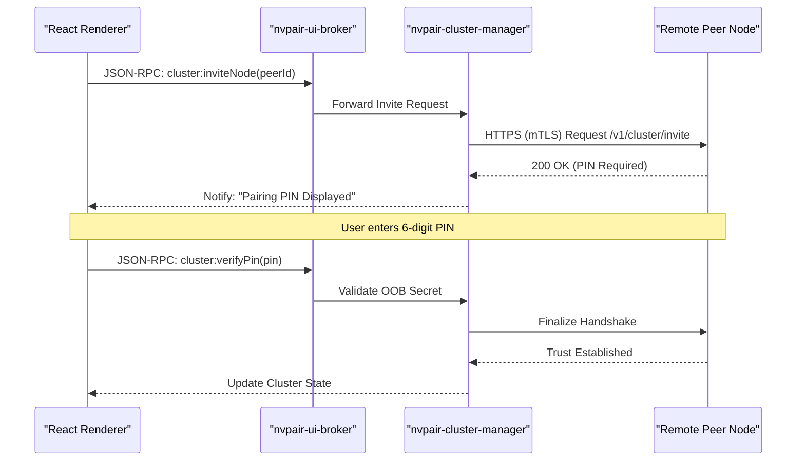
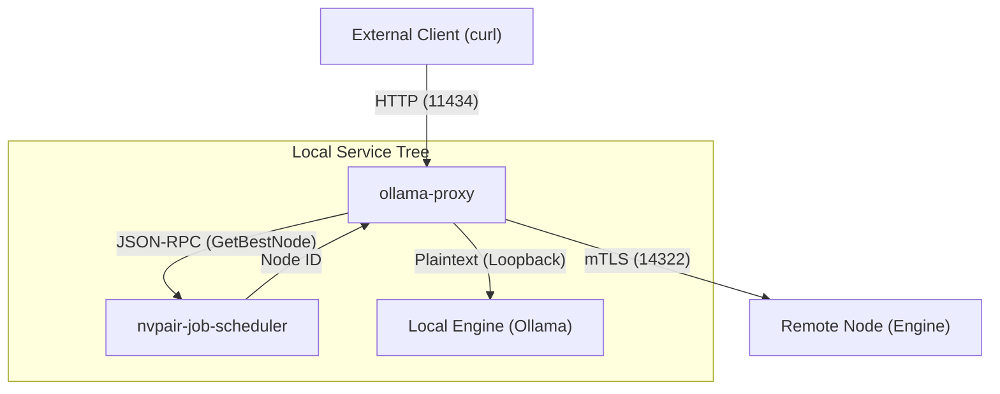

<!-- source: DeepWiki mcp.deepwiki.com · repo NVIDIA/Personal-AI-Router · page 1.1 Getting Started · fetched 2026-10-26 -->

# Getting Started

<details>
<summary>Relevant source files</summary>

The following files were used as context for generating this wiki page:

- [README.md](README.md)
- [desktop/scripts/build/installer.nsh](desktop/scripts/build/installer.nsh)
- [desktop/scripts/build/linux/after-install.sh](desktop/scripts/build/linux/after-install.sh)
- [desktop/scripts/build/linux/after-remove.sh](desktop/scripts/build/linux/after-remove.sh)
- [desktop/scripts/build/macos/uninstall.sh](desktop/scripts/build/macos/uninstall.sh)

</details>


The NVIDIA Personal AI Router (PAIR) is a local inference router designed to orchestrate LLM workloads across multiple machines on a local network. This guide provides the technical steps to install, configure, and perform the first inference across a PAIR cluster.

## Installation and Setup

PAIR is distributed as a multi-process Electron application. The installation process sets up the `nvpair-ui-broker` and its associated worker services, configures local firewall rules, and establishes the application data directories.

### Platform-Specific Installation

| Platform | Installer Type | Post-Install Actions |
| :--- | :--- | :--- |
| **Windows** | `.exe` (NSIS) | Sets up firewall rules for `localsubnet` [desktop/scripts/build/installer.nsh:112-121](). |
| **Linux** | `.deb` (Debian) | Installs `nvpair-tui` launcher to `/usr/bin` and configures AppArmor [desktop/scripts/build/linux/after-install.sh:27-71](). |
| **macOS** | `.dmg` | Registers `com.nvidia.nvpair.helper` for firewall management [desktop/scripts/build/macos/uninstall.sh:83-95](). |

**Linux Installation:**
```bash
sudo apt install ./NVPAIR-Setup-*.deb
```
The Debian installer creates a wrapper at `/usr/bin/nvpair` that points to the bundled Terminal UI (TUI) binary [desktop/scripts/build/linux/after-install.sh:27-32]().

**Sources:** [README.md:81-88](), [desktop/scripts/build/installer.nsh:11-33](), [desktop/scripts/build/linux/after-install.sh:1-78](), [desktop/scripts/build/macos/uninstall.sh:1-131]()

---

## First-Run and Engine Lifecycle

Upon launch, the Electron main process initializes the `ModularSupervisor`, which spawns the `nvpair-ui-broker` [README.md:98-100](). The broker then manages the lifecycle of inference engines via the `nvpair-engine-manager`.

### 1. Engine Installation
Users can install supported engines (Ollama or LM Studio) directly through the UI. The `nvpair-engine-manager` handles the binary download and environment setup [README.md:102-107]().

### 2. Model Management
Once an engine is running, models can be added. PAIR tracks model availability across the cluster to inform the `nvpair-job-scheduler` [README.md:109-113]().

### 3. Verification via Test Traffic
PAIR includes an internal synthetic traffic generator. Selecting **Test** in **Settings → Service** triggers `inference-dispatcher` to send requests through the local proxy to verify the end-to-end data flow [README.md:117-121]().

**Sources:** [README.md:98-121]()

---

## Cluster Pairing

PAIR uses the **EAP-NOOB** (Extensible Authentication Protocol - Nimble Out-of-Band) protocol to establish trust between nodes using a six-digit PIN.

### Pairing Flow Logic
1.  **Discovery**: Nodes advertise their presence via mDNS (`_nvpair-node._tcp`).
2.  **Invitation**: One node sends a cluster invitation to a discovered peer.
3.  **Authentication**: A 6-digit PIN is displayed on one machine and must be entered on the other.
4.  **Identity**: The `nvpair-cluster-manager` exchanges self-signed certificates to establish mTLS for all subsequent node-to-node communication.

### Implementation Diagram: Node Pairing
The following diagram illustrates the interaction between the UI and the backend Go services during the pairing process.


**Sources:** [README.md:155]() (Referencing cluster pairing concepts)

---

## Sending Your First Inference

PAIR exposes proxies that are compatible with Ollama and OpenAI API specifications. By default, these proxies listen on loopback interfaces to receive local application traffic.

### Inference Request Data Flow
When a `curl` request is sent to the proxy, the following sequence occurs:
1.  **Ingress**: `ollama-proxy` or `lmstudio-proxy` receives the HTTP request [README.md:129-132]().
2.  **Scheduling**: The proxy queries `nvpair-job-scheduler` for the best available node that has the requested model loaded.
3.  **Routing**: The request is forwarded to the selected node (either local via plaintext or remote via mTLS).
4.  **Execution**: The target engine (e.g., Ollama) processes the inference.

### Example Request
```bash
curl http://127.0.0.1:11434/v1/chat/completions \
  -H "Content-Type: application/json" \
  -d '{
    "model": "qwen4:12b",
    "messages": [{"role": "user", "content": "In one sentence, what does a router do?"}]
  }'
```

### Code-to-System Mapping: Inference Path
This diagram maps the logical request path to the specific Go binaries and internal communication methods.



**Sources:** [README.md:129-153]()

---

## Uninstalling and Resetting Data

PAIR maintains application data (settings, certificates, logs) in platform-specific directories.

### Data Locations
*   **Windows**: `%LOCALAPPDATA%\Nvidia Corporation\Personal AI Router` [desktop/scripts/build/installer.nsh:60]().
*   **Linux**: `~/.config/Nvidia Corporation/Personal AI Router` [desktop/scripts/build/linux/after-remove.sh:72]().
*   **macOS**: `~/Library/Application Support/Nvidia Corporation/Personal AI Router` [desktop/scripts/build/macos/uninstall.sh:115]().

### Resetting App Data
To perform a "factory reset" without uninstalling the application:
1.  Close PAIR and all associated `nvpair-*` processes [desktop/scripts/build/installer.nsh:11-31]().
2.  Delete the directories listed above.
3.  Restart the application.

### Uninstallation Commands
*   **Windows**: Use "Add or Remove Programs". The uninstaller provides an option to remove user data [desktop/scripts/build/installer.nsh:67-76]().
*   **Linux**: 
    *   `sudo apt remove nvpair`: Removes binaries, keeps data.
    *   `sudo apt purge nvpair`: Removes binaries and wipes per-user data [desktop/scripts/build/linux/after-remove.sh:54-80]().
*   **macOS**: Drag the app to the Trash, or run the provided script with `--purge`:
    ```bash
    sudo /Applications/PAIR.app/Contents/Resources/installer-tools/uninstall-macos.sh --purge
    ```

**Sources:** [desktop/scripts/build/installer.nsh:11-110](), [desktop/scripts/build/linux/after-remove.sh:1-82](), [desktop/scripts/build/macos/uninstall.sh:1-131]()

---

