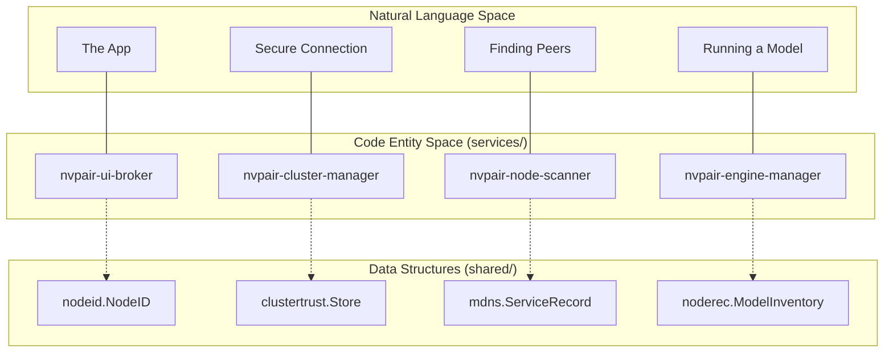
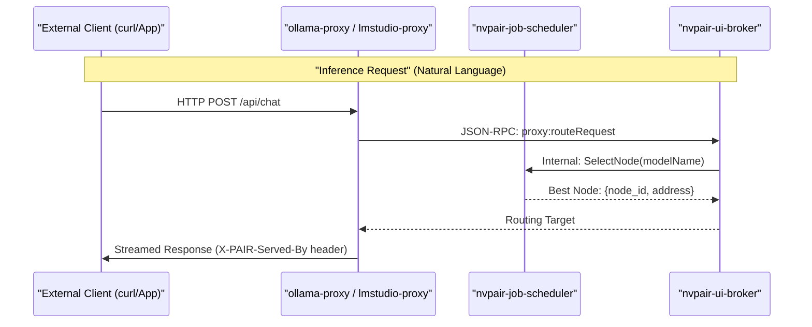

<!-- source: DeepWiki mcp.deepwiki.com · repo NVIDIA/Personal-AI-Router · page 1.2 Core Concepts and Vocabulary · fetched 2026-10-26 -->

# Core Concepts and Vocabulary

Relevant source files

The following files were used as context for generating this wiki page:

- [.github/ISSUE_TEMPLATE/bug.yml](.github/ISSUE_TEMPLATE/bug.yml)
- [.github/ISSUE_TEMPLATE/feature.yml](.github/ISSUE_TEMPLATE/feature.yml)
- [AGENTS.md](AGENTS.md)
- [CONTRIBUTING.md](CONTRIBUTING.md)

This page defines the domain terms and technical entities used throughout the NVIDIA Personal AI Router (PAIR) codebase. Understanding these concepts is essential for navigating the multi-process architecture and the interactions between the Electron frontend and Go backend services.

## System Entities

### Node
A **Node** represents a single instance of the PAIR application running on a machine. Each node is uniquely identified by a UUID generated at first run and persisted in the local settings [services/nvpair-ui-broker/README.md:12-15](). A node can function as both a client (sending inference requests) and a worker (hosting engines to fulfill requests).

### Cluster
A **Cluster** is a logical grouping of trusted nodes that have completed the pairing process. Nodes in a cluster share their model inventories and can route inference workloads to one another via mutual TLS (mTLS) [docs/architecture.mdx:145-150](). Cluster membership is managed by the `nvpair-cluster-manager` [AGENTS.md:36-39]().

### Engine
An **Engine** is a local LLM inference server that PAIR manages or interacts with. The two primary supported engines are **Ollama** and **LM Studio** [AGENTS.md:112-114](). The `nvpair-engine-manager` is responsible for the lifecycle (start, stop, install) of these engines [AGENTS.md:36-39]().

### Model
A **Model** refers to a specific LLM (e.g., `llama3:8b`) hosted by an Engine. PAIR tracks model availability across the cluster to make routing decisions. The system distinguishes between "Local Models" (on the current node) and "Cluster Models" (available on paired peers).

## Networking and Security

### Discovery
The process by which nodes find each other on a local area network (LAN). This is implemented using **mDNS** (Multicast DNS) via the `nvpair-node-scanner` worker, which advertises and browses for the `_nvpair-node._tcp` service record [AGENTS.md:38-39]().

### Pairing and PIN
**Pairing** is the workflow for establishing a secure, trusted relationship between two nodes. It uses the **EAP-NOOB** (Extensible Authentication Protocol - Nimble Out-of-Band) protocol, which involves a six-digit **PIN** displayed on one machine and entered on the other to prevent Man-in-the-Middle (MitM) attacks [docs/architecture.mdx:145-150]().

### mTLS (Mutual TLS)
Once paired, all node-to-node communication (control signals and inference traffic) is encrypted and authenticated using **mTLS**. Each node generates its own self-signed certificate, and the exchange of these certificates during pairing forms the basis of the cluster's trust [docs/architecture.mdx:145-150]().

### Proxy
A **Proxy** is a PAIR service that intercepts standard LLM API requests (e.g., Ollama or OpenAI formats) and routes them to the appropriate node in the cluster.
*   **Ollama Proxy**: Listens on port 11434.
*   **LM Studio Proxy**: Listens on port 1234.
These proxies allow existing tools to use the PAIR cluster without modification [AGENTS.md:36-39]().

## Workload Management

### Job / Workload
A **Job** (or Workload) represents a single inference request traveling through the system. The `nvpair-workload-manager` tracks the state of these jobs across the cluster for telemetry and UI updates [AGENTS.md:36-39]().

### Scheduler
The **Scheduler** (`nvpair-job-scheduler`) is the brain of the routing logic. When a proxy receives a request, the scheduler ranks available nodes based on:
1.  Model availability.
2.  Current GPU pressure.
3.  Pending job counts.
It then selects the optimal node to handle the request [AGENTS.md:36-39]().

### Broker and Worker
PAIR uses a supervision model:
*   **Broker**: The `nvpair-ui-broker` is the central orchestrator. It is the only process started directly by Electron [AGENTS.md:35-36]().
*   **Worker**: The broker spawns and supervises 11 specialized Go binaries (workers) such as the `scanner`, `scheduler`, and `proxies` [AGENTS.md:36-39]().

## Conceptual Mapping

### Natural Language to Code Entity Space: System Hierarchy
This diagram maps high-level concepts to the specific Go modules and Electron components that implement them.

**Sources:** [AGENTS.md:35-42](), [CONTRIBUTING.md:190-200]()

### Request Flow: Code Entity Mapping
This diagram shows how a "Request" (Natural Language) maps to specific code paths and JSON-RPC methods during execution.

**Sources:** [AGENTS.md:117-128](), [CONTRIBUTING.md:190-200]()

## Summary Table of Components

| Term | Implementation | Role |
| :--- | :--- | :--- |
| **Broker** | `nvpair-ui-broker` | Process supervisor and JSON-RPC hub [AGENTS.md:35-36](). |
| **Scanner** | `nvpair-node-scanner` | mDNS discovery and node heartbeat [AGENTS.md:38-39](). |
| **Cluster Mgr** | `nvpair-cluster-manager` | EAP-NOOB pairing and mTLS identity [AGENTS.md:36-39](). |
| **Scheduler** | `nvpair-job-scheduler` | Load balancing and node selection [AGENTS.md:36-39](). |
| **TUI** | `nvpair-tui` | Terminal-based management interface [AGENTS.md:40-40](). |
| **Shared** | `services/shared/` | Common logic for IPC, logging, and types [AGENTS.md:76-77](). |

**Sources:**
* [AGENTS.md:9-45]()
* [AGENTS.md:73-89]()
* [CONTRIBUTING.md:8-10]()
* [CONTRIBUTING.md:177-203]()
* [docs/architecture.mdx:145-150]() (referenced via context)

---

