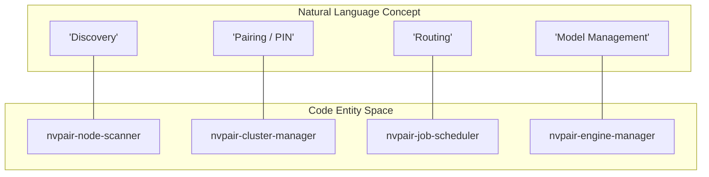
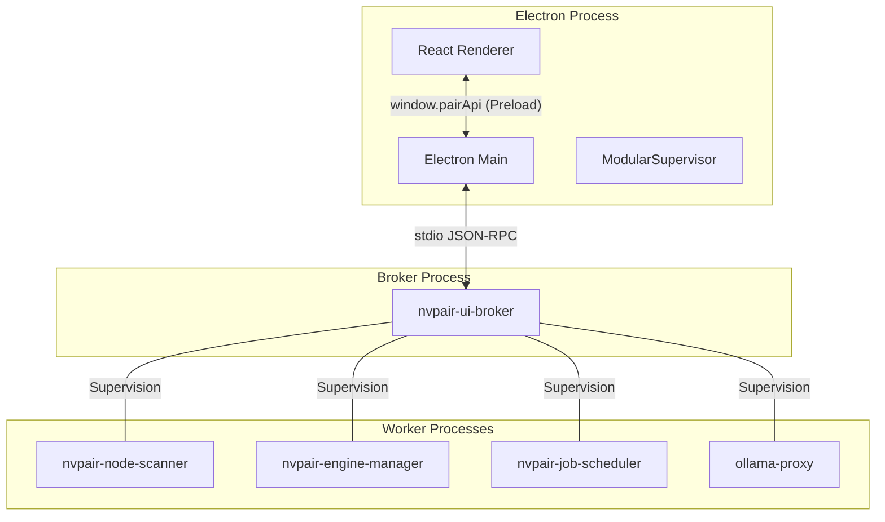

<!-- source: DeepWiki mcp.deepwiki.com · repo NVIDIA/Personal-AI-Router · page 10 Glossary · fetched 2026-10-26 -->

# Glossary

Relevant source files

The following files were used as context for generating this wiki page:

- [.github/ISSUE_TEMPLATE/bug.yml](.github/ISSUE_TEMPLATE/bug.yml)
- [.github/ISSUE_TEMPLATE/feature.yml](.github/ISSUE_TEMPLATE/feature.yml)
- [AGENTS.md](AGENTS.md)
- [CONTRIBUTING.md](CONTRIBUTING.md)
- [desktop/docs/architecture.md](desktop/docs/architecture.md)
- [desktop/docs/frontend-api.md](desktop/docs/frontend-api.md)
- [desktop/docs/services-api.md](desktop/docs/services-api.md)
- [desktop/docs/services-backend.md](desktop/docs/services-backend.md)

This glossary defines the technical terms, abbreviations, and domain concepts specific to the **NVIDIA Personal AI Router (PAIR)** codebase. It serves as a reference for onboarding engineers to understand how conceptual terms map to specific Go services and Electron TypeScript entities.

## Core Entities

### Node
A **Node** represents a single physical or virtual machine running the PAIR service stack. Every node is identified by a stable UUID generated upon first run and stored in the node settings.
*   **Code Pointers**:
    *   `NodeItem` type: [desktop/docs/frontend-api.md:146-146]()
    *   `AvailableNode` type: [desktop/docs/frontend-api.md:69-73]()
    *   Node Identity management: [desktop/docs/architecture.md:51-51]()

### Cluster
A **Cluster** is a logical group of Nodes that have established mutual trust. Clustered nodes can route inference requests to one another using **mTLS** (Mutual TLS). A node can only belong to one cluster at a time.
*   **Code Pointers**:
    *   `nvpair-cluster-manager`: [desktop/docs/architecture.md:50-50]()
    *   `ClusterIdentityPayload`: [desktop/docs/frontend-api.md:159-159]()
    *   Pairing logic: [desktop/docs/architecture.md:198-198]()

### Engine
An **Engine** is the underlying inference server that PAIR manages. Currently supported engines are **Ollama** and **LM Studio**. PAIR handles the lifecycle (install, start, stop) and model inventory of these engines.
*   **Code Pointers**:
    *   `nvpair-engine-manager`: [desktop/docs/architecture.md:53-53]()
    *   `EngineStatePatch`: [desktop/docs/frontend-api.md:149-149]()
    *   Engine command handlers: [desktop/docs/frontend-api.md:87-99]()

### Proxy
A **Proxy** is a PAIR service that sits in front of an Engine. It provides an API-compatible endpoint (e.g., Ollama-compatible or OpenAI-compatible) and handles the routing logic to send requests to the most appropriate node in the cluster.
*   **Code Pointers**:
    *   `ollama-proxy`: [desktop/docs/architecture.md:45-45]()
    *   `lmstudio-proxy`: [desktop/docs/architecture.md:46-46]()

## Architectural Components

### Broker
The `nvpair-ui-broker` is the central orchestrator for all Go services on a local node. It is the only process spawned directly by the Electron application and is responsible for supervising the lifecycle of all other "Worker" services.
*   **Code Pointers**:
    *   Binary definition: [desktop/docs/architecture.md:44-44]()
    *   Supervision logic: [AGENTS.md:35-39]()
    *   JSON-RPC relay: [desktop/docs/architecture.md:107-110]()

### Worker
A **Worker** is any Go service supervised by the Broker. Examples include the `nvpair-node-scanner`, `nvpair-job-scheduler`, and `nvpair-engine-manager`.
*   **Code Pointers**:
    *   Worker inventory: [desktop/docs/architecture.md:42-55]()
    *   Spawning logic: [AGENTS.md:38-38]()

### Service Bridge
The **Service Bridge** is the IPC layer in the Electron Main process that facilitates communication between the React Renderer and the Go Broker. It translates JSON-RPC messages from the backend into TypeScript events for the frontend.
*   **Code Pointers**:
    *   `ModularSupervisor`: [desktop/docs/architecture.md:79-79]()
    *   `JsonRpcSubprocess`: [desktop/docs/architecture.md:80-80]()
    *   `ModularBridgeState`: [desktop/docs/architecture.md:82-82]()

### Preload Bridge
The **Preload Bridge** (`window.pairApi`) is the secure API exposed to the React Renderer. It allows the UI to invoke backend commands and subscribe to state updates without having direct access to Node.js or IPC internals.
*   **Code Pointers**:
    *   `window.pairApi`: [desktop/docs/frontend-api.md:8-9]()
    *   `WsInvokeChannelMap`: [desktop/docs/frontend-api.md:33-33]()

## Data Flow & Diagrams

### Natural Language to Code Entity Mapping
This diagram bridges user-facing concepts to the specific code symbols used to implement them.

"Conceptual to Code Entity Map"

**Sources**: [desktop/docs/architecture.md:42-55](), [desktop/docs/services-backend.md:21-35]()

### Process Hierarchy and Communication
The following diagram illustrates the supervision tree and the protocols used between layers.

"PAIR Process Supervision & IPC"

**Sources**: [desktop/docs/architecture.md:15-32](), [AGENTS.md:35-43]()

## Technical Definitions

| Term | Definition | Implementation Detail |
| :--- | :--- | :--- |
| **JSON-RPC 2.0** | The primary protocol for control-plane communication. | Delivered over `stdio` with newline delimiters. [desktop/docs/architecture.md:107-107]() |
| **mDNS** | Multicast DNS used for local network discovery. | Handled by `nvpair-node-scanner` using `_nvpair-node._tcp`. [desktop/docs/architecture.md:47-47]() |
| **EAP-NOOB** | Protocol used for secure out-of-band pairing via a 6-digit PIN. | Orchestrated by `nvpair-cluster-manager`. [desktop/docs/architecture.md:50-50]() |
| **Workload** | An active inference task or session tracked across the cluster. | Managed by `nvpair-workload-manager`. [desktop/docs/architecture.md:49-49]() |
| **TUI** | Terminal User Interface. | A standalone Go binary `nvpair-tui` for headless operation. [desktop/docs/architecture.md:57-60]() |
| **mTLS** | Mutual TLS for authenticated node-to-node communication. | Used for all inference traffic between clustered nodes. [desktop/docs/architecture.md:198-198]() |

**Sources**: [desktop/docs/architecture.md:42-60](), [desktop/docs/services-backend.md:21-35](), [AGENTS.md:35-43]()