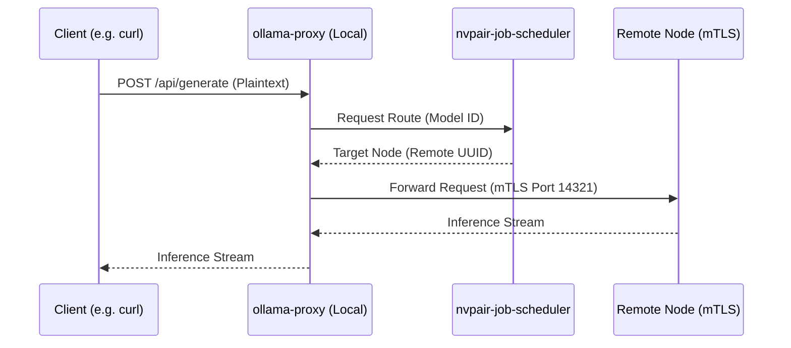

<!-- source: DeepWiki mcp.deepwiki.com · repo NVIDIA/Personal-AI-Router · page 2 System Architecture · fetched 2026-10-26 -->

# System Architecture

<details>
<summary>Relevant source files</summary>

The following files were used as context for generating this wiki page:

- [AGENTS.md](AGENTS.md)
- [CONTRIBUTING.md](CONTRIBUTING.md)
- [desktop/docs/architecture.md](desktop/docs/architecture.md)
- [desktop/docs/services-backend.md](desktop/docs/services-backend.md)

</details>


The NVIDIA Personal AI Router (PAIR) utilizes a multi-process, multi-layer architecture designed to decouple the user interface from the high-performance Go-based routing and inference logic. The system is split into two primary trees: `desktop/` (Electron/React) and `services/` (Go) [AGENTS.md:16-25]().

## Core Architectural Layers

PAIR's architecture is organized into four distinct layers that separate concerns from the UI down to the network transport:

1.  **UI Layer (Renderer):** A React application running in an Electron renderer process. It communicates exclusively through a typed bridge and never connects directly to backend workers [desktop/docs/architecture.md:8-11]().
2.  **Orchestration Layer (Electron Main):** Manages the lifecycle of the backend processes via the `ModularSupervisor` and handles JSON-RPC communication [desktop/docs/architecture.md:20-22]().
3.  **Control Plane (Go Workers):** A tree of specialized Go services supervised by `nvpair-ui-broker`. These handle discovery, pairing, scheduling, and engine management [desktop/docs/services-backend.md:18-19]().
4.  **Data Plane (Inference Proxies):** High-throughput HTTP proxies (`ollama-proxy`, `lmstudio-proxy`) that route inference traffic across the local network using mTLS for peer-to-peer security [desktop/docs/services-backend.md:24-25]().

### Process Hierarchy and Supervision

Electron acts as the root of the process tree but delegates all domain logic to the Go services. The `ModularSupervisor` in Electron Main is responsible for spawning exactly one backend binary: `nvpair-ui-broker` [AGENTS.md:35-37](). The broker then acts as a sidecar supervisor for the rest of the worker tree.

**System Process Map**
```mermaid
flowchart TD
    subgraph ["Electron Process (GUI)"]
        [src/electron/index.ts] --> ["ModularSupervisor"]
        ["ModularSupervisor"] --> ["JsonRpcSubprocess"]
    end

    subgraph ["Control Plane (Go)"]
        ["JsonRpcSubprocess"] <-->|"stdio JSON-RPC 2.0"| Broker["nvpair-ui-broker"]
        Broker --> Scanner["nvpair-node-scanner"]
        Broker --> Cluster["nvpair-cluster-manager"]
        Broker --> Engines["nvpair-engine-manager"]
        Broker --> Scheduler["nvpair-job-scheduler"]
        Broker --> Settings["nvpair-node-settings"]
    end

    subgraph ["Data Plane (HTTP)"]
        Broker --> OProxy["ollama-proxy"]
        Broker --> LMProxy["lmstudio-proxy"]
    end

    style Broker stroke-width:4px
```
Sources: [desktop/docs/architecture.md:15-32](), [desktop/docs/services-backend.md:42-68](), [AGENTS.md:35-42]()

## Communication Patterns

PAIR distinguishes between **Control Traffic** (how the app is managed) and **Inference Traffic** (how AI models are queried).

### Control Traffic (JSON-RPC)
The control plane uses newline-delimited JSON-RPC 2.0.
*   **Internal IPC:** Electron communicates with the `nvpair-ui-broker` over `stdio` [desktop/docs/architecture.md:105-110]().
*   **Service Bridge:** The renderer uses `window.pairApi` to send commands. These are routed through Electron Main to the broker, which relays them to the specific worker (e.g., `engine:install-model`) [desktop/docs/architecture.md:64-75]().
*   **State Flow:** PAIR follows a "commands down, events up" model. Results are not typically returned in the command response; instead, workers emit notifications (e.g., `engines:state-changed`) that update the UI's `ModularBridgeState` [desktop/docs/architecture.md:136-154]().

### Inference Traffic (HTTP)
Inference requests from client tools (like `curl` or a web UI) bypass the Electron process entirely for performance.
*   **Local Ingress:** Clients connect to local ports (e.g., 11434 for Ollama) in plaintext [desktop/docs/architecture.md:45]().
*   **Peer-to-Peer:** When a request is routed to a remote node, the proxy upgrades the connection to mTLS on port 14321 [desktop/docs/services-backend.md:24-25]().

For details, see [Node-to-Node Transport and Port Map](#2.5).

## Subsystem Overviews

### Process Model and IPC
The system maintains a strict hierarchy where `nvpair-ui-broker` manages up to 11 workers. If a worker fails, the broker handles the restart policy, while Electron monitors the broker's health via an `app:ready` handshake [desktop/docs/architecture.md:112-120]().
For details, see [Process Model and IPC](#2.1).

### Discovery and Node Identity
Nodes identify themselves using a stable UUID and advertise their presence on the local network via mDNS (`_nvpair-node._tcp`). The `nvpair-node-scanner` handles both advertising the local node and browsing for peers [desktop/docs/services-backend.md:26]().
For details, see [Discovery and Node Identity](#2.2).

### Cluster Pairing and Trust
Trust between nodes is established through an out-of-band (OOB) six-digit PIN using the EAP-NOOB protocol. Once paired, nodes exchange self-signed certificates to facilitate secure mTLS communication [desktop/docs/services-backend.md:33]().
For details, see [Cluster Pairing and Trust](#2.3).

### Inference Routing and Scheduling
The `nvpair-job-scheduler` maintains a real-time view of cluster health and GPU pressure. When a proxy receives a request, it asks the scheduler for the best available node that possesses the required model and capability [desktop/docs/services-backend.md:34]().
For details, see [Inference Routing and Scheduling](#2.4).

**Inference Request Flow**

Sources: [desktop/docs/architecture.md:45-55](), [desktop/docs/services-backend.md:24-34]()

---

