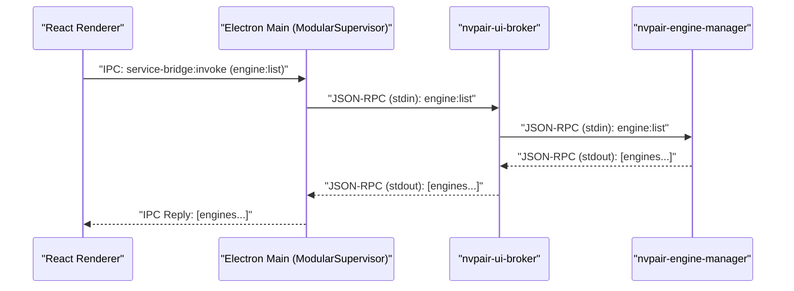

<!-- source: DeepWiki mcp.deepwiki.com · repo NVIDIA/Personal-AI-Router · page 2.1 Process Model and IPC · fetched 2026-10-26 -->

# Process Model and IPC

<details>
<summary>Relevant source files</summary>

The following files were used as context for generating this wiki page:

- [AGENTS.md](AGENTS.md)
- [desktop/src/electron/connector/broker-crash-notification.ts](desktop/src/electron/connector/broker-crash-notification.ts)
- [desktop/src/electron/connector/index.ts](desktop/src/electron/connector/index.ts)
- [desktop/src/electron/globals.ts](desktop/src/electron/globals.ts)
- [desktop/src/electron/index.ts](desktop/src/electron/index.ts)
- [desktop/src/electron/ipc/service-bridge.ipc.ts](desktop/src/electron/ipc/service-bridge.ipc.ts)
- [desktop/src/electron/ipc/service.ipc.ts](desktop/src/electron/ipc/service.ipc.ts)

</details>


NVIDIA Personal AI Router (PAIR) utilizes a multi-process architecture to separate the Electron-based user interface from the high-performance Go-based routing and inference services. This model ensures that the UI remains responsive while the backend handles complex networking, scheduling, and engine management tasks.

## Process Hierarchy and Supervision

The system follows a strict hierarchical tree where the Electron main process acts as the root supervisor for the backend services.

### Hierarchy Overview
1.  **Electron Main Process**: The entry point of the application. It manages the application lifecycle and window management [desktop/src/electron/index.ts:10-26]().
2.  **ModularSupervisor**: A singleton within the Electron main process that manages the lifecycle of the primary backend service [desktop/src/electron/service-bridge/modular-supervisor.ts]().
3.  **nvpair-ui-broker**: The master service process. It is the only Go binary spawned directly by Electron [AGENTS.md:35-35]().
4.  **Worker Services (11 total)**: The broker supervises 11 specialized worker processes that handle discovery, proxies, engines, and more [AGENTS.md:36-39]().

### The nvpair-tui Exception
The `nvpair-tui` (Terminal User Interface) is a standalone binary. When executed, it spawns its own internal broker and worker tree rather than connecting to an existing one. It is designed for headless environments and must not be run simultaneously with the Electron desktop application [AGENTS.md:40-40]().

### Process Map: Code to Entity
The following diagram maps the logical system components to their corresponding implementation classes and binary names.

**Process Entity Mapping**
```mermaid
graph TD
    subgraph "Renderer Space (Web)"
        ["window.pairApi"] -- "IPC Invoke" --> ["service-bridge:invoke"]
    end

    subgraph "Main Process Space (Node.js)"
        ["Electron Main"] --> ["ModularSupervisor"]
        ["ModularSupervisor"] -- "Spawns" --> ["nvpair-ui-broker"]
        ["JsonRpcSubprocess"] -- "Wraps" --> ["nvpair-ui-broker"]
    end

    subgraph "Backend Space (Go)"
        ["nvpair-ui-broker"] -- "Supervises" --> W1["nvpair-node-scanner"]
        ["nvpair-ui-broker"] -- "Supervises" --> W2["nvpair-ollama-proxy"]
        ["nvpair-ui-broker"] -- "Supervises" --> W3["nvpair-engine-manager"]
        ["nvpair-ui-broker"] -- "Supervises" --> W4["nvpair-job-scheduler"]
        ["nvpair-ui-broker"] -- "Supervises" --> W5["... (7 more workers)"]
    end
```
**Sources:** [AGENTS.md:35-42](), [desktop/src/electron/service-bridge/modular-supervisor.ts](), [desktop/src/electron/ipc/service-bridge.ipc.ts:7-11]()

---

## Inter-Process Communication (IPC)

PAIR uses a layered IPC strategy to bridge the gap between the TypeScript/React frontend and the Go backend services.

### 1. Preload Bridge (`window.pairApi`)
The renderer process does not have direct access to Node.js or the filesystem. It communicates via a "Preload Bridge" exposed on the `window` object.
*   **window.pairApi**: Provides typed methods for interacting with backend services (e.g., `pairApi.engines.list()`) [desktop/src/electron/service-bridge/empty-handlers.ts:5-10]().
*   **window.windowApi**: Handles Electron-native window operations like minimizing or opening external links.

### 2. Service Bridge
The Service Bridge is the internal Electron mechanism that routes requests from the renderer to the `ModularSupervisor`.
*   **service-bridge:invoke**: A safe IPC handler in the main process that receives payloads from the renderer and passes them to the backend transport [desktop/src/electron/ipc/service-bridge.ipc.ts:8-10]().

### 3. JSON-RPC 2.0 over Stdio
The final link in the chain is the communication between the Electron Main process and the `nvpair-ui-broker`.
*   **Transport**: Newline-delimited JSON-RPC 2.0 sent over `stdin` and `stdout` [AGENTS.md:41-42]().
*   **Handshake**: The broker sends an `app:ready` notification to signal it is initialized [desktop/src/electron/connector/index.ts:67-74]().

**Data Flow: UI to Worker**

**Sources:** [AGENTS.md:41-42](), [desktop/src/electron/ipc/service-bridge.ipc.ts:7-11](), [desktop/src/electron/connector/index.ts:140-148]()

---

## Supervision and Restart Policy

The `ModularSupervisor` manages the `nvpair-ui-broker` lifecycle, ensuring the system remains stable even if a backend component fails.

### Broker Supervision
*   **Startup**: The supervisor initiates the broker and waits for a "Ready" state within a defined timeout (`MODULAR_STARTUP_READY_TIMEOUT_MS`) [desktop/src/electron/connector/index.ts:147-147]().
*   **Crash Detection**: If the broker exits unexpectedly, the supervisor triggers `handleBrokerCrash` [desktop/src/electron/connector/index.ts:82-99]().
*   **Notification**: A crash surfaces a UI message modal via `notifyBrokerCrash`, allowing the user to navigate to settings and attempt a manual restart [desktop/src/electron/connector/broker-crash-notification.ts:15-25]().

### Worker Supervision
The `nvpair-ui-broker` is responsible for its 11 workers.
*   **Spawn Policy**: All 11 workers are spawned at startup [AGENTS.md:38-39]().
*   **Fault Tolerance**: Only the `nvpair-node-scanner` is strictly required. Other workers are considered optional; their failure will not cause the broker to exit, though it will degrade functionality [AGENTS.md:38-39]().

### Lifecycle States
| State | Description |
| :--- | :--- |
| `disconnected` | No broker process is running [desktop/src/electron/connector/index.ts:23](). |
| `connecting` | The broker has been spawned but has not yet sent the `ready` signal [desktop/src/electron/connector/index.ts:137](). |
| `connected` | The broker is active and responding to JSON-RPC calls [desktop/src/electron/connector/index.ts:69](). |
| `reconnecting` | A startup attempt timed out, and the system is retrying [desktop/src/electron/connector/index.ts:153](). |

**Sources:** [desktop/src/electron/connector/index.ts:23-168](), [desktop/src/electron/connector/broker-crash-notification.ts:15-41](), [AGENTS.md:35-39]()

---

