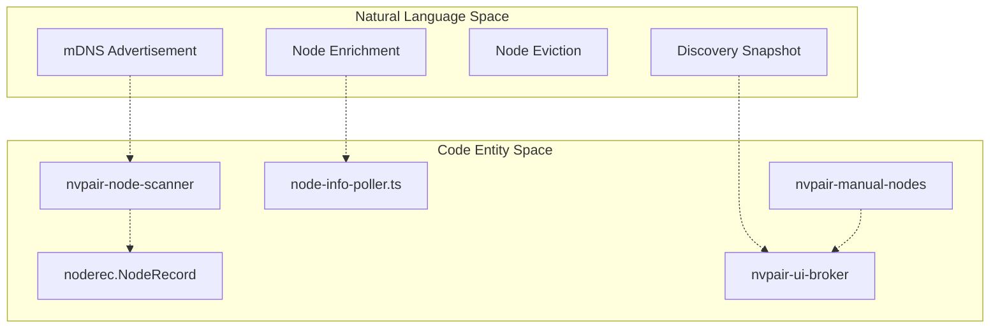
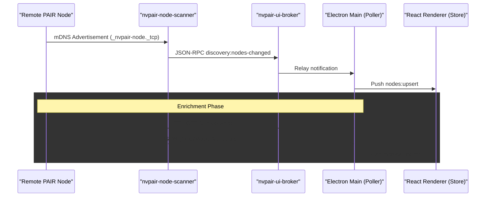

<!-- source: DeepWiki mcp.deepwiki.com · repo NVIDIA/Personal-AI-Router · page 2.2 Discovery and Node Identity · fetched 2026-10-26 -->

# Discovery and Node Identity

Relevant source files

The following files were used as context for generating this wiki page:

- [AGENTS.md](AGENTS.md)
- [desktop/docs/architecture.md](desktop/docs/architecture.md)
- [desktop/docs/services-backend.md](desktop/docs/services-backend.md)

Discovery in Personal AI Router (PAIR) is the mechanism by which nodes on a local area network find each other, exchange identity metadata, and establish a shared view of the cluster's capabilities. This process is managed primarily by the `nvpair-node-scanner` worker, which uses mDNS for advertisement and browsing, supplemented by HTTP-based enrichment for hardware inventory.

## Discovery Architecture and Data Flow

The discovery process involves several components working in concert to move a node from a network advertisement to a fully enriched member of the `nvpair-ui-broker` node list.

### Code-to-System Mapping
The following diagram maps the high-level discovery concepts to their specific implementation entities in the Go services and Electron bridge.

**Discovery Entity Mapping**

**Sources:** [desktop/docs/architecture.md:42-55](), [desktop/docs/services-backend.md:43-68]()

## Node Identity and mDNS

Every PAIR node is identified by a stable UUID generated during the first run and persisted by `nvpair-node-settings` [desktop/docs/architecture.md:51-51](). This identity is used to sign certificates and uniquely identify the node across network changes.

### mDNS Advertisement
The `nvpair-node-scanner` advertises the node using the `_nvpair-node._tcp` service type [desktop/docs/architecture.md:47-47](). 
- **Service Type:** `_nvpair-node._tcp`
- **Payload:** The mDNS TXT records include the node's unique ID and the port for its `nvpair-node-info` service.
- **Port Management:** The scanner utilizes `SO_REUSEADDR` to allow multiple instances or related services to bind effectively during discovery cycles [desktop/docs/services-backend.md:26-26]().

## Node Enrichment and Telemetry

Discovery only provides the network location (IP/Port) and ID. To make routing decisions, the system performs "Enrichment" by fetching detailed hardware and model inventory.

### The /v1/node-info Endpoint
Each node runs an `nvpair-node-info` service [desktop/docs/architecture.md:48-48](). This service exposes an HTTP endpoint that provides:
1. **GPU Inventory:** Number of GPUs, model names, and total VRAM.
2. **Model Inventory:** List of models currently loaded or available via local engines (Ollama/LM Studio).
3. **Utilization:** Real-time CPU, memory, and GPU pressure.

### Polling Logic
- **Backend Polling:** The `nvpair-node-scanner` samples a compact maximum-GPU utilization value from healthy nodes to feed the `nvpair-job-scheduler` [desktop/docs/services-backend.md:106-109]().
- **Frontend Polling:** The Electron main process runs `node-info-poller.ts`, which polls healthy nodes every two seconds [desktop/docs/architecture.md:130-132](). This data is merged into the `metrics:update` push channel for the UI [desktop/docs/services-backend.md:102-105]().
- **Backoff:** If a node fails to respond, the poller backs off exponentially (4s, 8s, 16s, up to 30s) before attempting again [desktop/docs/architecture.md:132-134]().

**Sources:** [desktop/docs/services-backend.md:83-83](), [desktop/docs/services-backend.md:102-112]()

## Manual Nodes

For environments where mDNS is restricted or nodes exist on different subnets, the `nvpair-manual-nodes` worker allows users to explicitly add node addresses [desktop/docs/architecture.md:52-52]().
- Manual nodes are treated as "Discovery Entries" by the broker.
- The system probes manual nodes every 10 seconds to verify availability [desktop/docs/services-backend.md:28-28]().

## Consolidation and Eviction

The `nvpair-ui-broker` acts as the central aggregator for all discovery sources.

### Discovery Snapshot
The broker consolidates nodes from `nvpair-node-scanner` and `nvpair-manual-nodes` into a single snapshot. When the inventory changes, the broker emits a `discovery:nodes-changed` notification [desktop/docs/services-backend.md:119-119]().

### Node Eviction
Nodes are removed from the active list under the following conditions:
1. **mDNS Goodbye:** The scanner receives a formal mDNS "goodbye" packet.
2. **TTL Expiry:** The mDNS record for a discovered node expires without a refresh.
3. **Manual Removal:** A user deletes a manual entry via the UI.

When a node is removed, the Electron bridge diffs the snapshot and emits a `nodes:remove` event to the React renderer stores [desktop/docs/services-backend.md:119-119]().

## Implementation Flow

The following diagram illustrates the sequence from a node appearing on the network to its appearance in the PAIR UI.

**Node Discovery Sequence**

**Sources:** [desktop/docs/architecture.md:15-32](), [desktop/docs/architecture.md:130-135](), [desktop/docs/services-backend.md:116-119]()

---

