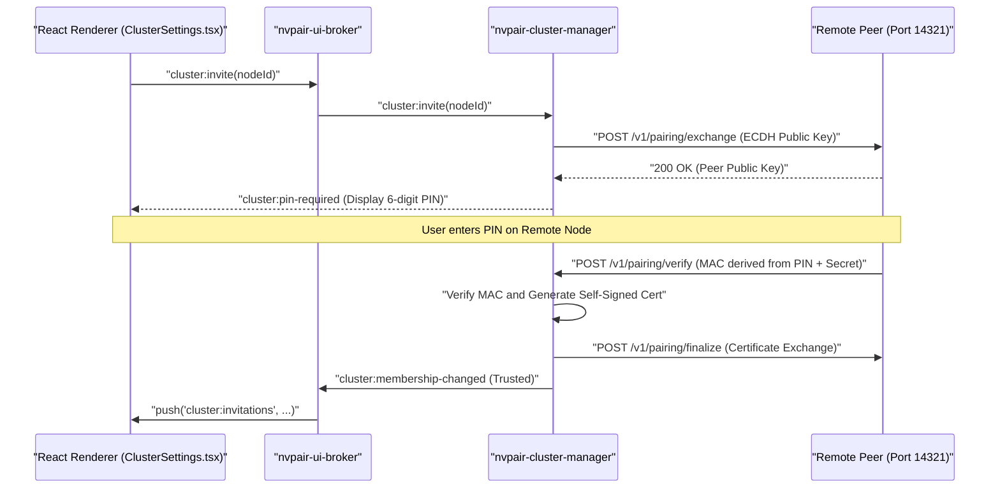
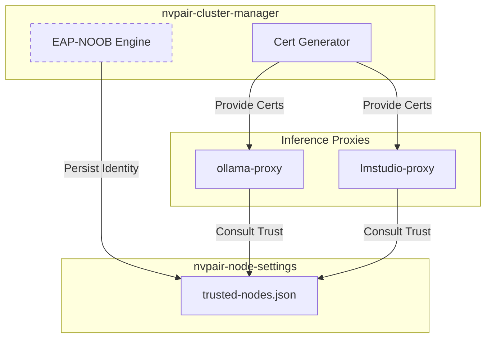

<!-- source: DeepWiki mcp.deepwiki.com · repo NVIDIA/Personal-AI-Router · page 2.3 Cluster Pairing and Trust · fetched 2026-10-26 -->

# Cluster Pairing and Trust

Relevant source files

The following files were used as context for generating this wiki page:

- [AGENTS.md](AGENTS.md)
- [SECURITY.md](SECURITY.md)
- [desktop/docs/architecture.md](desktop/docs/architecture.md)
- [desktop/docs/services-backend.md](desktop/docs/services-backend.md)

The `nvpair-cluster-manager` service is responsible for establishing and maintaining secure, authenticated relationships between nodes in a Personal AI Router (PAIR) deployment. It implements the **EAP-NOOB** (Extensible Authentication Protocol - Nimble Out-of-Band) protocol to bootstrap trust using a six-digit PIN, subsequently transitioning to **mutual TLS (mTLS)** using self-signed certificates for all peer-to-peer control and inference traffic.

## Trust Establishment Overview

Trust is not assumed based on local network presence. While `nvpair-node-scanner` discovers nodes via mDNS, these nodes remain "untrusted" until a pairing handshake is completed. The pairing process utilizes an out-of-band (OOB) step—the six-digit PIN—to prevent man-in-the-middle (MITM) attacks during the initial key exchange.

### Security Boundaries
*   **Authenticated:** Cluster membership management, remote engine control, and cross-node inference requests (via mTLS ingress on proxy ports) [SECURITY.md:54-56]().
*   **Unauthenticated:** mDNS discovery advertisements, initial `/v1/node-info` telemetry polling, and local loopback inference traffic [SECURITY.md:79-85, 102-110]().

## The EAP-NOOB Pairing Flow

PAIR implements a simplified version of RFC 9140 (EAP-NOOB). The flow moves from discovery to a persistent trusted state through several cryptographic phases.

### Pairing State Machine
1.  **Discovery:** Node A sees Node B via mDNS.
2.  **Invitation:** Node A sends a `cluster:invite` request to Node B.
3.  **Key Exchange (ECDH):** The nodes exchange public keys (Curve25519 or P-256) to establish a shared secret.
4.  **OOB Validation:** The UI displays a six-digit PIN on one node; the user must enter it on the other. This PIN validates the shared secret established in step 3.
5.  **Persistence:** Upon successful validation, the nodes exchange self-signed certificates and store them in the `trusted-nodes` store [SECURITY.md:98-100]().

### Sequence: PIN Bootstrap and mTLS Transition
The following diagram maps the logical pairing flow to the specific Go service entities and JSON-RPC methods.

**Pairing Logic and Code Entities**

Sources: [desktop/docs/architecture.md:50](), [desktop/docs/services-backend.md:33](), [SECURITY.md:91-100]()

## Identity and Cryptography

Each node maintains a unique identity rooted in a generated UUID and a corresponding self-signed certificate.

### Trusted-Node Store
The `nvpair-cluster-manager` interacts with `nvpair-node-settings` to persist the identities of paired peers. This store includes:
*   **Node UUID:** The stable identifier for the peer.
*   **Public Key/Certificate:** The self-signed certificate used to validate mTLS connections.
*   **Trust Status:** Boolean flag indicating if the node is currently authorized.

### Mutual TLS (mTLS) Implementation
Once paired, the nodes use the exchanged certificates to secure two primary channels:
1.  **Control Plane:** Cross-node JSON-RPC relays (e.g., one node asking another to pull a model) [desktop/docs/architecture.md:49-50]().
2.  **Data Plane:** Inference requests routed via `ollama-proxy` or `lmstudio-proxy`. The proxies serve a "dual-personality" on their ports:
    *   **Loopback:** Plaintext HTTP for local clients (127.0.0.1) [SECURITY.md:69-72]().
    *   **Network:** mTLS-only for paired cluster members [SECURITY.md:70-72]().

## Cluster Membership Operations

The `nvpair-cluster-manager` provides a set of JSON-RPC methods to manage the lifecycle of these trusted relationships.

| Method | Description | Implementation Detail |
| :--- | :--- | :--- |
| `cluster:invite` | Initiates pairing with a discovered node. | Triggers EAP-NOOB ECDH exchange. |
| `cluster:accept` | Confirms a pending invitation. | Validates the OOB PIN. |
| `cluster:decline` | Rejects a pending invitation. | Clears ephemeral pairing state. |
| `cluster:leave` | Removes the local node from a cluster. | Notifies peers and wipes local trust store. |
| `cluster:remove` | Evicts a specific peer from the cluster. | Revokes the peer's certificate from the local trust store. |

### Component Relationships
The diagram below shows how the Cluster Manager integrates with other services to enforce security.

**Service Integration Map**

Sources: [desktop/docs/architecture.md:45-51](), [desktop/docs/services-backend.md:21-34](), [SECURITY.md:102-110]()

## Security Considerations and Risks

While the pairing system provides a robust baseline, several architectural boundaries must be noted:

*   **PIN Entropy:** The six-digit PIN is designed for convenience and low-entropy bootstrap. It is not a durable credential and does not protect against a compromised node that has already been paired [SECURITY.md:91-96]().
*   **mTLS Scope:** mTLS only protects PAIR-specific inter-node traffic. It does not encrypt Electron IPC, local engine APIs (like the raw Ollama port 11434), or mDNS discovery packets [SECURITY.md:102-109]().
*   **Revocation:** When a node is "Removed" via the UI, its certificate is deleted from the local `trusted-nodes` store, immediately causing the mTLS handshake to fail for future requests from that node [SECURITY.md:95-96]().

Sources: [SECURITY.md:67-124](), [desktop/docs/architecture.md:105-135]()

---

