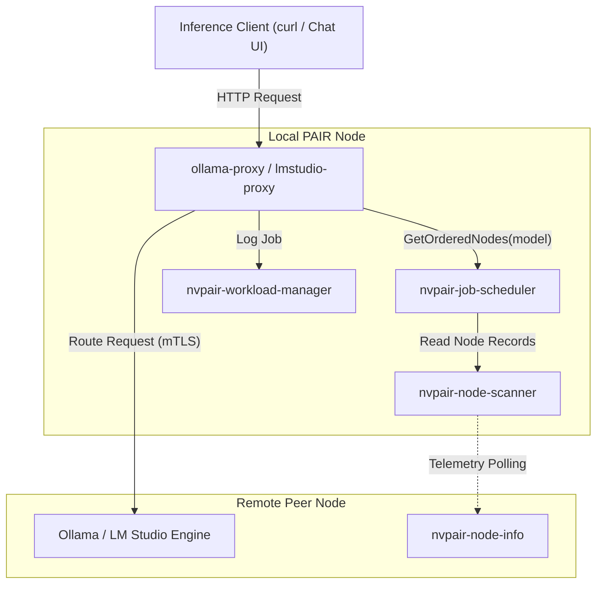
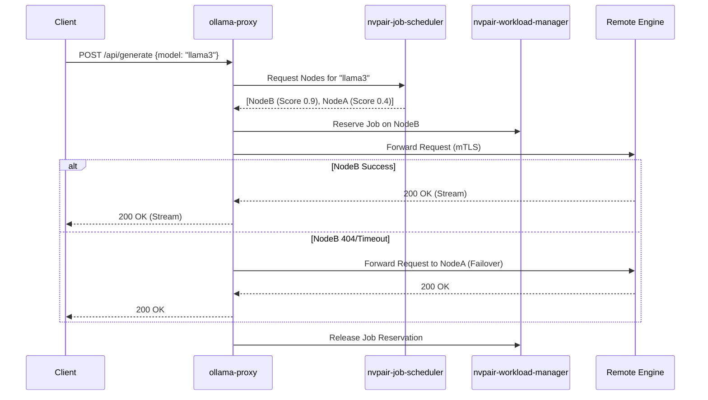

<!-- source: DeepWiki mcp.deepwiki.com · repo NVIDIA/Personal-AI-Router · page 2.4 Inference Routing and Scheduling · fetched 2026-10-26 -->

# Inference Routing and Scheduling

Relevant source files

The following files were used as context for generating this wiki page:

- [AGENTS.md](AGENTS.md)
- [desktop/docs/architecture.md](desktop/docs/architecture.md)
- [desktop/docs/services-backend.md](desktop/docs/services-backend.md)

This section describes the lifecycle of an inference request as it travels from a client application (e.g., a chatbot or IDE extension) through the Personal AI Router (PAIR) infrastructure to a selected compute node. The system utilizes a distributed scheduling algorithm that balances model availability, GPU pressure, and pending workload volume.

## Request Flow Overview

Inference requests enter the system via the `ollama-proxy` or `lmstudio-proxy`. These proxies do not perform inference themselves; instead, they act as intelligent gateways that route traffic to the most appropriate engine (Ollama or LM Studio) within the trusted cluster.

### 1. Model-Capability Gating
When a request arrives at the proxy (e.g., `POST /api/chat`), the proxy first identifies the requested model. It queries the local discovery cache to filter for "eligible nodes"—nodes that are currently advertising the requested model in their inventory [desktop/docs/architecture.md:45-46]().

### 2. The Ranking Algorithm
The `nvpair-job-scheduler` is responsible for ordering the eligible nodes. It uses a multi-factor ranking algorithm to determine the "best" destination [desktop/docs/architecture.md:55]().

The scheduler calculates a score for each node based on:
*   **Pending Work:** The number of active inference jobs currently assigned to that node by the local proxy.
*   **GPU Pressure:** A value from 0 to 3 representing the load on the node's GPU, sampled via the `nvpair-node-info` telemetry endpoint [desktop/docs/services-backend.md:106-109]().
*   **Local Preference:** The scheduler prioritizes the local node if it possesses the model and is not under extreme pressure, minimizing network latency.

### 3. Failover and Local Reservations
If the top-ranked node fails to respond or returns a `404 Not Found` (indicating the model was recently removed), the proxy automatically attempts the request on the next node in the ordered failover list. The proxy maintains local reservations to ensure that if a node is selected, its "pending work" count is incremented immediately, preventing a "thundering herd" effect where multiple requests are sent to a node before its reported telemetry reflects the new load.

## Inference Routing Architecture

The following diagram illustrates the path of a request from a local client through the Go service layers.

**Diagram: Inference Request Path and Code Entities**

**Sources:** [desktop/docs/architecture.md:15-32](), [desktop/docs/services-backend.md:42-68](), [desktop/docs/services-backend.md:102-109]()

## Scheduler Implementation Details

The `nvpair-job-scheduler` operates as a background worker supervised by the `nvpair-ui-broker` [desktop/docs/architecture.md:34-37](). It consumes telemetry from the `nvpair-node-scanner` and provides a prioritized list of endpoints to the proxies via JSON-RPC.

### Data Flow for Scheduling

1.  **Node Enrichment:** The `nvpair-node-scanner` browses `_nvpair-node._tcp` mDNS records [desktop/docs/architecture.md:47]().
2.  **Telemetry Sampling:** The scanner (or Electron `node-info-poller.ts` for UI display) hits the `/v1/node-info` endpoint on discovered nodes to gather GPU utilization and VRAM availability [desktop/docs/services-backend.md:102-105]().
3.  **Ranking:** The scheduler combines this telemetry with active workload data relayed by the `nvpair-workload-manager` [desktop/docs/services-backend.md:29]().

### Known Limitations
*   **Cold Start Latency:** The scheduler does not currently account for model loading times (TTFT impact) if a model is present on disk but not currently loaded into VRAM.
*   **Global vs. Local View:** Each node's scheduler has a perfect view of its own outgoing jobs but relies on periodic telemetry for the state of remote peers. This can lead to brief synchronization lags in high-concurrency environments.

## Component Responsibilities

| Component | Role in Routing/Scheduling | File Reference |
| :--- | :--- | :--- |
| `nvpair-job-scheduler` | Ranks nodes based on GPU pressure and pending jobs. | [desktop/docs/architecture.md:55]() |
| `ollama-proxy` | Entry point for Ollama clients; executes the failover logic. | [desktop/docs/architecture.md:45]() |
| `lmstudio-proxy` | Entry point for OpenAI-compatible clients. | [desktop/docs/architecture.md:46]() |
| `nvpair-node-info` | Exposes the telemetry (GPU/RAM) used for ranking. | [desktop/docs/architecture.md:48]() |
| `nvpair-workload-manager` | Synchronizes active job counts across the cluster. | [desktop/docs/architecture.md:49]() |

**Sources:** [desktop/docs/architecture.md:42-56](), [desktop/docs/services-backend.md:21-35]()

## Sequence: Request Handling

The following sequence diagram shows the interaction between the Go services when a request is received.

**Diagram: Request Routing Sequence**

**Sources:** [desktop/docs/architecture.md:45-55](), [desktop/docs/services-backend.md:116-119](), [AGENTS.md:35-39]()

---

