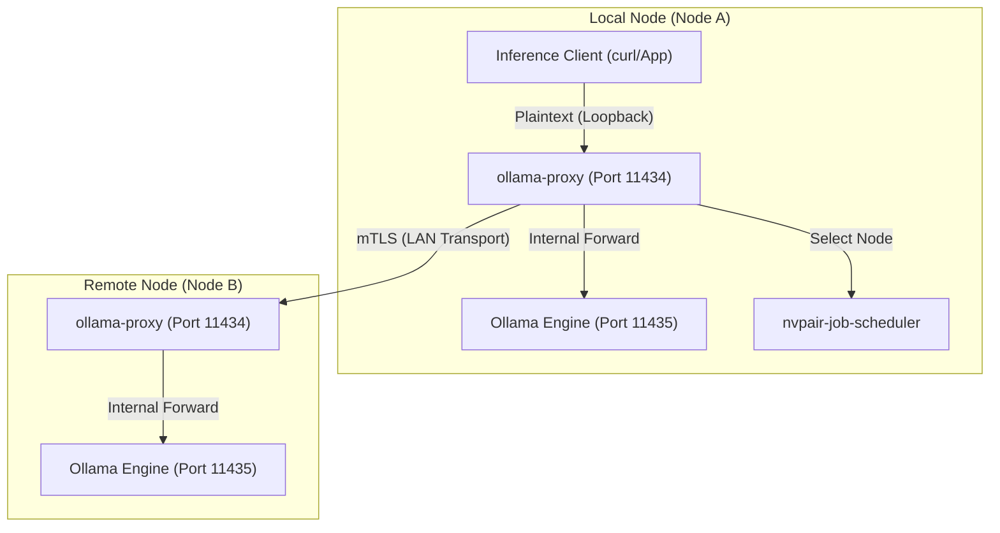
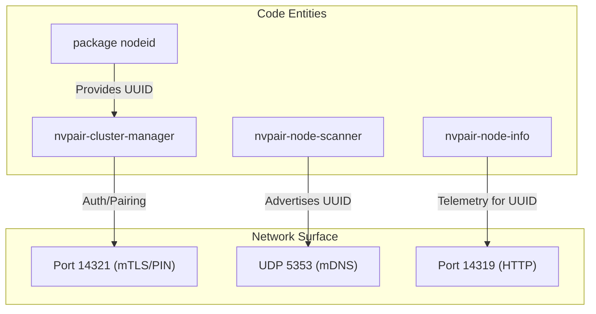

<!-- source: DeepWiki mcp.deepwiki.com · repo NVIDIA/Personal-AI-Router · page 2.5 Node-to-Node Transport and Port Map · fetched 2026-10-26 -->

# Node-to-Node Transport and Port Map

Relevant source files

The following files were used as context for generating this wiki page:

- [SECURITY.md](SECURITY.md)
- [desktop/docs/architecture.md](desktop/docs/architecture.md)
- [desktop/docs/services-backend.md](desktop/docs/services-backend.md)

The NVIDIA Personal AI Router (PAIR) employs a multi-layered networking strategy to balance local ease-of-use with cluster-wide security. It utilizes a "dual-personality" port design where the same physical port serves both plaintext traffic for local loopback clients and encrypted mutual TLS (mTLS) traffic for authenticated cluster peers.

## Port Map and Service Surface

PAIR reserves a specific range of ports to ensure predictable discovery and communication between the broker, workers, and external inference engines.

| Port | Protocol | Scope | Service / Process | Purpose |
| :--- | :--- | :--- | :--- | :--- |
| **11434** | HTTP / mTLS | Mixed | `ollama-proxy` | Default Ollama API surface. Displaces native Ollama. |
| **1234** | HTTP / mTLS | Mixed | `lmstudio-proxy` | Default LM Studio API surface. Displaces native LM Studio. |
| **14318** | JSON-RPC | Loopback | `nvpair-ui-broker` | Control plane (when using TCP transport). |
| **14319** | HTTP | LAN | `nvpair-node-info` | Node telemetry, GPU utilization, and metadata. |
| **14320** | mDNS | LAN | `nvpair-node-scanner` | Service discovery (`_nvpair-node._tcp`). |
| **14321** | mTLS | LAN | `nvpair-cluster-manager` | Inter-node pairing, PIN exchange, and cluster ops. |
| **14322** | mTLS | LAN | `nvpair-workload-manager` | Cluster-wide job and workload replication. |
| **14323** | mTLS | LAN | `nvpair-errors` | Peer-to-peer error synchronization. |

**Sources:** [desktop/docs/architecture.md:42-55](), [desktop/docs/services-backend.md:21-35]()

## Dual-Personality Port Design

The inference proxies (`ollama-proxy` and `lmstudio-proxy`) implement a security boundary based on the source of the connection.

1.  **Plaintext Loopback:** The proxy accepts unauthenticated HTTP requests only if they originate from `127.0.0.1` or `::1`. This allows local applications (like a web UI or CLI) to function without managing certificates [SECURITY.md:67-72]().
2.  **mTLS Peer Ingress:** The same port accepts connections from other nodes in the cluster. These requests **must** be encrypted via mutual TLS using certificates exchanged during the pairing process [SECURITY.md:54-56]().

### Port Takeover Logic
To provide a seamless experience, PAIR proxies are designed to "displace" the underlying engines. If a user starts Ollama, it defaults to port `11434`. When PAIR starts, the `ollama-proxy` attempts to bind to `11434`. If the port is occupied by the engine, the `nvpair-engine-manager` coordinates a port shift or adoption so that the proxy becomes the primary entry point for all traffic, allowing it to inject routing and failover logic [SECURITY.md:140-140]().

## Data Flow: Local vs. Remote Inference

The following diagram illustrates how a request is handled based on its origin and the target node selected by the `nvpair-job-scheduler`.

### Inference Routing Logic
Title: "Inference Request Transport Flow"

**Sources:** [SECURITY.md:67-77](), [desktop/docs/architecture.md:15-32](), [desktop/docs/services-backend.md:42-68]()

## Node Identity and Discovery Transport

Node identity is established via a stable UUID and a self-signed certificate generated by the `nvpair-cluster-manager` [SECURITY.md:98-100](). 

-   **Discovery:** `nvpair-node-scanner` advertises the node on the LAN using mDNS (`_nvpair-node._tcp`) [desktop/docs/architecture.md:47-47]().
-   **Metadata:** Rich telemetry (GPU pressure, VRAM) is fetched via `nvpair-node-info` on port `14319`. Electron polls this endpoint every 2 seconds to update the UI [desktop/docs/services-backend.md:100-109]().
-   **Pairing:** The EAP-NOOB protocol is used over port `14321` to bootstrap trust using a 6-digit PIN [SECURITY.md:91-97]().

### Identity and Trust Association
Title: "Identity to Transport Mapping"

**Sources:** [desktop/docs/architecture.md:42-55](), [desktop/docs/services-backend.md:77-86](), [SECURITY.md:98-102]()

## Security Implications

| Surface | Authentication | Encryption | Risk Mitigation |
| :--- | :--- | :--- | :--- |
| **Loopback Proxy** | None (Source IP Check) | None | Restricted to `127.0.0.1` to prevent open relay [SECURITY.md:69-72](). |
| **Peer Proxy Ingress** | mTLS (Certificate) | TLS 1.3 | Requires prior EAP-NOOB pairing [SECURITY.md:54-56](). |
| **Node Info** | None | None | Data is read-only telemetry; no inference data [SECURITY.md:106-107](). |
| **Broker IPC** | OS Permissions | None | Uses stdio or local sockets/named pipes [SECURITY.md:113-117](). |

**Sources:** [SECURITY.md:67-123]()

---

