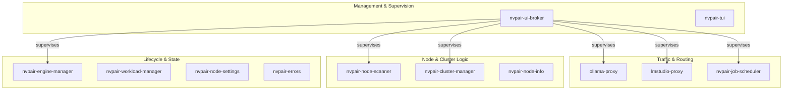
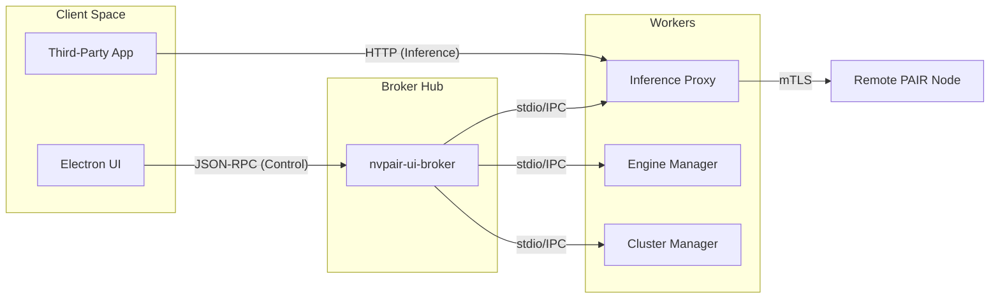

<!-- source: DeepWiki mcp.deepwiki.com · repo NVIDIA/Personal-AI-Router · page 3 Backend Services (Go) · fetched 2026-10-26 -->

# Backend Services (Go)

Relevant source files

The following files were used as context for generating this wiki page:

- [.gitignore](.gitignore)
- [AGENTS.md](AGENTS.md)
- [CONTRIBUTING.md](CONTRIBUTING.md)

The backend of the NVIDIA Personal AI Router (PAIR) is a distributed system composed of 13 Go binaries located in the `services/` directory [AGENTS.md:73-77](). These services handle the core logic of the application, including inference routing, engine management, cluster discovery, and secure pairing, while the Electron desktop application acts primarily as a management client [AGENTS.md:27-31]().

### Service Architecture and Supervision

The backend follows a hub-and-spoke supervision model. The **`nvpair-ui-broker`** serves as the central orchestrator, supervised directly by the Electron main process [AGENTS.md:35-37](). Upon startup, the broker spawns and supervises 11 specialized worker processes [AGENTS.md:38-39](). Communication between the UI and the workers, as well as between workers themselves, occurs via newline-delimited **JSON-RPC 2.0** over standard streams (stdio) [AGENTS.md:41-42]().

### Process Map: Natural Language to Code Entities

The following diagram maps high-level system responsibilities to the specific Go binaries and packages that implement them.

**System Responsibility to Binary Mapping**

**Sources:** [AGENTS.md:35-40](), [CONTRIBUTING.md:194-198]()

---

### Core Components

#### 3.1. nvpair-ui-broker — Broker and Worker Supervisor
The broker is the entry point for the backend. It manages the lifecycle of all worker processes, providing automatic restarts and backoff logic. It aggregates state from workers—such as engine availability and cluster discovery—and exposes a unified JSON-RPC API to the Electron frontend.
*   **For details, see [nvpair-ui-broker — Broker and Worker Supervisor](#3.1)**

#### 3.2. Inference Proxies — Ollama and LM Studio
These services (`ollama-proxy` and `lmstudio-proxy`) act as the primary interface for local AI applications. They provide a routing overlay that merges model lists from all nodes in the cluster and dispatches inference requests to the most suitable node via mTLS.
*   **For details, see [Inference Proxies — Ollama and LM Studio](#3.2)**

#### 3.3. Engine Manager — Engine and Model Lifecycle
The `nvpair-engine-manager` handles the installation and execution of local inference engines (Ollama and LM Studio). It tracks model download progress, manages engine configuration, and handles port takeover logic to ensure the PAIR proxy can intercept traffic.
*   **For details, see [Engine Manager — Engine and Model Lifecycle](#3.3)**

#### 3.4. Cluster Manager and EAP-NOOB Pairing
The `nvpair-cluster-manager` establishes a secure trust domain between nodes. It implements the EAP-NOOB protocol (RFC 9140) for out-of-band PIN pairing and manages the mutual TLS (mTLS) certificates used for encrypted inter-node communication.
*   **For details, see [Cluster Manager and EAP-NOOB Pairing](#3.4)**

#### 3.5. Supporting Services
This category includes several critical workers:
*   **`nvpair-node-scanner`**: Uses mDNS to discover other PAIR nodes on the local network.
*   **`nvpair-job-scheduler`**: Ranks available nodes based on GPU pressure and model availability.
*   **`nvpair-workload-manager`**: Relays real-time telemetry about active inference jobs.
*   **`nvpair-node-settings` & `nvpair-errors`**: Manage persistent configuration and cluster-wide error logging.
*   **For details, see [Supporting Services — Scanner, Scheduler, Workloads, Errors, Settings](#3.5)**

---

### Shared Foundations

#### 3.6. Shared Go Module (nvpair-shared)
All Go services depend on a common library located in `services/shared/`. This module provides standardized implementations for JSON-RPC handling, mDNS advertising, IPC transports, and the node identity system.
*   **For details, see [Shared Go Module (nvpair-shared)](#3.6)**

### Build System and Versioning

The Go backend uses a unified versioning manifest in `services/versions.json` [AGENTS.md:126-129](). Binaries are built using `build.sh` (Linux/macOS) or `build.bat` (Windows), which stamps version information into the binaries via `-ldflags` [AGENTS.md:80-82](). The desktop build process automatically invokes these scripts to ensure the UI is always paired with the correct backend versions [AGENTS.md:57-58]().

**Backend Component Interaction**

**Sources:** [AGENTS.md:33-42](), [CONTRIBUTING.md:190-200]()

---

