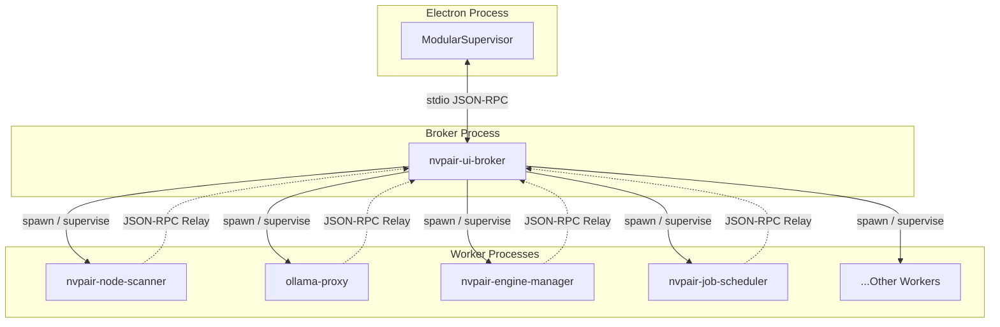
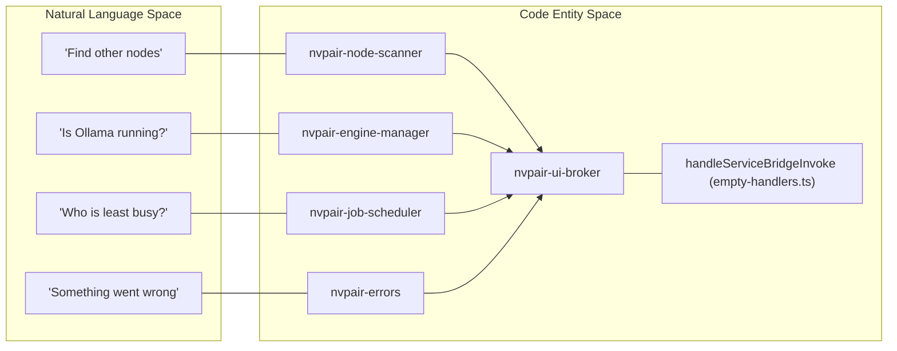

<!-- source: DeepWiki mcp.deepwiki.com · repo NVIDIA/Personal-AI-Router · page 3.1 nvpair-ui-broker — Broker and Worker Supervisor · fetched 2026-10-26 -->

# nvpair-ui-broker — Broker and Worker Supervisor

Relevant source files

The following files were used as context for generating this wiki page:

- [AGENTS.md](AGENTS.md)
- [CONTRIBUTING.md](CONTRIBUTING.md)
- [desktop/docs/services-api.md](desktop/docs/services-api.md)
- [desktop/docs/services-backend.md](desktop/docs/services-backend.md)

The `nvpair-ui-broker` is the central orchestrator and process supervisor of the Personal AI Router (PAIR) backend services. It is the only backend process started directly by the Electron application's `ModularSupervisor` [desktop/docs/services-backend.md:18-19](). Its primary responsibilities include lifecycle management of the 11 worker processes, relaying JSON-RPC traffic between the UI and workers, and coordinating engine advertising.

## Worker Supervision

The broker manages the lifecycle of the PAIR service ecosystem. Upon startup, it spawns the worker binaries located in the application's binary directory [AGENTS.md:35-39]().

### Supervision Logic
*   **Spawn Policy**: The broker attempts to launch all 11 workers. While the `nvpair-node-scanner` is considered critical, other workers are treated as optional; their failure to start does not terminate the broker [AGENTS.md:38-39]().
*   **Restart and Backoff**: The broker monitors worker health. If a worker exits unexpectedly, the broker manages restarts using a budget-based approach to prevent infinite crash loops.
*   **IPC Transport**: Communication between the broker and its workers typically occurs via newline-delimited JSON-RPC 2.0 over `stdio` pipes, though it supports named pipes or sockets via the `--ipc` flag [AGENTS.md:41-42]().

### Supervised Workers
The following workers are managed by the broker:
| Worker | Role |
| :--- | :--- |
| `nvpair-node-scanner` | mDNS discovery and node announcement |
| `ollama-proxy` | Ollama-compatible routing and mTLS ingress |
| `lmstudio-proxy` | LM Studio routing and mTLS ingress |
| `nvpair-engine-manager` | Local engine (Ollama/LM Studio) lifecycle |
| `nvpair-cluster-manager` | EAP-NOOB pairing and cluster trust |
| `nvpair-job-scheduler` | Routing priority and telemetry relay |
| `nvpair-node-info` | Node metadata and telemetry provider |
| `nvpair-workload-manager` | Cluster-wide workload replication |
| `nvpair-errors` | Centralized error registry |
| `nvpair-node-settings` | Persisted configuration store |
| `nvpair-manual-nodes` | Management of user-added static nodes |

**Sources:** [AGENTS.md:35-42](), [desktop/docs/services-backend.md:21-34]()

## Engine Advertising and Polling

The broker acts as a bridge for engine state. It coordinates with `nvpair-engine-manager` to track the availability of local AI engines like Ollama and LM Studio.

*   **Polling Frequency**: The system monitors engine health and model availability. While Electron polls `/v1/node-info` every 2 seconds for UI metrics [desktop/docs/services-backend.md:102-105](), the backend scanner samples GPU utilization on a similar cadence to feed the scheduler [desktop/docs/services-backend.md:106-109]().
*   **Service Readiness**: The broker emits an `app:ready` notification once the core supervision tree is established [desktop/docs/services-backend.md:92-93]().

## Workload Brokering and Scheduling

The broker facilitates the flow of inference metadata to the `nvpair-job-scheduler`.

1.  **Node Stamping**: As discovery updates arrive via `discovery:nodes-changed`, the broker ensures node identities are consistent across the service tree [desktop/docs/services-backend.md:119]().
2.  **Telemetry Relay**: The broker relays `schedule:priority` notifications from the scheduler to the UI, allowing the renderer to visualize which nodes are currently preferred for new jobs [desktop/docs/services-api.md:152]().
3.  **Workload Tracking**: Through the `nvpair-workload-manager`, the broker relays cluster-wide workload updates, allowing all nodes to maintain a shared view of active inference tasks [desktop/docs/services-backend.md:29]().

## JSON-RPC API Surface

The broker exposes a unified JSON-RPC 2.0 interface. It acts as a router, forwarding requests to the appropriate worker based on the method namespace.

### Key Methods and Notifications
*   **App Lifecycle**: `app:ready` (Notification) - Signals that the broker has initialized workers [desktop/docs/services-backend.md:88-92]().
*   **Discovery**: `discovery:subscribe` and `discovery:nodes-changed` - Used to manage the live list of network peers [desktop/docs/services-api.md:35](), [desktop/docs/services-backend.md:119]().
*   **Proxy Control**: `proxy:get-status` and `proxy:unsubscribe` - Manages the state of the inference proxies [desktop/docs/services-api.md:39-40]().
*   **Internal Routing**: The broker handles `internal:set-reserved-port` to coordinate port assignments between the engine manager and the proxies [desktop/docs/services-api.md:38]().

**Sources:** [desktop/docs/services-api.md:35-41](), [desktop/docs/services-backend.md:88-98]()

## Data Flow and Process Hierarchy

The following diagrams illustrate the relationship between the Electron frontend, the broker, and the supervised workers.

### Diagram 1: Process Ownership and IPC

**Sources:** [desktop/docs/services-backend.md:42-68](), [AGENTS.md:35-42]()

### Diagram 2: System Entity Mapping
This diagram maps high-level system responsibilities to the specific code entities that implement them.

**Sources:** [desktop/docs/services-backend.md:21-34](), [desktop/docs/services-backend.md:77-86]()

## CLI Flags and Transport

The broker behavior can be modified via command-line arguments:
*   **`--ipc`**: Switches the transport from `stdio` to a platform-specific IPC mechanism (e.g., named pipes on Windows or Unix domain sockets on Linux/macOS) [AGENTS.md:41-42]().
*   **Binary Pathing**: The broker expects workers to be in the same directory as its own executable or a path specified during the Electron `ModularSupervisor` initialization [desktop/docs/services-backend.md:79]().

**Sources:** [AGENTS.md:35-42](), [desktop/docs/services-backend.md:79-80]()

---

