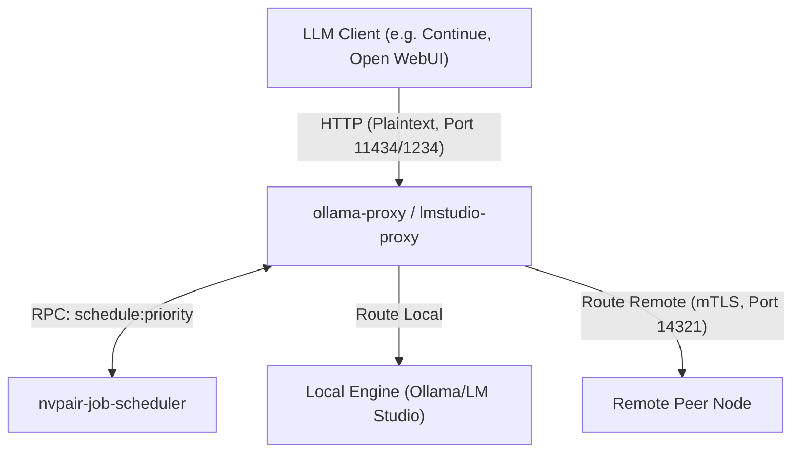
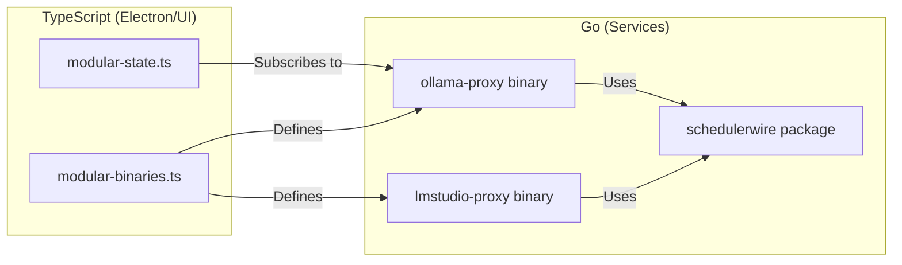

<!-- source: DeepWiki mcp.deepwiki.com · repo NVIDIA/Personal-AI-Router · page 3.2 Inference Proxies — Ollama and LM Studio · fetched 2026-10-26 -->

# 3.2. Inference Proxies — Ollama and LM Studio

Relevant source files

The following files were used as context for generating this wiki page:

- [desktop/docs/architecture.md](desktop/docs/architecture.md)
- [desktop/docs/services-api.md](desktop/docs/services-api.md)
- [desktop/docs/services-backend.md](desktop/docs/services-backend.md)

The inference proxies (`ollama-proxy` and `lmstudio-proxy`) are the primary data-plane components of the Personal AI Router (PAIR) architecture. They provide API-compatible entry points for local inference clients while transparently routing requests across a trusted cluster of nodes.

## Purpose and Scope

The proxies serve three main functions:
1.  **Port Takeover**: They occupy the default ports for Ollama (`11434`) and LM Studio (`1234`), allowing them to intercept traffic from third-party applications without requiring client configuration changes [desktop/docs/architecture.md:42-46]().
2.  **Cluster Routing**: They implement a routing overlay that can direct local requests to remote cluster peers based on model availability and scheduler priority [desktop/docs/services-backend.md:24-25]().
3.  **Security Boundary**: They manage the transition between plaintext loopback traffic (local clients) and mutual TLS (mTLS) encrypted traffic (inter-node cluster communication) [desktop/docs/services-backend.md:24-25]().

## System Architecture and Data Flow

The proxies are supervised by the `nvpair-ui-broker` and communicate with other backend services via JSON-RPC over stdio [desktop/docs/architecture.md:34-37]().

### Inference Request Path
The following diagram illustrates how a request from a local LLM client is routed through the proxy to either a local engine or a remote peer.

**Diagram: Inference Routing Overlay**

**Sources:** [desktop/docs/architecture.md:15-32](), [desktop/docs/services-backend.md:42-68](), [desktop/docs/services-api.md:152]()

## Key Implementation Details

### Discovery Subscription and Model Fan-out
The proxies subscribe to discovery updates via the broker. When a client requests a list of models (e.g., `GET /v1/models` or `GET /api/tags`), the proxy performs a **model-list fan-out**:
*   It queries the local engine for its inventory.
*   It aggregates model lists from all discovered and trusted nodes in the cluster.
*   It returns a merged JSON response to the client, making the entire cluster's model library appear as a single local resource.

### Dual-Personality Networking
The proxies implement a specific security and connectivity model for ingress traffic:
*   **Loopback-only Plaintext**: The proxy listens on `127.0.0.1` for local client requests. These are unauthenticated to maintain compatibility with standard LLM tools [desktop/docs/services-backend.md:24-25]().
*   **mTLS Ingress**: For requests arriving from other PAIR nodes, the proxy (via the cluster manager's shared transport) requires mutual TLS. This ensures that only paired and trusted nodes can utilize local compute resources [desktop/docs/services-backend.md:24-25]().

### Port Persistence and Takeover
If a native Ollama or LM Studio instance is already running on the target port, the `nvpair-engine-manager` coordinates a "takeover." The engine is moved to a high-numbered reserved port, and the proxy binds to the standard port to act as the gateway [desktop/docs/services-api.md:126-132]().

## Control Interface (JSON-RPC)

The proxies expose several methods to the `nvpair-ui-broker` and Electron bridge for managing routing behavior.

### Node Selection and Backend Control
| Method | Type | Description |
| :--- | :--- | :--- |
| `node/select` | Request | Manually targets a specific node for the next request [desktop/docs/services-api.md:64](). |
| `node/set-priority` | Request | Adjusts the routing weight for a specific node [desktop/docs/services-api.md:67](). |
| `node/set-local-backend` | Request | Configures which local engine process the proxy should treat as the primary local provider [desktop/docs/services-api.md:66](). |
| `nodes/list` | Request | Returns the proxy's current internal view of the cluster routing table [desktop/docs/services-api.md:68](). |

### Proxy Notifications
The proxies emit notifications to keep the UI synchronized with traffic and cluster state:
*   `ready`: Emitted when the proxy has successfully bound to its port [desktop/docs/services-api.md:61]().
*   `proxy/request`: Emitted when a new inference job begins, allowing the UI to show active workloads [desktop/docs/services-api.md:59]().
*   `node/updated`: Emitted when a remote node's model inventory or health status changes [desktop/docs/services-api.md:58]().

**Sources:** [desktop/docs/services-api.md:48-72](), [desktop/docs/services-backend.md:116-119]()

## Code Entity Map

The following diagram maps the logical proxy functions to the specific Go and TypeScript entities defined in the codebase.

**Diagram: Code Entity Mapping**

**Sources:** [desktop/docs/services-backend.md:77-86](), [desktop/docs/architecture.md:39-55](), [desktop/docs/services-api.md:152-153]()

---

