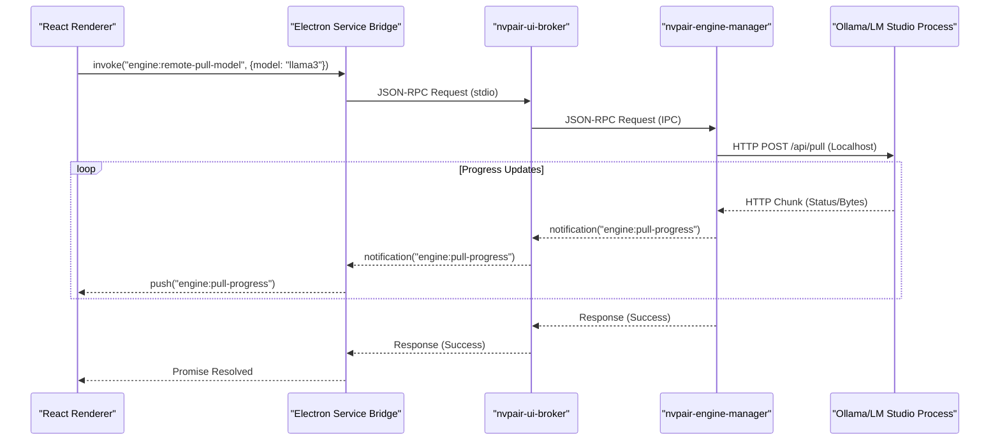

<!-- source: DeepWiki mcp.deepwiki.com · repo NVIDIA/Personal-AI-Router · page 3.3 Engine Manager — Engine and Model Lifecycle · fetched 2026-10-26 -->

# Engine Manager — Engine and Model Lifecycle

<details>
<summary>Relevant source files</summary>

The following files were used as context for generating this wiki page:

- [AGENTS.md](AGENTS.md)
- [desktop/docs/services-api.md](desktop/docs/services-api.md)
- [desktop/docs/services-backend.md](desktop/docs/services-backend.md)

</details>


The `nvpair-engine-manager` is the Go worker responsible for the end-to-end lifecycle of inference engines (Ollama and LM Studio) and the models they host. It handles binary detection, installation, process supervision, and model management (pulling, deleting, and status streaming). It provides a unified JSON-RPC interface that allows both local and remote cluster peers to control engine states.

### Engine Registry and Detection

The manager uses a manifest-driven approach to identify and manage engines. It tracks the installation state, version, and running status of supported backends.

*   **Detection**: At startup, the manager scans standard system paths to detect existing installations of Ollama and LM Studio.
*   **Manifest**: Engine definitions, including download URLs and versioning, are driven by internal configurations linked to the project's versioning strategy [services/versions.json:1-10]().
*   **State Tracking**: The manager maintains a state machine for each engine: `Stopped`, `Starting`, `Running`, `Stopping`, and `Error` [desktop/docs/services-api.md:106-106]().

### Engine Lifecycle Management

The manager orchestrates the installation and execution of engine binaries. It ensures that engines are correctly configured to work within the PAIR ecosystem, specifically regarding port management.

| Function | Description |
| :--- | :--- |
| `engine:install` | Downloads and sets up the engine binary for the current platform [desktop/docs/services-api.md:113-113](). |
| `engine:start` | Launches the engine process. If the default port (e.g., 11434 for Ollama) is taken by a PAIR proxy, the manager coordinates the takeover [desktop/docs/services-api.md:127-127](). |
| `engine:stop` | Gracefully terminates the engine process [desktop/docs/services-api.md:129-129](). |
| `engine:set-port` | Reconfigures the port the engine listens on to avoid conflicts with other services or proxies [desktop/docs/services-api.md:126-126](). |

**Sources:** [desktop/docs/services-api.md:97-135](), [desktop/docs/services-backend.md:21-34](), [AGENTS.md:35-40]()

### Model Lifecycle and Progress Streaming

`nvpair-engine-manager` abstracts the engine-specific APIs for model operations into a consistent JSON-RPC surface. This includes long-running operations like downloading large model files.

*   **Model Inventory**: Fetches the list of currently available models via `engine:models` [desktop/docs/services-api.md:115-115]().
*   **Progress Streaming**: For `engine:remote-pull-model`, the manager emits `engine:pull-progress` notifications, allowing the UI to render real-time download percentages and speeds [desktop/docs/services-api.md:103-103]().
*   **Remote Operations**: Enables cluster peers to trigger model downloads or deletions on the local node via `engine:remote-pull-model` and `engine:remote-delete-model` [desktop/docs/services-api.md:117-121]().

### Data Flow: Model Pull Request

The following diagram illustrates the flow from a User Interface action to the underlying engine execution.

**Model Management Flow**

**Sources:** [desktop/docs/services-backend.md:116-119](), [desktop/docs/services-api.md:103-121](), [AGENTS.md:27-31]()

### Port Takeover and Adoption

A critical role of the Engine Manager is handling the "Port 11434" (Ollama) and "Port 1234" (LM Studio) contention. 

1.  **Proxy Displacement**: When PAIR starts, the `ollama-proxy` or `lmstudio-proxy` typically attempts to bind to the standard engine ports to intercept traffic from third-party apps.
2.  **Engine Relocation**: The `nvpair-engine-manager` detects this and instructs the actual engine (e.g., Ollama) to bind to a high-numbered internal port (e.g., 14318) instead.
3.  **Communication**: The manager then informs the proxy of the engine's new location so the proxy can correctly route local inference requests to the hidden engine process.

### Remote Engine Control

In a cluster environment, nodes can request engine actions from one another. This is facilitated by the `remote:*` methods in the JSON-RPC surface.

| Method | Role in Cluster |
| :--- | :--- |
| `engine:remote-start` | Allows a peer node to wake up an engine on this node to handle incoming jobs [desktop/docs/services-api.md:122-122](). |
| `engine:remote-install` | Triggered when a peer sees this node lacks a required engine for a scheduled workload [desktop/docs/services-api.md:119-119](). |
| `engine:remote-load-model` | Pre-warms a specific model on a peer node before inference begins [desktop/docs/services-api.md:120-120](). |

**Sources:** [desktop/docs/services-api.md:117-124](), [desktop/docs/services-backend.md:88-91]()

### Code Entity Map: Engine Management

This diagram maps the conceptual engine lifecycle to the specific code entities responsible for the implementation.

**Engine Logic Mapping**
```mermaid
classDiagram
    class "nvpair-engine-manager" {
        <<Binary>>
        +HandleEngineAction()
        +StreamPullProgress()
    }

    class "nvpair-ui-broker" {
        <<Supervisor>>
        +RelayNotification()
        +ForwardRequest()
    }

    class "modular-supervisor.ts" {
        <<Electron Main>>
        +startBroker()
        +handleEngineState()
    }

    class "engine-store.ts" {
        <<React/Zustand>>
        +engines: Map
        +updateState()
    }

    "modular-supervisor.ts" ..> "nvpair-ui-broker" : spawns
    "nvpair-ui-broker" ..> "nvpair-engine-manager" : supervises
    "nvpair-engine-manager" --|> "engine:state-changed" : emits
    "engine:state-changed" ..> "engine-store.ts" : updates UI
```
**Sources:** [desktop/docs/services-backend.md:42-68](), [desktop/docs/services-backend.md:77-86](), [AGENTS.md:35-39]()

---

